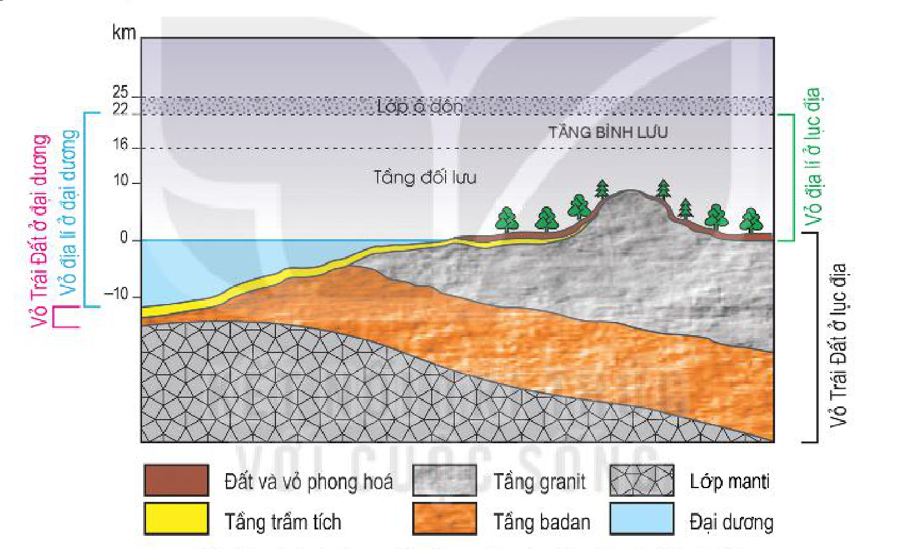
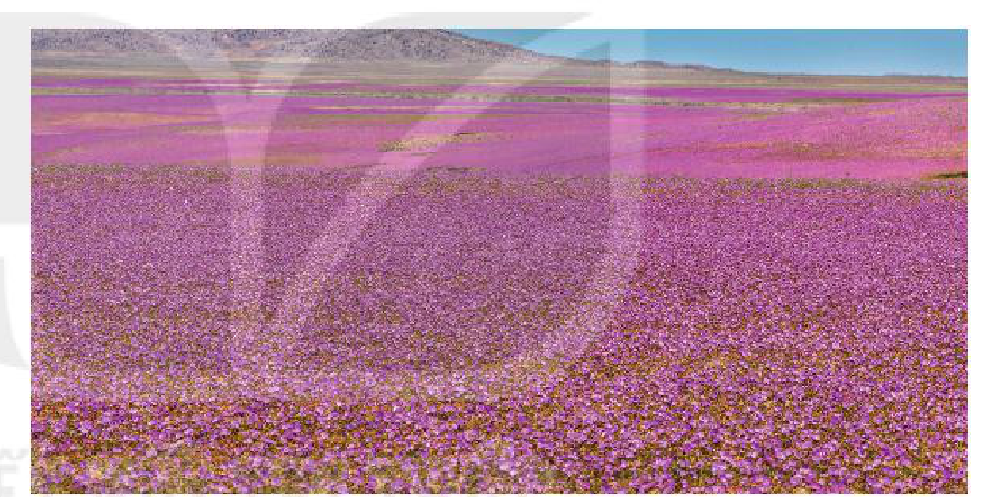

<!-- pdf:52 -->

# BÀI 17: VỎ ĐỊA LÍ, QUY LUẬT THỐNG NHẤT VÀ HOÀN CHỈNH CỦA VỎ ĐỊA LÍ

## 🔴 Mở đầu

<!-- term: Biểu hiện của quy luật thống nhất và hoàn chỉnh của vỏ địa lí -->
<!-- term: Quy luật thống nhất và hoàn chỉnh của vỏ địa lí -->
<!-- term: Vỏ địa lí -->
Đối tượng nghiên cứu của địa lí tự nhiên là vỏ địa lí. Vỏ địa lí là bộ phận phức tạp nhất của Trái Đất về thành phần vật chất và cấu trúc. Trong phạm vi giới hạn của vỏ địa lí, đã diễn ra rất nhiều quy luật của tất cả các thành phần địa lí. Đó là những quy luật gì? Các quy luật đó diễn ra và tác động lẫn nhau như thế nào?

## 1. Vỏ địa lí

### a) Khái niệm

<!-- term: Biểu hiện của quy luật thống nhất và hoàn chỉnh của vỏ địa lí -->
<!-- term: Quy luật thống nhất và hoàn chỉnh của vỏ địa lí -->
<!-- term: Vỏ địa lí -->
*Hình 17.1. Sơ đồ lớp vỏ địa lí của Trái Đất*

<!-- term: Biểu hiện của quy luật thống nhất và hoàn chỉnh của vỏ địa lí -->
<!-- term: Quy luật thống nhất và hoàn chỉnh của vỏ địa lí -->
<!-- term: Vỏ địa lí -->
*Mô tả hình:* Sơ đồ mặt cắt thẳng đứng (theo chiều cao/sâu tính bằng km) so sánh phạm vi của Vỏ địa lí và Vỏ Trái Đất ở đại dương và ở lục địa: giới hạn trên của vỏ địa lí ở phần dưới lớp ô-dôn (khoảng 22 – 25 km, gồm tầng đối lưu và phần thấp tầng bình lưu), bao gồm toàn bộ đại dương (đến sâu khoảng -10 km), lớp đất và vỏ phong hoá, tầng trầm tích, và giới hạn dưới nằm trong phần trên của vỏ Trái Đất (gồm tầng trầm tích, tầng granit, tầng badan trên lớp manti).
<!-- ocr-ok: mô tả hình ảnh bổ trợ không phải chữ in trực tiếp trong sách -->

<!-- term: Biểu hiện của quy luật thống nhất và hoàn chỉnh của vỏ địa lí -->
<!-- term: Quy luật thống nhất và hoàn chỉnh của vỏ địa lí -->
<!-- term: Vỏ địa lí -->
Vỏ địa lí là lớp vỏ của Trái Đất bao gồm các lớp vỏ thành phần (khí quyển, thạch quyển, thuỷ quyển và sinh quyển) xâm nhập và tác động lẫn nhau tạo nên thể tổng hợp tự nhiên thống nhất và hoàn chỉnh.

<!-- term: Biểu hiện của quy luật thống nhất và hoàn chỉnh của vỏ địa lí -->
<!-- term: Quy luật thống nhất và hoàn chỉnh của vỏ địa lí -->
<!-- term: Vỏ địa lí -->
> 💡 Em có biết?
>
> Trong phạm vi giới hạn của vỏ địa lí diễn ra năm quy luật địa lí quan trọng nhất là: quy luật thống nhất và hoàn chỉnh, sự tuần hoàn vật chất và năng lượng, tính nhịp điệu, địa đới, phi địa đới.

### b) Giới hạn của vỏ địa lí

<!-- term: Biểu hiện của quy luật thống nhất và hoàn chỉnh của vỏ địa lí -->
<!-- term: Quy luật thống nhất và hoàn chỉnh của vỏ địa lí -->
<!-- term: Vỏ địa lí -->
<!-- term: Giới hạn của vỏ địa lí -->
Vỏ địa lí bao gồm toàn bộ thuỷ quyển, sinh quyển và bộ phận phía trên của thạch quyển cùng với phần khí quyển bên dưới lớp ô-dôn. Chiều dày của vỏ địa lí khoảng 30 – 35 km.

<!-- term: Biểu hiện của quy luật thống nhất và hoàn chỉnh của vỏ địa lí -->
<!-- term: Quy luật thống nhất và hoàn chỉnh của vỏ địa lí -->
<!-- term: Vỏ địa lí -->
> ❓ Dựa vào thông tin và hình 17.1 trong mục 1, hãy:
> - Cho biết vỏ địa lí bao gồm những bộ phận nào. Nêu giới hạn của vỏ địa lí.
> - Phân biệt vỏ địa lí và vỏ Trái Đất.

<!-- pdf:53 -->

## 2. Quy luật thống nhất và hoàn chỉnh của vỏ địa lí

<!-- term: Biểu hiện của quy luật thống nhất và hoàn chỉnh của vỏ địa lí -->
> 💡 Em có biết?
>
> A-ta-ca-ma là hoang mạc khô cằn nhất thế giới nằm dọc theo sườn tây của dãy An-đét do tác động của dòng biển lạnh Pê-ru. Vào mùa hạ của bán cầu Bắc, dòng biển này chảy lên tới Xích đạo. Vào mùa đông, dòng biển này yếu đi, dòng biển nóng từ Xích đạo tiến xuống phía nam. Cứ khoảng 8 – 12 năm một lần, dòng biển nóng tiến sâu tới 12°N – 13°N. Lúc đó những trận mưa rào đổ xuống A-ta-ca-ma, một phần hoang mạc xuất hiện vô vàn thực vật và sâu bọ, lòng cạn biến thành dòng sông,... Tình trạng này kéo dài khoảng 4 tháng, sau đó dòng biển nóng lại lùi trở về phía bắc, dòng biển lạnh Pê-ru trở lại vị trí bình thường của nó. A-ta-ca-ma lại trở thành hoang mạc, thực vật bị cháy khô, các dòng nước cạn kiệt, sâu bọ biến mất,...

### a) Khái niệm

<!-- term: Biểu hiện của quy luật thống nhất và hoàn chỉnh của vỏ địa lí -->
<!-- term: Vỏ địa lí -->
<!-- term: Quy luật thống nhất và hoàn chỉnh của vỏ địa lí -->
Quy luật thống nhất và hoàn chỉnh của vỏ địa lí là quy luật về mối quan hệ quy định lẫn nhau giữa các thành phần và mỗi bộ phận lãnh thổ trong vỏ địa lí.

<!-- term: Biểu hiện của quy luật thống nhất và hoàn chỉnh của vỏ địa lí -->
<!-- term: Quy luật thống nhất và hoàn chỉnh của vỏ địa lí -->
<!-- term: Vỏ địa lí -->
Nguyên nhân của quy luật này là do tất cả các thành phần của vỏ địa lí không tồn tại và phát triển độc lập mà luôn tác động, trao đổi vật chất và năng lượng với nhau tạo nên thể thống nhất và hoàn chỉnh.

### b) Biểu hiện của quy luật

<!-- term: Quy luật thống nhất và hoàn chỉnh của vỏ địa lí -->
<!-- term: Vỏ địa lí -->
<!-- term: Biểu hiện của quy luật thống nhất và hoàn chỉnh của vỏ địa lí -->
Trong vỏ địa lí, bất cứ lãnh thổ nào cũng bao gồm nhiều thành phần tác động và phụ thuộc lẫn nhau. Nếu một thành phần thay đổi sẽ dẫn tới sự thay đổi của các thành phần khác còn lại và toàn bộ lãnh thổ.

<!-- term: Biểu hiện của quy luật thống nhất và hoàn chỉnh của vỏ địa lí -->
*Hình 17.2. Thực vật xuất hiện ở một phần hoang mạc A-ta-ca-ma khi có mưa*

<!-- term: Biểu hiện của quy luật thống nhất và hoàn chỉnh của vỏ địa lí -->
*Mô tả hình:* Ảnh chụp thảm hoa màu tím hồng nở rộ phủ kín một vùng rộng lớn trên bề mặt hoang mạc A-ta-ca-ma sau khi có mưa rào, phía xa là dãy núi khô cằn.
<!-- ocr-ok: mô tả hình ảnh bổ trợ không phải chữ in trực tiếp trong sách -->

### c) Ý nghĩa thực tiễn của quy luật

<!-- term: Biểu hiện của quy luật thống nhất và hoàn chỉnh của vỏ địa lí -->
<!-- term: Quy luật thống nhất và hoàn chỉnh của vỏ địa lí -->
<!-- term: Vỏ địa lí -->
<!-- term: Ý nghĩa thực tiễn của quy luật thống nhất và hoàn chỉnh của vỏ địa lí -->
Do vỏ địa lí mang tính thống nhất và hoàn chỉnh nên chúng ta có thể dự báo trước về sự thay đổi của các thành phần tự nhiên khi sử dụng chúng. Cần phải nghiên cứu tỉ mỉ, chính xác tất cả các đặc điểm địa lí của mọi lãnh thổ trước khi sử dụng, khai thác dưới hình thức này hay hình thức khác. Do đó, để cải tạo tự nhiên hợp lí không thể không tính đến quy luật về tính hoàn chỉnh của vỏ địa lí.

<!-- term: Biểu hiện của quy luật thống nhất và hoàn chỉnh của vỏ địa lí -->
<!-- term: Quy luật thống nhất và hoàn chỉnh của vỏ địa lí -->
<!-- term: Vỏ địa lí -->
> ❓ Đọc thông tin và hình 17.2 trong mục 2, hãy trình bày khái niệm, biểu hiện, ý nghĩa thực tiễn của quy luật thống nhất và hoàn chỉnh của vỏ địa lí.

## ✏️ Luyện tập

<!-- term: Biểu hiện của quy luật thống nhất và hoàn chỉnh của vỏ địa lí -->
<!-- term: Quy luật thống nhất và hoàn chỉnh của vỏ địa lí -->
<!-- term: Vỏ địa lí -->
- Lấy ví dụ về biểu hiện của quy luật thống nhất và hoàn chỉnh của vỏ địa lí.

## 🚀 Vận dụng

<!-- term: Biểu hiện của quy luật thống nhất và hoàn chỉnh của vỏ địa lí -->
<!-- term: Quy luật thống nhất và hoàn chỉnh của vỏ địa lí -->
<!-- term: Vỏ địa lí -->
- Tìm hiểu sự nóng lên toàn cầu có ảnh hưởng như thế nào đến các thành phần tự nhiên khác trên Trái Đất.

## 📷 Danh sách hình trong bài

<!-- term: Biểu hiện của quy luật thống nhất và hoàn chỉnh của vỏ địa lí -->
<!-- term: Quy luật thống nhất và hoàn chỉnh của vỏ địa lí -->
<!-- term: Vỏ địa lí -->
| Mã hình | Trang PDF | Vị trí trong bài | Chú thích gốc |
| --- | --- | --- | --- |
| H10-dia-b17-01 | 52 | Mục 1.a | Hình 17.1. Sơ đồ lớp vỏ địa lí của Trái Đất |
| H10-dia-b17-02 | 53 | Mục 2.b | Hình 17.2. Thực vật xuất hiện ở một phần hoang mạc A-ta-ca-ma khi có mưa |
<!-- ocr-ok: bảng danh mục hình tổng hợp cuối bài -->
