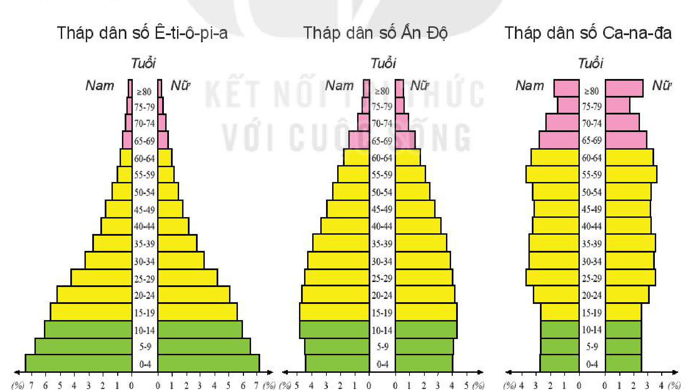
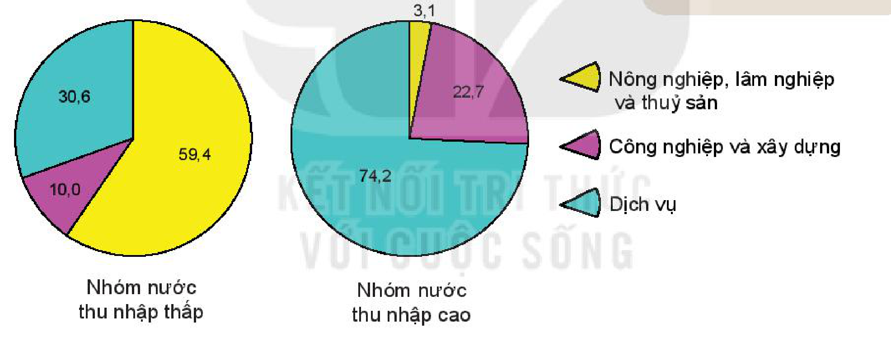

<!-- pdf:56 -->

# BÀI 19: QUY MÔ DÂN SỐ, GIA TĂNG DÂN SỐ VÀ CƠ CẤU DÂN SỐ THẾ GIỚI

## 🔴 Mở đầu

<!-- term: Tháp dân số -->
<!-- term: Cơ cấu dân số theo giới tính -->
<!-- term: Các nhân tố tác động đến gia tăng dân số -->
Quy mô dân số thế giới không ngừng tăng lên. Quá trình phát triển đó diễn ra khác nhau ở các nơi trên thế giới. Gia tăng dân số thế giới diễn ra như thế nào? Cơ cấu dân số thường đề cập đến những yếu tố nào?

## 1. Quy mô dân số

<!-- term: Tháp dân số -->
<!-- term: Cơ cấu dân số theo giới tính -->
<!-- term: Các nhân tố tác động đến gia tăng dân số -->
<!-- term: Quy mô dân số -->
<!-- term: Bùng nổ dân số -->
Từ khoảng giữa thế kỉ XX, số dân thế giới tăng rất nhanh (bùng nổ dân số), nhưng gần đây đã tăng chậm lại. Năm 2020 số dân thế giới đạt khoảng 7,8 tỉ người. Tuy nhiên, ở các khu vực, các quốc gia, số dân có sự biến động khác nhau.

<!-- term: Tháp dân số -->
**BẢNG 19. QUY MÔ DÂN SỐ THẾ GIỚI, GIAI ĐOẠN 1950 – 2050**

*(Đơn vị: tỉ người)*

<!-- term: Tháp dân số -->
<!-- term: Cơ cấu dân số theo giới tính -->
<!-- term: Các nhân tố tác động đến gia tăng dân số -->
| Khu vực \ Năm | 1950 | 2000 | 2020 | 2050 (dự báo) |
| --- | :---: | :---: | :---: | :---: |
| Toàn thế giới | 2,5 | 6,2 | 7,8 | 9,7 |
| Các nước phát triển | 0,8 | 1,2 | 1,3 | 1,3 |
| Các nước đang phát triển | 1,7 | 5,0 | 6,5 | 8,4 |
<!-- ocr-ok: bảng số liệu quy mô dân số thế giới đã đối chiếu chính xác với ảnh trang 56 -->

<!-- term: Tháp dân số -->
<!-- term: Cơ cấu dân số theo giới tính -->
<!-- term: Các nhân tố tác động đến gia tăng dân số -->
> ❓ Dựa vào thông tin trong mục 1 và bảng 19, hãy trình bày đặc điểm và tình hình phát triển dân số trên thế giới.

<!-- pdf:57 -->

## 2. Gia tăng dân số

### a) Gia tăng dân số tự nhiên

<!-- term: Tháp dân số -->
<!-- term: Cơ cấu dân số theo giới tính -->
<!-- term: Các nhân tố tác động đến gia tăng dân số -->
<!-- term: Tỉ suất sinh thô -->
- Tỉ suất sinh thô cho biết cứ 1 000 dân, có bao nhiêu trẻ em sinh ra còn sống trong năm. Năm 2020, tỉ suất sinh thô trên thế giới khoảng 19‰; trong đó các nước phát triển khoảng 10‰, các nước đang phát triển khoảng 20‰. Tỉ suất sinh thô trên thế giới có xu hướng giảm ở cả nhóm nước phát triển và nhóm nước đang phát triển.

<!-- term: Tháp dân số -->
<!-- term: Cơ cấu dân số theo giới tính -->
<!-- term: Các nhân tố tác động đến gia tăng dân số -->
<!-- term: Tỉ suất tử thô -->
- Tỉ suất tử thô cho biết cứ 1 000 dân, có bao nhiêu người bị chết trong năm. Năm 2020, tỉ suất tử thô trên thế giới khoảng 7‰; trong đó, các nước phát triển khoảng 10‰, các nước đang phát triển khoảng 7‰. Tỉ suất tử thô trên thế giới có xu hướng giảm.

<!-- term: Tháp dân số -->
<!-- term: Cơ cấu dân số theo giới tính -->
<!-- term: Các nhân tố tác động đến gia tăng dân số -->
<!-- term: Tỉ suất tăng tự nhiên dân số -->
- Để đánh giá gia tăng dân số tự nhiên, người ta dựa vào tỉ suất tăng tự nhiên dân số. Tỉ suất tăng tự nhiên dân số là mức chênh lệch giữa tỉ suất sinh thô và tỉ suất tử thô. Hiện nay, tỉ suất tăng tự nhiên dân số của toàn thế giới có xu hướng giảm; vì thế, số dân thế giới tăng chậm lại.

<!-- term: Các nhân tố tác động đến gia tăng dân số -->
> 💡 Em có biết?
>
> Do số dân biến động không ngừng nên để thể hiện số dân của một năm, người ta lấy số dân trung bình của năm đó. Số dân trung bình được coi là số dân giữa năm (ngày 1 – 7 hằng năm) hoặc trung bình cộng của số dân ngày đầu năm và số dân ngày cuối năm.

<!-- term: Các nhân tố tác động đến gia tăng dân số -->
> ❓ Dựa vào thông tin trong mục a, hãy cho biết thế nào là gia tăng dân số tự nhiên.

### b) Gia tăng dân số cơ học

<!-- term: Các nhân tố tác động đến gia tăng dân số -->
<!-- term: Tỉ suất nhập cư -->
- Tỉ suất nhập cư cho biết số người nhập cư đến một lãnh thổ trong năm, tính bình quân trên 1 000 dân của lãnh thổ đó.

<!-- term: Các nhân tố tác động đến gia tăng dân số -->
<!-- term: Tỉ suất xuất cư -->
- Tỉ suất xuất cư cho biết số người xuất cư của một lãnh thổ trong năm, tính bình quân trên 1 000 dân của lãnh thổ đó.

<!-- term: Tháp dân số -->
<!-- term: Cơ cấu dân số theo giới tính -->
<!-- term: Các nhân tố tác động đến gia tăng dân số -->
<!-- term: Gia tăng dân số cơ học -->
- Gia tăng dân số cơ học là sự chênh lệch giữa tỉ suất nhập cư và tỉ suất xuất cư. Ở các nước phát triển tỉ suất nhập cư thường lớn hơn tỉ suất xuất cư, còn ở các nước đang phát triển tỉ suất xuất cư thường lớn hơn tỉ suất nhập cư. Gia tăng dân số cơ học không ảnh hưởng tới số dân trên phạm vi toàn thế giới nhưng có ý nghĩa quan trọng đối với từng khu vực, từng quốc gia.

> 💡 Em có biết?
>
> Hiện nay, bên cạnh di cư trong nước, di cư quốc tế (người dân chuyển từ nước này sang nước khác) diễn ra ngày càng mạnh mẽ. Theo Tổ chức Di cư quốc tế (IOM), năm 1970 chỉ có 85 triệu người di cư quốc tế thì năm 2020 con số này đã lên tới 272 triệu người.

<!-- term: Các nhân tố tác động đến gia tăng dân số -->
> ❓ Dựa vào thông tin trong mục b, hãy cho biết thế nào là gia tăng dân số cơ học.

### c) Gia tăng dân số thực tế

<!-- term: Tháp dân số -->
<!-- term: Cơ cấu dân số theo giới tính -->
<!-- term: Các nhân tố tác động đến gia tăng dân số -->
<!-- term: Gia tăng dân số thực tế -->
Gia tăng dân số thực tế là tổng của gia tăng dân số tự nhiên và gia tăng dân số cơ học (đơn vị tính là %). Đây là thước đo phản ánh đầy đủ về sự gia tăng dân số. Tuy nhiên, giữa hai bộ phận tạo nên gia tăng dân số thực tế thì gia tăng dân số tự nhiên vẫn là động lực phát triển dân số.

<!-- term: Các nhân tố tác động đến gia tăng dân số -->
> ❓ Dựa vào thông tin trong mục c, hãy trình bày khái niệm về gia tăng dân số thực tế.

<!-- pdf:58 -->

### d) Các nhân tố tác động đến gia tăng dân số

<!-- term: Tháp dân số -->
<!-- term: Cơ cấu dân số theo giới tính -->
<!-- term: Các nhân tố tác động đến gia tăng dân số -->
Gia tăng dân số của một khu vực trong một năm là kết quả tổng hợp của tình hình sinh đẻ, tử vong và di cư của khu vực đó trong năm. Vì vậy, các nhân tố tác động đến sinh đẻ, tử vong và di cư cũng chính là các nhân tố tác động đến gia tăng dân số.

<!-- term: Tháp dân số -->
<!-- term: Cơ cấu dân số theo giới tính -->
<!-- term: Các nhân tố tác động đến gia tăng dân số -->
| NHÂN TỐ | TÁC ĐỘNG |
| --- | --- |
| **Điều kiện tự nhiên và môi trường sống** | - Điều kiện tự nhiên và môi trường sống thuận lợi góp phần tăng mức nhập cư và ngược lại. - Thiên tai, dịch bệnh làm tăng mức tử vong, mức xuất cư. |
| **Điều kiện kinh tế – xã hội** | - Nhìn chung, trình độ phát triển kinh tế và mức sống cao làm giảm mức sinh, mức xuất cư và ngược lại. - Tập quán, tâm lí xã hội, cơ cấu tuổi và giới tính tác động đến mức sinh, mức tử vong. - Chính sách về dân số ảnh hưởng đến mức sinh, mức di cư. |

<!-- term: Các nhân tố tác động đến gia tăng dân số -->
> ❓ Dựa vào thông tin trong mục d, hãy phân tích các nhân tố tác động đến gia tăng dân số.

## 3. Cơ cấu dân số

<!-- term: Tháp dân số -->
<!-- term: Cơ cấu dân số theo giới tính -->
<!-- term: Các nhân tố tác động đến gia tăng dân số -->
<!-- term: Cơ cấu dân số -->
Cơ cấu dân số là tổng số dân được phân loại theo giới tính, độ tuổi, dân tộc, trình độ học vấn, nghề nghiệp, tình trạng hôn nhân và các đặc trưng khác.

### a) Cơ cấu sinh học

<!-- term: Tháp dân số -->
<!-- term: Cơ cấu dân số theo giới tính -->
<!-- term: Các nhân tố tác động đến gia tăng dân số -->
- Cơ cấu dân số theo giới tính

<!-- term: Tháp dân số -->
<!-- term: Các nhân tố tác động đến gia tăng dân số -->
<!-- term: Cơ cấu dân số theo giới tính -->
Cơ cấu dân số theo giới tính biểu thị bằng tỉ lệ giới tính (tỉ lệ nam và tỉ lệ nữ trong tổng số dân) hoặc tỉ số giới tính (100 nữ thì tương ứng có bao nhiêu nam).

<!-- term: Tháp dân số -->
<!-- term: Cơ cấu dân số theo giới tính -->
<!-- term: Các nhân tố tác động đến gia tăng dân số -->
Cơ cấu dân số theo giới tính thay đổi theo thời gian và khác nhau giữa các nước, các khu vực, phụ thuộc vào tình trạng chiến tranh, tình hình phát triển kinh tế, quan niệm xã hội,...

<!-- pdf:59 -->

<!-- term: Tháp dân số -->
<!-- term: Cơ cấu dân số theo giới tính -->
<!-- term: Các nhân tố tác động đến gia tăng dân số -->
Cơ cấu dân số theo giới tính tác động tới phân bố sản xuất, tổ chức đời sống xã hội, chiến lược phát triển kinh tế – xã hội,...

<!-- term: Tháp dân số -->
<!-- term: Cơ cấu dân số theo giới tính -->
<!-- term: Các nhân tố tác động đến gia tăng dân số -->
- Cơ cấu dân số theo tuổi

<!-- term: Tháp dân số -->
<!-- term: Cơ cấu dân số theo giới tính -->
<!-- term: Các nhân tố tác động đến gia tăng dân số -->
<!-- term: Cơ cấu dân số theo tuổi -->
Cơ cấu dân số theo tuổi biểu thị tỉ lệ dân số theo những nhóm tuổi nhất định trong tổng số dân. Các nhóm tuổi có thể được phân theo khoảng cách đều nhau như: 0 – 4 tuổi, 5 – 9 tuổi, 10 – 14 tuổi,... hoặc không đều nhau như: 0 – 14 tuổi, 15 – 64 tuổi, 65 tuổi trở lên.

<!-- term: Tháp dân số -->
<!-- term: Cơ cấu dân số theo giới tính -->
<!-- term: Các nhân tố tác động đến gia tăng dân số -->
Cơ cấu dân số theo tuổi thể hiện tổng hợp tình hình sinh, tử, tuổi thọ, khả năng phát triển dân số và nguồn lao động của một quốc gia.

<!-- term: Tháp dân số -->
<!-- term: Cơ cấu dân số theo giới tính -->
> 💡 Em có biết?
>
> Người ta gọi là:
> - Dân số trẻ, nếu số người dưới 15 tuổi chiếm $\ge 35\%$ và số người từ 65 tuổi trở lên $< 7\%$ tổng số dân.
> - Già hoá dân số, nếu số người 65 tuổi trở lên chiếm $\ge 7\%$ tổng số dân. Dân số già, khi tỉ lệ này $\ge 14\%$ tổng số dân.
> - Dân số “vàng”, nếu số người từ 15 – 64 tuổi chiếm 2/3 tổng số dân trở lên.

<!-- term: Cơ cấu dân số theo giới tính -->
<!-- term: Các nhân tố tác động đến gia tăng dân số -->
<!-- term: Tháp dân số -->
Người ta có thể biểu hiện cơ cấu dân số sinh học bằng biểu đồ, gọi là tháp dân số (hay tháp tuổi).

<!-- term: Tháp dân số -->
<!-- term: Cơ cấu dân số theo giới tính -->
<!-- term: Các nhân tố tác động đến gia tăng dân số -->
Tháp dân số của các nước trên thế giới có ba dạng đặc trưng: tháp hình tam giác, như của Ê-ti-ô-pi-a, phản ánh dân số trẻ; tháp hình chum, như của Ca-na-đa, phản ánh dân số già và tháp hình quả chuông, như của Ấn Độ, phản ánh dân số đang chuyển từ dân số trẻ sang dân số già.

<!-- term: Tháp dân số -->
*Hình 19.1. Các loại tháp dân số đặc trưng trên thế giới, năm 2020*

<!-- term: Tháp dân số -->
<!-- term: Cơ cấu dân số theo giới tính -->
<!-- term: Các nhân tố tác động đến gia tăng dân số -->
*Mô tả hình:* Hình gồm 3 biểu đồ tháp dân số năm 2020 chia theo các nhóm tuổi 5 năm (từ 0–4 đến $\ge 80$) và giới tính (Nam bên trái, Nữ bên phải, đơn vị %): (1) Tháp dân số Ê-ti-ô-pi-a có dạng hình tam giác đáy rất rộng (nhóm 0–4 tuổi chiếm khoảng 7% mỗi giới), thu hẹp nhanh lên đỉnh, phản ánh cơ cấu dân số trẻ; (2) Tháp dân số Ấn Độ có dạng hình quả chuông với đáy bắt đầu thu hẹp và phần thân phình rộng, phản ánh dân số đang chuyển từ dân số trẻ sang dân số già; (3) Tháp dân số Ca-na-đa có dạng hình chum với đáy hẹp (nhóm 0–4 tuổi dưới 3% mỗi giới), thân và đỉnh mở rộng (nhóm từ 65 tuổi trở lên chiếm tỉ lệ cao), phản ánh cơ cấu dân số già.
<!-- ocr-ok: mô tả hình ảnh bổ trợ không phải chữ in trực tiếp trong sách -->

<!-- term: Tháp dân số -->
<!-- term: Cơ cấu dân số theo giới tính -->
<!-- term: Các nhân tố tác động đến gia tăng dân số -->
> ❓ Đọc thông tin trong mục a, hãy trình bày cơ cấu dân số theo giới tính và cơ cấu dân số theo tuổi.

<!-- pdf:60 -->

### b) Cơ cấu xã hội

<!-- term: Cơ cấu dân số theo giới tính -->
<!-- term: Các nhân tố tác động đến gia tăng dân số -->
Có nhiều cách phân chia cơ cấu xã hội, trong đó quan trọng nhất là phân chia theo trình độ văn hoá và phân chia theo lao động.

<!-- term: Tháp dân số -->
<!-- term: Cơ cấu dân số theo giới tính -->
<!-- term: Các nhân tố tác động đến gia tăng dân số -->
- Cơ cấu dân số theo trình độ văn hoá

<!-- term: Tháp dân số -->
<!-- term: Cơ cấu dân số theo giới tính -->
<!-- term: Các nhân tố tác động đến gia tăng dân số -->
<!-- term: Cơ cấu dân số theo trình độ văn hoá -->
Cơ cấu dân số theo trình độ văn hoá phản ánh trình độ dân trí và trình độ học vấn của dân cư; thường thể hiện qua tỉ lệ dân số 15 tuổi trở lên biết chữ, số năm đi học trung bình của người trên 25 tuổi,...

<!-- term: Tháp dân số -->
<!-- term: Cơ cấu dân số theo giới tính -->
<!-- term: Các nhân tố tác động đến gia tăng dân số -->
Cơ cấu dân số theo trình độ văn hoá là thước đo quan trọng phản ánh chất lượng dân số của một khu vực, một quốc gia.

<!-- term: Tháp dân số -->
<!-- term: Cơ cấu dân số theo giới tính -->
<!-- term: Các nhân tố tác động đến gia tăng dân số -->
- Cơ cấu dân số theo lao động

<!-- term: Tháp dân số -->
<!-- term: Cơ cấu dân số theo giới tính -->
<!-- term: Các nhân tố tác động đến gia tăng dân số -->
<!-- term: Cơ cấu dân số theo lao động -->
<!-- term: Dân số hoạt động kinh tế -->
Cơ cấu dân số theo lao động là sự biểu thị tỉ lệ giữa các bộ phận lao động trong tổng nguồn lao động xã hội. Có thể phân chia nguồn lao động thành hai nhóm: dân số hoạt động kinh tế (người có việc làm ổn định hoặc tạm thời, người có nhu cầu lao động nhưng chưa có việc làm) và dân số không hoạt động kinh tế (học sinh, sinh viên, người nội trợ,...) hoặc phân chia số lao động hoạt động trong ba khu vực kinh tế (nông nghiệp, lâm nghiệp và thuỷ sản; công nghiệp và xây dựng; dịch vụ).

<!-- term: Cơ cấu dân số theo giới tính -->
<!-- term: Các nhân tố tác động đến gia tăng dân số -->
> 💡 Em có biết?
>
> Nguồn lao động của quốc gia bao gồm bộ phận dân số trong độ tuổi quy định có khả năng tham gia lao động và những người ngoài độ tuổi lao động đang làm việc trong các ngành kinh tế quốc dân.

<!-- term: Tháp dân số -->
<!-- term: Cơ cấu dân số theo giới tính -->
<!-- term: Các nhân tố tác động đến gia tăng dân số -->
*Hình 19.2. Biểu đồ cơ cấu lao động theo khu vực kinh tế của nhóm nước thu nhập thấp và nhóm nước thu nhập cao, năm 2020 (%)*

<!-- term: Tháp dân số -->
<!-- term: Cơ cấu dân số theo giới tính -->
<!-- term: Các nhân tố tác động đến gia tăng dân số -->
*Mô tả hình:* Hai biểu đồ tròn thể hiện cơ cấu lao động theo 3 khu vực kinh tế năm 2020 (%): (1) Nhóm nước thu nhập thấp: Nông nghiệp, lâm nghiệp và thuỷ sản chiếm 59,4% (màu vàng); Công nghiệp và xây dựng chiếm 10,0% (màu tím); Dịch vụ chiếm 30,6% (màu xanh ngọc). (2) Nhóm nước thu nhập cao: Nông nghiệp, lâm nghiệp và thuỷ sản chỉ chiếm 3,1%; Công nghiệp và xây dựng chiếm 22,7%; Dịch vụ chiếm tới 74,2%.
<!-- ocr-ok: mô tả hình ảnh bổ trợ không phải chữ in trực tiếp trong sách -->

<!-- term: Tháp dân số -->
<!-- term: Cơ cấu dân số theo giới tính -->
<!-- term: Các nhân tố tác động đến gia tăng dân số -->
> ❓ Dựa vào hình 19.2 và thông tin trong mục b, hãy trình bày cơ cấu dân số theo trình độ văn hoá và cơ cấu dân số theo lao động.

## ✏️ Luyện tập

<!-- term: Tháp dân số -->
<!-- term: Cơ cấu dân số theo giới tính -->
<!-- term: Các nhân tố tác động đến gia tăng dân số -->
Quan sát hình 19.1, hãy so sánh sự khác nhau giữa tháp dân số năm 2020 của các nước Ê-ti-ô-pi-a, Ấn Độ và Ca-na-đa.

## 🚀 Vận dụng

<!-- term: Cơ cấu dân số theo giới tính -->
<!-- term: Các nhân tố tác động đến gia tăng dân số -->
Hãy tìm hiểu tình hình biến động dân số (tăng, giảm) ở nơi em sống trong thời gian 5 năm trở lại đây và nguyên nhân dẫn tới sự biến động đó.

## 📷 Danh sách hình trong bài

<!-- term: Tháp dân số -->
<!-- term: Cơ cấu dân số theo giới tính -->
<!-- term: Các nhân tố tác động đến gia tăng dân số -->
| Mã hình | Trang PDF | Vị trí trong bài | Chú thích gốc |
| --- | --- | --- | --- |
| H10-dia-b19-01 | 59 | Mục 3.a | Hình 19.1. Các loại tháp dân số đặc trưng trên thế giới, năm 2020 |
| H10-dia-b19-02 | 60 | Mục 3.b | Hình 19.2. Biểu đồ cơ cấu lao động theo khu vực kinh tế của nhóm nước thu nhập thấp và nhóm nước thu nhập cao, năm 2020 (%) |
