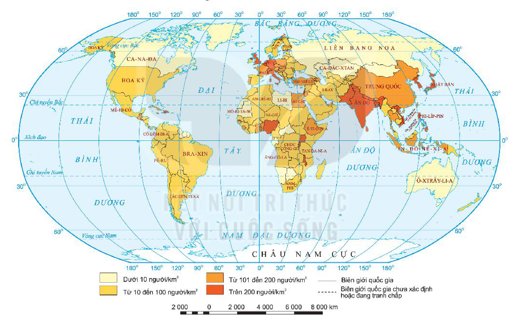

<!-- pdf:61 -->

# BÀI 20: PHÂN BỐ DÂN CƯ VÀ ĐÔ THỊ HOÁ TRÊN THẾ GIỚI

## 🔴 Mở đầu

<!-- term: Các nhân tố tác động đến phân bố dân cư -->
Dân cư trên thế giới phân bố không đồng đều. Ngày nay, dân cư đang có xu hướng tập trung vào các đô thị. Tại sao dân cư phân bố không đồng đều? Tại sao dân cư lại có xu hướng tập trung vào các đô thị?

## 1. Phân bố dân cư

### a) Tình hình phân bố dân cư thế giới

<!-- term: Các nhân tố tác động đến phân bố dân cư -->
<!-- term: Phân bố dân cư -->
<!-- term: Mật độ dân số -->
Dân cư thế giới phân bố rất không đều, có những vùng dân cư tập trung đông đúc như: Nam Á, Đông Á, Đông Nam Á, Tây và Trung Âu,... lại có những vùng thưa dân như: Bắc Á, châu Đại Dương,...

<!-- term: Mật độ dân số -->
*Hình 20. Bản đồ mật độ dân số các nước trên thế giới, năm 2020*

<!-- term: Mật độ dân số -->
*Mô tả hình:* Bản đồ thế giới thể hiện mật độ dân số các nước năm 2020 theo 4 thang màu: Dưới 10 người/km² (vàng nhạt: Liên bang Nga, Ca-na-đa, Ô-xtrây-li-a, Mông Cổ, Li-bi, Mô-ri-ta-ni,...); Từ 10 đến 100 người/km² (vàng đậm: Hoa Kỳ, Bra-xin, Ác-hen-ti-na, Cộng hoà Dân chủ Công-gô, I-ran, Ai Cập,...); Từ 101 đến 200 người/km² (cam: Trung Quốc, Pháp, In-đô-nê-xi-a, Ê-ti-ô-pi-a, Mê-hi-cô,...); Trên 200 người/km² (đỏ cam: Ấn Độ, Nhật Bản, Việt Nam, Phi-líp-pin, Anh, Đức, Ni-giê-ri-a,...).
<!-- ocr-ok: mô tả hình ảnh bổ trợ không phải chữ in trực tiếp trong sách -->

### b) Các nhân tố tác động đến phân bố dân cư

<!-- term: Ảnh hưởng của đô thị hoá -->
<!-- term: Các nhân tố tác động đến đô thị hoá -->
<!-- term: Các nhân tố tác động đến phân bố dân cư -->
Phân bố dân cư là một hiện tượng xã hội có tính quy luật do tác động tổng hợp của hàng loạt nhân tố từ tự nhiên đến kinh tế – xã hội. Các nhân tố này không tác động riêng lẻ mà kết hợp với nhau.

<!-- term: Các nhân tố tác động đến đô thị hoá -->
<!-- term: Các nhân tố tác động đến phân bố dân cư -->
- Nhân tố tự nhiên tạo điều kiện thuận lợi hoặc gây trở ngại cho sự cư trú của con người. Nhìn chung, những khu vực có điều kiện tự nhiên và tài nguyên thiên nhiên phong phú, môi trường thiên nhiên thuận lợi là các khu vực có dân cư sinh sống đông đúc và ngược lại.

<!-- pdf:62 -->

<!-- term: Ảnh hưởng của đô thị hoá -->
<!-- term: Các nhân tố tác động đến đô thị hoá -->
<!-- term: Các nhân tố tác động đến phân bố dân cư -->
<!-- term: Mật độ dân số -->
- Nhân tố kinh tế – xã hội
  + Trình độ phát triển của lực lượng sản xuất quyết định việc phân bố dân cư, làm cho phân bố dân cư chuyển từ tự phát sang tự giác. Sự phân bố dân cư phụ thuộc chặt chẽ vào tính chất của nền kinh tế. Nói chung, những khu vực dân cư đông đúc thường gắn với các hoạt động công nghiệp, dịch vụ.
  + Những khu vực được khai thác lâu đời thường có dân cư đông đúc hơn những khu vực mới khai thác.
  + Di cư có tác động tới sự phân bố dân cư thế giới. Trong lịch sử, các luồng di dân lớn có thể làm thay đổi tỉ trọng dân số của cả một châu lục.

<!-- term: Ảnh hưởng của đô thị hoá -->
<!-- term: Các nhân tố tác động đến đô thị hoá -->
<!-- term: Các nhân tố tác động đến phân bố dân cư -->
<!-- term: Mật độ dân số -->
> ❓ Dựa vào hình 20 và thông tin trong mục 1, hãy:
> - Xác định trên bản đồ một số nước có mật độ dân số trên 200 người/km² và một số nước có mật độ dân số dưới 10 người/km².
> - Phân tích tác động của các nhân tố tự nhiên, kinh tế – xã hội đến phân bố dân cư.

## 2. Đô thị hoá

### a) Khái niệm

<!-- term: Ảnh hưởng của đô thị hoá -->
<!-- term: Các nhân tố tác động đến đô thị hoá -->
<!-- term: Các nhân tố tác động đến phân bố dân cư -->
<!-- term: Đô thị hoá -->
Đô thị hoá là một quá trình kinh tế – xã hội mà biểu hiện của nó là sự tăng nhanh về số lượng và quy mô của các điểm dân cư đô thị, sự tập trung dân cư trong các thành phố, nhất là các thành phố lớn và phổ biến rộng rãi lối sống thành thị.

<!-- term: Ảnh hưởng của đô thị hoá -->
<!-- term: Các nhân tố tác động đến đô thị hoá -->
<!-- term: Các nhân tố tác động đến phân bố dân cư -->
<!-- term: Tỉ lệ dân thành thị -->
Tỉ lệ dân thành thị là một trong các thước đo quan trọng về trình độ phát triển của quá trình đô thị hoá và là cơ sở để đánh giá mức độ đô thị hoá giữa các quốc gia.

<!-- term: Ảnh hưởng của đô thị hoá -->
<!-- term: Các nhân tố tác động đến đô thị hoá -->
<!-- term: Các nhân tố tác động đến phân bố dân cư -->
> 💡 Em có biết?
>
> Đô thị là khu vực tập trung dân cư sinh sống và chủ yếu hoạt động trong lĩnh vực kinh tế phi nông nghiệp. Đô thị bao gồm nội thành, ngoại thành của thành phố; nội thị, ngoại thị của thị xã, thị trấn.

<!-- term: Ảnh hưởng của đô thị hoá -->
<!-- term: Các nhân tố tác động đến đô thị hoá -->
> ❓ Dựa vào thông tin trong mục a, hãy trình bày khái niệm đô thị hoá.

### b) Các nhân tố tác động đến đô thị hoá

<!-- term: Ảnh hưởng của đô thị hoá -->
<!-- term: Các nhân tố tác động đến phân bố dân cư -->
<!-- term: Các nhân tố tác động đến đô thị hoá -->
Quá trình đô thị hoá diễn ra thuận lợi hay khó khăn, nhanh hay chậm, diễn biến theo hướng tích cực hay tiêu cực,... phụ thuộc vào sự tác động của nhiều nhân tố.

<!-- term: Ảnh hưởng của đô thị hoá -->
<!-- term: Các nhân tố tác động đến đô thị hoá -->
<!-- term: Các nhân tố tác động đến phân bố dân cư -->
- Vị trí địa lí, điều kiện tự nhiên
  Vị trí địa lí và điều kiện tự nhiên như quỹ đất, địa hình, nguồn nước, tài nguyên khoáng sản,... tạo thuận lợi hay khó khăn cho đô thị hoá. Tuy nhiên, các nhân tố này không phải là nhân tố quyết định đô thị hoá.
- Nhân tố kinh tế – xã hội
  + Sự phát triển kinh tế, đặc biệt là phát triển công nghiệp gắn với khoa học – công nghệ có tác động đặc biệt quan trọng tới đô thị hoá. Công nghiệp hoá và đô thị hoá là hai quá trình song hành và hỗ trợ nhau cùng phát triển.
  + Lối sống, mức thu nhập, trình độ văn hoá, nghề nghiệp,... đều có tác động đến quá trình đô thị hoá.
  + Chính sách phát triển đô thị được đề ra xuất phát từ những hoàn cảnh cụ thể về tự nhiên, kinh tế – xã hội,... của quốc gia, của vùng. Đây là nhân tố quyết định hướng phát triển đô thị trong tương lai.

<!-- term: Ảnh hưởng của đô thị hoá -->
<!-- term: Các nhân tố tác động đến đô thị hoá -->
<!-- term: Các nhân tố tác động đến phân bố dân cư -->
> ❓ Đọc thông tin trong mục b, hãy phân tích các nhân tố tác động đến đô thị hoá.

<!-- pdf:63 -->

### c) Ảnh hưởng của đô thị hoá đến phát triển kinh tế – xã hội và môi trường

<!-- term: Các nhân tố tác động đến đô thị hoá -->
<!-- term: Ảnh hưởng của đô thị hoá -->
**BẢNG 20.1. ẢNH HƯỚNG CỦA ĐÔ THỊ HOÁ**

<!-- term: Ảnh hưởng của đô thị hoá -->
<!-- term: Các nhân tố tác động đến đô thị hoá -->
<!-- term: Các nhân tố tác động đến phân bố dân cư -->
| Lĩnh vực | Ảnh hưởng tích cực | Ảnh hưởng tiêu cực |
| --- | --- | --- |
| **Về kinh tế** | - Tăng quy mô và tỉ lệ lao động ở các khu vực công nghiệp và xây dựng, dịch vụ. - Thay đổi cơ cấu nền kinh tế, đẩy nhanh tốc độ phát triển kinh tế. - Tăng năng suất lao động. | - Giá cả ở đô thị thường cao. - Tăng sự chênh lệch trong phát triển kinh tế giữa thành thị và nông thôn. |
| **Về xã hội** | - Tạo thêm nhiều việc làm mới. - Phổ biến lối sống thành thị, tạo điều kiện tiếp cận nhiều thiết bị văn minh trong đời sống. - Nâng cao trình độ văn hoá, nghề nghiệp của một bộ phận dân cư. | - Tạo áp lực về nhà ở, việc làm, hạ tầng đô thị. - Nguy cơ gia tăng tệ nạn xã hội. |
| **Về môi trường** | Mở rộng và phát triển không gian đô thị, hình thành môi trường đô thị, cơ sở hạ tầng hiện đại, nâng cao chất lượng cuộc sống. | Đô thị hoá tự phát thường dẫn đến môi trường bị ô nhiễm, giao thông tắc nghẽn. |

<!-- term: Ảnh hưởng của đô thị hoá -->
<!-- term: Các nhân tố tác động đến đô thị hoá -->
<!-- term: Các nhân tố tác động đến phân bố dân cư -->
> ❓ Đọc thông tin trong bảng 20.1, hãy phân tích ảnh hưởng của đô thị hoá đến sự phát triển kinh tế, xã hội và môi trường.

## ✏️ Luyện tập

Cho bảng số liệu:

<!-- term: Ảnh hưởng của đô thị hoá -->
**BẢNG 20.2. TỈ LỆ DÂN THÀNH THỊ VÀ NÔNG THÔN CỦA THẾ GIỚI, GIAI ĐOẠN 1950 – 2020**

*(Đơn vị: %)*

<!-- term: Ảnh hưởng của đô thị hoá -->
| Năm | 1950 | 1970 | 2000 | 2020 |
| --- | :---: | :---: | :---: | :---: |
| Thành thị | 29,6 | 36,6 | 46,7 | 56,2 |
| Nông thôn | 70,4 | 63,4 | 53,3 | 43,8 |

<!-- term: Ảnh hưởng của đô thị hoá -->
<!-- term: Mật độ dân số -->
- Vẽ biểu đồ thể hiện sự thay đổi tỉ lệ dân thành thị và nông thôn thế giới giai đoạn 1950 – 2020.
- Nêu nhận xét.

## 🚀 Vận dụng

<!-- term: Ảnh hưởng của đô thị hoá -->
<!-- term: Các nhân tố tác động đến đô thị hoá -->
<!-- term: Các nhân tố tác động đến phân bố dân cư -->
Hãy nêu một số ảnh hưởng của đô thị hoá đến phát triển kinh tế, xã hội ở địa phương em.

## 📷 Danh sách hình trong bài

<!-- term: Mật độ dân số -->
| Mã hình | Trang PDF | Vị trí trong bài | Chú thích gốc |
| --- | --- | --- | --- |
| H10-dia-b20-01 | 61 | Mục 1.a | Hình 20. Bản đồ mật độ dân số các nước trên thế giới, năm 2020 |
