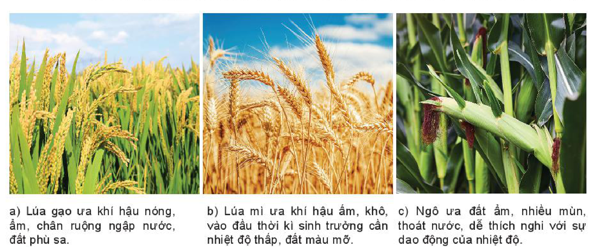
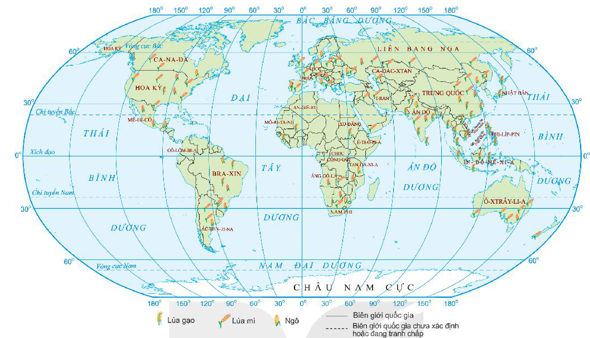
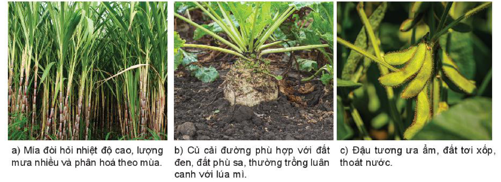
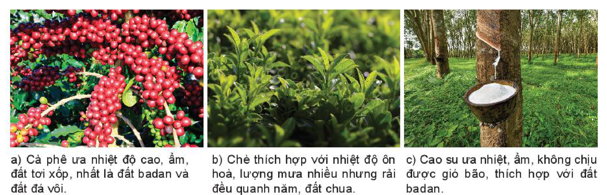
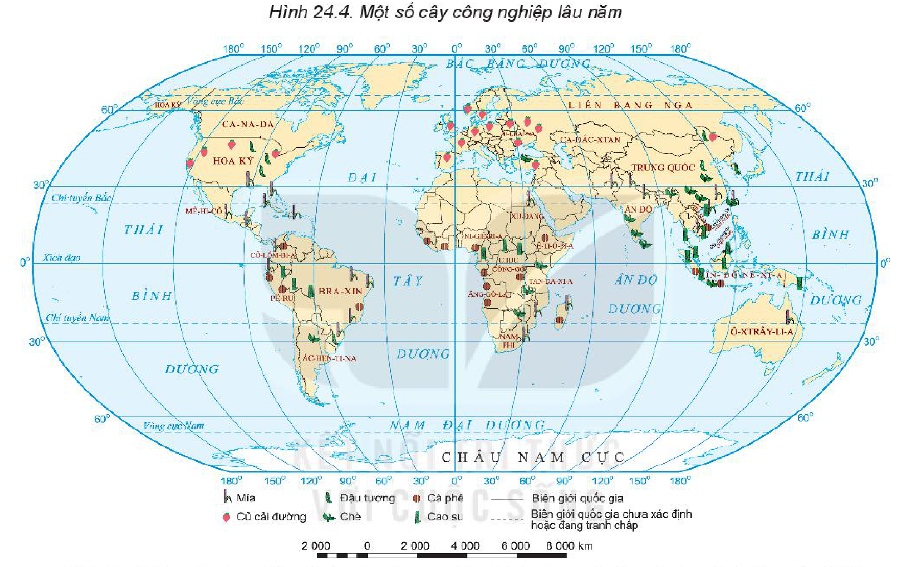
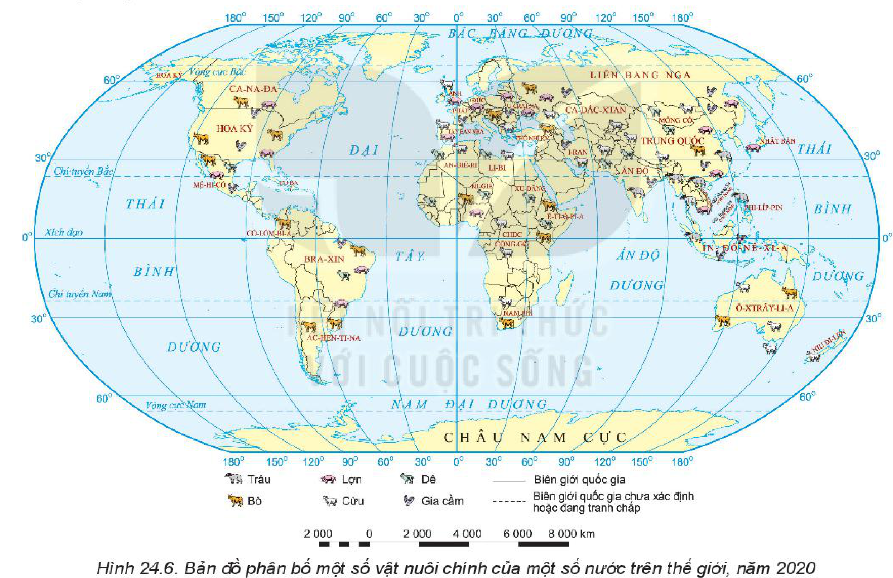

<!-- pdf:70 -->

# BÀI 24: ĐỊA LÍ NGÀNH NÔNG NGHIỆP

## 🔴 Mở đầu

<!-- term: Phân bố vật nuôi chính trên thế giới -->
Nông nghiệp gồm hai ngành chính là trồng trọt và chăn nuôi. Các cây trồng, vật nuôi trên thế giới phân bố theo khu vực do có đặc điểm sinh thái khác nhau, phù hợp với các vùng, khu vực nhất định. Sự phát triển, phân bố của cây trồng, vật nuôi trên thế giới biểu hiện như thế nào?

## 1. Ngành trồng trọt

### a) Vai trò

<!-- term: Ngành trồng trọt -->
- Cung cấp lương thực, thực phẩm cho con người, nguyên liệu cho các ngành công nghiệp chế biến. Là cơ sở để phát triển chăn nuôi và là mặt hàng xuất khẩu có giá trị.
- Tạo việc làm, giúp ổn định cuộc sống cho một bộ phận lớn cư dân nông thôn.
- Góp phần đảm bảo an ninh lương thực, ổn định xã hội và bảo vệ môi trường.

> ❓ Dựa vào thông tin trong mục a, hãy nêu vai trò của ngành trồng trọt.

### b) Đặc điểm

<!-- term: Đặc điểm ngành trồng trọt -->
- Sự phát triển và phân bố ngành trồng trọt phụ thuộc chặt chẽ vào điều kiện tự nhiên và có tính mùa vụ.
- Cây trồng được chia thành các nhóm: cây lương thực, cây thực phẩm, cây công nghiệp, cây ăn quả,...
- Việc bảo quản sản phẩm của ngành trồng trọt đòi hỏi nhiều về đầu tư và công nghệ.
- Ngành trồng trọt ngày càng gắn chặt với sự tiến bộ của khoa học – công nghệ.

> ❓ Đọc thông tin trong mục b, hãy trình bày đặc điểm của ngành trồng trọt.

### c) Sự phân bố của một số cây trồng chính

- Các cây lương thực chính

<!-- term: Cây lương thực -->
Các cây lương thực chính được con người sản xuất là lúa gạo, lúa mì và ngô.

*Hình 24.1. Các cây lương thực chính*

*Mô tả hình:* Hình gồm 3 ảnh chụp các cây lương thực chính kèm đặc điểm sinh thái: a) Lúa gạo ưa khí hậu nóng, ẩm, chân ruộng ngập nước, đất phù sa. b) Lúa mì ưa khí hậu ấm, khô, vào đầu thời kì sinh trưởng cần nhiệt độ thấp, đất màu mỡ. c) Ngô ưa đất ẩm, nhiều mùn, thoát nước, dễ thích nghi với sự dao động của nhiệt độ.
<!-- ocr-ok: mô tả hình ảnh bổ trợ kèm chú thích thành phần của Hình 24.1 -->

<!-- pdf:71 -->

<!-- term: Phân bố vật nuôi chính trên thế giới -->
*Hình 24.2. Bản đồ phân bố các cây lương thực chính của một số nước trên thế giới, năm 2020*

<!-- term: Phân bố vật nuôi chính trên thế giới -->
*Mô tả hình:* Bản đồ thế giới thể hiện sự phân bố 3 cây lương thực chính năm 2020 bằng kí hiệu tượng hình: Lúa gạo phân bố tập trung ở vùng nhiệt đới và cận nhiệt gió mùa (Trung Quốc, Ấn Độ, các nước Đông Nam Á như Việt Nam, Thái Lan, In-đô-nê-xi-a, Phi-líp-pin, Nhật Bản, Bra-xin, Hoa Kỳ,...); Lúa mì phân bố chủ yếu ở vùng ôn đới và cận nhiệt (Liên bang Nga, Ca-na-đa, Hoa Kỳ, các nước châu Âu như Pháp, Trung Quốc, Ấn Độ, Ô-xtrây-li-a, Ác-hen-ti-na,...); Ngô phân bố rộng ở Hoa Kỳ, Trung Quốc, Bra-xin, Ác-hen-ti-na, Mê-hi-cô, các nước châu Âu, châu Phi và Đông Nam Á.
<!-- ocr-ok: mô tả hình ảnh bổ trợ không phải chữ in trực tiếp trong sách -->

<!-- term: Cây hoa màu -->
> 💡 Em có biết?
>
> Ngoài các cây lương thực chính, trên thế giới còn có các cây lương thực khác (còn gọi là cây hoa màu) như: tại vùng ôn đới là đại mạch, mạch đen, khoai tây,...; tại vùng nhiệt đới và cận nhiệt đới là kê, khoai lang, sắn,... Nhìn chung, các cây hoa màu dễ thích nghi, không đòi hỏi nhiều phân bón, nhiều công chăm sóc và đặc biệt là khả năng chịu hạn giỏi.

- Một số cây công nghiệp chính

<!-- term: Cây công nghiệp -->
Cây công nghiệp rất đa dạng. Dựa vào công dụng, cây công nghiệp được chia thành các nhóm: cây lấy đường (mía, củ cải đường,...), cây lấy sợi (bông, đay, cói,...), cây lấy dầu (đậu tương, lạc,...), cây cho chất kích thích (chè, cà phê, ca cao,...), cây lấy nhựa (cao su,...),...

*Hình 24.3. Một số cây công nghiệp hàng năm*

*Mô tả hình:* Hình gồm 3 ảnh chụp các cây công nghiệp hàng năm kèm đặc điểm sinh thái: a) Mía đòi hỏi nhiệt độ cao, lượng mưa nhiều và phân hoá theo mùa. b) Củ cải đường phù hợp với đất đen, đất phù sa, thường trồng luân canh với lúa mì. c) Đậu tương ưa ẩm, đất tơi xốp, thoát nước.
<!-- ocr-ok: mô tả hình ảnh bổ trợ kèm chú thích thành phần của Hình 24.3 -->

<!-- pdf:72 -->

*Hình 24.4. Một số cây công nghiệp lâu năm*

*Mô tả hình:* Hình gồm 3 ảnh chụp các cây công nghiệp lâu năm kèm đặc điểm sinh thái: a) Cà phê ưa nhiệt độ cao, ẩm, đất tơi xốp, nhất là đất badan và đất đá vôi. b) Chè thích hợp với nhiệt độ ôn hoà, lượng mưa nhiều nhưng rải đều quanh năm, đất chua. c) Cao su ưa nhiệt, ẩm, không chịu được gió bão, thích hợp với đất badan.
<!-- ocr-ok: mô tả hình ảnh bổ trợ kèm chú thích thành phần của Hình 24.4 -->

<!-- term: Phân bố vật nuôi chính trên thế giới -->
*Hình 24.5. Bản đồ phân bố một số cây công nghiệp chính của một số nước trên thế giới, năm 2020*

<!-- term: Phân bố vật nuôi chính trên thế giới -->
*Mô tả hình:* Bản đồ thế giới thể hiện sự phân bố 6 cây công nghiệp chính năm 2020: Mía (Bra-xin, Ấn Độ, Trung Quốc, Thái Lan, Việt Nam, Mê-hi-cô, Hoa Kỳ, Ô-xtrây-li-a,...); Củ cải đường (Liên bang Nga, các nước châu Âu như Pháp, Hoa Kỳ, Ca-na-đa,...); Đậu tương (Hoa Kỳ, Bra-xin, Ác-hen-ti-na, Trung Quốc, Ấn Độ,...); Chè (Trung Quốc, Ấn Độ, Việt Nam, Kê-ni-a,...); Cà phê (Bra-xin, Việt Nam, Cô-lôm-bi-a, In-đô-nê-xi-a, Ê-ti-ô-pi-a, Ấn Độ,...); Cao su (Đông Nam Á như Thái Lan, In-đô-nê-xi-a, Việt Nam, Ma-lai-xi-a, Trung Quốc, Ấn Độ, Tây Phi,...).
<!-- ocr-ok: mô tả hình ảnh bổ trợ không phải chữ in trực tiếp trong sách -->

<!-- term: Phân bố vật nuôi chính trên thế giới -->
> ❓ Dựa vào thông tin, các bản đồ và hình ảnh trong mục c, hãy:
> - Kể tên các cây lương thực chính và một số cây công nghiệp trên thế giới.
> - Trình bày và giải thích sự phân bố của các cây lương thực và một số cây công nghiệp.

## 2. Ngành chăn nuôi

### a) Vai trò

<!-- term: Ngành chăn nuôi -->
- Chăn nuôi cung cấp thực phẩm dinh dưỡng cao cho con người.
- Sản phẩm ngành chăn nuôi là nguyên liệu cho công nghiệp thực phẩm, công nghiệp sản xuất hàng tiêu dùng.
- Ngành chăn nuôi phát triển sẽ thúc đẩy ngành trồng trọt phát triển.
- Tạo ra các mặt hàng xuất khẩu có giá trị, tăng GDP của đất nước.
- Là một mắt xích quan trọng trong sản xuất nông nghiệp bền vững.

<!-- term: Phân bố vật nuôi chính trên thế giới -->
> 💡 Em có biết?
>
> Ngành chăn nuôi được chia thành ba nhóm chính: chăn nuôi gia súc lớn (trâu, bò, ngựa,...), chăn nuôi gia súc nhỏ (cừu, lợn, dê,...) và chăn nuôi gia cầm (gà, vịt, ngan, ngỗng,...).
<!-- ocr-ok: hộp Em có biết đã đối chiếu chính xác với ảnh trang 72 -->

> ❓ Dựa vào thông tin trong mục a, hãy nêu vai trò của ngành chăn nuôi.

<!-- pdf:73 -->

### b) Đặc điểm

<!-- term: Phân bố vật nuôi chính trên thế giới -->
<!-- term: Đặc điểm ngành chăn nuôi -->
- Sự phát triển và phân bố ngành chăn nuôi phụ thuộc chặt chẽ vào nguồn thức ăn.
- Đối tượng của ngành chăn nuôi là các vật nuôi nên phải tuân theo các quy luật sinh học.
- Chăn nuôi có thể phát triển tập trung hay di động, phân tán; theo quy mô nhỏ hoặc quy mô lớn. Do đó hình thành và xuất hiện ba hình thức chăn nuôi khác nhau: chăn nuôi tự nhiên (chăn thả), chăn nuôi công nghiệp (trang trại hiện đại), chăn nuôi sinh thái (điều kiện như tự nhiên nhưng do con người tạo ra).
- Chăn nuôi là ngành sản xuất cho nhiều sản phẩm cùng lúc. Do vậy, tuỳ theo mục đích sản xuất mà quyết định sản phẩm chính, sản phẩm phụ và lựa chọn phương hướng đầu tư.
- Ngành chăn nuôi hiện đại áp dụng các công nghệ tiên tiến, kĩ thuật gen, liên kết chặt chẽ với công nghiệp chế biến.

> ❓ Đọc thông tin trong mục b, hãy trình bày đặc điểm của ngành chăn nuôi.

### c) Sự phân bố một số vật nuôi chính

<!-- term: Phân bố vật nuôi chính trên thế giới -->

<!-- term: Phân bố vật nuôi chính trên thế giới -->
*Hình 24.6. Bản đồ phân bố một số vật nuôi chính của một số nước trên thế giới, năm 2020*

<!-- term: Phân bố vật nuôi chính trên thế giới -->
*Mô tả hình:* Bản đồ thế giới thể hiện sự phân bố 6 vật nuôi chính năm 2020: Trâu (Ấn Độ, Trung Quốc, Đông Nam Á, Bra-xin); Bò (Ấn Độ, Bra-xin, Hoa Kỳ, Trung Quốc, Ác-hen-ti-na, Ô-xtrây-li-a, châu Âu, châu Phi); Lợn (Trung Quốc, Hoa Kỳ, Bra-xin, các nước châu Âu, Liên bang Nga, Việt Nam,...); Cừu (Trung Quốc, Ô-xtrây-li-a, Niu Di-len, Ấn Độ, I-ran, Anh, Nam Phi, Ác-hen-ti-na,...); Dê (Ấn Độ, Trung Quốc, các nước châu Phi và Tây Nam Á); Gia cầm (phân bố rộng khắp ở Trung Quốc, Hoa Kỳ, Bra-xin, In-đô-nê-xi-a, Ấn Độ, Liên bang Nga, các nước châu Âu,...).
<!-- ocr-ok: mô tả hình ảnh bổ trợ không phải chữ in trực tiếp trong sách -->

<!-- term: Phân bố vật nuôi chính trên thế giới -->
> ❓ Dựa vào hình 24.6, hãy trình bày và giải thích sự phân bố của một số vật nuôi chính trên thế giới.

## ✏️ Luyện tập

1. Nêu một số cây trồng, vật nuôi ở vùng nhiệt đới.
2. Ngành chăn nuôi phát triển có ý nghĩa như thế nào đối với sự phát triển ngành trồng trọt và các ngành công nghiệp thực phẩm, công nghiệp sản xuất hàng tiêu dùng?

## 🚀 Vận dụng

Sưu tầm thông tin, tìm hiểu tình hình phát triển nông nghiệp ở một đất nước có nền sản xuất nông nghiệp tiên tiến (ví dụ: Hoa Kỳ, I-xra-en,...).

## 📷 Danh sách hình trong bài

<!-- term: Phân bố vật nuôi chính trên thế giới -->
| Mã hình | Trang PDF | Vị trí trong bài | Chú thích gốc |
| --- | --- | --- | --- |
| H10-dia-b24-01 | 70 | Mục 1.c | Hình 24.1. Các cây lương thực chính |
| H10-dia-b24-02 | 71 | Mục 1.c | Hình 24.2. Bản đồ phân bố các cây lương thực chính của một số nước trên thế giới, năm 2020 |
| H10-dia-b24-03 | 71 | Mục 1.c | Hình 24.3. Một số cây công nghiệp hàng năm |
| H10-dia-b24-04 | 72 | Mục 1.c | Hình 24.4. Một số cây công nghiệp lâu năm |
| H10-dia-b24-05 | 72 | Mục 1.c | Hình 24.5. Bản đồ phân bố một số cây công nghiệp chính của một số nước trên thế giới, năm 2020 |
| H10-dia-b24-06 | 73 | Mục 2.c | Hình 24.6. Bản đồ phân bố một số vật nuôi chính của một số nước trên thế giới, năm 2020 |
