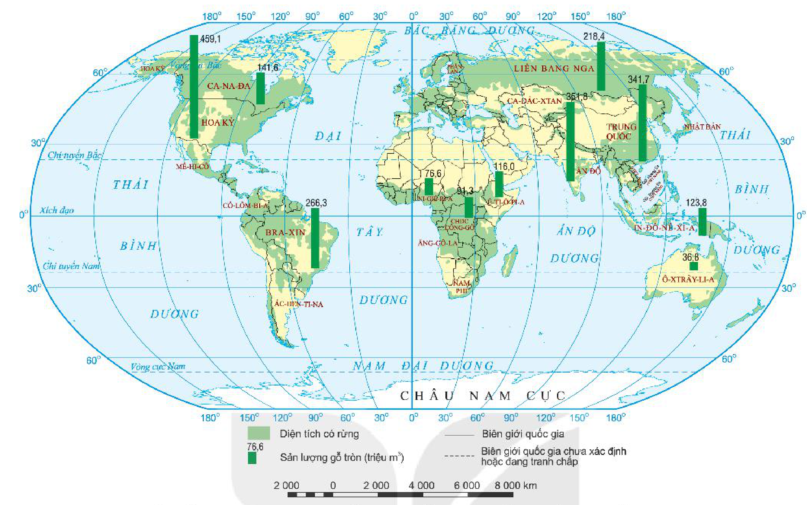
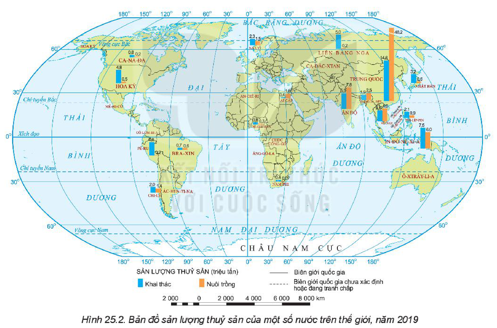

<!-- pdf:74 -->

# BÀI 25: ĐỊA LÍ NGÀNH LÂM NGHIỆP VÀ NGÀNH THUỶ SẢN

## 🔴 Mở đầu

<!-- term: Nuôi trồng thuỷ sản -->
Ngành lâm nghiệp và ngành thuỷ sản không chỉ có vai trò quan trọng đối với phát triển kinh tế – xã hội, mà còn tác động tích cực tới môi trường. Ngành lâm nghiệp và thuỷ sản có đặc điểm gì? Sự phát triển, phân bố của hai ngành đó trên thế giới như thế nào?

## 1. Địa lí ngành lâm nghiệp

### a) Vai trò

<!-- term: Vai trò của ngành lâm nghiệp -->
- Cung cấp lâm sản phục vụ cho các nhu cầu của xã hội (gỗ, nguyên liệu ngành giấy, thực phẩm, dược liệu,...).
- Tạo nguồn thu nhập và giải quyết việc làm, đặc biệt là cho người dân thuộc vùng trung du, miền núi.
- Bảo tồn đa dạng sinh học, chống xói mòn đất, điều tiết lượng nước trong đất, giảm thiểu tác động của biến đổi khí hậu và thiên tai.
- Góp phần đảm bảo phát triển bền vững.

### b) Đặc điểm

<!-- term: Đặc điểm ngành lâm nghiệp -->
- Chu kì sinh trưởng dài và phát triển chậm là đặc điểm mang tính đặc thù của cây lâm nghiệp.
- Ngành lâm nghiệp bao gồm: trồng rừng; khai thác và chế biến lâm sản; bảo vệ, bảo tồn hệ sinh thái rừng;... Các hoạt động khai thác và tái tạo rừng có mối quan hệ chặt chẽ với nhau.
- Sản xuất lâm nghiệp diễn ra trong không gian rộng và trên những địa bàn có điều kiện tự nhiên đa dạng.

> ❓ Dựa vào thông tin trong các mục a và b, hãy trình bày vai trò và đặc điểm của ngành lâm nghiệp.

### c) Hoạt động trồng rừng và khai thác rừng

<!-- term: Nuôi trồng thuỷ sản -->
<!-- term: Hoạt động trồng rừng và khai thác rừng -->
- Trồng rừng có ý nghĩa quan trọng không chỉ để tái tạo nguồn tài nguyên rừng mà còn góp phần bảo vệ môi trường. Diện tích rừng trồng trên toàn thế giới ngày càng được mở rộng, từ 17,8 triệu ha năm 1980 lên 293,9 triệu ha năm 2019. Các quốc gia có diện tích rừng trồng lớn nhất đồng thời cũng có sản lượng gỗ khai thác lớn nhất là Hoa Kỳ, Ấn Độ, Trung Quốc, Bra-xin, Liên bang Nga,...
- Trên phạm vi toàn thế giới, sản lượng gỗ khai thác hằng năm có xu hướng tăng nhưng không đều giữa các năm và giữa các nhóm nước.

> 💡 Em có biết?
>
> Nhằm nâng cao nhận thức về tầm quan trọng của rừng, từ năm 2013, Liên hợp quốc đã lấy ngày 21 – 3 hằng năm làm Ngày Quốc tế về Rừng. Còn ở nước ta, ngay từ năm 1959, Chủ tịch Hồ Chí Minh đã phát động Tết trồng cây. Từ đó đến nay, Tết trồng cây đã trở thành truyền thống tốt đẹp của đất nước.

<!-- term: Nuôi trồng thuỷ sản -->
**BẢNG 25. SẢN LƯỢNG GỖ TRÒN CỦA THẾ GIỚI, GIAI ĐOẠN 1980 – 2019**

*(Đơn vị: triệu m³)*

| Năm | 1980 | 1990 | 2000 | 2010 | 2019 |
| --- | :---: | :---: | :---: | :---: | :---: |
| Sản lượng | 3 129 | 3 542 | 3 484 | 3 587 | 3 964 |
<!-- ocr-ok: bảng 25 đã đối chiếu chính xác với ảnh trang 74 -->

<!-- pdf:75 -->

<!-- term: Nuôi trồng thuỷ sản -->
*Hình 25.1. Bản đồ diện tích rừng trên thế giới và sản lượng gỗ tròn của một số nước, năm 2019*

<!-- term: Nuôi trồng thuỷ sản -->
*Mô tả hình:* Bản đồ thế giới thể hiện diện tích có rừng (màu xanh lá nhạt phân bố rộng ở Liên bang Nga, Ca-na-đa, Hoa Kỳ, Bra-xin, Trung Quốc, lưu vực Công-gô, Đông Nam Á,...) và biểu đồ cột sản lượng gỗ tròn năm 2019 (đơn vị: triệu m³) của một số nước lớn: Hoa Kỳ (459,1), Ấn Độ (351,8), Trung Quốc (341,7), Bra-xin (266,3), Liên bang Nga (218,4), Ca-na-đa (141,6), In-đô-nê-xi-a (123,8), Ê-ti-ô-pi-a (116,0), CHDC Công-gô (91,3), Ni-giê-ri-a (76,6), Ô-xtrây-li-a (36,6).
<!-- ocr-ok: mô tả hình ảnh bổ trợ không phải chữ in trực tiếp trong sách -->

<!-- term: Nuôi trồng thuỷ sản -->
> ❓ Dựa vào thông tin trong mục c và hình 25.1, hãy trình bày hoạt động trồng rừng và khai thác rừng trên thế giới.

## 2. Địa lí ngành thuỷ sản

### a) Vai trò

<!-- term: Nuôi trồng thuỷ sản -->
<!-- term: Vai trò của ngành thuỷ sản -->
- Đóng góp vào GDP ngày càng lớn.
- Thuỷ sản (gồm cả thuỷ sản nước ngọt, nước lợ, nước mặn) là nguồn cung cấp các chất đạm, dễ tiêu hoá cho con người; đồng thời cung cấp các nguyên tố vi lượng dễ hấp thụ và có lợi cho sức khoẻ.
- Thuỷ sản là nguồn cung cấp nguyên liệu cho công nghiệp thực phẩm, dược phẩm và là mặt hàng xuất khẩu có giá trị.
- Góp phần giải quyết việc làm, bảo vệ chủ quyền, an ninh quốc gia.
- Phụ phẩm của ngành thuỷ sản còn là thức ăn cho chăn nuôi,...

### b) Đặc điểm

<!-- term: Nuôi trồng thuỷ sản -->
<!-- term: Đặc điểm ngành thuỷ sản -->
- Sản xuất thuỷ sản mang tính mùa vụ, phụ thuộc nhiều vào nguồn nước và khí hậu.
- Sản xuất thuỷ sản ngày càng áp dụng công nghệ, sản xuất theo chuỗi giá trị, góp phần nâng cao hiệu quả, truy xuất được nguồn gốc sản phẩm.
- Sản xuất thuỷ sản bao gồm các hoạt động khai thác, chế biến và nuôi trồng vừa có tính chất của ngành sản xuất nông nghiệp, vừa có tính chất của ngành sản xuất công nghiệp.

> ❓ Dựa vào thông tin trong mục a, b, hãy trình bày vai trò và đặc điểm của ngành thuỷ sản.

<!-- pdf:76 -->

### c) Hoạt động khai thác và nuôi trồng thuỷ sản

<!-- term: Nuôi trồng thuỷ sản -->
<!-- term: Khai thác thuỷ sản -->
- Khai thác thuỷ sản là hoạt động đánh bắt các loài thuỷ sản, trong đó cá chiếm đến 85 – 90% sản lượng. Việc đánh bắt chủ yếu diễn ra ở biển và đại dương, nơi có các ngư trường lớn.

<!-- term: Nuôi trồng thuỷ sản -->
Do nhu cầu tiêu thụ ngày càng lớn và do những tiến bộ trong công nghệ đánh bắt, sản lượng khai thác thuỷ sản ngày càng tăng. Các quốc gia có sản lượng đánh bắt lớn nhất năm 2019 là: Trung Quốc, In-đô-nê-xi-a, Pê-ru, Ấn Độ, Liên bang Nga, Hoa Kỳ, Nhật Bản, Việt Nam,...

<!-- term: Nuôi trồng thuỷ sản -->
- Nuôi trồng thuỷ sản được chú trọng phát triển và có vị trí ngày càng quan trọng.

<!-- term: Nuôi trồng thuỷ sản -->
Thuỷ sản được nuôi ở cả vùng nước ngọt, nước lợ và nước mặn. Hình thức và công nghệ nuôi trồng thuỷ sản ngày càng thay đổi, hiện đại. Sản lượng thuỷ sản nuôi trồng trên thế giới ngày càng tăng nhanh. Các quốc gia có sản lượng nuôi trồng thuỷ sản lớn nhất năm 2019 là: Trung Quốc, Ấn Độ, Băng-la-đét, Ai Cập, Na Uy, Nhật Bản và các quốc gia ở Đông Nam Á,...

<!-- term: Nuôi trồng thuỷ sản -->
*Hình 25.2. Bản đồ sản lượng thuỷ sản của một số nước trên thế giới, năm 2019*

<!-- term: Nuôi trồng thuỷ sản -->
*Mô tả hình:* Bản đồ thế giới thể hiện biểu đồ cột ghép sản lượng thuỷ sản khai thác (cột xanh dương) và nuôi trồng (cột cam) năm 2019 (đơn vị: triệu tấn) của một số nước: Trung Quốc đứng đầu thế giới (khai thác 14,6; nuôi trồng 48,2), tiếp theo là In-đô-nê-xi-a (khai thác 7,5; nuôi trồng 6,0), Ấn Độ (khai thác 5,5; nuôi trồng 7,8), Việt Nam (khai thác 3,4; nuôi trồng 4,4), Pê-ru (khai thác 4,8; nuôi trồng 0,2), Liên bang Nga (khai thác 5,0; nuôi trồng 0,2), Hoa Kỳ (khai thác 4,8; nuôi trồng 0,5), Nhật Bản (khai thác 3,2; nuôi trồng 0,6), Băng-la-đét (khai thác 1,9; nuôi trồng 2,5), Na Uy (khai thác 2,3; nuôi trồng 1,5), Chi-lê (khai thác 2,0; nuôi trồng 1,4), Phi-líp-pin (khai thác 2,1; nuôi trồng 0,9), Ai Cập (khai thác 0,4; nuôi trồng 1,6),...
<!-- ocr-ok: mô tả hình ảnh bổ trợ không phải chữ in trực tiếp trong sách -->

<!-- term: Nuôi trồng thuỷ sản -->
> ❓ Dựa vào thông tin trong mục c và hình 25.2, hãy trình bày hoạt động khai thác và nuôi trồng thuỷ sản trên thế giới.

## ✏️ Luyện tập

Dựa vào hình 25.1, hãy sắp xếp thứ tự 5 quốc gia có sản lượng gỗ tròn khai thác lớn nhất năm 2019.

## 🚀 Vận dụng

Tìm hiểu và kể tên các nước nhập khẩu nhiều thuỷ sản của nước ta.

## 📷 Danh sách hình trong bài

<!-- term: Nuôi trồng thuỷ sản -->
| Mã hình | Trang PDF | Vị trí trong bài | Chú thích gốc |
| --- | --- | --- | --- |
| H10-dia-b25-01 | 75 | Mục 1.c | Hình 25.1. Bản đồ diện tích rừng trên thế giới và sản lượng gỗ tròn của một số nước, năm 2019 |
| H10-dia-b25-02 | 76 | Mục 2.c | Hình 25.2. Bản đồ sản lượng thuỷ sản của một số nước trên thế giới, năm 2019 |
