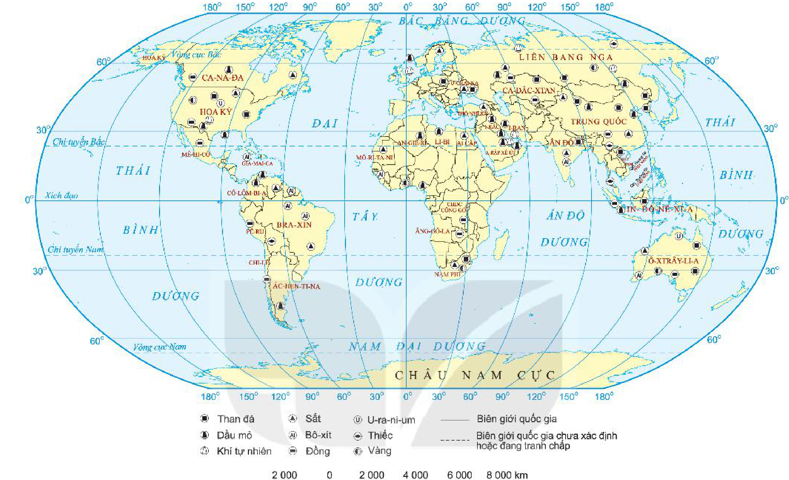
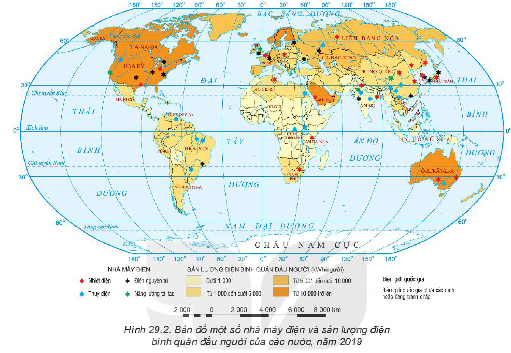
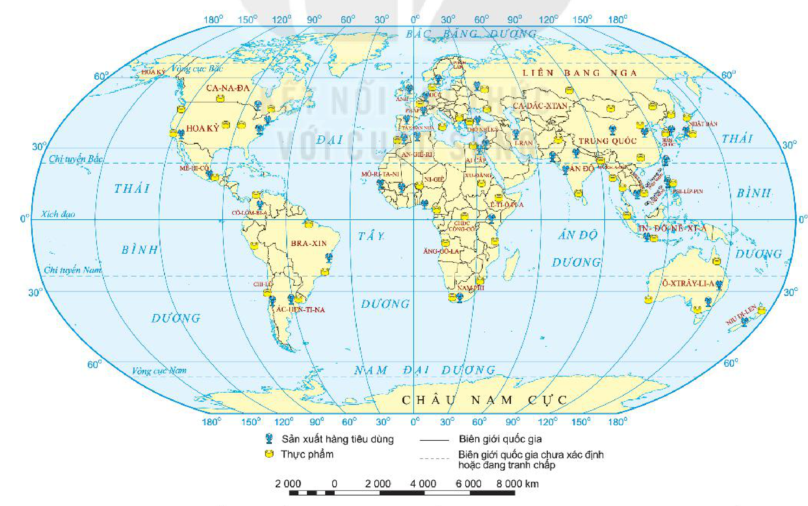

<!-- pdf:82 -->

# BÀI 29: ĐỊA LÍ MỘT SỐ NGÀNH CÔNG NGHIỆP

## 🔴 Mở đầu

Nền công nghiệp của một quốc gia bao gồm nhiều ngành khác nhau. Mỗi ngành lại có vai trò, đặc điểm và sự phân bố riêng, tạo nên sự phong phú, đa dạng trong sản xuất công nghiệp. Kể tên một số ngành công nghiệp mà em biết. Các ngành công nghiệp đó khác nhau ở những điểm chính nào?

## 1. Công nghiệp khai thác than, dầu khí, quặng kim loại

### a) Công nghiệp khai thác than

<!-- term: Công nghiệp khai thác than -->
- Vai trò: Than là nguồn năng lượng truyền thống và cơ bản trong cơ cấu năng lượng của thế giới. Than được sử dụng làm nhiên liệu trong các ngành công nghiệp nhiệt điện, luyện kim,... làm nguyên liệu cho công nghiệp hoá chất (chất dẻo, sợi nhân tạo,...).
- Đặc điểm: Công nghiệp khai thác than xuất hiện từ rất sớm, gắn với cuộc cách mạng công nghiệp lần thứ nhất. Quá trình sử dụng than gây tác động xấu tới môi trường, đòi hỏi phải có các nguồn năng lượng tái tạo để thay thế.
- Phân bố: Sản lượng than của thế giới tăng từ 3,7 tỉ tấn năm 1980 lên 7,9 tỉ tấn năm 2019. Các quốc gia có sản lượng than lớn nhất thế giới là Trung Quốc, Ấn Độ, Hoa Kỳ, In-đô-nê-xi-a, Liên bang Nga,...

### b) Công nghiệp khai thác dầu khí

<!-- term: Công nghiệp khai thác dầu khí -->
- Vai trò: Dầu khí cũng là nguồn năng lượng truyền thống và cơ bản, được sử dụng rộng rãi trong sản xuất và đời sống. Dầu mỏ là nguồn nguyên liệu để sản xuất nhiều loại hoá phẩm, dược phẩm. Nhiều thành tựu kĩ thuật hiện đại phụ thuộc vào nguồn nhiên liệu dầu khí. Xuất khẩu dầu khí là nguồn thu ngoại tệ chủ yếu của nhiều quốc gia.
- Đặc điểm: Các mỏ dầu khí thường nằm sâu trong lòng đất, việc khai thác phụ thuộc vào sự tiến bộ của kĩ thuật khoan sâu. Sản lượng và giá dầu khí có tác động mạnh tới sự phát triển kinh tế thế giới. Khai thác và sử dụng dầu khí ảnh hưởng lớn tới môi trường và tác động tới biến đổi khí hậu.
- Phân bố: Năm 2019, sản lượng dầu khai thác của thế giới là 4,5 tỉ tấn. Các quốc gia khai thác dầu chủ yếu là: Hoa Kỳ, Liên bang Nga, A-rập Xê-út, I-rắc,... Các quốc gia khai thác khí tự nhiên chủ yếu là Hoa Kỳ, Liên bang Nga, I-ran, Ca-ta,...

### c) Công nghiệp khai thác quặng kim loại

<!-- term: Công nghiệp khai thác quặng kim loại -->
- Vai trò: Công nghiệp khai thác quặng kim loại phát triển gắn với quá trình công nghiệp hoá trên thế giới do kim loại được sử dụng để sản xuất máy móc, thiết bị, làm vật liệu trong xây dựng, giao thông vận tải,... Kim loại được sử dụng nhiều ở các thiết bị trong đời sống,...
- Đặc điểm: Quặng kim loại được chia thành một số nhóm: kim loại đen, kim loại màu, kim loại quý, kim loại hiếm,... Việc khai thác thiếu quy hoạch khiến nhiều loại quặng kim loại có nguy cơ cạn kiệt, gây ô nhiễm môi trường, đòi hỏi phải có các vật liệu thay thế và tái sử dụng kim loại để tiết kiệm tài nguyên và giảm ô nhiễm môi trường.

<!-- pdf:83 -->

- Phân bố: Các nước khai thác quặng kim loại nhiều đều là các nước có trữ lượng quặng lớn: sắt (Liên bang Nga, Ô-xtrây-li-a, Trung Quốc, Ấn Độ, Bra-xin, Hoa Kỳ,...), bô-xít (Ô-xtrây-li-a, Ghi-nê, Xu-ri-nam, Gia-mai-ca, Bra-xin,...), đồng (Chi-lê, Mê-hi-cô, Dăm-bi-a, In-đô-nê-xi-a, Hoa Kỳ, Ca-na-đa,...),...

*Hình 29.1. Bản đồ phân bố công nghiệp khai thác than, dầu khí, quặng kim loại trên thế giới, năm 2019*

*Mô tả hình:* Bản đồ thế giới thể hiện sự phân bố các điểm khai thác khoáng sản năng lượng và kim loại năm 2019 bằng các kí hiệu: Than đá (Trung Quốc, Ấn Độ, Hoa Kỳ, Liên bang Nga, Ô-xtrây-li-a, In-đô-nê-xi-a, Nam Phi,...); Dầu mỏ và Khí tự nhiên (Hoa Kỳ, Liên bang Nga, khu vực Tây Nam Á như A-rập Xê-út, I-ran, I-rắc, Ca-ta, Bắc Phi, Vê-nê-du-ê-la, Đông Nam Á,...); Sắt (Liên bang Nga, Bra-xin, Ô-xtrây-li-a, Trung Quốc, Ấn Độ, Hoa Kỳ, Ca-na-đa,...); Bô-xít (Ô-xtrây-li-a, Ghi-nê, Gia-mai-ca, Bra-xin, Trung Quốc,...); Đồng (Chi-lê, Pê-ru, Mê-hi-cô, Hoa Kỳ, Ca-na-đa, Liên bang Nga,...); U-ra-ni-um (Ca-na-đa, Ca-dắc-xtan, Ô-xtrây-li-a, Liên bang Nga,...); Thiếc (Đông Nam Á, Trung Quốc, Bra-xin,...); Vàng (Nam Phi, Liên bang Nga, Hoa Kỳ, Ca-na-đa, Ô-xtrây-li-a, Trung Quốc,...).
<!-- ocr-ok: mô tả hình ảnh bổ trợ không phải chữ in trực tiếp trong sách -->

> ❓ Dựa vào thông tin trong mục 1 và hình 29.1, hãy trình bày vai trò, đặc điểm và giải thích sự phân bố của công nghiệp khai thác than, dầu khí, quặng kim loại.

## 2. Công nghiệp điện lực

<!-- term: Công nghiệp điện lực -->
- Vai trò: Điện là nguồn năng lượng không thể thiếu trong xã hội hiện đại, là cơ sở để tiến hành cơ khí hoá, tự động hoá trong sản xuất, là điều kiện thiết yếu để đáp ứng nhiều nhu cầu trong đời sống xã hội, đảm bảo an ninh quốc gia. Sản lượng điện bình quân đầu người là một trong những thước đo để đánh giá trình độ phát triển của một quốc gia.
- Đặc điểm: Các nước có cơ cấu điện năng khác nhau, phụ thuộc vào điều kiện tự nhiên, trình độ kĩ thuật, chính sách phát triển,... Công nghiệp điện lực đòi hỏi vốn đầu tư lớn, đặc biệt là hệ thống truyền tải điện. Sản phẩm của công nghiệp điện lực không lưu giữ được.
- Phân bố: Sản xuất điện tập trung chủ yếu ở các nước phát triển và một số nước đang phát triển (Hoa Kỳ, Trung Quốc, Nhật Bản, Liên bang Nga, Ấn Độ, Ca-na-đa, Đức, Hàn Quốc,...) do nhu cầu sử dụng điện trong sản xuất và đời sống ở các nước này rất lớn.

<!-- pdf:84 -->

*Hình 29.2. Bản đồ một số nhà máy điện và sản lượng điện bình quân đầu người của các nước, năm 2019*

*Mô tả hình:* Bản đồ thế giới thể hiện sản lượng điện bình quân đầu người (kWh/người) theo 4 thang màu: Từ 10 000 trở lên (màu cam đậm: Hoa Kỳ, Ca-na-đa, Na Uy, Thuỵ Điển, Phần Lan, Ô-xtrây-li-a, Hàn Quốc, A-rập Xê-út); Từ 5 001 đến dưới 10 000 (cam vừa: Liên bang Nga, Trung Quốc, Nhật Bản, các nước Tây Âu như Pháp, Đức, Anh); Từ 1 000 đến dưới 5 000 (vàng đậm: Bra-xin, Ác-hen-ti-na, Mê-hi-cô, Nam Phi, Ai Cập, I-ran, Ấn Độ, Việt Nam, In-đô-nê-xi-a,...); Dưới 1 000 (vàng nhạt: phần lớn các nước châu Phi). Kí hiệu các nhà máy điện lớn gồm: Nhiệt điện (sao đỏ), Thuỷ điện (sao xanh dương), Điện nguyên tử (sao đen, tập trung nhiều ở Hoa Kỳ, Tây Âu, Nhật Bản, Liên bang Nga, Đông Trung Quốc), Năng lượng tái tạo (sao xanh lá).
<!-- ocr-ok: mô tả hình ảnh bổ trợ không phải chữ in trực tiếp trong sách -->

> ❓ Dựa vào thông tin trong mục 2 và hình 29.2, hãy trình bày vai trò, đặc điểm và giải thích sự phân bố của công nghiệp điện lực.

## 3. Công nghiệp điện tử, tin học

<!-- term: Công nghiệp điện tử, tin học -->
- Vai trò: Công nghiệp điện tử, tin học có vai trò đặc biệt quan trọng cả ở hiện tại cũng như tương lai do tạo ra những thay đổi lớn trong phương thức sản xuất, trong đời sống xã hội, cũng như hỗ trợ tái tạo và bảo vệ môi trường tự nhiên. Công nghiệp điện tử, tin học đã trở thành một ngành công nghiệp mũi nhọn của nhiều nước, đem lại giá trị gia tăng cao, đồng thời là thước đo trình độ phát triển kinh tế, kĩ thuật của mọi quốc gia trên thế giới.
- Đặc điểm: Ngành công nghiệp điện tử, tin học bao gồm công nghiệp điện tử (máy tính, điện tử dân dụng, thiết bị viễn thông,...) và tin học (phần mềm, ứng dụng,...). Đây là ngành công nghiệp trẻ, phát triển mạnh mẽ từ cuối thế kỉ XX, đòi hỏi lực lượng lao động có trình độ chuyên môn, kĩ thuật cao. Sản phẩm phong phú, đa dạng, luôn thay đổi về chất lượng và mẫu mã theo hướng hiện đại hoá. Ngành này ít gây ô nhiễm môi trường.
- Phân bố: Tập trung hầu hết ở các nước phát triển và một số nước đang phát triển. Cụ thể: Hoa Kỳ (máy tính, thiết bị ngoại vi, phần mềm,...), Nhật Bản (điện tử dân dụng,...),

<!-- pdf:85 -->

Hàn Quốc (điện tử dân dụng, thiết bị viễn thông,...), các nước châu Âu (chất bán dẫn, thiết bị viễn thông, phần mềm,...), Trung Quốc (chất bán dẫn, điện tử dân dụng, thiết bị viễn thông, phần mềm,...), Ấn Độ (phần mềm,...).

> ❓ Dựa vào thông tin trong mục 3, hãy trình bày vai trò, đặc điểm và giải thích sự phân bố của công nghiệp điện tử, tin học.

## 4. Công nghiệp sản xuất hàng tiêu dùng

<!-- term: Công nghiệp sản xuất hàng tiêu dùng -->
- Vai trò: Đây là lĩnh vực không thể thiếu được trong cơ cấu công nghiệp của mọi quốc gia. Công nghiệp sản xuất hàng tiêu dùng sản xuất ra các hàng hoá thông dụng phục vụ cuộc sống hằng ngày của người dân và xuất khẩu; đồng thời tận dụng nguồn lao động tại chỗ, huy động sức mạnh của các thành phần kinh tế.
- Đặc điểm: là ngành đòi hỏi vốn đầu tư ít, hoàn vốn nhanh, thời gian xây dựng hạ tầng tương đối ngắn, quy trình sản xuất đơn giản. Sản xuất hàng tiêu dùng chịu ảnh hưởng lớn từ nhân công, nguồn nguyên liệu và thị trường tiêu thụ sản phẩm, dễ gây ô nhiễm môi trường không khí và nước.
- Phân bố: Công nghiệp sản xuất hàng tiêu dùng được phân bố rộng rãi ở cả các nước phát triển và các nước đang phát triển, đặc biệt ở các nước có nguồn nhân lực dồi dào, giá nhân công rẻ, các nước có thị trường tiêu thụ lớn,... Đó là các nước: Trung Quốc, Ấn Độ, Hoa Kỳ, các nước EU, Nhật Bản,... và gần đây là: Băng-la-đét, In-đô-nê-xi-a, Việt Nam, Pa-ki-xtan,...

*Hình 29.3. Bản đồ phân bố công nghiệp sản xuất hàng tiêu dùng và công nghiệp thực phẩm trên thế giới, năm 2019*

*Mô tả hình:* Bản đồ thế giới thể hiện các trung tâm công nghiệp sản xuất hàng tiêu dùng (kí hiệu màu xanh ngọc) và công nghiệp thực phẩm (kí hiệu màu vàng) năm 2019 phân bố rộng khắp ở Đông Á (Trung Quốc, Nhật Bản, Hàn Quốc), Nam Á (Ấn Độ), Đông Nam Á (Việt Nam, Thái Lan, In-đô-nê-xi-a,...), châu Âu (Anh, Pháp, Đức, I-ta-li-a, Tây Ban Nha, Liên bang Nga,...), Bắc Mỹ (Hoa Kỳ, Ca-na-đa, Mê-hi-cô), Nam Mỹ (Bra-xin, Ác-hen-ti-na, Chi-lê), Ô-xtrây-li-a và một số nước châu Phi (Ai Cập, Nam Phi, Ni-giê-ri-a,...).
<!-- ocr-ok: mô tả hình ảnh bổ trợ không phải chữ in trực tiếp trong sách -->

<!-- pdf:86 -->

> ❓ Dựa vào thông tin mục 4 và hình 29.3, hãy trình bày vai trò, đặc điểm và giải thích sự phân bố của công nghiệp sản xuất hàng tiêu dùng.

## 5. Công nghiệp thực phẩm

<!-- term: Công nghiệp thực phẩm -->
- Vai trò: Công nghiệp thực phẩm là lĩnh vực cung cấp các sản phẩm nhằm đáp ứng các nhu cầu về ăn, uống của con người. Thông qua chế biến, góp phần làm thay đổi chất lượng và giá trị của sản phẩm nông nghiệp, nhờ đó thúc đẩy sản xuất nông nghiệp phát triển. Công nghiệp thực phẩm cũng tạo ra nhiều mặt hàng xuất khẩu, tạo thêm việc làm và thu nhập cho người lao động.
- Đặc điểm: Sản phẩm của ngành công nghiệp thực phẩm rất phong phú, đa dạng. Nguyên liệu chủ yếu là các sản phẩm từ trồng trọt, chăn nuôi và thuỷ sản. Các yêu cầu về đảm bảo an toàn thực phẩm ngày càng được chú trọng trong quá trình chế biến, bảo quản.
- Phân bố: Công nghiệp thực phẩm có mặt ở mọi quốc gia nhưng phát triển nhất là ở các nước có nguồn nguyên liệu dồi dào, hoặc có nhu cầu tiêu thụ lớn, đó là: Trung Quốc, Hoa Kỳ, các nước EU, Ô-xtrây-li-a,...

> ❓ Dựa vào thông tin trong mục 5 và hình 29.3, hãy trình bày vai trò, đặc điểm và giải thích sự phân bố của công nghiệp thực phẩm.

## ✏️ Luyện tập

Cho bảng số liệu:

**BẢNG 29. SẢN LƯỢNG DẦU MỎ VÀ ĐIỆN CỦA THẾ GIỚI, GIAI ĐOẠN 2000 – 2019**

| Sản lượng \ Năm | 2000 | 2010 | 2015 | 2019 |
| --- | :---: | :---: | :---: | :---: |
| Dầu mỏ *(triệu tấn)* | 3 605,5 | 3 983,4 | 4 362,9 | 4 484,5 |
| Điện *(tỉ kWh)* | 15 555,3 | 21 570,7 | 24 266,3 | 27 004,7 |
<!-- ocr-ok: bảng 29 đã đối chiếu chính xác với ảnh trang 86 -->

Vẽ biểu đồ thể hiện sản lượng dầu mỏ và điện của thế giới, giai đoạn 2000 – 2019. Nêu nhận xét.

## 🚀 Vận dụng

Tìm hiểu và kể tên một số sản phẩm chính của công nghiệp sản xuất hàng tiêu dùng và công nghiệp thực phẩm của Việt Nam được xuất khẩu.

## 📷 Danh sách hình trong bài

| Mã hình | Trang PDF | Vị trí trong bài | Chú thích gốc |
| --- | --- | --- | --- |
| H10-dia-b29-01 | 83 | Mục 1.c | Hình 29.1. Bản đồ phân bố công nghiệp khai thác than, dầu khí, quặng kim loại trên thế giới, năm 2019 |
| H10-dia-b29-02 | 84 | Mục 2 | Hình 29.2. Bản đồ một số nhà máy điện và sản lượng điện bình quân đầu người của các nước, năm 2019 |
| H10-dia-b29-03 | 85 | Mục 4 | Hình 29.3. Bản đồ phân bố công nghiệp sản xuất hàng tiêu dùng và công nghiệp thực phẩm trên thế giới, năm 2019 |
