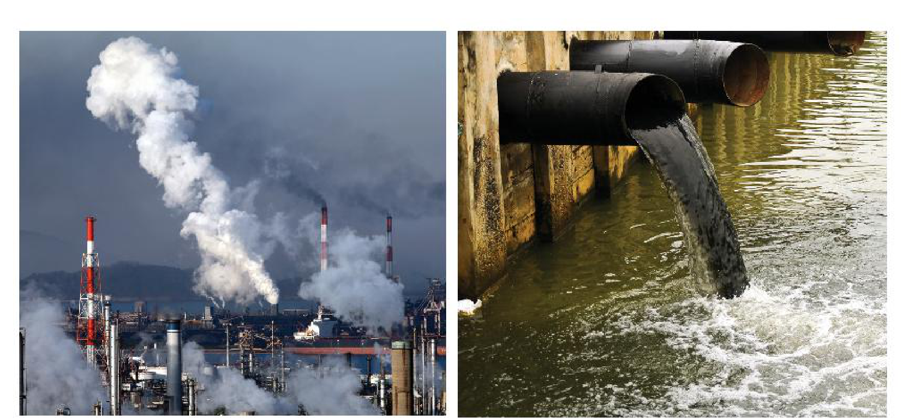

<!-- pdf:89 -->

# BÀI 31: TÁC ĐỘNG CỦA CÔNG NGHIỆP ĐỐI VỚI MÔI TRƯỜNG, PHÁT TRIỂN NĂNG LƯỢNG TÁI TẠO, ĐỊNH HƯỚNG PHÁT TRIỂN CÔNG NGHIỆP TRONG TƯƠNG LAI

## 🔴 Mở đầu

Công nghiệp là ngành có vai trò to lớn đối với nền kinh tế, nhưng cũng là ngành có tác động rất lớn đến môi trường. Công nghiệp tác động tới môi trường như thế nào? Để hạn chế những tác động đó, nền công nghiệp thế giới cần có định hướng phát triển ra sao trong tương lai?

## 1. Tác động của công nghiệp tới môi trường

Công nghiệp có tác động lớn tới môi trường như tạo ra môi trường mới, góp phần cải thiện chất lượng môi trường. Tuy nhiên, một số hoạt động sản xuất công nghiệp hiện nay do sử dụng công nghệ lạc hậu nên có tác động tiêu cực tới môi trường.

<!-- term: Tác động của công nghiệp tới môi trường -->
Trong quá trình sản xuất, hoạt động công nghiệp sẽ đưa vào môi trường các chất thải, làm phá vỡ chu trình cân bằng vật chất của môi trường, gây ô nhiễm môi trường.

<!-- term: Tác động của công nghiệp tới môi trường -->
<!-- term: Khí nhà kính -->
- Khí thải từ các cơ sở công nghiệp gây ô nhiễm môi trường không khí. Không những thế, việc phát thải khí nhà kính, nhất là do việc đốt cháy năng lượng hoá thạch để tạo ra điện sẽ gây hiệu ứng nhà kính, làm biến đổi khí hậu. Vì vậy, cần áp dụng công nghệ cao nhằm tiết kiệm năng lượng, sử dụng năng lượng tái tạo,...
- Nước thải công nghiệp, nhất là nước thải chưa được xử lí chứa nhiều hoá chất độc hại gây ô nhiễm môi trường nước, đất,... Vì vậy, trong quá trình sản xuất công nghiệp, cần thiết phải áp dụng các tiêu chuẩn kĩ thuật cũng như đảm bảo xử lí chất thải trước khi thải ra môi trường.

<!-- term: Chất thải công nghiệp -->
> 💡 Em có biết?
> Chất thải công nghiệp có nồng độ chất độc hại cao và tập trung, có ở nhiều dạng:
> - Dạng khí: CO₂, CO, NO, NO₂, CH₄, SO₂, H₂S,...
> - Dạng lỏng: các axit hữu cơ, nước, xà phòng, dầu mỡ,...
> - Dạng rắn: vỏ chai lọ, hộp nhựa, cao su, thuỷ tinh, kim loại phế liệu, gạch,...
<!-- ocr-ok: đối chiếu trực tiếp ảnh trang PDF 89 hộp Em có biết bị cắt hai cột khi OCR -->

*Hình 31. Tác động của công nghiệp tới môi trường không khí và nước*

*Mô tả hình:* Hình gồm hai bức ảnh chụp thực tế về ô nhiễm môi trường do hoạt động công nghiệp: ảnh bên trái là các ống khói nhà máy công nghiệp xả những cột khói trắng và xám dày đặc lên bầu trời gây ô nhiễm môi trường không khí; ảnh bên phải là các đường ống lớn xả trực tiếp dòng nước thải công nghiệp đen đục, sủi bọt ra nguồn nước mặt gây ô nhiễm môi trường nước.
<!-- ocr-ok: mô tả hình ảnh bổ trợ không phải chữ in trực tiếp trong sách -->

<!-- pdf:90 -->

Phần lớn sản phẩm và chất thải của ngành công nghiệp là những vật liệu khó phân huỷ; sau khi sử dụng, những vật liệu này sẽ tồn tại trong môi trường thời gian dài, ảnh hưởng xấu, lâu dài đến môi trường. Vì vậy, việc phân loại và tái chế rác thải công nghiệp đang được các quốc gia quan tâm.

> ❓ Dựa vào thông tin trong mục 1 và hình 31, hãy phân tích tác động của công nghiệp tới môi trường.

## 2. Phát triển năng lượng tái tạo

<!-- term: Năng lượng tái tạo -->
- Việc sử dụng năng lượng hoá thạch làm cạn kiệt tài nguyên và gây ô nhiễm môi trường, biến đổi khí hậu, vì vậy các quốc gia trên thế giới ngày càng chú trọng phát triển các nguồn năng lượng tái tạo.
- Các nguồn năng lượng tái tạo gồm: sức nước, sức gió, ánh sáng mặt trời, địa nhiệt, nhiên liệu sinh học và các nguồn năng lượng khác có khả năng tái tạo.
- Việc đẩy mạnh sử dụng các nguồn năng lượng tái tạo nhằm:
  + Đảm bảo nguồn cung cấp năng lượng cho các ngành công nghiệp khác.
  + Đảm bảo an ninh năng lượng cho mỗi quốc gia.
  + Góp phần giảm phát thải khí nhà kính, giảm nhẹ biến đổi khí hậu.
- Một số quốc gia phát triển mạnh năng lượng tái tạo là: Hoa Kỳ, Nhật Bản, các nước châu Âu,...

> ❓ Đọc thông tin trong mục 2, hãy giải thích tại sao cần phải phát triển mạnh các nguồn năng lượng tái tạo.

## 3. Định hướng phát triển công nghiệp trong tương lai

<!-- term: Định hướng phát triển công nghiệp trong tương lai -->
Để đáp ứng nhu cầu sản xuất, tiêu dùng và để bảo vệ môi trường, ngành công nghiệp trong tương lai cần phát triển theo hướng bền vững.

<!-- term: Định hướng phát triển công nghiệp trong tương lai -->
- Chuyển dần từ các ngành công nghiệp truyền thống sang các ngành công nghiệp có kĩ thuật, công nghệ cao. Ứng dụng các thành tựu của công nghệ để tối ưu hoá quy trình, phương thức sản xuất.
- Phát triển công nghiệp theo hướng tăng trưởng xanh, tạo ra sản phẩm bằng các quy trình không gây ô nhiễm, tiết kiệm nguồn năng lượng và tài nguyên thiên nhiên, giảm lượng chất thải.
- Đẩy mạnh sử dụng các nguồn năng lượng tái tạo.

> ❓ Dựa vào thông tin trong mục 3, hãy nêu các định hướng phát triển công nghiệp trong tương lai.

## ✏️ Luyện tập

Tại sao trong tương lai, nền công nghiệp thế giới phải vừa phát triển mạnh mẽ dựa trên các thành tựu công nghệ vừa đảm bảo phát triển bền vững?

## 🚀 Vận dụng

Tìm hiểu một số nguồn năng lượng tái tạo đang được sử dụng để sản xuất điện ở nước ta.

## 📷 Danh sách hình trong bài

| Mã hình | Trang PDF | Vị trí trong bài | Chú thích gốc |
| --- | --- | --- | --- |
| H10-dia-b31-01 | 89 | Mục 1 | Hình 31. Tác động của công nghiệp tới môi trường không khí và nước |
