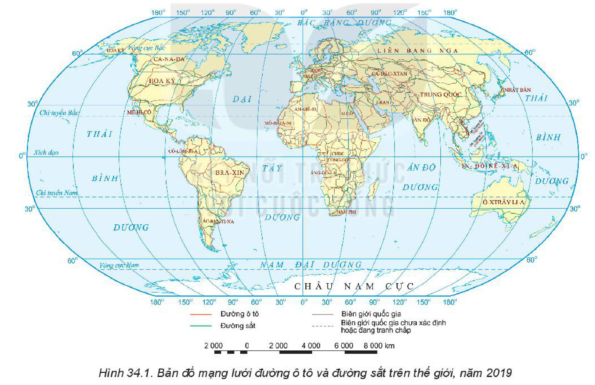
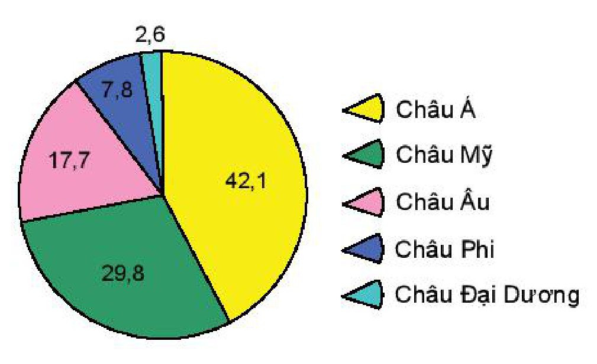
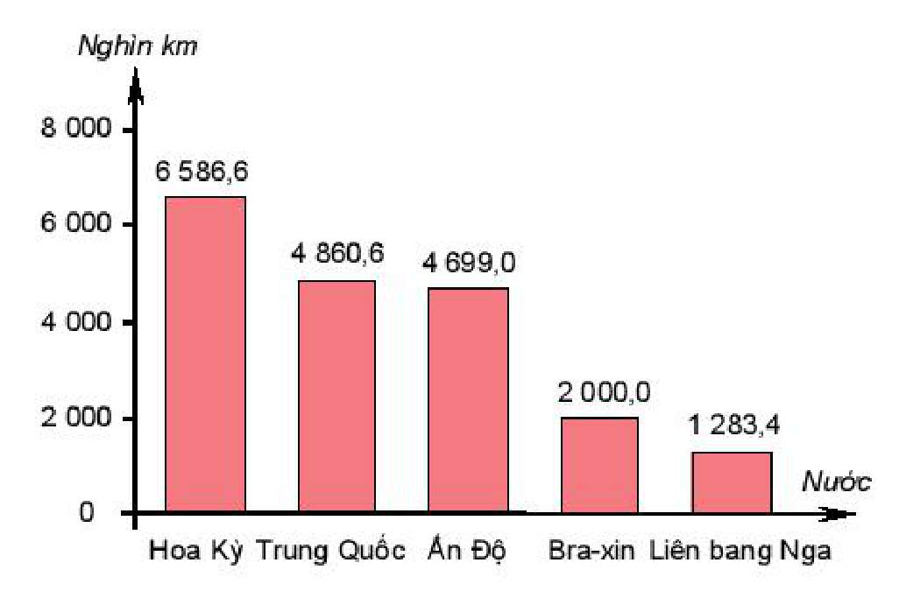
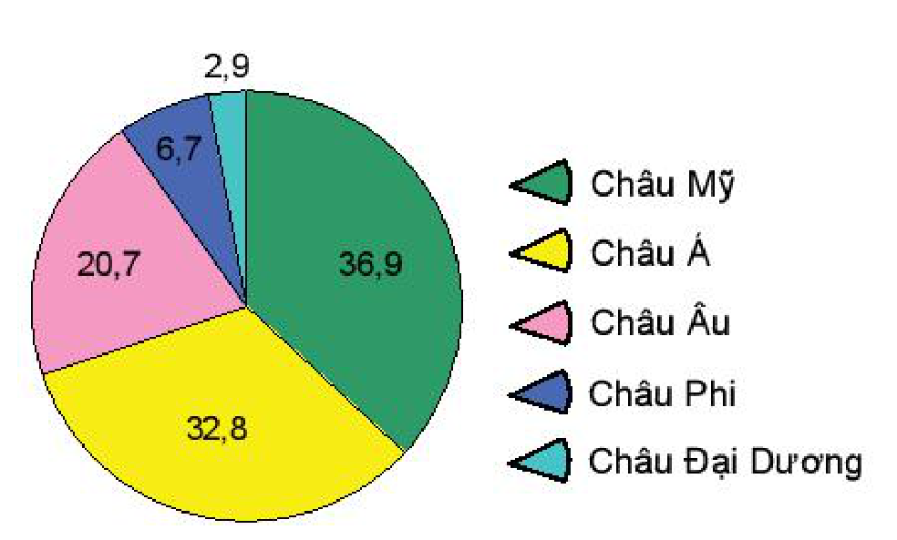
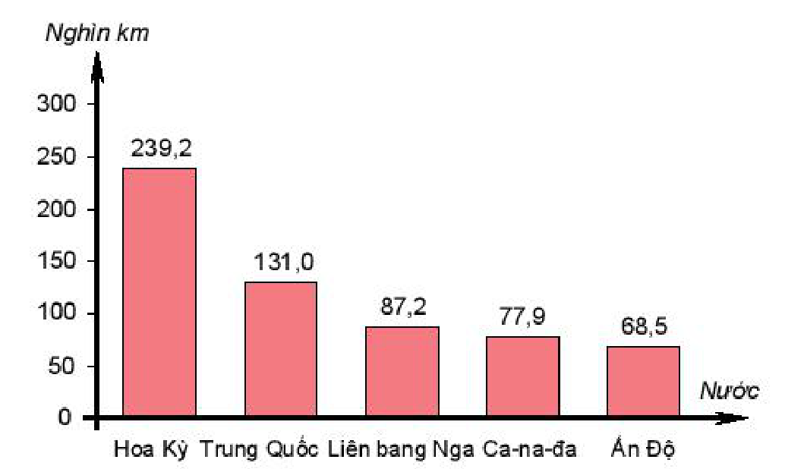
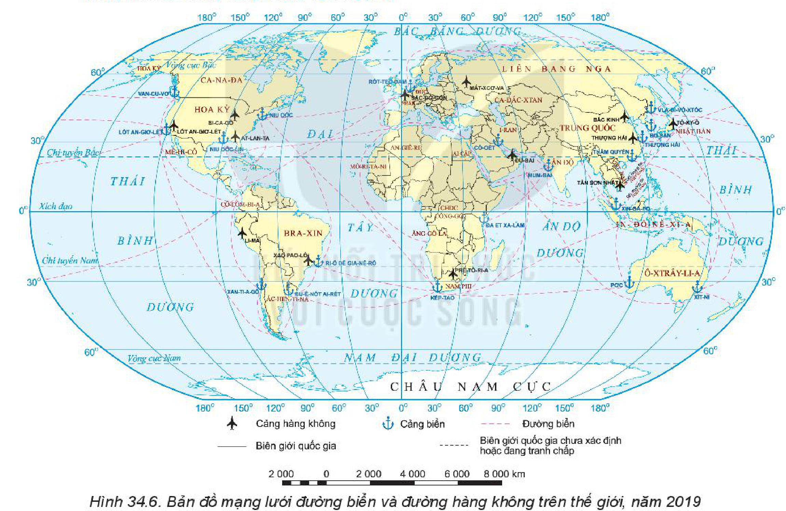

<!-- pdf:94 -->

# BÀI 34: ĐỊA LÍ NGÀNH GIAO THÔNG VẬN TẢI

## 🔴 Mở đầu

Giao thông vận tải là ngành dịch vụ đặc biệt. Các tuyến giao thông được coi là những mạch máu lưu thông giúp quá trình sản xuất và các hoạt động xã hội được diễn ra liên tục. Giao thông vận tải có vai trò và đặc điểm như thế nào? Tình hình phát triển của giao thông vận tải thế giới ra sao?

## 1. Vai trò, đặc điểm

### a) Vai trò

<!-- term: Vai trò của giao thông vận tải -->
- Với kinh tế, giao thông vận tải vận chuyển nguyên liệu, vật tư kĩ thuật,... đến nơi sản xuất và sản phẩm đến nơi tiêu thụ. Nhờ đó, thúc đẩy hoạt động sản xuất, kết nối các ngành kinh tế.
- Với đời sống xã hội, giao thông vận tải vận chuyển hành khách, phục vụ nhu cầu đi lại của dân cư, kết nối các địa phương, tăng cường khả năng an ninh quốc phòng. Đồng thời, thúc đẩy quá trình hội nhập quốc tế.
- Giao thông vận tải gắn kết giữa phát triển kinh tế với phát triển xã hội.

### b) Đặc điểm

<!-- term: Giao thông vận tải -->
<!-- term: Khối lượng vận chuyển -->
<!-- term: Khối lượng luân chuyển -->
<!-- term: Cự li vận chuyển trung bình -->
<!-- term: Mạng lưới giao thông vận tải -->
- Đối tượng phục vụ của giao thông vận tải là con người và các sản phẩm vật chất do con người làm ra. Sản phẩm của giao thông vận tải là sự chuyên chở người và hàng hoá từ nơi này đến nơi khác.
- Chất lượng của dịch vụ giao thông vận tải được đánh giá bằng tốc độ chuyên chở, sự tiện nghi, sự an toàn cho hành khách và hàng hoá.
- Tiêu chí đánh giá khối lượng dịch vụ của giao thông vận tải là: khối lượng vận chuyển (số lượt khách, số tấn hàng hoá); khối lượng luân chuyển (số lượt khách.km, số tấn.km); cự li vận chuyển trung bình (km).
- Sự phân bố của ngành giao thông vận tải có tính đặc thù, theo mạng lưới (gồm các tuyến và các đầu mối giao thông).
- Khoa học – công nghệ làm thay đổi loại hình, chất lượng,... của ngành giao thông vận tải.

> ❓ Dựa vào thông tin trong mục 1, hãy trình bày vai trò và đặc điểm của giao thông vận tải.

## 2. Các nhân tố ảnh hưởng đến sự phát triển và phân bố

<!-- term: Các nhân tố ảnh hưởng đến sự phát triển và phân bố giao thông vận tải -->
- Vị trí địa lí: Ảnh hưởng đến sự có mặt của loại hình vận tải, sự hình thành các mạng lưới giao thông vận tải và sự kết nối của mạng lưới giao thông bên trong với mạng lưới giao thông bên ngoài lãnh thổ.
- Điều kiện tự nhiên và tài nguyên thiên nhiên: Ảnh hưởng tới sự lựa chọn loại hình vận tải thích hợp, sự phân bố mạng lưới giao thông và sự hoạt động của các phương tiện vận tải.
- Điều kiện kinh tế – xã hội:
  + Sự phát triển, phân bố các ngành kinh tế và dân cư: Ảnh hưởng tới sự hình thành các đầu mối và mạng lưới giao thông vận tải, quyết định khối lượng vận tải (hàng hoá, hành khách).

<!-- pdf:95 -->

<!-- term: Các nhân tố ảnh hưởng đến sự phát triển và phân bố giao thông vận tải -->
  + Vốn đầu tư: Ảnh hưởng tới quy mô và tốc độ phát triển giao thông vận tải, loại hình giao thông vận tải.
  + Khoa học – công nghệ: Ảnh hưởng tới trình độ (vận tốc phương tiện, sự an toàn, sự tiện nghi,...) của giao thông vận tải.

> ❓ Dựa vào thông tin trong mục 2, hãy phân tích các nhân tố ảnh hưởng đến sự phát triển và phân bố giao thông vận tải.

## 3. Tình hình phát triển và phân bố

### a) Đường ô tô

<!-- term: Đường ô tô -->
- Tình hình phát triển: Ưu thế của giao thông vận tải đường ô tô là sự tiện lợi, tính cơ động, dễ kết nối với các loại hình vận tải khác,... Tổng chiều dài đường ô tô trên thế giới không ngừng tăng, từ 27 803,8 nghìn km (năm 2000) lên 38 016,5 nghìn km (năm 2019). Số lượng phương tiện vận tải ngày càng tăng. Sự bùng nổ trong việc sử dụng phương tiện ô tô gây ra nhiều vấn đề nghiêm trọng về môi trường. Vì vậy việc phát triển phương tiện giao thông thân thiện với môi trường, giao thông thông minh đang được các quốc gia hướng tới.

*Hình 34.1. Bản đồ mạng lưới đường ô tô và đường sắt trên thế giới, năm 2019*

*Mô tả hình:* Bản đồ thế giới thể hiện mạng lưới đường ô tô (đường liền nét màu đỏ cam) và đường sắt (đường liền nét màu xanh lục) năm 2019. Mạng lưới đường ô tô và đường sắt phân bố dày đặc nhất ở khu vực Tây và Trung Âu (Đức, Pháp,...), Hoa Kỳ, Ấn Độ, phía đông Trung Quốc, Nhật Bản, miền nam Liên bang Nga, đông nam Bra-xin, Ác-hen-ti-na, Nam Phi và đông nam Ô-xtrây-li-a; thưa thớt ở khu vực Bắc Phi (hoang mạc Xa-ha-ra), bắc Liên bang Nga, bắc Ca-na-đa và nội địa Ô-xtrây-li-a.
<!-- ocr-ok: mô tả hình ảnh bổ trợ không phải chữ in trực tiếp trong sách -->

<!-- term: Đường ô tô -->
- Sự phân bố: Mật độ và chiều dài đường ô tô rất khác nhau giữa các châu lục và các quốc gia. Riêng năm nước có chiều dài đường ô tô lớn nhất (Hoa Kỳ, Trung Quốc, Ấn Độ, Bra-xin, Liên bang Nga) đã chiếm hơn 1/2 tổng chiều dài đường ô tô của thế giới.

<!-- pdf:96 -->

*Hình 34.2. Biểu đồ cơ cấu theo chiều dài đường ô tô trên thế giới, năm 2019 (%)*

*Mô tả hình:* Biểu đồ tròn thể hiện cơ cấu theo chiều dài đường ô tô trên thế giới năm 2019 (%): Châu Á chiếm tỉ trọng lớn nhất với 42,1%, tiếp theo là Châu Mỹ 29,8%, Châu Âu 17,7%, Châu Phi 7,8% và Châu Đại Dương 2,6%.
<!-- ocr-ok: mô tả hình ảnh bổ trợ không phải chữ in trực tiếp trong sách -->

*Hình 34.3. Biểu đồ các nước có chiều dài đường ô tô lớn nhất thế giới, năm 2019*

*Mô tả hình:* Biểu đồ cột thể hiện 5 nước có chiều dài đường ô tô lớn nhất thế giới năm 2019 (đơn vị: Nghìn km): Hoa Kỳ đứng đầu với 6 586,6 nghìn km; Trung Quốc 4 860,6 nghìn km; Ấn Độ 4 699,0 nghìn km; Bra-xin 2 000,0 nghìn km; Liên bang Nga 1 283,4 nghìn km.
<!-- ocr-ok: mô tả hình ảnh bổ trợ không phải chữ in trực tiếp trong sách -->

> ❓ Dựa vào thông tin trong mục a và các hình 34.1, 34.2, 34.3, hãy trình bày tình hình phát triển và phân bố giao thông vận tải đường ô tô trên thế giới.

### b) Đường sắt

<!-- term: Đường sắt -->
- Tình hình phát triển: Đầu thế kỉ XIX, giao thông vận tải đường sắt ra đời với sự kết hợp giữa việc sử dụng đầu máy hơi nước với đường ray bằng sắt. Từ đó, ngành vận tải đường sắt không ngừng phát triển cả về chiều dài tuyến đường, trình độ kĩ thuật, khả năng vận hành,... Tổng chiều dài đường sắt của thế giới tăng từ 1 011,7 nghìn km (năm 2000) lên 1 321,9 nghìn km (năm 2019). Tốc độ và sức vận tải đã tăng lên nhiều nhờ sự phát triển của công nghệ. Hiện nay, ngành đường sắt tăng cường áp dụng công nghệ mới, tự động hoá để đạt hiệu quả tối ưu và chú ý tới bảo vệ môi trường. Một số loại hình đường sắt được phát triển là đường sắt trên cao, tàu điện ngầm, các tuyến tàu siêu tốc,...
- Sự phân bố: Mạng lưới đường sắt có sự phân bố không đều giữa các châu lục và các quốc gia. Châu Âu và Đông Bắc Hoa Kỳ là những nơi có mật độ đường sắt cao nhất thế giới.

<!-- term: Tàu cao tốc Sin-can-sen -->
> 💡 Em có biết?
> Sin-can-sen là hệ thống tàu cao tốc ở Nhật Bản – một trong những bước tiến công nghệ hàng đầu của Nhật Bản được cả thế giới biết đến. Tốc độ tối đa của tàu vào khoảng 320 km/giờ, thường rất đúng giờ, an toàn và rất tiện nghi.
<!-- ocr-ok: đối chiếu trực tiếp ảnh trang PDF 96 hộp Em có biết bị trộn dòng với văn bản bên trái khi OCR -->

*Hình 34.4. Biểu đồ cơ cấu theo chiều dài đường sắt trên thế giới, năm 2019 (%)*

*Mô tả hình:* Biểu đồ tròn thể hiện cơ cấu theo chiều dài đường sắt trên thế giới năm 2019 (%): Châu Mỹ chiếm tỉ trọng lớn nhất với 36,9%, tiếp theo là Châu Á 32,8%, Châu Âu 20,7%, Châu Phi 6,7% và Châu Đại Dương 2,9%.
<!-- ocr-ok: mô tả hình ảnh bổ trợ không phải chữ in trực tiếp trong sách -->

*Hình 34.5. Biểu đồ các nước có chiều dài đường sắt lớn nhất thế giới, năm 2019*

*Mô tả hình:* Biểu đồ cột thể hiện 5 nước có chiều dài đường sắt lớn nhất thế giới năm 2019 (đơn vị: Nghìn km): Hoa Kỳ đứng đầu với 239,2 nghìn km; Trung Quốc 131,0 nghìn km; Liên bang Nga 87,2 nghìn km; Ca-na-đa 77,9 nghìn km; Ấn Độ 68,5 nghìn km.
<!-- ocr-ok: mô tả hình ảnh bổ trợ không phải chữ in trực tiếp trong sách -->

> ❓ Dựa vào thông tin trong mục b và các hình 34.1, 34.4, 34.5, hãy trình bày tình hình phát triển và phân bố giao thông vận tải đường sắt trên thế giới.

<!-- pdf:97 -->

### c) Đường hàng không

<!-- term: Đường hàng không -->
<!-- term: Bảo vệ môi trường -->
- Tình hình phát triển: Vận tải hàng không là ngành giao thông vận tải ra đời muộn nhưng có bước phát triển mạnh mẽ cả về số lượng, chất lượng sân bay, máy bay. Năm 2019, ngành hàng không thế giới vận chuyển được hơn 4,4 tỉ lượt hành khách. Các máy bay ngày càng hiện đại hơn, vận chuyển được khối lượng lớn hơn, bay được quãng đường xa hơn với tốc độ nhanh hơn và an toàn hơn. Đồng thời, bảo vệ môi trường không khí cũng là vấn đề lớn của ngành vận tải đường hàng không.
- Sự phân bố: Các tuyến đường hàng không sôi động nhất là các tuyến xuyên Đại Tây Dương nối châu Âu với châu Mỹ và các tuyến nối Hoa Kỳ với khu vực châu Á – Thái Bình Dương. Các nước có nhiều sân bay quốc tế vận chuyển lượng hành khách lớn của thế giới là Hoa Kỳ, Trung Quốc,... Các sân bay quốc tế vận chuyển hành khách lớn nhất năm 2019 là: Át-lan-ta (Hoa Kỳ), Bắc Kinh (Trung Quốc), Lốt An-giơ-lét (Hoa Kỳ), Đu-bai (Các tiểu vương quốc A-rập thống nhất),...

> ❓ Dựa vào thông tin trong mục c và hình 34.6, hãy trình bày tình hình phát triển và phân bố giao thông vận tải đường hàng không trên thế giới.

*Hình 34.6. Bản đồ mạng lưới đường biển và đường hàng không trên thế giới, năm 2019*

*Mô tả hình:* Bản đồ thế giới thể hiện các cảng hàng không lớn (kí hiệu hình máy bay), cảng biển lớn (kí hiệu hình mỏ neo) và các tuyến đường biển (đường nét đứt màu hồng tím) năm 2019. Các cảng hàng không và cảng biển lớn tập trung ở Bắc Mỹ (Van-cu-vơ, Lốt An-giơ-lét, Si-ca-gô, Niu Oóc, Át-lan-ta, Niu Oóc-lin), Nam Mỹ (Li-ma, Xao Pao-lô, Ri-ô đê Gia-nê-rô, Bu-ê-nốt Ai-rét, Xan-ti-a-gô), châu Âu (Rốt-téc-đam, Mát-xcơ-va,...), châu Phi (Đa-ét Xa-lam, Prê-tô-ri-a, Kếp-tao), châu Á (Đu-bai, Mum-bai, Xin-ga-po, Tân Sơn Nhất, Thâm Quyến, Thượng Hải, Bắc Kinh, Bu-san, Tô-ky-ô, Vla-đi-vô-xtốc) và Ô-xtrây-li-a (Pớc, Xít-ni).
<!-- ocr-ok: mô tả hình ảnh bổ trợ không phải chữ in trực tiếp trong sách -->

### d) Đường biển

<!-- term: Đường biển -->
- Tình hình phát triển: Giao thông đường biển đảm nhiệm 3/5 khối lượng luân chuyển hàng hoá trong tổng khối lượng của tất cả các phương tiện vận tải hàng hoá trên thế giới (chủ yếu là dầu mỏ và sản phẩm của dầu mỏ). Khối lượng hàng hoá vận chuyển bằng tàu công-te-nơ không ngừng tăng và trở nên thông dụng. Năm 2019, số lượng tàu biển trên thế giới đã đạt hơn 2 triệu chiếc. Ngành vận tải đường biển hướng tới quy trình chặt chẽ, hạn chế rủi ro và bảo vệ hàng hoá an toàn trong quá trình vận chuyển, đồng thời chú ý tới vấn đề bảo vệ môi trường biển và đại dương.

<!-- pdf:98 -->

<!-- term: Đường biển -->
- Sự phân bố: Các tuyến đường biển hoạt động sôi động nhất là các tuyến kết nối giữa châu Âu với khu vực châu Á – Thái Bình Dương và các tuyến kết nối hai bờ Đại Tây Dương. Các cảng biển có lượng hàng hoá lưu thông qua cảng lớn nhất (năm 2019) đều nằm ở châu Á: Thượng Hải (Trung Quốc), Xin-ga-po, Ninh Ba – Chu Sơn (Trung Quốc), Thâm Quyến (Trung Quốc), Bu-san (Hàn Quốc),...

> ❓ Dựa vào thông tin trong mục d và hình 34.6, hãy trình bày tình hình phát triển và phân bố giao thông vận tải đường biển trên thế giới.

### e) Đường sông, hồ

<!-- term: Đường sông, hồ -->
- Tình hình phát triển: Vận tải trên sông, hồ xuất hiện từ rất sớm dựa trên hệ thống sông, hồ tự nhiên và ngày càng thuận lợi nhờ các hoạt động cải tạo sông, hồ của con người. Cải tạo cơ sở hạ tầng đường thuỷ, kết nối vận tải đường thuỷ và cảng biển bằng công-te-nơ, ứng dụng công nghệ cao,... là xu hướng phát triển của ngành vận tải đường sông, hồ trong tương lai.
- Sự phân bố: Các quốc gia phát triển mạnh giao thông sông, hồ là Hoa Kỳ, Liên bang Nga, Ca-na-đa. Các hệ thống sông, hồ có tiềm năng lớn về giao thông là Đa-nuýp, Rai-nơ, Von-ga,... (châu Âu), Mê Công, Dương Tử,... (châu Á), Mi-xi-xi-pi và Ngũ Hồ,... (châu Mỹ).

> ❓ Dựa vào thông tin trong mục e, hãy trình bày tình hình phát triển và phân bố giao thông vận tải đường sông, hồ.

## ✏️ Luyện tập

Vẽ biểu đồ cột thể hiện số lượng lượt hành khách vận chuyển bằng đường hàng không của thế giới theo bảng số liệu dưới đây. Nhận xét.
<!-- ocr-ok: đối chiếu trực tiếp ảnh trang PDF 98 câu hỏi Luyện tập bị OCR bỏ sót -->

**BẢNG 34. SỐ LƯỢNG LƯỢT HÀNH KHÁCH VẬN CHUYỂN ĐƯỜNG HÀNG KHÔNG TRÊN THẾ GIỚI, GIAI ĐOẠN 2000 – 2019**

*(Đơn vị: tỉ lượt người)*

| Năm | 2000 | 2010 | 2019 |
| --- | --- | --- | --- |
| Số lượng hành khách | 1,9 | 2,6 | 4,4 |

## 🚀 Vận dụng

Tìm hiểu về quá trình phát triển của giao thông vận tải đường ô tô hoặc giao thông vận tải đường hàng không ở nước ta.

## 📷 Danh sách hình trong bài

| Mã hình | Trang PDF | Vị trí trong bài | Chú thích gốc |
| --- | --- | --- | --- |
| H10-dia-b34-01 | 95 | Mục 3.a | Hình 34.1. Bản đồ mạng lưới đường ô tô và đường sắt trên thế giới, năm 2019 |
| H10-dia-b34-02 | 96 | Mục 3.a | Hình 34.2. Biểu đồ cơ cấu theo chiều dài đường ô tô trên thế giới, năm 2019 (%) |
| H10-dia-b34-03 | 96 | Mục 3.a | Hình 34.3. Biểu đồ các nước có chiều dài đường ô tô lớn nhất thế giới, năm 2019 |
| H10-dia-b34-04 | 96 | Mục 3.b | Hình 34.4. Biểu đồ cơ cấu theo chiều dài đường sắt trên thế giới, năm 2019 (%) |
| H10-dia-b34-05 | 96 | Mục 3.b | Hình 34.5. Biểu đồ các nước có chiều dài đường sắt lớn nhất thế giới, năm 2019 |
| H10-dia-b34-06 | 97 | Mục 3.c | Hình 34.6. Bản đồ mạng lưới đường biển và đường hàng không trên thế giới, năm 2019 |
