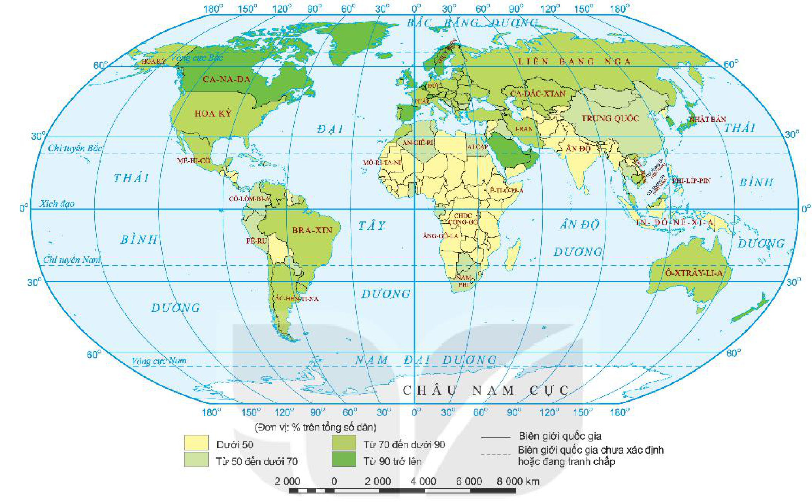

<!-- pdf:99 -->

# BÀI 35: ĐỊA LÍ NGÀNH BƯU CHÍNH VIỄN THÔNG

## 🔴 Mở đầu

Bưu chính viễn thông là một trong các ngành dịch vụ cơ bản, cung cấp nhiều điều kiện cần thiết cho các lĩnh vực sản xuất và đời sống. Khó có thể hình dung một xã hội hiện đại mà không có ngành bưu chính viễn thông. Ngành bưu chính viễn thông trên thế giới có vai trò, đặc điểm như thế nào? Tình hình phát triển và phân bố của ngành này ra sao?

## 1. Vai trò, đặc điểm

### a) Vai trò

<!-- term: Vai trò của bưu chính viễn thông -->
- VAI TRÒ CỦA BƯU CHÍNH VIỄN THÔNG:
  + Với phát triển kinh tế:
    - Cung ứng và truyền tải thông tin, vận chuyển bưu phẩm, bưu kiện góp phần tăng năng suất lao động.
    - Hiện đại hoá, thay đổi cách thức tổ chức nền kinh tế, thúc đẩy kinh tế phát triển.
    - Bản thân bưu chính viễn thông cũng là ngành dịch vụ mang lại giá trị kinh tế cao.
  + Với các lĩnh vực khác:
    - Đảm bảo giao lưu giữa các vùng, thúc đẩy quá trình hội nhập và toàn cầu hoá.
    - Tạo thuận lợi cho quản lí hành chính.
    - Nâng cao đời sống văn hoá, tinh thần trong xã hội.

### b) Đặc điểm

<!-- term: Bưu chính viễn thông -->
<!-- term: Bưu chính -->
<!-- term: Viễn thông -->
- Ngành bưu chính viễn thông bao gồm hai nhóm: bưu chính (vận chuyển thư, bưu phẩm, bưu kiện, hàng hoá,...) và viễn thông (dịch vụ gửi, truyền, nhận và xử lí thông tin giữa các đối tượng sử dụng).
- Sản phẩm của bưu chính viễn thông là sự vận chuyển tin tức, bưu kiện, bưu phẩm, truyền dẫn thông tin điện tử,... từ nơi gửi đến nơi nhận.

<!-- pdf:100 -->

<!-- term: Bưu chính viễn thông -->
- Viễn thông sử dụng các phương tiện, thiết bị để cung ứng dịch vụ từ các khoảng cách xa, không cần sự tiếp xúc giữa người cung cấp dịch vụ và người sử dụng dịch vụ.
- Sản phẩm có thể đánh giá thông qua khối lượng sản phẩm, dịch vụ đã thực hiện, như số lượng thư đã chuyển (kg), thời gian đàm thoại (phút),...
- Sự phát triển của bưu chính viễn thông trong tương lai phụ thuộc lớn vào sự phát triển của khoa học – công nghệ.

> ❓ Dựa vào thông tin trong mục 1, hãy trình bày vai trò và đặc điểm của bưu chính viễn thông.

## 2. Các nhân tố ảnh hưởng đến sự phát triển và phân bố

<!-- term: Các nhân tố ảnh hưởng đến sự phát triển và phân bố bưu chính viễn thông -->
- Trình độ phát triển kinh tế, mức sống dân cư ảnh hưởng tới quy mô và tốc độ phát triển bưu chính viễn thông.
- Sự phân bố các ngành kinh tế, phân bố dân cư và mạng lưới quần cư ảnh hưởng tới mật độ phân bố và sử dụng bưu chính viễn thông.
- Sự phát triển của khoa học công nghệ tác động đến chất lượng hoạt động và sự phát triển của bưu chính viễn thông.

> ❓ Dựa vào thông tin trong mục 2, hãy phân tích các nhân tố ảnh hưởng đến sự phát triển và phân bố của bưu chính viễn thông. Nêu ví dụ.

## 3. Tình hình phát triển và phân bố

<!-- term: Bưu chính -->
<!-- term: Tình hình phát triển và phân bố bưu chính -->
<!-- term: Tình hình phát triển và phân bố viễn thông -->
- Bưu chính bao gồm các dịch vụ vận chuyển thư tín, bưu phẩm, chuyển tiền và điện báo. Mạng lưới bưu cục không ngừng được mở rộng và nâng cấp. Nhiều dịch vụ mới có chất lượng cao ra đời (chuyển phát nhanh, khai thác dữ liệu qua bưu chính, bán hàng qua bưu điện,...). Tuy mạng lưới bưu cục mở rộng trên toàn cầu nhưng vẫn chủ yếu tập trung ở các thành phố, các trung tâm công nghiệp.
- Viễn thông phát triển nhanh chóng, trở thành một trong những hạ tầng cơ sở quan trọng nhất của nền kinh tế, các dịch vụ chủ yếu là điện thoại và internet.
  + Điện thoại là phương tiện liên lạc được sử dụng phổ biến nhất trên thế giới hiện nay. Từ chiếc điện thoại đầu tiên được phát minh năm 1876, đến năm 2019 đã có hơn 5 tỉ người trên thế giới đang sử dụng điện thoại cá nhân với hơn 8 tỉ thuê bao di động. Bình quân số máy điện thoại trên thế giới là 107,7/100 dân. Các nước có số thuê bao điện thoại nhiều nhất là Trung Quốc, Ấn Độ, Hoa Kỳ, Bra-xin, Liên bang Nga.
  + Internet ra đời từ năm 1989 đã tạo ra cuộc cách mạng trong ngành viễn thông thế giới do thúc đẩy quá trình trao đổi thông tin toàn cầu phát triển mạnh. Số người sử dụng internet ngày càng tăng. Năm 2019, có hơn 4,3 tỉ người trên thế giới sử dụng internet. Các nước có tỉ lệ người sử dụng internet cao là Ca-na-đa, Hàn Quốc, Nhật Bản, Anh, các nước EU, Trung Đông,...

> 💡 Em có biết?
> Mạng di động đầu tiên ở nước ta ra đời năm 1993. Từ đó đến nay, số lượng thuê bao điện thoại di động ngày càng tăng nhanh, mạng di động ngày càng phát triển, tiện lợi.
> Việt Nam kết nối internet vào năm 1997. Đến nay, nước ta là một trong 20 nước có số lượng người sử dụng internet nhiều nhất thế giới.
<!-- ocr-ok: đối chiếu trực tiếp ảnh trang PDF 100 hộp Em có biết bị trộn dòng hai cột khi OCR -->

<!-- pdf:101 -->

Ngành viễn thông đã ứng dụng những thành tựu của công nghệ thông tin (internet vạn vật, dữ liệu số, điện toán đám mây,...) để nâng cao chất lượng và khả năng cung ứng dịch vụ.

*Hình 35. Bản đồ tỉ lệ số dân sử dụng internet của các nước, năm 2019 (%)*

*Mô tả hình:* Bản đồ thế giới thể hiện tỉ lệ số dân sử dụng internet của các nước năm 2019 (Đơn vị: % trên tổng số dân) theo 4 mức màu: Từ 90 trở lên (màu xanh lá đậm: Ca-na-đa, Anh, Thuỵ Điển, Hàn Quốc, Nhật Bản,...), Từ 70 đến dưới 90 (màu xanh lá vừa: Hoa Kỳ, Liên bang Nga, Pháp, Đức, Tây Ban Nha, Ô-xtrây-li-a, Bra-xin, Ác-hen-ti-na, A-rập Xê-út,...), Từ 50 đến dưới 70 (màu xanh lá nhạt: Trung Quốc, Mê-hi-cô, Cô-lôm-bi-a, Pê-ru, Nam Phi, Ai Cập, I-ran, Ca-dắc-xtan, Việt Nam, Phi-líp-pin,...), và Dưới 50 (màu vàng nhạt: Ấn Độ, In-đô-nê-xi-a, phần lớn các nước châu Phi như An-giê-ri, Mô-ri-ta-ni, CHDC Công-gô, Ăng-gô-la, Ê-ti-ô-pi-a,...).
<!-- ocr-ok: mô tả hình ảnh bổ trợ không phải chữ in trực tiếp trong sách -->

> ❓ Dựa vào thông tin trong mục 3 và hình 35, hãy trình bày tình hình phát triển và phân bố ngành bưu chính viễn thông trên thế giới.

## ✏️ Luyện tập

Nêu ví dụ chứng minh sự phát triển của dịch vụ bưu chính viễn thông trên thế giới.

## 🚀 Vận dụng

Tìm hiểu về vai trò của internet đối với cuộc sống.

## 📷 Danh sách hình trong bài

| Mã hình | Trang PDF | Vị trí trong bài | Chú thích gốc |
| --- | --- | --- | --- |
| H10-dia-b35-01 | 101 | Mục 3 | Hình 35. Bản đồ tỉ lệ số dân sử dụng internet của các nước, năm 2019 (%) |
