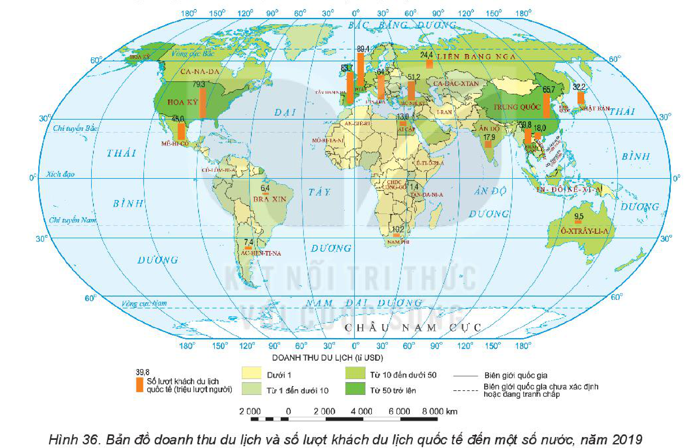

<!-- pdf:102 -->

# BÀI 36: ĐỊA LÍ NGÀNH DU LỊCH

## 🔴 Mở đầu

Du lịch là ngành dịch vụ có tốc độ phát triển nhanh và thu hút sự tham gia của hàng tỉ người trên thế giới. Du lịch có vai trò, đặc điểm như thế nào? Những nhân tố nào ảnh hưởng tới sự phát triển và phân bố du lịch? Tình hình phát triển và phân bố du lịch thế giới ra sao?

## 1. Vai trò, đặc điểm

### a) Vai trò

<!-- term: Vai trò của du lịch -->
- VAI TRÒ CỦA DU LỊCH:
  + Với phát triển kinh tế:
    - Góp phần khai thác hiệu quả nguồn lực của đất nước.
    - Tạo nguồn thu (cả về ngoại tệ) cho đất nước. Thúc đẩy sự phát triển của các ngành kinh tế liên quan.
    - Tạo việc làm, tăng thu nhập cho người dân.
  + Với các lĩnh vực khác:
    - Đáp ứng nhu cầu tinh thần, phục hồi và bồi dưỡng sức khoẻ cho con người.
    - Bảo tồn, phát triển các giá trị văn hoá, bảo vệ môi trường.
    - Tăng cường sự hiểu biết đất nước, quan hệ giữa các dân tộc, các quốc gia.

### b) Đặc điểm

<!-- term: Du lịch -->
<!-- term: Đặc điểm của ngành du lịch -->
- Du lịch là ngành đặc biệt, vừa mang đặc điểm của một ngành kinh tế, vừa mang đặc điểm của một ngành văn hoá – xã hội.
- Du lịch là ngành kinh tế tổng hợp, liên quan đến nhiều ngành nghề khác.
- Hoạt động du lịch thường có tính mùa vụ, chịu ảnh hưởng lớn bởi các điều kiện tự nhiên, điều kiện kinh tế – xã hội, dịch bệnh,...
- Khoa học – công nghệ tác động làm thay đổi hình thức, chất lượng,... của ngành du lịch.

> ❓ Dựa vào thông tin trong mục 1, hãy trình bày vai trò và đặc điểm của du lịch.

## 2. Các nhân tố ảnh hưởng đến sự phát triển và phân bố

<!-- term: Tài nguyên du lịch -->
<!-- term: Các nhân tố ảnh hưởng đến sự phát triển và phân bố du lịch -->
- Sự có mặt của các tài nguyên du lịch tự nhiên, tài nguyên du lịch nhân văn và sự kết hợp của các tài nguyên du lịch trên, tạo ra các sản phẩm du lịch.
- Thị trường (khách du lịch) có ảnh hưởng rất lớn tới doanh thu của ngành du lịch cũng như cơ cấu của các sản phẩm du lịch.
- Cơ sở vật chất – kĩ thuật (cơ sở lưu trú, nhà hàng, khu vui chơi, giải trí, các cơ sở thương mại,...) và cơ sở hạ tầng (giao thông vận tải, bưu chính viễn thông, điện, nước,...) là những điều kiện thiết yếu để tổ chức hoạt động du lịch.
- Nguồn nhân lực chuyên nghiệp, chất lượng cao mang lại sự hài lòng cho du khách.
- Các điều kiện kinh tế – xã hội khác như sự phát triển của các ngành kinh tế, mức sống của dân cư, chính sách của nhà nước, điều kiện an ninh chính trị và an toàn xã hội, dịch bệnh,... đều có tác động đến sự phát triển và phân bố của ngành du lịch.

> ❓ Dựa vào thông tin trong mục 2, hãy phân tích các nhân tố ảnh hưởng đến sự phát triển và phân bố du lịch.

<!-- pdf:103 -->

## 3. Tình hình phát triển và phân bố

<!-- term: Tình hình phát triển và phân bố du lịch trên thế giới -->
Hoạt động du lịch trên thế giới phát triển nhanh từ thập kỉ 90 của thế kỉ XX đến nay. Du lịch đã trở thành một nhu cầu trong đời sống văn hoá – xã hội của người dân các nước, nhất là các nước kinh tế phát triển.

<!-- term: Tình hình phát triển và phân bố du lịch trên thế giới -->
Số lượng khách du lịch quốc tế không ngừng tăng, từ 455,9 triệu lượt người năm 1990 lên 687,3 triệu lượt người năm 2000 và 1 460 triệu lượt người năm 2019.

<!-- term: Tình hình phát triển và phân bố du lịch trên thế giới -->
Doanh thu từ du lịch cũng tăng nhờ lượng khách du lịch tăng và chi tiêu của khách cũng tăng, đạt 1 482 tỉ USD (năm 2019), chiếm khoảng 7% GDP thế giới. Địa bàn du lịch ngày càng mở rộng. Các hoạt động du lịch ngày càng phong phú, bên cạnh các loại hình du lịch truyền thống (tham quan, nghỉ dưỡng, thể thao,...) đã xuất hiện các loại hình du lịch mới (du lịch xanh; du lịch kết hợp hội nghị, hội thảo,...).

<!-- term: Du lịch bền vững -->
Tuy nhiên, sự bùng nổ du lịch cũng gây ra nhiều tác động đến môi trường, do vậy du lịch bền vững đang là xu hướng được các quốc gia quan tâm.

*Hình 36. Bản đồ doanh thu du lịch và số lượt khách du lịch quốc tế đến một số nước, năm 2019*

*Mô tả hình:* Bản đồ thế giới thể hiện doanh thu du lịch (tỉ USD, bằng màu nền lãnh thổ) và số lượt khách du lịch quốc tế (triệu lượt người, bằng cột màu cam) đến một số nước năm 2019. Về doanh thu du lịch (tỉ USD): Từ 50 trở lên (màu xanh lá đậm: Hoa Kỳ, Tây Ban Nha, Pháp, Trung Quốc, Ô-xtrây-li-a), Từ 10 đến dưới 50 (màu xanh lá vừa: Ca-na-đa, Mê-hi-cô, Anh, Đức, I-ta-li-a, Liên bang Nga, Ấn Độ, Thái Lan, Việt Nam, Nhật Bản, Hàn Quốc, Ai Cập,...), Từ 1 đến dưới 10 (màu xanh lá nhạt: Bra-xin, Ác-hen-ti-na, Nam Phi,...), Dưới 1 (màu vàng nhạt: CHDC Công-gô, Tan-da-ni-a, An-giê-ri,...). Về số lượt khách du lịch quốc tế (triệu lượt người): Pháp (89,4), Tây Ban Nha (83,7), Hoa Kỳ (79,3), Trung Quốc (65,7), I-ta-li-a (64,5), Mê-hi-cô (45,0), Anh (39,4), Đức (39,6), Thái Lan (39,8), Nhật Bản (32,2), Liên bang Nga (24,4), Việt Nam (18,0), Ấn Độ (17,9), Hàn Quốc (17,5), Ai Cập (13,0), Nam Phi (10,2), Ô-xtrây-li-a (9,5), Ác-hen-ti-na (7,4), Bra-xin (6,4), Tan-da-ni-a (1,4).
<!-- ocr-ok: mô tả hình ảnh bổ trợ không phải chữ in trực tiếp trong sách -->

Các nước có ngành du lịch phát triển nhất là: Hoa Kỳ, Trung Quốc, Pháp, Tây Ban Nha, I-ta-li-a, Nhật Bản, Hàn Quốc, Thái Lan, Ô-xtrây-li-a, Liên bang Nga,...

> ❓ Dựa vào thông tin trong mục 3 và hình 36, hãy trình bày tình hình phát triển và phân bố du lịch trên thế giới.

## ✏️ Luyện tập

Đọc bản đồ hình 36, hãy cho biết:
- Số lượt khách du lịch quốc tế đến các nước: Hoa Kỳ, Trung Quốc, Pháp, Việt Nam.
- Các nước có doanh thu du lịch từ 50 tỉ USD trở lên.

## 🚀 Vận dụng

Hãy tìm hiểu về một địa điểm du lịch nổi tiếng thế giới và trình bày trước lớp.

## 📷 Danh sách hình trong bài

| Mã hình | Trang PDF | Vị trí trong bài | Chú thích gốc |
| --- | --- | --- | --- |
| H10-dia-b36-01 | 103 | Mục 3 | Hình 36. Bản đồ doanh thu du lịch và số lượt khách du lịch quốc tế đến một số nước, năm 2019 |
