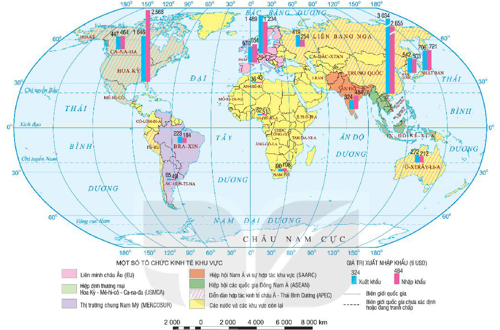

<!-- pdf:104 -->

# BÀI 37: ĐỊA LÍ NGÀNH THƯƠNG MẠI VÀ NGÀNH TÀI CHÍNH NGÂN HÀNG

## 🔴 Mở đầu

Thương mại và tài chính ngân hàng là những lĩnh vực dịch vụ quan trọng, được coi là những mạch máu của nền kinh tế, giúp cho hoạt động sản xuất, kinh doanh được diễn ra thường xuyên, liên tục. Ngành thương mại và ngành tài chính ngân hàng có vai trò và đặc điểm như thế nào?

## I. THƯƠNG MẠI

### 1. Vai trò, đặc điểm

**a) Vai trò**

<!-- term: Vai trò của thương mại -->
- VAI TRÒ:
  + Với phát triển kinh tế:
    - Là cầu nối giữa sản xuất và tiêu dùng.
    - Điều tiết sản xuất, giúp trao đổi hàng hoá được mở rộng, thúc đẩy sản xuất phát triển.
  + Với các lĩnh vực khác:
    - Định hướng tiêu dùng, tạo tập quán tiêu dùng mới.
    - Thúc đẩy phân công lao động giữa các lãnh thổ trong nước và trên thế giới.

**b) Đặc điểm**

<!-- term: Thương mại -->
<!-- term: Thị trường -->
<!-- term: Cán cân xuất nhập khẩu -->
<!-- term: Thương mại điện tử -->
- Thương mại là quá trình trao đổi hàng hoá, dịch vụ giữa bên bán và bên mua, đồng thời tạo ra thị trường.
- Hoạt động thương mại chịu tác động của quy luật cung và cầu.
- Không gian hoạt động thương mại không chỉ giới hạn trong phạm vi quốc gia (nội thương) mà còn giữa các quốc gia với nhau (ngoại thương).
- Hoạt động ngoại thương được đo lường bằng cán cân xuất nhập khẩu. Nếu trị giá xuất khẩu lớn hơn trị giá nhập khẩu gọi là xuất siêu. Nếu trị giá xuất khẩu nhỏ hơn trị giá nhập khẩu gọi là nhập siêu.
- Sự kết hợp giữa thương mại và công nghệ đã dẫn đến sự bùng nổ của thương mại điện tử.

> ❓ Dựa vào thông tin trong mục 1, hãy trình bày vai trò và đặc điểm của thương mại.

<!-- pdf:105 -->

### 2. Các nhân tố ảnh hưởng đến sự phát triển và phân bố

<!-- term: Các nhân tố ảnh hưởng đến sự phát triển và phân bố thương mại -->
| NHÂN TỐ | ẢNH HƯỞNG |
| --- | --- |
| Vị trí địa lí | Hình thành đầu mối thương mại, thu hút đầu tư, thúc đẩy thương mại phát triển. |
| Trình độ phát triển kinh tế và lịch sử – văn hoá | Cơ cấu thương mại, quy mô phát triển thương mại. |
| Đặc điểm dân cư | Sức mua và nhu cầu của người dân. Hình thành mạng lưới thương mại. |
| Khoa học – công nghệ | Thay đổi cách thức, loại hình thương mại. |
| Toàn cầu hoá, hội nhập quốc tế | Thúc đẩy đầu tư quốc tế, phát triển ngoại thương, hình thành các tổ chức thương mại quốc tế. |

> ❓ Dựa vào sơ đồ, phân tích các nhân tố ảnh hưởng đến sự phát triển và phân bố thương mại.

### 3. Tình hình phát triển và phân bố

<!-- term: Nội thương -->
<!-- term: Ngoại thương -->
<!-- term: Thương mại điện tử -->
- Nội thương: Cùng với sự phát triển của sức sản xuất và quy mô dân số, hoạt động thương mại trong các quốc gia ngày càng phát triển về cả không gian trao đổi sản phẩm, số lượng và chất lượng sản phẩm. Quy mô thị trường hàng hoá ngày càng phát triển, hàng hoá trên thị trường ngày càng phong phú, đa dạng. Việc mua bán hàng hoá thường diễn ra tại các cửa hàng bán lẻ, chợ, siêu thị, trung tâm thương mại. Thương mại điện tử đang phát triển mạnh mẽ, làm thay đổi thương mại truyền thống.
- Ngoại thương: Thị trường thế giới hiện nay là thị trường toàn cầu, xu hướng toàn cầu hoá kinh tế đang là xu hướng quan trọng nhất trong nền kinh tế thế giới. Thương mại quốc tế ngày càng tăng về khối lượng và giá trị hàng hoá.

<!-- term: Tổ chức Thương mại Thế giới -->
> 💡 Em có biết?
> Tổ chức Thương mại Thế giới (WTO) là tổ chức quốc tế có chức năng giám sát các hiệp định thương mại giữa các nước thành viên.
> Một số tổ chức kinh tế khu vực là EU (Liên minh châu Âu), ASEAN (Hiệp hội các quốc gia Đông Nam Á), APEC (Diễn đàn hợp tác kinh tế châu Á – Thái Bình Dương),...

**Bảng 37. TỔNG TRỊ GIÁ HÀNG HOÁ XUẤT KHẨU VÀ NHẬP KHẨU TRÊN THẾ GIỚI, GIAI ĐOẠN 1990 – 2019**
<!-- ocr-ok: đối chiếu trực tiếp ảnh trang PDF 105 tiêu đề Bảng 37 OCR nhận nhầm dấu -->

*(Đơn vị: tỉ USD)*

| Năm | 1990 | 2000 | 2010 | 2019 |
| --- | --- | --- | --- | --- |
| Tổng trị giá hàng hoá xuất khẩu và nhập khẩu | 6 816 | 12 423 | 29 516 | 37 169 |
<!-- ocr-ok: đối chiếu trực tiếp ảnh trang PDF 105 bảng số liệu Bảng 37 -->

<!-- pdf:106 -->

<!-- term: Ngoại thương -->
Các mặt hàng xuất nhập khẩu hàng đầu thế giới là dầu thô, linh kiện điện tử, ô tô, lương thực và dược phẩm.

*Hình 37. Bản đồ một số tổ chức kinh tế khu vực và trị giá xuất nhập khẩu của một số nước trên thế giới, năm 2019*

*Mô tả hình:* Bản đồ thế giới thể hiện một số tổ chức kinh tế khu vực (bằng màu nền và kí hiệu gạch chéo) và trị giá xuất nhập khẩu (tỉ USD, bằng biểu đồ cột ghép xanh – hồng) của một số nước năm 2019. Các tổ chức kinh tế khu vực gồm: Liên minh châu Âu (EU, màu hồng), Hiệp định thương mại Hoa Kỳ – Mê-hi-cô – Ca-na-đa (USMCA, màu xanh lá nhạt), Thị trường chung Nam Mỹ (MERCOSUR, màu tím nhạt), Hiệp hội Nam Á vì sự hợp tác khu vực (SAARC, màu cam), Hiệp hội các quốc gia Đông Nam Á (ASEAN, màu xanh lục), Diễn đàn hợp tác kinh tế châu Á – Thái Bình Dương (APEC, gạch chéo). Trị giá xuất khẩu và nhập khẩu (tỉ USD) của một số nước lớn: Trung Quốc (xuất khẩu 3 034, nhập khẩu 2 655), Hoa Kỳ (xuất khẩu 1 646, nhập khẩu 2 568), Đức (xuất khẩu 1 489, nhập khẩu 1 234), Nhật Bản (xuất khẩu 706, nhập khẩu 721), Pháp (xuất khẩu 570, nhập khẩu 651), Hàn Quốc (xuất khẩu 542, nhập khẩu 503), Ca-na-đa (xuất khẩu 447, nhập khẩu 464), Liên bang Nga (xuất khẩu 419, nhập khẩu 254), Ấn Độ (xuất khẩu 324, nhập khẩu 484), Ô-xtrây-li-a (xuất khẩu 272, nhập khẩu 212), Bra-xin (xuất khẩu 223, nhập khẩu 184), Nam Phi (xuất khẩu 90, nhập khẩu 108), Ác-hen-ti-na (xuất khẩu 65, nhập khẩu 49), Ni-giê-ri-a (xuất khẩu 62, nhập khẩu 51), An-giê-ri (xuất khẩu 36, nhập khẩu 43).
<!-- ocr-ok: mô tả hình ảnh bổ trợ không phải chữ in trực tiếp trong sách -->

> ❓ Dựa vào thông tin trong mục 3 và hình 37, hãy trình bày tình hình phát triển và phân bố thương mại thế giới.

## II. TÀI CHÍNH NGÂN HÀNG

### 1. Vai trò, đặc điểm

**a) Vai trò**

<!-- term: Vai trò của tài chính ngân hàng -->
- Là huyết mạch của nền kinh tế, động lực thúc đẩy kinh tế phát triển.
- Cung cấp các dịch vụ tài chính, đảm bảo cho các hoạt động đầu tư và sản xuất diễn ra liên tục, góp phần điều tiết sản xuất và ổn định nền kinh tế.
- Xác lập các mối quan hệ tài chính trong xã hội, góp phần tạo việc làm, tăng năng suất lao động.
- Thông qua các hoạt động tài chính toàn cầu, thúc đẩy toàn cầu hoá nền kinh tế thế giới.

<!-- pdf:107 -->

**b) Đặc điểm**

<!-- term: Tài chính ngân hàng -->
- Tài chính ngân hàng là một lĩnh vực rất rộng, bao gồm nhiều hoạt động như ngân hàng, tài chính doanh nghiệp, tài chính công, tài chính quốc tế,...
- Do tính rủi ro cao và có phản ứng dây chuyền trong hệ thống nên sản phẩm tài chính ngân hàng thường được thực hiện theo những quy trình nghiêm ngặt.
- Khách hàng lựa chọn dịch vụ tài chính ngân hàng dựa vào tính thuận tiện, sự an toàn, lãi suất và phí dịch vụ. Chất lượng sản phẩm thường chỉ có thể được đánh giá trong và sau khi sử dụng dịch vụ.

> ❓ Dựa vào thông tin trong mục 1, hãy trình bày vai trò và đặc điểm của tài chính ngân hàng.

### 2. Các nhân tố ảnh hưởng đến sự phát triển và phân bố

<!-- term: Các nhân tố ảnh hưởng đến sự phát triển và phân bố tài chính ngân hàng -->
- Nhu cầu phát triển kinh tế và khả năng tài chính của người dân ảnh hưởng trực tiếp đến sự phát triển tài chính ngân hàng.
- Các đặc điểm về phân bố các trung tâm kinh tế, dân cư, quần cư,... ảnh hưởng đến sự phân bố, quy mô của các cơ sở giao dịch tài chính ngân hàng.
- Sự phát triển của khoa học – công nghệ ảnh hưởng rất lớn tới hoạt động, năng suất lao động của ngành tài chính ngân hàng.

> ❓ Dựa vào thông tin trong mục 2, hãy phân tích các nhân tố ảnh hưởng đến sự phát triển và phân bố tài chính ngân hàng.

### 3. Tình hình phát triển và phân bố

<!-- term: Tình hình phát triển và phân bố tài chính ngân hàng -->
Ngành tài chính ngân hàng xuất hiện từ lâu và phát triển ở nhiều nước trên thế giới. Nhiều tổ chức tài chính ngân hàng quốc tế được thành lập. Tài chính ngân hàng là một trong những ngành trụ cột ở các nước phát triển như Hoa Kỳ, Nhật Bản, Anh, Đức, Pháp, Liên bang Nga, Hàn Quốc,... Ở các nước đang phát triển, hoạt động tài chính ngân hàng cũng ngày càng sôi động và có đóng góp lớn đối với sự phát triển chung của nền kinh tế.

<!-- term: Tình hình phát triển và phân bố tài chính ngân hàng -->
Các trung tâm tài chính hàng đầu thế giới là Niu Oóc, Luân Đôn, Thượng Hải, Tô-ky-ô,...

<!-- term: Ngân hàng Thế giới -->
<!-- term: Quỹ Tiền tệ Quốc tế -->
> 💡 Em có biết?
> Ngân hàng Thế giới (WB) là tổ chức tài chính quốc tế, cung cấp những khoản vay nhằm thúc đẩy kinh tế cho các nước, thông qua các chương trình vay vốn.
> Quỹ Tiền tệ Quốc tế (IMF) hoạt động với mục đích thúc đẩy hợp tác tiền tệ toàn cầu, bảo đảm sự ổn định tài chính, tạo thuận lợi cho thương mại quốc tế.

> ❓ Dựa vào thông tin trong mục 3, hãy trình bày tình hình phát triển và phân bố tài chính ngân hàng.

## ✏️ Luyện tập

1. So sánh vai trò của thương mại và tài chính ngân hàng.
2. Đọc bản đồ hình 37, cho biết tên một số tổ chức kinh tế khu vực lớn trên thế giới và một số quốc gia có hoạt động xuất, nhập khẩu hàng đầu trên thế giới.

## 🚀 Vận dụng

Tìm hiểu và cho biết tên các tổ chức kinh tế khu vực mà Việt Nam tham gia.

## 📷 Danh sách hình trong bài

| Mã hình | Trang PDF | Vị trí trong bài | Chú thích gốc |
| --- | --- | --- | --- |
| H10-dia-b37-01 | 106 | Mục I.3 | Hình 37. Bản đồ một số tổ chức kinh tế khu vực và trị giá xuất nhập khẩu của một số nước trên thế giới, năm 2019 |
