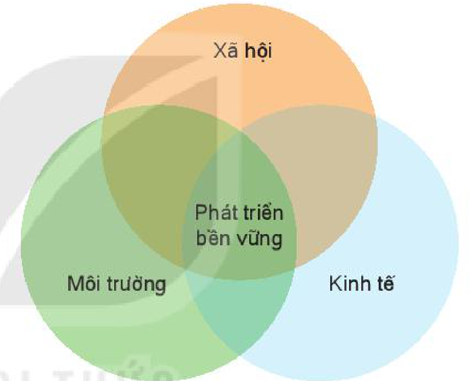

<!-- pdf:112 -->

# BÀI 40: PHÁT TRIỂN BỀN VỮNG VÀ TĂNG TRƯỞNG XANH

## 🔴 Mở đầu

Hiện nay, nhân loại đang đối mặt với một tình trạng hết sức mâu thuẫn: một mặt, cần tăng tối đa nhịp độ phát triển kinh tế để đáp ứng những nhu cầu cơ bản của loài người đang ngày càng tăng lên; mặt khác, sự tăng trưởng kinh tế đã gây ra những tác động xấu chưa từng có đối với môi trường, tài nguyên thiên nhiên. Cuộc sống của chúng ta sẽ ra sao nếu tình trạng đó vẫn tiếp diễn? Các thế hệ tương lai sẽ ra sao nếu chúng ta không hành động để bảo vệ hành tinh này?

## 1. Phát triển bền vững

### a) Khái niệm

<!-- term: Phát triển bền vững -->
Phát triển bền vững là sự phát triển đáp ứng được nhu cầu của hiện tại mà không làm tổn hại đến khả năng đáp ứng nhu cầu đó của các thế hệ tương lai, trên cơ sở kết hợp chặt chẽ, hài hoà giữa tăng trưởng kinh tế, bảo đảm tiến bộ xã hội và bảo vệ môi trường.

<!-- term: Phát triển bền vững -->
Cấu thành của phát triển bền vững thường được mô tả bởi ba vòng tròn lồng ghép vào nhau, bao gồm kinh tế, xã hội và môi trường. Phần giao của ba vòng tròn chính là phát triển bền vững.

*Hình 40. Các yếu tố của phát triển bền vững*

*Mô tả hình:* Sơ đồ gồm ba vòng tròn lồng ghép vào nhau thể hiện ba yếu tố cấu thành của phát triển bền vững: vòng tròn phía trên màu cam ghi "Xã hội", vòng tròn phía dưới bên trái màu xanh lá ghi "Môi trường", vòng tròn phía dưới bên phải màu xanh dương ghi "Kinh tế". Phần giao ở chính giữa của cả ba vòng tròn ghi "Phát triển bền vững".
<!-- ocr-ok: mô tả hình ảnh bổ trợ không phải chữ in trực tiếp trong sách -->

> ❓ Đọc thông tin trong mục a, hãy nêu khái niệm phát triển bền vững.

### b) Sự cần thiết phải phát triển bền vững

<!-- term: Sự cần thiết phải phát triển bền vững -->
Những thách thức đan xen về môi trường, kinh tế, chính trị và xã hội mà nhân loại đang phải đối mặt đòi hỏi chúng ta phải thực hiện các mục tiêu phát triển bền vững. Cụ thể:

<!-- term: Sự cần thiết phải phát triển bền vững -->
- Về kinh tế: Suốt một thời gian dài, nhiều quốc gia đã tập trung theo đuổi mục tiêu tăng trưởng GDP nhanh. Điều này dẫn tới việc khai thác tài nguyên thiên nhiên quá mức, lượng chất thải tạo ra môi trường quá cao. Việc tập trung vào các mục tiêu kinh tế và bỏ qua các vấn đề xã hội, suy thoái môi trường và suy giảm tài nguyên dẫn tới hậu quả môi trường bị suy thoái và ô nhiễm nghiêm trọng.
- Về xã hội: Quá trình phát triển của nhân loại đã kéo theo những thách thức chồng chất về các vấn đề xã hội. Đó là tình trạng gia tăng dân số, đô thị hoá quá nhanh, phân chia giàu nghèo, bất bình đẳng xã hội, vấn đề sức khoẻ, thất nghiệp và việc làm, phân biệt chủng tộc, sự xung đột và chiến tranh,... Những vấn đề này đã làm ảnh hưởng tới chất lượng cuộc sống, sự an toàn và thịnh vượng của con người và trở thành mối quan tâm cấp bách của tất cả các quốc gia.
- Về môi trường: Môi trường của chúng ta phải đối mặt với những vấn đề nghiêm trọng và có xu hướng trở nên tồi tệ hơn theo thời gian. Đó là sự ô nhiễm môi trường (đất, nước, không khí), biến đổi khí hậu, lượng chất thải quá lớn chưa

<!-- pdf:113 -->

<!-- term: Sự cần thiết phải phát triển bền vững -->
qua xử lí đổ ra môi trường, mất đa dạng sinh học, nạn phá rừng, sự suy giảm lớp ô-dôn, mưa a-xít,... Những thách thức này đưa chúng ta vào thời kì khủng hoảng môi trường. Do đó, việc nâng cao nhận thức về các vấn đề môi trường và hành động để giải quyết các vấn đề đó đang trở nên quan trọng hơn bao giờ hết.

> ❓ Dựa vào thông tin trong mục b, hãy trình bày sự cần thiết phải phát triển bền vững.

## 2. Tăng trưởng xanh

### a) Khái niệm

<!-- term: Tăng trưởng xanh -->
Tăng trưởng xanh là sự thúc đẩy tăng trưởng kinh tế, đồng thời bảo tồn tài nguyên thiên nhiên để có thể tiếp tục cung cấp các tài nguyên và dịch vụ môi trường cho cuộc sống con người trong tương lai.

<!-- term: Tăng trưởng xanh -->
Tăng trưởng xanh nhấn mạnh tới thúc đẩy tăng trưởng kinh tế nhưng vẫn giữ cân bằng hài hoà với môi trường sinh thái – mà cụ thể là tránh gây các áp lực làm phá vỡ sự cân bằng của môi trường, với mục tiêu cao nhất là duy trì bền vững sự tăng trưởng kinh tế.

> ❓ Dựa vào thông tin trong mục a, hãy nêu khái niệm tăng trưởng xanh.

### b) Biểu hiện

<!-- term: Biểu hiện của tăng trưởng xanh -->
<!-- term: Bảo vệ môi trường -->
- Tăng trưởng xanh lấy chính các hoạt động giảm phát thải khí nhà kính, bảo vệ môi trường, thích ứng với biến đổi khí hậu làm động lực cho tăng trưởng kinh tế. Ví dụ, do sản xuất điện than có mức phát thải CO₂ lớn nên nhiều nước trên thế giới có xu hướng đóng cửa các nhà máy nhiệt điện than, giảm dần tỉ trọng của nhiệt điện than trong cơ cấu nguồn cung năng lượng.
- Tăng trưởng xanh hướng tới việc sử dụng tài nguyên có hạn của Trái Đất một cách hiệu quả hơn, tăng năng suất lao động, đồng thời giảm các tác động đến môi trường. Điều này có nghĩa là với số lượng đầu vào ít hơn, chúng ta có thể tạo ra nhiều của cải vật chất hơn, đem lại nhiều giá trị hơn.
- Tăng trưởng xanh cũng thể hiện ở việc giảm bất bình đẳng thông qua tiêu dùng xanh, đổi mới sản xuất và kinh doanh. Ví dụ, tăng trưởng xanh hướng tới cung cấp các dịch vụ và tiện ích năng lượng cơ bản nhằm cải thiện chất lượng cuộc sống của người nghèo. Mô hình lưới điện mini sử dụng các nguồn năng lượng thay thế bao gồm năng lượng mặt trời, sinh khối, gió, địa nhiệt,... đang trở nên phổ biến ở các khu vực có thu nhập thấp ở châu Á nhằm làm giảm sự chênh lệch trong tiếp cận lưới điện giữa khu vực thành thị và nông thôn.

> 💡 Em có biết?
> Một số định hướng tăng trưởng xanh cho tương lai của Việt Nam:
> - Giảm cường độ phát thải khí nhà kính và thúc đẩy sử dụng năng lượng sạch, năng lượng tái tạo.
> - Xanh hoá sản xuất.
> - Xanh hoá lối sống và thúc đẩy tiêu dùng bền vững.
<!-- ocr-ok: đối chiếu trực tiếp ảnh trang PDF 113 hộp Em có biết bị trộn dòng hai cột khi OCR -->

> ❓ Đọc thông tin trong mục b, hãy trình bày biểu hiện của tăng trưởng xanh.

## ✏️ Luyện tập

Lấy các ví dụ cụ thể về biểu hiện của tăng trưởng xanh.

## 🚀 Vận dụng

Sưu tầm thông tin, tìm hiểu Chiến lược quốc gia về tăng trưởng xanh ở nước ta.

## 📷 Danh sách hình trong bài

| Mã hình | Trang PDF | Vị trí trong bài | Chú thích gốc |
| --- | --- | --- | --- |
| H10-dia-b40-01 | 112 | Mục 1.a | Hình 40. Các yếu tố của phát triển bền vững |
