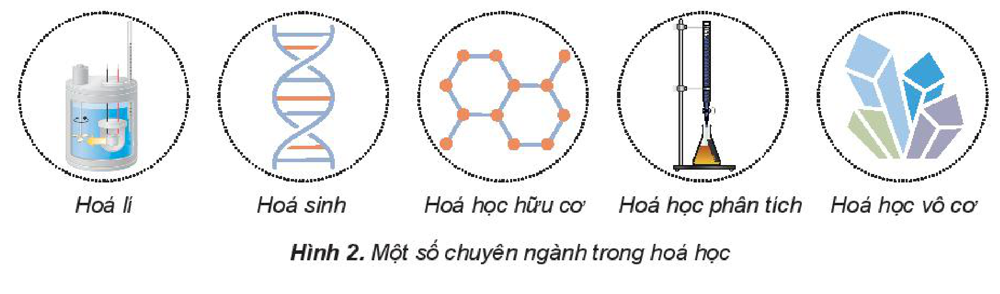
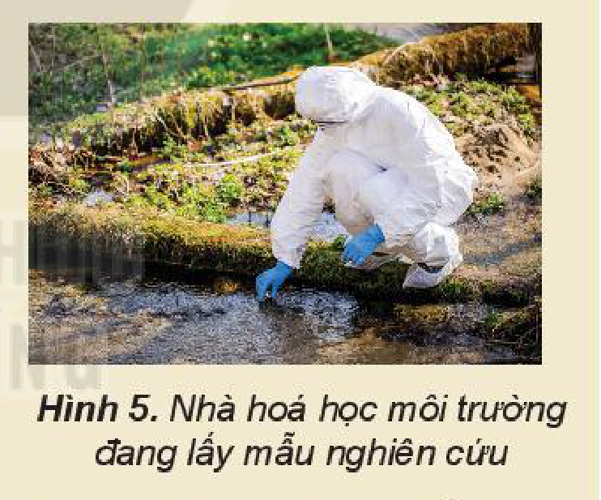
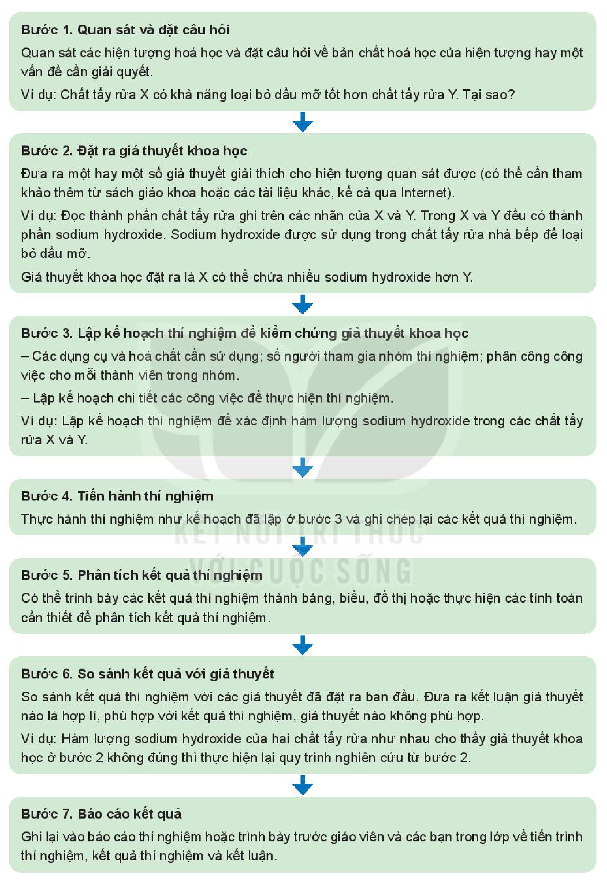

<!-- pdf:7 -->

# MỞ ĐẦU

## 🎯 Mục tiêu

- Nêu được đối tượng nghiên cứu của hoá học.
- Trình bày được phương pháp học tập và nghiên cứu hoá học.
- Nêu được vai trò của hoá học đối với đời sống, sản xuất,...

## 🔴 Mở đầu

Hoá học là một trong các nội dung của môn Khoa học tự nhiên ở cấp Trung học cơ sở và trở thành môn học độc lập ở cấp Trung học phổ thông. Đối tượng nghiên cứu của môn Hoá học là gì? Hoá học có vai trò như thế nào đối với đời sống và sản xuất? Làm thế nào để học tập tốt môn Hoá học?

## I. ĐỐI TƯỢNG NGHIÊN CỨU CỦA HOÁ HỌC

Hoá học nghiên cứu về thành phần, cấu trúc, tính chất, sự biến đổi của các chất và các hiện tượng kèm theo. Hoá học có mối liên hệ chặt chẽ với các ngành khoa học tự nhiên nghiên cứu về chất và vật thể như vật lí, sinh học và địa chất.

**Đối tượng nghiên cứu của hoá học** bao gồm các chất hữu cơ, các chất vô cơ, các loại vật liệu tự nhiên và nhân tạo.

Hình 1. Liên hệ giữa hoá học và các ngành khoa học tự nhiên khác

Môn Khoa học tự nhiên cấp Trung học cơ sở đã trình bày những khái niệm ban đầu của hoá học như mol (lượng chất), liên kết hoá học và tương tác giữa các chất để hiểu được các hoạt động của thế giới sinh học và các hiện tượng vật lí.

Theo truyền thống, hoá học được chia thành các chuyên ngành như hoá lí, hoá học vô cơ, hoá học hữu cơ, hoá học phân tích, hoá sinh,...

- Hoá lí; Hoá sinh; Hoá học hữu cơ; Hoá học phân tích; Hoá học vô cơ

Hình 2. Một số chuyên ngành trong hoá học
<!-- ocr-ok: OCR đọc sót nhãn "Hoá lí" và đọc dính chữ các nhãn dưới Hình 2; đã đối chiếu ảnh -->

<!-- pdf:8 -->

Ngày nay, sự phát triển của khoa học làm xuất hiện nhiều chuyên ngành mới không thuộc các ngành truyền thống như khoa học vật liệu, hoá dược, công nghệ hoá học,... Tuy nhiên, sự phân biệt các chuyên ngành như vậy chỉ có tính chất tương đối. Để giải quyết một bài toán hoá học trong thực tế cần biết vận dụng các kiến thức tổng hợp một cách hợp lí.

> ❓ 1. Đối tượng nghiên cứu của hoá học là sự biến đổi chất, hãy lấy 5 ví dụ về sự biến đổi hoá học.
>
> 2. Hãy cho biết khái niệm chất vô cơ và chất hữu cơ.

> 💡 EM CÓ BIẾT
>
> **Sơ lược về lịch sử hoá học**
>
> Từ hàng nghìn năm trước đây, hoá học được hình thành do sự mong ước tìm được thuốc “trường sinh bất lão” hay tìm được “hòn đá phù thuỷ” dùng để biến đổi các chất rẻ tiền thành gold (vàng). Các nhà giả kim thuật khi tiến hành các thí nghiệm đã tạo ra nhiều dụng cụ thí nghiệm mà đến tận ngày nay, chúng vẫn còn được sử dụng trong hoá học.
>
> Thời điểm đánh dấu việc hoá học tách khỏi khoa học giả kim là năm 1661, với tác phẩm “Nhà hoá học hoài nghi” (The Skeptical Chemist) của Robert Boyle (Rô-bớt Boi-lơ) và sự kiện đánh dấu hoá học trở thành môn khoa học độc lập là sự tìm ra khí oxygen vào năm 1783 bởi Antoine Lavoisier (Ăng-toan La-voa-di-ê). Hoá học đã phát triển mạnh mẽ vào thế kỉ XIX qua những nghiên cứu về tác động của phân bón đến nông nghiệp và những nỗ lực tìm kiếm chất màu tổng hợp để nhuộm vải, tạo tiền đề cho ngành hoá học hữu cơ.
>
> Ngày nay, hoá học đã thu được nhiều thành tựu vượt bậc, nhưng các nhà khoa học vẫn không ngừng khám phá sâu hơn bản chất của thế giới vật chất, tìm tòi nghiên cứu ra các sản phẩm mới để phục vụ cho đời sống của con người.

## II. VAI TRÒ CỦA HOÁ HỌC VỚI ĐỜI SỐNG VÀ SẢN XUẤT

Hoá học có vai trò vô cùng quan trọng với đời sống và sản xuất. Các chất hoá học có trong mọi thứ xung quanh ta như lương thực – thực phẩm; nhiên liệu; nguyên liệu, vật liệu để sản xuất; các loại thuốc chữa bệnh;...

Ngành công nghiệp hoá học sản xuất các hoá chất từ đơn giản đến phức tạp. Mỗi năm, hàng triệu tấn các hoá chất cơ bản như sulfuric acid hay ammonia, phân bón, chất dẻo,... được sản xuất để phục vụ nhu cầu của đời sống và công nghiệp.

Hình 3. Phân bón hoá học làm tăng năng suất cây trồng

<!-- pdf:9 -->

**Hoá học phóng xạ** nghiên cứu và sử dụng sự phân rã hạt nhân cho các quá trình hoá lí, sinh hoá,...

Nguồn năng lượng được coi như vô tận đối với loài người là năng lượng từ Mặt Trời. Việc sử dụng năng lượng mặt trời là lĩnh vực phát triển rất nhanh trong thời gian gần đây với những trang trại pin mặt trời phổ biến ở nhiều nước trên thế giới. Các nhà hoá học có đóng góp rất lớn trong việc chế tạo vật liệu mới giúp tăng hiệu suất chuyển hoá năng lượng mặt trời.

Những thách thức mới về khoa học công nghệ đang là động lực thúc đẩy hoá học tự phát triển và cùng phát triển với các lĩnh vực khác.

Hình 4. Thuốc - sản phẩm của ngành hoá dược

> ❓ 3. Hãy kể tên một số sản phẩm hoá học trong đời sống hằng ngày.
>
> 4. Người nông dân sử dụng sản phẩm nào của hoá học để tăng năng suất cây trồng?

> 💡 EM CÓ BIẾT
>
> **Một số nghề nghiệp liên quan đến hoá học**
>
> - Nhà hoá học (cử nhân và kĩ sư hoá học) kiểm tra tính chất vật lí và hoá học của sản phẩm. Họ có thể nghiên cứu để tạo ra sản phẩm mới hoặc cải tiến các sản phẩm đang có. Họ có thể tư vấn, hỗ trợ kĩ thuật về sản phẩm.
> - Nhà hoá học có thể làm giáo viên dạy môn Khoa học tự nhiên ở cấp Trung học cơ sở và môn Hoá học ở cấp Trung học phổ thông. Họ cũng có thể vừa giảng dạy và vừa nghiên cứu hoá học ở các trường đại học, cao đẳng và dạy nghề.
>
> 
>
> Hình 5. Nhà hoá học môi trường đang lấy mẫu nghiên cứu
>
> - Nhà hoá học có thể làm việc trong lĩnh vực môi trường. Họ vừa có thể kiểm tra mức độ ô nhiễm của môi trường cũng như tìm cách xử lí để giúp môi trường trong lành hơn.
> - Nhà hoá học có thể làm việc trong các cơ sở pháp y hay xét nghiệm y học để phân tích các mẫu lấy từ hiện trường vụ án hoặc bệnh phẩm để tìm sự hiện diện của ma tuý hoặc các chất gây bệnh.
> - Nhà hoá học có thể góp phần bảo vệ hoặc khôi phục các bức tranh, đồ cổ hoặc phát hiện ra các tác phẩm giả mạo.
>
> Hoá học là ngành khoa học thiết thực có nhiều ứng dụng. Trên đây chỉ là một số ngành nghề cơ bản có sự tham gia của các nhà hoá học, ngoài ra còn rất nhiều ngành nghề khác, thậm chí trong tương lai có thể có rất nhiều ngành nghề mới xuất hiện liên quan đến môn học thú vị này.

<!-- pdf:10 -->

## III. PHƯƠNG PHÁP HỌC TẬP VÀ NGHIÊN CỨU HOÁ HỌC

Hình 6. Phòng thí nghiệm hoá học

1. Khi học tập môn Hoá học, học sinh cần thực hiện các hoạt động tìm kiếm thông tin, xử lí thông tin và nắm vững những thông tin cần thiết qua sách giáo khoa. Cụ thể:

   - Xuất phát từ mục tiêu của mỗi bài học, học sinh tìm hiểu kiến thức qua sách giáo khoa: nội dung học tập, quan sát thí nghiệm, dự đoán kết quả, đồng thời liên hệ với các thông tin đã biết từ các hiện tượng tự nhiên, từ cuộc sống hằng ngày,...
   - Xử lí các thông tin đã có để đưa ra các giải thích, dự đoán và kết luận cần thiết, trả lời câu hỏi, giải bài tập.
   - Ghi nhớ những kiến thức cốt lõi, làm cơ sở cho việc tiếp tục học tập hay nghiên cứu.
   - Vận dụng những kiến thức, kĩ năng đã học vào các tình huống trong thực tiễn.

2. Để học tốt môn Hoá học, học sinh cần nắm vững và vận dụng các kiến thức đã học, đồng thời chú ý rèn các kĩ năng thực hiện thí nghiệm, phát hiện, giải quyết vấn đề và sáng tạo:

   - Biết làm thí nghiệm hoá học an toàn và thành công. Biết quan sát, ghi chép, mô tả và giải thích các hiện tượng xảy ra không chỉ trong phòng thí nghiệm mà cả trong tự nhiên và thực tế cuộc sống.
   - Rèn luyện thói quen tìm tòi, khám phá, tư duy và hành động, suy luận và sáng tạo, quan sát và liên kết giữa các hiện tượng, sự vật trong cuộc sống.
   - Hình thành, nuôi dưỡng sự hứng thú, say mê và chủ động trong việc học tập. Rèn luyện kĩ năng tra cứu, mở rộng kiến thức từ các nguồn tài liệu khác nhau phù hợp với bài học và lứa tuổi.

3. Học, tìm hiểu và nghiên cứu hoá học có nhiều điểm chung với các môn Khoa học tự nhiên khác, cụ thể là quy trình nghiên cứu cần thực hiện các bước theo sơ đồ dưới đây:

<!-- pdf:11 -->

**Bước 1. Quan sát và đặt câu hỏi**

Quan sát các hiện tượng hoá học và đặt câu hỏi về bản chất hoá học của hiện tượng hay một vấn đề cần giải quyết.

*Ví dụ:* Chất tẩy rửa X có khả năng loại bỏ dầu mỡ tốt hơn chất tẩy rửa Y. Tại sao?

**Bước 2. Đặt ra giả thuyết khoa học**

Đưa ra một hay một số giả thuyết giải thích cho hiện tượng quan sát được (có thể cần tham khảo thêm từ sách giáo khoa hoặc các tài liệu khác, kể cả qua Internet).

*Ví dụ:* Đọc thành phần chất tẩy rửa ghi trên các nhãn của X và Y. Trong X và Y đều có thành phần sodium hydroxide. Sodium hydroxide được sử dụng trong chất tẩy rửa nhà bếp để loại bỏ dầu mỡ.

Giả thuyết khoa học đặt ra là X có thể chứa nhiều sodium hydroxide hơn Y.

**Bước 3. Lập kế hoạch thí nghiệm để kiểm chứng giả thuyết khoa học**

- Các dụng cụ và hoá chất cần sử dụng; số người tham gia nhóm thí nghiệm; phân công công việc cho mỗi thành viên trong nhóm.
- Lập kế hoạch chi tiết các công việc để thực hiện thí nghiệm.

*Ví dụ:* Lập kế hoạch thí nghiệm để xác định hàm lượng sodium hydroxide trong các chất tẩy rửa X và Y.

**Bước 4. Tiến hành thí nghiệm**
<!-- ocr-ok: OCR đọc "Tiến" thành "Tiền"; đã đối chiếu ảnh -->

Thực hành thí nghiệm như kế hoạch đã lập ở bước 3 và ghi chép lại các kết quả thí nghiệm.

**Bước 5. Phân tích kết quả thí nghiệm**

Có thể trình bày các kết quả thí nghiệm thành bảng, biểu, đồ thị hoặc thực hiện các tính toán cần thiết để phân tích kết quả thí nghiệm.

**Bước 6. So sánh kết quả với giả thuyết**

So sánh kết quả thí nghiệm với các giả thuyết đã đặt ra ban đầu. Đưa ra kết luận giả thuyết nào là hợp lí, phù hợp với kết quả thí nghiệm, giả thuyết nào không phù hợp.

*Ví dụ:* Hàm lượng sodium hydroxide của hai chất tẩy rửa như nhau cho thấy giả thuyết khoa học ở bước 2 không đúng thì thực hiện lại quy trình nghiên cứu từ bước 2.

**Bước 7. Báo cáo kết quả**

Ghi lại vào báo cáo thí nghiệm hoặc trình bày trước giáo viên và các bạn trong lớp về tiến trình thí nghiệm, kết quả thí nghiệm và kết luận.

<!-- pdf:12 -->

4. **Phương pháp mô hình** được sử dụng để mô tả, mô phỏng cấu tạo của các hạt quá nhỏ không quan sát được bằng mắt thường như phân tử, nguyên tử và các hạt nhỏ hơn. Từ đó suy ra cấu tạo các vật thể thật trong cuộc sống.

   Mô hình cấu tạo nguyên tử của Rutherford (Rơ-dơ-pho) là một thí dụ. Từ thực nghiệm bắn phá lá vàng bằng tia $\alpha$, Rutherford phát hiện ra cấu tạo rỗng của nguyên tử, phát hiện ra lõi nguyên tử là hạt nhân có khối lượng xấp xỉ khối lượng nguyên tử. Rutherford đề xuất **mô hình hành tinh nguyên tử**, coi các electron quay xung quanh hạt nhân như các hành tinh quay xung quanh Mặt Trời.

   Phương pháp mô hình được sử dụng phổ biến trong ba chương đầu tiên về nguyên tử, phân tử, liên kết hoá học và bảng tuần hoàn các nguyên tố hoá học (bảng tuần hoàn).

5. **Phương pháp thực nghiệm** đóng vai trò cốt lõi của nghiên cứu hoá học. Các giả thuyết và mô hình hoá đều phải được kiểm chứng bằng thực nghiệm và từ thực nghiệm người ta có thể mô hình hoá thành quy luật. Phương pháp thực nghiệm được sử dụng xuyên suốt toàn bộ Chương trình Giáo dục phổ thông môn Hoá học.

   *Ví dụ:* Sử dụng phương pháp thực nghiệm để nghiên cứu chlorine:

   - Từ hiểu biết về cấu tạo nguyên tử và liên kết hoá học để dự đoán tính chất hoá học đặc trưng của chlorine.
   - Thực hiện các thí nghiệm cho chlorine tác dụng với kim loại, hydrogen, dung dịch muối của halogen để chứng minh dự đoán trên.
   - Vận dụng tính chất hoá học của chlorine vào thực tế: dùng dung dịch nước chlorine, clorua vôi,... để tẩy trắng.

   Các em hãy bắt đầu học hoá học với sự tò mò khoa học, kiên trì từ những bước đầu tiên với những thí nghiệm đơn giản để có thể nhận ra rằng “Hoá học thật là đơn giản!” và sau đó sẽ thấy “Hoá học thật là lí thú!”

## 📌 Em đã học

- Hoá học nghiên cứu về chất, sự biến đổi của chất và các hiện tượng đi kèm với những biến đổi hoá học.
- Hoá học có vai trò quan trọng với đời sống và sản xuất.
- Cách học tập, nghiên cứu về hoá học qua quan sát và đặt câu hỏi, đặt ra giả thuyết khoa học, chứng minh bằng thí nghiệm, phân tích kết quả thí nghiệm, trình bày kết quả thu được và báo cáo.

## ✏️ Em có thể

Biết vận dụng phương pháp học tập và nghiên cứu hoá học để học tốt môn Hoá học và giải quyết một số tình huống trong đời sống.

## 📷 Danh sách hình trong bài

| Mã hình | Trang PDF | Vị trí | Chú thích gốc |
|---|---|---|---|
| H10-hoa-b00-01 | 7 | Mục I | Hình 1. Liên hệ giữa hoá học và các ngành khoa học tự nhiên khác |
| H10-hoa-b00-02 | 7 | Mục I | Hình 2. Một số chuyên ngành trong hoá học |
| H10-hoa-b00-03 | 8 | Mục II | Hình 3. Phân bón hoá học làm tăng năng suất cây trồng |
| H10-hoa-b00-04 | 9 | Mục II | Hình 4. Thuốc - sản phẩm của ngành hoá dược |
| H10-hoa-b00-05 | 9 | Mục II, hộp "Em có biết" | Hình 5. Nhà hoá học môi trường đang lấy mẫu nghiên cứu |
| H10-hoa-b00-06 | 10 | Mục III | Hình 6. Phòng thí nghiệm hoá học |
| H10-hoa-b00-07 | 11 | Mục III.3 (sơ đồ 7 bước quy trình nghiên cứu hoá học) | (sách không đánh số, không có chú thích) |
