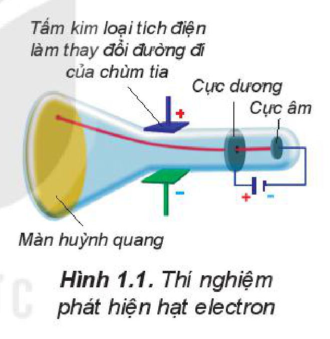
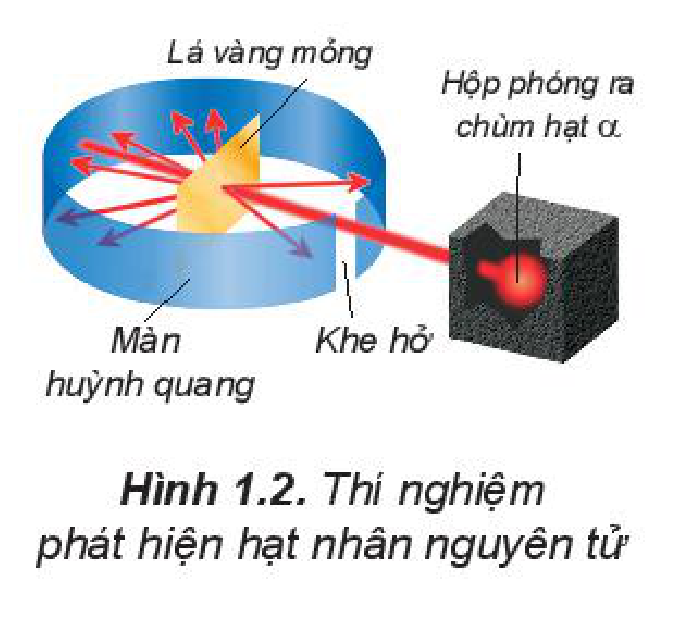
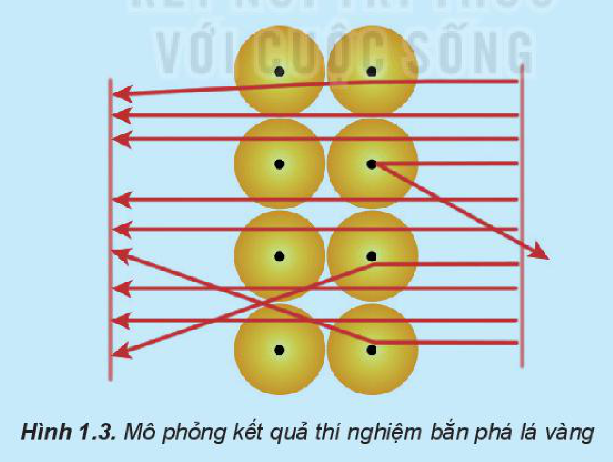

<!-- pdf:14 -->

# BÀI 1: THÀNH PHẦN CỦA NGUYÊN TỬ

## 🎯 Mục tiêu

- Trình bày được thành phần của nguyên tử (nguyên tử vô cùng nhỏ; nguyên tử gồm 2 phần: hạt nhân và lớp vỏ nguyên tử; hạt nhân tạo nên bởi các hạt proton (p), neutron (n); lớp vỏ tạo nên bởi các electron (e); điện tích, khối lượng mỗi loại hạt).
- So sánh được khối lượng của electron với proton và neutron, kích thước của hạt nhân với kích thước nguyên tử.

## 🔴 Mở đầu

Nguyên tử gồm các loại hạt cơ bản nào? Các nhà khoa học đã phát hiện ra các loại hạt cơ bản đó như thế nào?
<!-- ocr-ok: OCR đọc tách câu Mở đầu thành 2 dòng ngược thứ tự và mất chữ "hạt"; đã đối chiếu ảnh -->

## I. CÁC LOẠI HẠT CẤU TẠO NÊN NGUYÊN TỬ

Năm 1897, J. J. Thomson (Tôm-xơn, người Anh) thực hiện thí nghiệm phóng điện qua không khí loãng đã phát hiện ra chùm tia phát ra từ cực âm và bị hút lệch về phía cực dương của điện trường, chứng tỏ chúng mang điện tích âm (xem Hình 1.1). Đó chính là chùm các hạt **electron**. Electron là một thành phần của nguyên tử.

Hình 1.1. Thí nghiệm phát hiện hạt electron

Năm 1911, E. Rutherford (Rơ-dơ-pho, người Niu Di-lân) thực hiện thí nghiệm bắn phá lá vàng rất mỏng bằng chùm hạt $\alpha^{(*)}$ (alpha) (Hình 1.2). Ông sử dụng màn huỳnh quang bao quanh lá vàng để quan sát vị trí va chạm của hạt $\alpha$. Kết quả thí nghiệm cho thấy hầu hết các hạt $\alpha$ đều xuyên thẳng qua lá vàng, chứng tỏ nguyên tử có cấu tạo rỗng, ở tâm chứa một hạt nhân mang điện tích dương và có kích thước rất nhỏ so với kích thước nguyên tử.

Hình 1.2. Thí nghiệm phát hiện hạt nhân nguyên tử

Năm 1918, E. Rutherford và các cộng sự khi dùng hạt $\alpha$ bắn phá nitrogen đã phát hiện ra hạt **proton**.

Năm 1932, J. Chadwick (Chat-uých, người Anh), cộng sự của Rutherford, đã phát hiện ra hạt **neutron** khi bắn phá beryllium bằng các hạt $\alpha$.

Proton, neutron và electron là các hạt cấu tạo nên nguyên tử (trừ trường hợp $\ce{^1_1H}^{(**)}$).

> (*) Hạt $\alpha$: hạt nhân helium, mang điện tích dương.
>
> (**) $\ce{^1_1H}$ là một loại nguyên tử của nguyên tố hydrogen (sẽ được học trong bài Nguyên tố hoá học).

<!-- pdf:15 -->

Thành phần cấu tạo của nguyên tử gồm:

- ***Hạt nhân:*** ở tâm của nguyên tử, chứa các proton mang điện tích dương và các neutron không mang điện (trừ trường hợp $\ce{^1_1H}$).
- ***Vỏ nguyên tử:*** chứa các electron mang điện tích âm, chuyển động rất nhanh xung quanh hạt nhân.

*Bảng 1.1. Khối lượng, điện tích của các loại hạt cấu tạo nên nguyên tử*

| Hạt | Kí hiệu | Khối lượng (kg) | Khối lượng (amu) | Điện tích (C) | Điện tích tương đối |
|---|---|---|---|---|---|
| Proton | p | $1,673 \cdot 10^{-27}$ | $\approx 1$ | $+1,602 \cdot 10^{-19}$ | $+1$ |
| Neutron | n | $1,675 \cdot 10^{-27}$ | $\approx 1$ | $0$ | $0$ |
| Electron | e | $9,109 \cdot 10^{-31}$ | $\dfrac{1}{1837} \approx 0,00055$ | $-1,602 \cdot 10^{-19}$ | $-1$ |
<!-- ocr-ok: bảng nhiều cột có số mũ và phân số; đã đối chiếu ảnh -->

Trong nguyên tử, số proton bằng số electron. Nguyên tử trung hoà về điện.

Khối lượng của electron rất nhỏ, không đáng kể so với khối lượng của proton hay neutron nên khối lượng của nguyên tử tập trung hầu hết ở hạt nhân.

> ❓ 1. Nguyên tử chứa những hạt mang điện là
>
> A. proton và hạt $\alpha$. B. proton và neutron.
>
> C. proton và electron. D. electron và neutron.
>
> 2. Quan sát hình ảnh mô phỏng kết quả thí nghiệm bắn phá lá vàng thực hiện bởi Rutherford (Hình 1.3) và nhận xét về đường đi của các hạt $\alpha$.
>
> 
>
> Hình 1.3. Mô phỏng kết quả thí nghiệm bắn phá lá vàng

<!-- pdf:16 -->

## II. KÍCH THƯỚC VÀ KHỐI LƯỢNG CỦA NGUYÊN TỬ

### 1. Kích thước

**Kích thước của nguyên tử** là khoảng không gian tạo bởi sự chuyển động của các electron. Các nguyên tử khác nhau có số electron khác nhau nên có kích thước khác nhau. Nếu coi nguyên tử như một khối cầu thì đường kính của nó chỉ khoảng $10^{-10}\text{ m}$.

Kích thước nguyên tử rất nhỏ nên thường được biểu diễn bằng đơn vị picomet (pm) hay Ångström (Å). $1\text{ pm} = 10^{-12}\text{ m}$; $1\text{ Å} = 10^{-10}\text{ m}$. Nguyên tử hydrogen có bán kính khoảng $53\text{ pm}$.

Hạt nhân nguyên tử có đường kính khoảng $10^{-2}\text{ pm}$, kích thước nhỏ hơn nhiều so với kích thước nguyên tử.

### 2. Khối lượng

**Khối lượng nguyên tử** bằng tổng khối lượng các hạt proton, neutron và electron có trong nguyên tử. Khối lượng nguyên tử rất nhỏ nên một lượng chất rất nhỏ cũng chứa tới hàng tỉ tỉ nguyên tử. *Ví dụ:* Trong 2 g carbon chứa khoảng $10^{23}$ nguyên tử carbon.

Có thể biểu thị khối lượng nguyên tử theo **đơn vị khối lượng nguyên tử**, kí hiệu amu.

> 💡 EM CÓ BIẾT
>
> Một lượng chất rất nhỏ cũng chứa số nguyên tử lớn tới mức khó hình dung được. Ví dụ: trong 1 lít nước chứa khoảng $9 \cdot 10^{25}$ các nguyên tử oxygen và hydrogen. Do đó, không thể nhìn thấy nguyên tử bằng mắt thường, thậm chí bằng kính hiển vi có độ phóng đại rất lớn (hàng chục triệu lần).

*Ví dụ:* Một nguyên tử oxygen có khối lượng là $2,656 \cdot 10^{-26}\text{ kg}$.

$1\text{ amu} = 1,661 \cdot 10^{-27}\text{ kg}$ nên khối lượng một nguyên tử oxygen là $15,990\text{ amu}$.

> 💡 EM CÓ BIẾT
>
> Khối lượng tính ra kg của 1 nguyên tử carbon-12 là $19,926 \cdot 10^{-27}\text{ kg}$.
>
> **1 amu** được định nghĩa bằng $\dfrac{1}{12}$ khối lượng 1 nguyên tử carbon-12:
>
> $1\text{ amu} = \frac{19,926 \cdot 10^{-27}\text{ kg}}{12} = 1,661 \cdot 10^{-27}\text{ kg}.$

> ❓ 3. Nếu phóng đại một nguyên tử vàng lên 1 tỉ ($10^9$) lần thì kích thước của nó tương đương một quả bóng rổ (có đường kính 30 cm) và kích thước của hạt nhân tương đương một hạt cát (có đường kính 0,003 cm). Hãy cho biết kích thước nguyên tử vàng lớn hơn so với hạt nhân bao nhiêu lần.
>
> 4. Một loại nguyên tử nitrogen có 7 proton và 7 neutron trong hạt nhân. Dựa vào Bảng 1.1, hãy tính và so sánh:
>
> a) Khối lượng hạt nhân với khối lượng nguyên tử.
>
> b) Khối lượng hạt nhân với khối lượng vỏ nguyên tử.

<!-- pdf:17 -->

## III. ĐIỆN TÍCH HẠT NHÂN VÀ SỐ KHỐI

Số proton trong hạt nhân nguyên tử bằng **số đơn vị điện tích hạt nhân**, kí hiệu là $Z$.

*Ví dụ:* Hạt nhân nguyên tử Na có 11 proton nên số đơn vị điện tích hạt nhân là $Z = 11$.

Tổng số proton và tổng số neutron (kí hiệu là $N$) trong hạt nhân của một nguyên tử được gọi là **số khối** (hay **số nucleon**), kí hiệu là $A$.

$A = Z + N$

*Ví dụ:* Hạt nhân nguyên tử Na có số proton là 11 và số neutron là 12 nên số khối của hạt nhân nguyên tử Na là:

$A = 11 + 12 = 23$

> ❓ 5. Aluminium (nhôm) là kim loại phổ biến nhất trên vỏ Trái Đất, được sử dụng trong các ngành xây dựng, ngành điện hoặc sản xuất đồ gia dụng. Hạt nhân của nguyên tử aluminium có điện tích bằng $+13$ và số khối bằng $27$. Tính số proton, số neutron và số electron có trong nguyên tử aluminium.

## 📌 Em đã học

- Nguyên tử vô cùng nhỏ nhưng được tạo thành từ các hạt nhỏ hơn, gồm hạt nhân (chứa proton mang điện tích dương và neutron không mang điện) và vỏ nguyên tử (chứa các electron mang điện tích âm). Nguyên tử trung hoà về điện. Trong nguyên tử, số proton bằng số electron.
- Khối lượng nguyên tử tập trung ở hạt nhân (do khối lượng của electron rất nhỏ so với khối lượng của proton và neutron).
- Hạt nhân nguyên tử có kích thước vô cùng nhỏ so với nguyên tử.

## ✏️ Em có thể

Vận dụng phương pháp mô hình để mô tả cấu tạo nguyên tử.

## 📷 Danh sách hình trong bài

| Mã hình | Trang PDF | Vị trí | Chú thích gốc |
|---|---|---|---|
| H10-hoa-b01-01 | 14 | Mục I | Hình 1.1. Thí nghiệm phát hiện hạt electron |
| H10-hoa-b01-02 | 14 | Mục I | Hình 1.2. Thí nghiệm phát hiện hạt nhân nguyên tử |
| H10-hoa-b01-03 | 15 | Mục I, hộp câu hỏi 2 (nằm trong hộp câu hỏi nền xanh lam nên các cạnh khung cắt qua màu nền hộp) | Hình 1.3. Mô phỏng kết quả thí nghiệm bắn phá lá vàng |
