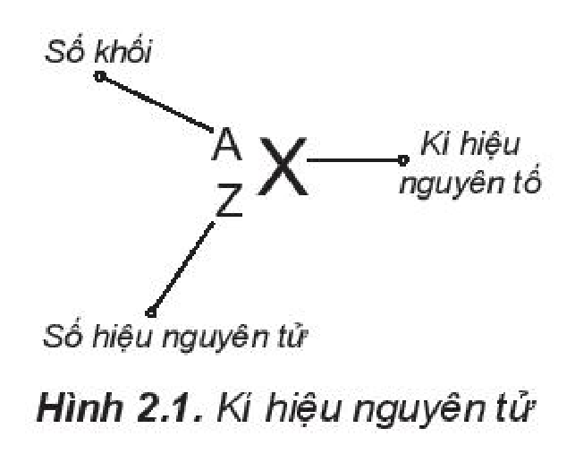
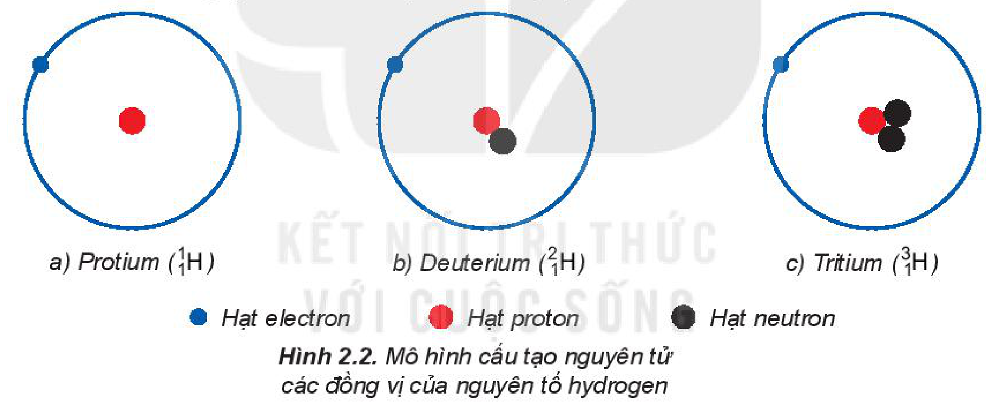
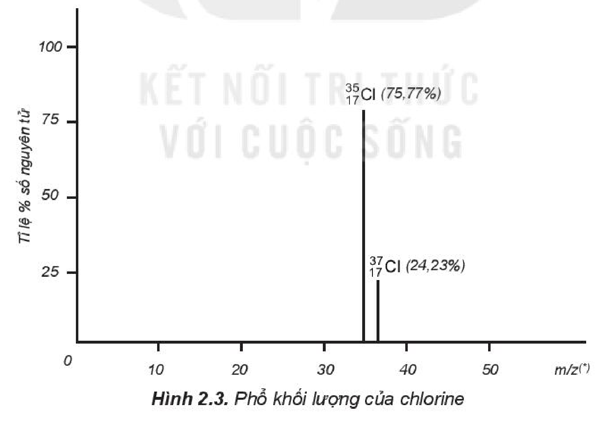
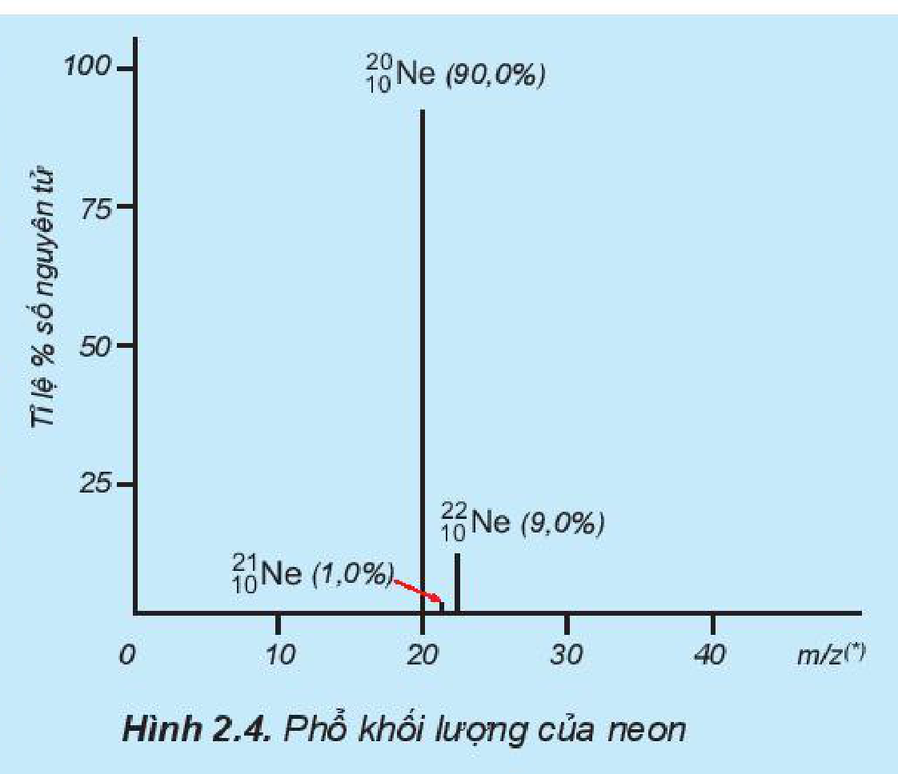

<!-- pdf:18 -->

# BÀI 2: NGUYÊN TỐ HOÁ HỌC

## 🎯 Mục tiêu

- Trình bày được khái niệm về nguyên tố hoá học, số hiệu nguyên tử và kí hiệu nguyên tử.
- Phát biểu được khái niệm đồng vị, nguyên tử khối.
- Tính được nguyên tử khối trung bình (theo amu) dựa vào khối lượng nguyên tử và phần trăm số nguyên tử của các đồng vị theo phổ khối lượng được cung cấp.

## 🔴 Mở đầu

Các nguyên tử có cùng số đơn vị điện tích hạt nhân thì có đặc điểm gì chung? Giữa số đơn vị điện tích hạt nhân, số proton và số electron có mối liên hệ như thế nào?

## I. NGUYÊN TỐ HOÁ HỌC

**Nguyên tố hoá học** là tập hợp các nguyên tử có cùng số đơn vị điện tích hạt nhân. Trong nguyên tử, số đơn vị điện tích hạt nhân bằng số electron ở vỏ nguyên tử. Các electron trong nguyên tử quyết định tính chất hoá học của nguyên tử, nên các nguyên tử của cùng một nguyên tố hoá học có tính chất hoá học giống nhau.

*Ví dụ:* Tất cả nguyên tử có cùng số đơn vị điện tích hạt nhân là 6 đều thuộc nguyên tố carbon dù chúng có thể có số neutron khác nhau.

Đến năm 2016, con người đã biết 118 nguyên tố hoá học, trong đó có 94 nguyên tố hoá học tồn tại trong tự nhiên và 24 nguyên tố được tạo ra trong phòng thí nghiệm, thậm chí có những nguyên tố mới chỉ tạo ra được một lượng rất ít, thời gian tồn tại rất ngắn$^{(*)}$.

> ❓ 1. Cho các nguyên tử sau: L ($Z = 8$, $A = 16$), D ($Z = 9$, $A = 19$), E ($Z = 8$, $A = 18$), G ($Z = 7$, $A = 15$). Trong các nguyên tử trên, các nguyên tử nào thuộc cùng một nguyên tố hoá học?

## II. KÍ HIỆU NGUYÊN TỬ

Số đơn vị điện tích hạt nhân nguyên tử của một nguyên tố hoá học (còn được gọi là **số hiệu nguyên tử** ($Z$) của nguyên tố đó) và số khối ($A$) là những đặc trưng cơ bản của một nguyên tử.

Hình 2.1. Kí hiệu nguyên tử

> (*) Nguồn: Liên minh Quốc tế về Hoá học cơ bản và Hoá học ứng dụng (IUPAC) (2016).

<!-- pdf:19 -->

Khi viết **kí hiệu nguyên tử**, đặt hai chỉ số đặc trưng ở bên trái kí hiệu nguyên tố, trong đó số hiệu nguyên tử $Z$ ở phía dưới và số khối $A$ ở phía trên.

*Ví dụ:* Kí hiệu $\ce{^4_2He}$ cho biết nguyên tử helium có kí hiệu là He; số hiệu nguyên tử helium bằng 2 nên trong hạt nhân helium có 2 proton, vỏ nguyên tử có 2 electron; số khối của nguyên tử He là 4 nên trong hạt nhân có số neutron là $4 - 2 = 2$.

> ❓ 2. Kí hiệu một nguyên tử cho biết những thông tin gì? Cho ví dụ.
>
> 3. Hãy biểu diễn kí hiệu của một số nguyên tử sau:
>
> a) Nitrogen (số proton = 7 và số neutron = 7).
>
> b) Phosphorus (số proton = 15 và số neutron = 16).
>
> c) Copper (đồng) (số proton = 29 và số neutron = 34).

## III. ĐỒNG VỊ

Một số nguyên tử có cùng số đơn vị điện tích hạt nhân (có cùng số proton) nhưng có số neutron khác nhau. Những nguyên tử như thế gọi là các **đồng vị** (cùng vị trí trong bảng tuần hoàn các nguyên tố hoá học) của một nguyên tố hoá học.

- a) Protium ($\ce{^1_1H}$); b) Deuterium ($\ce{^2_1H}$); c) Tritium ($\ce{^3_1H}$)
- Hạt electron; Hạt proton; Hạt neutron
<!-- ocr-ok: OCR đọc sai kí hiệu đồng vị và chấm màu chú giải trong Hình 2.2; đã đối chiếu ảnh -->

Hình 2.2. Mô hình cấu tạo nguyên tử các đồng vị của nguyên tố hydrogen

Các đồng vị khác nhau về số neutron nên khác nhau về khối lượng của hạt nhân nguyên tử, đồng thời khác nhau về một số tính chất vật lí. *Ví dụ:* Ở dạng đơn chất, đồng vị $\ce{^{37}_{17}Cl}$ có tỉ khối lớn hơn, nhiệt độ nóng chảy và nhiệt độ sôi cao hơn đồng vị $\ce{^{35}_{17}Cl}$.

Ngoài các **đồng vị bền**, các nguyên tố hoá học còn có một số đồng vị không bền. Các đồng vị không bền được gọi là **đồng vị phóng xạ**. Nhiều đồng vị phóng xạ được sử dụng trong y học, nông nghiệp, nghiên cứu khoa học,...

> ❓ 4. Xác định thành phần nguyên tử (số proton, neutron, electron) của mỗi đồng vị sau:
>
> a) $\ce{^{28}_{14}Si}$, $\ce{^{29}_{14}Si}$, $\ce{^{30}_{14}Si}$.
>
> b) $\ce{^{54}_{26}Fe}$, $\ce{^{56}_{26}Fe}$, $\ce{^{57}_{26}Fe}$, $\ce{^{58}_{26}Fe}$.

<!-- pdf:20 -->

## IV. NGUYÊN TỬ KHỐI

### 1. Nguyên tử khối

**Nguyên tử khối** là khối lượng tương đối của nguyên tử. Nguyên tử khối của một nguyên tử cho biết khối lượng của nguyên tử đó nặng gấp bao nhiêu lần đơn vị khối lượng nguyên tử. Do khối lượng proton và neutron đều xấp xỉ $1,0\text{ amu}$, còn khối lượng electron nhỏ hơn rất nhiều ($0,00055\text{ amu}$), nên có thể coi nguyên tử khối xấp xỉ số khối.

*Ví dụ:* Nguyên tử của nguyên tố potassium (kali) có số proton = 19; số neutron = 20 nên nguyên tử khối của potassium là $A = 19 + 20 = 39$.

### 2. Nguyên tử khối trung bình

Hầu hết các nguyên tố trong tự nhiên là hỗn hợp của nhiều đồng vị, mỗi đồng vị có tỉ lệ phần trăm số nguyên tử xác định. Nguyên tử khối của một nguyên tố là **nguyên tử khối trung bình** (kí hiệu là $\overline{A}$) của hỗn hợp các đồng vị của nguyên tố đó.

Biểu thức tổng quát tính nguyên tử khối trung bình ($\overline{A}$):

$\overline{A} = \frac{(X \cdot a) + (Y \cdot b) + \dots}{100}$

Trong đó, $\overline{A}$ là nguyên tử khối trung bình; $X$ và $Y$,... lần lượt là nguyên tử khối của các đồng vị X và Y,...; $a$ và $b$,... lần lượt là % số nguyên tử của các đồng vị X và Y,...

*Ví dụ:* Bằng phương pháp **phổ khối lượng**, người ta xác định được trong tự nhiên, nguyên tố chlorine có hai đồng vị bền là $\ce{^{35}_{17}Cl}$ (chiếm 75,77%) và $\ce{^{37}_{17}Cl}$ (chiếm 24,23% số nguyên tử) (Hình 2.3).

Hình 2.3. Phổ khối lượng của chlorine

Nguyên tử khối trung bình của chlorine:

$\overline{A} = \frac{(75,77 \cdot 35) + (24,23 \cdot 37)}{100} = 35,48$

> (*) $m$ là khối lượng, $z$ là số đơn vị điện tích của ion. Đối với phổ khối lượng của chlorine: $z = 1$ nên $m/z$ có giá trị bằng khối lượng nguyên tử hay nguyên tử khối.

<!-- pdf:21 -->

> ❓ 5. Tỉ lệ phần trăm số nguyên tử các đồng vị của neon (Ne) được xác định theo phổ khối lượng (Hình 2.4). Tính nguyên tử khối trung bình của Ne.
>
> 6. Vì sao trong bảng tuần hoàn các nguyên tố hoá học, giá trị nguyên tử khối của chromium (Cr) không phải là số nguyên, mà là 51,996?
>
> 
>
> Hình 2.4. Phổ khối lượng của neon
>
> 7. Copper (đồng) được sử dụng làm dây dẫn điện, huy chương, trống đồng,... Nguyên tử khối trung bình của copper bằng 63,546. Copper tồn tại trong tự nhiên dưới hai dạng đồng vị $\ce{^{63}_{29}Cu}$ và $\ce{^{65}_{29}Cu}$. Tính phần trăm số nguyên tử của đồng vị $\ce{^{63}_{29}Cu}$ tồn tại trong tự nhiên.

## 📌 Em đã học

- Nguyên tố hoá học là tập hợp các nguyên tử có cùng số đơn vị điện tích hạt nhân.
- Đồng vị là những nguyên tử có cùng số đơn vị điện tích hạt nhân (cùng số proton) nhưng có số neutron khác nhau.
- Kí hiệu của nguyên tử: $\ce{^A_ZX}$.
- Nguyên tử khối cho biết khối lượng nguyên tử đó nặng gấp bao nhiêu lần đơn vị khối lượng nguyên tử.
- Nguyên tử khối của một nguyên tố là nguyên tử khối trung bình của hỗn hợp các đồng vị của nguyên tố đó.

## ✏️ Em có thể

- Xác định được: nguyên tử khối, nguyên tử khối trung bình và phần trăm số nguyên tử các đồng vị của một nguyên tố hoá học.
- Giải thích được vì sao nguyên tử khối của các nguyên tố hoá học không phải là các trị số nguyên và hiểu được sự đa dạng của nguyên tố hoá học trong tự nhiên thông qua khái niệm đồng vị.

> (*) Đối với phổ khối lượng của neon: $z = 1$ nên $m/z$ có giá trị bằng khối lượng nguyên tử hay nguyên tử khối.
<!-- ocr-ok: OCR đọc lỗi chú thích chân trang ("Đồi với phỗ khôi lượng... băng khôi lượng"); đã đối chiếu ảnh -->

## 📷 Danh sách hình trong bài

| Mã hình | Trang PDF | Vị trí | Chú thích gốc |
|---|---|---|---|
| H10-hoa-b02-01 | 18 | Mục II | Hình 2.1. Kí hiệu nguyên tử |
| H10-hoa-b02-02 | 19 | Mục III | Hình 2.2. Mô hình cấu tạo nguyên tử các đồng vị của nguyên tố hydrogen |
| H10-hoa-b02-03 | 20 | Mục IV.2 | Hình 2.3. Phổ khối lượng của chlorine |
| H10-hoa-b02-04 | 21 | Mục IV.2, hộp câu hỏi 5–7 (nằm trong hộp câu hỏi nền xanh lam nên các cạnh khung cắt qua màu nền hộp) | Hình 2.4. Phổ khối lượng của neon |
