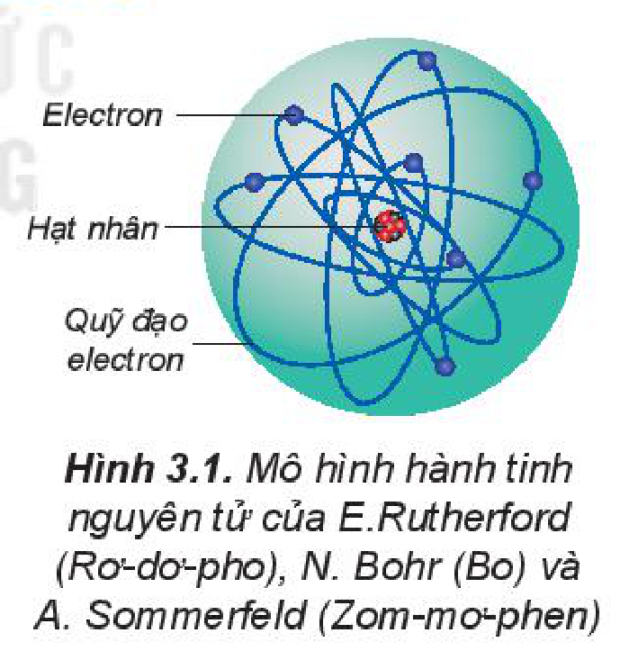
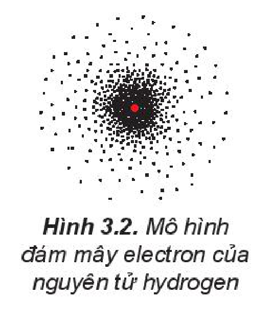
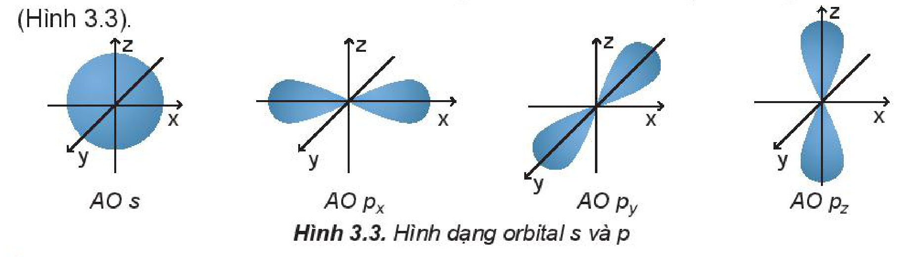
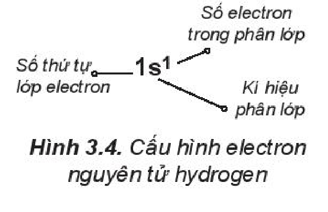
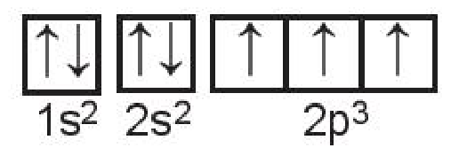

<!-- pdf:22 -->

# BÀI 3: CẤU TRÚC LỚP VỎ ELECTRON NGUYÊN TỬ

## 🎯 Mục tiêu

- Trình bày và so sánh được mô hình của Rutherford – Bohr với mô hình hiện đại mô tả sự chuyển động của electron trong nguyên tử.
- Nêu được khái niệm về orbital nguyên tử (AO), mô tả được hình dạng của AO (s, p), số lượng electron trong 1 AO.
- Trình bày được khái niệm lớp, phân lớp electron và mối quan hệ về số lượng phân lớp trong một lớp. Liên hệ được về số lượng AO trong một phân lớp, trong một lớp.
- Viết được cấu hình electron nguyên tử theo lớp, phân lớp electron và theo ô orbital khi biết số hiệu nguyên tử $Z$ của 20 nguyên tố đầu tiên trong bảng tuần hoàn.
- Dựa vào đặc điểm cấu hình electron lớp ngoài cùng của nguyên tử dự đoán được tính chất hoá học cơ bản (kim loại hay phi kim) của nguyên tố tương ứng.

## 🔴 Mở đầu

Trong nguyên tử các electron chuyển động như thế nào? Sự sắp xếp các electron ở các lớp, các phân lớp tuân theo nguyên lí và quy tắc nào?

## I. CHUYỂN ĐỘNG CỦA ELECTRON TRONG NGUYÊN TỬ

Đến đầu thế kỉ XX, người ta vẫn cho rằng các electron chuyển động xung quanh hạt nhân nguyên tử theo những quỹ đạo tròn hay bầu dục, giống như quỹ đạo của các hành tinh quay xung quanh Mặt Trời (Hình 3.1).

Hình 3.1. Mô hình hành tinh nguyên tử của E.Rutherford (Rơ-dơ-pho), N. Bohr (Bo) và A. Sommerfeld (Zom-mơ-phen)

Mô hình hành tinh nguyên tử đã có ảnh hưởng rất lớn, thúc đẩy sự phát triển lí thuyết cấu tạo nguyên tử, nhưng không đầy đủ để giải thích nhiều tính chất của nguyên tử.

Theo mô hình hiện đại, trong nguyên tử, electron chuyển động rất nhanh, không theo quỹ đạo xác định. Tuy nhiên, người ta có thể xác định được vùng không gian xung quanh hạt nhân mà ở đó xác suất có mặt (xác suất tìm thấy) electron là lớn nhất (khoảng 90%). Vùng không gian xung quanh hạt nhân tìm thấy electron có thể hình dung như một **đám mây electron**, được gọi là **orbital nguyên tử** (Hình 3.2). Orbital nguyên tử được kí hiệu là AO (Atomic Orbital).

Hình 3.2. Mô hình đám mây electron của nguyên tử hydrogen

<!-- pdf:23 -->

### 1. Hình dạng orbital nguyên tử

Khi chuyển động trong nguyên tử, các electron có những mức năng lượng khác nhau đặc trưng cho trạng thái chuyển động của nó. Dựa trên sự khác nhau về hình dạng, sự định hướng của orbital trong nguyên tử để phân loại orbital thành orbital s, orbital p, orbital d và orbital f. Các **orbital s** có dạng hình cầu và **orbital p** có dạng hình số 8 nổi (Hình 3.3).

- $\text{AO s}$; $\text{AO p}_x$; $\text{AO p}_y$; $\text{AO p}_z$

Hình 3.3. Hình dạng orbital s và p

### 2. Ô orbital

Một AO được biểu diễn bằng một ô vuông, gọi là **ô orbital** $\square$.

Trong 1 orbital chỉ chứa tối đa 2 electron có chiều tự quay ngược nhau (***nguyên lí loại trừ Pauli*** *(Pau-li)*). Nếu orbital có 1 electron thì biểu diễn bằng 1 mũi tên đi lên ($\boxed{\uparrow}$), nếu orbital có 2 electron thì được biểu diễn bằng 2 mũi tên ngược chiều nhau, mũi tên đi lên viết trước ($\boxed{\uparrow\downarrow}$).

> ❓ 1. Mô hình hiện đại mô tả sự chuyển động của electron trong nguyên tử như thế nào?
>
> 2. Orbital s có dạng
>
> A. hình tròn. B. hình số tám nổi. C. hình cầu. D. hình bầu dục.
>
> 3. Quan sát Hình 3.3 và nêu sự định hướng của các AO p trong không gian.

## II. LỚP VÀ PHÂN LỚP ELECTRON

Trong nguyên tử, các electron sắp xếp thành từng lớp và phân lớp theo các mức năng lượng từ thấp đến cao.

### 1. Lớp electron

Những electron ở lớp gần hạt nhân bị hút mạnh hơn về phía hạt nhân, vì thế có năng lượng thấp hơn so với những electron ở lớp xa hạt nhân.

Các electron thuộc cùng một lớp có mức năng lượng gần bằng nhau.

Người ta thường đánh số thứ tự lớp từ trong ra ngoài và được biểu thị bằng các số nguyên $n = 1, 2, 3, \dots, 7$ với tên gọi là các chữ cái in hoa như sau:

| $n$ | 1 | 2 | 3 | 4 | 5 | 6 | 7 |
|---|---|---|---|---|---|---|---|
| Tên lớp | K | L | M | N | O | P | Q |

<!-- pdf:24 -->

### 2. Phân lớp electron

Các phân lớp trong mỗi lớp electron được kí hiệu bằng các chữ cái viết thường, theo thứ tự: s, p, d, f.

Các electron trên cùng một phân lớp có mức năng lượng bằng nhau.

Số phân lớp trong mỗi lớp bằng số thứ tự của lớp ($n \le 4$):

Lớp thứ nhất (lớp K, với $n = 1$) có một phân lớp, được kí hiệu là 1s.

Lớp thứ hai (lớp L, với $n = 2$) có 2 phân lớp, được kí hiệu là 2s và 2p.

Lớp thứ ba (lớp M, với $n = 3$) có 3 phân lớp, được kí hiệu là 3s, 3p và 3d.

Lớp thứ tư (lớp N, với $n = 4$) có 4 phân lớp, được kí hiệu 4s, 4p, 4d và 4f.

Các electron ở phân lớp s gọi là electron s, các electron ở phân lớp p gọi là electron p,...

### 3. Số lượng orbital trong một phân lớp, trong một lớp

Trong một phân lớp, các orbital có cùng mức năng lượng.

- Phân lớp s: có 1 AO s $\square$.
- Phân lớp p: có 3 AO $\text{p}_x, \text{p}_y, \text{p}_z$ $\square\square\square$.
- Phân lớp d: có 5 AO $\square\square\square\square\square$.
- Phân lớp f: có 7 AO $\square\square\square\square\square\square\square$.
<!-- ocr-ok: OCR đọc dính chữ ("Phânlớps", "Phânlớpp", "Phânlớprc67AO") và kí hiệu ô vuông; đã đối chiếu ảnh -->

Trong lớp electron thứ $n$ có $n^2$ AO ($n \le 4$).
<!-- ocr-ok: OCR đọc dính "cón^AO"; đã đối chiếu ảnh -->

*Ví dụ:* Lớp L ($n = 2$) có 2 phân lớp là 2s và 2p. Trong đó, phân lớp 2s có 1 AO, phân lớp 2p có 3 AO nên tổng số orbital trong lớp L là $1 + 3 = 4$ hay $2^2$ AO.

> ❓ 4. Hãy cho biết tổng số electron tối đa chứa trong:
>
> a) Phân lớp p. b) Phân lớp d.
>
> 5. Lớp electron có số electron tối đa gọi là **lớp electron bão hoà**. Tổng số electron tối đa có trong mỗi lớp L và M lần lượt là
>
> A. 2 và 8. B. 8 và 10. C. 8 và 18. D. 18 và 32.

## III. CẤU HÌNH ELECTRON CỦA NGUYÊN TỬ

**Cấu hình electron của nguyên tử** biểu diễn sự phân bố electron trên các phân lớp thuộc các lớp khác nhau.

Các electron trong nguyên tử ở trạng thái cơ bản lần lượt chiếm các orbital có mức năng lượng từ thấp đến cao: 1s 2s 2p 3s 3p 4s ... (***nguyên lí vững bền***).

Trong cùng một phân lớp, các electron sẽ phân bố trên các orbital sao cho số electron độc thân là tối đa và các electron này có chiều tự quay giống nhau (***quy tắc Hund*** *(Hun)*).

Cấu hình electron của nguyên tử cho biết số lớp electron, thứ tự phân lớp electron và số electron trong mỗi lớp và mỗi phân lớp.

Hình 3.4. Cấu hình electron nguyên tử hydrogen

<!-- pdf:25 -->

### 1. Viết cấu hình electron của nguyên tử

**Bước 1.** Xác định số electron trong nguyên tử.

**Bước 2.** Viết thứ tự các lớp và phân lớp electron theo chiều tăng của năng lượng: 1s 2s 2p 3s 3p 4s ...

**Bước 3.** Điền các electron vào các phân lớp theo nguyên lí vững bền cho đến electron cuối cùng.

*Ví dụ:* Viết cấu hình electron của nguyên tử oxygen ($Z = 8$) và potassium ($Z = 19$).

- Tổng số electron của nguyên tử O là 8.

  Viết thứ tự các lớp và phân lớp electron đến phân lớp 4s theo chiều tăng của năng lượng:

  1s 2s 2p 3s 3p 4s ...

  Điền các electron: $\text{1s}^2\text{2s}^2\text{2p}^4$ (bỏ phần thừa 3s 3p 4s).

  Có thể thay $\text{1s}^2$ bằng kí hiệu $\text{[He]}$. Cấu hình electron của nguyên tử O là $\text{1s}^2\text{2s}^2\text{2p}^4$ hoặc $\text{[He]2s}^2\text{2p}^4$ hoặc $(2, 6)$.

  Electron cuối cùng điền vào phân lớp p nên oxygen là **nguyên tố p**.

- Tổng số electron của nguyên tử K là 19.

  Viết thứ tự các lớp và phân lớp electron đến phân lớp 4s theo chiều tăng của năng lượng:

  1s 2s 2p 3s 3p 4s ...

  Điền các electron: $\text{1s}^2\text{2s}^2\text{2p}^6\text{3s}^2\text{3p}^6\text{4s}^1$.

  Có thể thay $\text{1s}^2\text{2s}^2\text{2p}^6\text{3s}^2\text{3p}^6$ bằng kí hiệu $\text{[Ar]}$. Cấu hình electron của nguyên tử K là $\text{1s}^2\text{2s}^2\text{2p}^6\text{3s}^2\text{3p}^6\text{4s}^1$ hoặc $\text{[Ar]4s}^1$ hoặc $(2, 8, 8, 1)$.

  Electron cuối cùng điền vào phân lớp s nên potassium là **nguyên tố s**.

*Bảng 3.1. Cấu hình electron nguyên tử của 20 nguyên tố đầu tiên trong bảng tuần hoàn*

| $Z$ | Kí hiệu | Cấu hình electron |
|---|---|---|
| 1 | H | $\text{1s}^1$ |
| 2 | He | $\text{1s}^2$ |
| 3 | Li | $\text{1s}^2\text{2s}^1$ |
| 4 | Be | $\text{1s}^2\text{2s}^2$ |
| 5 | B | $\text{1s}^2\text{2s}^2\text{2p}^1$ |
| 6 | C | $\text{1s}^2\text{2s}^2\text{2p}^2$ |
| 7 | N | $\text{1s}^2\text{2s}^2\text{2p}^3$ |
| 8 | O | $\text{1s}^2\text{2s}^2\text{2p}^4$ |
| 9 | F | $\text{1s}^2\text{2s}^2\text{2p}^5$ |
| 10 | Ne | $\text{1s}^2\text{2s}^2\text{2p}^6$ |
| 11 | Na | $\text{1s}^2\text{2s}^2\text{2p}^6\text{3s}^1$ |
| 12 | Mg | $\text{1s}^2\text{2s}^2\text{2p}^6\text{3s}^2$ |
| 13 | Al | $\text{1s}^2\text{2s}^2\text{2p}^6\text{3s}^2\text{3p}^1$ |
| 14 | Si | $\text{1s}^2\text{2s}^2\text{2p}^6\text{3s}^2\text{3p}^2$ |
| 15 | P | $\text{1s}^2\text{2s}^2\text{2p}^6\text{3s}^2\text{3p}^3$ |
| 16 | S | $\text{1s}^2\text{2s}^2\text{2p}^6\text{3s}^2\text{3p}^4$ |
| 17 | Cl | $\text{1s}^2\text{2s}^2\text{2p}^6\text{3s}^2\text{3p}^5$ |
| 18 | Ar | $\text{1s}^2\text{2s}^2\text{2p}^6\text{3s}^2\text{3p}^6$ |
| 19 | K | $\text{1s}^2\text{2s}^2\text{2p}^6\text{3s}^2\text{3p}^6\text{4s}^1$ |
| 20 | Ca | $\text{1s}^2\text{2s}^2\text{2p}^6\text{3s}^2\text{3p}^6\text{4s}^2$ |
<!-- ocr-ok: Bảng 3.1 đặt cạnh văn bản nên OCR đọc trộn dòng văn bản với bảng; đã đối chiếu ảnh -->

### 2. Biểu diễn cấu hình electron theo ô orbital

*Ví dụ:* Cấu hình electron của nguyên tử nitrogen có $Z = 7$: $\text{1s}^2\text{2s}^2\text{2p}^3$ có thể được biểu diễn theo ô orbital như sau:

$\underset{\text{1s}^2}{\boxed{\uparrow\downarrow}}\ \underset{\text{2s}^2}{\boxed{\uparrow\downarrow}}\ \underset{\text{2p}^3}{\boxed{\uparrow}\boxed{\uparrow}\boxed{\uparrow}}$

Hai ô orbital 1s và 2s có đủ 2 electron được biểu diễn bằng hai mũi tên ngược chiều nhau (nguyên lí Pauli). 3 electron còn lại được sắp xếp vào 3 ô orbital 2p bằng 3 mũi tên đi lên để số electron độc thân là tối đa (quy tắc Hund).

> ❓ 6. Cấu hình electron của nguyên tử có $Z = 16$ là
>
> A. $\text{1s}^2\text{2s}^2\text{2p}^6\text{3s}^2\text{3p}^3$. B. $\text{1s}^2\text{2s}^2\text{2p}^6\text{3s}^2\text{3p}^5$.
>
> C. $\text{1s}^2\text{2s}^2\text{2p}^6\text{3s}^2\text{3p}^4$. D. $\text{1s}^2\text{2s}^2\text{2p}^5\text{3s}^2\text{3p}^5$.
>
> 7. Biểu diễn cấu hình electron của các nguyên tử có $Z = 8$ và $Z = 11$ theo ô orbital.

<!-- pdf:26 -->

### 3. Đặc điểm của lớp electron ngoài cùng

Các **electron lớp ngoài cùng** quyết định tính chất hoá học cơ bản của nguyên tố (kim loại, phi kim, khí hiếm).

Các nguyên tử có 8 electron lớp ngoài cùng đều rất bền vững, chúng hầu như không tham gia vào các phản ứng hoá học, đó là các nguyên tử **khí hiếm** (riêng He có số electron lớp ngoài cùng là 2).

Các nguyên tố mà nguyên tử có 1, 2, 3 electron ở lớp ngoài cùng là **kim loại** (trừ H, He, B).

Các nguyên tố mà nguyên tử có 5, 6, 7 electron ở lớp ngoài cùng thường là **phi kim**.

Các nguyên tố mà nguyên tử có 4 electron ở lớp ngoài cùng có thể là kim loại hoặc phi kim.

> ❓ 8. Silicon được sử dụng trong nhiều ngành công nghiệp: gốm, men sứ, thuỷ tinh, luyện thép, vật liệu bán dẫn,... Hãy biểu diễn cấu hình electron của nguyên tử silicon ($Z = 14$) theo ô orbital, chỉ rõ việc áp dụng các nguyên lí vững bền, nguyên lí Pauli và quy tắc Hund.
>
> 9. Chlorine ($Z = 17$) thường được sử dụng để khử trùng nước máy trong sinh hoạt. Viết cấu hình electron của nguyên tử chlorine và cho biết tại sao chlorine là phi kim.

## 📌 Em đã học

- Khái niệm về orbital nguyên tử theo mô hình hiện đại về sự chuyển động của electron trong nguyên tử (hình dạng các orbital s, p và biểu diễn ô orbital).
- **Lớp electron**: chứa các electron có mức năng lượng gần bằng nhau.
- **Phân lớp electron**: chứa các electron có mức năng lượng bằng nhau.
- Số orbital trong một phân lớp: s(1); p(3); d(5); f(7) và số orbital trong một lớp: $n^2$ ($n \le 4$).
- Cấu hình electron của nguyên tử và cách viết cấu hình electron của 20 nguyên tố đầu tiên trong bảng tuần hoàn tuân theo: nguyên lí vững bền, nguyên lí Pauli và quy tắc Hund.
- Dựa vào đặc điểm về cấu hình electron lớp ngoài cùng để dự đoán tính chất hoá học cơ bản của nguyên tố:
  - Nguyên tố mà nguyên tử đủ 8 electron lớp ngoài cùng là khí hiếm (trừ He).
  - Nguyên tố mà nguyên tử có 1, 2, 3 electron lớp ngoài cùng thường là nguyên tố kim loại.
  - Các nguyên tố mà nguyên tử có 4 electron ở lớp ngoài cùng có thể là kim loại hoặc phi kim.
  - Nguyên tố mà nguyên tử có 5, 6, 7 electron lớp ngoài cùng thường là nguyên tố phi kim.

## ✏️ Em có thể

Viết được cấu hình electron nguyên tử của một số nguyên tố hoá học quen thuộc trong thực tế như: nitrogen, oxygen, aluminium,... và dự đoán được tính chất hoá học cơ bản của chúng.

## 📷 Danh sách hình trong bài

| Mã hình | Trang PDF | Vị trí | Chú thích gốc |
|---|---|---|---|
| H10-hoa-b03-01 | 22 | Mục I | Hình 3.1. Mô hình hành tinh nguyên tử của E.Rutherford (Rơ-dơ-pho), N. Bohr (Bo) và A. Sommerfeld (Zom-mơ-phen) |
| H10-hoa-b03-02 | 22 | Mục I | Hình 3.2. Mô hình đám mây electron của nguyên tử hydrogen |
| H10-hoa-b03-03 | 23 | Mục I.1 | Hình 3.3. Hình dạng orbital s và p |
| H10-hoa-b03-04 | 24 | Mục III | Hình 3.4. Cấu hình electron nguyên tử hydrogen |
| H10-hoa-b03-05 | 25 | Mục III.2 (sơ đồ ô orbital của nguyên tử nitrogen) | (sách không đánh số, không có chú thích) |
