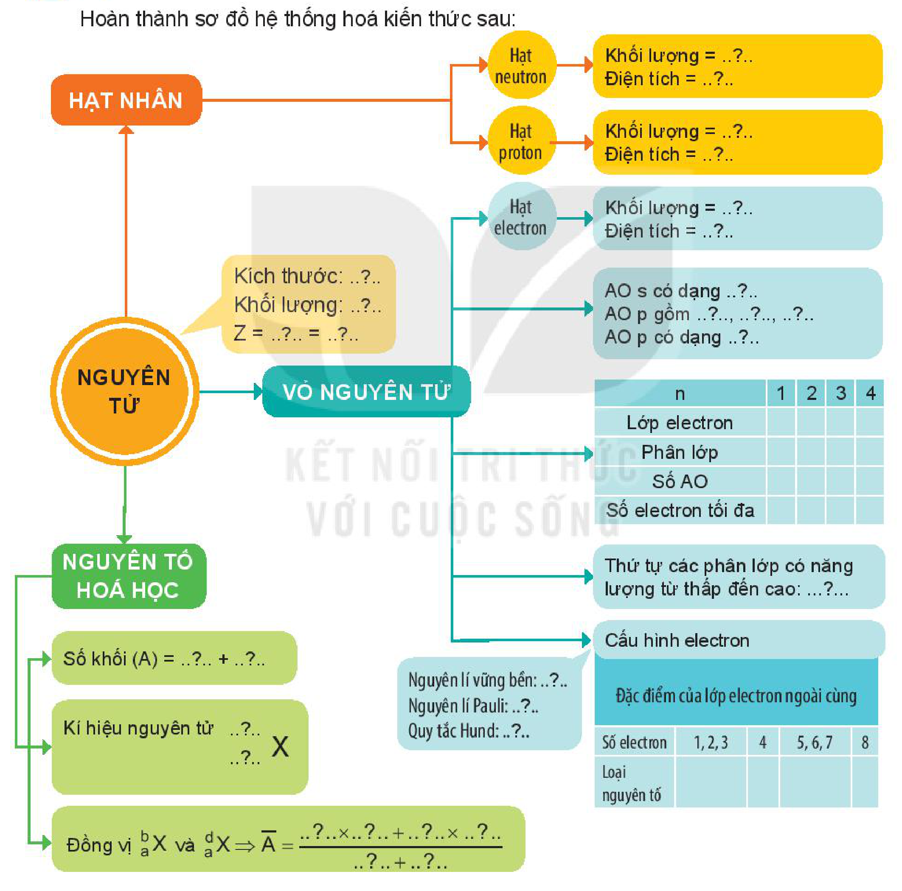

<!-- pdf:27 -->

# BÀI 4: ÔN TẬP CHƯƠNG 1

## I. HỆ THỐNG HOÁ KIẾN THỨC

Hoàn thành sơ đồ hệ thống hoá kiến thức sau:

- NGUYÊN TỬ
  - Kích thước: ..?..
  - Khối lượng: ..?..
  - $Z =$ ..?.. $=$ ..?..
  - HẠT NHÂN
    - Hạt neutron: Khối lượng = ..?..; Điện tích = ..?..
    - Hạt proton: Khối lượng = ..?..; Điện tích = ..?..
  - VỎ NGUYÊN TỬ
    - Hạt electron: Khối lượng = ..?..; Điện tích = ..?..
    - AO s có dạng ..?..; AO p gồm ..?.., ..?.., ..?..; AO p có dạng ..?..
    - Lớp và phân lớp electron ($n = 1, 2, 3, 4$): Lớp electron; Phân lớp; Số AO; Số electron tối đa
    - Thứ tự các phân lớp có năng lượng từ thấp đến cao: ...?...
    - Cấu hình electron:
      - Nguyên lí vững bền: ..?..
      - Nguyên lí Pauli: ..?..
      - Quy tắc Hund: ..?..
      - Đặc điểm của lớp electron ngoài cùng (Số electron: 1, 2, 3 | 4 | 5, 6, 7 | 8; Loại nguyên tố: ..?..)
  - NGUYÊN TỐ HOÁ HỌC
    - Số khối ($A$) = ..?.. + ..?..
    - Kí hiệu nguyên tử: $\ce{^{..?..}_{..?..}X}$
    - Đồng vị $\ce{^b_aX}$ và $\ce{^d_aX} \Rightarrow \overline{A} = \dfrac{..?.. \times ..?.. + ..?.. \times ..?..}{..?.. + ..?..}$
<!-- ocr-ok: sơ đồ tư duy nhiều nhánh và bảng trống; các nhánh chép theo ảnh -->

<!-- pdf:28 -->

## II. LUYỆN TẬP

Câu 1. Số proton, neutron và electron của $\ce{^{39}_{19}K}$ lần lượt là

A. 19, 20, 39. B. 20, 19, 39. C. 19, 20, 19. D. 19, 19, 20.

Câu 2. Nguyên tử của nguyên tố nào sau đây có 3 electron thuộc lớp ngoài cùng?

A. $\ce{^{23}_{11}Na}$. B. $\ce{^{14}_7N}$. C. $\ce{^{27}_{13}Al}$. D. $\ce{^{12}_6C}$.

Câu 3. Nguyên tử của nguyên tố potassium có 19 electron. Ở trạng thái cơ bản, potassium có số orbital chứa electron là

A. 8. B. 9. C. 11. D. 10.
<!-- ocr-ok: OCR đọc phương án "C. 11." thành "C r."; đã đối chiếu ảnh -->

Câu 4. Nguyên tử của nguyên tố sodium (natri) ($Z = 11$) có cấu hình electron là

A. $\text{1s}^2\text{2s}^2\text{2p}^6\text{3s}^2$. B. $\text{1s}^2\text{2s}^2\text{2p}^6$. C. $\text{1s}^2\text{2s}^2\text{2p}^6\text{3s}^1$. D. $\text{1s}^2\text{2s}^2\text{2p}^5\text{3s}^2$.

Câu 5. Tổng số hạt proton, neutron và electron trong nguyên tử X là 58. Số hạt mang điện nhiều hơn số hạt không mang điện là 18. X là

A. Cl. B. Ca. C. K. D. S.
<!-- ocr-ok: OCR đọc "A. Cl." thành "A. GI." và "C. K." thành "cm"; đã đối chiếu ảnh -->

Câu 6. Nguyên tố chlorine có $Z = 17$. Hãy cho biết số lớp electron, số electron thuộc lớp ngoài cùng, số electron độc thân của nguyên tử chlorine.

Câu 7. Nguyên tử khối trung bình của vanadium (V) là 50,9975. Nguyên tố V có 2 đồng vị trong đó đồng vị $\ce{^{50}_{23}V}$ chiếm 0,25%. Tính số khối của đồng vị còn lại.

Câu 8. Cấu hình electron của:

- Nguyên tử X: $\text{1s}^2\text{2s}^2\text{2p}^6\text{3s}^2\text{3p}^6\text{4s}^1$;
- Nguyên tử Y: $\text{1s}^2\text{2s}^2\text{2p}^6\text{3s}^2\text{3p}^4$.

a) Mỗi nguyên tử X và Y chứa bao nhiêu electron?

b) Hãy cho biết số hiệu nguyên tử của X và Y.

c) Lớp electron nào trong nguyên tử X và Y có mức năng lượng cao nhất?

d) Mỗi nguyên tử X và Y có bao nhiêu lớp electron, bao nhiêu phân lớp electron?

e) X và Y là nguyên tố kim loại, phi kim hay khí hiếm?
<!-- ocr-ok: OCR đọc đảo thứ tự các ý a, b, c xuống dưới ý e; đã đối chiếu ảnh -->

Câu 9. Nguyên tố X được dùng để chế tạo hợp kim nhẹ, bền, dùng trong nhiều lĩnh vực: hàng không, ô tô, xây dựng, hàng tiêu dùng,... Nguyên tố Y ở dạng $\ce{YO4^3-}$, đóng vai trò quan trọng trong các phân tử sinh học như DNA và RNA. Các tế bào sống sử dụng $\ce{YO4^3-}$ để vận chuyển năng lượng. Nguyên tử của nguyên tố X có cấu hình electron kết thúc ở phân lớp $\text{3p}^1$. Nguyên tử của nguyên tố Y có cấu hình electron kết thúc ở phân lớp $\text{3p}^3$. Viết cấu hình electron nguyên tử của X và Y. Tính số electron trong các nguyên tử X và Y. Nguyên tố X và Y có tính kim loại hay phi kim?

Câu 10. Nguyên tử của nguyên tố X có tổng số hạt cơ bản (proton, electron, neutron) là 49, trong đó số hạt không mang điện bằng 53,125% số hạt mang điện. Xác định điện tích hạt nhân, số proton, số electron, số neutron và số khối của X.

## 📷 Danh sách hình trong bài

| Mã hình | Trang PDF | Vị trí | Chú thích gốc |
|---|---|---|---|
| H10-hoa-b04-01 | 27 | Mục I (sơ đồ hệ thống hoá kiến thức chương 1, gồm cả câu dẫn) | (sách không đánh số, không có chú thích) |
