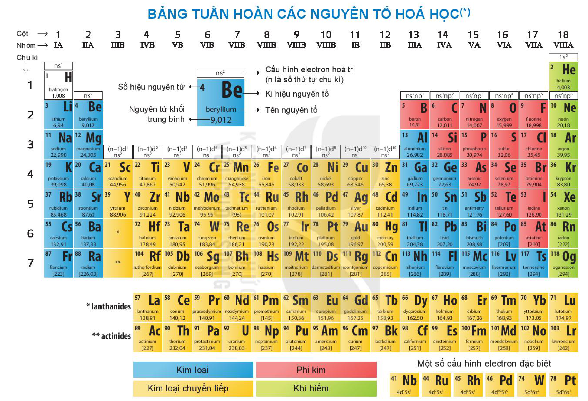
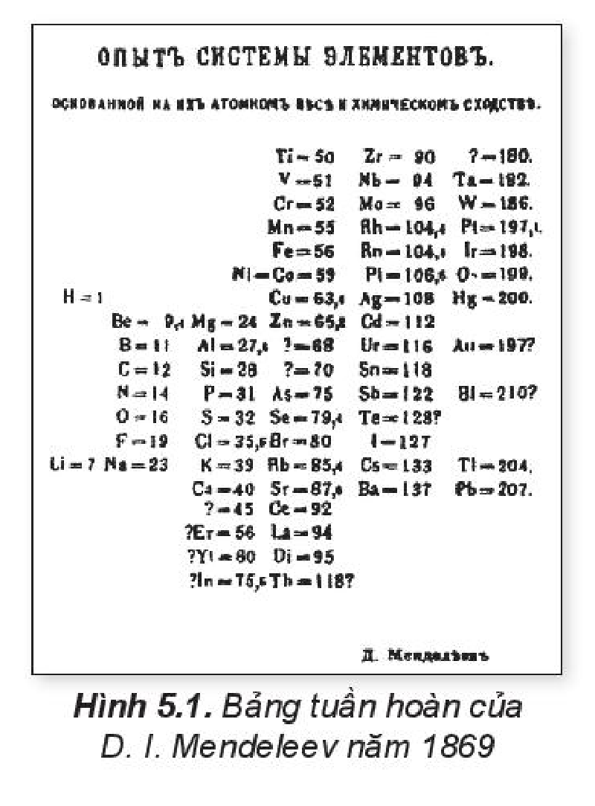
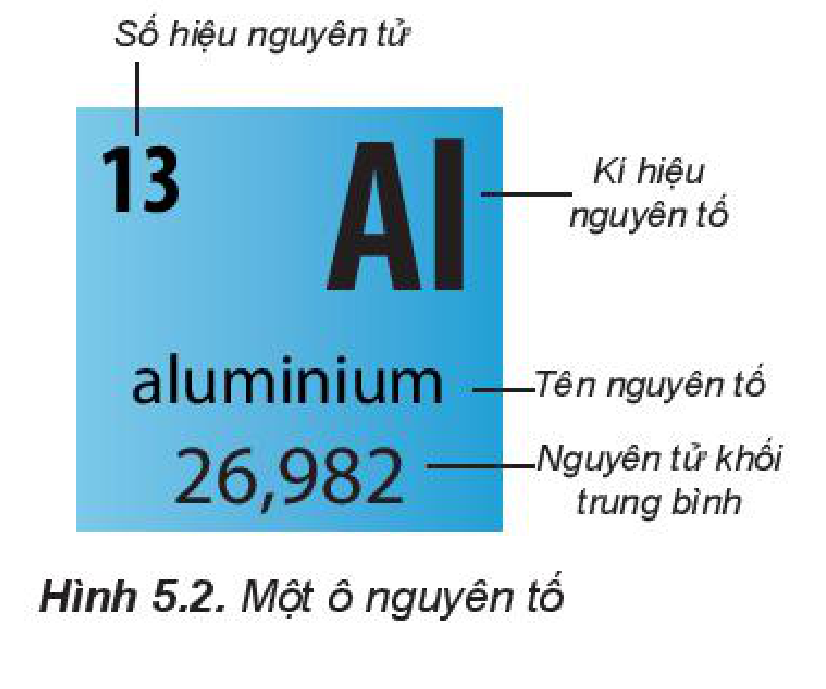

<!-- pdf:30 -->

# BÀI 5: CẤU TẠO CỦA BẢNG TUẦN HOÀN CÁC NGUYÊN TỐ HOÁ HỌC

BẢNG TUẦN HOÀN CÁC NGUYÊN TỐ HOÁ HỌC$^{(*)}$

> $^{(*)}$ Nguồn: IUPAC. Atomic weights of the elements 2019.
<!-- ocr-ok: bảng tuần hoàn xoay dọc toàn trang PDF 30 (trang in 29), OCR đọc ngược chữ xoay; đã đối chiếu ảnh -->

<!-- pdf:31 -->

## 🎯 Mục tiêu

- Nêu được lịch sử phát minh định luật tuần hoàn và bảng tuần hoàn các nguyên tố hoá học.
- Mô tả được cấu tạo của bảng tuần hoàn các nguyên tố hoá học và nêu được các khái niệm liên quan (ô, chu kì, nhóm).
- Nêu được nguyên tắc sắp xếp của bảng tuần hoàn các nguyên tố hoá học (dựa theo cấu hình electron).
- Phân loại được nguyên tố (dựa theo cấu hình electron: nguyên tố s, p, d, f; dựa theo tính chất hoá học: kim loại, phi kim, khí hiếm).

## 🔴 Mở đầu

Bảng tuần hoàn các nguyên tố hoá học có cấu tạo như thế nào? Trong bảng tuần hoàn, các nguyên tố được sắp xếp theo nguyên tắc nào?

## I. LỊCH SỬ PHÁT MINH BẢNG TUẦN HOÀN CÁC NGUYÊN TỐ HOÁ HỌC

Khi đã biết một số đáng kể các nguyên tố hoá học, người ta đã tìm cách phân loại chúng. Cách phân loại đầu tiên được A. Lavoisier (La-voa-di-ê, người Pháp) thực hiện năm 1789, xếp 33 nguyên tố hoá học thành nhóm các chất khí, kim loại, phi kim và "đất". Năm 1829, J. W. Döbereiner (Đô-be-rai-nơ, người Đức) phân loại các nguyên tố thành các nhóm có tính chất hoá học giống nhau, ví dụ: lithium, sodium và potassium là nhóm các kim loại mềm, dễ phản ứng. Năm 1866, J. Newlands (Niu-lan, người Anh) đã xếp các nguyên tố hoá học theo chiều tăng khối lượng nguyên tử thành các octave (quãng tám), trong đó nguyên tố thứ tám lặp lại tính chất của nguyên tố đầu tiên.

Năm 1869, hai nhà hoá học, D. I. Mendeleev (Men-đê-lê-ép, người Nga) và J. L. Meyer (May-ơ, người Đức) đều sắp xếp các nguyên tố theo chiều tăng khối lượng nguyên tử vào các hàng và cột, bắt đầu mỗi hàng (bảng của Mendeleev) hoặc cột mới (bảng của Mayer) khi các tính chất của nguyên tố bắt đầu lặp lại. Trong bảng tuần hoàn các nguyên tố hoá học của mình, Mendeleev đã thay đổi vị trí một số nguyên tố để tính chất của nguyên tố phù hợp với quy luật, đồng thời để trống một số chỗ cho các nguyên tố chưa biết.

Sau này, các nguyên tố ở vị trí còn trống đó được tìm ra và tính chất của chúng đều phù hợp với dự đoán của Mendeleev.

Hình 5.1. Bảng tuần hoàn của D. I. Mendeleev năm 1869

<!-- pdf:32 -->

Đến năm 2016, với những hiểu biết về cấu tạo nguyên tử, bảng tuần hoàn các nguyên tố hoá học hiện đại sắp xếp 118 nguyên tố theo chiều tăng của điện tích hạt nhân nguyên tử.

> ❓ 1. Theo tiến trình lịch sử, các nhà khoa học đã phân loại các nguyên tố hoá học dựa trên các cơ sở nào?

## II. NGUYÊN TẮC SẮP XẾP CÁC NGUYÊN TỐ TRONG BẢNG TUẦN HOÀN

<!-- term: Nguyên tắc sắp xếp các nguyên tố trong bảng tuần hoàn -->
Bảng tuần hoàn chứa 118 nguyên tố hoá học được sắp xếp theo các nguyên tắc sau:

<!-- term: Nguyên tắc sắp xếp các nguyên tố trong bảng tuần hoàn -->
- Các nguyên tố được sắp xếp theo chiều tăng dần điện tích hạt nhân nguyên tử.
- Các nguyên tố có cùng số lớp electron trong nguyên tử được xếp thành một hàng.
- Các nguyên tố có cùng số *electron hoá trị* trong nguyên tử được xếp thành một cột.

Khi sắp xếp như vậy, sự tuần hoàn tính chất của các đơn chất và hợp chất được thể hiện qua chu kì (hàng) và nhóm (cột).

> 💡 EM CÓ BIẾT
>
> ***Electron hoá trị*** là các electron có khả năng tham gia tạo thành liên kết hoá học, chúng thường nằm ở lớp electron ngoài cùng và phân lớp sát lớp ngoài cùng.

> ❓ 2. Trong bảng tuần hoàn, các nguyên tố hoá học được sắp xếp theo ba nguyên tắc, nguyên tắc nào sau đây là đúng?
>
> A. Nguyên tử khối tăng dần. B. Cùng số lớp electron xếp cùng cột.
>
> C. Điện tích hạt nhân tăng dần. D. Cùng số electron hoá trị xếp cùng hàng.

## III. CẤU TẠO CỦA BẢNG TUẦN HOÀN

### 1. Ô nguyên tố

Trong bảng tuần hoàn, mỗi nguyên tố được xếp vào một ô, gọi là **ô nguyên tố**. Số thứ tự của ô là số hiệu nguyên tử của nguyên tố đó. Mỗi ô nguyên tố có các thông tin quan trọng nhất về nguyên tố hoá học. Tuỳ theo từng loại bảng, các thông tin này có thể là số hiệu nguyên tử, kí hiệu nguyên tố, tên nguyên tố, nguyên tử khối trung bình,...

Số hiệu nguyên tử: 13; Kí hiệu nguyên tố: Al; Tên nguyên tố: aluminium; Nguyên tử khối trung bình: 26,982
<!-- ocr-ok: nhãn và chữ trong ô nguyên tố của Hình 5.2, OCR bỏ sót chữ trong ô màu; đã đối chiếu ảnh -->

Hình 5.2. Một ô nguyên tố

<!-- pdf:33 -->

### 2. Chu kì

**Chu kì** là dãy các nguyên tố mà nguyên tử của chúng có cùng số lớp electron, được xếp theo chiều điện tích hạt nhân tăng dần.

Bảng tuần hoàn hiện nay có 7 chu kì. Số thứ tự của chu kì bằng số lớp electron của nguyên tử các nguyên tố trong chu kì.

*Chu kì 1:* gồm 2 nguyên tố là H và He, đều có 1 lớp electron

*Chu kì 2:* gồm 8 nguyên tố từ Li đến Ne, đều có 2 lớp electron.

*Chu kì 3:* gồm 8 nguyên tố từ Na đến Ar, đều có 3 lớp electron.

*Chu kì 4:* gồm 18 nguyên tố từ K đến Kr, đều có 4 lớp electron.

*Chu kì 5:* gồm 18 nguyên tố từ Rb đến Xe, đều có 5 lớp electron.

*Chu kì 6*$^{(*)}$: gồm 32 nguyên tố từ Cs đến Rn, đều có 6 lớp electron.

*Chu kì 7*$^{(*)}$: gồm 32 nguyên tố từ Fr đến Og, đều có 7 lớp electron.

### 3. Nhóm nguyên tố

**Nhóm nguyên tố** gồm các nguyên tố mà nguyên tử của chúng có cấu hình electron tương tự nhau, do đó có tính chất hoá học gần giống nhau và được xếp thành một cột.

Bảng tuần hoàn hiện nay có 18 cột, chia thành 8 nhóm A (IA đến VIIIA) và 8 nhóm B (IB đến VIIIB). Mỗi nhóm là một cột, riêng nhóm VIIIB gồm 3 cột.

Ví dụ: Nhóm kim loại kiềm – nhóm IA, nhóm halogen – nhóm VIIA.

Nguyên tử các nguyên tố trong cùng một nhóm A có số electron hoá trị bằng nhau và bằng số thứ tự của nhóm (trừ He).

### 4. Phân loại nguyên tố

**a) Theo cấu hình electron**

**Các nguyên tố s, p, d, f** là những nguyên tố mà nguyên tử có electron cuối cùng được điền vào phân lớp s, p, d, f tương ứng.

Ví dụ: $_{11}\ce{Na}$: $\ce{1s^2 2s^2 2p^6 3s^1}$ (nguyên tố s);

$_{13}\ce{Al}$: $\ce{1s^2 2s^2 2p^6 3s^2 3p^1}$ (nguyên tố p).

**Các nhóm A**: gồm các nguyên tố s (IA, IIA) và nguyên tố p (từ IIIA đến VIIIA, trừ He).

**Các nhóm B**: gồm các nguyên tố d (từ IB đến VIIIB) và các nguyên tố f (lanthanides và actinides).

**b) Theo tính chất hoá học**

<!-- term: Phân loại nguyên tố theo tính chất hoá học -->
Các nhóm IA, IIA, IIIA: gồm các nguyên tố s và p là kim loại (trừ H và B).

<!-- term: Phân loại nguyên tố theo tính chất hoá học -->
Các nhóm VA, VIA, VIIA: gồm các nguyên tố p, thường là phi kim.

<!-- term: Phân loại nguyên tố theo tính chất hoá học -->
Nhóm VIIIA: gồm các nguyên tố khí hiếm.

<!-- term: Phân loại nguyên tố theo tính chất hoá học -->
Các nhóm B: gồm các nguyên tố d và f đều là kim loại chuyển tiếp.

> $^{(*)}$ *14 nguyên tố từ La đến Lu thuộc chu kì 6 (các nguyên tố họ lanthanide) và 14 nguyên tố từ Ac đến Lr thuộc chu kì 7 (các nguyên tố họ actinide) được xếp thành hai hàng ở cuối bảng do có tính chất hoá học tương tự nhau.*

<!-- pdf:34 -->

> ❓ 3. Ô nguyên tố trong bảng tuần hoàn cho ta biết những thông tin gì? Lấy ví dụ minh hoạ.
>
> 4. Dựa vào bảng tuần hoàn, hãy cho biết cấu hình electron và số electron hoá trị của các nguyên tố: C, Mg và Cl.
>
> 5. Dựa vào bảng tuần hoàn, hãy cho biết: $_{12}\ce{Mg}$, $_{15}\ce{P}$, $_{26}\ce{Fe}$, $_{18}\ce{Ar}$ thuộc loại nguyên tố nào sau đây.
>
> a) s, p, d hay f? b) phi kim, kim loại hay khí hiếm?
>
> 6. Nguyên tố phosphorus có $Z = 15$, có trong thành phần của một số loại phân bón, diêm, pháo hoa; nguyên tố calcium có $Z = 20$, đóng vai trò rất quan trọng đối với cơ thể, đặc biệt là xương và răng. Xác định vị trí của hai nguyên tố trên trong bảng tuần hoàn và cho biết chúng thuộc loại nguyên tố s, p hay d; là kim loại, phi kim hay khí hiếm.
>
> 7. Sulfur (lưu huỳnh) là chất rắn, xốp, màu vàng nhạt ở điều kiện thường. Sulfur và hợp chất của nó được sử dụng trong acquy, bột giặt, thuốc diệt nấm; do dễ cháy nên sulfur còn được dùng để sản xuất các loại diêm, thuốc súng, pháo hoa,... Trong bảng tuần hoàn, nguyên tố sulfur nằm ở chu kì 3, nhóm VIA.
>
> a) Nguyên tử của nguyên tố sulfur có bao nhiêu electron thuộc lớp ngoài cùng?
>
> b) Các electron lớp ngoài cùng thuộc những phân lớp nào?
>
> c) Viết cấu hình electron nguyên tử của sulfur.
>
> d) Sulfur là nguyên tố kim loại hay phi kim?

## 📌 Em đã học

- Các nguyên tố trong bảng tuần hoàn được sắp xếp theo chiều tăng dần của điện tích hạt nhân, thành các hàng và các cột.
- Cấu tạo của bảng tuần hoàn các nguyên tố hoá học:
  - Ô nguyên tố: cho biết số hiệu nguyên tử, kí hiệu nguyên tố, tên nguyên tố và nguyên tử khối trung bình,...
  - Chu kì là dãy các nguyên tố mà nguyên tử của chúng có cùng số lớp electron, được xếp theo chiều điện tích hạt nhân tăng dần.
  - Nhóm gồm các nguyên tố mà nguyên tử có cấu hình electron tương tự nhau, do đó có tính chất hoá học gần giống nhau.

## ✏️ Em có thể

Xác định được vị trí các nguyên tố hoá học trong bảng tuần hoàn và phân loại được thành nguyên tố s, p, d, f hay nguyên tố kim loại, phi kim, khí hiếm.

## 📷 Danh sách hình trong bài

| Mã hình | Trang PDF | Vị trí | Chú thích gốc |
|---|---|---|---|
| H10-hoa-b05-01 | 30 | Đầu bài, toàn trang PDF 30 (trang in 29) | BẢNG TUẦN HOÀN CÁC NGUYÊN TỐ HOÁ HỌC(*) — (*) Nguồn: IUPAC. Atomic weights of the elements 2019. |
| H10-hoa-b05-02 | 31 | Mục I | Hình 5.1. Bảng tuần hoàn của D. I. Mendeleev năm 1869 |
| H10-hoa-b05-03 | 32 | Mục III.1 | Hình 5.2. Một ô nguyên tố |
