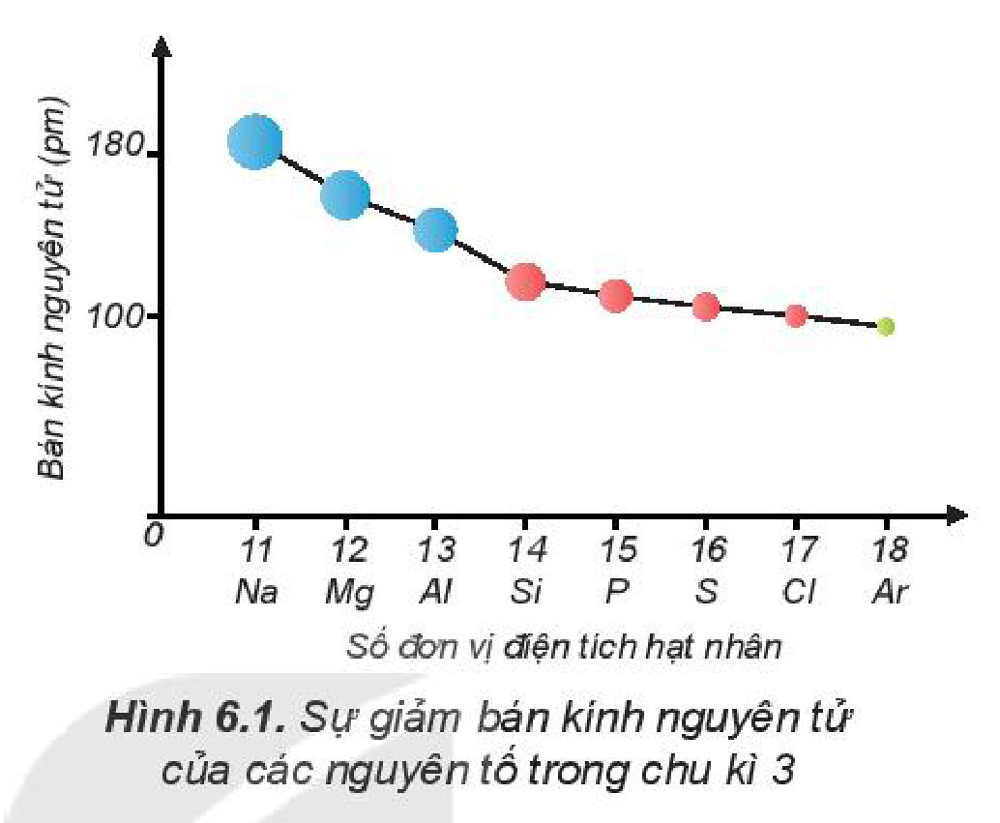
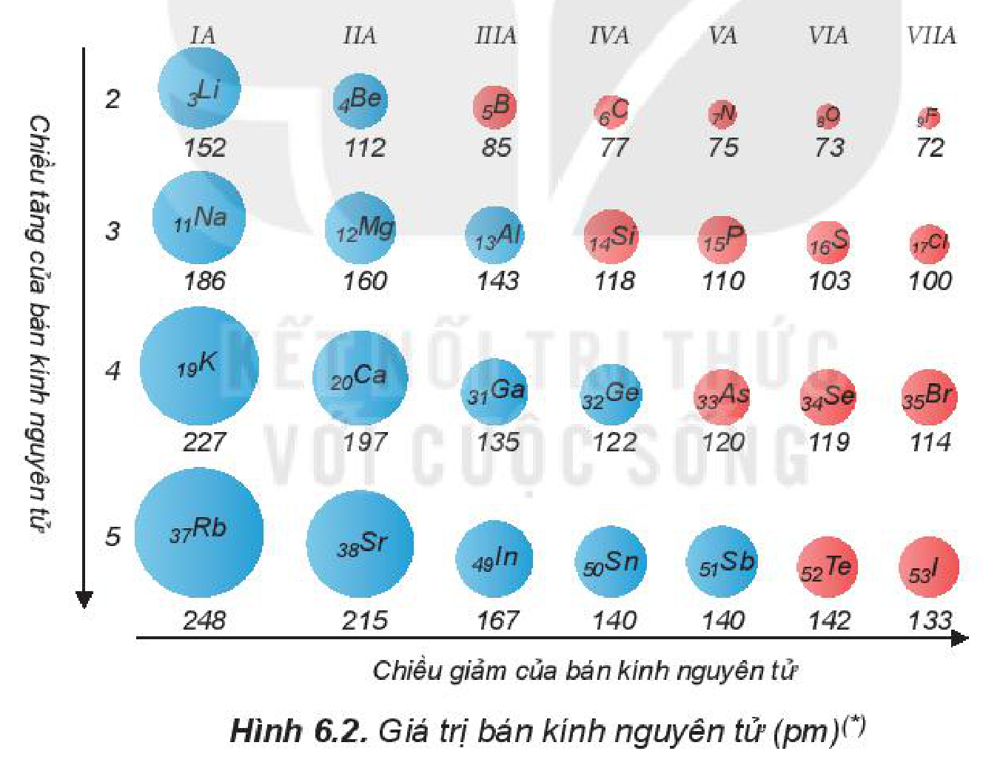
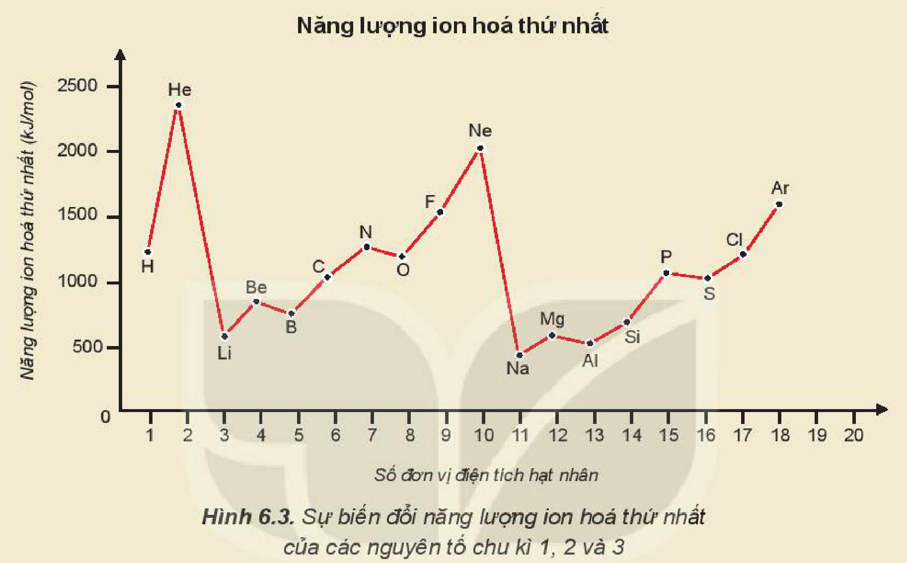
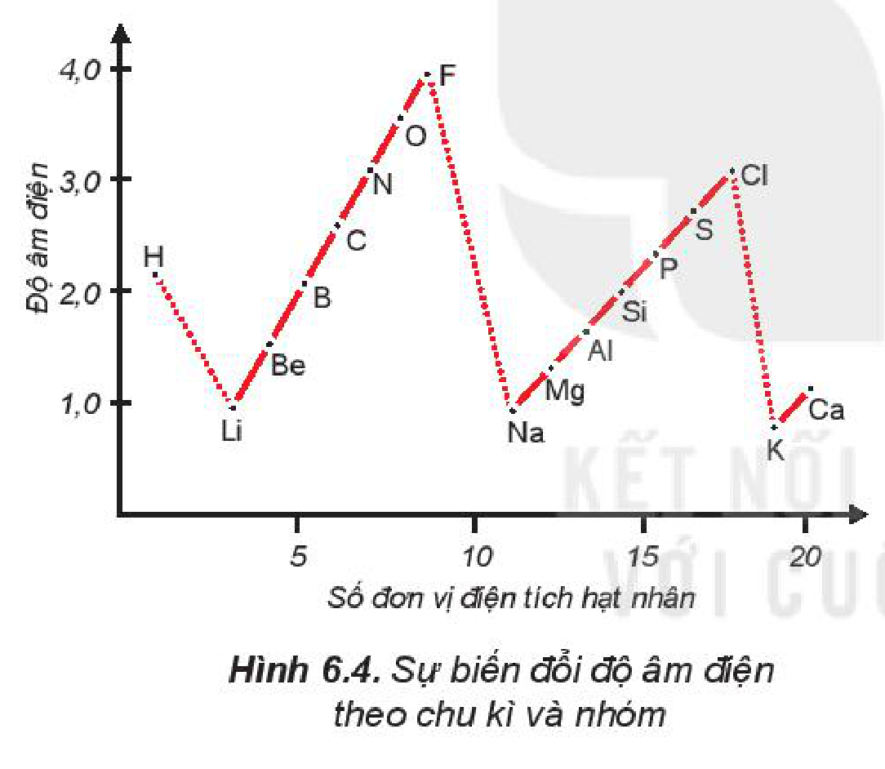
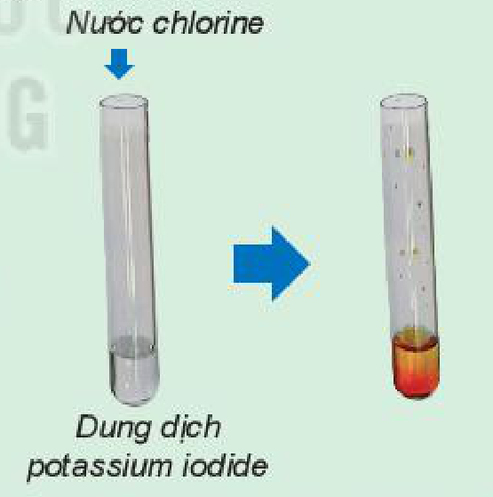
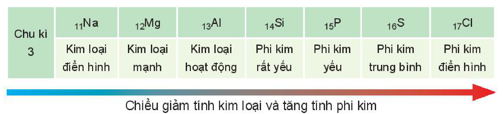
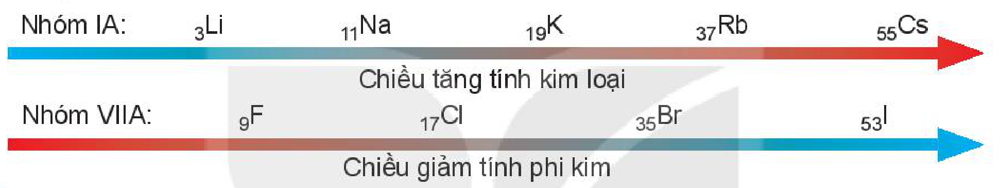

<!-- pdf:35 -->

# BÀI 6: XU HƯỚNG BIẾN ĐỔI MỘT SỐ TÍNH CHẤT CỦA NGUYÊN TỬ CÁC NGUYÊN TỐ TRONG MỘT CHU KÌ VÀ TRONG MỘT NHÓM

## 🎯 Mục tiêu

- Giải thích được xu hướng biến đổi bán kính nguyên tử trong một chu kì, trong một nhóm (nhóm A) (dựa theo lực hút tĩnh điện của hạt nhân với electron ngoài cùng và dựa theo số lớp electron tăng trong một nhóm theo chiều từ trên xuống dưới).
- Nhận xét và giải thích được xu hướng biến đổi độ âm điện và tính kim loại, phi kim của nguyên tử các nguyên tố trong một chu kì, trong một nhóm (nhóm A).

## 🔴 Mở đầu

Trong bảng tuần hoàn, một số tính chất của nguyên tử và đơn chất biến đổi theo xu hướng nào trong một chu kì, trong một nhóm A? Vì sao?

## I. CẤU HÌNH ELECTRON NGUYÊN TỬ CỦA CÁC NGUYÊN TỐ NHÓM A

Bảng 6.1. Cấu hình electron lớp ngoài cùng của nguyên tử các nguyên tố nhóm A

| Chu kì \ Nhóm | IA | IIA | IIIA | IVA | VA | VIA | VIIA | VIIIA |
|---|---|---|---|---|---|---|---|---|
| 1 | H $\ce{1s^1}$ | | | | | | | He $\ce{1s^2}$ |
| 2 | Li $\ce{2s^1}$ | Be $\ce{2s^2}$ | B $\ce{2s^2 2p^1}$ | C $\ce{2s^2 2p^2}$ | N $\ce{2s^2 2p^3}$ | O $\ce{2s^2 2p^4}$ | F $\ce{2s^2 2p^5}$ | Ne $\ce{2s^2 2p^6}$ |
| 3 | Na $\ce{3s^1}$ | Mg $\ce{3s^2}$ | Al $\ce{3s^2 3p^1}$ | Si $\ce{3s^2 3p^2}$ | P $\ce{3s^2 3p^3}$ | S $\ce{3s^2 3p^4}$ | Cl $\ce{3s^2 3p^5}$ | Ar $\ce{3s^2 3p^6}$ |
| 4 | K $\ce{4s^1}$ | Ca $\ce{4s^2}$ | Ga $\ce{4s^2 4p^1}$ | Ge $\ce{4s^2 4p^2}$ | As $\ce{4s^2 4p^3}$ | Se $\ce{4s^2 4p^4}$ | Br $\ce{4s^2 4p^5}$ | Kr $\ce{4s^2 4p^6}$ |
| 5 | Rb $\ce{5s^1}$ | Sr $\ce{5s^2}$ | In $\ce{5s^2 5p^1}$ | Sn $\ce{5s^2 5p^2}$ | Sb $\ce{5s^2 5p^3}$ | Te $\ce{5s^2 5p^4}$ | I $\ce{5s^2 5p^5}$ | Xe $\ce{5s^2 5p^6}$ |
| 6 | Cs $\ce{6s^1}$ | Ba $\ce{6s^2}$ | Tl $\ce{6s^2 6p^1}$ | Pb $\ce{6s^2 6p^2}$ | Bi $\ce{6s^2 6p^3}$ | Po $\ce{6s^2 6p^4}$ | At $\ce{6s^2 6p^5}$ | Rn $\ce{6s^2 6p^6}$ |
| 7 | Fr $\ce{7s^1}$ | Ra $\ce{7s^2}$ | | | | | | |
<!-- ocr-ok: Bảng 6.1 có nền màu, OCR đọc sai kí hiệu nguyên tố và số mũ cấu hình electron; đã đối chiếu ảnh -->

<!-- term: Cấu hình electron nguyên tử của các nguyên tố nhóm A -->
Nhóm A gồm các nguyên tố s và p. Nguyên tử của các nguyên tố cùng một nhóm A có số electron lớp ngoài cùng (electron hoá trị) bằng nhau (trừ He trong nhóm VIIIA). Sự giống nhau về số electron hoá trị dẫn đến sự tương tự nhau về tính chất hoá học của các nguyên tố trong cùng nhóm A.

<!-- term: Cấu hình electron nguyên tử của các nguyên tố nhóm A -->
Sau mỗi chu kì, cấu hình electron lớp ngoài cùng của nguyên tử các nguyên tố nhóm A được lặp đi lặp lại một cách tuần hoàn. Sự biến đổi tuần hoàn cấu hình electron lớp ngoài cùng của nguyên tử các nguyên tố khi điện tích hạt nhân tăng dần là nguyên nhân của sự biến đổi tuần hoàn về tính chất của các nguyên tố.

<!-- pdf:36 -->

> ❓ 1. Dựa vào Bảng 6.1, cho biết số electron lớp ngoài cùng của nguyên tử các nguyên tố: Li, Al, Ar, Ca, Si, Se, P, Br.
>
> 2. Nêu vị trí trong bảng tuần hoàn của các nguyên tố có $Z = 8$; $Z = 11$; $Z = 17$ và $Z = 20$. Xác định số electron hoá trị của nguyên tử các nguyên tố đó.

## II. BÁN KÍNH NGUYÊN TỬ

Một cách gần đúng, **bán kính nguyên tử** được xác định bằng một nửa khoảng cách trung bình giữa hai hạt nhân nguyên tử gần nhau nhất trong chất rắn đơn chất hoặc trong phân tử hai nguyên tử giống nhau.

Hình 6.1. Sự giảm bán kính nguyên tử của các nguyên tố trong chu kì 3

Hình 6.2. Giá trị bán kính nguyên tử (pm)$^{(*)}$

Bán kính nguyên tử phụ thuộc vào lực hút giữa hạt nhân với các electron lớp ngoài cùng. Bán kính giảm là do lực hút tăng và ngược lại, bán kính tăng là do lực hút giảm.

<!-- term: Xu hướng biến đổi bán kính nguyên tử -->
Xu hướng biến đổi bán kính nguyên tử:

<!-- term: Xu hướng biến đổi bán kính nguyên tử -->
- Trong một chu kì, *bán kính nguyên tử giảm theo chiều tăng dần của điện tích hạt nhân.*
- Trong một nhóm A, *bán kính nguyên tử tăng theo chiều tăng dần của điện tích hạt nhân.*

> $^{(*)}$ *Nguồn: Martin S. Silberberg. (2007). Principles of GENERAL CHEMISTRY. McGraw-Hill.*

<!-- pdf:37 -->

> ❓ 3. Dựa vào bảng tuần hoàn, hãy so sánh và giải thích sự khác nhau về bán kính nguyên tử của
>
> a) lithium ($Z = 3$) và potassium ($Z = 19$).
>
> b) calcium ($Z = 20$) và selenium ($Z = 34$).

> 💡 EM CÓ BIẾT
>
> **Năng lượng ion hoá thứ nhất**
>
> 
>
> Hình 6.3. Sự biến đổi năng lượng ion hoá thứ nhất của các nguyên tố chu kì 1, 2 và 3
>
> Năng lượng ion hoá thứ nhất của nguyên tử là năng lượng tối thiểu cần thiết để tách electron thứ nhất ra khỏi nguyên tử ở thể khí, ở trạng thái cơ bản: $\ce{X(g)}^{(*)} \rightarrow \ce{X^+(g) + e}$
>
> Năng lượng ion hoá thứ nhất kí hiệu là $I_1$, đơn vị là kJ/mol.
>
> Ví dụ : Để tách một mol electron ra khỏi một mol nguyên tử hydrogen theo quá trình:
>
> $\ce{H(g) -> H^+(g) + e}$ phải tiêu tốn một năng lượng là $1\,312\text{ kJ}$, do đó $I_1 = 1\,312\text{ kJ/mol}$.
>
> - Trong một chu kì, năng lượng ion hoá thứ nhất có xu hướng tăng theo chiều tăng dần của điện tích hạt nhân.
> - Trong một nhóm A, năng lượng ion hoá thứ nhất có xu hướng giảm theo chiều tăng dần của điện tích hạt nhân.

## III. ĐỘ ÂM ĐIỆN

**Độ âm điện** của nguyên tử ($\chi$) là đại lượng đặc trưng cho khả năng hút electron của nguyên tử một nguyên tố hoá học khi tạo thành liên kết hoá học.

Khi tham gia liên kết hoá học, nguyên tử có độ âm điện nhỏ dễ nhường electron, nguyên tử có độ âm điện lớn dễ nhận electron.

Sau đây là bảng giá trị độ âm điện do nhà hoá học L. C. Pauling (Pau-linh) thiết lập vào năm 1932.

> $^{(*)}$ *Viết tắt trạng thái các chất trong phương trình hoá học: s (solid): thể rắn; g (gas): thể khí; l (liquid): thể lỏng; aq (aqua): dung dịch.*

<!-- pdf:38 -->

Bảng 6.2. Giá trị độ âm điện tương đối theo L. C. Pauling

| Chu kì \ Nhóm | IA | IIA | IIIA | IVA | VA | VIA | VIIA |
|---|---|---|---|---|---|---|---|
| 1 | $_1\ce{H}$ (2,20) | | | | | | |
| 2 | $_3\ce{Li}$ (0,98) | $_4\ce{Be}$ (1,57) | $_5\ce{B}$ (2,04) | $_6\ce{C}$ (2,55) | $_7\ce{N}$ (3,04) | $_8\ce{O}$ (3,44) | $_9\ce{F}$ (3,98) |
| 3 | $_{11}\ce{Na}$ (0,93) | $_{12}\ce{Mg}$ (1,31) | $_{13}\ce{Al}$ (1,61) | $_{14}\ce{Si}$ (1,90) | $_{15}\ce{P}$ (2,19) | $_{16}\ce{S}$ (2,58) | $_{17}\ce{Cl}$ (3,16) |
| 4 | $_{19}\ce{K}$ (0,82) | $_{20}\ce{Ca}$ (1,00) | $_{31}\ce{Ga}$ (1,81) | $_{32}\ce{Ge}$ (2,01) | $_{33}\ce{As}$ (2,18) | $_{34}\ce{Se}$ (2,55) | $_{35}\ce{Br}$ (2,96) |
| 5 | $_{37}\ce{Rb}$ (0,82) | $_{38}\ce{Sr}$ (0,95) | $_{49}\ce{In}$ (1,78) | $_{50}\ce{Sn}$ (1,96) | $_{51}\ce{Sb}$ (2,05) | $_{52}\ce{Te}$ (2,10) | $_{53}\ce{I}$ (2,66) |
| 6 | $_{55}\ce{Cs}$ (0,79) | $_{56}\ce{Ba}$ (0,89) | $_{81}\ce{Tl}$ (1,62) | $_{82}\ce{Pb}$ (2,33) | $_{83}\ce{Bi}$ (2,02) | $_{84}\ce{Po}$ (2,00) | $_{85}\ce{At}$ (2,20) |
<!-- ocr-ok: Bảng 6.2 có nền màu đậm, OCR bỏ sót hầu hết các ô trong bảng; đã đối chiếu ảnh -->

Hình 6.4. Sự biến đổi độ âm điện theo chu kì và nhóm

<!-- term: Xu hướng biến đổi độ âm điện -->
Xu hướng biến đổi độ âm điện theo chiều tăng dần của điện tích hạt nhân:

<!-- term: Xu hướng biến đổi độ âm điện -->
- *Độ âm điện tăng* từ trái qua phải trong một chu kì.

<!-- term: Xu hướng biến đổi độ âm điện -->
Trong một chu kì, khi số electron lớp ngoài cùng tăng, điện tích hạt nhân tăng thì lực hút giữa hạt nhân với các electron lớp ngoài cùng tăng nên độ âm điện tăng.

<!-- term: Xu hướng biến đổi độ âm điện -->
- *Độ âm điện giảm* từ trên xuống dưới trong một nhóm A.

<!-- term: Xu hướng biến đổi độ âm điện -->
Trong một nhóm A, khi số lớp electron tăng, lực hút giữa hạt nhân với các electron lớp ngoài cùng giảm nên độ âm điện giảm.

> ❓ 4. Dãy các nguyên tố được sắp xếp theo thứ tự độ âm điện tăng dần là Ca, Mg, P, S. Hãy giải thích sự sắp xếp này dựa trên sự biến đổi độ âm điện theo chu kì và nhóm A.
>
> 5. Almelec là hợp kim của aluminium với một lượng nhỏ magnesium và silicon (98,8% aluminium; 0,7% magnesium và 0,5% silicon). Almelec được sử dụng làm dây điện cao thế do nhẹ, dẫn điện tốt và bền. Dựa vào bảng tuần hoàn các nguyên tố hoá học, hãy:
>
> a) Sắp xếp theo thứ tự tăng dần về bán kính nguyên tử của các nguyên tố hoá học có trong almelec.
>
> b) Cho biết thứ tự giảm dần về độ âm điện của các nguyên tố hoá học có trong almelec.

<!-- pdf:39 -->

## IV. TÍNH KIM LOẠI VÀ TÍNH PHI KIM

### 1. Khái niệm

**Tính kim loại** là tính chất của một nguyên tố mà nguyên tử của nó dễ nhường electron để trở thành ion dương. Nguyên tử của nguyên tố nào càng dễ nhường electron để trở thành ion dương, tính kim loại của nguyên tố đó càng mạnh.

**Tính phi kim** là tính chất của một nguyên tố mà nguyên tử của nó dễ nhận electron để trở thành ion âm. Nguyên tử của nguyên tố nào càng dễ nhận electron để trở thành ion âm, tính phi kim của nguyên tố đó càng mạnh.

### 2. Sự biến đổi tính kim loại, tính phi kim

> ✋ **1. So sánh tính kim loại của sodium và magnesium**
>
> *Chuẩn bị:* kim loại Na; Mg; dung dịch phenolphthalein; nước; cốc thuỷ tinh.
>
> *Tiến hành:*
>
> - Lấy hai cốc thuỷ tinh, mỗi cốc có chứa khoảng 200 mL nước, nhỏ tiếp vài giọt dung dịch phenolphthalein.
> - Cho một mẩu nhỏ Na vào cốc (1), một dây Mg vào cốc (2).
>
> *Lưu ý: Hầu hết các kim loại kiềm phản ứng với nước mãnh liệt, chỉ sử dụng các kim loại kiềm với lượng nhỏ; cần làm sạch bề mặt dây Mg trước khi cho vào cốc (2).*
>
> *Quan sát hiện tượng và thực hiện yêu cầu sau:*
>
> 1. Viết phương trình hoá học của các phản ứng.
> 2. So sánh mức độ phản ứng của sodium và magnesium với nước.
>
> **2. So sánh tính phi kim của chlorine và iodine**
>
> *Chuẩn bị:* Hình ảnh hoặc video phản ứng của nước chlorine với dung dịch potassium iodide$^{(*)}$.
>
> *Tiến hành:* Quan sát hình ảnh hoặc xem video phản ứng của nước chlorine với dung dịch potassium iodide.
>
> *Câu hỏi:* So sánh tính phi kim của chlorine và iodine.
>
> 
>
> Hình 6.5. Phản ứng của nước chlorine với dung dịch potassium iodide

<!-- term: Xu hướng biến đổi tính kim loại và tính phi kim -->
Xu hướng biến đổi tính kim loại và tính phi kim:

<!-- term: Xu hướng biến đổi tính kim loại và tính phi kim -->
- Trong một chu kì, theo chiều tăng dần của điện tích hạt nhân, *tính kim loại giảm dần và tính phi kim tăng dần.* Do bán kính nguyên tử giảm, lực hút giữa hạt nhân với các electron lớp ngoài cùng tăng, dẫn đến khả năng nhường electron giảm nên tính kim loại giảm, khả năng nhận electron tăng nên tính phi kim tăng.

> $^{(*)}$ *Nguồn: Youtube.com*

<!-- pdf:40 -->

Ví dụ:

| Chu kì 3 | $_{11}\ce{Na}$ | $_{12}\ce{Mg}$ | $_{13}\ce{Al}$ | $_{14}\ce{Si}$ | $_{15}\ce{P}$ | $_{16}\ce{S}$ | $_{17}\ce{Cl}$ |
|---|---|---|---|---|---|---|---|
| | Kim loại điển hình | Kim loại mạnh | Kim loại hoạt động | Phi kim rất yếu | Phi kim yếu | Phi kim trung bình | Phi kim điển hình |
<!-- ocr-ok: bảng có nền màu, OCR ghép chữ trong ô và tách sai dòng; đã đối chiếu ảnh -->

Chiều giảm tính kim loại và tăng tính phi kim

<!-- term: Xu hướng biến đổi tính kim loại và tính phi kim -->
- Trong một nhóm A, theo chiều tăng dần của điện tích hạt nhân, *tính kim loại tăng dần và tính phi kim giảm dần.* Tuy điện tích hạt nhân tăng, nhưng bán kính nguyên tử tăng nhanh và chiếm ưu thế hơn nên lực hút giữa hạt nhân với các electron lớp ngoài cùng giảm dẫn đến khả năng nhường electron tăng, do đó tính kim loại tăng, khả năng nhận electron giảm nên tính phi kim giảm.

Ví dụ:

- Nhóm IA: $_3\ce{Li}$, $_{11}\ce{Na}$, $_{19}\ce{K}$, $_{37}\ce{Rb}$, $_{55}\ce{Cs}$ — Chiều tăng tính kim loại
- Nhóm VIIA: $_9\ce{F}$, $_{17}\ce{Cl}$, $_{35}\ce{Br}$, $_{53}\ce{I}$ — Chiều giảm tính phi kim

> ❓ 6. Dựa vào bảng tuần hoàn các nguyên tố hoá học, sắp xếp các nguyên tố Ba, Mg, Ca, Sr theo thứ tự giảm dần tính kim loại và giải thích.
>
> 7. Trong các nguyên tố O, F, Cl, Se, nguyên tố có tính phi kim mạnh nhất là
>
> A. O. B. F. C. Se. D. Cl.

## 📌 Em đã học

Theo chiều tăng dần của điện tích hạt nhân nguyên tử:

- Trong một chu kì:
  - Bán kính nguyên tử giảm dần, độ âm điện tăng dần.
  - Tính kim loại giảm dần và tính phi kim tăng dần.
  - Số electron hoá trị của nguyên tử các nguyên tố nhóm A tăng lần lượt từ 1 đến 8.
- Trong một nhóm A:
  - Bán kính nguyên tử tăng dần, độ âm điện giảm dần.
  - Tính kim loại tăng dần và tính phi kim giảm dần.

## ✏️ Em có thể

So sánh và giải thích được xu hướng biến đổi một số tính chất của các nguyên tố theo vị trí của chúng trong bảng tuần hoàn các nguyên tố hoá học.

## 📷 Danh sách hình trong bài

| Mã hình | Trang PDF | Vị trí | Chú thích gốc |
|---|---|---|---|
| H10-hoa-b06-01 | 36 | Mục II | Hình 6.1. Sự giảm bán kính nguyên tử của các nguyên tố trong chu kì 3 |
| H10-hoa-b06-02 | 36 | Mục II | Hình 6.2. Giá trị bán kính nguyên tử (pm)(*) — (*) Nguồn: Martin S. Silberberg. (2007). Principles of GENERAL CHEMISTRY. McGraw-Hill. |
| H10-hoa-b06-03 | 37 | Mục II, hộp "Em có biết" | Hình 6.3. Sự biến đổi năng lượng ion hoá thứ nhất của các nguyên tố chu kì 1, 2 và 3 |
| H10-hoa-b06-04 | 38 | Mục III | Hình 6.4. Sự biến đổi độ âm điện theo chu kì và nhóm |
| H10-hoa-b06-05 | 39 | Mục IV.2, hộp hoạt động thí nghiệm 2 | Hình 6.5. Phản ứng của nước chlorine với dung dịch potassium iodide |
| H10-hoa-b06-06 | 40 | Mục IV.2 (ví dụ sự biến đổi tính kim loại và tính phi kim trong chu kì 3) | (sách không đánh số, không có chú thích) |
| H10-hoa-b06-07 | 40 | Mục IV.2 (ví dụ sự biến đổi tính kim loại trong nhóm IA và tính phi kim trong nhóm VIIA) | (sách không đánh số, không có chú thích) |
