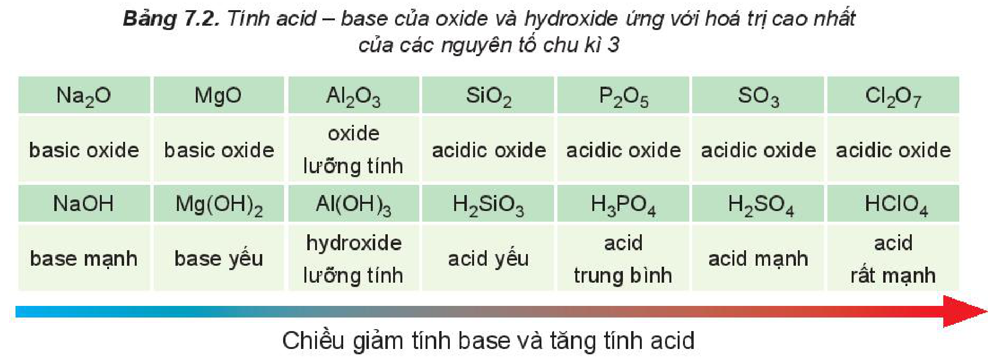

<!-- pdf:41 -->

# BÀI 7: XU HƯỚNG BIẾN ĐỔI THÀNH PHẦN VÀ MỘT SỐ TÍNH CHẤT CỦA HỢP CHẤT TRONG MỘT CHU KÌ

## 🎯 Mục tiêu

Nhận xét được xu hướng biến đổi thành phần và tính acid – base của các oxide và các hydroxide theo chu kì. Viết được phương trình hoá học minh hoạ.

## 🔴 Mở đầu

Trong một chu kì của bảng tuần hoàn, tính chất của các oxide và hydroxide biến đổi theo xu hướng nào?

## I. THÀNH PHẦN CỦA CÁC OXIDE VÀ HYDROXIDE

<!-- term: Thành phần của các oxide và hydroxide theo chu kì -->
Hoá trị cao nhất của các nguyên tố nhóm A trong hợp chất với oxygen tăng từ I đến VII khi đi từ trái qua phải trong một chu kì (trừ chu kì 1 và nguyên tố fluorine ở chu kì 2), do đó thành phần của các oxide và hydroxide có sự lặp lại theo chu kì.

Bảng 7.1. Công thức oxide, hydroxide ứng với hoá trị cao nhất của các nguyên tố thuộc chu kì 2, 3

| Hợp chất | Chu kì \ Nhóm | IA | IIA | IIIA | IVA | VA | VIA | VIIA |
|---|---|---|---|---|---|---|---|---|
| Oxide | Chu kì 2 | $\ce{Li2O}$ | $\ce{BeO}$ | $\ce{B2O3}$ | $\ce{CO2}$ | $\ce{N2O5}$ | | |
| Oxide | Chu kì 3 | $\ce{Na2O}$ | $\ce{MgO}$ | $\ce{Al2O3}$ | $\ce{SiO2}$ | $\ce{P2O5}$ | $\ce{SO3}$ | $\ce{Cl2O7}$ |
| Hydroxide | Chu kì 2 | $\ce{LiOH}$ | $\ce{Be(OH)2}$ | $\ce{H3BO3}$ | $\ce{H2CO3}$ | $\ce{HNO3}$ | | |
| Hydroxide | Chu kì 3 | $\ce{NaOH}$ | $\ce{Mg(OH)2}$ | $\ce{Al(OH)3}$ | $\ce{H2SiO3}$ | $\ce{H3PO4}$ | $\ce{H2SO4}$ | $\ce{HClO4}$ |
<!-- ocr-ok: Bảng 7.1 có nền màu và chữ chìm, OCR đọc sai công thức hoá học; đã đối chiếu ảnh -->

> ❓ 1. Nguyên tố gallium thuộc nhóm IIIA và nguyên tố selenium thuộc nhóm VIA của bảng tuần hoàn. Viết công thức hoá học của oxide, hydroxide (ứng với hoá trị cao nhất) của hai nguyên tố trên.

<!-- pdf:42 -->

## II. TÍNH CHẤT CỦA OXIDE VÀ HYDROXIDE

> ✋ **1. Phản ứng của oxide với nước**
>
> Trong một thí nghiệm, cho lần lượt các oxide $\ce{Na2O}$, $\ce{MgO}$, $\ce{P2O5}$ vào nước, nhúng giấy quỳ tím vào dung dịch sau phản ứng, hiện tượng phản ứng được trình bày trong bảng sau:
>
> | Oxide | Hiện tượng |
> |---|---|
> | $\ce{Na2O}$ | Tan hoàn toàn trong nước. Quỳ tím chuyển màu xanh đậm. |
> | $\ce{MgO}$ | Tan một phần trong nước. Quỳ tím chuyển màu xanh nhạt. |
> | $\ce{P2O5}$ | Tan hoàn toàn trong nước. Quỳ tím chuyển màu đỏ. |
>
> *Thực hiện các yêu cầu sau:*
>
> 1. Viết phương trình hoá học của các phản ứng xảy ra trong thí nghiệm trên.
> 2. So sánh tính acid – base của các oxide và hydroxide tương ứng.
>
> **2. Phản ứng của muối với dung dịch acid**
>
> *Chuẩn bị:* dung dịch $\ce{Na2CO3}$; dung dịch $\ce{HNO3}$ loãng; ống nghiệm.
>
> *Tiến hành:*
>
> Thêm từng giọt dung dịch $\ce{Na2CO3}$ vào ống nghiệm chứa dung dịch $\ce{HNO3}$.
>
> *Quan sát hiện tượng và thực hiện yêu cầu sau:*
>
> a) Viết phương trình hoá học của phản ứng.
>
> b) Hãy so sánh độ mạnh, yếu giữa hai acid $\ce{HNO3}$ và $\ce{H2CO3}$.

Các oxide, hydroxide ứng với hoá trị cao nhất của các nguyên tố chu kì 3 có tính base hoặc acid (Bảng 7.2).

Bảng 7.2. Tính acid – base của oxide và hydroxide ứng với hoá trị cao nhất của các nguyên tố chu kì 3

| $\ce{Na2O}$ | $\ce{MgO}$ | $\ce{Al2O3}$ | $\ce{SiO2}$ | $\ce{P2O5}$ | $\ce{SO3}$ | $\ce{Cl2O7}$ |
|---|---|---|---|---|---|---|
| basic oxide | basic oxide | oxide lưỡng tính | acidic oxide | acidic oxide | acidic oxide | acidic oxide |
| $\ce{NaOH}$ | $\ce{Mg(OH)2}$ | $\ce{Al(OH)3}$ | $\ce{H2SiO3}$ | $\ce{H3PO4}$ | $\ce{H2SO4}$ | $\ce{HClO4}$ |
| base mạnh | base yếu | hydroxide lưỡng tính | acid yếu | acid trung bình | acid mạnh | acid rất mạnh |
<!-- ocr-ok: Bảng 7.2 có nền màu, OCR đọc sai công thức và ngắt dòng trong ô; đã đối chiếu ảnh -->

Chiều giảm tính base và tăng tính acid

Nói chung, hydroxide của các nguyên tố nhóm IA thể hiện tính base mạnh, hydroxide ứng với hoá trị cao nhất của các nguyên tố nhóm VIIA (trừ fluorine) thể hiện tính acid mạnh.

<!-- pdf:43 -->

<!-- term: Xu hướng biến đổi tính acid – base của oxide và hydroxide theo chu kì -->
Trong một chu kì, theo chiều tăng dần của điện tích hạt nhân, *tính base của oxide và hydroxide tương ứng giảm dần, đồng thời tính acid của chúng tăng dần.*

> ❓ 2. Trong các chất dưới đây, chất nào có tính acid yếu nhất?
>
> A. $\ce{H2SO4}$. B. $\ce{HClO4}$.
>
> C. $\ce{H3PO4}$. D. $\ce{H2SiO3}$.
>
> 3. Dãy gồm các chất có tính base tăng dần là
>
> A. $\ce{Al(OH)3}$, $\ce{Mg(OH)2}$, $\ce{NaOH}$.
>
> B. $\ce{NaOH}$, $\ce{Mg(OH)2}$, $\ce{Al(OH)3}$.
>
> C. $\ce{Mg(OH)2}$, $\ce{Al(OH)3}$, $\ce{NaOH}$.
>
> D. $\ce{Al(OH)3}$, $\ce{NaOH}$, $\ce{Mg(OH)2}$.
>
> 4. Những đại lượng và tính chất nào của nguyên tố hoá học cho dưới đây **không** biến đổi tuần hoàn theo chiều tăng của điện tích hạt nhân nguyên tử?
>
> A. Tính kim loại và phi kim.
>
> B. Tính acid – base của các hydroxide.
>
> C. Khối lượng nguyên tử.
>
> D. Cấu hình electron lớp ngoài cùng của nguyên tử.

## 📌 Em đã học

Trong một chu kì: theo chiều tăng dần của điện tích hạt nhân, tính base của oxide và hydroxide tương ứng giảm dần, đồng thời tính acid của chúng tăng dần.

## ✏️ Em có thể

So sánh được tính acid và base của các oxide và hydroxide dựa vào vị trí của nguyên tố tạo nên chúng trong bảng tuần hoàn các nguyên tố hoá học.

## 📷 Danh sách hình trong bài

| Mã hình | Trang PDF | Vị trí | Chú thích gốc |
|---|---|---|---|
| H10-hoa-b07-01 | 42 | Mục II | Bảng 7.2. Tính acid – base của oxide và hydroxide ứng với hoá trị cao nhất của các nguyên tố chu kì 3 |
