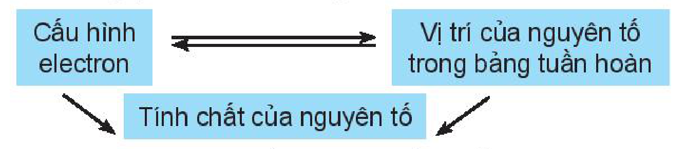
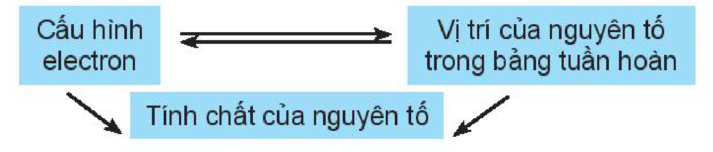

<!-- pdf:44 -->

# BÀI 8: ĐỊNH LUẬT TUẦN HOÀN. Ý NGHĨA CỦA BẢNG TUẦN HOÀN CÁC NGUYÊN TỐ HOÁ HỌC

## 🎯 Mục tiêu

- Phát biểu được định luật tuần hoàn.
- Trình bày được ý nghĩa của bảng tuần hoàn các nguyên tố hoá học: Mối liên hệ giữa vị trí (trong bảng tuần hoàn các nguyên tố hoá học) với tính chất và ngược lại.

## 🔴 Mở đầu

Định luật tuần hoàn đóng vai trò như thế nào trong việc dự đoán tính chất của các chất?

## I. ĐỊNH LUẬT TUẦN HOÀN

Nội dung của **định luật tuần hoàn**: “Tính chất của các nguyên tố và đơn chất, cũng như thành phần và tính chất của các hợp chất tạo nên từ các nguyên tố đó biến đổi tuần hoàn theo chiều tăng của điện tích hạt nhân nguyên tử”.

> ❓ 1. Nêu một số tính chất của các đơn chất biến đổi tuần hoàn theo chu kì để minh hoạ nội dung của định luật tuần hoàn.

> 💡 EM CÓ BIẾT
>
> Dựa trên xu hướng biến đổi tính chất của các nguyên tố hoá học khi sắp xếp theo chiều tăng dần khối lượng nguyên tử, D. I. Mendeleev đã đưa ra hai quyết định quan trọng. Thứ nhất, ông đã dành chỗ trống cho các nguyên tố khi đó chưa được tìm ra và dự đoán tính chất của chúng (ví dụ: nguyên tố gallium và germanium). Thứ hai, ông bỏ qua trật tự cứng nhắc theo chiều tăng của khối lượng nguyên tử để sắp xếp các nguyên tố theo xu hướng biến đổi tính chất (ví dụ: nguyên tố tellirium có số khối lớn hơn được xếp trước nguyên tố iodine trong bảng tuần hoàn). Các quyết định này của ông phù hợp với nguyên tắc sắp xếp các nguyên tố theo chiều tăng của điện tích hạt nhân.

## II. Ý NGHĨA CỦA BẢNG TUẦN HOÀN

<!-- term: Ý nghĩa của bảng tuần hoàn các nguyên tố hoá học -->
- Vị trí của nguyên tố trong bảng tuần hoàn các nguyên tố hoá học cho biết cấu hình electron nguyên tử, cấu hình electron nguyên tử quyết định tính chất của các nguyên tố. Vì vậy, có thể dự đoán được tính chất hoá học của các nguyên tố khi biết vị trí của nó trong bảng tuần hoàn các nguyên tố hoá học hay cấu hình electron của nó.

Cấu hình electron ⇄ Vị trí của nguyên tố trong bảng tuần hoàn → Tính chất của nguyên tố

Ví dụ 1: Nguyên tố sulfur (S) ở ô số 16, nhóm VIA, chu kì 3.

- Nguyên tử S có:
  + 16 proton, 16 electron (do số proton = số electron = $Z$).
  + 3 lớp electron (do số lớp electron bằng số thứ tự chu kì).
  + 6 electron lớp ngoài cùng (do số electron lớp ngoài cùng bằng số thứ tự nhóm A).

<!-- pdf:45 -->

- Cấu hình electron của S: $\ce{1s^2 2s^2 2p^6 3s^2 3p^4}$. S là nguyên tố phi kim. Oxide cao nhất ($\ce{SO3}$) là acidic oxide và acid tương ứng $\ce{H2SO4}$ là acid mạnh.

Ví dụ 2: Cấu hình electron của nguyên tử phosphorus (P) là $\ce{1s^2 2s^2 2p^6 3s^2 3p^3}$.

- Nguyên tử P có $Z = 15$ (do số proton = số electron = $Z$).
- Nguyên tố P ở chu kì 3, nhóm VA (do có 3 lớp electron và có 5 electron ở lớp ngoài cùng).
- P là nguyên tố phi kim. Oxide cao nhất ($\ce{P2O5}$) là acidic oxide và acid tương ứng là ($\ce{HPO3}$ hay $\ce{H3PO4}$) là acid trung bình.

<!-- term: Ý nghĩa của bảng tuần hoàn các nguyên tố hoá học -->
- Dựa vào định luật tuần hoàn, có thể so sánh tính chất của một nguyên tố với các nguyên tố xung quanh.

Ví dụ: So sánh tính phi kim của P ($Z = 15$) với N ($Z = 7$) và S ($Z = 16$).

Nguyên tố P và N cùng nhóm nên N có tính phi kim mạnh hơn P, P và S cùng chu kì nên P có tính phi kim yếu hơn S.

> ❓ 2. Nguyên tố magnesium thuộc ô số 12, chu kì 3, nhóm IIA của bảng tuần hoàn.
>
> a) Viết cấu hình electron của magnesium, nêu một số tính chất cơ bản của đơn chất và oxide, hydroxide chứa magnesium.
>
> b) So sánh tính kim loại của magnesium với các nguyên tố lân cận trong bảng tuần hoàn.
>
> 3. Potassium ($Z = 19$) là nguyên tố dinh dưỡng thiết yếu cho thực vật và con người.
>
> a) Nêu vị trí của potassium trong bảng tuần hoàn.
>
> b) Nêu một số tính chất cơ bản của đơn chất và hợp chất chứa potassium.

## 📌 Em đã học

- Định luật tuần hoàn: Tính chất của các nguyên tố và đơn chất, cũng như thành phần và tính chất của các hợp chất tạo nên từ các nguyên tố đó biến đổi tuần hoàn theo chiều tăng của điện tích hạt nhân nguyên tử.
- Ý nghĩa của bảng tuần hoàn:

Cấu hình electron ⇄ Vị trí của nguyên tố trong bảng tuần hoàn → Tính chất của nguyên tố

## ✏️ Em có thể

Từ vị trí của nguyên tố trong bảng tuần hoàn, có thể:

- Viết được cấu hình electron của nguyên tử và ngược lại.
- Dự đoán được tính chất (tính kim loại, tính phi kim) của nguyên tố đó.
- Viết được công thức oxide, hydroxide và nêu tính acid, base tương ứng.

## 📷 Danh sách hình trong bài

| Mã hình | Trang PDF | Vị trí | Chú thích gốc |
|---|---|---|---|
| H10-hoa-b08-01 | 44 | Mục II (sơ đồ mối liên hệ giữa cấu hình electron, vị trí và tính chất của nguyên tố) | (sách không đánh số, không có chú thích) |
| H10-hoa-b08-02 | 45 | Mục "Em đã học" (sơ đồ ý nghĩa của bảng tuần hoàn) | (sách không đánh số, không có chú thích) |
