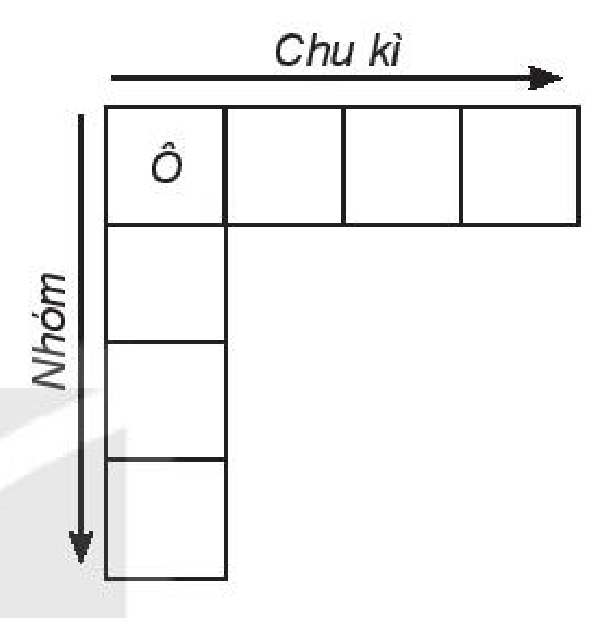
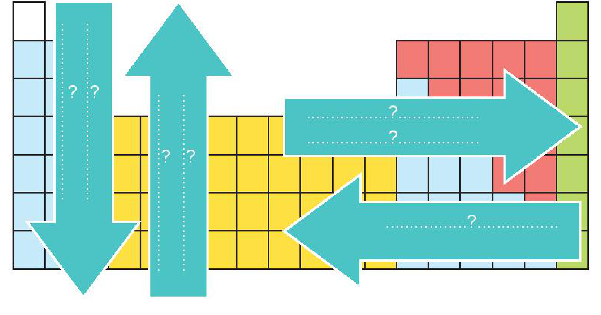
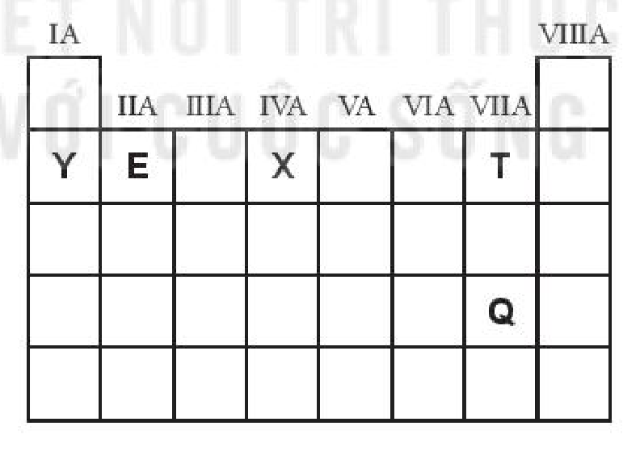
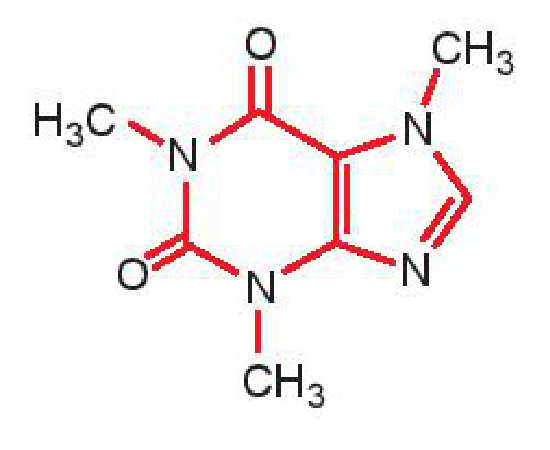

<!-- pdf:46 -->

# BÀI 9: ÔN TẬP CHƯƠNG 2

## I. HỆ THỐNG HOÁ KIẾN THỨC

### 1. Cấu tạo bảng tuần hoàn

a) Điền các cụm từ “số lớp electron” ; “điện tích hạt nhân” và “số electron hoá trị” vào chỗ trống thích hợp trong các mệnh đề sau theo đúng các nguyên tắc sắp xếp các nguyên tố trong bảng tuần hoàn.

- ..................?.................. tăng dần.
- Cùng ..................?.................. $\Rightarrow$ cùng chu kì (hàng).
- Cùng ..................?.................. $\Rightarrow$ cùng nhóm (cột).

Chu kì / Nhóm / Ô

b) Trong bảng tuần hoàn (đến năm 2016) có bao nhiêu nguyên tố, bao nhiêu chu kì, bao nhiêu nhóm?

### 2. Xu hướng biến đổi trong bảng tuần hoàn

Điền các đại lượng và tính chất dưới đây vào bên trong các mũi tên (theo chiều tăng dần) để thấy xu hướng biến đổi của các đại lượng và tính chất đó.

- Bán kính nguyên tử
- Giá trị độ âm điện
- Tính kim loại
- Tính phi kim
- Tính acid – base của các oxide và hydroxide

<!-- pdf:47 -->

### 3. Bảng tuần hoàn và cấu tạo nguyên tử

Điền các cụm từ “số proton”; “số lớp electron”; “số Z”; “số thứ tự nhóm A”; “số electron”; “số thứ tự chu kì”; “số hiệu nguyên tử”; “số electron lớp ngoài cùng” thích hợp thay cho các số sau đây để cho thấy ý nghĩa của bảng tuần hoàn các nguyên tố hoá học.

.........(1)......... = .........(2)......... = .........(3)......... = .........(4).........

.........(5)......... = .........(6).........

.........(7)......... = .........(8).........

### 4. Định luật tuần hoàn

Chọn từ hoặc cụm từ thích hợp để hoàn thành nội dung của định luật tuần hoàn:

Tính chất của các ...?... và đơn chất cũng như thành phần và ...?... của các hợp chất tạo nên từ các nguyên tố đó biến đổi tuần hoàn theo chiều tăng của ...?... nguyên tử.

## II. LUYỆN TẬP

Câu 1. Cho vị trí của các nguyên tố E, T, Q, X, Y trong bảng tuần hoàn rút gọn (chỉ biểu diễn các nguyên tố nhóm A) như sau:

| IA | IIA | IIIA | IVA | VA | VIA | VIIA | VIIIA |
|---|---|---|---|---|---|---|---|
| | | | | | | | |
| Y | E | | X | | | T | |
| | | | | | | | |
| | | | | | | Q | |
| | | | | | | | |
<!-- ocr-ok: bảng tuần hoàn rút gọn có chữ chìm, OCR đọc sai số La Mã tên nhóm; đã đối chiếu ảnh -->

Có các nhận xét sau:

(1) Thứ tự giảm dần tính kim loại là Y, E, X.

(2) Thứ tự tăng dần độ âm điện là Y, X, T.

(3) Thứ tự tăng dần tính phi kim là T, Q.

(4) Thứ tự giảm dần bán kính nguyên tử là Y, E, X, T.

Số nhận xét đúng là

A. 1. B. 2. C. 3. D. 4.
<!-- ocr-ok: OCR đọc nhầm "B. 2. C. 3." thành "B. Ca"; đã đối chiếu ảnh -->

<!-- pdf:48 -->

Câu 2. Sulfur (S) là nguyên tố thuộc nhóm VIA, chu kì 3 của bảng tuần hoàn. Trong các phát biểu sau:

(1) Nguyên tử S có 3 lớp electron và có 10 electron p.

(2) Nguyên tử S có 5 electron hoá trị và 6 electron s.

(3) Công thức oxide cao nhất của S có dạng $\ce{SO3}$ và là acidic oxide.

(4) Nguyên tố S có tính phi kim mạnh hơn so với nguyên tố có số hiệu nguyên tử là 8.

(5) Hydroxide cao nhất của S có dạng $\ce{H2SO4}$ và có tính acid.

Số phát biểu đúng là

A. 2. B. 3. C. 4. D. 5.

Câu 3. X và Y là hai nguyên tố thuộc nhóm A, trong cùng một chu kì của bảng tuần hoàn. Oxide cao nhất của X và Y có dạng là $\ce{XO}$ và $\ce{YO3}$. Trong các phát biểu sau:

(1) X và Y thuộc 2 nhóm A kế tiếp nhau.

(2) X là kim loại, Y là phi kim.

(3) $\ce{XO}$ là basic oxide và $\ce{YO3}$ là acidic oxide.

(4) Hydroxide cao nhất của Y có dạng $\ce{Y(OH)6}$ và có tính base.

Số phát biểu đúng là

A. 2. B. 3. C. 4. D. 1.

Câu 4. Borax ($\ce{Na2B4O7.10H2O}$), còn gọi là hàn the, là khoáng chất dạng tinh thể. Nhờ có khả năng hoà tan oxide của kim loại, borax được dùng để làm sạch bề mặt kim loại trước khi hàn, chế tạo thuỷ tinh quang học, men đồ sứ,… Một lượng lớn borax được dùng để sản xuất bột giặt.

a) Nêu vị trí trong bảng tuần hoàn của mỗi nguyên tố có trong thành phần của borax và viết cấu hình electron của nguyên tử các nguyên tố đó.

b) Sắp xếp các nguyên tố trên (trừ H) theo chiều bán kính nguyên tử tăng dần và giải thích.

c) Sắp xếp các nguyên tố trên (trừ H) theo chiều độ âm điện giảm dần và giải thích.

Câu 5. Công thức cấu tạo của phân tử cafein, một chất gây đắng tìm thấy nhiều trong cafe và trà được biểu diễn ở hình bên.

a) Nêu vị trí của các nguyên tố tạo nên cafein trong bảng tuần hoàn.

b) So sánh tính phi kim, bán kính nguyên tử và độ âm điện của các nguyên tố đó (trừ H) và giải thích.

Câu 6. Một loại hợp kim nhẹ, bền được sử dụng rộng rãi trong kĩ thuật hàng không chứa hai nguyên tố A, B đứng kế tiếp nhau trong cùng một chu kì của bảng tuần hoàn và có tổng số đơn vị điện tích hạt nhân là 25.

a) Viết cấu hình electron, từ đó xác định vị trí của hai nguyên tố A và B trong bảng tuần hoàn.

b) So sánh tính chất hoá học của A với B và giải thích.

## 📷 Danh sách hình trong bài

| Mã hình | Trang PDF | Vị trí | Chú thích gốc |
|---|---|---|---|
| H10-hoa-b09-01 | 46 | Mục I.1 (sơ đồ khung chu kì, nhóm, ô) | (sách không đánh số, không có chú thích) |
| H10-hoa-b09-02 | 46 | Mục I.2 (sơ đồ xu hướng biến đổi trong bảng tuần hoàn) | (sách không đánh số, không có chú thích) |
| H10-hoa-b09-03 | 47 | Mục II, Câu 1 (bảng tuần hoàn rút gọn) | (sách không đánh số, không có chú thích) |
| H10-hoa-b09-04 | 48 | Mục II, Câu 5 (công thức cấu tạo của phân tử cafein) | (sách không đánh số, không có chú thích) |
