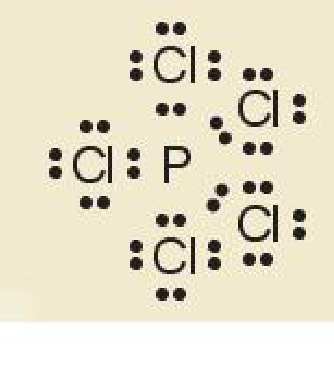

<!-- pdf:50 -->

# BÀI 10: QUY TẮC OCTET

## 🎯 Mục tiêu

- Trình bày và vận dụng được quy tắc octet trong quá trình hình thành liên kết hoá học cho các nguyên tố nhóm A.

## 🔴 Mở đầu

Khi các nguyên tử kết hợp với nhau tạo thành phân tử theo một tỉ lệ xác định, yếu tố nào quyết định tỉ lệ số nguyên tử của mỗi nguyên tố trong phân tử đó?

## I. KHÁI NIỆM LIÊN KẾT HOÁ HỌC

Theo thuyết cấu tạo hoá học, sự liên kết giữa các nguyên tử tạo thành phân tử hay tinh thể được giải thích bằng sự giảm năng lượng khi các nguyên tử kết hợp lại với nhau. Khi tạo liên kết hoá học thì nguyên tử có xu hướng đạt tới cấu hình electron bền vững của khí hiếm.

**Liên kết hoá học** là sự kết hợp giữa các nguyên tử tạo thành phân tử hay tinh thể bền vững hơn.

Trong các phản ứng hoá học, chỉ có các electron thuộc lớp ngoài cùng và phân lớp sát lớp ngoài cùng tham gia vào quá trình tạo thành liên kết (**electron hoá trị**).

Các electron hoá trị của nguyên tử một nguyên tố được quy ước biểu diễn bằng các dấu chấm đặt xung quanh kí hiệu nguyên tố.

*Bảng 10.1. Biểu diễn electron hoá trị của một số nguyên tử*

| Nhóm | IA | IIA | IIIA | IVA | VA | VIA | VIIA | VIIIA |
|---|---|---|---|---|---|---|---|---|
| Số electron hoá trị | 1 | 2 | 3 | 4 | 5 | 6 | 7 | 8 |
| Biểu diễn nguyên tử với electron hoá trị | $\ce{H.}$ | | | | | | | $\ce{He:}$ |
| | $\ce{Li.}$ | $\ce{Be:}$ | $\ce{.B:}$ | $\overset{\Large\cdot}{\underset{\Large\cdot}{\ce{.C.}}}$ | $\overset{\Large\cdot\cdot}{\underset{\Large\cdot}{\ce{.N.}}}$ | $\overset{\Large\cdot}{\underset{\Large\cdot\cdot}{\ce{:O:}}}$ | $\overset{\Large\cdot}{\underset{\Large\cdot\cdot}{\ce{:F:}}}$ | $\overset{\Large\cdot\cdot}{\underset{\Large\cdot\cdot}{\ce{:Ne:}}}$ |
| | $\ce{Na.}$ | $\ce{Mg:}$ | $\ce{.Al:}$ | $\overset{\Large\cdot\cdot}{\ce{.Si.}}$ | $\overset{\Large\cdot\cdot}{\underset{\Large\cdot}{\ce{.P.}}}$ | $\overset{\Large\cdot}{\underset{\Large\cdot}{\ce{:S:}}}$ | $\overset{\Large\cdot}{\underset{\Large\cdot\cdot}{\ce{:Cl:}}}$ | $\overset{\Large\cdot\cdot}{\underset{\Large\cdot\cdot}{\ce{:Ar:}}}$ |
<!-- ocr-ok: Bảng 10.1 biểu diễn các dấu chấm electron hoá trị xung quanh kí hiệu nguyên tố hoá học; OCR không nhận diện được các dấu chấm và kí hiệu nguyên tố, đã đối chiếu ảnh -->

> ❓ 1. Khi nguyên tử fluorine nhận thêm 1 electron thì ion tạo thành có cấu hình electron của nguyên tử nguyên tố nào?
>
> 2. Để giảm năng lượng, các nguyên tử kết hợp lại thành phân tử theo xu hướng nào?

<!-- pdf:51 -->

## II. QUY TẮC OCTET

Khi hình thành liên kết hoá học, các nguyên tử có xu hướng nhường, nhận hoặc góp chung electron để đạt tới cấu hình electron bền vững của nguyên tử khí hiếm. Vì các khí hiếm (trừ helium) đều có 8 electron lớp ngoài cùng nên quy tắc này được gọi là **quy tắc octet**.

Khi hình thành liên kết hoá học trong phân tử $\ce{Cl2}$, nguyên tử chlorine có 7 electron hoá trị, mỗi nguyên tử chlorine cần thêm 1 electron để đạt cấu hình electron bão hoà theo quy tắc octet nên mỗi nguyên tử chlorine góp chung 1 electron.

Phân tử $\ce{Cl2}$ được biểu diễn $\overset{\Large\cdot\cdot}{\underset{\Large\cdot\cdot}{\ce{:Cl}}}\!:\!\overset{\Large\cdot\cdot}{\underset{\Large\cdot\cdot}{\ce{Cl:}}}$. Xung quanh mỗi nguyên tử chlorine đều có 8 electron.

Khi hình thành liên kết hoá học trong phân tử $\ce{H2O}$, nguyên tử hydrogen có 1 electron hoá trị, nguyên tử oxygen có 6 electron hoá trị, mỗi nguyên tử hydrogen cần thêm 1 electron và nguyên tử oxygen cần thêm 2 electron để đạt cấu hình electron bão hoà theo quy tắc octet.

Phân tử $\ce{H2O}$ được biểu diễn $\ce{H}\!:\!\overset{\Large\cdot\cdot}{\underset{\Large\cdot\cdot}{\ce{O}}}\!:\!\ce{H}$. Xung quanh nguyên tử oxygen có 8 electron.

Khi hình thành liên kết hoá học trong phân tử $\ce{NaF}$, nguyên tử $\ce{Na}$ có 1 electron hoá trị, nguyên tử $\ce{F}$ có 7 electron hoá trị, nguyên tử $\ce{Na}$ nhường 1 electron hoá trị tạo thành hạt mang điện tích dương, nguyên tử $\ce{F}$ nhận 1 electron tạo thành hạt mang điện tích âm. Các hạt này đều đạt cấu hình electron bão hoà theo quy tắc octet và có điện tích trái dấu nên hút nhau.

> 💡 EM CÓ BIẾT
>
> Quy tắc octet chỉ đúng cho sự tạo thành liên kết hoá học giữa các nguyên tử của các nguyên tố thuộc chu kì 2 của bảng tuần hoàn và một số nguyên tử của các nguyên tố có tính kim loại, phi kim điển hình. Ngoài ra có các ngoại lệ.
>
> Ví dụ: Trong phân tử $\ce{PCl5}$, lớp ngoài cùng của $\ce{P}$ có 10 electron.
>
> 

> ❓ 3. Vận dụng quy tắc octet để giải thích sự hình thành liên kết trong các phân tử: $\ce{F2}$, $\ce{CCl4}$ và $\ce{NF3}$.
>
> 4. Phosphine là hợp chất hoá học giữa phosphorus với hydrogen, có công thức hoá học là $\ce{PH3}$. Đây là chất khí không màu, có mùi tỏi, rất độc, không bền. Phosphine sinh ra khi phân huỷ xác động, thực vật và thường lẫn một lượng nhỏ diphosphine ($\ce{P2H4}$) nên nó có thể tự cháy trong không khí ở điều kiện thường và tạo thành khói phát sáng bay lơ lửng (hiện tượng "ma trơi").
>
> Vận dụng quy tắc octet để giải thích sự tạo thành liên kết hoá học trong phosphine.

## 📌 Em đã học

- Liên kết hoá học là sự kết hợp giữa các nguyên tử tạo thành phân tử hay tinh thể bền vững hơn.
- Quy tắc octet: Khi hình thành liên kết hoá học, các nguyên tử có xu hướng nhường, nhận hoặc góp chung electron để đạt tới cấu hình electron bền vững của nguyên tử khí hiếm.

## ✏️ Em có thể

Vận dụng quy tắc octet để giải thích sự hình thành liên kết hoá học trong một số phân tử của các nguyên tử nguyên tố nhóm A.

## 📷 Danh sách hình trong bài

| Mã hình | Trang PDF | Vị trí | Chú thích gốc |
|---|---|---|---|
| H10-hoa-b10-01 | 51 | Mục II, hộp "Em có biết" (biểu diễn electron trong phân tử $\ce{PCl5}$) | (sách không đánh số, không có chú thích) |
