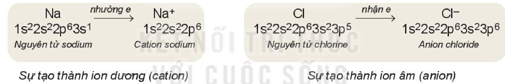
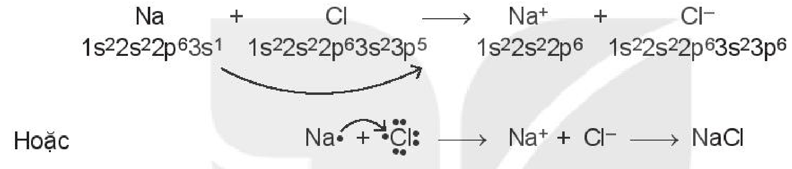
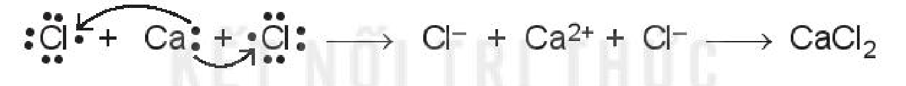
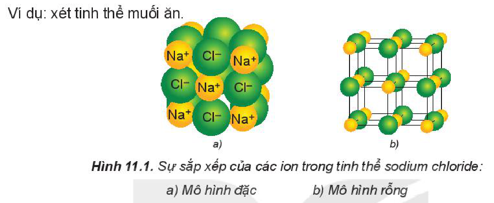
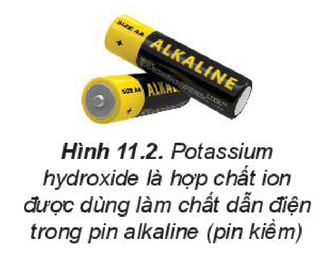
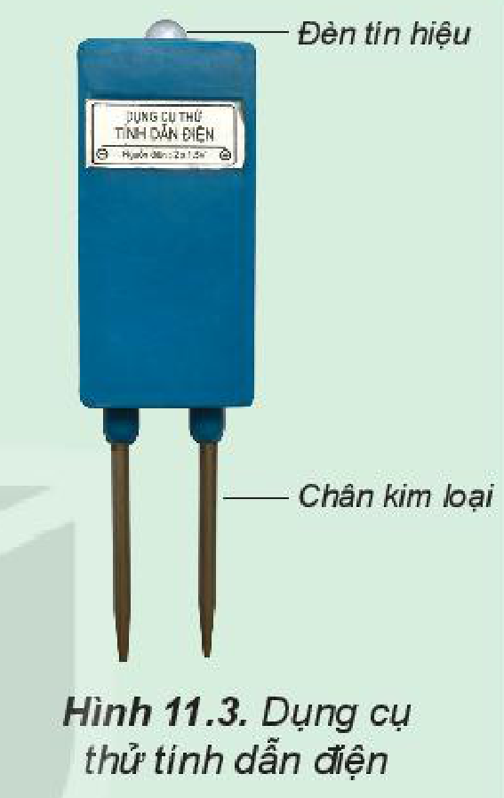

<!-- pdf:52 -->

# BÀI 11: LIÊN KẾT ION

## 🎯 Mục tiêu

- Trình bày được khái niệm và sự hình thành liên kết ion (nêu một số ví dụ điển hình tuân theo quy tắc octet).
- Nêu được cấu tạo tinh thể $\ce{NaCl}$. Giải thích được vì sao các hợp chất ion thường ở trạng thái rắn trong điều kiện thường (dạng tinh thể ion).
- Lắp được mô hình tinh thể $\ce{NaCl}$ (theo mô hình có sẵn).

## 🔴 Mở đầu

Hợp chất $\ce{NaCl}$ nóng chảy ở nhiệt độ cao và có khả năng dẫn điện khi nóng chảy hoặc khi hoà tan trong dung dịch. Yếu tố nào trong phân tử $\ce{NaCl}$ gây ra các tính chất trên?

## I. SỰ TẠO THÀNH ION

Kim loại điển hình (ví dụ: sodium) phản ứng rất mạnh với phi kim điển hình (ví dụ: chlorine) tạo ra hợp chất ion. Khi đó, nguyên tử kim loại nhường electron để tạo thành ion mang điện tích dương (**cation**) còn nguyên tử phi kim nhận electron để trở thành ion mang điện tích âm (**anion**). Có thể mô tả quá trình tạo thành ion như sau:

- *Sự tạo thành ion dương (cation)*: $\underset{1s^22s^22p^63s^1\text{ (Nguyên tử sodium)}}{\ce{Na}} \xrightarrow{\text{nhường e}} \underset{1s^22s^22p^6\text{ (Cation sodium)}}{\ce{Na+}}$
- *Sự tạo thành ion âm (anion)*: $\underset{1s^22s^22p^63s^23p^5\text{ (Nguyên tử chlorine)}}{\ce{Cl}} \xrightarrow{\text{nhận e}} \underset{1s^22s^22p^63s^23p^6\text{ (Anion chloride)}}{\ce{Cl-}}$
<!-- ocr-ok: hai sơ đồ tạo thành cation và anion in ngang trên hai khung màu; đã đối chiếu ảnh -->

Số đơn vị điện tích của **ion dương** (cation) bằng số electron mà nguyên tử đã nhường.

Ví dụ:

- $\ce{Na -> Na+ + 1e}$ — Tên gọi: *cation sodium*
- $\ce{Mg -> Mg^{2+} + 2e}$ — Tên gọi: *cation magnesium*
- $\ce{Al -> Al^{3+} + 3e}$ — Tên gọi: *cation aluminium*
<!-- ocr-ok: sách trình bày phương trình và tên gọi theo 3 cột; đã đối chiếu ảnh -->

Số đơn vị điện tích của **ion âm** (anion) bằng số electron mà nguyên tử đã nhận.

Ví dụ:

- $\ce{Cl + 1e -> Cl-}$ — Tên gọi: *anion chloride*
- $\ce{F + 1e -> F-}$ — Tên gọi: *anion fluoride*
- $\ce{S + 2e -> S^{2-}}$ — Tên gọi: *anion sulfide*
<!-- ocr-ok: sách trình bày phương trình và tên gọi theo 3 cột; đã đối chiếu ảnh -->

Các ion thường có cấu hình electron bền vững của nguyên tử khí hiếm gần nhất với nguyên tố tạo thành ion đó trong bảng tuần hoàn.

> 💡 EM CÓ BIẾT
>
> Ngoài các ion được tạo thành từ một nguyên tử (**ion đơn nguyên tử**) như $\ce{Na+}$, $\ce{Mg^{2+}}$, $\ce{Cl-}$,... còn có các ion tạo thành từ hai hay nhiều nguyên tử (**ion đa nguyên tử**), ví dụ: $\ce{NH4+}$, $\ce{OH-}$, $\ce{NO3-}$, $\ce{HCO3-}$, $\ce{SO4^{2-}}$, $\ce{PO4^{3-}}$,...

<!-- pdf:53 -->

> ❓ 1. Hoàn thành các sơ đồ tạo thành ion sau:
>
> a) $\ce{Li -> Li+ + ?}$
>
> b) $\ce{Be -> ? + 2e}$
>
> c) $\ce{Br + ? -> Br-}$
>
> d) $\ce{O + 2e -> ?}$
>
> 2. Viết cấu hình electron của các ion: $\ce{K+}$, $\ce{Mg^{2+}}$, $\ce{F-}$, $\ce{S^{2-}}$. Mỗi cấu hình đó giống với cấu hình electron của nguyên tử khí hiếm nào?
>
> 3. Vì sao một ion $\ce{O^{2-}}$ kết hợp được với hai ion $\ce{Li+}$?

## II. SỰ TẠO THÀNH LIÊN KẾT ION

- Sodium chloride: Khi kim loại sodium kết hợp với phi kim chlorine, tạo thành các ion $\ce{Na+}$ và $\ce{Cl-}$, các ion này mang điện trái dấu sẽ hút nhau tạo thành liên kết ion.

  Có thể biểu diễn sự tạo thành liên kết ion trong phân tử $\ce{NaCl}$ như sau:

  

  $\underset{1s^22s^22p^63s^1}{\ce{Na}} + \underset{1s^22s^22p^63s^23p^5}{\ce{Cl}} \longrightarrow \underset{1s^22s^22p^6}{\ce{Na+}} + \underset{1s^22s^22p^63s^23p^6}{\ce{Cl-}}$

  Hoặc $\ce{Na.} + \overset{\Large\cdot\cdot}{\underset{\Large\cdot\cdot}{\ce{.Cl:}}} \longrightarrow \ce{Na+ + Cl- -> NaCl}$
  <!-- ocr-ok: sơ đồ chuyển electron có mũi tên cong và dấu chấm electron; đã đối chiếu ảnh -->

- Calcium chloride: Khi kim loại calcium kết hợp với phi kim chlorine, tạo thành các ion $\ce{Ca^{2+}}$ và $\ce{Cl-}$. Các ion này mang điện trái dấu sẽ hút nhau tạo thành liên kết ion.

  Có thể biểu diễn sự tạo thành liên kết ion trong phân tử $\ce{CaCl2}$ như sau:

  

  $\overset{\Large\cdot\cdot}{\underset{\Large\cdot\cdot}{\ce{:Cl.}}} + \ce{Ca:} + \overset{\Large\cdot\cdot}{\underset{\Large\cdot\cdot}{\ce{.Cl:}}} \longrightarrow \ce{Cl- + Ca^{2+} + Cl- -> CaCl2}$
  <!-- ocr-ok: sơ đồ chuyển electron có mũi tên cong và dấu chấm electron; đã đối chiếu ảnh -->

Lực hút tĩnh điện giữa các ion mang điện trái dấu trong phân tử (hay tinh thể) tạo ra **liên kết ion**. Liên kết ion thường được hình thành giữa kim loại điển hình và phi kim điển hình. Các hợp chất tạo nên từ các ion được gọi là những **hợp chất ion**.

> ❓ 4. Cho các ion: $\ce{Na+}$, $\ce{Mg^{2+}}$, $\ce{O^{2-}}$, $\ce{Cl-}$. Những ion nào có thể kết hợp với nhau tạo thành liên kết ion?
>
> 5. Mô tả sự tạo thành liên kết ion trong:
>
> a) Calcium oxide.
>
> b) Magnesium chloride.

<!-- pdf:54 -->

## III. TINH THỂ ION

### 1. Cấu trúc của tinh thể ion

Các ion được sắp xếp theo một trật tự nhất định trong không gian theo kiểu mạng lưới, trong đó ở các nút của mạng lưới là những ion dương và ion âm được sắp xếp luân phiên, liên kết chặt chẽ với nhau do sự cân bằng giữa lực hút (các ion trái dấu hút nhau) và lực đẩy (các ion cùng dấu đẩy nhau), tạo thành **mạng tinh thể ion**.

Ví dụ: xét tinh thể muối ăn.

*Hình 11.1. Sự sắp xếp của các ion trong tinh thể sodium chloride: a) Mô hình đặc; b) Mô hình rỗng*

Trong tinh thể sodium chloride, mỗi ion sodium được bao quanh bởi 6 ion chloride gần nhất và mỗi ion chloride cũng được bao quanh bởi 6 ion sodium gần nhất.

Trong tinh thể ion, số ion cùng dấu bao quanh một ion trái dấu phụ thuộc vào kiểu mạng lưới tinh thể, số điện tích và kích thước của ion.

Do lực hút giữa các cation và anion không có tính bão hoà và tính định hướng nên chúng có xu hướng hút lẫn nhau, tạo ra mạng lưới các ion trong không gian ba chiều.

> ✋ **Lắp ráp mô hình tinh thể $\ce{NaCl}$**
>
> *Chuẩn bị:* bộ mô hình tinh thể $\ce{NaCl}$.
>
> *Tiến hành:*
>
> - Chọn hình cầu có màu sắc khác nhau đại diện cho ion $\ce{Na+}$ và ion $\ce{Cl-}$.
> - Lắp các hình cầu và que nối theo mẫu (Hình 11.1b).
>
> *Quan sát mô hình và xác định số ion gần nhất bao quanh một ion trái dấu ở giữa mô hình.*

### 2. Độ bền và tính chất của hợp chất ion

Trong tinh thể ion, giữa các ion có lực hút tĩnh điện rất mạnh nên các hợp chất ion thường là chất rắn, khó nóng chảy, khó bay hơi ở điều kiện thường. Ví dụ: Nhiệt độ nóng chảy của $\ce{MgO}$ là 2 852 °C.

Do lực hút tĩnh điện rất mạnh giữa các ion nên các tinh thể ion khá rắn chắc, nhưng khá giòn. Đây là tính chất đặc trưng của tinh thể ion.

Ví dụ: Tinh thể muối ăn ở dạng rắn, cứng, nhưng khi tác dụng một lực mạnh thì bị vỡ vụn.

<!-- pdf:55 -->

Các hợp chất ion thường tan nhiều trong nước. Khi tan trong nước, các ion bị tách khỏi mạng lưới tinh thể, chuyển động khá tự do và là tác nhân dẫn điện.

Ở trạng thái rắn, các ion không di chuyển tự do được nên hợp chất ion không dẫn điện. Tuy nhiên, ở trạng thái nóng chảy, các ion có thể chuyển động khá tự do nên hợp chất ion dẫn điện.

*Hình 11.2. Potassium hydroxide là hợp chất ion được dùng làm chất dẫn điện trong pin alkaline (pin kiềm)*

> ✋ **Thử tính dẫn điện của hợp chất**
>
> *Chuẩn bị:* muối ăn dạng hạt, dung dịch muối ăn bão hoà, dung dịch nước đường, dụng cụ thử tính dẫn điện, cốc thuỷ tinh.
>
> *Tiến hành:* Sử dụng dụng cụ thử tính dẫn điện như Hình 11.3, lần lượt cho chân kim loại của dụng cụ thử tính dẫn điện tiếp xúc với:
>
> - Dung dịch nước đường.
> - Muối ăn khan.
> - Dung dịch muối ăn bão hoà.
>
> Nếu đèn sáng thì chất dẫn điện, nếu đèn không sáng thì chất không dẫn điện.
>
> *Quan sát hiện tượng và cho biết trường hợp nào dẫn điện, trường hợp nào không dẫn điện. Giải thích.*
>
> 
>
> *Hình 11.3. Dụng cụ thử tính dẫn điện*

> ❓ 6. a) Vì sao muối ăn có nhiệt độ nóng chảy cao (801 °C)?
>
> b) Hợp chất ion dẫn điện trong trường hợp nào? Vì sao?

## 📌 Em đã học

- Nguyên tử nhường electron tạo thành cation hoặc nhận electron tạo thành anion.
- Liên kết ion trong phân tử hay tinh thể được tạo thành nhờ lực hút tĩnh điện của các ion mang điện tích trái dấu. Liên kết ion thường tạo thành từ các nguyên tử kim loại điển hình và phi kim điển hình, phân tử thu được là hợp chất ion.
- Cấu trúc của mạng tinh thể ion: các ion được sắp xếp theo trật tự nhất định trong không gian theo kiểu mạng lưới (ở các nút mạng là các ion dương và ion âm xếp luân phiên liên kết chặt chẽ với nhau do cân bằng lực hút và lực đẩy).
- Các hợp chất ion thường là chất rắn có nhiệt độ nóng chảy và nhiệt độ sôi cao, có khả năng dẫn điện khi tan trong nước hay khi nóng chảy.

## ✏️ Em có thể

Giải thích được một số tính chất đặc trưng của hợp chất ion và một số ứng dụng phổ biến của chúng trong đời sống.

## 📷 Danh sách hình trong bài

| Mã hình | Trang PDF | Vị trí | Chú thích gốc |
|---|---|---|---|
| H10-hoa-b11-01 | 52 | Mục I (sơ đồ sự tạo thành ion dương và ion âm) | Sự tạo thành ion dương (cation); Sự tạo thành ion âm (anion) |
| H10-hoa-b11-02 | 53 | Mục II (sơ đồ sự tạo thành liên kết ion trong phân tử $\ce{NaCl}$) | (sách không đánh số, không có chú thích) |
| H10-hoa-b11-03 | 53 | Mục II (sơ đồ sự tạo thành liên kết ion trong phân tử $\ce{CaCl2}$) | (sách không đánh số, không có chú thích) |
| H10-hoa-b11-04 | 54 | Mục III.1 | Hình 11.1. Sự sắp xếp của các ion trong tinh thể sodium chloride: a) Mô hình đặc; b) Mô hình rỗng |
| H10-hoa-b11-05 | 55 | Mục III.2 | Hình 11.2. Potassium hydroxide là hợp chất ion được dùng làm chất dẫn điện trong pin alkaline (pin kiềm) |
| H10-hoa-b11-06 | 55 | Mục III.2, hộp "Thử tính dẫn điện của hợp chất" | Hình 11.3. Dụng cụ thử tính dẫn điện |
