<!-- pdf:56 -->

# BÀI 12: LIÊN KẾT CỘNG HOÁ TRỊ

## 🎯 Mục tiêu

- Trình bày được khái niệm và lấy được ví dụ về liên kết cộng hoá trị (liên kết đơn, đôi, ba) khi áp dụng quy tắc octet.
- Viết được công thức Lewis của một số chất đơn giản.
- Trình bày được khái niệm về liên kết cho – nhận.
- Phân biệt được các loại liên kết (liên kết cộng hoá trị không phân cực, phân cực, liên kết ion) dựa theo độ âm điện.
- Giải thích được sự hình thành liên kết $\sigma$ và liên kết $\pi$ qua sự xen phủ AO.
- Trình bày được khái niệm năng lượng liên kết (cộng hoá trị).
- Lắp ráp được mô hình một số phân tử có liên kết cộng hoá trị.

## 🔴 Mở đầu

Nguyên tử hydrogen và chlorine dễ dàng kết hợp để tạo thành phân tử hydrogen chloride ($\ce{HCl}$), liên kết trong trường hợp này có gì khác so với liên kết ion trong phân tử sodium chloride ($\ce{NaCl}$)?

## I. SỰ TẠO THÀNH LIÊN KẾT CỘNG HOÁ TRỊ

Nguyên tử phi kim có lớp electron hoá trị gần bão hoà và có xu hướng nhận thêm electron để đạt cấu hình electron bền vững của nguyên tử khí hiếm. Khi hai nguyên tử phi kim kết hợp với nhau tạo thành phân tử, chúng sẽ góp một hoặc nhiều electron để tạo thành các cặp electron dùng chung. Các cặp electron dùng chung được tính cho cả hai nguyên tử trong phân tử nên mỗi nguyên tử đều đạt được cấu hình bền vững theo quy tắc octet. Cặp electron dùng chung tạo ra liên kết cộng hoá trị giữa hai nguyên tử.

Cặp electron dùng chung giữa hai nguyên tử có thể được tạo thành theo hai kiểu khác nhau:

- Mỗi nguyên tử góp một hay nhiều electron để tạo thành các cặp electron dùng chung:

  Ví dụ: $\ce{A. + .B -> A:B}$ hoặc $\ce{A-B}$ (liên kết $\ce{A-B}$ là liên kết cộng hoá trị).

- Cặp electron dùng chung chỉ do một nguyên tử đóng góp, liên kết giữa hai nguyên tử là **liên kết cộng hoá trị kiểu cho – nhận**.

  Ví dụ: Khi cặp electron dùng chung chỉ do nguyên tử B đóng góp, nguyên tử B là nguyên tử cho electron, nguyên tử A là nguyên tử nhận electron. Kí hiệu $\ce{B -> A}$.

### 1. Sự tạo thành phân tử có liên kết đơn

- Phân tử chlorine: Mỗi nguyên tử chlorine có 7 electron hoá trị, hai nguyên tử chlorine liên kết với nhau bằng cách mỗi nguyên tử chlorine góp 1 electron, tạo thành một cặp electron dùng chung. Khi đó, trong phân tử $\ce{Cl2}$, mỗi nguyên tử đều có 8 electron ở lớp ngoài cùng, thoả mãn quy tắc octet:

<!-- pdf:57 -->

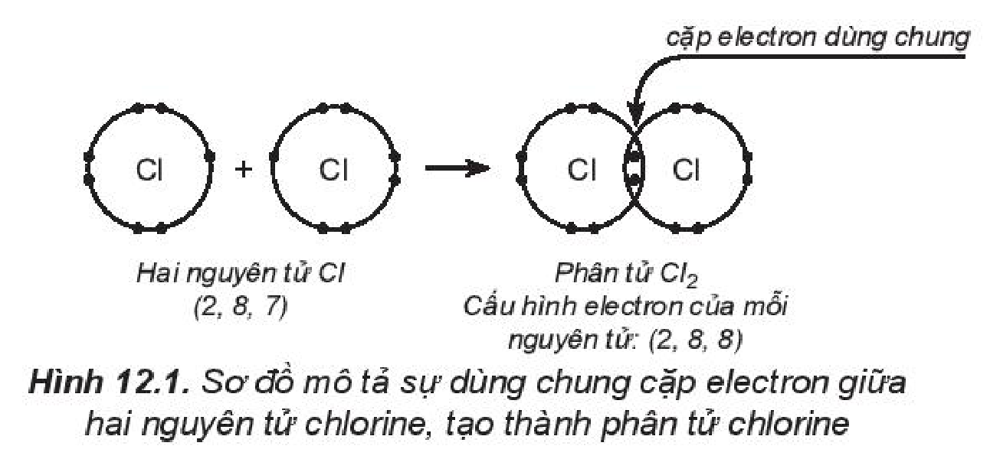

*Hình 12.1. Sơ đồ mô tả sự dùng chung cặp electron giữa hai nguyên tử chlorine, tạo thành phân tử chlorine*

Từ **công thức electron**, thay một cặp electron dùng chung bằng một gạch nối thì thu được **công thức Lewis** (Li-uýt).

Có thể biểu diễn bằng sơ đồ:

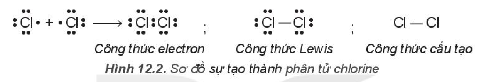

$\overset{\Large\cdot\cdot}{\underset{\Large\cdot\cdot}{\ce{:Cl.}}} + \overset{\Large\cdot\cdot}{\underset{\Large\cdot\cdot}{\ce{.Cl:}}} \longrightarrow \overset{\Large\cdot\cdot}{\underset{\Large\cdot\cdot}{\ce{:Cl}}}\!:\!\overset{\Large\cdot\cdot}{\underset{\Large\cdot\cdot}{\ce{Cl:}}}$ (Công thức electron) ; $\overset{\Large\cdot\cdot}{\underset{\Large\cdot\cdot}{\ce{:Cl}}}-\overset{\Large\cdot\cdot}{\underset{\Large\cdot\cdot}{\ce{Cl:}}}$ (Công thức Lewis) ; $\ce{Cl-Cl}$ (Công thức cấu tạo)
<!-- ocr-ok: sơ đồ Hình 12.2 gồm các dấu chấm electron xung quanh kí hiệu nguyên tố; đã đối chiếu ảnh -->

*Hình 12.2. Sơ đồ sự tạo thành phân tử chlorine*

Giữa hai nguyên tử chlorine có một cặp electron dùng chung (biểu diễn bằng một gạch nối), đó là **liên kết đơn**.

- Phân tử hydrogen chloride: Nguyên tử hydrogen liên kết với nguyên tử chlorine bằng cách mỗi nguyên tử góp 1 electron tạo thành 1 cặp electron dùng chung trong phân tử $\ce{HCl}$. Khi đó nguyên tử hydrogen có 2 electron (cấu hình electron bền vững của nguyên tử khí hiếm $\ce{He}$) và nguyên tử chlorine có 8 electron ở lớp ngoài cùng, thoả mãn quy tắc octet.

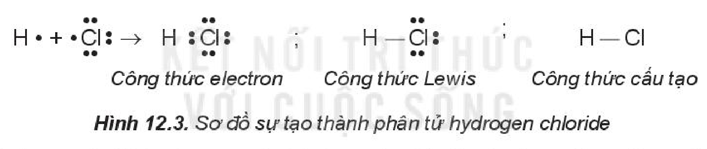

$\ce{H.} + \overset{\Large\cdot\cdot}{\underset{\Large\cdot\cdot}{\ce{.Cl:}}} \longrightarrow \ce{H}\!:\!\overset{\Large\cdot\cdot}{\underset{\Large\cdot\cdot}{\ce{Cl:}}}$ (Công thức electron) ; $\ce{H}-\overset{\Large\cdot\cdot}{\underset{\Large\cdot\cdot}{\ce{Cl:}}}$ (Công thức Lewis) ; $\ce{H-Cl}$ (Công thức cấu tạo)
<!-- ocr-ok: sơ đồ Hình 12.3 gồm các dấu chấm electron xung quanh kí hiệu nguyên tố; đã đối chiếu ảnh -->

*Hình 12.3. Sơ đồ sự tạo thành phân tử hydrogen chloride*

Giữa hai nguyên tử hydrogen và chlorine có một cặp electron dùng chung (biểu diễn bằng một gạch nối), đó là liên kết đơn.

- Phân tử hợp chất có liên kết cho – nhận:

  Trong phân tử $\ce{NH3}$, lớp ngoài cùng của nguyên tử nitrogen có 5 electron, trong đó có cặp electron chưa liên kết. Ion $\ce{H+}$ có orbital trống, không có electron. Khi phân tử $\ce{NH3}$ kết hợp với ion $\ce{H+}$, nguyên tử nitrogen đóng góp cặp electron chưa liên kết để tạo liên kết với ion $\ce{H+}$ tạo thành $\ce{NH4+}$. Khi đó, **liên kết cho – nhận** được hình thành, nguyên tử nitrogen là nguyên tử cho, ion $\ce{H+}$ là nguyên tử nhận. Trong ion $\ce{NH4+}$, bốn liên kết $\ce{N-H}$ hoàn toàn tương đương nhau.

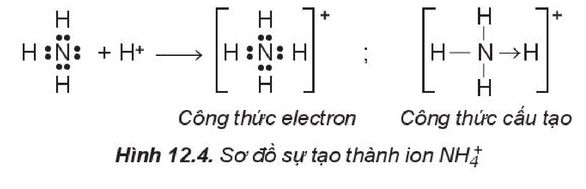

*Hình 12.4. Sơ đồ sự tạo thành ion $\ce{NH4+}$*

<!-- pdf:58 -->

### 2. Sự tạo thành phân tử có liên kết đôi

- Phân tử oxygen: Mỗi nguyên tử oxygen có 6 electron hoá trị, hai nguyên tử oxygen liên kết với nhau bằng cách mỗi nguyên tử đóng góp 2 electron, tạo thành 2 cặp electron dùng chung. Trong phân tử $\ce{O2}$, mỗi nguyên tử oxygen đều có 8 electron ở lớp ngoài cùng, thoả mãn quy tắc octet.

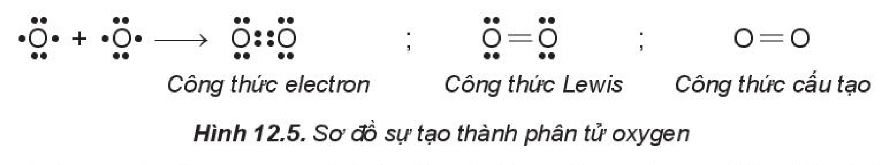

$\overset{\Large\cdot\cdot}{\underset{\Large\cdot\cdot}{\ce{.O.}}} + \overset{\Large\cdot\cdot}{\underset{\Large\cdot\cdot}{\ce{.O.}}} \longrightarrow \overset{\Large\cdot\cdot}{\underset{\Large\cdot\cdot}{\ce{O}}}\!::\!\overset{\Large\cdot\cdot}{\underset{\Large\cdot\cdot}{\ce{O}}}$ (Công thức electron) ; $\overset{\Large\cdot\cdot}{\underset{\Large\cdot\cdot}{\ce{O}}}=\overset{\Large\cdot\cdot}{\underset{\Large\cdot\cdot}{\ce{O}}}$ (Công thức Lewis) ; $\ce{O=O}$ (Công thức cấu tạo)
<!-- ocr-ok: sơ đồ Hình 12.5 gồm các dấu chấm electron xung quanh kí hiệu nguyên tố; đã đối chiếu ảnh -->

*Hình 12.5. Sơ đồ sự tạo thành phân tử oxygen*

Giữa hai nguyên tử oxygen có hai cặp electron dùng chung (biểu diễn bằng hai gạch nối), đó là **liên kết đôi**.

- Phân tử carbon dioxide: Nguyên tử carbon có 4 electron hoá trị, nguyên tử oxygen có 6 electron hoá trị. Hai nguyên tử oxygen liên kết với một nguyên tử carbon bằng cách mỗi nguyên tử oxygen đóng góp 2 electron và nguyên tử carbon đóng góp 4 electron tạo thành bốn cặp electron dùng chung. Khi đó, trong phân tử $\ce{CO2}$, mỗi nguyên tử đều có 8 electron ở lớp ngoài cùng, thoả mãn quy tắc octet.

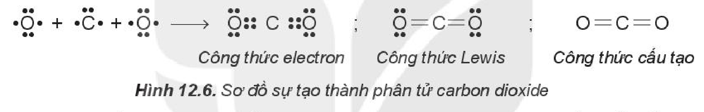

$\overset{\Large\cdot\cdot}{\underset{\Large\cdot\cdot}{\ce{.O.}}} + \overset{\Large\cdot\cdot}{\ce{.C.}} + \overset{\Large\cdot\cdot}{\underset{\Large\cdot\cdot}{\ce{.O.}}} \longrightarrow \overset{\Large\cdot\cdot}{\underset{\Large\cdot\cdot}{\ce{O}}}\!::\!\ce{C}\!::\!\overset{\Large\cdot\cdot}{\underset{\Large\cdot\cdot}{\ce{O}}}$ (Công thức electron) ; $\overset{\Large\cdot\cdot}{\underset{\Large\cdot\cdot}{\ce{O}}}=\ce{C}=\overset{\Large\cdot\cdot}{\underset{\Large\cdot\cdot}{\ce{O}}}$ (Công thức Lewis) ; $\ce{O=C=O}$ (Công thức cấu tạo)
<!-- ocr-ok: sơ đồ Hình 12.6 gồm các dấu chấm electron xung quanh kí hiệu nguyên tố; đã đối chiếu ảnh -->

*Hình 12.6. Sơ đồ sự tạo thành phân tử carbon dioxide*

Giữa nguyên tử $\ce{C}$ và nguyên tử $\ce{O}$ có 2 cặp electron dùng chung (biểu diễn bằng hai gạch nối), đó là liên kết đôi. Phân tử $\ce{CO2}$ có hai liên kết đôi.

### 3. Sự tạo thành phân tử có liên kết ba

Phân tử nitrogen: Nguyên tử nitrogen có 5 electron hoá trị, hai nguyên tử nitrogen liên kết với nhau bằng cách mỗi nguyên tử nitrogen đóng góp 3 electron, tạo thành ba cặp electron dùng chung. Khi đó, trong phân tử $\ce{N2}$, mỗi nguyên tử đều có 8 electron ở lớp ngoài cùng, thoả mãn quy tắc octet.

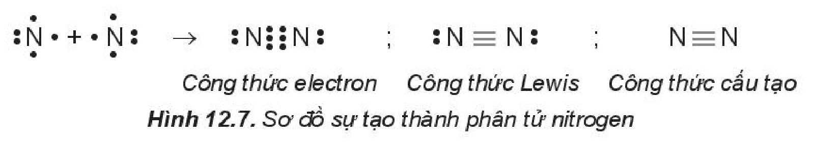

$\overset{\Large\cdot}{\underset{\Large\cdot}{\ce{:N.}}} + \overset{\Large\cdot}{\underset{\Large\cdot}{\ce{.N:}}} \longrightarrow \ce{:N}\!\vdots\vdots\!\ce{N:}$ (Công thức electron) ; $\ce{:N#N:}$ (Công thức Lewis) ; $\ce{N#N}$ (Công thức cấu tạo)
<!-- ocr-ok: sơ đồ Hình 12.7 gồm các dấu chấm electron xung quanh kí hiệu nguyên tố; đã đối chiếu ảnh -->

*Hình 12.7. Sơ đồ sự tạo thành phân tử nitrogen*

Giữa hai nguyên tử nitrogen có ba cặp electron dùng chung (biểu diễn bằng ba gạch nối), đó là **liên kết ba**.

Liên kết tạo thành trong các phân tử $\ce{Cl2}$, $\ce{HCl}$, $\ce{O2}$, $\ce{CO2}$, $\ce{N2}$,... là liên kết cộng hoá trị.

**Liên kết cộng hoá trị** là liên kết được tạo thành giữa hai nguyên tử bằng một hay nhiều cặp electron dùng chung.

Liên kết trong các phân tử $\ce{Cl2}$, $\ce{O2}$, $\ce{N2}$,... có cặp electron dùng chung không bị hút lệch về phía nguyên tử nào được gọi là **liên kết cộng hoá trị không phân cực**. Liên kết trong phân tử $\ce{HCl}$ có cặp electron dùng chung lệch về phía nguyên tử có độ âm điện lớn hơn ($\ce{Cl}$) được gọi là **liên kết cộng hoá trị phân cực**.

<!-- pdf:59 -->

> ✋ **Lắp ráp mô hình một số phân tử**
>
> *Chuẩn bị:* Bộ lắp ráp mô hình các phân tử $\ce{CH4}$, $\ce{C2H4}$, $\ce{C2H2}$, $\ce{C2H5OH}$, $\ce{CH3COOH}$.
>
> *Tiến hành:*
>
> - Chọn hình cầu có màu sắc khác nhau đại diện cho nguyên tử $\ce{C}$, $\ce{O}$, $\ce{H}$.
> - Lắp các hình cầu và que nối theo mẫu (Hình 12.8).
>
> 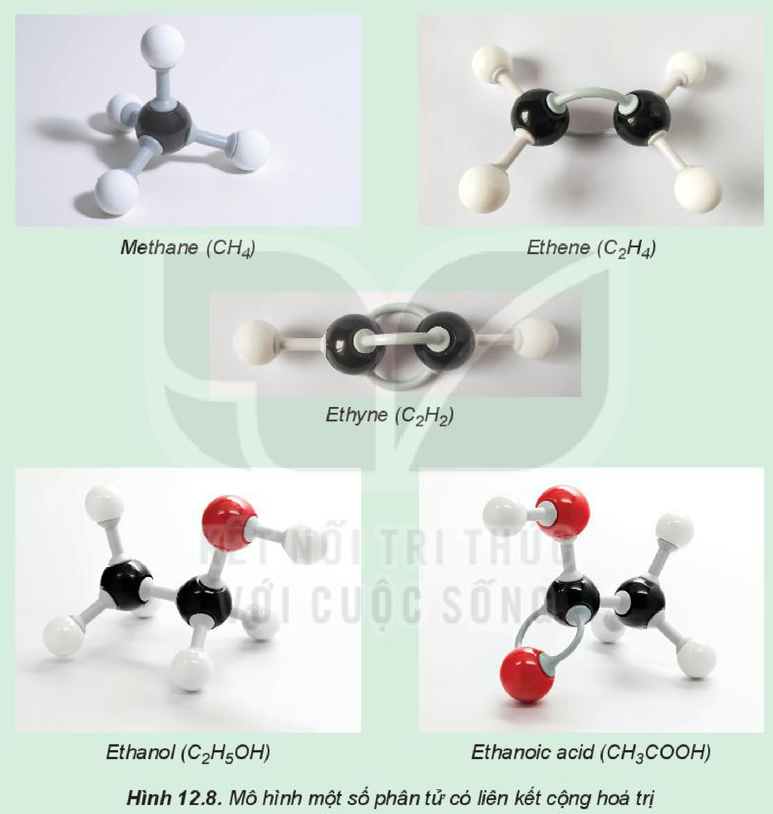
>
> *Hình 12.8. Mô hình một số phân tử có liên kết cộng hoá trị: Methane ($\ce{CH4}$); Ethene ($\ce{C2H4}$); Ethyne ($\ce{C2H2}$); Ethanol ($\ce{C2H5OH}$); Ethanoic acid ($\ce{CH3COOH}$)*
>
> *Quan sát mô hình và cho biết số liên kết đơn, liên kết đôi, liên kết ba trong mỗi phân tử.*

> ❓ 1. Viết công thức electron, công thức cấu tạo và công thức Lewis của các phân tử:
>
> a) Bromine ($\ce{Br2}$).
>
> b) Hydrogen sulfide ($\ce{H2S}$).
>
> c) Methane ($\ce{CH4}$).
>
> d) Ammonia ($\ce{NH3}$).
>
> e) Ethene ($\ce{C2H4}$).
>
> g) Ethyne ($\ce{C2H2}$).

<!-- pdf:60 -->

## II. ĐỘ ÂM ĐIỆN VÀ LIÊN KẾT HOÁ HỌC

**Độ âm điện** đặc trưng cho khả năng hút electron của nguyên tử khi hình thành liên kết hoá học. Dựa vào sự khác nhau về độ âm điện giữa các nguyên tử tham gia liên kết, có thể dự đoán được loại liên kết giữa hai nguyên tử đó$^{(*)}$ (Bảng 12.1):

*Bảng 12.1. Mối quan hệ giữa hiệu độ âm điện với liên kết hoá học*

| Trạng thái của cặp electron liên kết | Hiệu độ âm điện ($\Delta \chi$) | Đặc điểm liên kết | Loại liên kết |
|---|---|---|---|
| Cặp electron liên kết không bị hút lệch về phía nguyên tử nào. | $0 \le \lvert\Delta \chi\rvert < 0{,}4$ | Liên kết không bị phân cực | Cộng hoá trị không phân cực |
| Cặp electron liên kết bị hút lệch về phía nguyên tử có độ âm điện lớn hơn. | $0{,}4 \le \lvert\Delta \chi\rvert < 1{,}7$ | Liên kết bị phân cực | Cộng hoá trị phân cực |
| Cặp electron liên kết chuyển hẳn đến nguyên tử nhận electron tạo thành ion âm và nguyên tử nhường electron tạo thành ion dương. | $\lvert\Delta \chi\rvert \ge 1{,}7$ | Liên kết bị phân cực mạnh | Ion |
<!-- ocr-ok: Bảng 12.1 có nhiều dòng trong mỗi ô, OCR bỏ sót dòng "tử có độ âm điện lớn hơn. / phân cực / trị phân" ở hàng thứ hai; đã đối chiếu ảnh -->

Ví dụ:

- Trong phân tử $\ce{HCl}$, hiệu độ âm điện của $\ce{Cl}$ và $\ce{H}$: $3{,}16 - 2{,}20 = 0{,}96$. Vì vậy, liên kết giữa $\ce{H}$ và $\ce{Cl}$ là liên kết cộng hoá trị phân cực.
- Trong phân tử $\ce{CO2}$, hiệu độ âm điện của $\ce{O}$ và $\ce{C}$: $3{,}44 - 2{,}55 = 0{,}89$. Vì vậy, liên kết giữa $\ce{C}$ và $\ce{O}$ là liên kết cộng hoá trị phân cực. Tuy nhiên, do phân tử $\ce{CO2}$ có cấu tạo thẳng nên độ phân cực của hai liên kết đôi ($\ce{C=O}$) triệt tiêu nhau, dẫn đến toàn bộ phân tử không bị phân cực.
- Trong phân tử $\ce{NaCl}$, hiệu độ âm điện của $\ce{Cl}$ và $\ce{Na}$: $3{,}16 - 0{,}93 = 2{,}23$. Vì vậy, liên kết giữa $\ce{Na}$ và $\ce{Cl}$ là liên kết ion.

Liên kết cộng hoá trị phân cực có thể được coi là dạng trung gian giữa liên kết cộng hoá trị không phân cực và liên kết ion.

> ❓ 2. Dựa vào giá trị độ âm điện trong Bảng 6.2, dự đoán loại liên kết (liên kết cộng hoá trị phân cực, liên kết cộng hoá trị không phân cực, liên kết ion) trong các phân tử: $\ce{MgCl2}$, $\ce{AlCl3}$, $\ce{HBr}$, $\ce{O2}$, $\ce{H2}$, $\ce{NH3}$.

> (*) Trừ một số trường hợp ngoại lệ như: $\ce{HF}$, $\ce{MnI2}$,...

<!-- pdf:61 -->

> 💡 EM CÓ BIẾT
>
> **Tính chất của các chất có liên kết cộng hoá trị**
>
> Tương tác giữa các phân tử có liên kết cộng hoá trị yếu hơn nhiều so với các phân tử có liên kết ion.
>
> *Trạng thái:* Các chất có liên kết cộng hoá trị có thể tồn tại ở các trạng thái rắn, lỏng và khí.
>
> - Khí: hydrogen, fluorine, carbon dioxide, chlorine,...
> - Lỏng: bromine, nước, alcohol,...
> - Rắn: sulfur, iodine, đường glucose, sucrose,...
>
> *Tính tan:* Nói chung, các chất có liên kết cộng hoá trị phân cực như ethanol, đường,... tan nhiều trong nước,... Các chất có liên kết cộng hoá trị không phân cực như iodine, hydrocarbon ít tan trong nước, tan trong benzene, carbon tetrachloride,...
>
> *Nhiệt độ nóng chảy:* Hợp chất cộng hoá trị không có lực hút tĩnh điện mạnh như hợp chất ion nên chúng có nhiệt độ nóng chảy và nhiệt độ sôi thấp.
>
> *Khả năng dẫn điện:* Nói chung, các chất có liên kết cộng hoá trị không phân cực không dẫn điện ở mọi trạng thái.

## III. MÔ TẢ LIÊN KẾT CỘNG HOÁ TRỊ BẰNG SỰ XEN PHỦ CÁC ORBITAL NGUYÊN TỬ

### 1. Sự xen phủ các orbital nguyên tử tạo liên kết $\sigma$ (sigma)

- Sự xen phủ s – s

  Phân tử $\ce{H2}$ tạo thành từ 2 nguyên tử $\ce{H}$ ($1s^1$). Khi 2 nguyên tử $\ce{H}$ tiến lại gần nhau, hạt nhân của nguyên tử này hút đám mây electron của nguyên tử kia, hai orbital nguyên tử xen phủ vào nhau một phần. Vùng xen phủ có mật độ điện tích âm lớn, làm tăng lực hút của mỗi hạt nhân với vùng này và làm cân bằng lực đẩy giữa hai hạt nhân, để hai nguyên tử liên kết với nhau.

  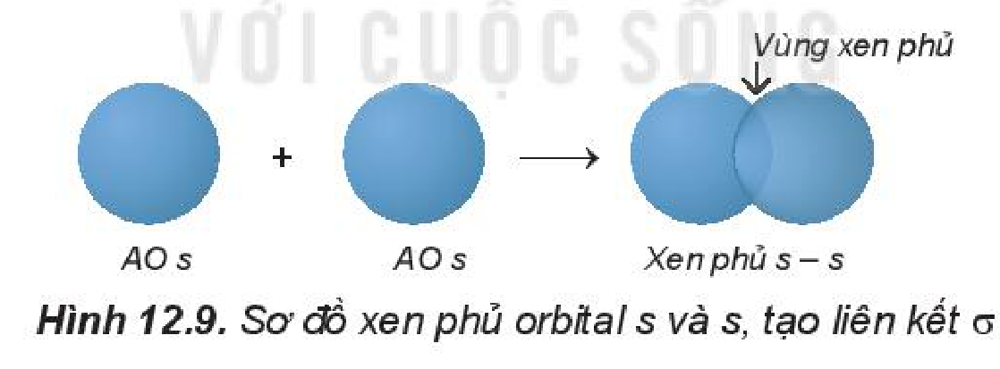

  *Hình 12.9. Sơ đồ xen phủ orbital s và s, tạo liên kết $\sigma$*

  Trong phân tử $\ce{H2}$, khoảng cách giữa tâm của hai hạt nhân nguyên tử $\ce{H}$ (**độ dài liên kết** $\ce{H-H}$) là 74 pm, ngắn hơn tổng bán kính của hai nguyên tử $\ce{H}$ (106 pm). Phân tử $\ce{H2}$ bền hơn và có năng lượng thấp hơn tổng năng lượng của hai nguyên tử $\ce{H}$ riêng rẽ.

- Sự xen phủ s – p

  Phân tử $\ce{HF}$ tạo thành khi orbital $1s$ của nguyên tử $\ce{H}$ ($1s^1$) xen phủ với orbital $2p$ của nguyên tử $\ce{F}$ ($2s^22p^5$) theo trục liên kết, tạo liên kết cộng hoá trị giữa $\ce{H}$ và $\ce{F}$, vùng xen phủ càng lớn thì liên kết càng bền.

  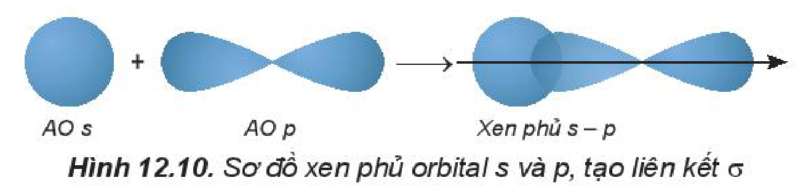

  *Hình 12.10. Sơ đồ xen phủ orbital s và p, tạo liên kết $\sigma$*

<!-- pdf:62 -->

- Sự xen phủ p – p.

  Phân tử $\ce{Cl2}$ tạo thành khi hai orbital $3p$ của hai nguyên tử $\ce{Cl}$ ($3s^23p^5$) xen phủ theo trục liên kết của hai nguyên tử $\ce{Cl}$.

  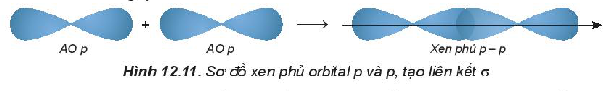

  *Hình 12.11. Sơ đồ xen phủ orbital p và p, tạo liên kết $\sigma$*

Trong các trường hợp xen phủ trên, để vùng xen phủ cực đại, các orbital sẽ xen phủ với nhau theo trục liên kết. Sự xen phủ như thế gọi là **xen phủ trục**, tạo ra **liên kết $\sigma$**. Các liên kết cộng hoá trị đơn đều là liên kết $\sigma$. Trong liên kết $\sigma$, mật độ xác suất tìm thấy electron lớn nhất dọc theo trục liên kết.

### 2. Sự xen phủ các orbital nguyên tử tạo liên kết $\pi$ (pi)

Sự xen phủ, trong đó trục của các orbital tham gia liên kết song song với nhau và vuông góc với đường nối tâm của hai nguyên tử liên kết, được gọi là **xen phủ bên**. Sự xen phủ bên tạo ra **liên kết $\pi$** (pi) (Hình 12.12).

Ở những liên kết đôi và ba (như trong phân tử $\ce{N2}$, $\ce{C2H4}$,...), ngoài liên kết $\sigma$ còn có liên kết $\pi$.

Liên kết đôi gồm một liên kết $\sigma$ và một liên kết $\pi$. Liên kết ba gồm một liên kết $\sigma$ và hai liên kết $\pi$.

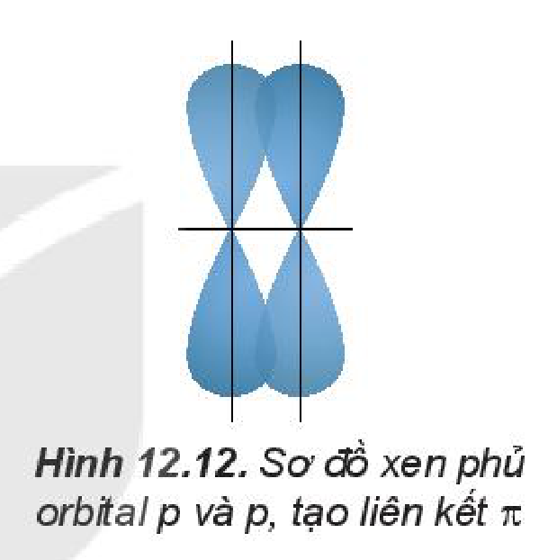

*Hình 12.12. Sơ đồ xen phủ orbital p và p, tạo liên kết $\pi$*

> ❓ 3. Sự hình thành liên kết $\sigma$ và liên kết $\pi$ khác nhau như thế nào?
>
> 4. Số liên kết $\sigma$ và $\pi$ có trong phân tử $\ce{C2H4}$ lần lượt là
>
> A. 4 và 0. B. 2 và 0. C. 1 và 1. D. 5 và 1.
<!-- ocr-ok: OCR đọc sai các phương án A, B, C, D ("A.4vàuo. B.2vàD. GC.1vài1. D.5vä1."); đã đối chiếu ảnh -->

## IV. NĂNG LƯỢNG LIÊN KẾT CỘNG HOÁ TRỊ

**Năng lượng liên kết** ($E_b$)$^{(*)}$ là năng lượng cần thiết để phá vỡ một liên kết hoá học trong phân tử ở thể khí thành các nguyên tử ở thể khí. Năng lượng liên kết thường có đơn vị là kJ/mol.

Ví dụ: Để phá vỡ 1 mol liên kết $\ce{H-Cl}$ thành các nguyên tử $\ce{H}$ và $\ce{Cl}$ (ở thể khí) theo phương trình:

$\ce{HCl(g) -> H(g) + Cl(g)}$

cần năng lượng là 432 kJ, nên năng lượng liên kết $\ce{H-Cl}$ là $E_b = 432\text{ kJ/mol}$.

> (*) $E_b$ là năng lượng liên kết, chữ b viết tắt của từ tiếng Anh "bond", nghĩa là liên kết.

<!-- pdf:63 -->

*Bảng 12.2. Năng lượng liên kết trung bình của một số liên kết hoá học$^{(*)}$*

| Liên kết | $E_b$ (kJ/mol) | Liên kết | $E_b$ (kJ/mol) |
|---|---|---|---|
| $\ce{F-F}$ | 159 | $\ce{C-C}$ | 346 |
| $\ce{Cl-Cl}$ | 243 | $\ce{C=C}$ | 612 |
| $\ce{Br-Br}$ | 193 | $\ce{C#C}$ | 835 |
| $\ce{I-I}$ | 151 | $\ce{C-H}$ | 418 |
| $\ce{H-F}$ | 569 | $\ce{C=O}$ | 732 |
| $\ce{H-Cl}$ | 432 | $\ce{O=O}$ | 494 |
| $\ce{H-Br}$ | 366 | $\ce{N#N}$ | 945 |
| $\ce{H-I}$ | 299 | $\ce{N-H}$ | 386 |
| $\ce{H-H}$ | 436 | $\ce{O-H}$ | 459 |
<!-- ocr-ok: Bảng 12.2 gồm các công thức liên kết viết bằng LaTeX mhchem và số liệu; đã đối chiếu ảnh -->

Năng lượng liên kết đặc trưng cho độ bền của liên kết. Năng lượng liên kết càng lớn thì liên kết càng bền và phân tử càng khó bị phân huỷ.

> 💡 EM CÓ BIẾT
>
> Dựa vào hiệu giữa năng lượng liên kết của các chất tham gia và tạo thành sau phản ứng, có thể biết được phản ứng nào toả nhiệt và phản ứng nào thu nhiệt, từ đó sử dụng biện pháp thích hợp để tận dụng nhiệt và sử dụng nhiệt phù hợp hoặc có thể tính được lượng nhiệt toả ra hay thu vào của phản ứng.
>
> Ví dụ: Trong phản ứng đốt than, dầu, xăng, do năng lượng liên kết của sản phẩm cháy lớn hơn năng lượng liên kết của chất bị đốt nên phản ứng toả nhiệt. Ngược lại, trong phản ứng phân huỷ nước để điều chế hydrogen làm nhiên liệu, do năng lượng liên kết của chất ban đầu lớn hơn năng lượng liên kết của sản phẩm nên phản ứng thu nhiệt, phải cung cấp nhiệt để phản ứng xảy ra.

> ❓ 5. Năng lượng liên kết là gì? Năng lượng liên kết của phân tử $\ce{Cl2}$ là 243 kJ/mol cho biết điều gì?
>
> 6. Dựa vào giá trị năng lượng liên kết ở Bảng 12.2, hãy chọn phương án đúng khi so sánh độ bền liên kết giữa $\ce{Cl2}$, $\ce{Br2}$ và $\ce{I2}$.
>
> A. $\ce{I2 > Br2 > Cl2}$.
>
> B. $\ce{Br2 > Cl2 > I2}$.
>
> C. $\ce{Cl2 > Br2 > I2}$.
>
> D. $\ce{Cl2 > I2 > Br2}$.

> (*) Nguồn: Raymond E. Davis, Regina Frey, Mickey Sarquis, Jerry L.Sarquis. (2009). *Modern Chemistry*. Holt, Rinehart and Wiston.

<!-- pdf:64 -->

## 📌 Em đã học

- Cách viết công thức Lewis của một số chất đơn giản.
- Liên kết cộng hoá trị được tạo thành giữa hai nguyên tử bằng một hay nhiều cặp electron dùng chung.
- Sự xen phủ orbital theo trục liên kết tạo ra liên kết $\sigma$. Sự xen phủ bên của các orbital tạo ra liên kết $\pi$.
- Các liên kết cộng hoá trị đơn đều là liên kết $\sigma$, 1 liên kết đôi gồm 1 liên kết $\sigma$ và 1 liên kết $\pi$, 1 liên kết ba gồm 1 liên kết $\sigma$ và 2 liên kết $\pi$.
- Dựa vào hiệu độ âm điện của các nguyên tử, dự đoán loại liên kết:

  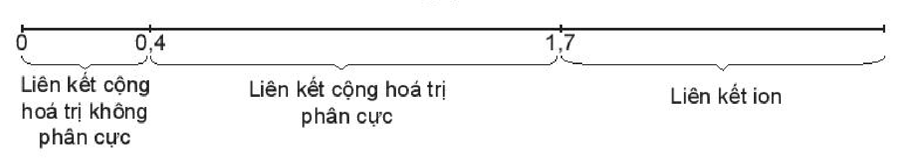

  - Từ $0$ đến $0{,}4$: Liên kết cộng hoá trị không phân cực
  - Từ $0{,}4$ đến $1{,}7$: Liên kết cộng hoá trị phân cực
  - Từ $1{,}7$ trở lên: Liên kết ion
- Năng lượng liên kết là năng lượng cần thiết để phá vỡ một liên kết hoá học trong phân tử ở thể khí thành các nguyên tử ở thể khí. Năng lượng liên kết đặc trưng cho độ bền của liên kết.

## ✏️ Em có thể

Phân biệt được liên kết ion, liên kết cộng hoá trị phân cực và liên kết cộng hoá trị không phân cực theo độ âm điện.

## 📷 Danh sách hình trong bài

| Mã hình | Trang PDF | Vị trí | Chú thích gốc |
|---|---|---|---|
| H10-hoa-b12-01 | 57 | Mục I.1 | Hình 12.1. Sơ đồ mô tả sự dùng chung cặp electron giữa hai nguyên tử chlorine, tạo thành phân tử chlorine |
| H10-hoa-b12-02 | 57 | Mục I.1 | Hình 12.2. Sơ đồ sự tạo thành phân tử chlorine |
| H10-hoa-b12-03 | 57 | Mục I.1 | Hình 12.3. Sơ đồ sự tạo thành phân tử hydrogen chloride |
| H10-hoa-b12-04 | 57 | Mục I.1 | Hình 12.4. Sơ đồ sự tạo thành ion $\ce{NH4+}$ |
| H10-hoa-b12-05 | 58 | Mục I.2 | Hình 12.5. Sơ đồ sự tạo thành phân tử oxygen |
| H10-hoa-b12-06 | 58 | Mục I.2 | Hình 12.6. Sơ đồ sự tạo thành phân tử carbon dioxide |
| H10-hoa-b12-07 | 58 | Mục I.3 | Hình 12.7. Sơ đồ sự tạo thành phân tử nitrogen |
| H10-hoa-b12-08 | 59 | Mục I.3, hộp "Lắp ráp mô hình một số phân tử" | Hình 12.8. Mô hình một số phân tử có liên kết cộng hoá trị |
| H10-hoa-b12-09 | 61 | Mục III.1 | Hình 12.9. Sơ đồ xen phủ orbital s và s, tạo liên kết $\sigma$ |
| H10-hoa-b12-10 | 61 | Mục III.1 | Hình 12.10. Sơ đồ xen phủ orbital s và p, tạo liên kết $\sigma$ |
| H10-hoa-b12-11 | 62 | Mục III.1 | Hình 12.11. Sơ đồ xen phủ orbital p và p, tạo liên kết $\sigma$ |
| H10-hoa-b12-12 | 62 | Mục III.2 | Hình 12.12. Sơ đồ xen phủ orbital p và p, tạo liên kết $\pi$ |
| H10-hoa-b12-13 | 64 | Mục "Em đã học" (sơ đồ trục hiệu độ âm điện) | (sách không đánh số, không có chú thích) |
