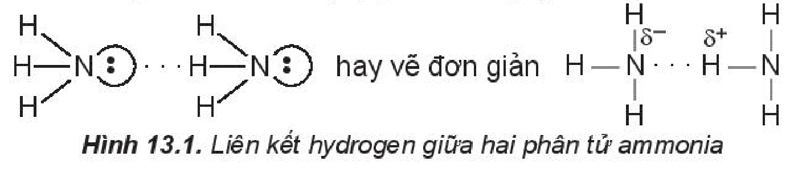
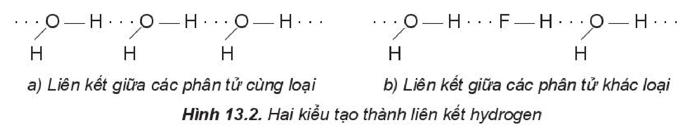
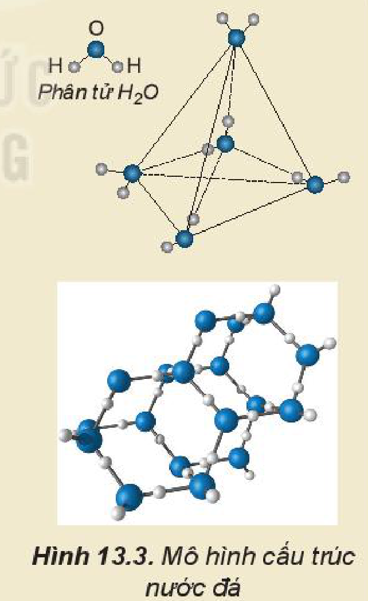
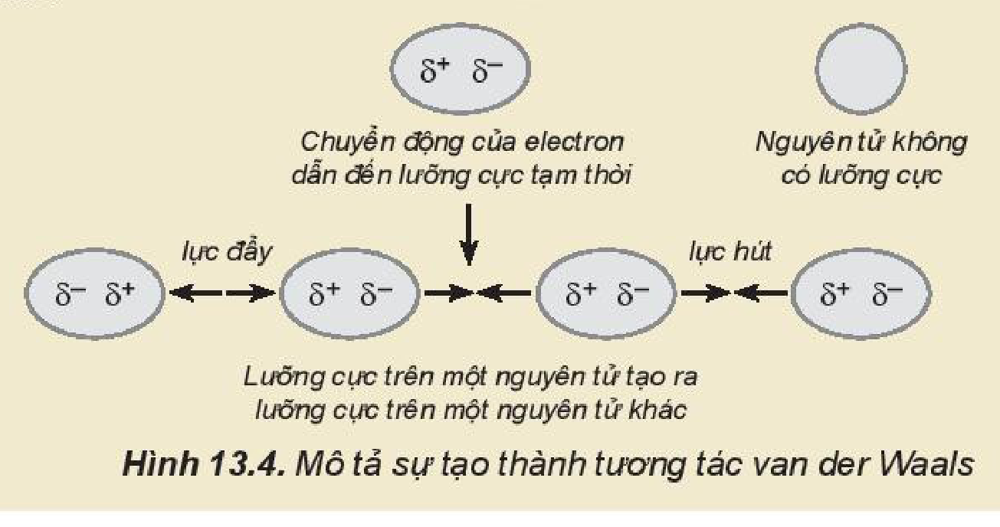
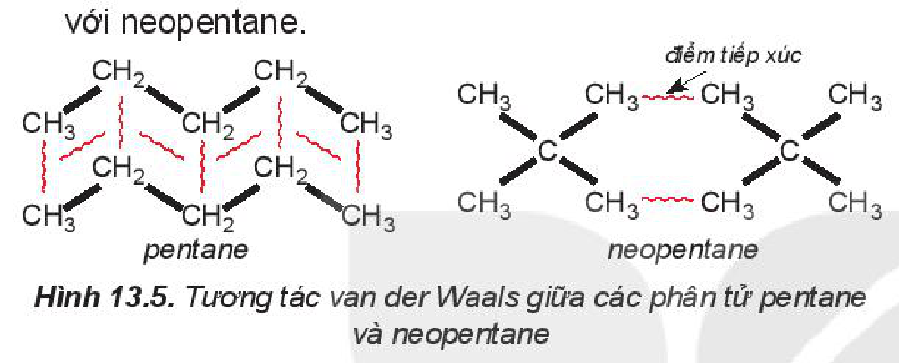

<!-- pdf:65 -->

# BÀI 13: LIÊN KẾT HYDROGEN VÀ TƯƠNG TÁC VAN DER WAALS

## 🎯 Mục tiêu

- Trình bày được khái niệm liên kết hydrogen. Vận dụng để giải thích sự xuất hiện liên kết hydrogen (với nguyên tố có độ âm điện lớn: $\ce{N}$, $\ce{O}$, $\ce{F}$).
- Nêu được vai trò, ảnh hưởng của liên kết hydrogen tới tính chất vật lí của nước.
- Nêu được khái niệm về tương tác van der Waals và ảnh hưởng của tương tác này tới nhiệt độ nóng chảy, nhiệt độ sôi của các chất.

## 🔴 Mở đầu

Ở áp suất khí quyển, nhiệt độ sôi của $\ce{H2O}$ là 100 °C, $\ce{CH4}$ là $-161{,}58\text{ °C}$, $\ce{H2S}$ là $-60{,}28\text{ °C}$. Vì sao các chất trên có nhiệt độ sôi khác nhau?

## I. MỞ ĐẦU

Các tính chất vật lí của các chất có liên kết cộng hoá trị được quyết định bởi lực tương tác giữa các phân tử, hình dạng của phân tử và mức độ phân cực của liên kết cộng hoá trị trong phân tử. Keo dán là một ví dụ về việc sử dụng lực tương tác giữa các phân tử để gắn các vật với nhau. Bong bóng xà phòng thể hiện tương tác giữa các phân tử nước và các phân tử xà phòng tạo thành màng mỏng, giữ được không khí bên trong để bay lên.

Lực tương tác giữa các phân tử yếu hơn rất nhiều so với lực liên kết ion, liên kết cộng hoá trị hay liên kết kim loại. Một số tương tác điển hình giữa các phân tử là liên kết hydrogen và tương tác van der Waals (Van đơ Van).

## II. LIÊN KẾT HYDROGEN

### 1. Bản chất của liên kết hydrogen

Các phân tử $\ce{HF}$, $\ce{H2O}$, $\ce{NH3}$ có chứa nguyên tử $\ce{H}$ (độ âm điện là $2{,}2$) và các nguyên tử phi kim có độ âm điện lớn ($\ce{F} = 3{,}98$; $\ce{O} = 3{,}44$; $\ce{N} = 3{,}04$). Sự chênh lệch độ âm điện lớn làm cho các liên kết phân cực, cặp electron dùng chung trong liên kết cộng hoá trị bị hút lệch về phía các nguyên tử $\ce{F}$, $\ce{O}$, $\ce{N}$, tạo thành khu vực có điện tích âm ($\delta^-$).

Nguyên tử hydrogen trong các phân tử $\ce{HF}$, $\ce{H2O}$, $\ce{NH3}$ rất linh động, có điện tích dương ($\delta^+$) đủ lớn để hút cặp electron hoá trị chưa liên kết trên nguyên tử $\ce{F}$, $\ce{O}$ hoặc $\ce{N}$ (của phân tử khác) có độ âm điện lớn tạo thành **liên kết hydrogen**. Liên kết hydrogen thường được biểu diễn bằng dấu ba chấm (...) giữa các nguyên tử (Hình 13.1).

*Hình 13.1. Liên kết hydrogen giữa hai phân tử ammonia*

<!-- pdf:66 -->

Điều kiện cần và đủ để tạo thành liên kết hydrogen:

- Nguyên tử hydrogen liên kết với các nguyên tử có độ âm điện lớn như $\ce{F}$, $\ce{O}$, $\ce{N}$,...
- Nguyên tử $\ce{F}$, $\ce{O}$, $\ce{N}$,... liên kết với hydrogen phải có ít nhất một cặp electron hoá trị chưa liên kết.

Một số kiểu tạo thành liên kết hydrogen:

*Hình 13.2. Hai kiểu tạo thành liên kết hydrogen: a) Liên kết giữa các phân tử cùng loại; b) Liên kết giữa các phân tử khác loại*

### 2. Vai trò và ảnh hưởng của liên kết hydrogen tới tính chất vật lí của nước

Liên kết hydrogen làm tăng nhiệt độ nóng chảy, nhiệt độ sôi của nước.

*Bảng 13.1. Nhiệt độ nóng chảy và nhiệt độ sôi một số chất*

| | $\ce{H2O}$ | $\ce{H2S}$ | $\ce{CH4}$ |
|---|---|---|---|
| Nhiệt độ nóng chảy (°C) | $0$ | $-85{,}6$ | $-182{,}5$ |
| Nhiệt độ sôi (°C) | $100$ | $-60{,}75$ | $-161{,}58$ |

Số liệu Bảng 13.1 cho thấy: do ảnh hưởng của liên kết hydrogen nên nhiệt độ nóng chảy và nhiệt độ sôi của $\ce{H2O}$ cao hơn nhiều so với $\ce{H2S}$ và $\ce{CH4}$.

> 💡 EM CÓ BIẾT
>
> Liên kết hydrogen ảnh hưởng đến tính chất của nước đá. Nguyên tử $\ce{O}$ có 2 cặp electron chưa liên kết nên có thể tạo 2 liên kết hydrogen với 2 nguyên tử $\ce{H}$ của các phân tử nước khác, 2 nguyên tử $\ce{H}$ của phân tử nước đủ điều kiện để tạo liên kết hydrogen với 2 nguyên tử $\ce{O}$ của các phân tử nước khác. Như vậy, một phân tử nước có thể tạo ra 4 liên kết hydrogen với các phân tử nước khác xung quanh tạo thành cấu trúc tứ diện (Hình 13.3). Mạng tinh thể nước đá có vô số cấu trúc như vậy. Cấu trúc này khá “rỗng” nên nước đá nhẹ hơn nước lỏng và có thể nổi một phần trên bề mặt nước lỏng.
>
> Do có liên kết hydrogen mà nước dễ dàng dâng lên trong mao quản của rễ cây để vận chuyển lên thân và lá cây.
>
> Khi nhiệt độ tăng từ 0 °C đến 4 °C, các cấu trúc tứ diện trong nước đá bị phá vỡ một phần và các phân tử nước được sắp xếp lại gần nhau hơn, làm cho khối lượng riêng của nước tăng dần. Khi nhiệt độ tiếp tục tăng lên, khoảng cách giữa các phân tử nước tăng, làm khối lượng riêng của nước giảm. Các phân tử nước đóng vai trò điều hoà nhiệt độ trên Trái Đất.
>
> Liên kết hydrogen còn tạo nên cấu trúc xoắn của các protein, carbohydrate và nucleic acid, đảm bảo chức năng đặc biệt của chúng đối với cơ thể sống.
>
> 
>
> *Hình 13.3. Mô hình cấu trúc nước đá*

<!-- pdf:67 -->

> ❓ 1. Vẽ sơ đồ biểu diễn liên kết hydrogen giữa:
>
> a) hai phân tử hydrogen fluoride ($\ce{HF}$).
>
> b) phân tử hydrogen fluoride ($\ce{HF}$) và phân tử ammonia ($\ce{NH3}$).
>
> 2. Những nguyên tử hydrogen nào trong phân tử ethanol ($\ce{CH3CH2OH}$) không tham gia vào liên kết hydrogen? Vì sao?

## III. TƯƠNG TÁC VAN DER WAALS

### 1. Khái niệm tương tác van der Waals

Cùng là phân tử không phân cực, ở nhiệt độ phòng, fluorine, chlorine là những chất khí còn bromine là chất lỏng. Như vậy, ở trạng thái lỏng, giữa các phân tử bromine tồn tại một tương tác yếu. Tương tác yếu đó gọi là tương tác van der Waals.

Các khí hiếm như neon, argon,... tồn tại dưới dạng các nguyên tử độc lập. Tuy nhiên ở nhiệt độ thấp, khí hiếm có thể hoá lỏng. Như vậy, ở nhiệt độ thấp, giữa các nguyên tử khí hiếm tồn tại một tương tác yếu để giữ các nguyên tử khí hiếm lại với nhau trong trạng thái lỏng. Tương tác đó cũng là tương tác van der Waals.

**Tương tác van der Waals** là tương tác tĩnh điện lưỡng cực – lưỡng cực giữa các nguyên tử hay phân tử.

> 💡 EM CÓ BIẾT
>
> **Sự hình thành tương tác van der Waals**
>
> Tương tác van der Waals thể hiện rõ ở các chất cộng hoá trị phân cực do chúng có cấu tạo lưỡng cực, một đầu mang một phần điện tích âm và một đầu mang một phần điện tích dương.
>
> Các nguyên tử khí hiếm hoặc các chất cộng hoá trị không phân cực, do đám mây electron luôn chuyển động nên cũng có thể tạo ra một **lưỡng cực tạm thời** (Hình 13.4). Lực hút giữa một đầu mang một phần điện tích âm ($\delta^-$) của lưỡng cực trong phân tử này và một đầu mang một phần điện tích dương ($\delta^+$) của lưỡng cực trong phân tử khác tạo thành tương tác van der Waals.
>
> 
>
> *Hình 13.4. Mô tả sự tạo thành tương tác van der Waals*

### 2. Ảnh hưởng của tương tác van der Waals đến nhiệt độ nóng chảy, nhiệt độ sôi của các chất

Ví dụ 1: Trong dãy halogen, tương tác van der Waals tăng theo sự tăng của số electron (và proton) trong phân tử, làm tăng nhiệt độ nóng chảy, nhiệt độ sôi của các chất (Bảng 13.2).

<!-- pdf:68 -->

*Bảng 13.2. Nhiệt độ nóng chảy và nhiệt độ sôi tăng khi tương tác van der Waals tăng*

| Halogen | $\ce{F2}$ | $\ce{Cl2}$ | $\ce{Br2}$ | $\ce{I2}$ |
|---|---|---|---|---|
| Khối lượng mol (g/mol) | $38{,}0$ | $70{,}9$ | $159{,}8$ | $253{,}8$ |
| Tổng số electron | $18$ | $34$ | $70$ | $106$ |
| Nhiệt độ sôi (°C) | $-188{,}1$ | $-34{,}1$ | $59{,}2$ | $185{,}5$ |
| Nhiệt độ nóng chảy (°C) | $-219{,}6$ | $-101{,}0$ | $-7{,}3$ | $113{,}6$ |
<!-- ocr-ok: Bảng 13.2 có số liệu nhiệt độ âm viết bằng LaTeX và OCR đọc nhầm "Khối" thành "Khói", "59,2" thành "592"; đã đối chiếu ảnh -->

Ví dụ 2: Pentane là hydrocarbon no có công thức $\ce{C5H12}$. Đồng phân mạch không phân nhánh pentane có nhiệt độ sôi (36 °C) cao hơn so với đồng phân mạch nhánh neopentane (9,5 °C) do diện tích tiếp xúc giữa các phân tử pentane lớn hơn nhiều so với neopentane.

*Hình 13.5. Tương tác van der Waals giữa các phân tử pentane và neopentane*

Hình 13.5 cho thấy để phá vỡ lực liên phân tử giữa các phân tử pentane cần nhiều năng lượng hơn so với neopentane, nên nhiệt độ sôi cao hơn.

> 💡 EM CÓ BIẾT
>
> Khi khối lượng phân tử tăng thì tương tác van der Waals tăng. Ví dụ, tổng tương tác van der Waals giữa các phân tử polyethene lớn hơn rất nhiều so với giữa các phân tử ethene. Đó là lí do tại sao polyethene là một chất rắn ở điều kiện thường.

> ❓ 3. Hãy giải thích sự khác nhau về nhiệt độ sôi của butane và isobutane.

## 📌 Em đã học

- **Liên kết hydrogen** được hình thành giữa nguyên tử $\ce{H}$ (đã liên kết với một nguyên tử có độ âm điện lớn) với một nguyên tử khác (có độ âm điện lớn) còn cặp electron hoá trị chưa tham gia liên kết.
- Liên kết hydrogen làm tăng nhiệt độ nóng chảy và nhiệt độ sôi của nước.
- Tương tác van der Waals là tương tác tĩnh điện lưỡng cực – lưỡng cực được hình thành giữa các phân tử hay nguyên tử.
- Tương tác van der Waals làm tăng nhiệt độ nóng chảy và nhiệt độ sôi của các chất.

## ✏️ Em có thể

So sánh được tính chất vật lí giữa các phân tử dựa vào liên kết hydrogen và tương tác van der Waals.

## 📷 Danh sách hình trong bài

| Mã hình | Trang PDF | Vị trí | Chú thích gốc |
|---|---|---|---|
| H10-hoa-b13-01 | 65 | Mục II.1 | Hình 13.1. Liên kết hydrogen giữa hai phân tử ammonia |
| H10-hoa-b13-02 | 66 | Mục II.1 | Hình 13.2. Hai kiểu tạo thành liên kết hydrogen: a) Liên kết giữa các phân tử cùng loại; b) Liên kết giữa các phân tử khác loại |
| H10-hoa-b13-03 | 66 | Mục II.2, hộp "Em có biết" | Hình 13.3. Mô hình cấu trúc nước đá |
| H10-hoa-b13-04 | 67 | Mục III.1, hộp "Em có biết" | Hình 13.4. Mô tả sự tạo thành tương tác van der Waals |
| H10-hoa-b13-05 | 68 | Mục III.2 | Hình 13.5. Tương tác van der Waals giữa các phân tử pentane và neopentane |
