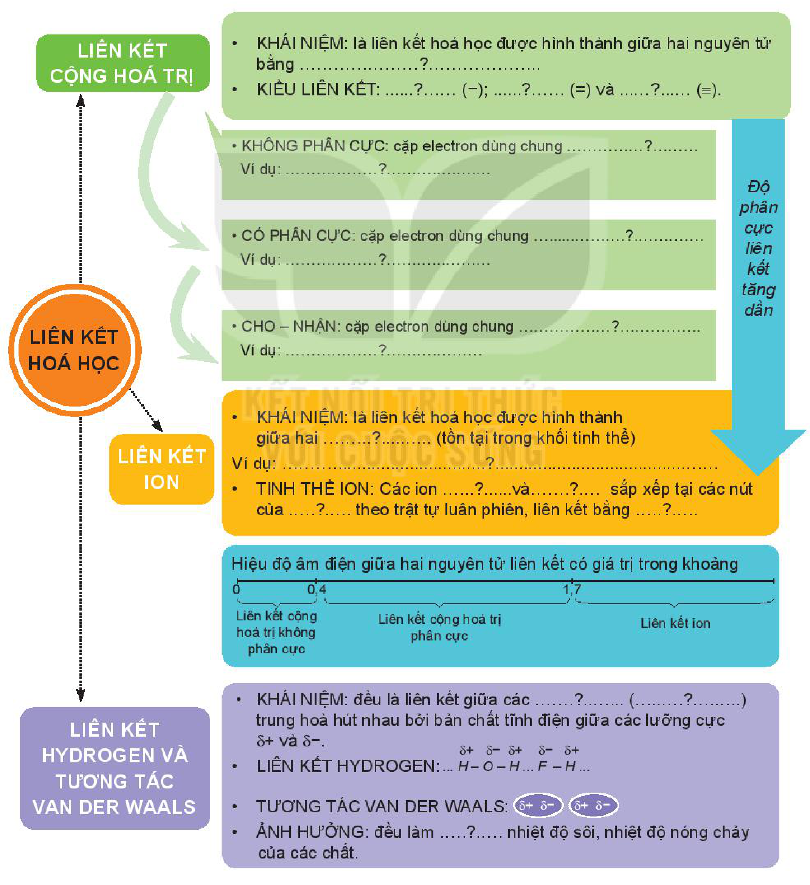

<!-- pdf:69 -->

# BÀI 14: ÔN TẬP CHƯƠNG 3

## I. HỆ THỐNG HOÁ KIẾN THỨC
<!-- ocr-ok: OCR đọc "I. HỆ THỐNG HOÁ KIẾN THỨC" thành "{Õ nệ THốNg HOÁ KIẾN THỨC"; đã đối chiếu ảnh -->

Hoàn thành sơ đồ hệ thống hoá kiến thức sau:

- LIÊN KẾT HOÁ HỌC
  - LIÊN KẾT CỘNG HOÁ TRỊ
    - KHÁI NIỆM: là liên kết hoá học được hình thành giữa hai nguyên tử bằng ......?......
    - KIỂU LIÊN KẾT: ......?...... ($\ce{-}$); ......?...... ($\ce{=}$) và ......?...... ($\ce{#}$).
    - KHÔNG PHÂN CỰC: cặp electron dùng chung ......?......
      - Ví dụ: ......?......
    - CÓ PHÂN CỰC: cặp electron dùng chung ......?......
      - Ví dụ: ......?......
    - CHO – NHẬN: cặp electron dùng chung ......?......
      - Ví dụ: ......?......
  - LIÊN KẾT ION
    - KHÁI NIỆM: là liên kết hoá học được hình thành giữa hai ......?...... (tồn tại trong khối tinh thể)
      - Ví dụ: ......?......
    - TINH THỂ ION: Các ion ......?...... và ......?...... sắp xếp tại các nút của ......?...... theo trật tự luân phiên, liên kết bằng ......?......
  - Độ phân cực liên kết tăng dần
  - Hiệu độ âm điện giữa hai nguyên tử liên kết có giá trị trong khoảng:
    - Từ $0$ đến $0{,}4$: Liên kết cộng hoá trị không phân cực
    - Từ $0{,}4$ đến $1{,}7$: Liên kết cộng hoá trị phân cực
    - Từ $1{,}7$ trở lên: Liên kết ion
  - LIÊN KẾT HYDROGEN VÀ TƯƠNG TÁC VAN DER WAALS
    - KHÁI NIỆM: đều là liên kết giữa các ......?...... (......?......) trung hoà hút nhau bởi bản chất tĩnh điện giữa các lưỡng cực $\delta^+$ và $\delta^-$.
    - LIÊN KẾT HYDROGEN: $\cdots \overset{\delta^+}{\ce{H}}-\overset{\delta^-}{\ce{O}}-\overset{\delta^+}{\ce{H}}\cdots\overset{\delta^-}{\ce{F}}-\overset{\delta^+}{\ce{H}}\cdots$
    - TƯƠNG TÁC VAN DER WAALS: $(\delta^+\ \delta^-)\ (\delta^+\ \delta^-)$
    - ẢNH HƯỞNG: đều làm ......?...... nhiệt độ sôi, nhiệt độ nóng chảy của các chất.
<!-- ocr-ok: sơ đồ tư duy nhiều nhánh trên nền màu, OCR bỏ sót phần lớn chữ trong các ô; đã đối chiếu ảnh -->

<!-- pdf:70 -->

## II. LUYỆN TẬP

Câu 1. Dãy các chất nào dưới đây mà tất cả các phân tử đều có liên kết ion?

A. $\ce{Cl2}$, $\ce{Br2}$, $\ce{I2}$, $\ce{HCl}$. B. $\ce{Na2O}$, $\ce{KCl}$, $\ce{BaCl2}$, $\ce{Al2O3}$.

C. $\ce{HCl}$, $\ce{H2S}$, $\ce{NaCl}$, $\ce{N2O}$. D. $\ce{MgO}$, $\ce{H2SO4}$, $\ce{H3PO4}$, $\ce{HCl}$.

Câu 2. Dãy các chất nào dưới đây mà tất cả các phân tử đều có liên kết cộng hoá trị không phân cực?

A. $\ce{N2}$, $\ce{CO2}$, $\ce{Cl2}$, $\ce{H2}$. B. $\ce{N2}$, $\ce{Cl2}$, $\ce{H2}$, $\ce{HCl}$.

C. $\ce{N2}$, $\ce{HI}$, $\ce{Cl2}$, $\ce{CH4}$. D. $\ce{Cl2}$, $\ce{O2}$, $\ce{N2}$, $\ce{F2}$.

Câu 3. Viết công thức cấu tạo và công thức Lewis của các phân tử sau: $\ce{PH3}$, $\ce{H2O}$, $\ce{C2H6}$. Trong phân tử nào có liên kết phân cực mạnh nhất?

Câu 4. Dựa vào giá trị độ âm điện của các nguyên tử trong Bảng 6.2, xác định loại liên kết trong phân tử các chất: $\ce{CH4}$, $\ce{CaCl2}$, $\ce{HBr}$, $\ce{NH3}$.

Câu 5. Cho dãy các oxide sau: $\ce{Na2O}$, $\ce{MgO}$, $\ce{Al2O3}$, $\ce{SiO2}$, $\ce{P2O5}$, $\ce{SO3}$, $\ce{Cl2O7}$.

a) Độ phân cực của các liên kết trong dãy các oxide trên thay đổi thế nào?

b) Dựa vào giá trị độ âm điện của các nguyên tố trong Bảng 6.2, cho biết loại liên kết (ion, cộng hoá trị phân cực, cộng hoá trị không phân cực) trong từng phân tử oxide.

Câu 6.

a) Cho dãy các phân tử: $\ce{C2H6}$, $\ce{CH3OH}$, $\ce{NH3}$. Phân tử nào trong dãy có thể tạo liên kết hydrogen? Vì sao?

b) Vẽ sơ đồ biểu diễn liên kết hydrogen giữa các phân tử đó.

## 📷 Danh sách hình trong bài

| Mã hình | Trang PDF | Vị trí | Chú thích gốc |
|---|---|---|---|
| H10-hoa-b14-01 | 69 | Mục I (sơ đồ hệ thống hoá kiến thức chương 3) | (sách không đánh số, không có chú thích) |
