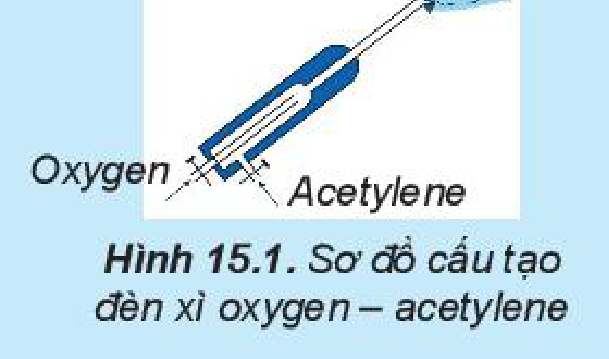

<!-- pdf:72 -->

# BÀI 15: PHẢN ỨNG OXI HOÁ – KHỬ

## 🎯 Mục tiêu

- Nêu được khái niệm và xác định được số oxi hoá của nguyên tử các nguyên tố trong hợp chất.
- Nêu được khái niệm và ý nghĩa của phản ứng oxi hoá – khử.
- Lập được phương trình hoá học của phản ứng oxi hoá – khử bằng phương pháp thăng bằng electron.
- Mô tả được một số phản ứng oxi hoá – khử quan trọng trong cuộc sống.

## 🔴 Mở đầu

Trong lò luyện gang, xảy ra phản ứng oxi hoá – khử theo sơ đồ sau:

$\ce{Fe2O3 + CO ->[t^o] Fe + CO2}$

Về bản chất, phản ứng oxi hoá – khử là gì? Dựa vào dấu hiệu nào để nhận ra loại phản ứng đó? Làm thế nào để lập phương trình hoá học của phản ứng trên?

## I. SỐ OXI HOÁ

### 1. Khái niệm

**Số oxi hoá** là điện tích quy ước của nguyên tử trong phân tử khi coi tất cả các electron liên kết đều chuyển hoàn toàn về nguyên tử có độ âm điện lớn hơn.

Số oxi hoá được viết ở dạng số đại số, dấu viết trước, số viết sau.

*Ví dụ 1:* Xét phân tử $\ce{NaCl}$.

Nguyên tử Na nhường 1 electron cho nguyên tử Cl, khi đó nguyên tử Na trở thành ion dương mang điện tích 1+ (số oxi hoá của Na là +1) và nguyên tử Cl nhận 1 electron của nguyên tử Na trở thành ion âm mang điện tích 1– (số oxi hoá của Cl là –1):

$\overset{+1}{\ce{Na}}\overset{-1}{\ce{Cl}}$

*Ví dụ 2:* Xét phân tử $\ce{H2O}$.

$\ce{H : \underset{\Large ..}{\overset{\Large ..}{O}} : H}$

Độ âm điện của nguyên tử O lớn hơn độ âm điện của nguyên tử H, nếu các cặp electron liên kết chuyển hoàn toàn về nguyên tử O thì nguyên tử O có thêm 2 electron và trở thành ion âm có điện tích 2– (số oxi hoá của O là –2); mỗi nguyên tử H mất đi 1 electron và trở thành ion dương có điện tích 1+ (số oxi hoá của H là +1):

$\overset{+1}{\ce{H}}_2\overset{-2}{\ce{O}}$

*Ví dụ 3:* Xét phân tử $\ce{H2}$.

$\ce{H : H}$

<!-- pdf:73 -->

Hai nguyên tử H giống nhau nên cặp electron liên kết không lệch về nguyên tử nào. Do vậy, mỗi nguyên tử H đều trung hoà điện, có điện tích bằng 0 và số oxi hoá là 0:

$\overset{0}{\ce{H}}_2$

Số oxi hoá thường được dùng để lập phương trình hoá học của phản ứng oxi hoá – khử.

### 2. Quy tắc xác định số oxi hoá

Thông thường, số oxi hoá của nguyên tử được xác định trực tiếp từ công thức phân tử theo các quy tắc sau:

<!-- term: Quy tắc xác định số oxi hoá -->
**Quy tắc 1.** Trong đơn chất, số oxi hoá của nguyên tử bằng 0.

*Ví dụ:* $\overset{0}{\ce{C}} \quad \overset{0}{\ce{Na}} \quad \overset{0}{\ce{H}}_2 \quad \overset{0}{\ce{O}}_2$

<!-- term: Quy tắc xác định số oxi hoá -->
**Quy tắc 2.** Trong phân tử các hợp chất, thông thường số oxi hoá của hydrogen là +1, của oxygen là –2, các kim loại điển hình có số oxi hoá dương và có giá trị bằng số electron hoá trị.

*Bảng 15.1. Số oxi hoá thường gặp của một số nguyên tử trong hợp chất*

| Nguyên tử | Hydrogen | Oxygen | Kim loại kiềm (nhóm IA) | Kim loại kiềm thổ (nhóm IIA) | Aluminium |
|---|---|---|---|---|---|
| Số oxi hoá | +1 | –2 | +1 | +2 | +3 |
<!-- ocr-ok: OCR đọc lỗi tiêu đề cột "Kim loại kiềm" và "Kim loại kiềm thổ" trong Bảng 15.1; đã đối chiếu ảnh -->

<!-- term: Quy tắc xác định số oxi hoá -->
**Quy tắc 3.** Trong hợp chất, tổng số oxi hoá của các nguyên tử trong phân tử bằng 0.

*Ví dụ:* $\overset{+3}{\ce{Al}}_2\overset{-2}{\ce{O}}_3$

Tổng số oxi hoá = $(+3) \cdot 2 + (-2) \cdot 3 = 0$.

<!-- term: Quy tắc xác định số oxi hoá -->
**Quy tắc 4.** Trong ion đơn nguyên tử, số oxi hoá của nguyên tử bằng điện tích ion; trong ion đa nguyên tử, tổng số oxi hoá của các nguyên tử bằng điện tích ion.

*Ví dụ:* $\left[\overset{-3}{\ce{N}}\overset{+1}{\ce{H}}_4\right]^+$

Tổng số oxi hoá = $(-3) + (+1) \cdot 4 = +1$.

**ÁP DỤNG:** Sử dụng các quy tắc này có thể xác định số oxi hoá của một nguyên tử trong hợp chất khi biết số oxi hoá của các nguyên tử còn lại.

*Ví dụ:* Xác định số oxi hoá của nguyên tử C trong phân tử $\ce{CaCO3}$.

Dựa vào Bảng 15.1, biết được số oxi hoá của Ca là +2 và O là –2.

Số oxi hoá của từng nguyên tử: $\overset{+2}{\ce{Ca}}\overset{x}{\ce{C}}\overset{-2}{\ce{O}}_3$

Phân tử $\ce{CaCO3}$ trung hoà điện nên tổng số oxi hoá của các nguyên tử bằng 0:

$(+2) + x + (-2) \cdot 3 = 0$ nên $x = +4$.

<!-- pdf:74 -->

> ❓ 1. Xác định số oxi hoá của nguyên tử Fe và S trong các chất sau:
>
> a) $\ce{Fe}$, $\ce{FeO}$, $\ce{Fe2O3}$, $\ce{Fe(OH)3}$, $\ce{Fe3O4}$.
>
> b) $\ce{S}$, $\ce{H2S}$, $\ce{SO2}$, $\ce{SO3}$, $\ce{H2SO4}$, $\ce{Na2SO3}$.

## II. CHẤT OXI HOÁ, CHẤT KHỬ, PHẢN ỨNG OXI HOÁ – KHỬ

### 1. Chất oxi hoá, chất khử

*Ví dụ 1:* Đưa mẩu than gỗ nóng đỏ vào bình đựng khí $\ce{O2}$, mẩu than cháy sáng.

$\overset{0}{\ce{C}} + \overset{0}{\ce{O}}_2 \ce{->[t^o]} \overset{+4}{\ce{C}}\overset{-2}{\ce{O}}_2$

Trong phản ứng trên, nguyên tử C nhường 4 electron, là chất khử; phân tử $\ce{O2}$ nhận 4 electron, là chất oxi hoá.

$\overset{0}{\ce{C}} \longrightarrow \overset{+4}{\ce{C}} + 4\text{e}$ (quá trình oxi hoá)

$\overset{0}{\ce{O}}_2 + 4\text{e} \longrightarrow 2\overset{-2}{\ce{O}}$ (quá trình khử)

*Ví dụ 2:* Phản ứng đốt cháy methane.

$\overset{-4}{\ce{C}}\overset{+1}{\ce{H}}_4 + 2\overset{0}{\ce{O}}_2 \ce{->[t^o]} \overset{+4}{\ce{C}}\overset{-2}{\ce{O}}_2 + 2\overset{+1}{\ce{H}}_2\overset{-2}{\ce{O}}$

Chất oxi hoá là oxygen, chất khử là methane.

*Ví dụ 3:* Phản ứng khử $\ce{Fe2O3}$ bằng CO để sản xuất gang và thép.

$\overset{+3}{\ce{Fe}}_2\ce{O3} + 3\overset{+2}{\ce{C}}\ce{O} \ce{->[t^o]} 2\overset{0}{\ce{Fe}} + 3\overset{+4}{\ce{C}}\ce{O2}$

Chất oxi hoá là iron(III) oxide, chất khử là carbon monooxide.

***Chất khử*** *là chất nhường electron,* ***chất oxi hoá*** *là chất nhận electron.*

***Quá trình oxi hoá*** *là quá trình chất khử nhường electron,* ***quá trình khử*** *là quá trình chất oxi hoá nhận electron.*

> ✋ Xác định chất oxi hoá, chất khử
>
> *Chuẩn bị:* đinh sắt, dung dịch $\ce{CuSO4}$, dung dịch $\ce{H2SO4}$ loãng, ống nghiệm.
>
> *Thực hiện:*
>
> *Thí nghiệm 1:* Cho đinh sắt vào ống nghiệm đựng dung dịch $\ce{CuSO4}$.
>
> *Thí nghiệm 2:* Cho đinh sắt vào ống nghiệm đựng dung dịch $\ce{H2SO4}$.
>
> *Quan sát hiện tượng và thực hiện yêu cầu sau:*
>
> 1. Viết quá trình oxi hoá, quá trình khử.
> 2. Xác định chất oxi hoá, chất khử trong hai phản ứng trên.

<!-- pdf:75 -->

### 2. Phản ứng oxi hoá – khử

**Phản ứng oxi hoá – khử** là phản ứng hoá học xảy ra đồng thời quá trình nhường electron và quá trình nhận electron.

Dấu hiệu để nhận biết phản ứng oxi hoá – khử là có sự thay đổi số oxi hoá của các nguyên tử.

> ❓ 2. Trong không khí ẩm, $\ce{Fe(OH)2}$ màu trắng xanh chuyển dần sang $\ce{Fe(OH)3}$ màu nâu đỏ theo sơ đồ sau:
>
> $\ce{Fe(OH)2 + O2 + H2O -> Fe(OH)3}$
>
> a) Hãy xác định các nguyên tử có sự thay đổi số oxi hoá.
>
> b) Viết quá trình oxi hoá, quá trình khử.
>
> c) Dùng mũi tên biểu diễn sự chuyển electron từ chất khử sang chất oxi hoá.

## III. LẬP PHƯƠNG TRÌNH HOÁ HỌC CỦA PHẢN ỨNG OXI HOÁ – KHỬ

**Phương pháp thăng bằng electron** được dùng để lập phương trình hoá học của phản ứng oxi hoá – khử theo nguyên tắc:

*Tổng số electron chất khử nhường bằng tổng số electron chất oxi hoá nhận.*

*Ví dụ:* Quá trình Ostwald (Ốt-xvan) dùng để sản xuất nitric acid từ ammonia, được đề xuất vào năm 1902. Ở giai đoạn đầu của quá trình, ammonia bị oxi hoá bởi oxygen ở nhiệt độ cao khi có chất xúc tác:

$\ce{NH3 + O2 ->[t^o, \text{xúc tác}, p] NO + H2O}$

Theo phương pháp thăng bằng electron, phương trình hoá học của phản ứng trên được lập theo các bước như sau:

**Bước 1.** Xác định các nguyên tử có sự thay đổi số oxi hoá, từ đó xác định chất oxi hoá, chất khử:

$\underset{\text{Chất khử}}{\overset{-3}{\ce{N}}\ce{H3}} + \underset{\text{Chất oxi hoá}}{\overset{0}{\ce{O}}_2} \longrightarrow \overset{+2}{\ce{N}}\overset{-2}{\ce{O}} + \ce{H2}\overset{-2}{\ce{O}}$

**Bước 2.** Biểu diễn quá trình oxi hoá, quá trình khử:

$\overset{-3}{\ce{N}} \longrightarrow \overset{+2}{\ce{N}} + 5\text{e}$

$\overset{0}{\ce{O}}_2 + 4\text{e} \longrightarrow 2\overset{-2}{\ce{O}}$

**Bước 3.** Tìm hệ số thích hợp cho chất khử và chất oxi hoá dựa trên nguyên tắc:

Tổng số electron chất khử nhường bằng tổng số electron chất oxi hoá nhận.

$\begin{array}{r|l} 4 \times & \overset{-3}{\ce{N}} \longrightarrow \overset{+2}{\ce{N}} + 5\text{e} \\ 5 \times & \overset{0}{\ce{O}}_2 + 4\text{e} \longrightarrow 2\overset{-2}{\ce{O}} \end{array}$

<!-- pdf:76 -->

**Bước 4.** Đặt hệ số của chất oxi hoá và chất khử vào sơ đồ phản ứng, từ đó tính ra hệ số của các chất khác có mặt trong phương trình hoá học. Kiểm tra sự cân bằng số nguyên tử của các nguyên tố ở hai vế.

$\ce{4NH3 + 5O2 -> 4NO + 6H2O}$

> ❓ 3. Xét các phản ứng hoá học xảy ra trong công nghiệp:
>
> a) $\ce{Al(OH)3 ->[t^o] Al2O3 + H2O}$
>
> b) $\ce{C + CO2 ->[t^o] CO}$
>
> Phản ứng nào là phản ứng oxi hoá – khử? Lập phương trình hoá học của phản ứng oxi hoá – khử theo phương pháp thăng bằng electron.

## IV. PHẢN ỨNG OXI HOÁ – KHỬ TRONG THỰC TIỄN

Trong thực tiễn, phản ứng oxi hoá – khử rất phổ biến, dưới đây là một số trường hợp điển hình.

### 1. Sự cháy

**Phản ứng cháy** là phản ứng oxi hoá – khử xảy ra ở nhiệt độ cao giữa chất cháy và chất oxi hoá.

Trong phản ứng cháy, chất cháy thường là nhiên liệu (than đá, khí thiên nhiên, xăng, dầu,...), còn chất oxi hoá thường là oxygen. Sự cháy kèm theo sự toả nhiệt và phát sáng, tạo ra nhiệt lượng đủ để duy trì sự cháy.

*Ví dụ:* Phản ứng oxi hoá – khử xảy ra khi đốt cháy carbon trong than đá và butane trong khí gas:

$\ce{C + O2 ->[t^o] CO2}$

$\ce{2C4H10 + 13O2 ->[t^o] 8CO2 + 10H2O}$

### 2. Sự han gỉ kim loại

<!-- term: Sự han gỉ kim loại -->
Sau một thời gian sử dụng, nhiều thiết bị, máy móc, vật dụng bằng kim loại thường bị han gỉ do sự oxi hoá bởi oxygen trong không khí. Đặc biệt, nước ta có khí hậu nhiệt đới, độ ẩm cao nên sự han gỉ kim loại xảy ra rất phổ biến.

*Ví dụ:* Trong không khí ẩm, các vật dụng bằng thép bị oxi hoá tạo gỉ sắt.

$\ce{4Fe + 3O2 + xH2O -> 2Fe2O3.xH2O}$

### 3. Sản xuất hoá chất

Trong công nghiệp, phần lớn các phản ứng hoá học xảy ra trong các quy trình sản xuất là phản ứng oxi hoá – khử. *Ví dụ:* Sulfuric acid là hoá chất quan trọng trong công nghiệp, được sản xuất chủ yếu từ sulfur hoặc quặng pyrite.

<!-- pdf:77 -->

Sơ đồ phản ứng:

$\left. \begin{array}{l} \ce{S ->[+O2, t^o]} \\ \ce{FeS2 ->[+O2, t^o]} \end{array} \right\} \ce{SO2 ->[+O2, xt, t^o] SO3 ->[+H2O] H2SO4}$

### 4. Chuyển hoá các chất trong tự nhiên

Trong tự nhiên cũng xảy ra rất nhiều quá trình kèm theo phản ứng oxi hoá – khử. *Ví dụ:*

*Lúa chiêm lấp ló đầu bờ*

*Hễ nghe tiếng sấm phất cờ mà lên*

*(Ca dao Việt Nam)*

Đây là hiện tượng cây lúa phát triển nhanh khi có những cơn mưa rào đầu tiên kèm theo sấm sét vào khoảng cuối mùa xuân.

Tia sét tạo ra tia lửa điện, là điều kiện cho nitrogen phản ứng với oxygen:

$\ce{N2 + O2 ->[\text{tia lửa điện}] 2NO}$

Khí NO sinh ra nhanh chóng chuyển hoá thành $\ce{NO2}$, sau đó tiếp tục bị oxi hoá thành $\ce{HNO3}$:

$\ce{2NO + O2 -> 2NO2}$

$\ce{4NO2 + O2 + 2H2O -> 4HNO3}$

Nitric acid tan vào nước mưa và chuyển hoá thành gốc nitrate ($\ce{NO3-}$), cung cấp chất đạm cho cây lúa. Nhờ quá trình trên, hằng năm một lượng lớn phân đạm tự nhiên được bổ sung cho đất.

> ❓ 4. Nêu một số phản ứng oxi hoá – khử có lợi và có hại trong thực tế.
>
> 5. Lập phương trình hoá học của các phản ứng trong quá trình sản xuất sulfuric acid theo sơ đồ mục IV.3. Trong các phản ứng đó, phản ứng nào là phản ứng oxi hoá – khử?
>
> 6. Đèn xì oxygen – acetylene có cấu tạo gồm hai ống dẫn khí: một ống dẫn khí oxygen, một ống dẫn khí acetylene (Hình 15.1). Khi đèn hoạt động, hai khí này được trộn vào nhau để thực hiện phản ứng đốt cháy theo sơ đồ:
>
>    $\ce{C2H2 + O2 ->[t^o] CO2 + H2O}$
>
>    
>
>    Hình 15.1. Sơ đồ cấu tạo đèn xì oxygen – acetylene
>
>    Phản ứng toả nhiệt lớn, tạo ra ngọn lửa có nhiệt độ đạt đến 3 000 °C nên được dùng để hàn cắt kim loại.
>
>    Hãy xác định chất oxi hoá, chất khử và lập phương trình hoá học của phản ứng trên theo phương pháp thăng bằng electron.

<!-- pdf:78 -->

> 7. Trong quá trình luyện gang từ quặng chứa $\ce{Fe2O3}$, ban đầu không khí nóng được nén vào lò cao, đốt cháy hoàn toàn than cốc kèm theo toả nhiệt mạnh:
>
>    $\ce{C + O2 ->[t^o] CO2}$
>
>    Khí $\ce{CO2}$ đi lên phía trên, gặp các lớp than cốc và bị khử thành CO:
>
>    $\ce{CO2 + C ->[t^o] CO}$
>
>    Tiếp đó, khí CO khử $\ce{Fe2O3}$ thành Fe theo phản ứng tổng quát:
>
>    $\ce{Fe2O3 + CO ->[t^o] Fe + CO2}$
>
>    Lập các phương trình hoá học ở trên, chỉ rõ chất oxi hoá, chất khử.

### 5. Xác định nồng độ một chất bằng phản ứng oxi hoá – khử

Trong thực tế, dung dịch thuốc tím ($\ce{KMnO4}$) được sử dụng phổ biến như một tác nhân oxi hoá mạnh để xác định hàm lượng các chất khử như iron(II), hydrogen peroxide, oxalic acid,...

*Ví dụ:* Trong quá trình bảo quản, một mẫu iron(II) sulfate bị oxi hoá một phần thành hợp chất iron(III). Hàm lượng iron(II) sulfate còn lại trong mẫu được xác định thông qua phản ứng với dung dịch thuốc tím có nồng độ đã biết:

$\ce{10FeSO4 + 2KMnO4 + 8H2SO4 -> 5Fe2(SO4)3 + K2SO4 + 2MnSO4 + 8H2O}$

## 📌 Em đã học

- Số oxi hoá là điện tích quy ước của nguyên tử và được tính theo các quy tắc xác định số oxi hoá.
- Chất khử là chất nhường electron, chất oxi hoá là chất nhận electron.
- Bản chất của phản ứng oxi hoá – khử:

  Quá trình khử: Chất oxi hoá 1 → Chất khử 1

  Chất oxi hoá 1 + Chất khử 2 $\longrightarrow$ Chất khử 1 + Chất oxi hoá 2

  Quá trình oxi hoá: Chất khử 2 → Chất oxi hoá 2
- Nguyên tắc lập phương trình hoá học của phản ứng oxi hoá – khử theo phương pháp thăng bằng electron:

  $\sum$ số electron chất khử nhường = $\sum$ số electron chất oxi hoá nhận.
- Các phản ứng oxi hoá – khử xảy ra phổ biến trong thực tiễn: sự cháy, sự han gỉ của kim loại, sản xuất hoá chất, chuyển hoá nitrogen trong tự nhiên,...

## ✏️ Em có thể

Sử dụng phương trình hoá học của phản ứng oxi hoá – khử để giải thích một số quá trình liên quan trong thực tiễn.

## 📷 Danh sách hình trong bài

| Mã hình | Trang PDF | Vị trí | Chú thích gốc |
|---|---|---|---|
| H10-hoa-b15-01 | 77 | Mục IV.4, hộp câu hỏi 6 (nằm trong hộp câu hỏi nền xanh lam nên cạnh khung cắt qua màu nền hộp) | Hình 15.1. Sơ đồ cấu tạo đèn xì oxygen – acetylene |
