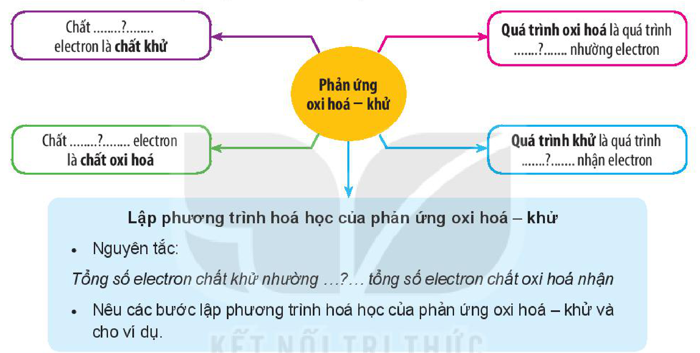

<!-- pdf:79 -->

# BÀI 16: ÔN TẬP CHƯƠNG 4

## I. HỆ THỐNG HOÁ KIẾN THỨC

Hoàn thành các nội dung còn thiếu sau đây:

- **Phản ứng oxi hoá – khử**
  - Chất .......?....... electron là **chất khử**
  - Chất .......?....... electron là **chất oxi hoá**
  - **Quá trình oxi hoá** là quá trình .......?....... nhường electron
  - **Quá trình khử** là quá trình .......?....... nhận electron
  <!-- ocr-ok: sơ đồ tư duy 4 nhánh quanh nút trung tâm "Phản ứng oxi hoá – khử", OCR đọc lẫn hai cột; đã đối chiếu ảnh -->
  - **Lập phương trình hoá học của phản ứng oxi hoá – khử**
    - Nguyên tắc:

      *Tổng số electron chất khử nhường ...?... tổng số electron chất oxi hoá nhận*
    - Nêu các bước lập phương trình hoá học của phản ứng oxi hoá – khử và cho ví dụ.

## II. LUYỆN TẬP

Câu 1. Trong phản ứng oxi hoá – khử, chất oxi hoá là chất

A. nhận electron. B. nhường proton.

C. nhường electron. D. nhận proton.

Câu 2. Trong phản ứng hoá học: $\ce{Fe + H2SO4 -> FeSO4 + H2}$, mỗi nguyên tử Fe đã

A. nhường 2 electron. B. nhận 2 electron.

C. nhường 1 electron. D. nhận 1 electron.

Câu 3. Trong phản ứng hoá học: $\ce{2Na + 2H2O -> 2NaOH + H2}$, chất oxi hoá là

A. $\ce{H2O}$. B. $\ce{NaOH}$. C. $\ce{Na}$. D. $\ce{H2}$.

Câu 4. Cho nước $\ce{Cl2}$ vào dung dịch $\ce{NaBr}$ xảy ra phản ứng hoá học:

$\ce{Cl2 + 2NaBr -> 2NaCl + Br2}$

Trong phản ứng hoá học trên, xảy ra quá trình oxi hoá chất nào?

A. $\ce{NaCl}$. B. $\ce{Br2}$. C. $\ce{Cl2}$. D. $\ce{NaBr}$.

<!-- pdf:80 -->

Câu 5. Xét các phản ứng hoá học xảy ra trong các quá trình sau:

a) Luyện gang từ quặng hematite đỏ:

$\ce{Fe2O3 + CO ->[t^o] FeO + CO2} \qquad \ce{FeO + CO ->[t^o] Fe + CO2}$

b) Luyện zinc (kẽm) từ quặng blend:

$\ce{ZnS + O2 ->[t^o] ZnO + SO2} \qquad \ce{ZnO + C ->[t^o] Zn + CO}$

c) Sản xuất xút, chlorine từ dung dịch muối ăn:

$\ce{NaCl + H2O ->[\text{điện phân dung dịch}][\text{có màng ngăn xốp}] NaOH + Cl2 + H2}$

d) Đốt cháy ethanol có trong xăng E5:

$\ce{C2H5OH + O2 ->[t^o] CO2 + H2O}$

Hãy chỉ ra các phản ứng oxi hoá – khử, lập phương trình hoá học của các phản ứng đó theo phương pháp thăng bằng electron và chỉ rõ chất oxi hoá, chất khử.

Câu 6. Xét phản ứng trong giai đoạn đầu của quá trình Ostwald:

$\ce{NH3 + O2 -> NO + H2O}$

Trong công nghiệp, cần trộn 1 thể tích khí ammonia với bao nhiêu thể tích không khí để thực hiện phản ứng trên? Biết không khí chứa 21% thể tích oxygen và các thể tích khí đo ở cùng điều kiện về nhiệt độ và áp suất.

Câu 7. Copper(II) sulfate được dùng để diệt tảo, rong rêu trong nước bể bơi; dùng để pha chế thuốc Bordaux (trừ bệnh mốc sương trên cây cà chua, khoai tây; bệnh thối thân trên cây ăn quả, cây công nghiệp);...

Trong công nghiệp, copper(II) sulfate thường được sản xuất bằng cách ngâm đồng phế liệu trong dung dịch sulfuric acid loãng và sục không khí:

$\ce{Cu + O2 + H2SO4 -> CuSO4 + H2O} \qquad (1)$

a) Lập phương trình hoá học của phản ứng (1) theo phương pháp thăng bằng electron, chỉ rõ chất oxi hoá, chất khử.

b) Copper(II) sulfate còn được điều chế bằng cách cho đồng phế liệu tác dụng với sulfuric acid đặc, nóng:

$\ce{Cu + H2SO4(\text{đặc}) ->[t^o] CuSO4 + SO2 + H2O} \qquad (2)$

Trong hai cách trên, cách nào sử dụng ít sulfuric acid hơn, cách nào ít gây ô nhiễm môi trường hơn?

## 📷 Danh sách hình trong bài

| Mã hình | Trang PDF | Vị trí | Chú thích gốc |
|---|---|---|---|
| H10-hoa-b16-01 | 79 | Mục I (sơ đồ hệ thống hoá kiến thức chương 4) | (sách không đánh số, không có chú thích) |
