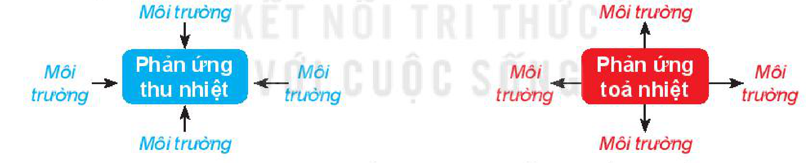
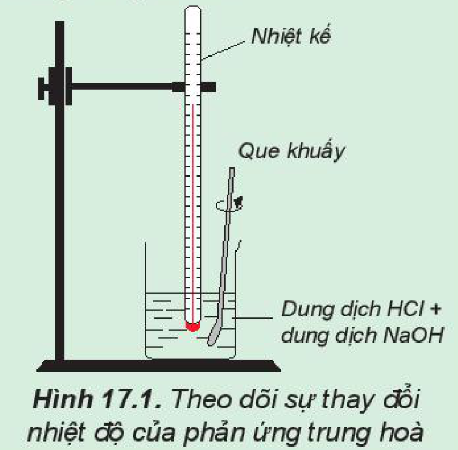
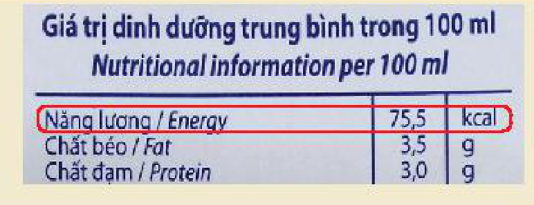
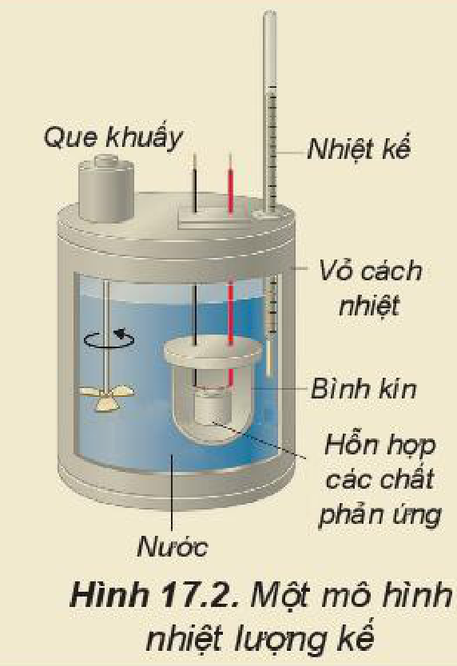

<!-- pdf:82 -->

# BÀI 17: BIẾN THIÊN ENTHALPY TRONG CÁC PHẢN ỨNG HOÁ HỌC

## 🎯 Mục tiêu

- Trình bày được khái niệm phản ứng toả nhiệt, thu nhiệt; điều kiện chuẩn; nhiệt tạo thành và biến thiên enthalpy (nhiệt phản ứng) của phản ứng.
- Nêu được ý nghĩa của dấu và giá trị của biến thiên enthalpy chuẩn.
- Tính được biến thiên enthalpy chuẩn của một số phản ứng theo năng lượng liên kết, nhiệt tạo thành.

## 🔴 Mở đầu

Phản ứng giữa đường glucose với oxygen tạo ra carbon dioxide, hơi nước và toả nhiều nhiệt. Sau khi chơi thể thao, cơ thể mệt mỏi, nghỉ ngơi một vài phút, sau đó nếu uống một cốc nước hoa quả, em sẽ cảm thấy khoẻ hơn. Có phải đường glucose đã "cháy" và cấp bù năng lượng cho cơ thể?

## I. PHẢN ỨNG TOẢ NHIỆT, PHẢN ỨNG THU NHIỆT

Khi các phản ứng hoá học xảy ra thường có sự trao đổi nhiệt với môi trường, làm thay đổi nhiệt độ môi trường.

**Phản ứng toả nhiệt** là phản ứng giải phóng năng lượng dưới dạng nhiệt.

**Phản ứng thu nhiệt** là phản ứng hấp thụ năng lượng dưới dạng nhiệt.

- Phản ứng thu nhiệt: Môi trường → Phản ứng thu nhiệt
- Phản ứng toả nhiệt: Phản ứng toả nhiệt → Môi trường
<!-- ocr-ok: nhãn các mũi tên trên sơ đồ phản ứng thu nhiệt và phản ứng toả nhiệt; đã đối chiếu ảnh -->

*Ví dụ:* Vào những ngày trời lạnh, nhiều người hay ngồi bên bếp lửa để sưởi. Khi than, củi cháy, không khí xung quanh ấm hơn do phản ứng toả nhiệt. Những lúc nóng nực, pha viên sủi vitamin C vào nước để giải khát, khi viên sủi tan, thấy nước trong cốc mát hơn, đó là do xảy ra phản ứng thu nhiệt.

Khi nung vôi, người ta sử dụng phản ứng đốt cháy than để cung cấp nhiệt cho phản ứng phân huỷ đá vôi. Phản ứng đốt than là phản ứng toả nhiệt, phản ứng phân huỷ đá vôi là phản ứng thu nhiệt.

> ❓ 1. Khi đun nóng ống nghiệm đựng $\ce{KMnO4}$ (thuốc tím), nhiệt của ngọn lửa làm cho $\ce{KMnO4}$ bị nhiệt phân, tạo hỗn hợp bột màu đen:
>
> $\ce{2KMnO4(s) -> K2MnO4(s) + MnO2(s) + O2(g)}$
>
> Em hãy dự đoán phản ứng này toả nhiệt hay thu nhiệt.

<!-- pdf:83 -->

> ✋ Theo dõi sự thay đổi nhiệt độ của phản ứng trung hoà
>
> *Chuẩn bị:* dung dịch $\ce{HCl}$ 0,5 M, dung dịch $\ce{NaOH}$ 0,5 M, 1 cốc 250 mL, giá treo nhiệt kế, nhiệt kế (có dải đo đến 100 °C), que khuấy và 2 ống đong 50 mL.
>
> *Tiến hành:*
>
> - Dùng ống đong lấy 50 mL dung dịch $\ce{HCl}$ 0,5 M cho vào cốc phản ứng, lắp nhiệt kế lên giá sao cho đầu nhiệt kế nhúng vào dung dịch trong cốc (Hình 17.1). Đọc nhiệt độ dung dịch.
> - Dùng ống đong khác lấy 50 mL dung dịch $\ce{NaOH}$ 0,5 M cho vào cốc phản ứng. Khuấy nhẹ.
>
> 
>
> Hình 17.1. Theo dõi sự thay đổi nhiệt độ của phản ứng trung hoà
>
> *Theo dõi sự thay đổi nhiệt độ của dung dịch và trả lời câu hỏi:*
>
> 1. Nhiệt độ trên nhiệt kế thay đổi như thế nào sau khi rót dung dịch $\ce{NaOH}$ vào cốc? Phản ứng trung hoà là phản ứng toả nhiệt hay thu nhiệt?
> 2. Trong thí nghiệm trên, nếu thay các dung dịch $\ce{HCl}$ và $\ce{NaOH}$ bằng các dung dịch loãng hơn thì nhiệt độ thay đổi như thế nào so với thí nghiệm trên?

> 💡 EM CÓ BIẾT
>
> Sự đốt cháy các loại nhiên liệu như xăng, dầu, cồn, khí gas,... xảy ra nhanh, toả nhiều nhiệt, dễ gây hoả hoạn, thậm chí gây nổ mạnh, rất khó kiểm soát. Vì vậy, khi sử dụng chúng cần tuân thủ nghiêm ngặt các nguyên tắc phòng cháy.

## II. BIẾN THIÊN ENTHALPY CỦA PHẢN ỨNG

### 1. Biến thiên enthalpy

Hầu hết các quá trình hoá học trong thực tế xảy ra ở điều kiện áp suất không đổi. Nhiệt lượng toả ra hay thu vào của phản ứng ở điều kiện này gọi là **biến thiên enthalpy của phản ứng** (**nhiệt phản ứng**), kí hiệu là $\Delta_r H^{(*)}$.

Phương trình hoá học kèm theo trạng thái của các chất và giá trị $\Delta_r H$ gọi là **phương trình nhiệt hoá học**.

*Ví dụ 1:* Phản ứng đốt cháy 2 mol khí hydrogen bằng 1 mol khí oxygen, tạo thành 2 mol nước ở trạng thái lỏng, toả ra nhiệt lượng 571,6 kJ. Phản ứng trên có biến thiên enthalpy $\Delta_r H^0_{298} = -571,6\text{ kJ}$, biểu diễn bằng phương trình nhiệt hoá học như sau:

$\ce{2H2(g) + O2(g) -> 2H2O(l)} \qquad \Delta_r H^0_{298} = -571,6\text{ kJ}$

> (\*) $\Delta_r H$ là biến thiên enthalpy của phản ứng (nhiệt phản ứng). Chữ "r" là viết tắt của từ tiếng Anh *reaction*, nghĩa là phản ứng.

<!-- pdf:84 -->

*Ví dụ 2:* Phản ứng nhiệt phân hoàn toàn 1 mol $\ce{Cu(OH)2}$, tạo thành 1 mol $\ce{CuO}$ và 1 mol $\ce{H2O}$, thu vào nhiệt lượng 9,0 kJ. Phản ứng trên có biến thiên enthalpy $\Delta_r H^0_{298} = +9,0\text{ kJ}$ và biểu diễn bằng phương trình nhiệt hoá học như sau:

$\ce{Cu(OH)2(s) ->[t^o] CuO(s) + H2O(l)} \qquad \Delta_r H^0_{298} = +9,0\text{ kJ}$

### 2. Biến thiên enthalpy chuẩn

Biến thiên enthalpy của các phản ứng phụ thuộc vào điều kiện xảy ra phản ứng (như nhiệt độ, áp suất) và trạng thái vật lí của các chất. Để so sánh biến thiên enthalpy của các phản ứng khác nhau thì cần xác định chúng ở cùng một điều kiện. **Biến thiên enthalpy chuẩn** là nhiệt toả ra hay thu vào của phản ứng được xác định ở **điều kiện chuẩn**: áp suất 1 bar (đối với chất khí), nồng độ 1 mol/L (đối với chất tan trong dung dịch) và nhiệt độ thường được chọn là 25 °C (298 K), kí hiệu $\Delta_r H^0_{298}$.

*Ví dụ:* Phản ứng đốt cháy hoàn toàn 1 mol carbon graphite trong khí oxygen dư (ở điều kiện chuẩn) tạo ra 1 mol $\ce{CO2}$, nhiệt lượng toả ra là 393,5 kJ. Phương trình nhiệt hoá học của phản ứng được viết như sau:

$\ce{C(graphite) + O2(g) ->[t^o] CO2(g)} \qquad \Delta_r H^0_{298} = -393,5\text{ kJ}$

### 3. Ý nghĩa của biến thiên enthalpy

Dấu của biến thiên enthalpy cho biết phản ứng toả nhiệt hay thu nhiệt:

$\Delta_r H > 0$: phản ứng thu nhiệt.

$\Delta_r H < 0$: phản ứng toả nhiệt.

Giá trị tuyệt đối của biến thiên enthalpy càng lớn thì nhiệt lượng toả ra hay thu vào của phản ứng càng nhiều.

*Ví dụ:* Xét 2 phản ứng

$\ce{CH4(g) + 2O2(g) ->[t^o] CO2(g) + 2H2O(l)} \qquad \Delta_r H^0_{298} = -890\text{ kJ/mol}$

$\ce{CH3OH(l) + \frac{3}{2}O2(g) ->[t^o] CO2(g) + 2H2O(l)} \qquad \Delta_r H^0_{298} = -726\text{ kJ/mol}$

Vậy, khi đốt 1 mol methane (16 g) toả ra nhiệt lượng nhiều hơn đốt 1 mol methanol (32 g).

Các phản ứng xảy ra ở nhiệt độ phòng thường là phản ứng toả nhiệt, các phản ứng thu nhiệt thường xảy ra khi đun nóng.

> ❓ 2. Cho các phương trình nhiệt hoá học:
>
> (1) $\ce{CaCO3(s) -> CaO(s) + CO2(g)} \qquad \Delta_r H^0_{298} = +176,0\text{ kJ}$
>
> (2) $\ce{C2H4(g) + H2(g) -> C2H6(g)} \qquad \Delta_r H^0_{298} = -137,0\text{ kJ}$
>
> (3) $\ce{Fe2O3(s) + 2Al(s) -> Al2O3(s) + 2Fe(s)} \qquad \Delta_r H^0_{298} = -851,5\text{ kJ}$
>
> Trong các phản ứng trên, phản ứng nào toả nhiệt, phản ứng nào thu nhiệt?
>
> 3. Biết phản ứng đốt cháy khí carbon monoxide (CO) như sau:
>
> $\ce{CO(g) + \frac{1}{2}O2(g) -> CO2(g)} \qquad \Delta_r H^0_{298} = -283,0\text{ kJ}$

<!-- pdf:85 -->

> Ở điều kiện chuẩn, nếu đốt cháy hoàn toàn 2,479 L khí CO thì nhiệt lượng toả ra là bao nhiêu?
>
> 4. Phản ứng tôi vôi toả ra nhiệt lượng rất lớn, có thể làm sôi nước. Hãy nêu các biện pháp để đảm bảo an toàn khi thực hiện quá trình tôi vôi.

> 💡 EM CÓ BIẾT
>
> Trên các vỏ hộp thực phẩm thường ghi giá trị năng lượng – đó là năng lượng do một lượng thực phẩm nhất định cung cấp khi chuyển hoá hoàn toàn trong cơ thể.
>
> 

## III. TÍNH BIẾN THIÊN ENTHALPY CỦA PHẢN ỨNG THEO NHIỆT TẠO THÀNH

### 1. Khái niệm nhiệt tạo thành

**Nhiệt tạo thành** ($\Delta_f H$)$^{(*)}$ của một chất là biến thiên enthalpy của phản ứng tạo thành 1 mol chất đó từ các đơn chất ở dạng bền vững nhất, ở một điều kiện xác định.

**Nhiệt tạo thành chuẩn** ($\Delta_f H^0_{298}$) là nhiệt tạo thành ở điều kiện chuẩn.

Nhiệt tạo thành chuẩn của các đơn chất ở dạng bền vững nhất bằng không, ví dụ:

$\Delta_f H^0_{298}(\ce{O2(g)}) = 0\text{ kJ/mol}$.

*Ví dụ 1:* Nước lỏng được tạo thành từ khí hydrogen và khí oxygen theo phản ứng:

$\ce{H2(g) + \frac{1}{2}O2(g) -> H2O(l)}$

Ở điều kiện chuẩn, cứ 1 mol $\ce{H2O(l)}$ tạo thành từ 1 mol $\ce{H2(g)}$ và $\frac{1}{2}$ mol $\ce{O2(g)}$ giải phóng nhiệt lượng là 285,8 kJ.

Như vậy nhiệt tạo thành của nước lỏng:

$\Delta_f H^0_{298}(\ce{H2O(l)}) = -285,8\text{ kJ/mol}$.

*Ví dụ 2:* Phản ứng $\ce{\frac{1}{2}N2(g) + \frac{1}{2}O2(g) -> NO(g)}$

có biến thiên enthalpy: $\Delta_f H^0_{298}(\ce{NO(g)}) = +90,3\text{ kJ/mol}$. Giá trị $\Delta_f H^0_{298} > 0$, tức phản ứng này là phản ứng thu nhiệt.

> (\*) $\Delta_f H$ là nhiệt tạo thành (chữ f viết tắt của từ tiếng Anh “formation”, nghĩa là tạo thành).

<!-- pdf:86 -->

*Bảng 17.1. Nhiệt tạo thành chuẩn của một số chất thường gặp$^{(*)}$*

| Chất | $\Delta_f H^0_{298}\text{ (kJ/mol)}$ | Chất | $\Delta_f H^0_{298}\text{ (kJ/mol)}$ |
|---|---|---|---|
| $\ce{AgCl(s)}$ | –127,0 | $\ce{HCl(g)}$ | –92,3 |
| $\ce{BaCl2(s)}$ | –806,1 | $\ce{HI(g)}$ | +25,9 |
| $\ce{BaSO4(s)}$ | –1 465,0 | $\ce{H2O(l)}$ | –285,8 |
| $\ce{CaCl2(s)}$ | –795,0 | $\ce{H2O(g)}$ | –241,8 |
| $\ce{CaCO3(s)}$ | –1 206,9 | $\ce{KCl(s)}$ | –436,7 |
| $\ce{CaO(s)}$ | –635,1 | $\ce{KOH(s)}$ | –424,8 |
| $\ce{CH4(g)}$ | –74,9 | $\ce{Fe2O3(s)}$ | –825,5 |
| $\ce{C2H6(g)}$ | –84,7 | $\ce{NaCl(s)}$ | –411,1 |
| $\ce{C2H2(g)}$ | +227,0 | $\ce{NaOH(s)}$ | –425,6 |
| $\ce{CO(g)}$ | –110,5 | $\ce{NH3(g)}$ | –45,9 |
| $\ce{CO2(g)}$ | –393,5 | $\ce{O3(g)}$ | +143,0 |
| $\ce{Ca(OH)2(s)}$ | –986,1 | $\ce{SO2(g)}$ | –296,8 |
| $\ce{HBr(g)}$ | –36,3 | $\ce{SO3(l)}$ | –441,0 |
<!-- ocr-ok: Bảng 17.1 có nhiều công thức và số âm, OCR đọc thiếu dấu trừ và lệch chỉ số; đã đối chiếu ảnh -->

### 2. Tính biến thiên enthalpy của phản ứng theo nhiệt tạo thành

Biến thiên enthalpy của phản ứng được xác định bằng hiệu số giữa tổng nhiệt tạo thành các chất sản phẩm (sp) và tổng nhiệt tạo thành của các chất đầu (cđ).

Ở điều kiện chuẩn:

$\Delta_r H^0_{298} = \sum \Delta_f H^0_{298}(\text{sp}) - \sum \Delta_f H^0_{298}(\text{cđ})$

Trong tính toán cần lưu ý đến hệ số của các chất trong phương trình hoá học.

*Ví dụ 1:* Xác định biến thiên enthalpy của phản ứng sau ở điều kiện chuẩn:

$\ce{SO2(g) + \frac{1}{2}O2(g) -> SO3(l)}$

biết nhiệt tạo thành $\Delta_f H^0_{298}$ của $\ce{SO2(g)}$ là –296,8 kJ/mol, của $\ce{SO3(l)}$ là –441,0 kJ/mol.

*Lời giải:*

$\Delta_r H^0_{298} = \Delta_f H^0_{298}(\ce{SO3(l)}) - \left[\Delta_f H^0_{298}(\ce{SO2(g)}) + \frac{1}{2}\Delta_f H^0_{298}(\ce{O2(g)})\right] = -441,0 - \left(-296,8 + 0 \cdot \frac{1}{2}\right) = -144,2\text{ (kJ)}$.

> (\*) Nguồn: Silberberg, Martin. (2018). *Chemistry: the molecular nature of matter and change with advanced topics*. McGraw-Hill Education.
<!-- ocr-ok: chú thích chân trang tiếng Anh cỡ chữ nhỏ, OCR đọc sai "Martin", "with", "topics"; đã đối chiếu ảnh -->

<!-- pdf:87 -->

*Ví dụ 2:* Xác định biến thiên enthalpy của phản ứng sau ở điều kiện chuẩn:

$\ce{4FeS2(s) + 11O2(g) -> 2Fe2O3(s) + 8SO2(g)}$

biết nhiệt tạo thành $\Delta_f H^0_{298}$ của các chất $\ce{FeS2(s)}$, $\ce{Fe2O3(s)}$ và $\ce{SO2(g)}$ lần lượt là –177,9 kJ/mol, –825,5 kJ/mol và –296,8 kJ/mol.

*Lời giải:*

Tổng nhiệt tạo thành các chất đầu là:

$\sum \Delta_f H^0_{298}(\text{cđ}) = \Delta_f H^0_{298}(\ce{FeS2(s)}) \cdot 4 + \Delta_f H^0_{298}(\ce{O2(g)}) \cdot 11 = (-177,9) \cdot 4 + 0 \cdot 11 = -711,6\text{ (kJ)}$

Tổng nhiệt tạo thành các chất sản phẩm là:

$\sum \Delta_f H^0_{298}(\text{sp}) = \Delta_f H^0_{298}(\ce{Fe2O3(s)}) \cdot 2 + \Delta_f H^0_{298}(\ce{SO2(g)}) \cdot 8 = (-825,5) \cdot 2 + (-296,8) \cdot 8 = -4\,025,4\text{ (kJ)}$

Vậy, biến thiên enthalpy của phản ứng:

$\Delta_r H^0_{298} = \sum \Delta_f H^0_{298}(\text{sp}) - \sum \Delta_f H^0_{298}(\text{cđ}) = -4\,025,4 - (-711,6) = -3\,313,8\text{ (kJ)}$

> 💡 EM CÓ BIẾT
>
> <!-- term: Định luật Hess -->
> Từ các nghiên cứu thực nghiệm, năm 1840, nhà hoá học người Thuỵ Sĩ là G. Hess (He-xơ) đã đề xuất một định luật về sau mang tên ông, trong đó nói rằng những sự thay đổi năng lượng trong một quá trình hoá học chỉ phụ thuộc vào trạng thái của các chất ban đầu và sản phẩm mà không phụ thuộc vào cách phản ứng xảy ra và các sản phẩm trung gian.
>
> Dựa vào định luật Hess, các nhà khoa học đã thu thập các số liệu thực nghiệm của các phản ứng cơ bản như nhiệt tạo thành, nhiệt cháy, năng lượng liên kết,… đưa vào các tài liệu tra cứu. Từ các số liệu thực nghiệm này, ta có thể tính được các đại lượng của các phản ứng khác mà không cần tiến hành thí nghiệm.

> ❓ 5. Cho phản ứng:
>
> $\ce{C(\text{kim cương}) -> C(graphite)} \qquad \Delta_r H^0_{298} = -1,9\text{ kJ}$
>
> a) Ở điều kiện chuẩn, kim cương hay graphite có mức năng lượng thấp hơn?
>
> b) Trong phản ứng xác định nhiệt tạo thành của $\ce{CO2(g)}$: $\ce{C(s) + O2(g) -> CO2(g)}$, carbon ở dạng kim cương hay graphite?
>
> 6. Từ số liệu Bảng 17.1, hãy xác định biến thiên enthalpy chuẩn của phản ứng đốt cháy ethane:
>
> $\ce{C2H6(g) + \frac{7}{2}O2(g) ->[t^o] 2CO2(g) + 3H2O(l)}$

## IV. TÍNH BIẾN THIÊN ENTHALPY CỦA PHẢN ỨNG THEO NĂNG LƯỢNG LIÊN KẾT

Phản ứng hoá học là quá trình phá vỡ các liên kết trong chất đầu và hình thành các liên kết mới để tạo thành sản phẩm. Sự phá vỡ liên kết cần cung cấp năng lượng, trong khi sự hình thành liên kết lại giải phóng năng lượng. Biến thiên enthalpy của phản ứng (mà các chất đều ở thể khí), bằng hiệu số giữa tổng năng lượng liên kết của các

<!-- pdf:88 -->

chất đầu và tổng năng lượng liên kết của các sản phẩm (ở cùng điều kiện nhiệt độ và áp suất).

Ở điều kiện chuẩn:

$\Delta_r H^0_{298} = \sum E_b(\text{cđ}) - \sum E_b(\text{sp})$

*Ví dụ 1:* Tính biến thiên enthalpy chuẩn của phản ứng

$\ce{H2(g) + Cl2(g) -> 2HCl(g)}$

biết $E_b(\ce{H-H}) = 436\text{ kJ/mol}$, $E_b(\ce{Cl-Cl}) = 243\text{ kJ/mol}$, $E_b(\ce{H-Cl}) = 432\text{ kJ/mol}$.

*Lời giải:*

Biến thiên enthalpy chuẩn của phản ứng là:

$\Delta_r H^0_{298} = E_b(\ce{H-H}) + E_b(\ce{Cl-Cl}) - 2 \cdot E_b(\ce{H-Cl}) = 436 + 243 - 2 \cdot 432 = -185\text{ (kJ)}$

Phản ứng toả nhiệt vì khi tạo thành 2 liên kết $\ce{H-Cl}$ toả ra năng lượng lớn hơn năng lượng cần thiết để phá vỡ liên kết $\ce{H-H}$ và $\ce{Cl-Cl}$.

*Ví dụ 2:* Xác định biến thiên enthalpy chuẩn của phản ứng

$\ce{C2H4(g) + H2(g) -> C2H6(g)}$

biết năng lượng liên kết (ở điều kiện chuẩn):

| Liên kết | $\ce{H-H}$ | $\ce{C-H}$ | $\ce{C-C}$ | $\ce{C=C}$ |
|---|---|---|---|---|
| Phân tử | hydrogen | hydrocarbon | alkane | alkene |
| $E_b\text{ (kJ/mol)}$ | 436 | 418 | 346 | 612 |

*Lời giải:*

$\ce{H-\underset{\underset{\ce{H}}{\displaystyle |}}{\overset{\overset{\ce{H}}{\displaystyle |}}{C}}=\underset{\underset{\ce{H}}{\displaystyle |}}{\overset{\overset{\ce{H}}{\displaystyle |}}{C}}-H + H-H -> H-\underset{\underset{\ce{H}}{\displaystyle |}}{\overset{\overset{\ce{H}}{\displaystyle |}}{C}}-\underset{\underset{\ce{H}}{\displaystyle |}}{\overset{\overset{\ce{H}}{\displaystyle |}}{C}}-H}$

$\Rightarrow \Delta_r H^0_{298} = E_b(\ce{C=C}) + 4E_b(\ce{C-H}) + E_b(\ce{H-H}) - E_b(\ce{C-C}) - 6E_b(\ce{C-H}) = 612 + 4 \cdot 418 + 436 - 346 - 6 \cdot 418 = -134\text{ (kJ)}$

> 💡 EM CÓ BIẾT
>
> **Xác định biến thiên enthalpy bằng thực nghiệm**
>
> Biến thiên enthalpy của phản ứng có thể xác định bằng nhiệt lượng kế (Hình 17.2). Dựa vào kết quả khi xác định sự thay đổi nhiệt độ của nước sẽ tính được nhiệt lượng đã cho đi (hoặc nhận vào), từ đó xác định được biến thiên enthalpy của phản ứng.
>
> 
>
> Hình 17.2. Một mô hình nhiệt lượng kế

<!-- pdf:89 -->

> ❓ 7.
>
> a) Cho biết năng lượng liên kết trong các phân tử $\ce{O2}$, $\ce{N2}$ và NO lần lượt là 494 kJ/mol, 945 kJ/mol và 607 kJ/mol. Tính biến thiên enthalpy chuẩn của phản ứng:
>
> $\ce{N2(g) + O2(g) -> 2NO(g)}$
>
> b) Giải thích vì sao nitrogen chỉ phản ứng với oxygen ở nhiệt độ cao hoặc khi có tia lửa điện.
>
> 8. Từ số liệu năng lượng liên kết ở Bảng 12.2, hãy tính biến thiên enthalpy của phản ứng đốt cháy butane theo năng lượng liên kết, biết sản phẩm phản ứng đều ở thể khí.

## 📌 Em đã học

- Phản ứng toả nhiệt là phản ứng khi xảy ra kèm theo sự truyền nhiệt từ chất phản ứng ra môi trường.
- Phản ứng thu nhiệt là phản ứng khi xảy ra kèm theo sự truyền nhiệt từ môi trường vào chất phản ứng.
- Biến thiên enthalpy của phản ứng là nhiệt lượng toả ra hay thu vào của phản ứng ở một điều kiện xác định.
- Biểu thức tính biến thiên enthalpy của các phản ứng ở điều kiện chuẩn:
  - Theo nhiệt tạo thành:

    $\Delta_r H^0_{298} = \sum \Delta_f H^0_{298}(\text{sp}) - \sum \Delta_f H^0_{298}(\text{cđ})$.
  - Theo năng lượng liên kết (các chất đều ở thể khí)

    $\Delta_r H^0_{298} = \sum E_b(\text{cđ}) - \sum E_b(\text{sp})$

## ✏️ Em có thể

- Nhận biết được một phản ứng là toả nhiệt hay thu nhiệt.
- Tính được biến thiên enthalpy của một số phản ứng khi biết nhiệt tạo thành hoặc năng lượng liên kết của các chất.

## 📷 Danh sách hình trong bài

| Mã hình | Trang PDF | Vị trí | Chú thích gốc |
|---|---|---|---|
| H10-hoa-b17-01 | 82 | Mục I (sơ đồ phản ứng thu nhiệt và phản ứng toả nhiệt) | (sách không đánh số, không có chú thích) |
| H10-hoa-b17-02 | 83 | Mục I, hộp "Theo dõi sự thay đổi nhiệt độ của phản ứng trung hoà" | Hình 17.1. Theo dõi sự thay đổi nhiệt độ của phản ứng trung hoà |
| H10-hoa-b17-03 | 85 | Mục II.3, hộp "Em có biết" (thông tin dinh dưỡng trên vỏ hộp thực phẩm) | (sách không đánh số, không có chú thích) |
| H10-hoa-b17-04 | 88 | Mục IV, hộp "Em có biết" | Hình 17.2. Một mô hình nhiệt lượng kế |
