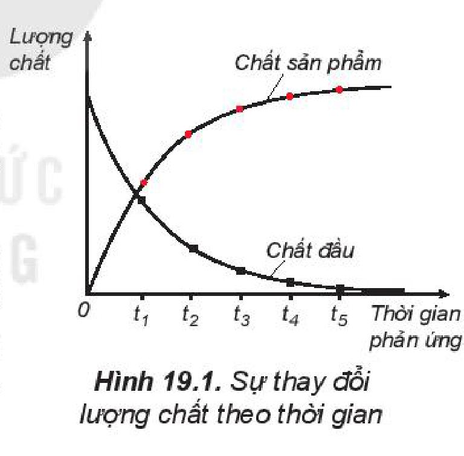
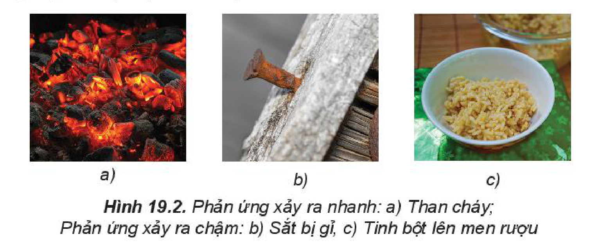
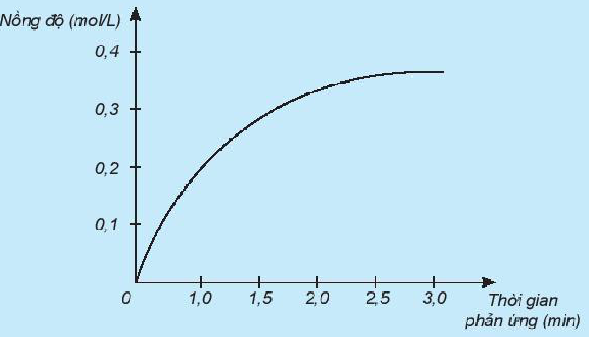
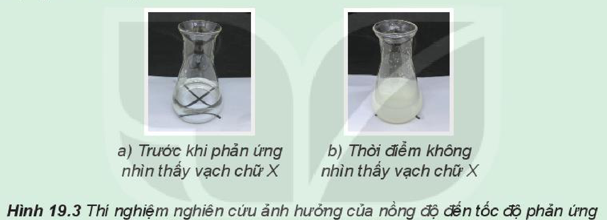
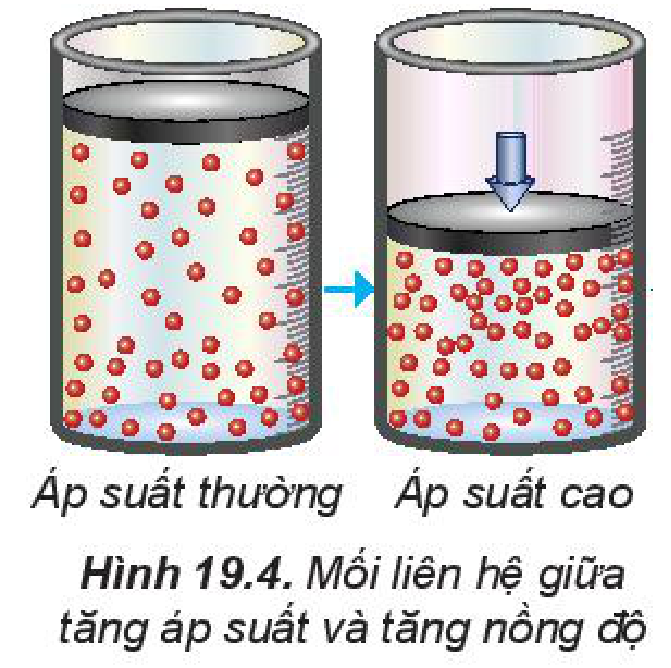
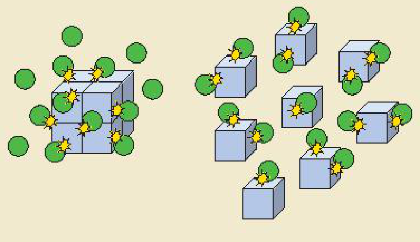
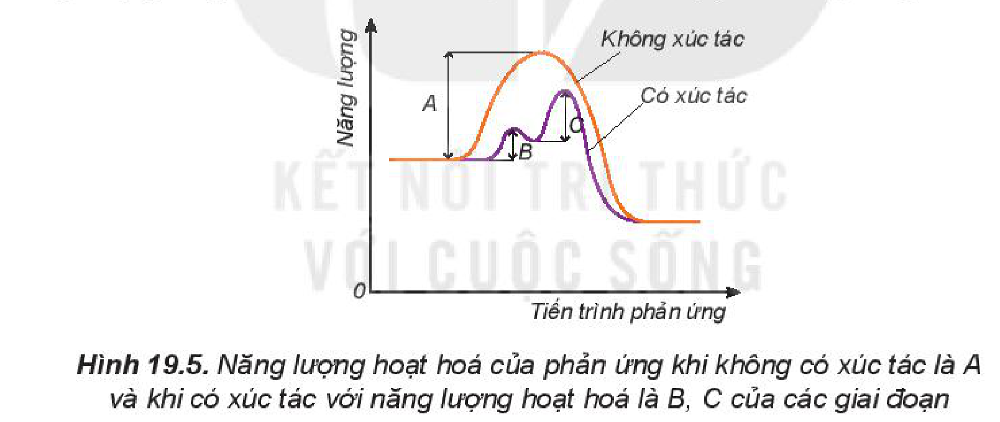
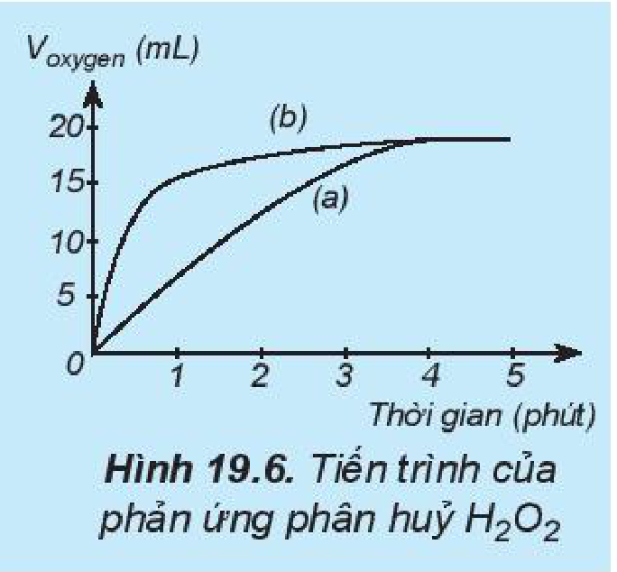
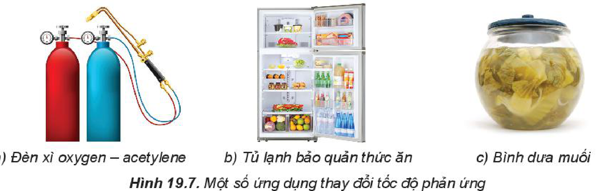

<!-- pdf:93 -->

# BÀI 19: TỐC ĐỘ PHẢN ỨNG

## 🎯 Mục tiêu

- Trình bày được khái niệm tốc độ phản ứng hoá học và cách tính tốc độ trung bình của phản ứng.
- Viết được biểu thức tốc độ phản ứng theo hằng số tốc độ phản ứng và nồng độ (còn gọi là định luật tác dụng khối lượng, chỉ đúng cho phản ứng đơn giản nên không tuỳ ý áp dụng cho mọi phản ứng). Từ đó nêu được ý nghĩa hằng số tốc độ phản ứng.
- Thực hiện được một số thí nghiệm nghiên cứu và giải thích được các yếu tố ảnh hưởng tới tốc độ phản ứng (nồng độ, nhiệt độ, áp suất, diện tích bề mặt, chất xúc tác).
- Nêu được ý nghĩa của hệ số nhiệt độ Van't Hoff.
- Vận dụng được kiến thức tốc độ phản ứng hoá học vào việc giải thích một số vấn đề trong cuộc sống và sản xuất.

## 🔴 Mở đầu

Làm thế nào có thể so sánh sự nhanh, chậm của các phản ứng hoá học để thúc đẩy hoặc kìm hãm nó theo mong muốn?

## I. TỐC ĐỘ PHẢN ỨNG HOÁ HỌC

### 1. Khái niệm tốc độ phản ứng hoá học

Khi phản ứng hoá học xảy ra, lượng chất đầu giảm dần theo thời gian, trong khi lượng chất sản phẩm tăng dần theo thời gian (Hình 19.1).

**Tốc độ phản ứng** được xác định bằng sự thay đổi lượng chất đầu hoặc chất sản phẩm trong một đơn vị thời gian: giây (s), phút (min), giờ (h), ngày (d),... Lượng chất có thể được biểu diễn bằng số mol, nồng độ mol, khối lượng, hoặc thể tích.

Hình 19.1. Sự thay đổi lượng chất theo thời gian

Các phản ứng khác nhau xảy ra với tốc độ khác nhau, có phản ứng xảy ra nhanh, có phản ứng xảy ra chậm (Hình 19.2).

Hình 19.2. Phản ứng xảy ra nhanh: a) Than cháy; Phản ứng xảy ra chậm: b) Sắt bị gỉ, c) Tinh bột lên men rượu

<!-- pdf:94 -->

> ❓ 1. Xét phản ứng: $\ce{H2 + Cl2 -> 2HCl}$.
>
> Nghiên cứu sự thay đổi nồng độ một chất trong phản ứng theo thời gian, thu được đồ thị sau:
>
> 
>
> a) Đồ thị này mô tả sự thay đổi nồng độ theo thời gian của chất nào?
>
> b) Nêu đơn vị của tốc độ phản ứng trong trường hợp này.

### 2. Tốc độ trung bình của phản ứng

> ✋ Phản ứng phân huỷ $\ce{H2O2}$:
>
> $\ce{H2O2 -> H2O + 1/2O2}$
>
> Kết quả thí nghiệm đo nồng độ $\ce{H2O2}$ tại các thời điểm khác nhau được trình bày trên Bảng 19.1.
>
> *Bảng 19.1. Kết quả thí nghiệm phản ứng phân huỷ $\ce{H2O2}$*
>
> | Thời gian phản ứng (h) | 0 | 3 | 6 | 9 | 12 |
> | :--- | :---: | :---: | :---: | :---: | :---: |
> | Nồng độ $\ce{H2O2}$ ($\text{mol/L}$) | 1,000 | 0,707 | 0,500 | 0,354 | 0,250 |
>
> Biến thiên nồng độ trong khoảng thời gian từ 0 giờ đến 3 giờ là:
>
> $0,707 - 1,000 = -0,293\text{ (mol/L)}$
>
> (Dấu "$-$" thể hiện rằng nồng độ $\ce{H2O2}$ giảm dần khi phản ứng xảy ra).
>
> Tốc độ phản ứng trong khoảng thời gian từ 0 giờ đến 3 giờ được tính như sau:
>
> $v_{tb} = -\frac{C_{\ce{H2O2}(3\text{h})} - C_{\ce{H2O2}(0\text{h})}}{3 - 0} = -\frac{0,707 - 1,000}{3} \approx 0,098\text{ (mol/(L}\cdot\text{h))}$
>
> (Đặt dấu "$-$" trước biểu thức để tốc độ phản ứng có giá trị dương.)

<!-- pdf:95 -->

> *Thực hiện các yêu cầu sau:*
>
> 1. Hãy tính tốc độ phản ứng theo nồng độ $\ce{H2O2}$ trong các khoảng thời gian từ:
>
>    a) 3 giờ đến 6 giờ;
>
>    b) 6 giờ đến 9 giờ;
>
>    c) 9 giờ đến 12 giờ.
>
> 2. Nhận xét về sự thay đổi tốc độ phản ứng theo thời gian.

Đa số các phản ứng hoá học có tốc độ giảm dần theo thời gian. Để đặc trưng cho sự nhanh chậm của phản ứng trong một khoảng thời gian, ta dùng **tốc độ phản ứng trung bình**.

> 💡 EM CÓ BIẾT
>
> Sự thay đổi lượng chất trong khoảng thời gian vô cùng ngắn được gọi là **tốc độ tức thời của phản ứng**.

Ví dụ: Xét phản ứng

$\ce{2CO + O2 -> 2CO2}$

Tại thời điểm $t_1$, nồng độ $\ce{CO}$, $\ce{O2}$, $\ce{CO2}$ lần lượt là $C_{\ce{CO}}(1), C_{\ce{O2}}(1), C_{\ce{CO2}}(1)$.

Tại thời điểm $t_2$, nồng độ $\ce{CO}$, $\ce{O2}$, $\ce{CO2}$ lần lượt là $C_{\ce{CO}}(2), C_{\ce{O2}}(2), C_{\ce{CO2}}(2)$.

Vậy, trong khoảng thời gian $\Delta t = t_2 - t_1$, biến thiên nồng độ các chất là:

$\Delta C_{\ce{CO}} = C_{\ce{CO}}(2) - C_{\ce{CO}}(1)$

$\Delta C_{\ce{O2}} = C_{\ce{O2}}(2) - C_{\ce{O2}}(1)$

$\Delta C_{\ce{CO2}} = C_{\ce{CO2}}(2) - C_{\ce{CO2}}(1)$

Khi phản ứng xảy ra, theo thời gian, nồng độ $\ce{CO}$ và $\ce{O2}$ giảm, nồng độ $\ce{CO2}$ tăng, nên $\Delta C_{\ce{CO}}$ và $\Delta C_{\ce{O2}}$ âm, $\Delta C_{\ce{CO2}}$ dương.

Từ phương trình hoá học, cho thấy tỉ lệ: cứ $2\text{ mol }\ce{CO}$ phản ứng với $1\text{ mol }\ce{O2}$, sinh ra $2\text{ mol }\ce{CO2}$. Vì vậy:

$-\frac{1}{2}\Delta C_{\ce{CO}} = -\Delta C_{\ce{O2}} = \frac{1}{2}\Delta C_{\ce{CO2}}$

**Tốc độ trung bình của phản ứng** được tính theo biểu thức:

$v_{tb} = -\frac{1}{2}\frac{\Delta C_{\ce{CO}}}{\Delta t} = -\frac{\Delta C_{\ce{O2}}}{\Delta t} = \frac{1}{2}\cdot\frac{\Delta C_{\ce{CO2}}}{\Delta t}$

Đối với phản ứng tổng quát: $\ce{aA + bB -> cC + dD}$

Gọi $\Delta C_A, \Delta C_B, \Delta C_C, \Delta C_D$ lần lượt là biến thiên lượng chất các chất A, B, C, D trong khoảng thời gian $\Delta t$. Tốc độ trung bình của phản ứng được tính theo biểu thức:

$v_{tb} = -\frac{1}{a}\cdot\frac{\Delta C_A}{\Delta t} = -\frac{1}{b}\cdot\frac{\Delta C_B}{\Delta t} = \frac{1}{c}\cdot\frac{\Delta C_C}{\Delta t} = \frac{1}{d}\cdot\frac{\Delta C_D}{\Delta t}$

> ❓ 2. Cho phản ứng của các chất ở thể khí:
>
> $\ce{2NO + 2H2 -> N2 + 2H2O}$
>
> Hãy viết biểu thức tính tốc độ trung bình theo sự biến đổi nồng độ chất đầu và chất sản phẩm của phản ứng trên.

<!-- pdf:96 -->

## II. CÁC YẾU TỐ ẢNH HƯỞNG ĐẾN TỐC ĐỘ PHẢN ỨNG

### 1. Ảnh hưởng của nồng độ đến tốc độ phản ứng

> ✋ **Nghiên cứu ảnh hưởng của nồng độ đến tốc độ phản ứng:**
>
> $\ce{Na2S2O3 + H2SO4 -> Na2SO4 + S + SO2 + H2O}$
>
> *Chuẩn bị:* Các dung dịch: $\ce{Na2S2O3}\text{ }0,05\text{ M}$; $\ce{Na2S2O3}\text{ }0,10\text{ M}$; $\ce{Na2S2O3}\text{ }0,30\text{ M}$; $\ce{H2SO4}\text{ }0,50\text{ M}$; 3 bình tam giác; đồng hồ bấm giờ; tờ giấy trắng có kẻ chữ X.
>
> *Tiến hành:*
>
> - Cho vào mỗi bình tam giác $30\text{ mL}$ dung dịch $\ce{Na2S2O3}$ với các nồng độ tương ứng là $0,05\text{ M}$; $0,10\text{ M}$ và $0,30\text{ M}$. Đặt các bình lên tờ giấy trắng có kẻ sẵn chữ X.
> - Rót nhanh vào mỗi bình $30\text{ mL}$ dung dịch $\ce{H2SO4}\text{ }0,5\text{ M}$ và bắt đầu bấm giờ.
>
> *Lưu ý: Phản ứng có sinh ra khí độc. Cần tiến hành cẩn thận và tránh ngửi trực tiếp trên miệng bình tam giác.*
>
> 
>
> Hình 19.3. Thí nghiệm nghiên cứu ảnh hưởng của nồng độ đến tốc độ phản ứng
>
> *Quan sát vạch chữ X trên tờ giấy dưới đáy bình, ghi lại thời điểm không nhìn thấy vạch chữ X nữa và trả lời câu hỏi:*
>
> 1. Phản ứng ở bình nào xảy ra nhanh nhất? Chậm nhất?
> 2. Nồng độ ảnh hưởng thế nào đến tốc độ phản ứng?

Sự thay đổi nồng độ các chất tham gia sẽ ảnh hưởng đến tốc độ phản ứng, thông thường, khi nồng độ tăng, tốc độ phản ứng sẽ tăng. Mối liên hệ giữa tốc độ phản ứng và nồng độ các chất tham gia được xác định bằng thực nghiệm.

Ở nhiệt độ không đổi, tốc độ phản ứng tỉ lệ thuận với tích số nồng độ các chất phản ứng với số mũ thích hợp. Đối với **phản ứng đơn giản** (phản ứng chỉ xảy ra qua một giai đoạn), số mũ là hệ số của chất tham gia trong phương trình hoá học.

Ví dụ: Xét phản ứng

$\ce{2NO + O2 -> 2NO2}\quad\text{(1)}$

Từ thực nghiệm, xác định được mối liên hệ giữa tốc độ phản ứng (1) và nồng độ các chất tham gia phản ứng: $v = k \cdot C_{\ce{NO}}^2 \cdot C_{\ce{O2}}$.

<!-- pdf:97 -->

Trong đó: $C_{\ce{NO}}$ và $C_{\ce{O2}}$ là nồng độ mol của $\ce{NO}$ và $\ce{O2}$ tại thời điểm đang xét; $k$ được gọi là ***hằng số tốc độ phản ứng***; $v$ là tốc độ phản ứng tại thời điểm đang xét. Xét tại thời điểm $C_{\ce{NO}} = 1\text{ M}$ và $C_{\ce{O2}} = 1\text{ M}$, khi đó $v = k$. Như vậy: hằng số tốc độ $k$ là tốc độ phản ứng khi nồng độ của tất cả các chất đầu đều bằng đơn vị.

Đại lượng $k$ đặc trưng cho mỗi phản ứng và chỉ phụ thuộc vào nhiệt độ, không phụ thuộc vào nồng độ chất phản ứng. Giá trị của $k$ được xác định từ thực nghiệm.

Ảnh hưởng của nồng độ đến tốc độ phản ứng có thể giải thích như sau: trong quá trình phản ứng, các hạt (phân tử, nguyên tử hoặc ion) luôn chuyển động không ngừng và va chạm với nhau. Những va chạm có năng lượng đủ lớn phá vỡ liên kết cũ và hình thành liên kết mới dẫn tới phản ứng hoá học, được gọi là **va chạm hiệu quả**.

Khi nồng độ chất phản ứng tăng lên, số va chạm giữa các hạt tăng lên, làm số va chạm hiệu quả cũng tăng lên và dẫn đến tốc độ phản ứng tăng.

> 💡 EM CÓ BIẾT
>
> Trong các **phản ứng phức tạp**, các chất đầu trải qua nhiều giai đoạn trung gian mới tạo thành được sản phẩm cuối cùng. Khi đó, tốc độ phản ứng phụ thuộc vào nồng độ của các chất tham gia phản ứng với số mũ nhìn chung khác với hệ số tỉ lượng của chất đó trong phương trình hoá học.
>
> Ví dụ: Phản ứng tổng hợp phosgene ($\ce{COCl2}$) là một chất độc hoá học được sử dụng trong chiến tranh thế giới thứ nhất.
>
> $\ce{CO + Cl2 -> COCl2}$
>
> Phương trình tốc độ phản ứng được xác định từ thực nghiệm có dạng như sau:
>
> $v = k \cdot C_{\ce{CO}} \cdot C_{\ce{Cl2}}^{3/2}$

> ❓ 3. Cho phản ứng: $\ce{X + Y -> XY}$.
>
> Biết tốc độ phản ứng tỉ lệ thuận với nồng độ của các chất tham gia phản ứng với số mũ là hệ số tỉ lượng của chất đó trong phương trình hoá học.
>
> a) Hãy viết phương trình tốc độ của phản ứng này.
>
> b) Ở một nhiệt độ xác định, hằng số tốc độ của phản ứng này là $2,5\cdot 10^{-4}\text{ L/(mol}\cdot\text{s)}$. Nồng độ đầu của X và Y lần lượt là $0,02\text{ M}$ và $0,03\text{ M}$. Hãy tính tốc độ phản ứng:
>
> - Tại thời điểm đầu.
> - Tại thời điểm đã hết một nửa lượng X.

### 2. Ảnh hưởng của áp suất đến tốc độ phản ứng

Trong hỗn hợp khí, nồng độ mỗi khí tỉ lệ thuận với áp suất của nó. Khi nén hỗn hợp khí (giảm thể tích) thì nồng độ mỗi khí tăng lên (Hình 19.4). Việc tăng áp suất hỗn hợp khí cũng tương tự như tăng nồng độ, sẽ làm tốc độ phản ứng tăng.

Việc thay đổi áp suất không làm ảnh hưởng đến tốc độ của phản ứng không có chất khí tham gia.

Hình 19.4. Mối liên hệ giữa tăng áp suất và tăng nồng độ

<!-- pdf:98 -->

> ❓ 4. Nêu mối liên hệ giữa nồng độ và áp suất của khí trong hỗn hợp.
>
> 5. Áp suất ảnh hưởng đến tốc độ phản ứng nào sau đây?
>
> $\ce{N2(g) + 3H2(g) <=>[\text{t}^\circ\text{, xúc tác}] 2NH3(g)}\quad\text{(1)}$
>
> $\ce{CO2(g) + Ca(OH)2(aq) -> CaCO3(s) + H2O(l)}\quad\text{(2)}$
>
> $\ce{SiO2(s) + CaO(s) -> CaSiO3(s)}\quad\text{(3)}$
>
> $\ce{BaCl2(aq) + H2SO4(aq) -> BaSO4(s) + 2HCl(aq)}\quad\text{(4)}$

### 3. Ảnh hưởng của nhiệt độ đến tốc độ phản ứng

> ✋ **Nghiên cứu ảnh hưởng của nhiệt độ đến tốc độ phản ứng:**
>
> $\ce{Mg + 2H2O -> Mg(OH)2 + H2}$
>
> *Chuẩn bị:* $\ce{Mg}$ dạng phoi bào, dung dịch phenolphthalein, nước cất, 2 ống nghiệm, đèn cồn, kẹp gỗ.
>
> *Tiến hành:*
>
> - Cho vào mỗi ống nghiệm khoảng $3\text{ mL}$ nước cất.
> - Nhỏ vào mỗi ống nghiệm $1 - 2$ giọt phenolphthalein và cho vào mỗi ống 1 mẩu phoi bào $\ce{Mg}$.
> - Đun nóng 1 ống nghiệm.
>
> *Lưu ý:* Làm sạch bề mặt $\ce{Mg}$ trước khi tiến hành thí nghiệm.
>
> *Quan sát và trả lời câu hỏi:*
>
> 1. Sự thay đổi màu sắc trong ống nghiệm nào nhanh hơn?
> 2. Nhiệt độ ảnh hưởng như thế nào đến tốc độ phản ứng?

Khi tăng nhiệt độ, các hạt (phân tử, nguyên tử hoặc ion) sẽ chuyển động nhanh hơn, động năng cao hơn. Khi đó, số va chạm hiệu quả giữa các hạt tăng lên, dẫn đến tốc độ phản ứng tăng.

Thực nghiệm cho thấy khi tăng nhiệt độ lên $10\text{ }^\circ\text{C}$ thì tốc độ phản ứng thường tăng từ 2 đến 4 lần.

Gọi $v_T$ là tốc độ phản ứng tại nhiệt độ $T$, $v_{T+10}$ là tốc độ phản ứng tại nhiệt độ $T+10$, khi đó:

$\frac{v_{T+10}}{v_T} = \gamma$

Trong biểu thức trên, $\gamma$ được gọi là **hệ số nhiệt độ Van't Hoff** (Van-Hốp). Giá trị $\gamma$ càng lớn thì ảnh hưởng của nhiệt độ đến tốc độ phản ứng càng mạnh.

Ví dụ: xét phản ứng của acetone với iodine.

$\ce{CH3COCH3 + I2 -> CH3COCH2I + HI}$

Phản ứng có hệ số nhiệt độ $\gamma$ trong khoảng từ $30\text{ }^\circ\text{C}$ đến $50\text{ }^\circ\text{C}$ là 2,5. Nếu ở $35\text{ }^\circ\text{C}$, phản ứng có tốc độ là $0,036\text{ mol/(L}\cdot\text{h)}$ thì ở $45\text{ }^\circ\text{C}$, phản ứng có tốc độ là $0,036 \cdot 2,5 = 0,09\text{ mol/(L}\cdot\text{h)}$.

> 💡 EM CÓ BIẾT
>
> **Quá trình chín của trái cây**
>
> Khi các phản ứng hoá học chuyển hoá tinh bột thành đường xảy ra, trái cây sẽ chín. Khi thời tiết nóng lên, phản ứng xảy ra nhanh hơn nên trái cây chín nhanh hơn.

<!-- pdf:99 -->

> ❓ 6. Hãy giải thích tại sao khi nhiệt độ tăng thì tốc độ phản ứng tăng.
>
> 7. Nêu ý nghĩa của hệ số nhiệt độ Van't Hoff.
>
> 8. Ở $20\text{ }^\circ\text{C}$, tốc độ một phản ứng là $0,05\text{ mol/(L}\cdot\text{min)}$. Ở $30\text{ }^\circ\text{C}$, tốc độ phản ứng này là $0,15\text{ mol/(L}\cdot\text{min)}$.
>
> a) Hãy tính hệ số nhiệt độ Van't Hoff của phản ứng trên.
>
> b) Dự đoán tốc độ phản ứng trên ở $40\text{ }^\circ\text{C}$ (giả thiết hệ số nhiệt độ $\gamma$ trong khoảng nhiệt độ này không đổi).

### 4. Ảnh hưởng của diện tích bề mặt đến tốc độ phản ứng

> ✋ **Nghiên cứu ảnh hưởng của diện tích bề mặt đến tốc độ phản ứng:**
>
> $\ce{CaCO3 + 2HCl -> CaCl2 + CO2 + H2O}$
>
> *Chuẩn bị:* 2 bình tam giác, dung dịch $\ce{HCl}\text{ }0,5\text{ M}$, đá vôi dạng viên, đá vôi đập nhỏ.
>
> *Tiến hành:*
>
> - Cho cùng một lượng (khoảng $2\text{ g}$) đá vôi dạng viên vào bình tam giác (1) và đá vôi đập nhỏ vào bình tam giác (2).
> - Rót $20\text{ mL}$ dung dịch $\ce{HCl}\text{ }0,5\text{ M}$ vào mỗi bình.
>
> *Quan sát hiện tượng và thực hiện yêu cầu sau:*
>
> 1. Phản ứng trong bình nào có tốc độ thoát khí nhanh hơn?
> 2. Đá vôi dạng nào có tổng diện tích bề mặt lớn hơn?
> 3. Nêu ảnh hưởng của diện tích bề mặt tiếp xúc đến tốc độ phản ứng.

Khi tăng diện tích bề mặt tiếp xúc, số va chạm giữa các chất đầu tăng lên, số va chạm hiệu quả cũng tăng theo, dẫn đến tốc độ phản ứng tăng.

> 💡 EM CÓ BIẾT
>
> Nếu kích thước hạt càng nhỏ thì tổng diện tích bề mặt càng lớn, nên có thể tăng diện tích tiếp xúc bằng cách đập nhỏ hạt.
>
> Ngoài ra, có thể tăng diện tích bề mặt của một khối chất bằng cách tạo nhiều đường rãnh, lỗ xốp trong lòng khối chất đó (tương tự như miếng bọt biển). Khi đó diện tích bề mặt bao gồm diện tích bề mặt trong và diện tích bề mặt ngoài.
>
> 

<!-- pdf:100 -->

### 5. Ảnh hưởng của chất xúc tác đến tốc độ phản ứng

> ✋ **Nghiên cứu ảnh hưởng của chất xúc tác đến tốc độ phản ứng:**
>
> $\ce{2H2O2 -> 2H2O + O2}$
>
> *Chuẩn bị:* 2 bình tam giác, dung dịch $\ce{H2O2}\text{ }10\%$, $\ce{MnO2}$.
>
> *Tiến hành:*
>
> - Rót vào 2 bình tam giác, mỗi bình $20\text{ mL}$ dung dịch $\ce{H2O2}\text{ }10\%$.
> - Thêm khoảng $0,1\text{ g}$ xúc tác $\ce{MnO2}$ vào một bình và lắc đều.
>
> *Quan sát hiện tượng và thực hiện yêu cầu sau:*
>
> 1. So sánh tốc độ thoát khí ở hai bình.
> 2. Chất xúc tác ảnh hưởng thế nào đến tốc độ phản ứng?

Ảnh hưởng của xúc tác đến tốc độ phản ứng được giải thích dựa vào **năng lượng hoạt hoá**. Đây là năng lượng tối thiểu cần cung cấp cho các hạt (nguyên tử, phân tử hoặc ion) để va chạm giữa chúng gây ra phản ứng hoá học.

Khi có xúc tác, phản ứng sẽ xảy ra qua nhiều giai đoạn. Mỗi giai đoạn đều có năng lượng hoạt hoá thấp hơn so với phản ứng không xúc tác (Hình 19.5). Do đó số hạt có đủ năng lượng hoạt hoá sẽ nhiều hơn, dẫn đến tốc độ phản ứng tăng lên.

Hình 19.5. Năng lượng hoạt hoá của phản ứng khi không có xúc tác là A và khi có xúc tác với năng lượng hoạt hoá là B, C của các giai đoạn

Sau phản ứng, khối lượng, bản chất hoá học của xúc tác không đổi, tuy nhiên, kích thước, hình dạng hạt, độ xốp,... có thể thay đổi.

> ❓ 9. Thực hiện hai phản ứng phân huỷ $\ce{H2O2}$: một phản ứng có xúc tác $\ce{MnO2}$, một phản ứng không xúc tác. Đo thể tích khí oxygen theo thời gian và biểu diễn trên đồ thị như hình bên:
>
> 
>
> Hình 19.6. Tiến trình của phản ứng phân huỷ $\ce{H2O2}$
>
> Đường phản ứng nào trên đồ thị (Hình 19.6) tương ứng với phản ứng có xúc tác, với phản ứng không có xúc tác?

<!-- pdf:101 -->

## III. MỘT SỐ ỨNG DỤNG CỦA VIỆC THAY ĐỔI TỐC ĐỘ PHẢN ỨNG

Trong đời sống và trong sản xuất, con người áp dụng nhiều biện pháp kĩ thuật để thay đổi tốc độ phản ứng như thay đổi nồng độ, nhiệt độ, dùng chất xúc tác,... Ví dụ: Trong hàn xì, đốt acetylene bằng oxygen nguyên chất cháy nhanh và cho nhiệt độ cao hơn khi đốt bằng oxygen trong không khí.

Hình 19.7. Một số ứng dụng thay đổi tốc độ phản ứng: a) Đèn xì oxygen – acetylene; b) Tủ lạnh bảo quản thức ăn; c) Bình dưa muối

> ❓ 10. Yếu tố nào đã được áp dụng để làm thay đổi tốc độ của các phản ứng trong Hình 19.7?
>
> 11. Phản ứng tạo $\ce{NO}$ từ $\ce{NH3}$ là một giai đoạn trung gian trong quá trình sản xuất nitric acid: $\ce{4NH3(g) + 5O2(g) -> 4NO(g) + 6H2O(g)}$
>
> Hãy nêu một số cách để tăng tốc độ phản ứng này.

## 📌 Em đã học

- Tốc độ phản ứng đặc trưng cho sự nhanh chậm của một phản ứng hoá học.
- Tốc độ trung bình của phản ứng được tính bằng sự thay đổi lượng chất trong một đơn vị thời gian.
- Khi nồng độ chất tan trong dung dịch tăng, tốc độ phản ứng tăng.
- Đối với phản ứng có sự tham gia của chất khí, khi áp suất tăng, tốc độ phản ứng tăng.
- Khi nhiệt độ phản ứng tăng dẫn đến số va chạm hiệu quả giữa các chất phản ứng tăng, làm tốc độ phản ứng tăng.
- Để tăng tốc độ phản ứng ta có thể tăng diện tích bề mặt tiếp xúc của chất phản ứng bằng cách làm giảm kích thước hạt rắn hoặc tạo những hạt xốp.
- **Chất xúc tác** làm tăng tốc độ phản ứng nhưng nó không bị biến đổi về lượng và chất sau phản ứng.

## ✏️ Em có thể

Giải thích được tại sao nhiều phản ứng hoá học trong công nghiệp cần tiến hành ở nhiệt độ cao và sử dụng chất xúc tác.

## 📷 Danh sách hình trong bài

| Mã hình | Trang PDF | Vị trí | Chú thích gốc |
|---|---|---|---|
| H10-hoa-b19-01 | 93 | Mục I.1 | Hình 19.1. Sự thay đổi lượng chất theo thời gian |
| H10-hoa-b19-02 | 93 | Mục I.1 | Hình 19.2. Phản ứng xảy ra nhanh: a) Than cháy; Phản ứng xảy ra chậm: b) Sắt bị gỉ, c) Tinh bột lên men rượu |
| H10-hoa-b19-03 | 94 | Mục I.1, hộp câu hỏi 1 (nằm trong hộp câu hỏi nền xanh lam nên cạnh khung cắt qua màu nền hộp) | *(không có chú thích)* |
| H10-hoa-b19-04 | 96 | Mục II.1, hộp hoạt động thí nghiệm | Hình 19.3. Thí nghiệm nghiên cứu ảnh hưởng của nồng độ đến tốc độ phản ứng |
| H10-hoa-b19-05 | 97 | Mục II.2 | Hình 19.4. Mối liên hệ giữa tăng áp suất và tăng nồng độ |
| H10-hoa-b19-06 | 99 | Mục II.4, hộp Em có biết | *(không có chú thích)* |
| H10-hoa-b19-07 | 100 | Mục II.5 | Hình 19.5. Năng lượng hoạt hoá của phản ứng khi không có xúc tác là A và khi có xúc tác với năng lượng hoạt hoá là B, C của các giai đoạn |
| H10-hoa-b19-08 | 100 | Mục II.5, hộp câu hỏi 9 (nằm trong hộp câu hỏi nền xanh lam nên cạnh trái khung cắt qua màu nền hộp) | Hình 19.6. Tiến trình của phản ứng phân huỷ $\ce{H2O2}$ |
| H10-hoa-b19-09 | 101 | Mục III (góc dưới trái chạm đỉnh biểu tượng dấu hỏi câu 10 do nhãn a) nằm lệch trái) | Hình 19.7. Một số ứng dụng thay đổi tốc độ phản ứng |
