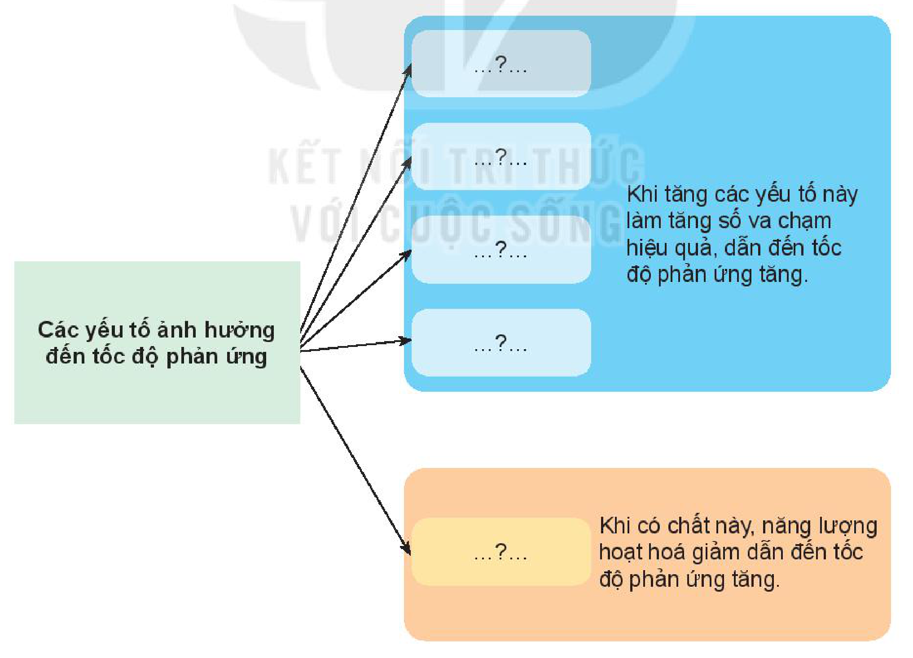

<!-- pdf:102 -->

# BÀI 20: ÔN TẬP CHƯƠNG 6

## I. HỆ THỐNG HOÁ KIẾN THỨC

Hoàn thành các nội dung còn thiếu sau đây:

**Tốc độ phản ứng:**

Xét phản ứng hoá học dạng tổng quát: $\ce{aA + bB -> cC + dD}$.

Biểu thức tốc độ trung bình của phản ứng: $v_{tb} = \text{...?...}$

Nếu phản ứng trên là một phản ứng đơn giản thì biểu thức tốc độ phản ứng theo hằng số tốc độ phản ứng: $v = \text{...?...}$

**Các yếu tố ảnh hưởng đến tốc độ phản ứng**

- **Các yếu tố ảnh hưởng đến tốc độ phản ứng:**
  - Nhóm 1 (4 yếu tố: ...?...; ...?...; ...?...; ...?...): Khi tăng các yếu tố này làm tăng số va chạm hiệu quả, dẫn đến tốc độ phản ứng tăng.
  - Nhóm 2 (1 yếu tố: ...?...): Khi có chất này, năng lượng hoạt hoá giảm dẫn đến tốc độ phản ứng tăng.
  <!-- ocr-ok: sơ đồ khối trang 102 bị OCR bỏ sót phần chữ trong các khung bên phải; đã đối chiếu ảnh -->

<!-- pdf:103 -->

## II. LUYỆN TẬP

Câu 1. Hãy cho biết trong các phản ứng sau, phản ứng nào có tốc độ nhanh, phản ứng nào có tốc độ chậm?

(a) Đốt cháy nhiên liệu.

(b) Sắt bị gỉ.

(c) Trung hoà acid – base.

Câu 2. Cho khoảng $2\text{ g}$ zinc (kẽm) dạng hạt vào một cốc đựng dung dịch $\ce{H2SO4}\text{ }2\text{ M}$ (dư) ở nhiệt độ phòng. Nếu chỉ biến đổi một trong các điều kiện sau đây (các điều kiện khác giữ nguyên) thì tốc độ phản ứng sẽ thay đổi thế nào (tăng lên, giảm xuống hay không đổi)?

(a) Thay kẽm hạt bằng kẽm bột cùng khối lượng và khuấy đều.

(b) Thay dung dịch $\ce{H2SO4}\text{ }2\text{ M}$ bằng dung dịch $\ce{H2SO4}\text{ }1\text{ M}$ có cùng thể tích.

(c) Thực hiện phản ứng ở nhiệt độ cao hơn (khoảng $50\text{ }^\circ\text{C}$).

Câu 3. Hydrogen peroxide phân huỷ theo phản ứng: $\ce{2H2O2 -> 2H2O + O2}$.

Đo thể tích oxygen thu được theo thời gian, kết quả được ghi trong bảng sau:

| Thời gian (min) | 0 | 15 | 30 | 45 | 60 |
| :--- | :---: | :---: | :---: | :---: | :---: |
| Thể tích khí oxygen ($\text{cm}^3$) | 0 | 16 | 30 | 40 | 48 |

a) Vẽ đồ thị mô tả sự phụ thuộc của thể tích khí oxygen theo thời gian.

b) Tính tốc độ trung bình của phản ứng (theo $\text{cm}^3\text{/min}$) trong các khoảng thời gian:

- Từ $0 \div 15$ phút;
- Từ $15 \div 30$ phút;
- Từ $30 \div 45$ phút;
- Từ $45 \div 60$ phút.
<!-- ocr-ok: danh sách 2 cột bị OCR đọc lệch dấu chia thành dấu cộng/U; đã đối chiếu ảnh -->

Nhận xét sự thay đổi tốc độ trung bình theo thời gian.

Câu 4. Hãy thiết kế một thí nghiệm để chứng minh ảnh hưởng của nhiệt độ đến tốc độ phản ứng của zinc và sulfuric acid loãng.

Câu 5. Một phản ứng ở $45\text{ }^\circ\text{C}$ có tốc độ là $0,068\text{ mol/(L}\cdot\text{min)}$. Hỏi phải giảm xuống nhiệt độ bao nhiêu để tốc độ phản ứng là $0,017\text{ mol/(L}\cdot\text{min)}$. Giả sử, trong khoảng nhiệt độ thí nghiệm, hệ số nhiệt độ Van't Hoff của phản ứng bằng 2.

## 📷 Danh sách hình trong bài

| Mã hình | Trang PDF | Vị trí | Chú thích gốc |
|---|---|---|---|
| H10-hoa-b20-01 | 102 | Mục I | *(không có chú thích)* |
