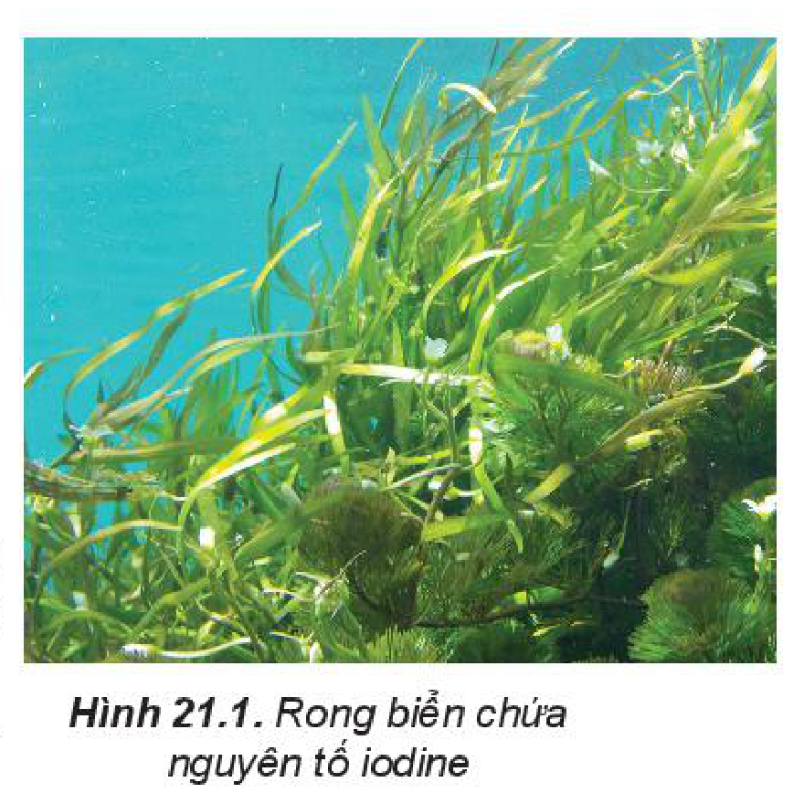
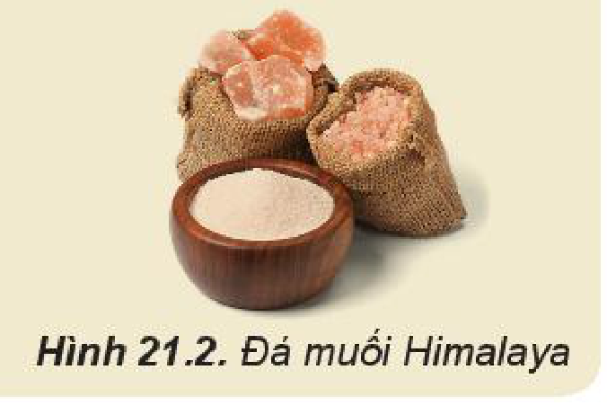
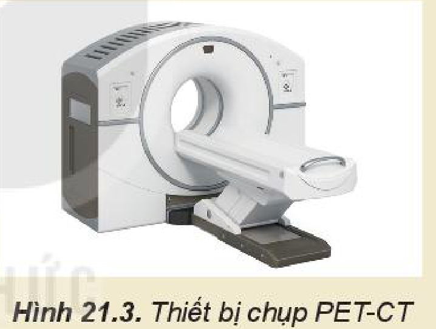
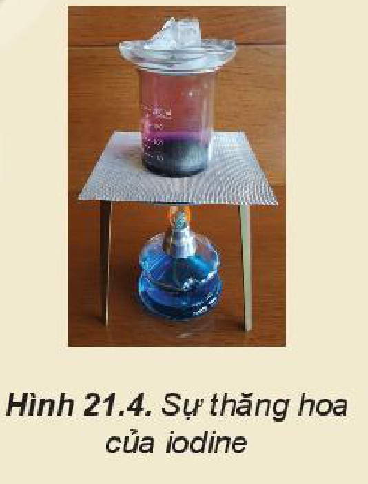
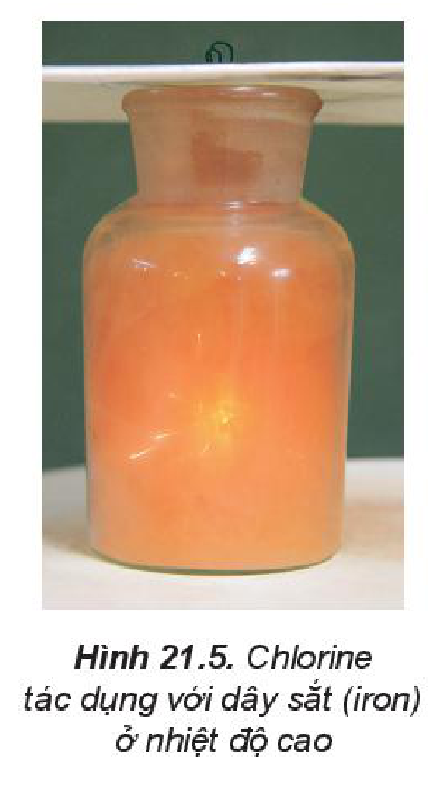
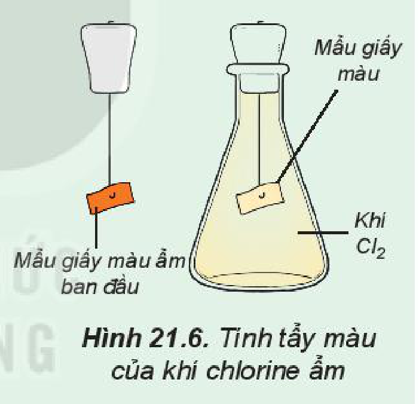
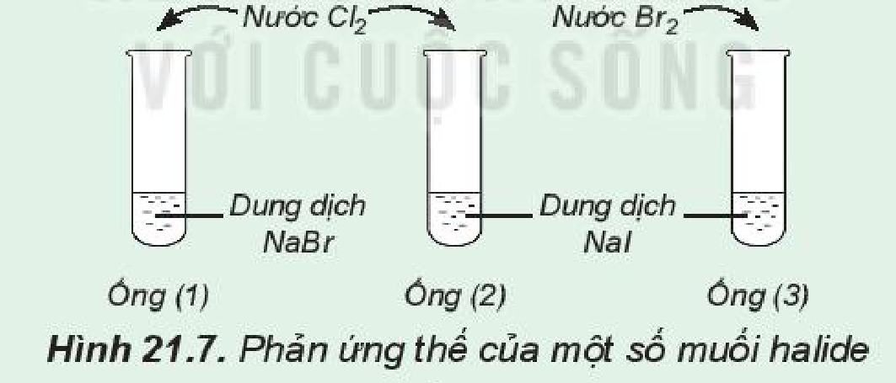

<!-- pdf:105 -->

# BÀI 21: NHÓM HALOGEN

## 🎯 Mục tiêu

- Nêu được trạng thái tự nhiên của các nguyên tố halogen.
- Mô tả được trạng thái, màu sắc, nhiệt độ nóng chảy, nhiệt độ sôi của các đơn chất halogen.
- Giải thích được sự biến đổi nhiệt độ nóng chảy, nhiệt độ sôi của các đơn chất halogen dựa vào tương tác van der Waals.
- Trình bày được xu hướng các halogen nhận thêm 1 electron (từ kim loại) hoặc dùng chung electron (với phi kim) để tạo hợp chất ion hoặc hợp chất cộng hoá trị dựa theo cấu hình electron.
- Giải thích được xu hướng phản ứng của các đơn chất halogen với hydrogen.
- Viết được phương trình hoá học của phản ứng tự oxi hoá – khử của chlorine.
- Thực hiện được (hoặc quan sát video) một số thí nghiệm chứng minh tính oxi hoá mạnh của các halogen và so sánh tính oxi hoá của các halogen trong nhóm VIIA.

## 🔴 Mở đầu

Trong tự nhiên, một số phi kim như carbon, nitrogen, oxygen tồn tại ở cả dạng đơn chất và hợp chất, còn các halogen đều chỉ tồn tại ở dạng hợp chất. Vì sao có sự khác biệt này?

## I. TRẠNG THÁI TỰ NHIÊN

Nhóm VIIA trong bảng tuần hoàn các nguyên tố hoá học còn gọi là **nhóm halogen**, gồm sáu nguyên tố: fluorine ($\ce{F}$), chlorine ($\ce{Cl}$), bromine ($\ce{Br}$), iodine ($\ce{I}$), astatine ($\ce{At}$) và tennessine ($\ce{Ts}$). Bốn nguyên tố $\ce{F}$, $\ce{Cl}$, $\ce{Br}$ và $\ce{I}$ tồn tại trong tự nhiên, còn $\ce{At}$ và $\ce{Ts}$ là các nguyên tố phóng xạ.

Trong tự nhiên, halogen chỉ tồn tại ở dạng hợp chất, phần lớn ở dạng muối halide, phổ biến như calcium fluoride, sodium chloride.

*Bảng 21.1. Nồng độ các ion halide trong nước biển$^{(*)}$*

| Ion halide | $\ce{F-}$ | $\ce{Cl-}$ | $\ce{Br-}$ | $\ce{I-}$ |
| :--- | :---: | :---: | :---: | :---: |
| Nồng độ ($\text{mg/kg}$) | 1 | 18 980 | 65 | 0,06 |

Trong cơ thể người, nguyên tố chlorine có trong máu và dịch vị dạ dày (ở dạng ion $\ce{Cl-}$), nguyên tố iodine có ở tuyến giáp (ở dạng hợp chất hữu cơ).

Hình 21.1. Rong biển chứa nguyên tố iodine
<!-- ocr-ok: chú thích hình cột phải bị OCR tách dòng xen vào chú thích chân trang và sai dấu "biễn", "nguyền tô"; đã đối chiếu ảnh -->

$^{(*)}$ *Nguồn: John Wright, Angela Colling (2004). Seawater: Its Composition, Properties and Behaviour. The Open University.*
<!-- ocr-ok: chú thích tiếng Anh bị OCR nhận diện sai "Wftight", "lts"; đã đối chiếu ảnh -->

<!-- pdf:106 -->

> 💡 EM CÓ BIẾT
>
> **Muối mỏ**
>
> Ngoài khai thác chủ yếu từ nước biển, muối ăn còn được khai thác từ mỏ muối. Muối mỏ có nhiều ứng dụng, ví dụ đá muối Himalaya (Hình 21.2) được sử dụng trong ẩm thực, chăm sóc sức khoẻ, sắc đẹp, trang trí nội thất,...
>
> 
>
> Hình 21.2. Đá muối Himalaya

> ❓ 1. Kể tên một số hợp chất phổ biến của halogen trong tự nhiên.

## II. CẤU TẠO NGUYÊN TỬ, PHÂN TỬ

> ✋ 1. Tra cứu số liệu Bảng 6.1, Bảng 6.2 và Hình 6.2 để hoàn thành bảng mô tả một số đặc điểm cấu tạo của các nguyên tử halogen theo mẫu sau:
>
> | Nguyên tử | Lớp electron ngoài cùng | Bán kính nguyên tử | Độ âm điện |
> | :--- | :---: | :---: | :---: |
> | Fluorine | ? | ? | ? |
> | Chlorine | ? | ? | ? |
> | Bromine | ? | ? | ? |
> | Iodine | ? | ? | ? |
>
> Từ bảng số liệu thu được, hãy:
>
> a) Giải thích tại sao nguyên tử halogen có xu hướng nhận 1 electron từ nguyên tử kim loại, hoặc góp chung 1 electron với nguyên tử phi kim, để hình thành liên kết.
>
> b) Nêu và giải thích xu hướng biến đổi bán kính nguyên tử, độ âm điện của các nguyên tử halogen. Từ đó dự đoán xu hướng biến đổi tính oxi hoá từ $\ce{F}$ đến $\ce{I}$.
>
> c) Dựa vào cấu hình electron lớp ngoài cùng và độ âm điện, giải thích tại sao nguyên tử fluorine chỉ có số oxi hoá $-1$ trong các hợp chất?
>
> 2. Tham khảo Bài 12 (Liên kết cộng hoá trị), hãy:
>
> a) Mô tả sự hình thành liên kết trong phân tử halogen bằng công thức electron.
>
> b) Liên kết trong phân tử halogen là liên kết cộng hoá trị phân cực hay không phân cực?
>
> c) Dựa vào bán kính nguyên tử (Hình 6.2), hãy dự đoán xu hướng biến đổi độ dài liên kết trong dãy các phân tử halogen.

<!-- pdf:107 -->

Các nguyên tử halogen có 7 electron ở lớp ngoài cùng, dễ nhận thêm 1 electron để đạt được cấu hình electron bền của khí hiếm gần nhất:

$ns^2np^5 + 1e \longrightarrow ns^2np^6$

Do vậy, số oxi hoá đặc trưng của các halogen trong hợp chất là $-1$.

Tuy nhiên, khi liên kết với các nguyên tố có độ âm điện lớn, các halogen có thể có các số oxi hoá dương: $+1, +3, +5, +7$ (trừ fluorine có độ âm điện lớn nhất, nên fluorine luôn có số oxi hoá bằng $-1$ trong mọi hợp chất).

> ✋ 1. Xác định số oxi hoá của chlorine trong các chất sau: $\ce{Cl2}$, $\ce{HCl}$, $\ce{HClO}$, $\ce{HClO2}$, $\ce{HClO3}$, $\ce{HClO4}$.
>
> 2. Từ các số oxi hoá của chlorine, hãy giải thích tại sao $\ce{Cl2}$ vừa có tính oxi hoá vừa có tính khử?

> 💡 EM CÓ BIẾT
>
> **Đồng vị phóng xạ trong y học**
>
> - Kĩ thuật chụp PET-CT nhằm phát hiện vị trí các tế bào có tốc độ tiêu thụ glucose lớn, thường là tế bào ung thư.
>
>   Dược chất $\ce{^{18}F}$-FDG dùng trong chụp PET-CT được tạo ra khi thay thế một nhóm $\ce{OH}$ trong phân tử glucose bằng nguyên tử đồng vị đánh dấu $\ce{^{18}F}$.
>
> - Đồng vị phóng xạ $\ce{^{131}I}$ dùng điều trị một số bệnh lí tuyến giáp như cường giáp tự miễn (Basedow), ung thư tuyến giáp.
>
> 
>
> Hình 21.3. Thiết bị chụp PET-CT

> ❓ 2. Trong tự nhiên, các nguyên tố halogen tồn tại ở dạng hợp chất. Viết công thức một vài hợp chất của halogen thường được dùng trong thực tế.
>
> 3. Nguyên tử halogen có thể nhận 1 electron từ nguyên tử kim loại hoặc góp chung electron với nguyên tử phi kim.
>
> Hãy mô tả sự hình thành liên kết trong phân tử $\ce{NaCl}$ và $\ce{HCl}$ để minh hoạ.

<!-- pdf:108 -->

## III. TÍNH CHẤT VẬT LÍ

Trạng thái tồn tại, màu sắc, nhiệt độ nóng chảy ($t_{nc}$), nhiệt độ sôi ($t_s$) của halogen được trình bày ở Bảng 21.2:

*Bảng 21.2. Một số tính chất vật lí của đơn chất halogen$^{(*)}$*

| Đơn chất | Trạng thái | Màu sắc | $t_{nc}$ ($^\circ\text{C}$) | $t_s$ ($^\circ\text{C}$) | Độ tan trong nước ($\text{mol/L}$) (ở $25\text{ }^\circ\text{C}$) |
| :---: | :---: | :---: | :---: | :---: | :---: |
| $\ce{F2}$ | Khí | Lục nhạt | $-219,6$ | $-188,1$ | $-$ |
| $\ce{Cl2}$ | Khí | Vàng lục | $-101,0$ | $-34,1$ | $0,091$ |
| $\ce{Br2}$ | Lỏng | Nâu đỏ | $-7,3$ | $59,2$ | $0,21$ |
| $\ce{I2}$ | Rắn | Tím đen | $113,6$ | $185,5$ | $0,0013$ |
<!-- ocr-ok: bảng 21.2 có kí hiệu nhiệt độ trong tiêu đề cột bị OCR nhận diện sai; đã đối chiếu ảnh -->

Nhiệt độ nóng chảy, nhiệt độ sôi tăng từ $\ce{F2}$ đến $\ce{I2}$ do:

- Tương tác van der Waals giữa các phân tử tăng.
- Khối lượng phân tử tăng.

Ở điều kiện thường, các halogen ít tan trong nước nhưng tan nhiều trong dung môi hữu cơ như alcohol, benzene. Trong y học, dung dịch iodine loãng trong ethanol được dùng làm thuốc sát trùng.

Bromine gây bỏng sâu khi tiếp xúc với da. Hít thở không khí có chứa halogen với nồng độ vượt ngưỡng cho phép làm tổn hại niêm mạc tế bào đường hô hấp, gây co thắt phế quản, khó thở.

> 💡 EM CÓ BIẾT
>
> **Iodine thăng hoa**
>
> Ở nhiệt độ cao, iodine thăng hoa, chuyển từ thể rắn sang thể hơi dưới áp suất thường.
>
> 
>
> Hình 21.4. Sự thăng hoa của iodine
<!-- ocr-ok: hộp Em có biết cột phải bị OCR ghép lẫn với cột trái và đọc sai dấu "chuyên tử thê", "suât"; đã đối chiếu ảnh -->

> ❓ 4. Từ Bảng 21.2, nhận xét xu hướng biến đổi nhiệt độ nóng chảy, nhiệt độ sôi của các halogen và giải thích.

## IV. TÍNH CHẤT HOÁ HỌC
<!-- ocr-ok: tiêu đề mục có biểu tượng IV bị OCR đọc dính "TÍNH CHẤTHOÁ HỌC"; đã đối chiếu ảnh -->

<!-- term: Đơn chất halogen -->
Halogen là các phi kim điển hình, có tính oxi hoá mạnh, tính oxi hoá giảm dần từ fluorine đến iodine.

### 1. Tác dụng với kim loại

Các halogen phản ứng trực tiếp với nhiều kim loại, tạo muối halide.

$^{(*)}$ *Nguồn: http://chem.libretexts.org.*
<!-- ocr-ok: chú thích chân trang chứa URL bị OCR đọc lệch; đã đối chiếu ảnh -->

<!-- pdf:109 -->

Sodium nóng chảy sẽ cháy với ngọn lửa sáng chói trong khí chlorine, tạo thành sodium chloride:

$\ce{2Na + Cl2 ->[\text{t}^\circ] 2NaCl}$

Dây sắt (iron) nung đỏ sẽ bốc cháy trong khí chlorine, tạo thành khói màu nâu đỏ là iron(III) chloride (Hình 21.5):

$\ce{2Fe + 3Cl2 ->[\text{t}^\circ] 2FeCl3}$

Hình 21.5. Chlorine tác dụng với dây sắt (iron) ở nhiệt độ cao

> ❓ 5. Xác định chất oxi hoá, chất khử trong phản ứng của sodium và iron với chlorine, dùng mũi tên chỉ rõ sự nhường electron từ chất khử sang chất oxi hoá.

### 2. Tác dụng với hydrogen

Các halogen phản ứng với hydrogen, tạo thành hydrogen halide.

*Bảng 21.3. Một số đặc điểm của phản ứng giữa halogen và hydrogen*

| Phản ứng | Điều kiện | Đặc điểm phản ứng |
| :---: | :---: | :---: |
| $\ce{H2 + F2 -> 2HF}$ | Phản ứng ngay ở nhiệt độ phòng và trong bóng tối | Nổ mạnh |
| $\ce{H2 + Cl2 -> 2HCl}$ | Ánh sáng hoặc $t^\circ$ | Gây nổ |
| $\ce{H2 + Br2 -> 2HBr}$ | $\sim 200\text{ }^\circ\text{C}$, xúc tác $\ce{Pt}$ | Không gây nổ |
| $\ce{H2 + I2 <=> 2HI}$ | $\sim 300\text{ }^\circ\text{C}$, xúc tác $\ce{Pt}$ | Thuận nghịch $(*)$ |
<!-- ocr-ok: bảng 21.3 có ô nhiều dòng bị OCR tách chữ "Nổ mạnh" thành "Nổ h / Sman"; đã đối chiếu ảnh -->

Mức độ phản ứng của các halogen với hydrogen giảm dần khi đi từ fluorine đến iodine, phù hợp với tính oxi hoá của các halogen giảm dần từ $\ce{F2}$ đến $\ce{I2}$.

> ✋ Xét các phản ứng hoá học: $\ce{H2(g) + X2(g) -> 2HX(g)}$ ($\ce{X}$ là các halogen).
>
> Tra số liệu trong Bảng 12.2 để:
>
> 1. Giải thích xu hướng phản ứng của các đơn chất halogen với hydrogen theo khả năng hoạt động của các halogen.
> 2. Dựa vào số liệu năng lượng liên kết $\ce{H-X}$, giải thích xu hướng phản ứng giảm dần từ $\ce{F2}$ đến $\ce{I2}$.

$(*)$ ***Phản ứng thuận nghịch*** *là phản ứng xảy ra theo hai chiều trái ngược nhau ở cùng điều kiện.*

<!-- pdf:110 -->

### 3. Tác dụng với nước

Khi tan vào nước, một phần $\ce{Cl2}$ tác dụng với nước tạo thành $\ce{HCl}$ (hydrochloric acid) và $\ce{HClO}$ (hypochlorous acid):

$\ce{Cl2 + H2O <=> HCl + HClO}$

Hypochlorous acid có tính oxi hoá mạnh nên chlorine trong nước có khả năng diệt khuẩn, tẩy màu và được ứng dụng trong khử trùng nước sinh hoạt.

> 💡 EM CÓ BIẾT
>
> $\ce{F2}$ phản ứng mạnh với nước ngay ở nhiệt độ thường, giải phóng khí $\ce{O2}$:
>
> $\ce{2F2 + 2H2O -> 4HF + O2}$
>
> Các halogen $\ce{Cl2}$, $\ce{Br2}$ và $\ce{I2}$ phản ứng chậm với nước và mức độ phản ứng giảm dần từ $\ce{Cl2}$ đến $\ce{I2}$.

> ❓ 6. Một nhà máy nước sử dụng $5\text{ mg }\ce{Cl2}$ để khử trùng $1\text{ L}$ nước sinh hoạt. Tính khối lượng $\ce{Cl2}$ nhà máy cần dùng để khử trùng $80\text{ }000\text{ m}^3$ nước sinh hoạt.

> ✋ **Tìm hiểu tính tẩy màu của khí chlorine ẩm**
>
> *Tiến hành:*
>
> Đính một mẩu giấy màu ẩm vào dây kim loại gắn với nút đậy bình tam giác. Sau đó, đưa mẩu giấy vào bình tam giác chứa khí chlorine (Hình 21.6).
>
> 
>
> Hình 21.6. Tính tẩy màu của khí chlorine ẩm
>
> *Quan sát hiện tượng và thực hiện yêu cầu sau:*
>
> 1. Nhận xét màu của mẩu giấy trước và sau khi cho vào bình tam giác. Giải thích.
> 2. Xác định vai trò của chlorine trong phản ứng với nước, tại sao nói chlorine tự oxi hoá – tự khử trong phản ứng này?

### 4. Tác dụng với dung dịch kiềm

Chlorine phản ứng với dung dịch sodium hydroxide ở điều kiện thường, tạo thành **nước Javel** (Gia-ven):

$\ce{Cl2 + 2NaOH -> NaCl + NaClO + H2O}$

**Nước Javel** (chứa $\ce{NaClO}$ (sodium hypochlorite), $\ce{NaCl}$ và một phần $\ce{NaOH}$ dư) được dùng làm chất tẩy rửa, khử trùng.

Khi đun nóng, $\ce{Cl2}$ phản ứng với dung dịch potassium hydroxide tạo thành muối chlorate:

$\ce{3Cl2 + 6KOH ->[\text{t}^\circ] 5KCl + KClO3 + 3H2O}$

Potassium chlorate là chất oxi hoá mạnh, được sử dụng chế tạo thuốc nổ, hỗn hợp đầu que diêm,...

<!-- pdf:111 -->

> ❓ 7. Khí $\ce{Cl2}$ phản ứng với dung dịch sodium hydroxide nóng tạo thành sodium chloride, sodium chlorate và nước.
>
> Lập phương trình hoá học của phản ứng trên theo phương pháp thăng bằng electron, chỉ rõ chất oxi hoá, chất khử.

### 5. Tác dụng với dung dịch halide

Chlorine có thể oxi hoá ion $\ce{Br-}$ trong dung dịch muối bromide và ion $\ce{I-}$ trong dung dịch muối iodide, bromine có thể oxi hoá ion $\ce{I-}$ trong dung dịch muối iodide.

$\ce{Cl2 + 2NaBr -> 2NaCl + Br2}$

$\ce{Br2 + 2NaI -> 2NaBr + I2}$

Trong công nghiệp, phản ứng giữa chlorine và ion bromide được ứng dụng để điều chế bromine từ nước biển.

> ✋ **Phản ứng thế của một số muối halide**
>
> *Chuẩn bị:* 3 ống nghiệm, dung dịch $\ce{NaBr}$, dung dịch $\ce{NaI}$, nước $\ce{Cl2}$, nước $\ce{Br2}$ loãng.
>
> *Tiến hành:*
>
> - Lấy khoảng $2\text{ mL}$ dung dịch $\ce{NaBr}$ vào ống nghiệm (1), $2\text{ mL}$ dung dịch $\ce{NaI}$ vào mỗi ống nghiệm (2) và (3).
> - Thêm vào ống nghiệm (1) và (2) vài giọt nước $\ce{Cl2}$, thêm vào ống (3) vài giọt nước $\ce{Br2}$, lắc đều các ống nghiệm.
>
> *Lưu ý: Cẩn thận không để nước $\ce{Cl2}$, nước $\ce{Br2}$ dây ra tay, quần áo.*
>
> 
>
> Hình 21.7. Phản ứng thế của một số muối halide
>
> *Quan sát hiện tượng và thực hiện yêu cầu sau:*
>
> 1. Nhận xét sự thay đổi màu của dung dịch trong các ống nghiệm.
> 2. So sánh tính oxi hoá của $\ce{Cl2}$, $\ce{Br2}$, $\ce{I2}$.
> 3. Hãy chọn một thuốc thử để chứng tỏ có sự tạo thành $\ce{I2}$ khi cho nước chlorine (hoặc nước bromine) tác dụng với dung dịch sodium iodide.

> ❓ 8. Viết phương trình hoá học minh hoạ tính oxi hoá giảm dần trong dãy $\ce{Cl2}$, $\ce{Br2}$, $\ce{I2}$.

<!-- pdf:112 -->

## V. ĐIỀU CHẾ CHLORINE

<!-- term: Điều chế chlorine -->
Năm 1774, C. W. Scheele (Se-lơ), nhà hoá học người Thuỵ Điển, điều chế được chlorine khi cho quặng pyrolusite ($\ce{MnO2}$) tác dụng với hydrochloric acid đặc:

$\ce{MnO2 + 4HCl(\text{đặc}) ->[\text{t}^\circ] MnCl2 + Cl2 + 2H2O}$

<!-- term: Điều chế chlorine -->
Ngày nay, phản ứng trên vẫn được dùng khi cần điều chế khí $\ce{Cl2}$ trong phòng thí nghiệm. Ngoài ra, còn có thể thay $\ce{MnO2}$ bằng $\ce{KMnO4}$ rắn để điều chế khí $\ce{Cl2}$:

$\ce{2KMnO4 + 16HCl(\text{đặc}) -> 2KCl + 2MnCl2 + 5Cl2 + 8H2O}$

<!-- term: Điều chế chlorine -->
Trong công nghiệp, chlorine được sản xuất ở nhiệt độ thường bằng cách điện phân dung dịch muối ăn bão hoà, có màng ngăn giữa các điện cực:

$\ce{2NaCl + 2H2O ->[\text{điện phân dung dịch}][\text{có màng ngăn xốp}] 2NaOH + H2 + Cl2}$

> ❓ 9. Khi sản xuất chlorine trong công nghiệp, $\ce{NaOH}$ và $\ce{H2}$ được tạo thành ở cực âm, còn $\ce{Cl2}$ được tạo thành ở cực dương. Tại sao cần sử dụng màng ngăn xốp để ngăn cách hai điện cực?

## 📌 Em đã học

- Các nguyên tố halogen tồn tại trong tự nhiên ở dạng hợp chất, phổ biến là muối của fluorine và chlorine.
- Các đơn chất halogen từ fluorine đến iodine:
  - Nhiệt độ nóng chảy tăng dần, nhiệt độ sôi tăng dần.
  - Là phi kim điển hình, tính oxi hoá giảm dần.

## ✏️ Em có thể

- Thực hiện được thí nghiệm chứng minh và so sánh tính oxi hoá của đơn chất halogen.
- Sử dụng nước Javel an toàn.

## 📷 Danh sách hình trong bài

| Mã hình | Trang PDF | Vị trí | Chú thích gốc |
|---|---|---|---|
| H10-hoa-b21-01 | 105 | Mục I | Hình 21.1. Rong biển chứa nguyên tố iodine |
| H10-hoa-b21-02 | 106 | Mục I, hộp Em có biết | Hình 21.2. Đá muối Himalaya |
| H10-hoa-b21-03 | 107 | Mục II, hộp Em có biết | Hình 21.3. Thiết bị chụp PET-CT |
| H10-hoa-b21-04 | 108 | Mục III, hộp Em có biết | Hình 21.4. Sự thăng hoa của iodine |
| H10-hoa-b21-05 | 109 | Mục IV.1 | Hình 21.5. Chlorine tác dụng với dây sắt (iron) ở nhiệt độ cao |
| H10-hoa-b21-06 | 110 | Mục IV.3, hộp hoạt động thí nghiệm | Hình 21.6. Tính tẩy màu của khí chlorine ẩm |
| H10-hoa-b21-07 | 111 | Mục IV.5, hộp hoạt động thí nghiệm | Hình 21.7. Phản ứng thế của một số muối halide |
