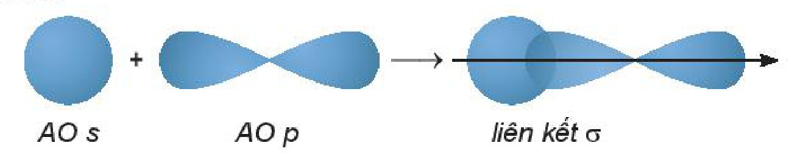

<!-- pdf:113 -->

# BÀI 22: HYDROGEN HALIDE. MUỐI HALIDE

## 🎯 Mục tiêu

- Nhận xét và giải thích được xu hướng biến đổi nhiệt độ sôi của các hydrogen halide từ $\ce{HCl}$ tới $\ce{HI}$. Giải thích được sự bất thường về nhiệt độ sôi của $\ce{HF}$ so với các $\ce{HX}$ khác.
- Trình bày được xu hướng biến đổi tính acid của dãy hydrohalic acid.
- Thực hiện được thí nghiệm phân biệt các ion $\ce{F-}$, $\ce{Cl-}$, $\ce{Br-}$, $\ce{I-}$.
- Trình bày được tính khử của các ion halide ($\ce{Cl-}$, $\ce{Br-}$, $\ce{I-}$) thông qua phản ứng với chất oxi hoá là sulfuric acid đặc.
- Nêu được ứng dụng của một số hydrogen halide.

## 🔴 Mở đầu

Hydrochloric acid được sử dụng rộng rãi trong sản xuất, điển hình là dùng để đánh sạch bề mặt kim loại trước khi gia công, sơn, hàn, mạ điện,... Trong công đoạn này, thép được đưa qua các bể chứa dung dịch $\ce{HCl}$ (được gọi là bể Picking) để tẩy bỏ lớp rỉ sét, sau đó rửa sạch bằng nước trước khi qua các công đoạn tiếp theo. Vậy các ứng dụng trên dựa vào tính chất quan trọng nào của hydrochloric acid?

## I. HYDROGEN HALIDE

### 1. Cấu tạo phân tử

<!-- term: Hydrogen halide -->
Phân tử hydrogen halide ($\ce{HX}$) gồm một liên kết cộng hoá trị. Các phân tử $\ce{HX}$ là phân tử phân cực.

$\ce{H}\cdot + \cdot\underset{\Large ..}{\overset{\Large ..}{\ce{X}}}: \longrightarrow \ce{H}:\underset{\Large ..}{\overset{\Large ..}{\ce{X}}}:\text{ hoặc }\ce{H-X}$

Mô hình liên kết:

*Bảng 22.1. Một số đặc điểm của hydrogen halide*

| Công thức phân tử | Tên gọi | Mô hình phân tử | Độ dài liên kết ($\text{pm}$) | Năng lượng liên kết ($\text{kJ/mol}$) |
| :---: | :---: | :---: | :---: | :---: |
| $\ce{HF}$ | Hydrogen fluoride | $\ce{HF}$ | 92 | 569 |
| $\ce{HCl}$ | Hydrogen chloride | $\ce{HCl}$ | 127 | 432 |
| $\ce{HBr}$ | Hydrogen bromide | $\ce{HBr}$ | 141 | 366 |
| $\ce{HI}$ | Hydrogen iodide | $\ce{HI}$ | 160 | 299 |
<!-- ocr-ok: bảng 22.1 có tiêu đề nhiều dòng và hình cầu trong cột Mô hình phân tử bị OCR bỏ sót/đọc sai 432 thành 452; đã đối chiếu ảnh -->

<!-- pdf:114 -->

### 2. Tính chất vật lí

Ở điều kiện thường, hydrogen halide tồn tại ở thể khí, tan tốt trong nước, tạo thành dung dịch **hydrohalic acid** tương ứng.

*Bảng 22.2. Nhiệt độ sôi ($t_s$) của các hydrogen halide*

| Hydrogen halide | $\ce{HF}$ | $\ce{HCl}$ | $\ce{HBr}$ | $\ce{HI}$ |
| :--- | :---: | :---: | :---: | :---: |
| $t_s$ ($^\circ\text{C}$) | $+19,5$ | $-84,9$ | $-66,7$ | $-35,8$ |

$\ce{HF}$ lỏng có nhiệt độ sôi cao bất thường là do phân tử $\ce{HF}$ phân cực mạnh, có khả năng tạo liên kết hydrogen:

$\ce{H-F \cdots H-F \cdots H-F}$

Từ $\ce{HCl}$ đến $\ce{HI}$, nhiệt độ sôi tăng do:

- Lực tương tác van der Waals giữa các phân tử tăng.
- Khối lượng phân tử tăng.

> ❓ 1. Nêu xu hướng biến đổi độ dài liên kết trong dãy $\ce{HX}$.
>
> 2. Từ Bảng 22.2, hãy nhận xét xu hướng biến đổi nhiệt độ sôi của các hydrogen halide. Giải thích.

## II. HYDROHALIC ACID

### 1. Tính chất hoá học

**a) Tính acid**

Trong dãy hydrohalic acid, tính acid tăng từ hydrofluoric acid (yếu) đến hydroiodic acid (rất mạnh).

> ❓ 3. Ở một nhà máy sản xuất vàng từ quặng, sau khi cho dung dịch chứa hợp chất tan của vàng chảy qua cột chứa kẽm hạt, thu được chất rắn gồm vàng và kẽm. Đề xuất phương pháp thu được vàng tinh khiết.

> ✋ **1. Dung dịch $\ce{HCl}$ tác dụng với kim loại**
>
> *Chuẩn bị:* 2 ống nghiệm, dung dịch $\ce{HCl}$ loãng, $\ce{Zn}$ dạng hạt, $\ce{Cu}$ dạng lá.
>
> *Tiến hành:*
>
> - Cho vào 2 ống nghiệm, mỗi ống khoảng $2\text{ mL}$ dung dịch $\ce{HCl}$ loãng.
> - Cho vài hạt $\ce{Zn}$ vào ống (1), vài lá $\ce{Cu}$ vào ống (2).
>
> *Quan sát hiện tượng và viết phương trình hoá học.*

<!-- pdf:115 -->

> **2. Dung dịch $\ce{HCl}$ tác dụng với muối $\ce{NaHCO3}$ rắn**
>
> *Chuẩn bị:* dung dịch $\ce{HCl}$ loãng, muối $\ce{NaHCO3}$ rắn, ống nghiệm.
>
> *Tiến hành:*
>
> Cho 1 thìa nhỏ $\ce{NaHCO3}$ vào ống nghiệm, thêm tiếp dung dịch $\ce{HCl}$ loãng.
>
> *Quan sát hiện tượng và thực hiện yêu cầu sau:*
>
> 1. Viết phương trình hoá học của phản ứng.
> 2. So sánh tính acid của $\ce{HCl}$ và $\ce{H2CO3}$.

**b) Tính khử**

Ngoài tính acid, hydrohalic acid còn có tính khử, ví dụ:

$\ce{2KMnO4 + 16HCl -> 2KCl + 2MnCl2 + 5Cl2 + 8H2O}$

> 💡 EM CÓ BIẾT
>
> **Điều chế hydrofluoric acid và hydrochloric acid**
>
> - Năm 1771, C. W. Scheele cho sulfuric acid đặc tác dụng với quặng fluorite ($\ce{CaF2}$), thu được hydrogen fluoride:
>
>   $\ce{CaF2 + H2SO4(\text{đặc}) ->[\text{t}^\circ] CaSO4 + 2HF}$
>
>   Hiện nay, phản ứng trên vẫn được dùng để sản xuất hydrofluoric acid trong công nghiệp.
>
> - Trong công nghiệp, hydrogen chloride được tạo ra trong nhiều quá trình tổng hợp hữu cơ. Một lượng nhỏ hydrogen chloride được sản xuất từ các đơn chất:
>
>   $\ce{H2 + Cl2 ->[\text{t}^\circ] 2HCl}$
>
>   Trong phòng thí nghiệm, cho muối sodium chloride rắn tác dụng với sulfuric acid đặc, thu được khí hydrogen chloride:
>
>   $\ce{NaCl + H2SO4(\text{đặc}) ->[\text{t}^\circ] NaHSO4 + HCl}$
>
>   Hoà tan khí hydrogen chloride vào nước, tạo thành dung dịch hydrochloric acid.

> ❓ 4. Viết phương trình hoá học khi cho dung dịch hydrochloric acid lần lượt tác dụng với: $\ce{Fe}$, $\ce{MgO}$, $\ce{Cu(OH)2}$, $\ce{AgNO3}$.
>
> 5. Hydrochloric acid thường được dùng để đánh sạch lớp oxide, hydroxide, muối carbonate bám trên bề mặt kim loại trước khi sơn, hàn, mạ điện.
>
> Ứng dụng này dựa trên tính chất hoá học nào của hydrochloric acid?

### 2. Ứng dụng

**a) Hydrogen fluoride**

Hydrogen fluoride được sử dụng trong quá trình sản xuất teflon theo sơ đồ:

$\ce{CH4 ->[+\ce{Cl2}][-\ce{HCl}] CHCl3 ->[+\ce{HF}][-\ce{HCl}] CHClF2 ->[-\ce{HCl}] CF2=CF2 ->[\text{t}^\circ\text{, p}][\text{xt}]} \text{(}\ce{-CF2-CF2-}\text{)}_n$

<!-- pdf:116 -->

Teflon có hệ số ma sát nhỏ, bền nhiệt, được dùng làm chất chống dính ở nồi, chảo.

Hydrofluoric acid còn có khả năng đặc biệt là ăn mòn thuỷ tinh vô cơ (có thành phần gần đúng là $\ce{Na2O.CaO.6SiO2}$) do xảy ra phản ứng:

$\ce{SiO2 + 4HF -> SiF4 + 2H2O}$

Trong công nghiệp, hỗn hợp có thành phần $\ce{KF.3HF}$ được dùng để điện phân nóng chảy sản xuất fluorine.

**b) Hydrogen chloride**

Trong sản xuất tôn, thép, hydrochloric acid được sử dụng phổ biến để loại bỏ gỉ sét trên sắt thép trước khi chuyển sang các công đoạn sản xuất tiếp theo.

Trong công nghiệp, hydrochloric acid được dùng để sản xuất các hợp chất vô cơ và hữu cơ như aluminium chloride dùng làm chất phụ gia chống nhoè cho giấy, PAC (poli aluminium chloride) dùng để xử lí nước, nickel chloride dùng trong mạ điện, zinc chloride dùng trong sản xuất pin, vinyl chloride dùng sản xuất PVC,...

Trong sản xuất nước uống đóng chai, hydrochloric acid tinh khiết được sử dụng để tái sinh các nhựa trao đổi ion nhằm thay thế các ion $\ce{Na+}$ và $\ce{Ca^2+}$ (đã bị hấp phụ trên nhựa trong quá trình khử khoáng nước nguyên liệu) bằng ion $\ce{H+}$.

## III. MUỐI HALIDE

### 1. Tính tan

<!-- term: Muối halide -->
Hầu hết các muối halide đều dễ tan trong nước, trừ một số muối không tan, ví dụ như silver chloride, silver bromide, silver iodide và một số muối ít tan như lead chloride, lead bromide.

### 2. Tính chất hoá học

**a) Phản ứng trao đổi**

> ✋ **Nhận biết ion halide**
>
> *Chuẩn bị:* 4 ống nghiệm; các dung dịch: $\ce{AgNO3}$, $\ce{NaF}$, $\ce{NaCl}$, $\ce{NaBr}$, $\ce{NaI}$.
>
> *Tiến hành:*
>
> - Cho $2\text{ mL}$ mỗi dung dịch $\ce{NaF}$, $\ce{NaCl}$, $\ce{NaBr}$, $\ce{NaI}$ vào từng ống nghiệm.
> - Nhỏ vài giọt dung dịch $\ce{AgNO3}$ vào mỗi ống nghiệm.
>
> *Quan sát hiện tượng và thực hiện yêu cầu sau:*
>
> 1. Viết phương trình hoá học các phản ứng xảy ra.
> 2. Nêu cách nhận biết dung dịch muối halide bằng dung dịch $\ce{AgNO3}$.

**b) Tính khử của ion halide**

<!-- term: Tính khử của các ion halide -->
Sodium bromide khử được sulfuric acid đặc thành sulfur dioxide, còn sodium iodide có thể khử được sulfuric acid đặc thành hydrogen sulfide.

$\ce{2NaBr + 3H2SO4 -> 2NaHSO4 + Br2 + SO2 + 2H2O}$

$\ce{8NaI + 9H2SO4 -> 8NaHSO4 + 4I2 + H2S + 4H2O}$

<!-- pdf:117 -->

<!-- term: Tính khử của các ion halide -->
Trong điều kiện như trên, $\ce{NaCl}$ chỉ xảy ra phản ứng trao đổi, tạo thành hydrogen chloride.

<!-- term: Tính khử của các ion halide -->
Tính khử của các ion halide tăng dần theo thứ tự $\ce{Cl- < Br- < I-}$.

> ❓ 6. Cho biết vai trò của $\ce{NaBr}$ và $\ce{NaI}$ khi tham gia phản ứng với sulfuric acid đặc.

### 3. Muối ăn

**a) Vai trò của muối ăn**

Trong cơ thể sống, muối ăn có vai trò quan trọng trong việc cân bằng điện giải, truyền dẫn xung điện thần kinh, trao đổi chất,...

Trong đời sống, muối ăn được dùng để bảo quản và chế biến thực phẩm (ướp, muối),...

Trong y học, muối ăn được dùng sản xuất nước muối sinh lí, nước nhỏ mắt, dịch tiêm truyền tĩnh mạch,...

Trong công nghiệp, muối ăn là nguyên liệu để sản xuất xút, chlorine, nước Javel,...

**b) Tinh chế muối ăn**
<!-- ocr-ok: OCR đọc sai "Tinh" thành "Tỉnh"; đã đối chiếu ảnh -->

Muối ăn thường được sản xuất từ nước biển bằng phương pháp kết tinh nhờ quá trình làm bay hơi nước biển dưới sức nóng của Mặt Trời.

Muối ăn thô thu được trên ruộng muối có lẫn tạp chất như muối của magnesium, calcium. Để đạt độ tinh khiết làm thức ăn cho con người, muối ăn thô cần được kết tinh lại. Trong y học, muối ăn được sử dụng có độ tinh khiết rất cao, do đó cần kết tinh lại nhiều lần.

> ❓ 7. Vì sao không dùng trực tiếp nước biển làm nước uống, nước tưới cây?
>
> 8. Nước muối sinh lí thường chia làm hai loại: loại dùng để tiêm truyền tĩnh mạch và loại dùng để nhỏ mắt, nhỏ mũi, súc miệng, rửa vết thương.
>
> a) Loại nào cần vô trùng tuyệt đối và phải dùng theo chỉ định của bác sĩ?
>
> b) Để pha 1 lít nước muối sinh lí $\ce{NaCl}\text{ }0,9\%$ dùng làm nước súc miệng thì cần bao nhiêu gam muối ăn?

## 📌 Em đã học

- Hydrogen halide: $\ce{HF}$ có nhiệt độ sôi cao bất thường do giữa các phân tử có liên kết hydrogen; từ $\ce{HCl}$ đến $\ce{HI}$ nhiệt độ sôi tăng dần do tương tác van der Waals tăng dần.
- Hydrohalic acid: tính acid tăng dần từ $\ce{HF}$ (acid yếu) đến $\ce{HI}$ (acid rất mạnh).
- Ion halide, muối halide: Tính khử tăng dần từ fluoride đến iodide.

## ✏️ Em có thể

Thực hiện được thí nghiệm phân biệt các ion halide bằng dung dịch silver nitrate.

## 📷 Danh sách hình trong bài

| Mã hình | Trang PDF | Vị trí | Chú thích gốc |
|---|---|---|---|
| H10-hoa-b22-01 | 113 | Mục I.1 | *(không có chú thích)* |
