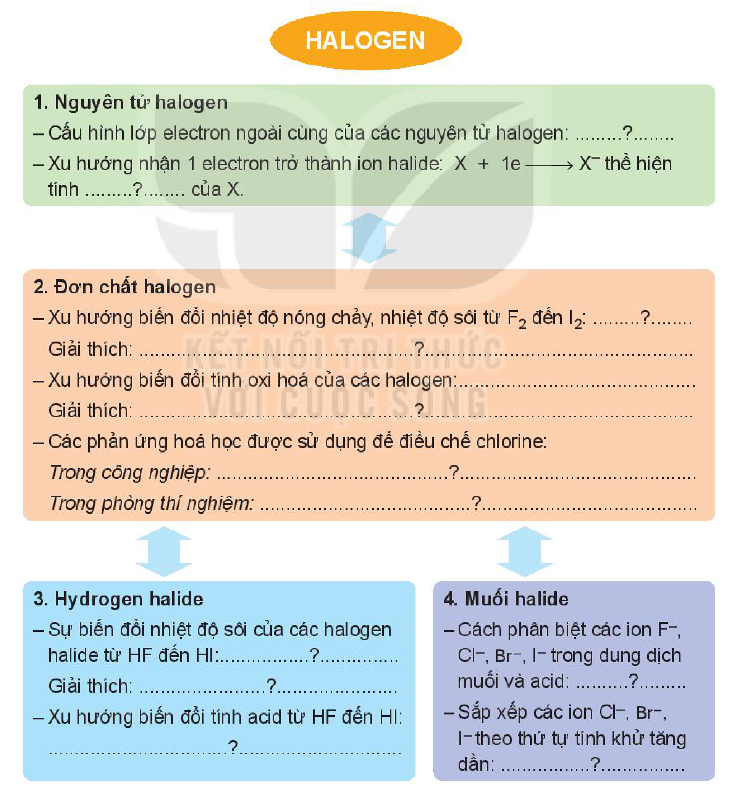

<!-- pdf:118 -->

# BÀI 23: ÔN TẬP CHƯƠNG 7

## I. HỆ THỐNG HOÁ KIẾN THỨC
<!-- ocr-ok: biểu tượng mục I làm OCR đọc sai chữ "HỆ" thành "nỆ"; đã đối chiếu ảnh -->

Hoàn thành các nội dung còn thiếu sau đây:

- **HALOGEN**
  - **1. Nguyên tử halogen**
    - Cấu hình lớp electron ngoài cùng của các nguyên tử halogen: .........?.........
    - Xu hướng nhận 1 electron trở thành ion halide: $\ce{X + 1e -> X-}$ thể hiện tính .........?......... của $\ce{X}$.
  - **2. Đơn chất halogen**
    - Xu hướng biến đổi nhiệt độ nóng chảy, nhiệt độ sôi từ $\ce{F2}$ đến $\ce{I2}$: .........?.........
    - Giải thích: ......................................................?......................................................
    - Xu hướng biến đổi tính oxi hoá của các halogen: ........................................................
    - Giải thích: ......................................................?......................................................
    - Các phản ứng hoá học được sử dụng để điều chế chlorine:
      - *Trong công nghiệp:* ..........................................?..........................................
      - *Trong phòng thí nghiệm:* ...................................?..........................................
  - **3. Hydrogen halide**
    - Sự biến đổi nhiệt độ sôi của các halogen halide từ $\ce{HF}$ đến $\ce{HI}$: ...................?...................
    - Giải thích: ...........................?...........................
    - Xu hướng biến đổi tính acid từ $\ce{HF}$ đến $\ce{HI}$: ...................................?...................................
  - **4. Muối halide**
    - Cách phân biệt các ion $\ce{F-}$, $\ce{Cl-}$, $\ce{Br-}$, $\ce{I-}$ trong dung dịch muối và acid: .........?.........
    - Sắp xếp các ion $\ce{Cl-}$, $\ce{Br-}$, $\ce{I-}$ theo thứ tự tính khử tăng dần: ....................?....................
<!-- ocr-ok: sơ đồ hệ thống hoá kiến thức 4 khối có nhiều dòng chấm lửng bị OCR nhận diện sai; đã đối chiếu ảnh -->

<!-- pdf:119 -->

## II. LUYỆN TẬP

Câu 1. Liên kết trong phân tử nào sau đây có độ phân cực lớn nhất?

A. $\ce{H-F}$. B. $\ce{H-Cl}$. C. $\ce{H-Br}$. D. $\ce{H-I}$.

Câu 2. Trong nhóm halogen, từ $\ce{F}$ đến $\ce{I}$, bán kính nguyên tử biến đổi theo chiều nào?

A. Giảm dần. B. Không đổi. C. Tăng dần. D. Tuần hoàn.
<!-- ocr-ok: OCR đọc thiếu dấu huyền chữ "dần" thành "dân"; đã đối chiếu ảnh -->

Câu 3. Trong dãy đơn chất từ $\ce{F2}$ đến $\ce{I2}$, chất có tính oxi hoá mạnh nhất là

A. $\ce{F2}$. B. $\ce{Cl2}$. C. $\ce{Br2}$. D. $\ce{I2}$.

Câu 4. Khi tiến hành điều chế và thu khí $\ce{Cl2}$ vào bình, để ngăn khí $\ce{Cl2}$ thoát ra ngoài gây độc, cần đậy miệng bình thu khí $\ce{Cl2}$ bằng bông có tẩm dung dịch

A. $\ce{NaCl}$. B. $\ce{HCl}$. C. $\ce{NaOH}$. D. $\ce{KCl}$.

Câu 5. Làm muối là nghề phổ biến tại nhiều vùng ven biển Việt Nam. Một hộ gia đình tiến hành làm muối trên ruộng muối chứa $200\text{ }000\text{ L}$ nước biển. Giả thiết $1\text{ L}$ nước biển có chứa $30\text{ g }\ce{NaCl}$ và hiệu suất quá trình làm muối thành phẩm đạt $60\%$.
<!-- ocr-ok: OCR đọc sai nhiều dấu tiếng Việt ("phố", "tiền", "biên", "suât", "muôi", "phâm") và "NaCl" thành "NaOI"; đã đối chiếu ảnh -->

Khối lượng muối hộ gia đình thu được là

A. $1\text{ }200\text{ kg}$. B. $10\text{ }000\text{ kg}$. C. $6\text{ }000\text{ kg}$. D. $3\text{ }600\text{ kg}$.

Câu 6. Cho $\ce{X}$, $\ce{Y}$ là hai nguyên tố halogen có trong tự nhiên, ở hai chu kì liên tiếp, $Z_X < Z_Y$. Hoà tan hoàn toàn $0,402\text{ g}$ hỗn hợp $\ce{NaX}$ và $\ce{NaY}$ vào nước, thu được dung dịch E. Cho từ từ E vào cốc đựng dung dịch $\ce{AgNO3}$ dư, thu được $0,574\text{ g}$ kết tủa.

Kí hiệu của nguyên tố $\ce{X}$ và $\ce{Y}$ lần lượt là
<!-- ocr-ok: OCR đọc sai "Kí" thành "Kĩ"; đã đối chiếu ảnh -->

A. $\ce{F}$ và $\ce{Cl}$. B. $\ce{Cl}$ và $\ce{Br}$. C. $\ce{Br}$ và $\ce{I}$. D. $\ce{Cl}$ và $\ce{I}$.
<!-- ocr-ok: OCR nhận diện sai các kí hiệu nguyên tố trong 4 phương án trắc nghiệm; đã đối chiếu ảnh -->

## 📷 Danh sách hình trong bài

| Mã hình | Trang PDF | Vị trí | Chú thích gốc |
|---|---|---|---|
| H10-hoa-b23-01 | 118 | Mục I | *(không có chú thích)* |
