<!-- pdf:7 -->

# BÀI 1: HIỆN THỰC LỊCH SỬ VÀ NHẬN THỨC LỊCH SỬ

## 🎯 Học xong bài này, em sẽ:

- Trình bày được khái niệm lịch sử, Sử học.
- Nêu được chức năng, nhiệm vụ, đối tượng nghiên cứu, một số nguyên tắc, phương pháp cơ bản của Sử học.
- Phân biệt được các nguồn sử liệu, hiện thực lịch sử và nhận thức lịch sử.
- Vận dụng được một số phương pháp cơ bản của Sử học khi sưu tầm, xử lí thông tin sử liệu để học tập, khám phá lịch sử.

## 🔴 Mở đầu

Cầu Long Biên bắc qua sông Hồng ở Hà Nội được xây dựng trong thời gian từ năm 1898 đến năm 1902. Trong suốt hơn một thế kỉ qua, cây cầu này đã “chứng kiến” nhiều sự kiện, quá trình lịch sử quan trọng của Thủ đô và đất nước. Cây cầu chính là một hiện vật lịch sử. Việc khai thác thông tin từ những hiện vật như vậy có vai trò như thế nào trong nghiên cứu lịch sử?

*Hình 1. Cầu Long Biên (Hà Nội)*
<!-- ocr-ok: chú thích Hình 1 nằm trên nền ảnh cuối trang p0007.png nên OCR bỏ sót -->

<!-- pdf:8 -->

## 1. Lịch sử là gì?

<!-- term: Lịch sử -->
Lịch sử là những gì đã diễn ra trong quá khứ. Lịch sử loài người là toàn bộ những hoạt động của con người từ khi xuất hiện đến ngày nay, bao gồm cả lịch sử quá trình tương tác của con người với tự nhiên và quá trình con người tương tác với nhau.

> TƯ LIỆU 1. Lịch sử “là quá trình tương tác không ngừng giữa nhà sử học và sự thật lịch sử, là cuộc đối thoại không bao giờ dứt giữa hiện tại và quá khứ”.
>
> *(Ét-uốt Ha-lét Ca, Lịch sử là gì? (bản tiếng Anh), Niu Oóc, 1987, tr. 30)*

Lịch sử được hiểu theo hai nghĩa khác nhau: *hiện thực lịch sử* và *nhận thức lịch sử*.

<!-- term: Hiện thực lịch sử -->
*Hiện thực lịch sử* là tất cả những gì đã diễn ra trong quá khứ. Do đó, hiện thực lịch sử tồn tại hoàn toàn khách quan, không phụ thuộc vào ý muốn chủ quan của con người. Chúng ta chỉ có thể tìm hiểu, nhận thức và trình bày, tái hiện lịch sử theo những cách khác nhau chứ không thể thay đổi được hiện thực lịch sử.

<!-- term: Nhận thức lịch sử -->
*Nhận thức lịch sử* là những hiểu biết của con người về hiện thực lịch sử, được trình bày, tái hiện theo những cách khác nhau: kể chuyện, ghi chép, nghiên cứu, trình diễn, lập đài tưởng niệm, thực hành các nghi lễ, phong tục,...

> TƯ LIỆU 2. Một số hiện vật lịch sử và cách tái hiện lịch sử nước Âu Lạc

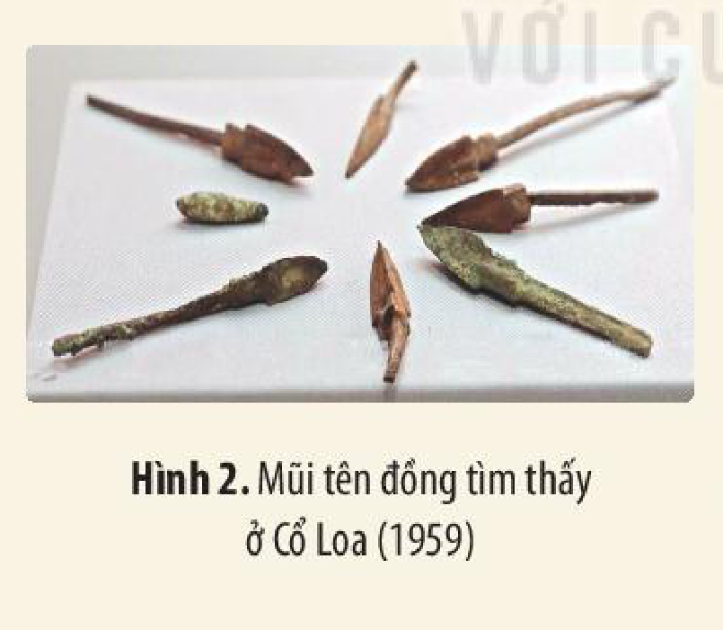

*Hình 2. Mũi tên đồng tìm thấy ở Cổ Loa (1959)*

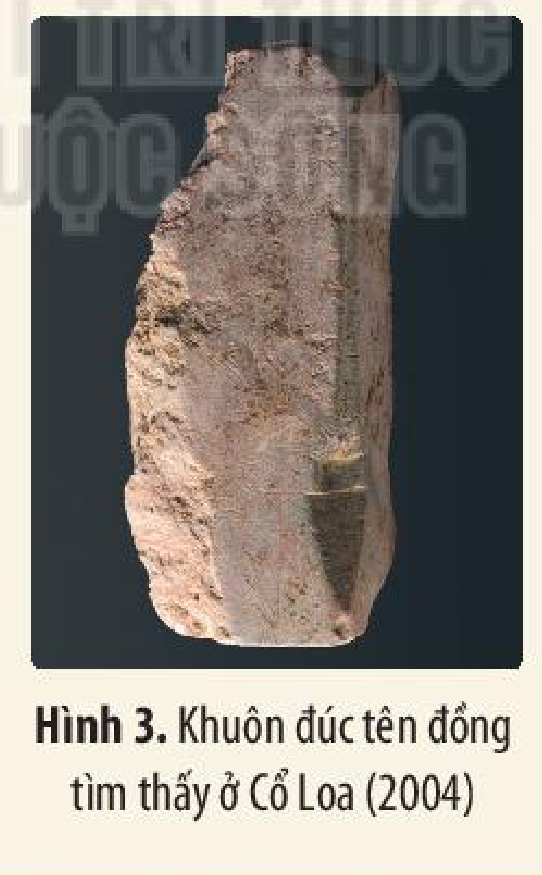

*Hình 3. Khuôn đúc tên đồng tìm thấy ở Cổ Loa (2004)*

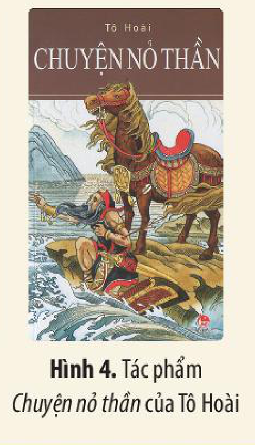

*Hình 4. Tác phẩm Chuyện nỏ thần của Tô Hoài*
<!-- ocr-ok: OCR nhận diện nhầm dấu hỏi trong "Chuyện nỏ thần" thành "Chuyện nó thân" (đối chiếu p0008.png) -->

Giữa hiện thực lịch sử và nhận thức lịch sử luôn có khoảng cách, bởi dù có cố gắng đến đâu thì con người cũng không thể nhận thức và tái hiện hoàn toàn đầy đủ hiện thực lịch sử đúng như nó đã xảy ra.

<!-- pdf:9 -->

Có nhiều nguyên nhân dẫn đến thực trạng trên. Nhận thức lịch sử trước hết phụ thuộc vào nhu cầu và năng lực của người tìm hiểu lịch sử; phụ thuộc vào điều kiện và phương pháp để tìm hiểu lịch sử; phụ thuộc vào mức độ phong phú và xác thực của thông tin sử liệu thu thập được. Quan trọng hơn, nhận thức lịch sử phụ thuộc vào mục đích, thái độ, đạo đức và thế giới quan của người tìm hiểu, nghiên cứu lịch sử.

> 💡 EM CÓ BIẾT ?
>
> Theo một truyện dân gian: Một hôm, năm ông thầy bói nghe nói có con voi đứng ở gần cổng chợ, bèn rủ nhau đến xem. Ông thứ nhất chạm vào tai voi, nói: “Con voi giống như cái quạt”. Ông thứ hai chạm vào mình voi thì reo lên: “Con voi to như cái nhà”. Ông thứ ba chạm vào chân voi, khẳng định: “Con voi như cái cột đình chứ!”. Ông thứ tư chạm vào vòi voi, lại nói: “Con voi giống con trăn mà”. Ông thứ năm phát hoảng: “Thế thì voi là cái giống gì đây!”.

> TƯ LIỆU 3.
>
> *3.1. Về La-pu-la-pu*
>
> Tại nơi đây, vào ngày 27 – 4 – 1521, La-pu-la-pu và người dân địa phương đã đẩy lui quân xâm lược Tây Ban Nha và giết chết viên chỉ huy là Phéc-đi-năng Ma-gien-lăng. Do đó, La-pu-la-pu đã trở thành người Phi-líp-pin đầu tiên đánh đuổi quân xâm lược châu Âu.

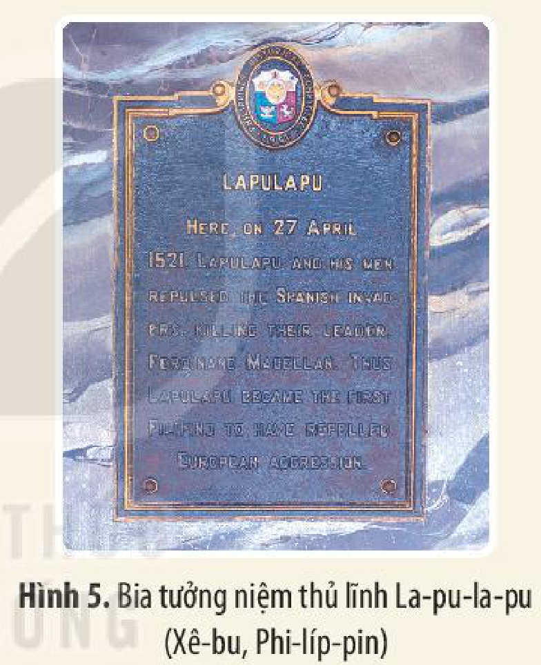

*Hình 5. Bia tưởng niệm thủ lĩnh La-pu-la-pu (Xê-bu, Phi-líp-pin)*

> *3.2. Về Ma-gien-lăng*
>
> Tại nơi đây, trong cuộc đụng độ với các chiến binh của La-pu-la-pu – thủ lĩnh đảo Mác-tan, Ma-gien-lăng đã chết vào ngày 27 – 4 – 1521.
>
> Vích-to-ri-a, một trong những con tàu của đoàn thám hiểm do Gioan Xê-bát-ti-an chỉ huy đã rời Xê-bu vào ngày 1 – 5 – 1521, trở về Xan Lu-ca đờ Ba-ra-mê-đa (Tây Ban Nha) vào ngày 6 – 9 – 1522 và hoàn thành chuyến đi vòng quanh thế giới đầu tiên bằng đường biển.

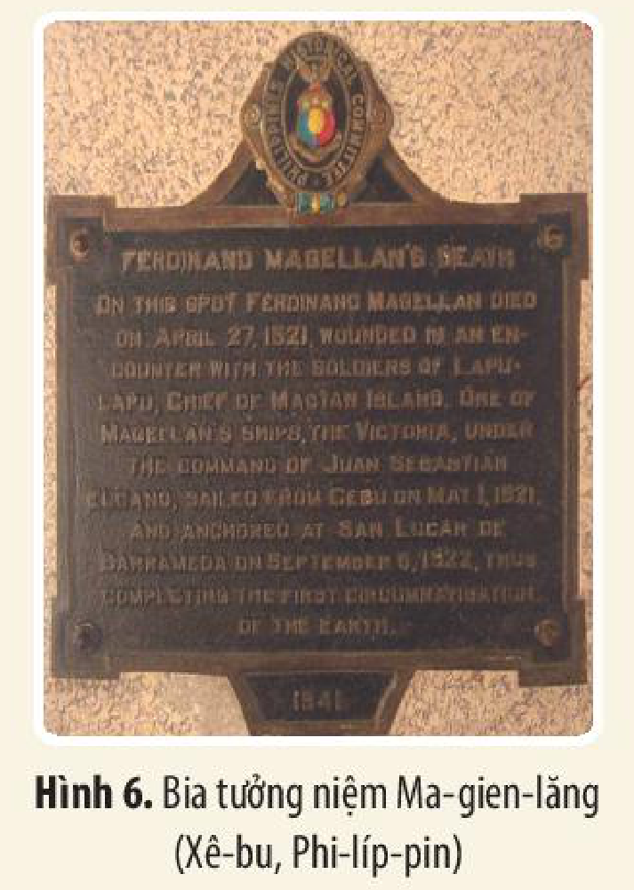

*Hình 6. Bia tưởng niệm Ma-gien-lăng (Xê-bu, Phi-líp-pin)*

<!-- pdf:10 -->

> ❓ 1. Em hiểu câu nói của Ét-uốt Ha-lét Ca trong Tư liệu 1 (tr. 7) như thế nào?
>
> 2. Dựa vào Tư liệu 2 (tr. 7), hãy cho biết hình ảnh nào thể hiện hiện thực lịch sử, hình ảnh nào thể hiện nhận thức lịch sử?
>
> 3. Khai thác Tư liệu 3 (tr. 8), em hãy chỉ ra điểm giống và khác nhau trong nội dung hai tấm bia. Theo em, vì sao có sự khác nhau đó?

## 2. Sử học

### a) Khái niệm, đối tượng, chức năng, nhiệm vụ của Sử học

<!-- term: Sử học -->
• *Khái niệm:* Sử học là khoa học nghiên cứu về quá khứ của loài người.

<!-- term: Đối tượng nghiên cứu của Sử học -->
• *Đối tượng:* Đối tượng nghiên cứu của Sử học là toàn bộ quá khứ của loài người. Đó có thể là quá khứ của một cá nhân, một nhóm, cộng đồng người hay một quốc gia, khu vực hoặc toàn thể nhân loại.

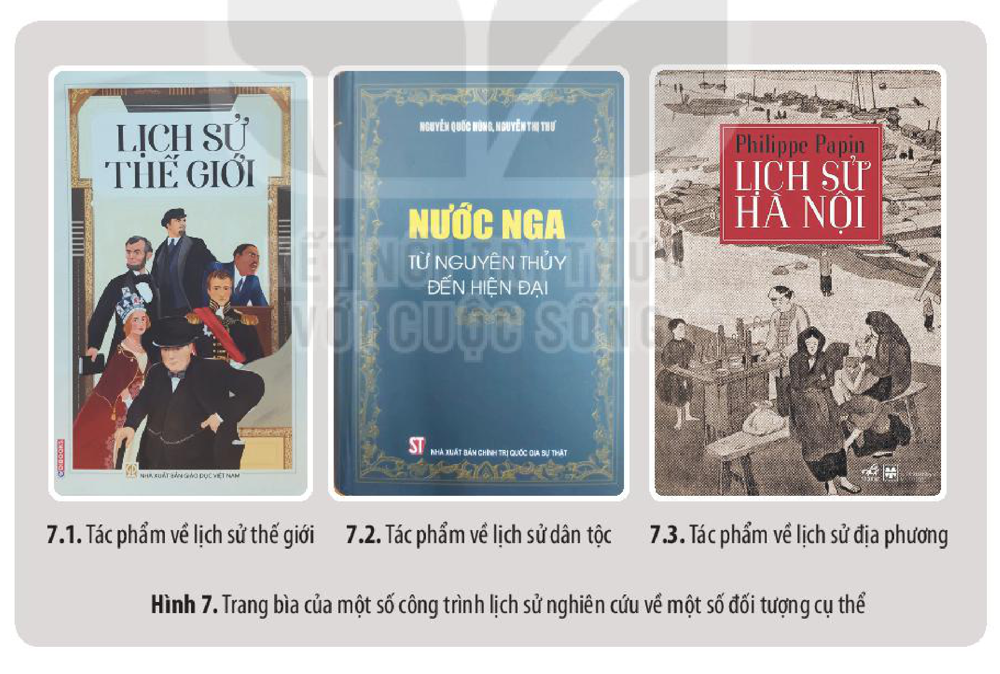

*Hình 7. Trang bìa của một số công trình lịch sử nghiên cứu về một số đối tượng cụ thể*

<!-- pdf:11 -->

• *Chức năng, nhiệm vụ của Sử học*

<!-- term: Chức năng của Sử học -->
Chức năng của Sử học gồm:
- *Khoa học:* Khôi phục các sự kiện lịch sử diễn ra trong quá khứ; rút ra bản chất của các quá trình lịch sử để phát hiện quy luật vận động và phát triển của lịch sử.
- *Xã hội:* Giáo dục tư tưởng, tình cảm, đạo đức; rút ra bài học kinh nghiệm cho cuộc sống hiện tại.

<!-- term: Nhiệm vụ của Sử học -->
Nhiệm vụ của Sử học gồm:
- *Nhận thức:* Cung cấp tri thức khoa học, giúp con người tìm hiểu, khám phá hiện thực lịch sử một cách khách quan, khoa học, chân thực.
- *Giáo dục:* Góp phần truyền bá những giá trị và truyền thống tốt đẹp trong lịch sử cho thế hệ sau, góp phần giáo dục đạo đức, tinh thần dân tộc, tình yêu quê hương, đất nước, bồi dưỡng lòng khoan dung, nhân ái,...
- *Dự báo:* Thông qua việc tổng kết thực tiễn, rút ra các bài học kinh nghiệm,... Sử học góp phần dự báo về tương lai của đất nước, nhân loại,...

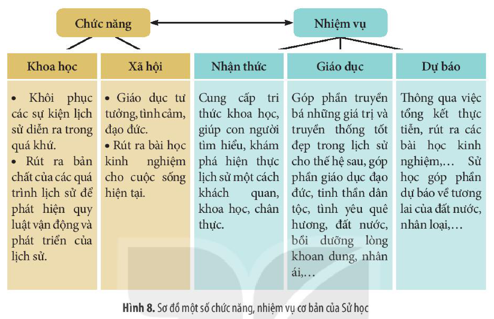

*Hình 8. Sơ đồ một số chức năng, nhiệm vụ cơ bản của Sử học*

> ❓ 1. Nêu khái niệm Sử học.
>
> 2. Trình bày về đối tượng nghiên cứu, chức năng, nhiệm vụ của Sử học. Nêu ví dụ cụ thể.

### b) Nguyên tắc cơ bản của Sử học

*Một số nguyên tắc cơ bản của Sử học*

<!-- term: Nguyên tắc cơ bản của Sử học -->
- *Khách quan:* Sứ mệnh của Sử học là tái hiện hiện thực lịch sử, đưa lại nhận thức đầy đủ nhất về quá khứ của con người dựa trên những thông tin đáng tin cậy. Đây là nguyên tắc quan trọng nhất của Sử học.
- *Trung thực:* Nhà sử học có nhiệm vụ tôn trọng sự thật lịch sử và tái hiện nó một cách chân thực dựa trên những sử liệu đáng tin cậy, không xuyên tạc sự thật lịch sử.
- *Nhân văn, tiến bộ:* Mục đích của Sử học là giúp con người hiểu rõ về quá khứ, rút ra những quy luật, bài học hữu ích cho cuộc sống. Sử học vừa phải phản ánh sự thật trong quá khứ, nhưng không kích động hận thù, xung đột hoặc kì thị, phân biệt đối xử,... Sử học phải góp phần bảo vệ hoà bình, xây dựng xã hội văn minh, tiến bộ, nhân ái.

<!-- pdf:12 -->

> TƯ LIỆU 4.
>
> *4.1. Câu chuyện Thôi Trữ giết vua*
>
> Chuyện xảy ra vào năm 558 TCN ở nước Tề (Trung Quốc). Thôi Trữ – Tướng quốc nước Tề đã giết chết vua Tề Trang Công (Khương Quang). Sự kiện này được viên Thái sử – người có nhiệm vụ ghi chép các việc diễn ra ở các nước chư hầu thời đó – ghi lại trên tấm thẻ tre, rằng: “Mùa hạ, tháng 5, ngày Ất Hợi, Thôi Trữ giết vua của mình là Quang”. Khi đọc được những chữ đó, Thôi Trữ xấu hổ và lo sợ rằng việc làm xấu xa của ông ta sẽ lưu truyền đến đời sau nên yêu cầu viên Thái sử sửa khác đi. Thái sử không chịu, Thôi Trữ liền cho giết luôn và gọi người em của ông này vào và cho làm Thái sử. Ông này cũng ghi lại nguyên văn những chữ đó và cũng bị giết. Đến lượt người em thứ ba thay các anh giữ chức Thái sử, cũng vẫn ghi lại sự việc đúng như nó đã diễn ra. Lần này thì Thôi Trữ đành chịu. Về sau, câu chuyện này đã được Khổng Tử đưa vào sách *Xuân Thu* và được lưu truyền đến ngày nay như một ví dụ điển hình về bản lĩnh của người chép sử: sẵn sàng chết để bảo vệ nguyên tắc trung thực, khách quan.
>
> *(Theo Tư Mã Thiên, Sử ký, thiên Tề Thái Công thế gia)*
>
> *4.2. Quan điểm của Giô-han Mác-tin Cla-đen-ni-ớt, nhà sử học nổi tiếng người Đức thế kỉ XVIII:*
>
> “Những ai đòi hỏi rằng người viết sử phải tự đặt mình vào vị thế của một người không tôn giáo, không tổ quốc, không gia đình, thì đó hẳn là một sai lầm lớn, vì người ta đã không biết rằng mình đang đòi hỏi những điều không thể.”
>
> *(Theo Giô-han Mác-tin Cla-đen-ni-ớt, Sử học đại cương (bản tiếng Đức), Buê-lau, Lai-pxích, 1982 (1752), tr. 15 – 16)*

Các nguyên tắc trên đây có ý nghĩa vô cùng quan trọng đối với Sử học. Chỉ khi đảm bảo nguyên tắc khách quan, trung thực thì Sử học mới thực sự trở thành một khoa học, những thông tin do Sử học cung cấp, những bài học kinh nghiệm do Sử học đúc kết được mới đáng tin cậy và có giá trị thực tiễn. Hơn nữa, nghiên cứu lịch sử là nhằm phục vụ cuộc sống con người, khi đảm bảo nguyên tắc nhân văn, tiến bộ, Sử học sẽ góp phần xây dựng thế giới hoà bình, yêu thương, nhân ái, đoàn kết và hợp tác,...

> ❓ 1. Câu chuyện *Thôi Trữ giết vua* được lưu truyền để tôn vinh đức tính nào của nhà sử học?
>
> 2. Khai thác Tư liệu 4 (4.1, 4.2) giúp em biết được điều gì trong khi nghiên cứu lịch sử?
>
> 3. Phân tích ý nghĩa một số nguyên tắc cơ bản của Sử học.

<!-- pdf:13 -->

### c) Các phương pháp cơ bản của Sử học

<!-- term: Phương pháp lịch sử -->
• *Phương pháp lịch sử:* Là phương pháp nghiên cứu sự vật, hiện tượng theo các giai đoạn phát triển cụ thể của nó (hình thành, phát triển và tiêu vong). Phương pháp này đòi hỏi khi xem xét, mô tả, khôi phục sự kiện, nhân vật lịch sử phải đặt trong bối cảnh lịch sử cụ thể, nhằm tránh suy diễn, hiện đại hoá lịch sử.

<!-- term: Phương pháp lô-gích -->
• *Phương pháp lô-gích:* Là phương pháp nghiên cứu mối liên hệ biện chứng bên trong của các sự vật, hiện tượng (mối liên hệ nguyên nhân – kết quả, chung – riêng, bản chất – hiện tượng,...), từ đó có thể nhận thức được bản chất, quy luật hay khuynh hướng phát triển của sự vật, hiện tượng đó.

<!-- term: Phương pháp lịch đại và đồng đại -->
• *Phương pháp lịch đại và đồng đại:*
- *Lịch đại:* là tìm hiểu mối liên hệ giữa các nhân vật, sự kiện lịch sử,... theo trình tự thời gian trước – sau, quá khứ – hiện tại (mối liên hệ dọc).
- *Đồng đại:* là tìm hiểu mối liên hệ giữa các sự kiện, nhân vật, quá trình lịch sử diễn ra trong cùng một thời gian (mối liên hệ ngang).

<!-- term: Phương pháp liên ngành -->
• *Phương pháp liên ngành:* Để tìm hiểu cụ thể, sâu sắc các lĩnh vực cụ thể của đời sống con người và xã hội loài người trong quá khứ, nhà sử học cần phải vận dụng phương pháp, kĩ thuật nghiên cứu của nhiều ngành khoa học khác (khoa học xã hội và nhân văn, khoa học tự nhiên và công nghệ).

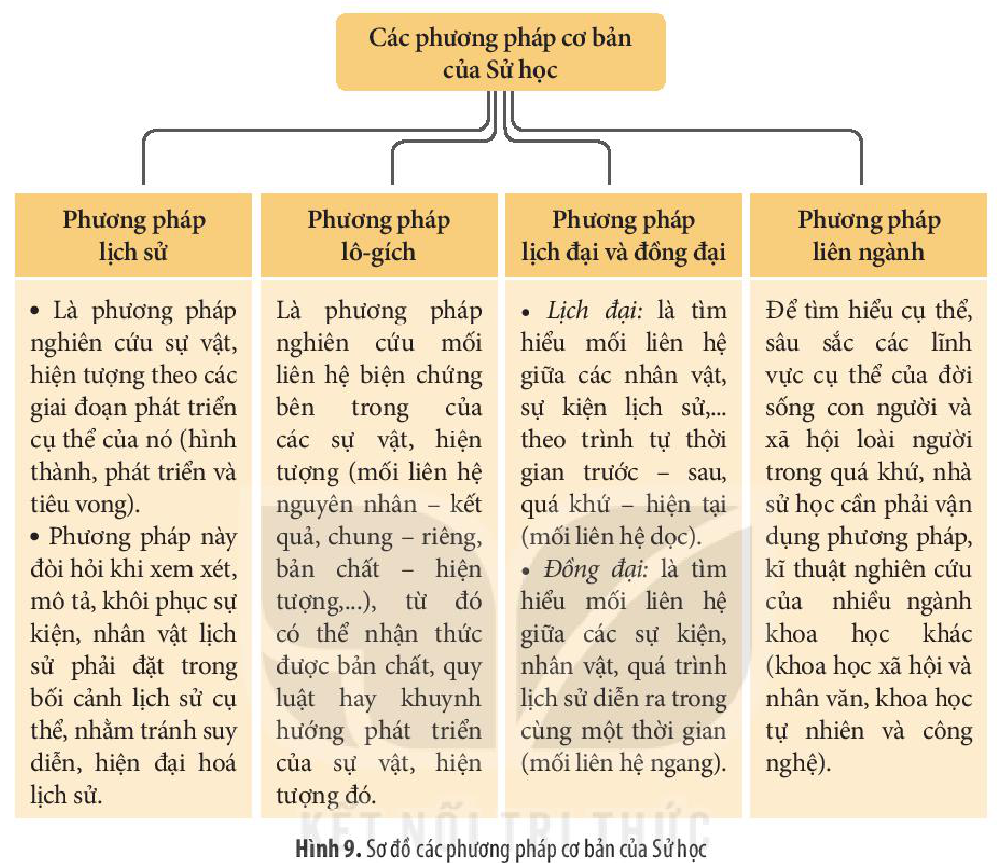

*Hình 9. Sơ đồ các phương pháp cơ bản của Sử học*

> ❓ Hãy nêu một số phương pháp cơ bản của Sử học.

### d) Các nguồn sử liệu

Để tìm hiểu và khám phá lịch sử, người nghiên cứu phải dựa vào các nguồn sử liệu.

• *Sử liệu là gì?*

<!-- term: Sử liệu -->
Sử liệu là toàn bộ những hình thức khác nhau của tư liệu lịch sử, chứa đựng những thông tin về quá khứ của loài người.

• *Các loại hình sử liệu*

<!-- term: Các loại hình sử liệu -->
Sử liệu được phân chia theo nhiều cách. Căn cứ vào hình thức, có sử liệu hiện vật, sử liệu truyền miệng, sử liệu chữ viết, sử liệu hình ảnh, sử liệu đa phương tiện (phim, băng, đĩa),... Căn cứ vào tính chất, có sử liệu trực tiếp (sử liệu gốc, sử liệu sơ cấp) và sử liệu gián tiếp (sử liệu thứ cấp, sử liệu phái sinh).

<!-- pdf:14 -->

Các loại hình sử liệu thường cung cấp thông tin với độ tin cậy khác nhau, tuỳ thuộc vào mục đích truyền tin và kênh cung cấp thông tin,...

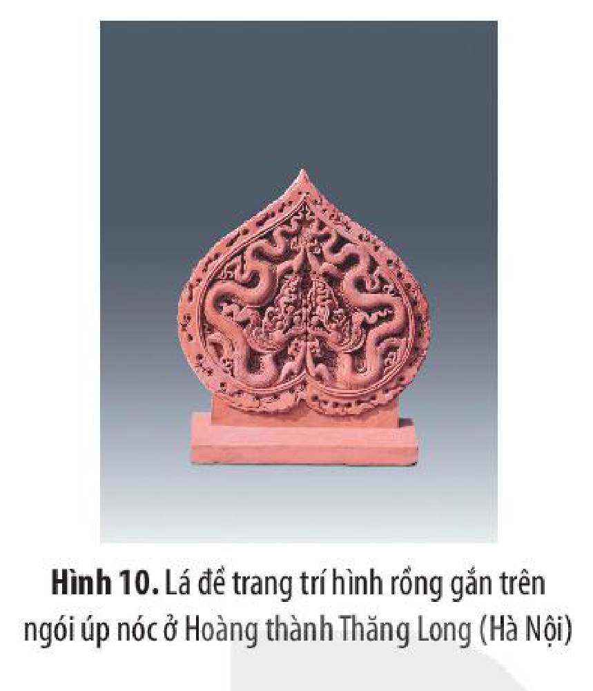

*Hình 10. Lá đề trang trí hình rồng gắn trên ngói úp nóc ở Hoàng thành Thăng Long (Hà Nội)*

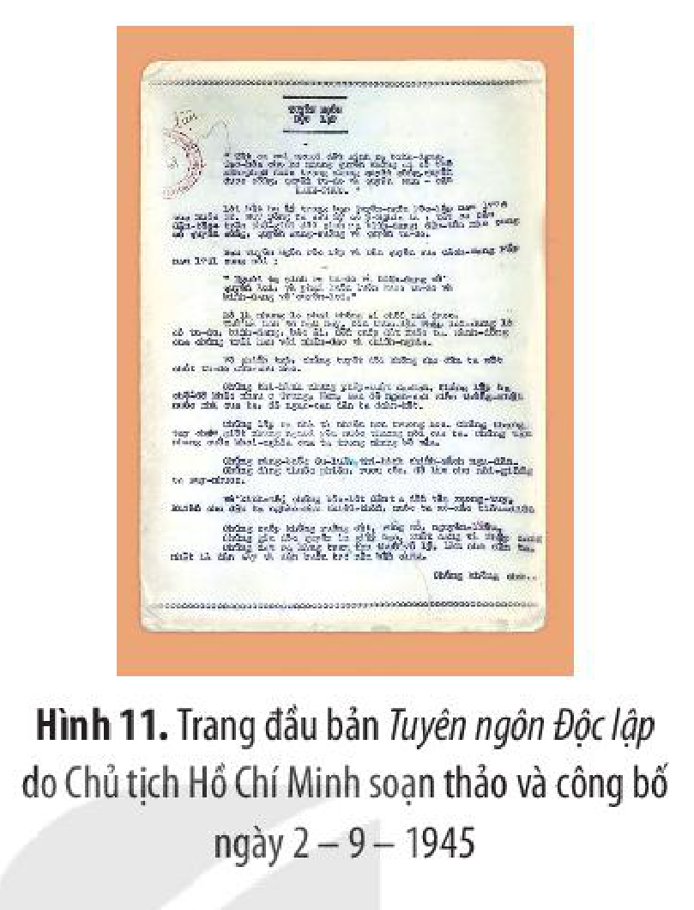

*Hình 11. Trang đầu bản Tuyên ngôn Độc lập do Chủ tịch Hồ Chí Minh soạn thảo và công bố ngày 2 – 9 – 1945*

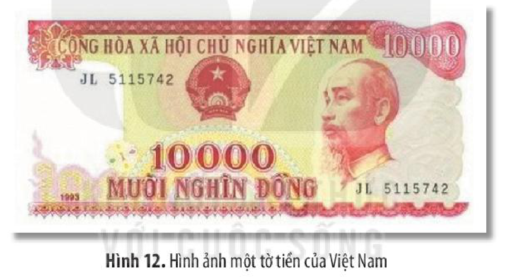

*Hình 12. Hình ảnh một tờ tiền của Việt Nam*

• *Sưu tầm, xử lí thông tin sử liệu trong khám phá, học tập lịch sử*

Việc tìm hiểu, khám phá lịch sử cần phải tiến hành một cách khoa học, bao gồm các khâu: xác định vấn đề cần tìm hiểu, chuẩn bị sử liệu, giải quyết vấn đề trên cơ sở khai thác sử liệu,... Trong đó, sưu tầm và xử lí thông tin sử liệu là hai nhiệm vụ cơ bản của công tác chuẩn bị sử liệu.

<!-- term: Sưu tầm sử liệu -->
*Sưu tầm sử liệu:* là quá trình lập danh mục sử liệu cần sưu tầm; tìm kiếm, thu thập thông tin liên quan đến đối tượng tìm hiểu. Cần lưu ý, các nguồn sử liệu càng đa dạng, đầy đủ càng tốt.

<!-- term: Xử lí thông tin sử liệu -->
*Xử lí thông tin sử liệu:* là quá trình phân loại, đánh giá, thẩm định, so sánh nguồn sử liệu đã thu thập được. Công đoạn này nhằm xác định tính xác thực, độ tin cậy và giá trị của sử liệu cũng như thông tin mà sử liệu đó phản ánh đối với việc tìm hiểu, khám phá lịch sử.

<!-- pdf:15 -->

Sản phẩm của Sử học là nhận thức khoa học về hiện thực lịch sử. Nhà sử học phải dùng các phương pháp khoa học để tìm kiếm, thu thập và xử lí các tư liệu lịch sử, trên cơ sở đó tái hiện, trình bày những sự kiện, quá trình và nhân vật lịch sử một cách khách quan, trung thực, toàn diện và cụ thể, trong các mối liên hệ lịch đại và đồng đại.

> ❓ 1. Kể tên một số loại hình sử liệu. Lấy một ví dụ cho mỗi loại hình sử liệu đó.
>
> 2. Đóng vai một nhà sử học, em hãy khai thác và phân tích những thông tin sử liệu trong các hình 10 – 12 (tr. 13) thông qua việc vận dụng một số phương pháp cơ bản của Sử học.

## ✏️ Luyện tập và vận dụng

1. Lịch sử là gì? Phân biệt hiện thực lịch sử và nhận thức lịch sử thông qua ví dụ cụ thể.

2. Làm thế nào để tái hiện được một sự kiện lịch sử?

1. Sưu tầm một số tư liệu có liên quan đến quá khứ của gia đình/quê hương em và viết đoạn văn ngắn giới thiệu về những tư liệu đó. Thông qua những tư liệu đó, em biết được điều gì về gia đình/quê hương em trong quá khứ? Cho biết cảm nhận/cảm xúc của em khi biết được những điều này.

2. Em hoặc một nhóm bạn hãy tìm đọc một cuốn truyện/một cuốn sách lịch sử, sau đó giới thiệu với các bạn cùng lớp (tên sách, tác giả, năm ra đời, nội dung chủ yếu,...). Điều gì ở cuốn sách/cuốn truyện đó khiến em thích nhất?

## 📷 Danh sách hình trong bài

| Mã hình | Trang PDF | Vị trí trong bài | Chú thích gốc |
| --- | --- | --- | --- |
| H10-lich_su-b01-01 | 7 | Mở đầu (ảnh nền tràn lề cuối trang dưới khung Mở đầu) | Hình 1. Cầu Long Biên (Hà Nội) |
| H10-lich_su-b01-02 | 8 | Mục 1 (Tư liệu 2) | Hình 2. Mũi tên đồng tìm thấy ở Cổ Loa (1959) |
| H10-lich_su-b01-03 | 8 | Mục 1 (Tư liệu 2) | Hình 3. Khuôn đúc tên đồng tìm thấy ở Cổ Loa (2004) |
| H10-lich_su-b01-04 | 8 | Mục 1 (Tư liệu 2) | Hình 4. Tác phẩm Chuyện nỏ thần của Tô Hoài |
| H10-lich_su-b01-05 | 9 | Mục 1 (Tư liệu 3.1) | Hình 5. Bia tưởng niệm thủ lĩnh La-pu-la-pu (Xê-bu, Phi-líp-pin) |
| H10-lich_su-b01-06 | 9 | Mục 1 (Tư liệu 3.2) | Hình 6. Bia tưởng niệm Ma-gien-lăng (Xê-bu, Phi-líp-pin) |
| H10-lich_su-b01-07 | 10 | Mục 2.a | Hình 7. Trang bìa của một số công trình lịch sử nghiên cứu về một số đối tượng cụ thể |
| H10-lich_su-b01-08 | 11 | Mục 2.a | Hình 8. Sơ đồ một số chức năng, nhiệm vụ cơ bản của Sử học |
| H10-lich_su-b01-09 | 13 | Mục 2.c | Hình 9. Sơ đồ các phương pháp cơ bản của Sử học |
| H10-lich_su-b01-10 | 14 | Mục 2.d | Hình 10. Lá đề trang trí hình rồng gắn trên ngói úp nóc ở Hoàng thành Thăng Long (Hà Nội) |
| H10-lich_su-b01-11 | 14 | Mục 2.d | Hình 11. Trang đầu bản Tuyên ngôn Độc lập do Chủ tịch Hồ Chí Minh soạn thảo và công bố ngày 2 – 9 – 1945 |
| H10-lich_su-b01-12 | 14 | Mục 2.d | Hình 12. Hình ảnh một tờ tiền của Việt Nam |
