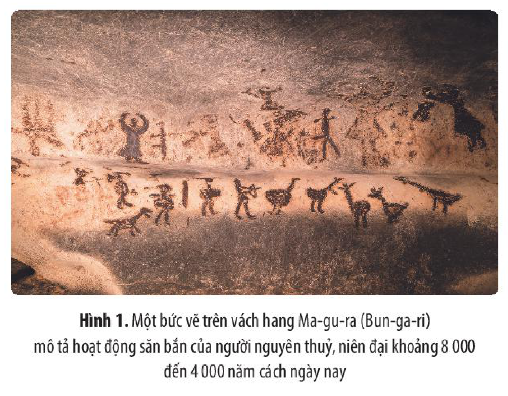
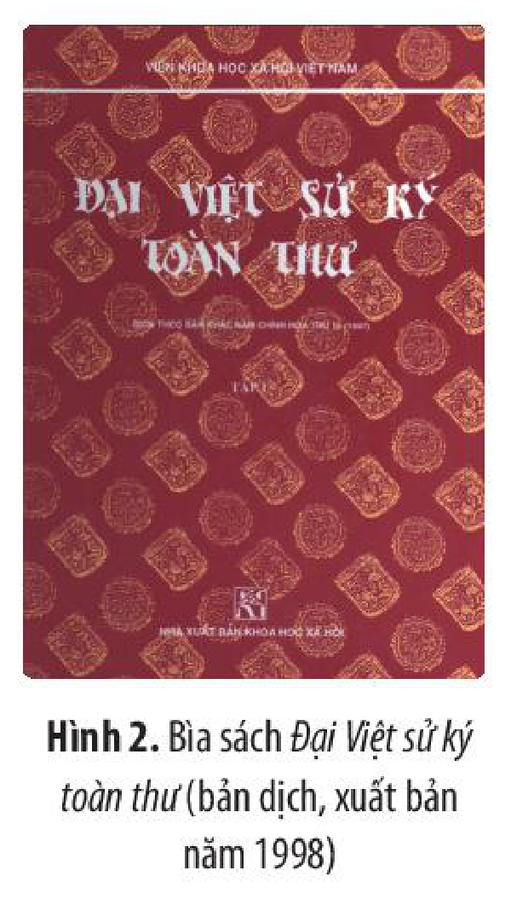
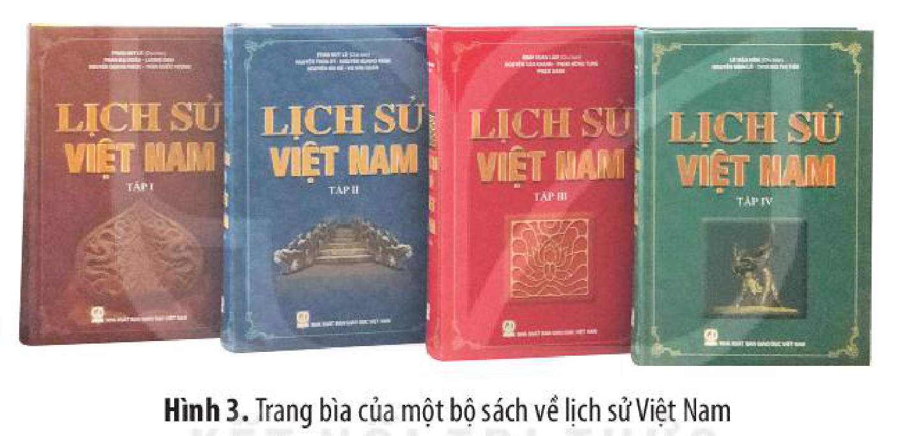
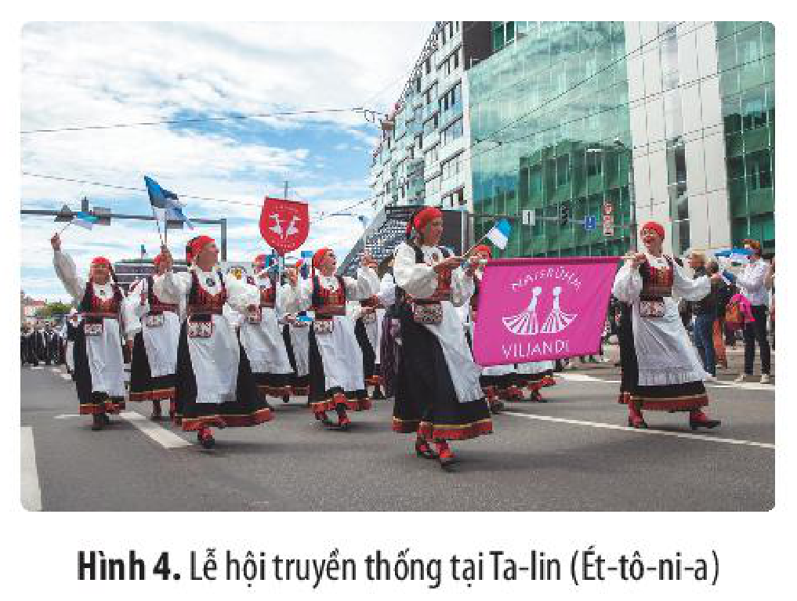

<!-- pdf:16 -->

# BÀI 2: TRI THỨC LỊCH SỬ VÀ CUỘC SỐNG

## 🎯 Học xong bài này, em sẽ:

- Nêu được vai trò và ý nghĩa của tri thức lịch sử thông qua ví dụ cụ thể.
- Giải thích được sự cần thiết phải học tập lịch sử suốt đời.
- Vận dụng được kiến thức, bài học lịch sử để giải thích những vấn đề thời sự trong nước và thế giới, những vấn đề trong thực tiễn cuộc sống (ở mức độ đơn giản).
- Quan tâm, yêu thích và tham gia các hoạt động tìm hiểu lịch sử, văn hoá của Việt Nam và thế giới.

## 🔴 Mở đầu

Lịch sử là những gì đã diễn ra trong quá khứ. Tại sao chúng ta lại phải nghiên cứu, tìm hiểu, phục dựng lại lịch sử? Chia sẻ hiểu biết của em về ý nghĩa và vai trò của tri thức lịch sử đối với cuộc sống hiện tại của mỗi cá nhân và xã hội.

## 1. Vai trò, ý nghĩa của tri thức lịch sử

Cuộc sống của mỗi con người, mỗi gia đình, mỗi dân tộc và toàn nhân loại đều có quá khứ, hiện tại và tương lai.

Chúng không tách biệt nhau mà luôn luôn gắn bó, liên hệ chặt chẽ với nhau. Để hiểu biết hiện tại, dự đoán và có niềm tin vào tương lai, người ta không thể không tìm hiểu về quá khứ, bởi vì hiện tại luôn kế thừa và được xây dựng trên nền tảng của những gì quá khứ để lại. Vì thế, người xưa thường nói: “Ôn cố, tri tân” (Ôn cũ, biết mới).

Tìm hiểu về cội nguồn là một nhu cầu tự thân của con người. Từ thuở xa xưa, con người đã quan tâm đến việc tìm hiểu về cội nguồn của bản thân, gia đình, dòng họ và cộng đồng. Đồng thời, họ cũng luôn tìm cách lưu giữ, truyền lại cho thế hệ sau những kinh nghiệm, truyền thống, tri thức, khát vọng,... bằng nhiều hình thức khác nhau như: khắc hoạ trên vách đá, đồ vật; gửi gắm trong sử thi; thực hành nghi lễ; lập gia phả;... Về sau, các ghi chép lịch sử, thư tịch và công trình nghiên cứu lịch sử ra đời.

<!-- pdf:17 -->

*Hình 1. Một bức vẽ trên vách hang Ma-gu-ra (Bun-ga-ri) mô tả hoạt động săn bắn của người nguyên thuỷ, niên đại khoảng 8 000 đến 4 000 năm cách ngày nay*

*Hình 2. Bìa sách Đại Việt sử ký toàn thư (bản dịch, xuất bản năm 1998)*

*Hình 3. Trang bìa của một bộ sách về lịch sử Việt Nam*

<!-- term: Vai trò, ý nghĩa của tri thức lịch sử -->
Lịch sử cung cấp cho con người những thông tin hữu ích về quá khứ của chính con người và xã hội loài người. Nhờ đó, con người biết được về nguồn gốc, tổ tiên của bản thân, gia đình, dòng họ, dân tộc và toàn nhân loại.

<!-- term: Vai trò, ý nghĩa của tri thức lịch sử -->
Với mỗi cộng đồng, dân tộc, hiểu biết về lịch sử chính là một trong những yếu tố cốt lõi tạo nên ý thức dân tộc và bản sắc văn hoá của cộng đồng, dân tộc đó.

> TƯ LIỆU.
>
> “Sử để ghi việc, mà việc hay hoặc dở đều dùng làm gương răn cho đời sau.”
>
> *(Ngô Sỹ Liên và các sử thần nhà Lê, Đại Việt sử ký toàn thư, Tập I, NXB Khoa học xã hội, Hà Nội, 1998, tr. 101)*
>
> “Dân ta phải biết sử ta,
> Cho tường gốc tích nước nhà Việt Nam”.
>
> *(Hồ Chí Minh, Lịch sử nước ta, 1942)*

<!-- pdf:18 -->

> ❓ 1. Thảo luận về các ý kiến được trích dẫn ở Tư liệu (tr. 16) để làm rõ vai trò và ý nghĩa của lịch sử.
>
> 2. Hãy tìm hiểu về truyền thống ngôi trường mà em đang theo học. Chia sẻ cảm xúc và suy nghĩ của em khi biết được những thông tin đó.

## 2. Học tập và tìm hiểu lịch sử suốt đời

### a) Sự cần thiết của việc học tập, khám phá lịch sử suốt đời

<!-- term: Sự cần thiết của việc học tập, khám phá lịch sử suốt đời -->
Trong cuộc sống hằng ngày, chúng ta luôn cần hiểu biết và vận dụng những tri thức, kinh nghiệm từ quá khứ vào cuộc sống hiện tại, định hướng cho tương lai.

<!-- term: Sự cần thiết của việc học tập, khám phá lịch sử suốt đời -->
Nhiều sự kiện, quá trình lịch sử hiện nay vẫn còn là bí ẩn cho dù đã có những cách giải thích khác nhau được đưa ra. Việc tồn tại những khoảng trống, những bí ẩn trong nghiên cứu lịch sử chính là cơ hội thôi thúc lớp người đi sau tham gia tìm tòi, khám phá để hoàn chỉnh thêm nhận thức chung, làm giàu tri thức lịch sử.

Các kim tự tháp là di sản tiêu biểu của Ai Cập cổ đại và được xem là một trong những kì quan trong lịch sử văn minh nhân loại. Tuy nhiên, đến nay người ta vẫn chưa trả lời chính xác được câu hỏi: Những kim tự tháp đó đã được xây dựng như thế nào?

<!-- term: Sự cần thiết của việc học tập, khám phá lịch sử suốt đời -->
Hiện nay, nhân loại đang sống trong kỉ nguyên toàn cầu hoá. Khám phá lịch sử giúp chúng ta biết được những thành tựu văn minh của nhân loại qua các thời kì, hiểu được những kinh nghiệm, rút ra những bài học có giá trị từ lịch sử các nước khác, phòng tránh được những sai lầm,...

<!-- term: Sự cần thiết của việc học tập, khám phá lịch sử suốt đời -->
Hiểu biết sâu sắc về lịch sử và văn hoá dân tộc Việt Nam, của các nước trong khu vực và thế giới giúp chúng ta hội nhập thành công. Nhờ đó, chúng ta vừa biết cách tôn trọng sự khác biệt, đa dạng về truyền thống và văn hoá của các dân tộc, chủ động tiếp thu có chọn lọc những thành tựu của nhân loại, vừa biết cách tôn vinh, bảo tồn, phát huy giá trị tốt đẹp và bản sắc văn hoá Việt Nam.

<!-- term: Sự cần thiết của việc học tập, khám phá lịch sử suốt đời -->
Ngày nay, tri thức lịch sử và văn hoá chính là nguồn cảm hứng và ý tưởng cho nhiều sáng tạo trong các ngành công nghiệp văn hoá, phát triển du lịch,... Học tập và tìm hiểu lịch sử cũng đưa lại cho chúng ta những cơ hội nghề nghiệp mới đầy thú vị.

*Hình 4. Lễ hội truyền thống tại Ta-lin (Ét-tô-ni-a)*

<!-- pdf:19 -->

### b) Kết nối lịch sử với cuộc sống, cuộc sống với lịch sử

Trong cuộc sống hằng ngày, chúng ta đã và đang bắt gặp lịch sử ở khắp mọi nơi. Lịch sử hiện hữu trong mỗi nếp nhà, trên từng con phố, trong mỗi bản làng,... Nếu chú ý quan sát, khi đi trên mỗi con phố, nẻo đường, chúng ta sẽ nhận thấy lịch sử có mặt ở khắp nơi như: một đình làng, nhà thờ cổ, một tượng đài hay một quảng trường,... Và ngôi trường của em cũng có câu chuyện lịch sử của riêng mình.

Nếu muốn, em có thể tìm hiểu: Những nhà thờ, đình làng, chùa, đền, miếu ở quê em được xây dựng khi nào? Ai là người xây dựng nên chúng? Ai được thờ trong đó?... Ngay cả ngôi trường của các em nữa: Nó được xây dựng từ bao giờ? Tại sao lại có tên như vậy? Hiệu trưởng đầu tiên là ai? Những học sinh nổi tiếng của trường là ai?...

<!-- term: Hình thức học tập và tìm hiểu lịch sử -->
Tham quan các bảo tàng, các khu tưởng niệm, các di tích, hay đơn giản hơn là đọc sách, truyện, xem phim, nghe các bài hát “đi cùng năm tháng”,... cũng là cách để tìm hiểu, học tập lịch sử.

Việc tìm hiểu lịch sử như thế rất gần gũi, thú vị mà lại hữu ích và không quá khó khăn, đúng không nào!

> ❓ 1. Vì sao đặt ra vấn đề học tập, khám phá lịch sử suốt đời?
>
> 2. Hãy kể tên một số bộ phim, chương trình truyền hình,... ở Việt Nam sử dụng chất liệu là tri thức lịch sử và văn hoá mà em biết.
>
> 3. Có thể học tập và tìm hiểu lịch sử qua các hình thức nào? Hình thức nào giúp em có hứng thú và đạt hiệu quả cao nhất?

## ✏️ Luyện tập và vận dụng

Tri thức lịch sử có ý nghĩa và vai trò như thế nào đối với cuộc sống? Hãy nêu một số ví dụ.

Có quan điểm cho rằng: Học tập lịch sử chỉ diễn ra ở trong các lớp học và khi chúng ta còn là học sinh, sinh viên. Theo em, quan điểm đó đúng hay sai? Vì sao?

## 📷 Danh sách hình trong bài

| Mã hình | Trang PDF | Vị trí trong bài | Chú thích gốc |
| --- | --- | --- | --- |
| H10-lich_su-b02-01 | 17 | Mục 1 | Hình 1. Một bức vẽ trên vách hang Ma-gu-ra (Bun-ga-ri) mô tả hoạt động săn bắn của người nguyên thuỷ, niên đại khoảng 8 000 đến 4 000 năm cách ngày nay |
| H10-lich_su-b02-02 | 17 | Mục 1 | Hình 2. Bìa sách Đại Việt sử ký toàn thư (bản dịch, xuất bản năm 1998) |
| H10-lich_su-b02-03 | 17 | Mục 1 | Hình 3. Trang bìa của một bộ sách về lịch sử Việt Nam |
| H10-lich_su-b02-04 | 18 | Mục 2.a | Hình 4. Lễ hội truyền thống tại Ta-lin (Ét-tô-ni-a) |
