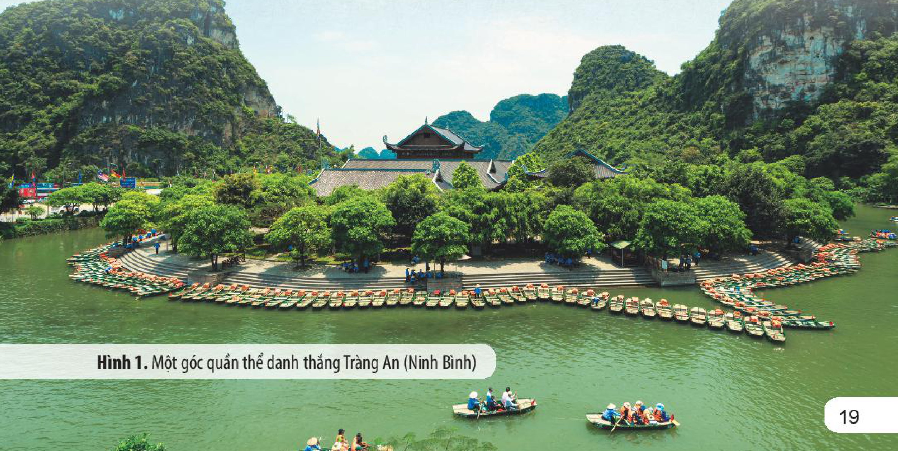
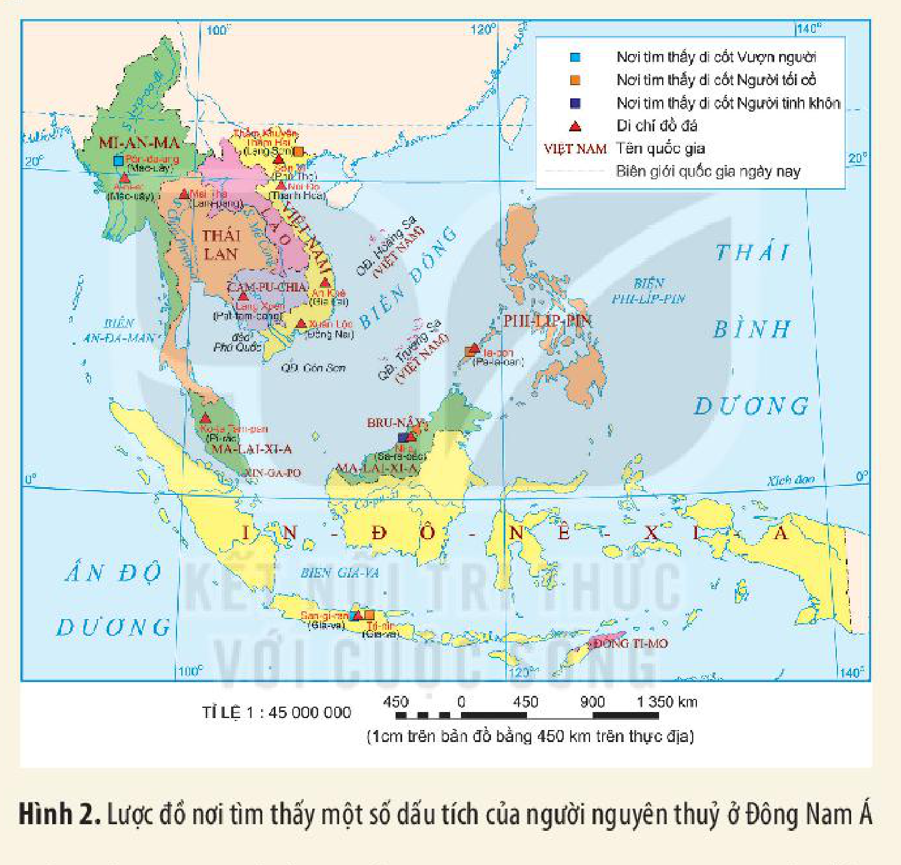
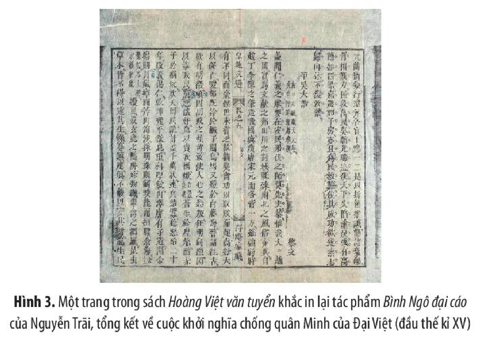
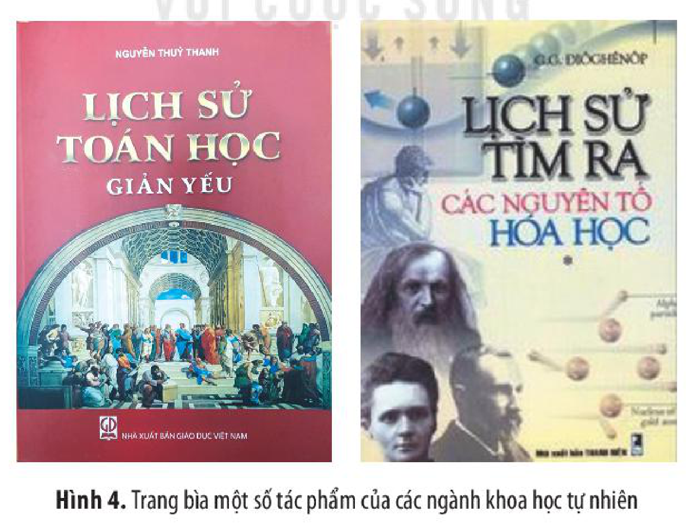
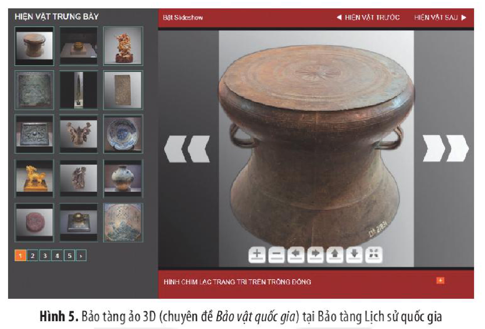

<!-- pdf:20 -->

# BÀI 3: SỬ HỌC VỚI CÁC LĨNH VỰC KHOA HỌC

## 🎯 Học xong bài này, em sẽ:

- Nêu được vai trò của các ngành khoa học tự nhiên và công nghệ đối với nghiên cứu lịch sử.
- Phân tích được mối liên hệ giữa Sử học với các ngành khoa học xã hội và nhân văn khác.
- Giải thích được Sử học là một môn khoa học có tính liên ngành, sự hỗ trợ của Sử học đối với các ngành khoa học tự nhiên và công nghệ.

## 🔴 Mở đầu

Quần thể danh thắng Tràng An (Ninh Bình) là Di sản thế giới hỗn hợp đầu tiên của Việt Nam. Để chuẩn bị hồ sơ khoa học thuyết minh về di sản trình UNESCO, nhiệm vụ nghiên cứu toàn diện về giá trị lịch sử – văn hoá, địa chất địa mạo, giá trị thẩm mĩ,... của danh thắng đã được triển khai. Nhờ đó, danh thắng Tràng An đã được ghi danh là Di sản văn hoá và thiên nhiên thế giới. Như vậy, để khẳng định đầy đủ giá trị của một di sản văn hoá nói riêng và lịch sử nói chung cần có sự phối hợp, sử dụng thành tựu nghiên cứu của nhiều lĩnh vực khoa học khác nhau. Vấn đề đặt ra: Các lĩnh vực khoa học có vai trò như thế nào trong nghiên cứu lịch sử? Ngược lại, Sử học có đóng góp gì trong sự phát triển của các lĩnh vực khoa học khác?

*Hình 1. Một góc quần thể danh thắng Tràng An (Ninh Bình)*
<!-- ocr-ok: chú thích Hình 1 nằm trên nền ảnh cuối trang p0020.png nên OCR bỏ sót -->

<!-- pdf:21 -->

## 1. Sử học – môn khoa học có tính liên ngành

<!-- term: Tính liên ngành của Sử học -->
Sử học là ngành khoa học nghiên cứu về toàn bộ đời sống của loài người trong quá khứ, trên tất cả các lĩnh vực: chính trị, quân sự, kinh tế, xã hội, văn hoá, khoa học, giáo dục,... Vì vậy, trong quá trình nghiên cứu, nhà sử học cần phải phối hợp sử dụng thông tin và phương pháp của các ngành khoa học khác nhau để tìm hiểu một cách toàn diện, sâu sắc, hiệu quả và khoa học về từng lĩnh vực của đời sống xã hội. Nhờ thế, nhà sử học mới có thể hiểu đúng và ngày càng đầy đủ hơn về quá khứ của loài người. Sử học được coi là một môn khoa học có tính liên ngành là vì vậy.

> TƯ LIỆU 1.

*Hình 2. Lược đồ nơi tìm thấy một số dấu tích của người nguyên thuỷ ở Đông Nam Á*

> TƯ LIỆU 2. Khi nghiên cứu về nền văn hoá Đông Sơn ở Việt Nam, các nhà khảo cổ học đã xác định niên đại của các mẫu di vật khai quật được tại một số di chỉ bằng đồng vị phóng xạ $^{14}\text{C}$.

| Địa điểm | Niên đại $^{14}\text{C}$ (năm) | Niên đại theo dương lịch |
| --- | --- | --- |
| Đông Sơn (Thanh Hoá) | 2820 ± 12 | Khoảng thế kỉ IX TCN |
| Việt Khê (Hải Phòng) | 2480 ± 100 | Khoảng thế kỉ V TCN |
| Làng Vạc (Nghệ An) | 1990 ± 85 | Khoảng thế kỉ I TCN |

> *(Theo Phan Huy Lê (Chủ biên), Lịch sử Việt Nam, Tập I, NXB Giáo dục Việt Nam, Hà Nội, 2012, tr. 116)*

<!-- pdf:22 -->

> TƯ LIỆU 3. Thống kê tỉ lệ phân bố ruộng đất công và tư ở một số địa phương dưới thời Nguyễn

| TT | Địa phương | Loại ruộng đất: Ruộng công (đơn vị: %) | Loại ruộng đất: Ruộng tư (đơn vị: %) | Loại ruộng đất: Các loại khác (đơn vị: %) | Năm |
| --- | --- | --- | --- | --- | --- |
| 1 | Hà Đông | 22,12 | 65,34 | 12,54 | 1805 |
| 2 | Thái Bình | 31,43 | 53,24 | 15,33 | 1805 |
| 3 | Bình Định | 8,71 | 89,62 | 1,67 | 1815 |
| 4 | Phú Yên | 1,34 | 98,66 | - | 1815 |
| 5 | Nam Bộ | 7,85 | 92,15 | - | 1815 |
<!-- ocr-ok: bảng thống kê Tư liệu 3 có tiêu đề gộp cột và dấu phẩy thập phân bị OCR đọc lệch (đối chiếu p0022.png) -->

> *(Theo Phan Huy Lê (Chủ biên), Lịch sử Việt Nam, Tập II, NXB Giáo dục Việt Nam, Hà Nội, 2012, tr. 707)*

> ❓ 1. Để có được thông tin trong các tư liệu 1, 2, 3 (tr. 20 – 21) các nhà sử học đã sử dụng kiến thức hoặc phương pháp của những ngành khoa học nào? Các phương pháp đó có tác dụng thế nào khi nghiên cứu sự kiện, vấn đề lịch sử liên quan?
>
> 2. Tại sao khi nghiên cứu lịch sử phải kết hợp kiến thức và phương pháp liên ngành?

## 2. Mối liên hệ giữa Sử học và các ngành khoa học xã hội, nhân văn

<!-- term: Khoa học xã hội và nhân văn -->
Khoa học xã hội và nhân văn là một lĩnh vực khoa học bao gồm toàn bộ các ngành khoa học nghiên cứu về các vấn đề, phương diện của con người như: Ngôn ngữ, Văn hoá, Văn học, Tâm lí, Triết học, Kinh tế, Khoa học chính trị, Xã hội học, Nhân học, Địa lí kinh tế – xã hội,...

Quan hệ giữa Sử học với các ngành khoa học xã hội và nhân văn là mối quan hệ tương tác hai chiều.

### a) Mối liên hệ của Sử học với các ngành khoa học xã hội và nhân văn

<!-- term: Mối liên hệ của Sử học với các ngành khoa học xã hội và nhân văn -->
Các công trình thuộc lĩnh vực khoa học xã hội và nhân văn đều phản ánh hiện thực cuộc sống hiện tại hoặc trong quá khứ và đều không thể thoát li khỏi bối cảnh xuất hiện của nó với những nhân vật, sự kiện, vấn đề cụ thể. Vì vậy, lịch sử đời sống xã hội chính là chất liệu, là nguồn cảm hứng đưa đến sự ra đời của các công trình, tác phẩm của các ngành khoa học xã hội và nhân văn, đồng thời cũng là tấm gương phản chiếu giá trị của các công trình, tác phẩm đó với cuộc sống.

<!-- pdf:23 -->

*Hình 3. Một trang trong sách Hoàng Việt văn tuyển khắc in lại tác phẩm Bình Ngô đại cáo của Nguyễn Trãi, tổng kết về cuộc khởi nghĩa chống quân Minh của Đại Việt (đầu thế kỉ XV)*

> TƯ LIỆU 4. Một số hồi trong tác phẩm *Hoàng Lê nhất thống chí* thế kỉ XVIII:
>
> *Hồi 1.* Đặng Tuyên Phi được yêu dấu, đứng đầu hậu cung. Vương Thế Tử bị truất ngôi, ra ở nhà kín.
>
> *Hồi 2.* Lập Điện Đô, bảy quan nhận di chúc. Giết Huy Quận, ba quân phò Trịnh Vương.
>
> *Hồi 9.* Tướng Tây Sơn Vũ Văn Nhậm đem quân lấn ngoài bờ cõi. Quan Bình chương Trần Công Xán vâng mệnh bàn việc biên cương.
>
> *Hồi 11.* Tây Sơn lại kéo vào thành chiếm giữ đất nước. Chiêu Thống ba phen tính chước khôi phục kinh đô.
>
> *Hồi 12.* Lê sứ thần qua đất Bắc xin quân. Tôn đốc bộ tới ải Nam truyền hịch.
>
> *Hồi 14.* Đánh Ngọc Hồi, quân Thanh bị thua trận. Bỏ Thăng Long, Chiêu Thống trốn ra ngoài.
>
> *Hồi 15.* Dẹp yên cõi Bắc, Nguyễn Huệ được phong. Đánh phá Cao Bằng, Duy Chỉ bị hại.
>
> *(Theo Ngô Gia văn phái, Hoàng Lê nhất thống chí, bản dịch của Nguyễn Đức Vân – Kiều Thu Hoạch, NXB Văn học, Hà Nội, 1987)*

### b) Mối liên hệ của các ngành khoa học xã hội và nhân văn với Sử học

<!-- term: Mối liên hệ của các ngành khoa học xã hội và nhân văn với Sử học -->
Trong quá trình nghiên cứu lịch sử, các ngành khoa học xã hội và nhân văn lại hỗ trợ đắc lực cho việc tìm hiểu, phục dựng quá khứ.

<!-- term: Mối liên hệ của các ngành khoa học xã hội và nhân văn với Sử học -->
Sử học luôn sử dụng tri thức, phương pháp nghiên cứu, thành tựu,... của nhiều ngành như: Triết học, Văn học, Địa lí, Luật học, Tâm lí học, Xã hội học,... để mô tả, phục dựng đối tượng nghiên cứu, cũng như giải thích, chứng minh, khái quát,... trên cơ sở đó vạch ra những triết lí, rút ra bài học hoặc quy luật lịch sử. Nhờ đó, nhận thức lịch sử được chính xác, đầy đủ và sâu sắc hơn.

<!-- pdf:24 -->

Ví dụ: Khai thác một số tác phẩm văn học như *Tắt đèn* của Ngô Tất Tố, *Bỉ vỏ* của Nguyên Hồng, *Chí Phèo* của Nam Cao, *Số đỏ* của Vũ Trọng Phụng,... giúp chúng ta hiểu biết một cách sinh động hơn về đời sống xã hội ở nông thôn và thành thị Việt Nam trong những năm 1930 – 1945.

> ❓ 1. Tư liệu 4 (tr. 22) giúp em biết đến những sự kiện lịch sử nào? Hãy chỉ ra một số sự kiện hoặc bối cảnh lịch sử được đề cập trong các hồi của tác phẩm.
>
> 2. Giữa Sử học với các ngành khoa học xã hội và nhân văn có mối quan hệ thế nào? Hãy lấy ví dụ để chứng minh.

## 3. Sử học với các ngành khoa học tự nhiên và công nghệ

<!-- term: Khoa học tự nhiên và công nghệ -->
Lĩnh vực khoa học tự nhiên bao gồm một số ngành cơ bản như: Toán học, Vật lí học, Hoá học, Sinh học, Thiên văn học, Tin học,... Hơn nữa, trong xu thế phát triển như vũ bão của khoa học, công nghệ hiện nay đã xuất hiện hàng loạt các ngành mới thuộc lĩnh vực công nghệ như: Công nghệ thông tin, Viễn thám, Trí tuệ nhân tạo, Internet vạn vật, Thực tế ảo, Công nghệ 3D,...

### a) Vai trò của Sử học với các ngành khoa học tự nhiên và công nghệ

<!-- term: Vai trò của Sử học với các ngành khoa học tự nhiên và công nghệ -->
Các ngành khoa học tự nhiên và công nghệ cũng là một bộ phận của đời sống xã hội, do con người sáng tạo ra. Do vậy, khoa học tự nhiên và công nghệ cũng là đối tượng nghiên cứu của Sử học. Khi đó, Sử học không đi sâu vào nội dung của các khoa học tự nhiên và công nghệ, mà chủ yếu chỉ xem xét nó ở góc độ lịch sử. Ví dụ: Thành tựu của ngành ấy ra đời trong bối cảnh, điều kiện lịch sử nào? Tác dụng, ý nghĩa của nó đối với sự phát triển xã hội ra sao? Nó phản ánh lịch sử xã hội lúc bấy giờ thế nào?...

*Hình 4. Trang bìa một số tác phẩm của các ngành khoa học tự nhiên*

<!-- pdf:25 -->

<!-- term: Vai trò của Sử học với các ngành khoa học tự nhiên và công nghệ -->
Hơn nữa, bất kì ngành khoa học nào cũng có lịch sử của chính nó. Việc tái hiện toàn diện, đầy đủ lịch sử của từng ngành khoa học tự nhiên và công nghệ giúp cho các nhà khoa học thuộc lĩnh vực đó hiểu rõ các vấn đề đã từng được các nhà khoa học đi trước đặt ra và giải quyết như thế nào. Việc này vừa giúp các nhà khoa học đi sau không lặp lại sai lầm của người đi trước, lại có thể kế thừa tri thức, kinh nghiệm của người đi trước.

> ❓ 1. Khai thác Hình 4 (tr. 23) và cho biết: Các tác phẩm như trong hình có được coi là tác phẩm lịch sử không? Vì sao? Hãy chỉ ra vai trò của Sử học đối với ngành Toán học, Hoá học thông qua các tác phẩm đó.
>
> 2. Hãy lấy ví dụ khác về sự đóng góp của Sử học đối với một ngành khoa học tự nhiên và công nghệ.

### b) Vai trò của các ngành khoa học tự nhiên và công nghệ đối với Sử học

<!-- term: Vai trò của các ngành khoa học tự nhiên và công nghệ đối với Sử học -->
Đối tượng nghiên cứu của Sử học là toàn bộ đời sống của loài người trong quá khứ, bao gồm cả các tương tác của con người với tự nhiên. Vì vậy, nhà sử học cần phải sử dụng nhiều thông tin và phương pháp của các ngành khoa học tự nhiên và công nghệ để tái hiện đời sống trong quá khứ của con người.

<!-- term: Vai trò của các ngành khoa học tự nhiên và công nghệ đối với Sử học -->
Ví dụ:
– Thông tin và phương pháp của Toán học để thống kê, phân tích, trình bày các thành tựu kinh tế – xã hội, tính toán, đo đạc một số công trình trong quá khứ,...
– Thông tin và phương pháp của Vật lí học để giám định sử liệu, trình bày các thành tựu về khoa học – kĩ thuật,...
– Tài liệu, phương pháp của các ngành Địa lí – Địa chất, Cổ sinh học, Vật lí, Hoá học, Sinh học, Y học,... để xác định tính chính xác của sự kiện, cũng như phân tích để đoán định niên đại của các di vật lịch sử.
– Ứng dụng công nghệ số, viễn thám, trí tuệ nhân tạo, internet vạn vật, thực tế ảo,... để hỗ trợ quá trình tìm kiếm dấu vết lịch sử, thu thập, xử lí sử liệu, đo đạc và xây dựng bản đồ về sự kiện, không gian lịch sử, cũng như trình bày và tái hiện quá khứ lịch sử một cách sinh động, hấp dẫn và hiệu quả,...

<!-- pdf:26 -->

*Hình 5. Bảo tàng ảo 3D (chuyên đề Bảo vật quốc gia) tại Bảo tàng Lịch sử quốc gia*

> ❓ 1. Dựa vào thông tin về Di sản văn hoá và thiên nhiên thế giới Tràng An (tr. 19), hãy cho biết: Để xác định giá trị của danh thắng này, các nhà khoa học đã dựa vào phương pháp, kết quả nghiên cứu của những ngành khoa học nào?
>
> 2. Hãy cho biết vai trò của các ngành khoa học tự nhiên và công nghệ đối với Sử học.

## ✏️ Luyện tập và vận dụng

1. Nêu và phân tích một số ví dụ để làm rõ về việc sử dụng tri thức, phương pháp liên ngành trong nghiên cứu lịch sử.

2. Thông qua ví dụ cụ thể, hãy phân tích mối liên hệ giữa Sử học với một lĩnh vực/ngành khoa học xã hội và nhân văn hoặc khoa học tự nhiên mà em thích.

1. Hãy xây dựng một bài giới thiệu về trường học/gia đình của em,... trong những năm gần đây (lưu ý: trong bài viết thể hiện việc vận dụng những thông tin, kiến thức, kĩ năng, phương pháp liên ngành).

2. Ở trường, em đã được trải nghiệm ứng dụng công nghệ nào trong giờ học lịch sử? Hãy nêu tác dụng của nó.

## 📷 Danh sách hình trong bài

| Mã hình | Trang PDF | Vị trí trong bài | Chú thích gốc |
| --- | --- | --- | --- |
| H10-lich_su-b03-01 | 20 | Mở đầu (ảnh nền tràn lề cuối trang dưới khung Mở đầu) | Hình 1. Một góc quần thể danh thắng Tràng An (Ninh Bình) |
| H10-lich_su-b03-02 | 21 | Mục 1 (Tư liệu 1) | Hình 2. Lược đồ nơi tìm thấy một số dấu tích của người nguyên thuỷ ở Đông Nam Á |
| H10-lich_su-b03-03 | 23 | Mục 2.a | Hình 3. Một trang trong sách Hoàng Việt văn tuyển khắc in lại tác phẩm Bình Ngô đại cáo của Nguyễn Trãi, tổng kết về cuộc khởi nghĩa chống quân Minh của Đại Việt (đầu thế kỉ XV) |
| H10-lich_su-b03-04 | 24 | Mục 3.a | Hình 4. Trang bìa một số tác phẩm của các ngành khoa học tự nhiên |
| H10-lich_su-b03-05 | 26 | Mục 3.b | Hình 5. Bảo tàng ảo 3D (chuyên đề Bảo vật quốc gia) tại Bảo tàng Lịch sử quốc gia |
