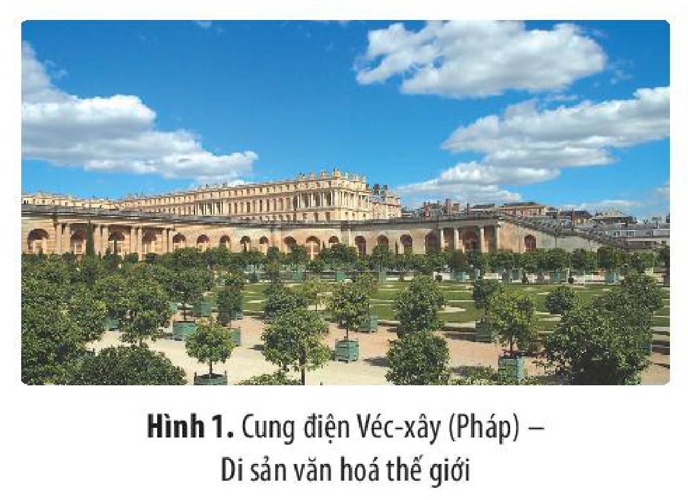
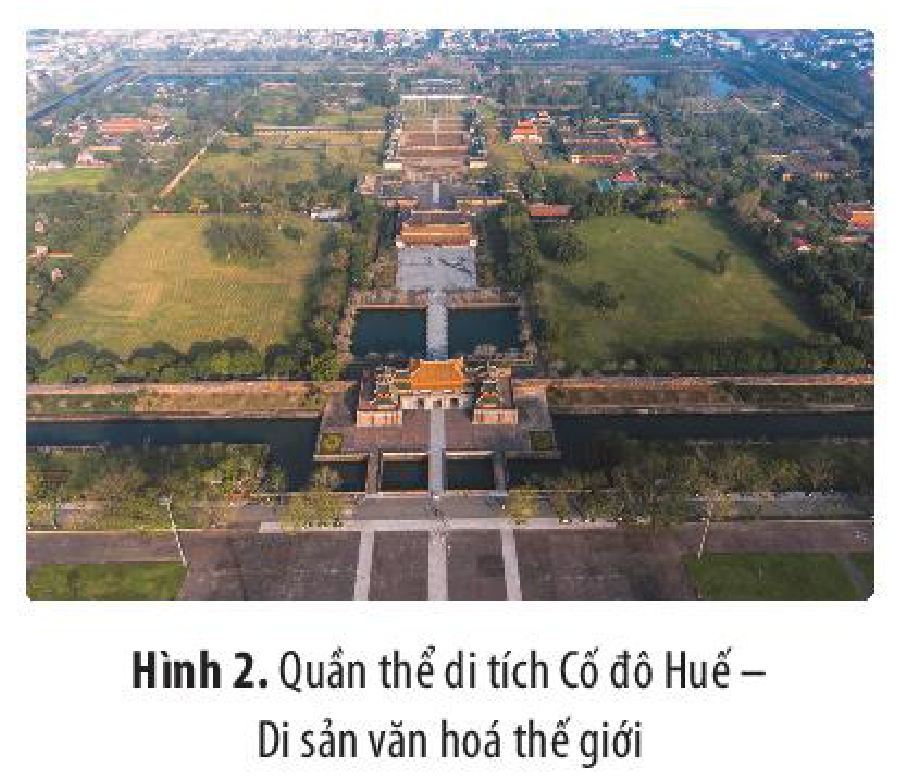
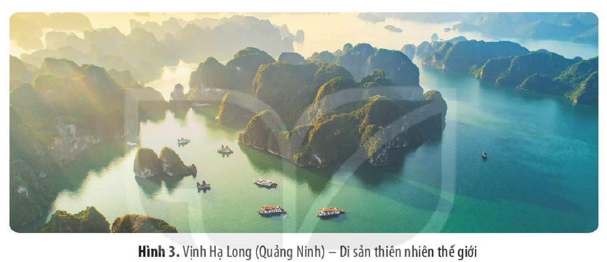
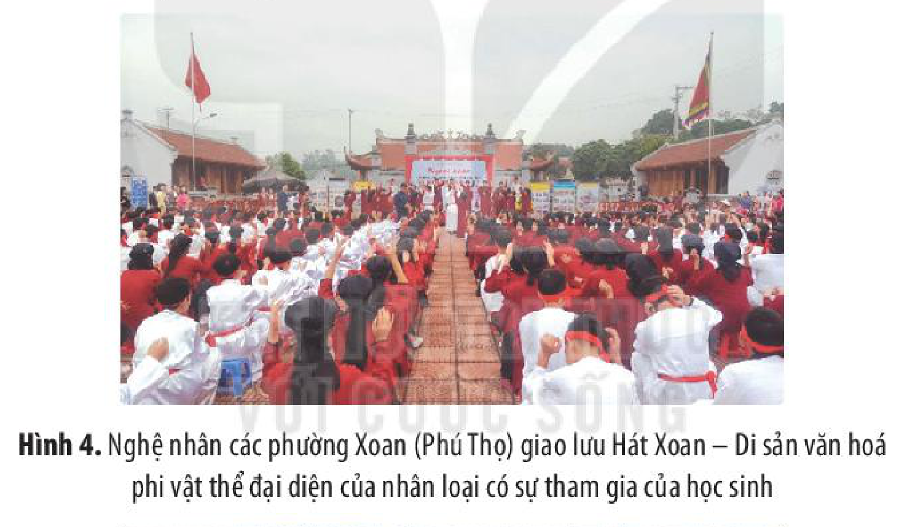
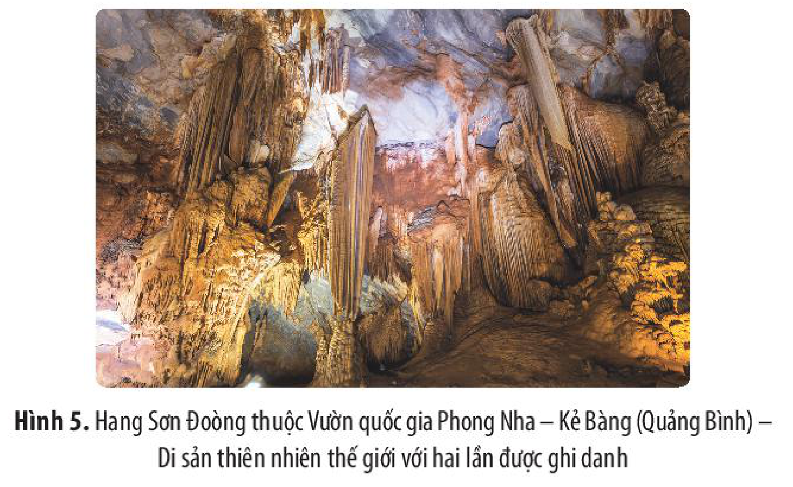
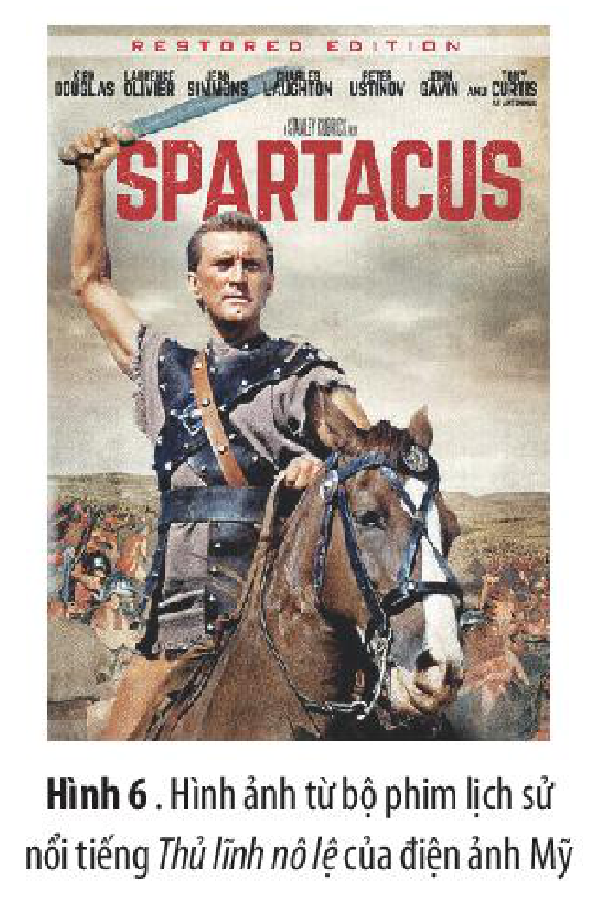
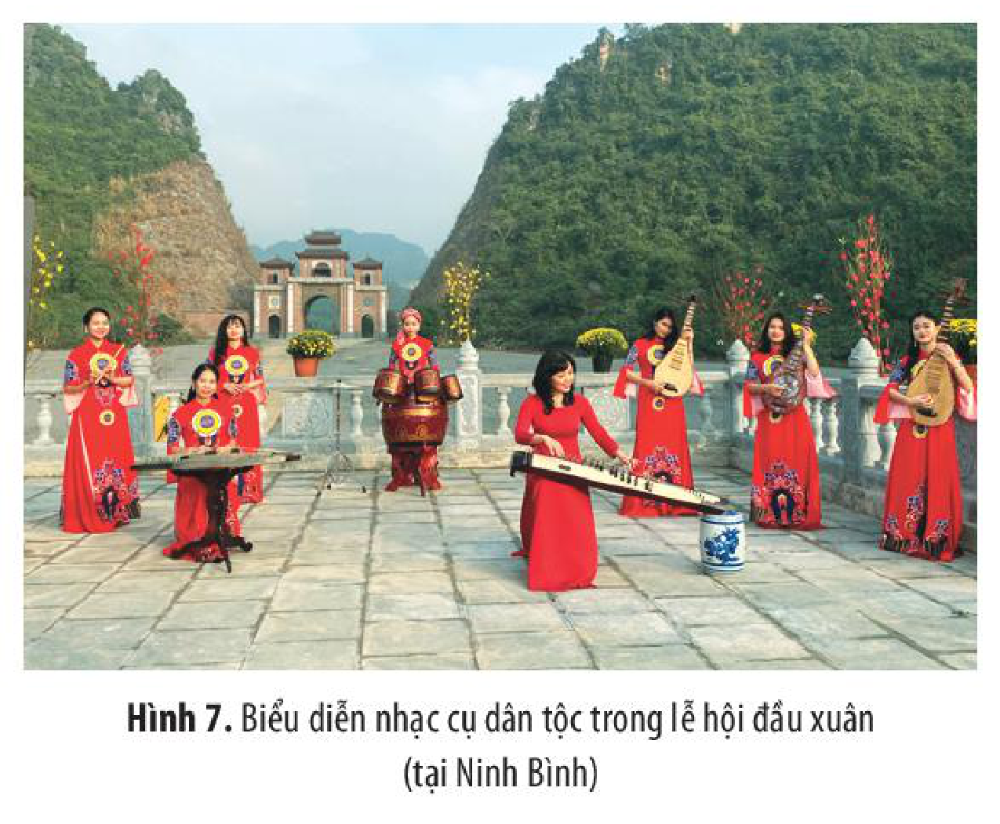
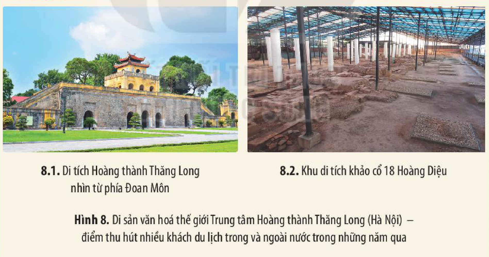

<!-- pdf:27 -->

# BÀI 4: SỬ HỌC VỚI MỘT SỐ LĨNH VỰC, NGÀNH NGHỀ HIỆN ĐẠI

## 🎯 Học xong bài này, em sẽ:

- Trình bày được tác động của các ngành nghề thuộc lĩnh vực công nghiệp văn hoá đối với việc quảng bá tri thức, truyền thống và giá trị lịch sử – văn hoá của dân tộc, nhân loại.
- Giải thích được vai trò của lịch sử và văn hoá đối với sự phát triển du lịch thông qua ví dụ cụ thể.
- Phân tích được vai trò, tác động của du lịch với công tác bảo tồn di tích lịch sử, văn hoá, mối quan hệ giữa Sử học với công tác bảo tồn và phát huy giá trị di sản văn hoá, di sản thiên nhiên, vai trò của Sử học đối với một số ngành, nghề trong lĩnh vực công nghiệp văn hoá.
- Biết cách vận động mọi người xung quanh tham gia bảo vệ các di sản văn hoá, di sản thiên nhiên ở địa phương.

## 🔴 Mở đầu

“Di sản văn hoá, di sản thiên nhiên là những tài sản vô giá và không thể thay thế, không chỉ của một dân tộc mà còn là của nhân loại... Bất kì di sản nào trong số đó biến mất, do xuống cấp hoặc bị huỷ hoại, cũng sẽ làm nghèo đi kho tàng di sản của tất cả các dân tộc trên thế giới”(1). Em hiểu như thế nào về quan điểm nêu trên? Theo em, Sử học có vai trò như thế nào trong việc bảo tồn và phát huy giá trị của di sản văn hoá, di sản thiên nhiên? Trong bối cảnh của nền kinh tế tri thức, Sử học có đóng góp như thế nào trong sự phát triển một số lĩnh vực, ngành nghề hiện đại?

## 1. Sử học với công tác bảo tồn và phát huy giá trị di sản văn hoá, di sản thiên nhiên

### a) Mối quan hệ giữa Sử học với công tác bảo tồn và phát huy giá trị các di sản

<!-- term: Bảo tồn di sản -->
Công tác bảo vệ, bảo quản, tu bổ, phục hồi,... di sản là nhiệm vụ thường xuyên và quan trọng hàng đầu trong công tác quản lí di sản của mỗi quốc gia. Điều cốt lõi trong hoạt động bảo tồn di sản là phải đảm bảo tính nguyên trạng, phải giữ cho được “yếu tố gốc cấu thành di tích”, hay phải đảm bảo “tính xác thực”, “tính toàn vẹn”, “giá trị nổi bật” của di sản, dựa trên cơ sở các cứ liệu và phương pháp khoa học.

*(1) Theo Hướng dẫn thực hiện Công ước di sản thế giới của UNESCO.*

<!-- pdf:28 -->

*Hình 1. Cung điện Véc-xây (Pháp) – Di sản văn hoá thế giới*

*Hình 2. Quần thể di tích Cố đô Huế – Di sản văn hoá thế giới*

*Hình 3. Vịnh Hạ Long (Quảng Ninh) – Di sản thiên nhiên thế giới*

<!-- term: Vai trò của Sử học với công tác bảo tồn và phát huy giá trị di sản -->
Giá trị của một di sản thường thể hiện ở nhiều khía cạnh: lịch sử, văn hoá, kiến trúc, mĩ thuật,... Vì vậy, việc sử dụng những phương pháp nghiên cứu của Sử học với tư cách là một khoa học có tính liên ngành đóng vai trò quan trọng. Kết quả nghiên cứu của Sử học sẽ là cơ sở khoa học cho công tác xác định giá trị, bảo tồn và phát huy giá trị đích thực của di sản vì sự phát triển bền vững trong bối cảnh của đời sống hiện tại.

> ❓ 1. Hãy cho biết: Các di sản được giới thiệu trong các hình 1, 2, 3 sẽ ra sao nếu trong quá trình bảo tồn và phát huy giá trị của chúng không quan tâm đến việc sử dụng, ứng dụng những kết quả nghiên cứu của các ngành khoa học nói chung và Sử học nói riêng?
>
> 2. Hãy phân tích vai trò của Sử học với công tác bảo tồn và phát huy giá trị di sản văn hoá, di sản thiên nhiên.

<!-- pdf:29 -->

### b) Vai trò của công tác bảo tồn và phát huy giá trị di sản văn hoá, di sản thiên nhiên

<!-- term: Vai trò của công tác bảo tồn và phát huy giá trị di sản -->
Di sản văn hoá vật thể gồm nhiều loại hình (thành quách, lăng tẩm, đình, đền, tháp, cung điện, nhà cổ,...), được xây dựng bằng nhiều chất liệu khác nhau (đất, đá, gạch, gỗ, tre, nứa, lá,...), nên có thể bị biến dạng, xuống cấp, hư hỏng theo thời gian,... Công tác bảo tồn và phát huy giá trị di sản góp phần quan trọng nhất trong việc hạn chế cũng như khắc phục có hiệu quả những tác động tiêu cực của điều kiện tự nhiên và của con người.

<!-- term: Vai trò của công tác bảo tồn và phát huy giá trị di sản -->
Loại hình di sản văn hoá phi vật thể cũng đối mặt với nhiều thách thức và nguy cơ mai một. Nhờ công tác bảo tồn di sản, thông qua một số biện pháp khác nhau (sưu tầm, lưu giữ, truyền nghề, trình diễn,...) mà những di sản đó được tái tạo, giữ gìn và được lưu truyền từ thế hệ này sang thế hệ khác.

<!-- term: Vai trò của công tác bảo tồn và phát huy giá trị di sản -->
Đối với di sản thiên nhiên, công tác bảo tồn và phát huy giá trị của di sản góp phần phát triển đa dạng sinh học, làm tăng giá trị khoa học của di sản.

<!-- term: Vai trò của công tác bảo tồn và phát huy giá trị di sản -->
Hơn nữa, khi di sản được bảo tồn và phát huy giá trị sẽ góp phần phát triển kinh tế – xã hội địa phương.

*Hình 4. Nghệ nhân các phường Xoan (Phú Thọ) giao lưu Hát Xoan – Di sản văn hoá phi vật thể đại diện của nhân loại có sự tham gia của học sinh*

*Hình 5. Hang Sơn Đoòng thuộc Vườn quốc gia Phong Nha – Kẻ Bàng (Quảng Bình) – Di sản thiên nhiên thế giới với hai lần được ghi danh*

<!-- pdf:30 -->

> ❓ 1. Hãy phân tích vai trò của công tác bảo tồn, phát huy giá trị của di sản văn hoá, di sản thiên nhiên.
>
> 2. Địa phương em đang sinh sống và học tập có di sản văn hoá, di sản thiên nhiên nào? Theo em, có thể và nên làm gì để bảo tồn, phát huy tốt hơn giá trị của di sản đó?

## 2. Sử học với sự phát triển công nghiệp văn hoá

### a) Vai trò của Sử học đối với một số ngành, nghề trong lĩnh vực công nghiệp văn hoá

<!-- term: Công nghiệp văn hoá -->
Công nghiệp văn hoá là lĩnh vực công nghiệp sản xuất và phân phối các loại hàng hoá dựa trên sự khai thác và phát huy các giá trị của di sản văn hoá vật thể và phi vật thể.

<!-- term: Các ngành công nghiệp văn hoá Việt Nam -->
> TƯ LIỆU 1. Công nghiệp văn hoá Việt Nam bao gồm: quảng cáo; kiến trúc; phần mềm và các trò chơi giải trí; thủ công mĩ nghệ; thiết kế; điện ảnh; xuất bản; thời trang; nghệ thuật biểu diễn; mĩ thuật, nhiếp ảnh và triển lãm; truyền hình và phát thanh; du lịch văn hoá.
>
> *(Theo Chiến lược phát triển các ngành công nghiệp văn hoá đến năm 2020, tầm nhìn đến năm 2030 do Thủ tướng Chính phủ Việt Nam phê duyệt ngày 8 – 9 – 2016)*

Trong thế giới toàn cầu hoá, công nghiệp văn hoá ngày càng có vai trò quan trọng, góp phần tăng cường “sức mạnh mềm” và năng lực cạnh tranh quốc gia, mang lại nhiều lợi ích về vật chất và tinh thần to lớn.

Sử học đóng vai trò rất quan trọng đối với sự phát triển công nghiệp văn hoá.

<!-- term: Vai trò của Sử học đối với công nghiệp văn hoá -->
Sử học cung cấp tri thức, ý tưởng và cảm hứng sáng tạo cho các ngành như xuất bản, điện ảnh, thời trang, kiến trúc,... thông qua các nguồn sử liệu (chữ viết, hình ảnh, hiện vật,...) và các thành tựu nghiên cứu về lịch sử – văn hoá của dân tộc và nhân loại.

> 💡 EM CÓ BIẾT ?
>
> Theo kết quả công bố của Ngân hàng Thế giới năm 2019, tỉ lệ đóng góp doanh thu của ngành công nghiệp văn hoá (bao gồm cả lĩnh vực du lịch văn hoá) đối với tổng doanh thu toàn cầu là xấp xỉ 4,04% và đem lại việc làm chiếm tỉ trọng 2,21% tổng số lao động trên thế giới; lao động trong ngành này có thu nhập cao gấp 2,44 lần so với mặt bằng chung.

<!-- pdf:31 -->

*Hình 6. Hình ảnh từ bộ phim lịch sử nổi tiếng Thủ lĩnh nô lệ của điện ảnh Mỹ*

*Hình 7. Biểu diễn nhạc cụ dân tộc trong lễ hội đầu xuân (tại Ninh Bình)*

> ❓ 1. Khai thác Tư liệu 1 (tr. 29), hãy cho biết công nghiệp văn hoá bao gồm những ngành nào? Theo em, những ngành nào cần sử dụng những chất liệu về lịch sử – văn hoá trong quá trình phát triển?
>
> 2. Quan sát các hình 6, 7, hãy cho biết chất liệu lịch sử – văn hoá có vai trò như thế nào trong các lĩnh vực cụ thể đó?
>
> 3. Hãy phân tích vai trò của Sử học đối với một số ngành, nghề cụ thể của công nghiệp văn hoá.

### b) Vai trò của các ngành nghề thuộc lĩnh vực công nghiệp văn hoá đối với Sử học

<!-- term: Vai trò của công nghiệp văn hoá đối với Sử học -->
Khi công nghiệp văn hoá phát triển đồng nghĩa với việc các thành tựu của Sử học, những tri thức, giá trị về lịch sử, văn hoá, hình ảnh đất nước, con người Việt Nam được quảng bá, lan toả rộng rãi dưới nhiều hình thức sinh động, hấp dẫn. Nhờ vậy, những giá trị và truyền thống lịch sử – văn hoá tốt đẹp ngày càng được củng cố, truyền lại cho các thế hệ sau.

<!-- term: Vai trò của công nghiệp văn hoá đối với Sử học -->
Mặt khác, sự phát triển của công nghiệp văn hoá đã đóng góp một nguồn lực vật chất đáng kể để tái đầu tư cho công tác nghiên cứu, bảo tồn và phát huy các giá trị của các công trình lịch sử – văn hoá.

> ❓ Sự phát triển các ngành trong công nghiệp văn hoá có vai trò thế nào trong việc quảng bá tri thức và bảo tồn truyền thống lịch sử, giá trị văn hoá dân tộc và của nhân loại?

<!-- pdf:32 -->

## 3. Sử học với sự phát triển du lịch

<!-- term: Du lịch văn hoá -->
Du lịch văn hoá là một ngành của công nghiệp văn hoá. Trong xu thế hội nhập, toàn cầu hoá hiện nay, du lịch ngày càng phát huy thế mạnh và giữ vai trò quan trọng trong sự phát triển kinh tế – xã hội ở nhiều quốc gia, trong đó có Việt Nam.

### a) Vai trò của lịch sử và văn hoá đối với sự phát triển du lịch

<!-- term: Tài nguyên du lịch văn hoá -->
> TƯ LIỆU 2. Tài nguyên du lịch văn hoá bao gồm di tích lịch sử – văn hoá, di tích lịch sử cách mạng, khảo cổ, kiến trúc; giá trị văn hoá truyền thống, lễ hội, văn nghệ dân gian và các giá trị văn hoá khác; công trình lao động sáng tạo của con người có thể được sử dụng cho mục đích du lịch.
>
> *(Theo Luật Du lịch năm 2010)*

> TƯ LIỆU 3. Du lịch là một lĩnh vực tăng trưởng tiềm năng cho nền kinh tế châu Âu, tạo ra hơn 10% GDP của EU và sử dụng lực lượng lao động khoảng hơn 10 triệu người. Các khía cạnh văn hoá chiếm khoảng 40% trong giá trị du lịch ở châu Âu. Di sản độc đáo, bao gồm: bảo tàng, nhà hát, di tích khảo cổ học và các thành phố lịch sử,... đã khiến châu lục này trở thành điểm đến du lịch chính.
>
> *(Theo Phơxt Glô-bơn Vi-da, Di sản độc đáo của châu Âu khiến châu lục này trở thành điểm đến du lịch chính, tháng 3 – 2018)*

> TƯ LIỆU 4.

*Hình 8. Di sản văn hoá thế giới Trung tâm Hoàng thành Thăng Long (Hà Nội) – điểm thu hút nhiều khách du lịch trong và ngoài nước trong những năm qua*

> ❓ 1. Khai thác các tư liệu 2, 3, 4, hãy cho biết nội dung phản ánh của các tư liệu có điểm gì chung?
>
> 2. Từ kết quả trả lời câu 1, em hãy cho biết lịch sử và văn hoá có vai trò như thế nào đối với du lịch?

<!-- pdf:33 -->

### b) Vai trò của du lịch đối với việc bảo tồn di tích lịch sử và di sản văn hoá

Trong mối quan hệ tương tác hai chiều, du lịch đã góp phần thúc đẩy việc bảo vệ di sản văn hoá, di tích lịch sử của các quốc gia.

<!-- term: Vai trò của du lịch đối với việc bảo tồn di tích lịch sử và di sản văn hoá -->
Chính nhu cầu tham quan, tìm hiểu, trải nghiệm của du khách đã thôi thúc các cấp chính quyền và nhân dân biết quý trọng, tự hào, quan tâm hơn nữa đến việc gìn giữ, bảo tồn, phục dựng, phát huy những giá trị của di tích, di sản. Đó chính là sự chăm lo bảo tồn và phát huy nguồn lực cốt lõi cho sự phát triển bền vững, hiệu quả của ngành du lịch nói chung và du lịch văn hoá nói riêng.

<!-- term: Vai trò của du lịch đối với việc bảo tồn di tích lịch sử và di sản văn hoá -->
Một phần doanh thu từ du lịch đã được tái đầu tư vào việc bảo tồn, tôn tạo, tôn vinh, phục dựng và quản lí di tích, di sản. Các di sản văn hoá phi vật thể nhờ đó cũng được sưu tầm, nghiên cứu, phục dựng, truyền dạy và tổ chức trình diễn,...

> ❓ Dựa vào kiến thức đã học và thông qua ví dụ cụ thể, hãy phân tích vai trò của du lịch đối với công tác bảo tồn di tích lịch sử, văn hoá.

## ✏️ Luyện tập và vận dụng

1. Hãy kể tên một số di tích lịch sử, di sản văn hoá/di sản thiên nhiên của địa phương em (tỉnh/thành phố/huyện/thị).

2. Địa phương em đã làm gì để bảo tồn và phát huy giá trị của các công trình, di sản văn hoá/di sản thiên nhiên?

1. Giả sử có một công trình thuộc di sản văn hoá đã xuống cấp nghiêm trọng, cần được bảo tồn. Có hai quan điểm:
– Xây công trình tương tự với quy mô kiến trúc lớn hơn và hiện đại hơn trên nền di tích cũ.
– Bảo tồn nguyên trạng di tích.
Nếu được giao nhiệm vụ tư vấn để bảo tồn di tích đó, ý kiến của em thế nào?

2. Giả sử có một chủ đề của hội thảo về du lịch di sản như sau: “Lựa chọn lợi ích về kinh tế hay văn hoá lịch sử? Lợi ích lâu dài hay trước mắt?”. Dựa vào kiến thức đã học và hiểu biết của bản thân, em hãy viết một bài khoảng 200 từ thể hiện quan điểm của em về vấn đề được nêu.

3. Hãy xây dựng kế hoạch hành động để góp phần bảo vệ một di sản ở địa phương.

## 📷 Danh sách hình trong bài

| Mã hình | Trang PDF | Vị trí trong bài | Chú thích gốc |
| --- | --- | --- | --- |
| H10-lich_su-b04-01 | 28 | Mục 1.a | Hình 1. Cung điện Véc-xây (Pháp) – Di sản văn hoá thế giới |
| H10-lich_su-b04-02 | 28 | Mục 1.a | Hình 2. Quần thể di tích Cố đô Huế – Di sản văn hoá thế giới |
| H10-lich_su-b04-03 | 28 | Mục 1.a | Hình 3. Vịnh Hạ Long (Quảng Ninh) – Di sản thiên nhiên thế giới |
| H10-lich_su-b04-04 | 29 | Mục 1.b | Hình 4. Nghệ nhân các phường Xoan (Phú Thọ) giao lưu Hát Xoan – Di sản văn hoá phi vật thể đại diện của nhân loại có sự tham gia của học sinh |
| H10-lich_su-b04-05 | 29 | Mục 1.b | Hình 5. Hang Sơn Đoòng thuộc Vườn quốc gia Phong Nha – Kẻ Bàng (Quảng Bình) – Di sản thiên nhiên thế giới với hai lần được ghi danh |
| H10-lich_su-b04-06 | 31 | Mục 2.a | Hình 6. Hình ảnh từ bộ phim lịch sử nổi tiếng Thủ lĩnh nô lệ của điện ảnh Mỹ |
| H10-lich_su-b04-07 | 31 | Mục 2.a | Hình 7. Biểu diễn nhạc cụ dân tộc trong lễ hội đầu xuân (tại Ninh Bình) |
| H10-lich_su-b04-08 | 32 | Mục 3.a (Tư liệu 4) | Hình 8. Di sản văn hoá thế giới Trung tâm Hoàng thành Thăng Long (Hà Nội) – điểm thu hút nhiều khách du lịch trong và ngoài nước trong những năm qua |
