<!-- pdf:34 -->

# BÀI 5: KHÁI NIỆM VĂN MINH. MỘT SỐ NỀN VĂN MINH PHƯƠNG ĐÔNG THỜI KÌ CỔ – TRUNG ĐẠI

## 🎯 Học xong bài này, em sẽ:

- Trình bày được sự phát triển của các nền văn minh thế giới. Nêu được ý nghĩa của những thành tựu cơ bản của văn minh Ai Cập cổ đại, văn minh Trung Hoa và văn minh Ấn Độ thời kì cổ – trung đại.
- Giải thích và phân biệt được khái niệm văn hoá và văn minh; phân tích được cơ sở hình thành của các nền văn minh phương Đông.
- Biết cách sưu tầm và sử dụng tài liệu lịch sử để tìm hiểu về các nền văn minh phương Đông.
- Biết trân trọng giá trị, có nhận thức, hành động góp phần bảo tồn và phát huy các giá trị di sản và giá trị văn minh nhân loại.

## 🔴 Mở đầu

Tối ngày 3 – 4 – 2021, tại Cai-rô (Ai Cập) đã diễn ra một sự kiện quan trọng với tên gọi “Cuộc diễu hành vàng của các pha-ra-ông”. Trong hoạt động này, 22 xác ướp của 18 pha-ra-ông và 4 nữ hoàng của Ai Cập cổ đại đã được đưa từ Bảo tàng Ai Cập ở Ta-ri-ơ, qua trung tâm Thủ đô Cai-rô, đến “ngôi nhà mới” là Bảo tàng Quốc gia Văn minh Ai Cập ở Phu-xtát. Cuộc diễu hành được tổ chức với những nghi thức trang trọng nhất để tôn vinh nền văn minh Ai Cập cổ đại cùng những giá trị trường tồn của nó. Vì sao những thành tựu văn minh đã hơn 5 000 năm vẫn được nhân loại trân trọng, tôn vinh trong cuộc sống hiện tại? Em hãy chia sẻ những hiểu biết của bản thân về các nền văn minh thế giới thời kì cổ – trung đại và ý nghĩa của những thành tựu văn minh ấy.

**I. KHÁI NIỆM VĂN MINH. KHÁI QUÁT LỊCH SỬ VĂN MINH THẾ GIỚI THỜI KÌ CỔ – TRUNG ĐẠI**

## 1. Khái niệm văn minh

<!-- term: Văn minh -->
*Văn minh* là sự tiến bộ về vật chất và tinh thần của xã hội loài người; là trạng thái phát triển cao của nền văn hoá, khi xã hội loài người vượt qua trình độ của thời kì dã man.

<!-- pdf:35 -->

Những tiêu chuẩn cơ bản để nhận diện văn minh là: nhà nước, đô thị, chữ viết, những tiến bộ về tổ chức xã hội, luân lí và kĩ thuật để cải thiện cuộc sống của con người.

<!-- term: Văn hoá -->
*Văn hoá* là tổng thể những giá trị vật chất và tinh thần mà con người sáng tạo nên. Văn hoá tạo ra đặc tính, bản sắc của một xã hội hoặc nhóm người trong xã hội.

> TƯ LIỆU 1. “Văn hoá hôm nay có thể coi là tổng thể những nét riêng biệt tinh thần và vật chất, trí tuệ và xúc cảm quyết định tính cách của một xã hội hay của một nhóm người trong xã hội. Văn hoá bao gồm nghệ thuật và văn chương, những lối sống, những quyền cơ bản của con người, những hệ thống các giá trị, những tập tục và những tín ngưỡng,...”.
>
> *(Tuyên bố về những chính sách văn hoá của Hội nghị quốc tế do UNESCO chủ trì, tháng 8 – 1982 tại Mê-hi-cô)*

> 💡 EM CÓ BIẾT ?
>
> Ph. Ăng-ghen đã chia lịch sử của loài người thành ba thời kì: thời kì mông muội, thời kì dã man và thời đại văn minh.

Văn hoá xuất hiện đồng thời với sự xuất hiện của loài người, còn văn minh chỉ được con người sáng tạo trong thời kì phát triển cao của xã hội.

> ❓ 1. Em hãy giải thích về khái niệm văn minh và văn hoá.
>
> 2. Khái niệm văn minh, văn hoá giống nhau và khác nhau như thế nào? Nêu một ví dụ để chứng minh.

## 2. Khái quát tiến trình lịch sử các nền văn minh thế giới thời kì cổ – trung đại

Những nền văn minh đầu tiên trên thế giới hình thành từ khoảng cuối thiên niên kỉ IV TCN ở khu vực Đông Bắc châu Phi và Tây Á.

Thời kì cổ đại, ở phương Đông hình thành bốn trung tâm văn minh lớn là Ai Cập, Lưỡng Hà, Ấn Độ và Trung Hoa. Những điều kiện tự nhiên thuận lợi cũng như khó khăn mà con người phải đối mặt ở lưu vực của các dòng sông lớn đã dẫn đến sự hình thành sớm của các nền văn minh.

Đến thời kì trung đại, ở Nam Á và Đông Á, văn minh Ấn Độ và văn minh Trung Hoa vẫn tiếp tục phát triển; còn khu vực Đông Bắc Phi và Tây Á chịu ảnh hưởng của nền văn minh A-rập trong một thời gian dài.

<!-- pdf:36 -->

Mặc dù xuất hiện muộn hơn so với phương Đông, nền văn minh Hy Lạp – La Mã cổ đại đã phát triển rực rỡ và trở thành cơ sở của văn minh phương Tây sau này. Trong thời hậu kì trung đại, sự phục hưng của nhiều giá trị từ văn minh Hy Lạp – La Mã cổ đại và những tiến bộ không ngừng trên các lĩnh vực kinh tế, văn hoá, khoa học kĩ thuật đã khiến văn minh Tây Âu tiếp tục đạt được nhiều thành tựu, tạo cơ sở cho sự phát triển của châu Âu trong thời kì cận đại và hiện đại.

> 💡 EM CÓ BIẾT ?
>
> Ở châu Mỹ, trước khi có sự xâm nhập của người châu Âu (cuối thế kỉ XV) đã từng tồn tại một số nền văn minh của các cư dân bản địa, tiêu biểu là văn minh của người May-a, A-dơ-tếch và In-ca.

*Bảng khái quát một số nền văn minh thế giới thời kì cổ – trung đại*

| Tên nền văn minh | Thời gian |
| --- | --- |
| Ai Cập cổ đại | Khoảng năm 3200 – năm 30 TCN |
| Lưỡng Hà cổ đại | Khoảng cuối thiên niên kỉ IV TCN – giữa thiên niên kỉ I TCN |
| Ấn Độ thời kì cổ – trung đại | Giữa thiên niên kỉ III TCN – năm 1857 |
| Trung Hoa thời kì cổ – trung đại | Khoảng thế kỉ XXI TCN – năm 1911 |
| Hy Lạp – La Mã cổ đại | Khoảng cuối thiên niên kỉ III TCN – năm 476 |
| Văn minh Tây Âu thời kì Phục hưng | Thế kỉ XV – XVII (ở Tây Âu) |
<!-- ocr-ok: Bảng khái quát trang 35 (PDF 36), OCR bỏ sót dòng Lưỡng Hà cổ đại do vướng watermark -->

> ❓ 1. Em hãy trình bày sự phát triển của một số nền văn minh thế giới thời kì cổ – trung đại trên trục thời gian.
>
> 2. Hãy nhận xét về thời gian hình thành và lịch sử phát triển của các nền văn minh phương Đông và phương Tây thời kì cổ – trung đại.

**II. MỘT SỐ NỀN VĂN MINH PHƯƠNG ĐÔNG THỜI KÌ CỔ – TRUNG ĐẠI**

## 1. Văn minh Ai Cập cổ đại

### a) Cơ sở hình thành

• *Điều kiện tự nhiên*

<!-- term: Văn minh Ai Cập cổ đại -->
Nền văn minh Ai Cập cổ đại hình thành và phát triển gắn liền với sông Nin ở Đông Bắc châu Phi. Ai Cập được bao quanh bởi Địa Trung Hải, Hồng Hải, sa mạc và các vùng rừng núi, khiến ở Ai Cập sớm hình thành một nền văn minh rất độc đáo từ thời cổ đại.

<!-- pdf:37 -->

> TƯ LIỆU 2. Một nhà du hành người A-rập đã viết: “Sông Nin của Ai Cập hơn hẳn các dòng sông khác trên thế giới về vị ngọt, độ dài và cả sự hữu ích của nó. Không dòng sông nào khác trên thế giới có thể quy tụ bên bờ của nó nhiều thành phố và làng mạc đến vậy”... Người Ai Cập gọi vùng đất phì nhiêu của họ là “Vùng đất đen” vì màu của phù sa và cây trồng rậm rạp trên đó. Ngoài dải đất dài và hẹp của những cánh đồng màu mỡ ấy là sa mạc (được họ gọi là “Vùng đất đỏ”).
>
> *(Theo Uy-li-am G. Đu-khơ, Giắc-xơn G. Spi-en-vô-ghen, Lịch sử thế giới (bản tiếng Anh), NXB Oát-uốt, 2010, tr. 16)*

• *Dân cư và xã hội*

Do vị trí tiếp giáp giữa các châu lục khiến Ai Cập sớm trở thành nơi giao lưu của các dòng văn hoá từ châu Á, châu Phi và châu Âu. Khoảng hơn 3 000 năm TCN, những tộc người từ châu Phi, Pa-le-xtin và Xi-ri đã đến định cư tại lưu vực sông Nin và cùng sáng tạo nên nền văn minh ở đây.

Trong xã hội Ai Cập cổ đại đã hình thành các tầng lớp như: quý tộc, tăng lữ, nông dân, thợ thủ công, thương nhân và nô lệ.

• *Kinh tế*

Nông nghiệp là nền tảng kinh tế cơ bản của Ai Cập cổ đại. Người Ai Cập thường trồng các loại lúa mì, lúa mạch, kê và nhiều loại hoa màu khác. Họ cũng đã biết thuần dưỡng và chăn nuôi các loài gia súc để cung cấp sức kéo và thực phẩm như: dê, bò, lừa, ngựa,... Hoạt động buôn bán cũng sớm phát triển.

• *Chính trị*

<!-- term: Nôm -->
Từ thiên niên kỉ IV TCN, các nhà nước sơ khai đầu tiên ở Ai Cập, gọi là nôm, được hình thành trên lưu vực của sông Nin. Khoảng năm 3200 TCN, Nhà nước Ai Cập thống nhất ra đời. Đứng đầu Nhà nước tập quyền Ai Cập cổ đại là pha-ra-ông, nắm giữ quyền tối cao về cả chính trị và tôn giáo; bên dưới là hệ thống quan lại ở trung ương và các địa phương.

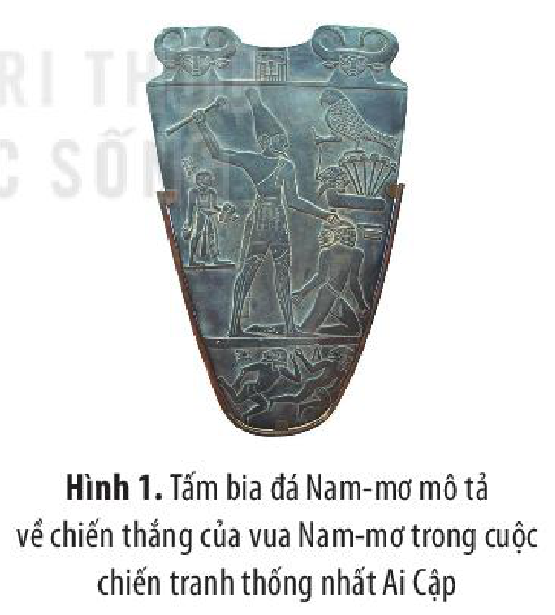

*Hình 1. Tấm bia đá Nam-mơ mô tả về chiến thắng của vua Nam-mơ trong cuộc chiến tranh thống nhất Ai Cập*

> ❓ 1. Khai thác Tư liệu 2, em hãy giải thích vì sao nhà sử học Hy Lạp cổ đại Hê-rô-đốt cho rằng: “Ai Cập là tặng phẩm của sông Nin”?
>
> 2. Hãy trình bày cơ sở hình thành văn minh Ai Cập cổ đại.

<!-- pdf:38 -->

### b) Những thành tựu cơ bản

• *Tín ngưỡng, tôn giáo*

Người Ai Cập sùng bái đa thần. Họ thờ các vị thần tự nhiên, thần động vật (như chim ưng, rắn hổ mang,...) và thờ linh hồn người chết.

Một số vị thần được thờ phổ biến nhất ở Ai Cập là thần Mặt Trời (Ra), thần Mặt Trăng (Thót),...

Người Ai Cập tin vào sự bất tử của linh hồn. Họ cho rằng ở thế giới của thần Ô-di-rít (thần của cái chết và sự phục sinh), linh hồn người chết sẽ phải chịu sự phán xét của thần A-nu-bít bằng cách cân trái tim.

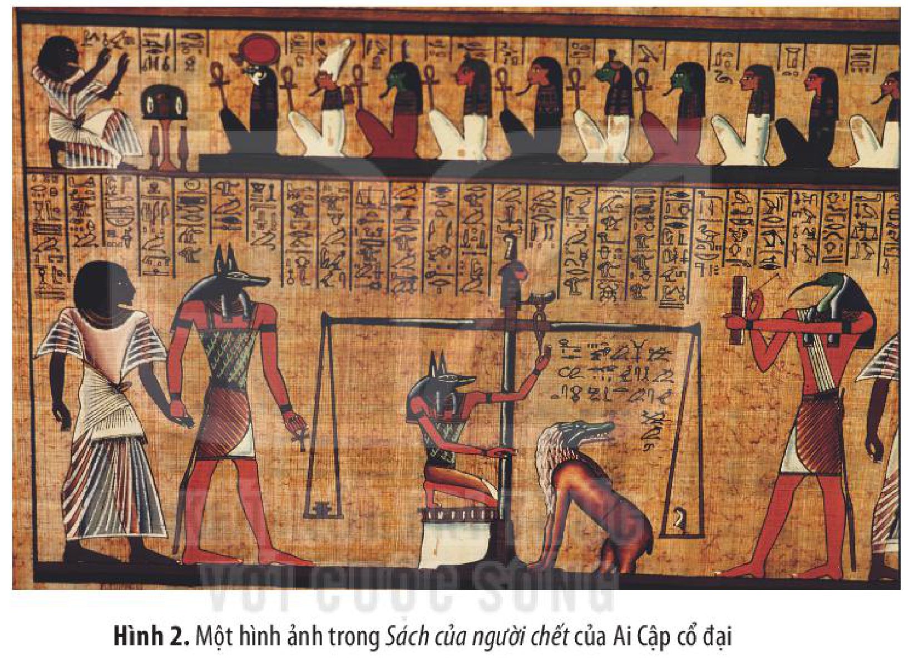

*Hình 2. Một hình ảnh trong Sách của người chết của Ai Cập cổ đại*

Tín ngưỡng, tôn giáo có ảnh hưởng và ý nghĩa quan trọng trong văn hoá, xã hội, chính trị và nhiều thành tựu văn minh của Ai Cập cổ đại.

• *Chữ viết*

<!-- term: Bảng chữ cái Phê-ni-xi -->
Người Ai Cập cổ đại đã sáng tạo ra một trong những hệ thống chữ viết cổ nhất thế giới (chữ tượng hình) từ khoảng hơn 3 000 năm TCN. Trên cơ sở đó, người Phê-ni-xi đã sáng tạo ra bảng chữ cái Phê-ni-xi, được cho là nguồn gốc của những bảng chữ cái ngày nay. Nhờ có chữ viết, người Ai Cập cổ đại đã ghi chép, để lại nhiều tư liệu quý giá thuộc các lĩnh vực như: Lịch sử, Văn học, Thiên văn học, Toán học,...

<!-- pdf:39 -->

> 💡 EM CÓ BIẾT ?

<!-- term: Bia đá Rô-sét-ta -->
> Trong nhiều thế kỉ, các học giả trên thế giới đã tìm cách giải nghĩa chữ viết của Ai Cập cổ đại nhưng đều không thành công. Đến năm 1822, nhà ngôn ngữ học người Pháp Giăng Phơ-răng-xoa Săm-pô-li-ông (1790 – 1832) mới tìm ra cách đọc loại chữ viết này trên cơ sở so sánh, đối chiếu các văn tự ghi trên tấm bia đá Rô-sét-ta.

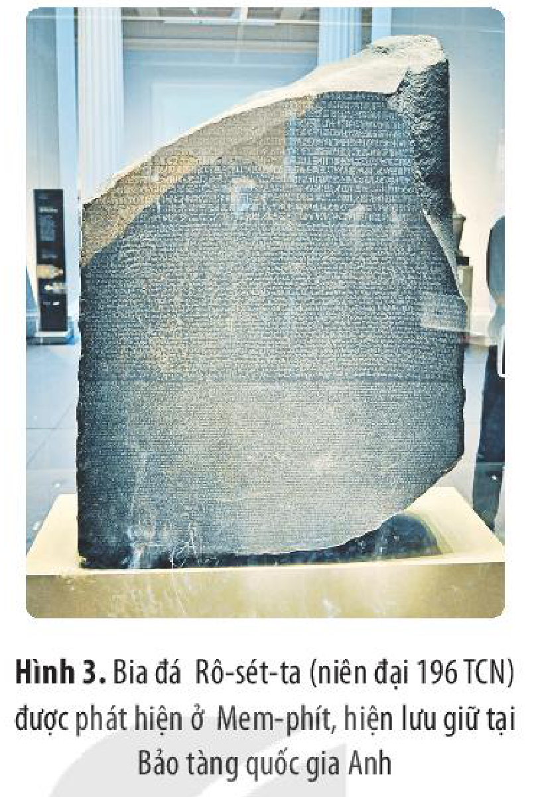

*Hình 3. Bia đá Rô-sét-ta (niên đại 196 TCN) được phát hiện ở Mem-phít, hiện lưu giữ tại Bảo tàng quốc gia Anh*

• *Kiến trúc và điêu khắc*

Cung điện, đền thờ và kim tự tháp là các loại hình kiến trúc tiêu biểu nhất của Ai Cập cổ đại. Đó là những di sản quý giá của Ai Cập nói riêng và nhân loại nói chung.

<!-- term: Tượng Nhân sư ở Ghi-da -->
Cho tới nay, đã có 138 kim tự tháp ở Ai Cập được phát hiện, trong đó nổi tiếng nhất là quần thể kim tự tháp và tượng Nhân sư ở Ghi-da. Các tác phẩm điêu khắc nổi tiếng nhất của Ai Cập cổ đại là: tượng Nhân sư ở Ghi-da, tượng bán thân của Nê-phéc-ti-ti, nắp quan tài bằng vàng của Tu-tan-kha-mun,...

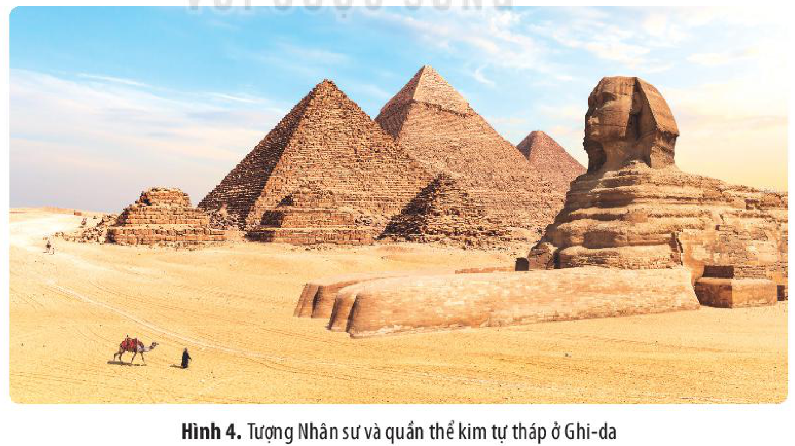

*Hình 4. Tượng Nhân sư và quần thể kim tự tháp ở Ghi-da*

<!-- pdf:40 -->

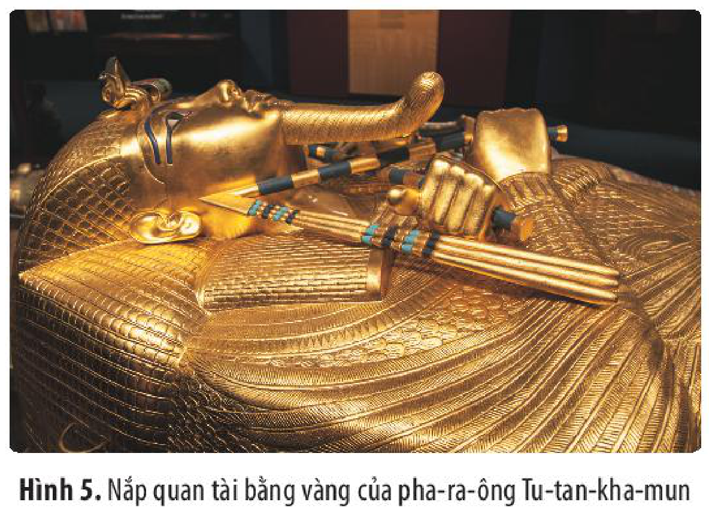

*Hình 5. Nắp quan tài bằng vàng của pha-ra-ông Tu-tan-kha-mun*

Đến nay, nhiều công trình kiến trúc, điêu khắc của người Ai Cập cổ đại vẫn còn hiện hữu, là hiện thân cho sức lao động và trí tuệ, sự sáng tạo vĩ đại của con người.

• *Khoa học, kĩ thuật*

Văn minh Ai Cập cổ đại đã có những đóng góp vĩ đại cho các ngành khoa học, kĩ thuật của nhân loại, đặc biệt là các ngành Toán học, Thiên văn học và Y học.

Người Ai Cập cổ đại đã sử dụng hệ số thập phân, phép tính cộng và trừ, biết tính diện tích hình tam giác, hình chữ nhật, biết sử dụng số *pi* ($\pi$) với giá trị 3,16,...

Họ đã sớm quan sát thiên văn và sự vận hành của các thiên thể. Người Ai Cập đã sáng tạo ra kĩ thuật làm lịch dựa trên chu kì vận động của Mặt Trời.

Về Y học, người Ai Cập cổ đại đã có hiểu biết tương đối chính xác về các cơ quan trong cơ thể con người,... Đặc biệt, họ đã sử dụng những kiến thức về giải phẫu để chữa bệnh và trong kĩ thuật ướp xác.

Như thế, những thành tựu của Ai Cập cổ đại đã góp phần vào sự phát triển rực rỡ của nền văn minh này, đồng thời đặt nền móng cho sự phát triển nhiều lĩnh vực của văn minh nhân loại.

> ❓ 1. Hãy giới thiệu về một số thành tựu cơ bản của văn minh Ai Cập cổ đại.
>
> 2. Các thành tựu văn minh Ai Cập cổ đại có ý nghĩa như thế nào?

## 2. Văn minh Ấn Độ thời kì cổ – trung đại

### a) Cơ sở hình thành

• *Điều kiện tự nhiên*

<!-- term: Văn minh Ấn Độ thời kì cổ – trung đại -->
Nền văn minh Ấn Độ hình thành và phát triển trên một không gian rộng lớn ở Nam Á với điều kiện tự nhiên đa dạng.

<!-- pdf:41 -->

Miền Bắc Ấn Độ có dãy Hi-ma-lay-a và châu thổ của hai dòng sông lớn (sông Ấn, sông Hằng). Miền Nam Ấn Độ là vùng cao nguyên, có điều kiện tự nhiên ít thuận lợi hơn miền Bắc. Khí hậu Ấn Độ chủ yếu là khô nóng, nhưng cũng có những vùng mát mẻ, mưa nhiều. Ấn Độ có ba mặt giáp biển, thuận lợi cho giao thương và giao lưu văn hoá với thế giới.

• *Dân cư và xã hội*

Những chủ nhân đầu tiên của nền văn minh Ấn Độ là người Đra-vi-đa. Từ giữa thiên niên kỉ II TCN, người A-ri-a di cư đến Ấn Độ và trở thành cư dân chủ yếu ở miền Bắc. Sau này, nhiều tộc người khác, như người Ba Tư, Hy Lạp, A-rập, Mông Cổ,... cũng đã xâm nhập và sinh sống ở Ấn Độ.

<!-- term: Chế độ đẳng cấp Vác-na -->
Một đặc trưng quan trọng trong lịch sử Ấn Độ thời kì cổ – trung đại là sự tồn tại lâu dài và ảnh hưởng sâu sắc của chế độ đẳng cấp Vác-na, chia xã hội thành các đẳng cấp khác nhau gồm: Bra-man, Ksa-tri-a, Vai-si-a và Su-đra.

• *Kinh tế*

Cư dân Ấn Độ đã sớm phát triển một nền kinh tế nông nghiệp đa dạng, trồng nhiều loại cây lương thực như lúa, hoa màu và các loại cây khác như bông, đay, lanh,... Họ cũng coi trọng chăn nuôi, đặc biệt là chăn nuôi các loại gia súc.

Các ngành nghề thủ công của Ấn Độ cũng sớm phát triển với việc sản xuất nhiều sản phẩm đáp ứng các nhu cầu trong nước và trao đổi, buôn bán với nước ngoài.

• *Chính trị*

<!-- term: Văn minh sông Ấn -->
Nền văn minh sông Ấn đã hình thành từ khoảng thiên niên kỉ III TCN. Từ cuối thiên niên kỉ II TCN, người A-ri-a đã bắt đầu xây dựng các nhà nước của mình ở lưu vực sông Hằng. Các triều đại tiêu biểu trong lịch sử Ấn Độ là: Vương triều Mô-ri-a (cuối thiên niên kỉ I TCN), Vương triều Gúp-ta (thế kỉ IV – thế kỉ VI), Vương triều Hác-sa (thế kỉ VII),... Trong thời kì cổ – trung đại, Ấn Độ nhiều lần bị xâm lược và thống trị bởi các vương triều ngoại tộc.

### b) Những thành tựu cơ bản

• *Tôn giáo*

Ấn Độ là quê hương của nhiều tôn giáo lớn. Các tôn giáo không chỉ ảnh hưởng và có ý nghĩa sâu sắc đối với văn minh Ấn Độ mà còn được truyền bá ra bên ngoài và để lại nhiều dấu ấn trong lịch sử nhân loại. Hai tôn giáo có ảnh hưởng sâu rộng hàng đầu của Ấn Độ là Hin-đu giáo và Phật giáo.

<!-- term: Hin-đu giáo -->
Hin-đu giáo hình thành trên cơ sở của Bà La Môn giáo, ra đời từ khoảng thiên niên kỉ I TCN, có ảnh hưởng lâu dài và sâu sắc nhất ở Ấn Độ.

<!-- pdf:42 -->

<!-- term: Phật giáo -->
Phật giáo hình thành từ giữa thiên niên kỉ I TCN, hưng thịnh cho đến thế kỉ VII rồi dần suy yếu và mất đi ảnh hưởng ở Ấn Độ. Tuy vậy, Phật giáo đã được truyền bá đến nhiều quốc gia và khu vực, trở thành một trong những tôn giáo lớn nhất trên thế giới.

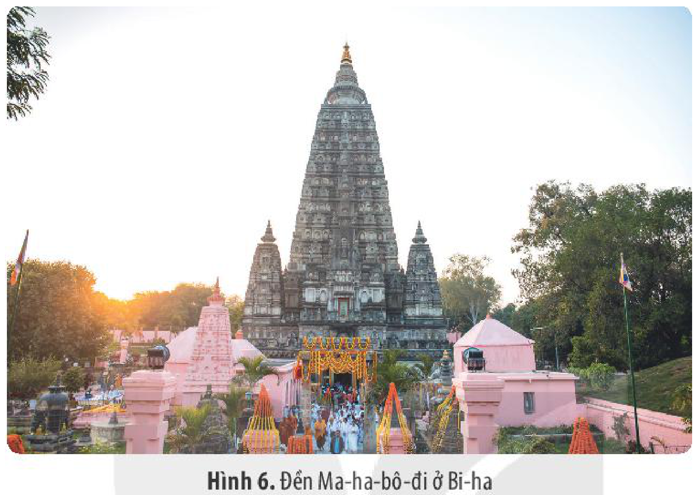

*Hình 6. Đền Ma-ha-bô-đi ở Bi-ha*

• *Chữ viết*

<!-- term: Tiếng San-xcrít -->
Chữ viết cổ nhất của Ấn Độ được tìm thấy trong nền văn minh sông Ấn. Về sau, ở Ấn Độ xuất hiện chữ Kha-rốt-thi và chữ Bra-mi. Trên cơ sở đó, người Ấn Độ đã cải biên chữ viết để ghi âm tiếng San-xcrít (tiếng Phạn). Chữ viết của Ấn Độ được truyền bá sang Đông Nam Á và được cải biên thành chữ viết của một số quốc gia trong khu vực này.

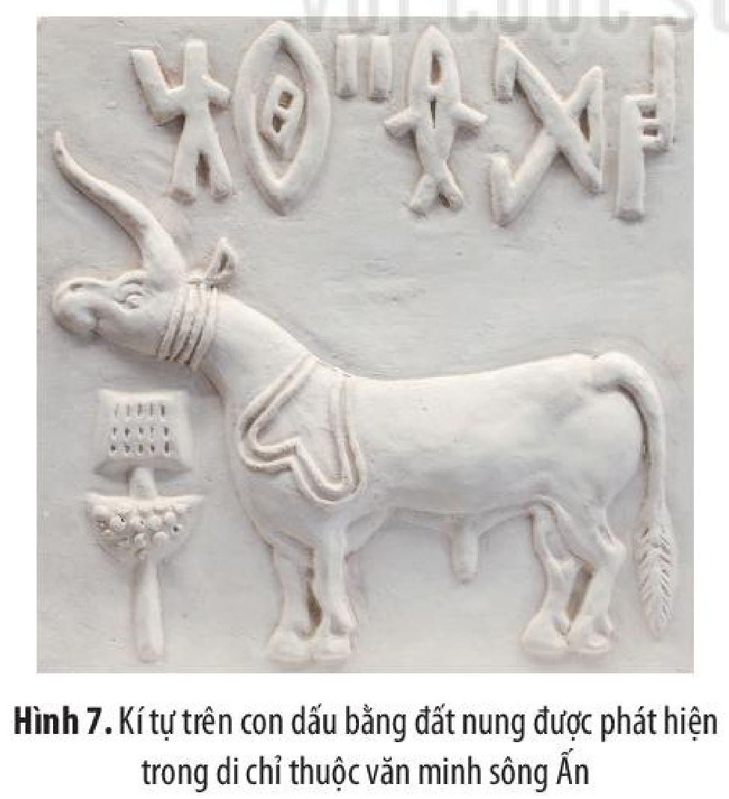

*Hình 7. Kí tự trên con dấu bằng đất nung được phát hiện trong di chỉ thuộc văn minh sông Ấn*

> 💡 EM CÓ BIẾT ?
>
> Từ năm 1921, trong các cuộc khai quật khảo cổ học ở lưu vực sông Ấn, hơn 3 000 con dấu có khắc kí tự và hình vẽ đã được phát hiện. Những con dấu này được cho là dùng để đóng lên các kiện hàng nhằm xác nhận xuất xứ của những hàng hoá đó.

<!-- pdf:43 -->

• *Văn học*

<!-- term: Kinh Vê-đa -->
<!-- term: Ma-ha-bha-ra-ta và Ra-ma-y-a-na -->
Văn học Ấn Độ đạt nhiều thành tựu rực rỡ, tiêu biểu nhất là kinh *Vê-đa*, sử thi *Ma-ha-bha-ra-ta* và *Ra-ma-y-a-na*, các tác phẩm của Ca-li-đa-sa (như vở kịch *Sơ-kun-tơ-la*),...

Văn học Ấn Độ chứa đựng những giá trị nghệ thuật và nhân văn sâu sắc, là niềm tự hào của người dân Ấn Độ, trở thành nguồn cảm hứng, đề tài sáng tác của nhiều ngành nghệ thuật khác, không chỉ ở Ấn Độ mà cả nhiều quốc gia khác, nhất là khu vực Đông Nam Á.

• *Kiến trúc, điêu khắc*

Kiến trúc, điêu khắc của Ấn Độ chịu ảnh hưởng của tôn giáo. Người Ấn Độ đã xây dựng nhiều công trình kiến trúc đồ sộ như: cột đá, chùa và tháp Phật giáo; đền thờ, lăng mộ Hin-đu giáo; các thánh đường, cung điện Hồi giáo. Kiến trúc và điêu khắc của Ấn Độ đã có những ảnh hưởng đến nhiều nước trên thế giới, đặc biệt là các quốc gia Đông Nam Á.

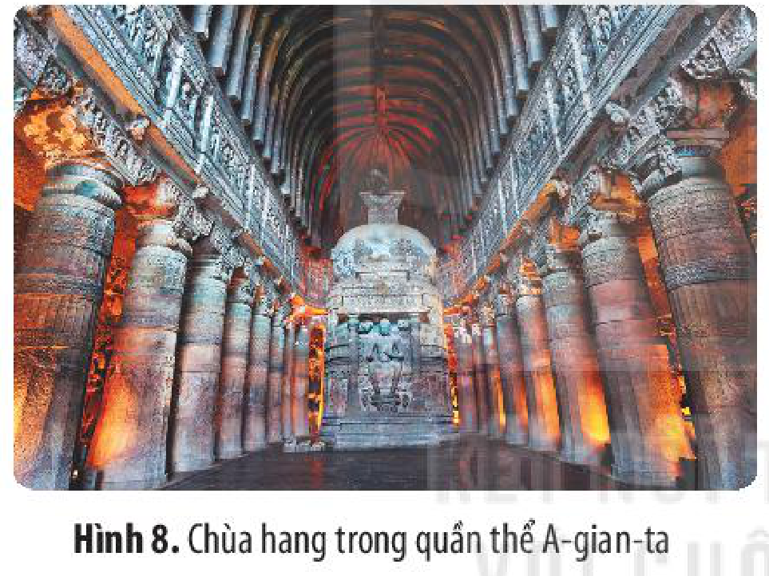

*Hình 8. Chùa hang trong quần thể A-gian-ta*

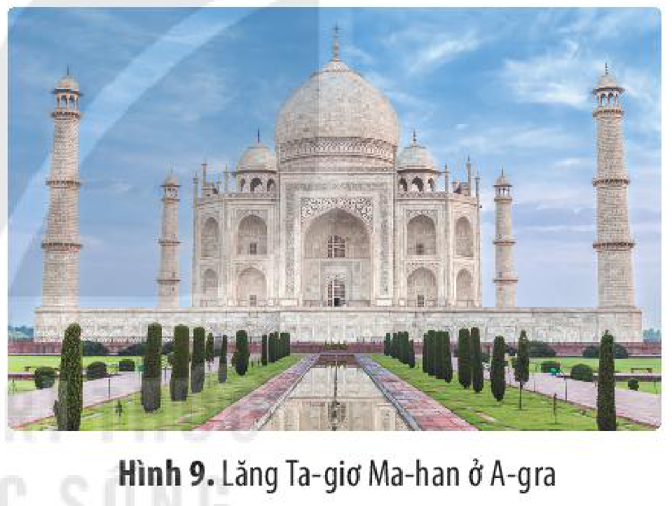

<!-- term: Lăng Ta-giơ Ma-han -->
*Hình 9. Lăng Ta-giơ Ma-han ở A-gra*

• *Khoa học, kĩ thuật*

Người Ấn Độ sớm đạt được trình độ cao trong khoa học, kĩ thuật.

Đóng góp quan trọng nhất của Toán học Ấn Độ là việc sáng tạo ra 10 chữ số mà ngày nay chúng ta đang sử dụng. Họ đã tính được giá trị của số *pi* ($\pi$) là 3,1416;...

Trong Thiên văn học, người Ấn Độ đã sớm có hiểu biết về vũ trụ, về Mặt Trời và các hành tinh. Họ đã biết đặt ra lịch.

Trong Vật lí học và Hoá học, người Ấn Độ đã nêu ra thuyết nguyên tử, đã khẳng định được về lực hấp dẫn của Trái Đất. Người Ấn Độ đã phát triển kĩ thuật luyện kim ở trình độ cao và tìm ra cách để bảo vệ kim loại không bị ăn mòn.

Về Y – Dược học, người Ấn Độ có nhiều ghi chép về bệnh lí học, giải phẫu học, độc dược học và biết dùng phẫu thuật để chắp xương sọ, lấy sỏi thận,...

Những thành tựu về khoa học, kĩ thuật của Ấn Độ có ý nghĩa và đóng góp quan trọng vào kho tàng tri thức của nhân loại.

<!-- pdf:44 -->

> TƯ LIỆU 3. Ấn Độ đã cho chúng ta những món quà như môn ngữ pháp và luận lí, triết học và ngụ ngôn, thuật thôi miên và chơi cờ, trên tất cả là các chữ số và hệ thống thập phân,... Ấn Độ dạy chúng ta sự khoan dung, hoà nhã của tâm trí thành thục, sự tĩnh lặng của tâm hồn thanh thản, sự bình tĩnh của tinh thần hiểu biết và sự yêu thương hoà hợp, thống nhất dành cho mọi vật sống.
>
> *(Theo Uyn Đu-ran, Câu chuyện văn minh, Phần 1: Di sản phương Đông của chúng ta (bản tiếng Anh), Niu Oóc, 1942, tr. 633)*

> ❓ 1. Hãy giới thiệu một số thành tựu cơ bản của văn minh Ấn Độ thời kì cổ – trung đại.
>
> 2. Hãy nêu ý nghĩa các thành tựu của văn minh Ấn Độ thời kì cổ – trung đại.

## 3. Văn minh Trung Hoa thời kì cổ – trung đại

### a) Cơ sở hình thành

• *Điều kiện tự nhiên*

<!-- term: Văn minh Trung Hoa thời kì cổ – trung đại -->
Văn minh Trung Hoa hình thành và phát triển trên một không gian rộng lớn ở phía Đông châu Á. Vùng đất này có hệ động thực vật phong phú, cùng hàng nghìn dòng sông lớn, nhỏ, trong đó quan trọng nhất là Hoàng Hà và Trường Giang. Điều kiện tự nhiên đa dạng và tài nguyên dồi dào là những cơ sở quan trọng cho sự hình thành và phát triển của nền văn minh Trung Hoa.

• *Dân cư và xã hội*

Những cư dân đầu tiên đã xây dựng nền văn minh Trung Hoa ở lưu vực Hoàng Hà là người Hoa – Hạ (tổ tiên của dân tộc Hán sau này). Cùng với dân tộc Hán (chiếm số lượng đông nhất), các dân tộc như Choang, Mãn, Hồi, Mông,... đã góp phần xây dựng nền văn minh Trung Hoa đa dạng, phong phú và phát triển rực rỡ.

Các giai tầng cơ bản trong xã hội Trung Quốc thời kì cổ – trung đại là: quý tộc, địa chủ, nông dân, thợ thủ công, thương nhân,...

> 💡 EM CÓ BIẾT ?
>
> Người Trung Hoa là cư dân đầu tiên trên thế giới tìm ra cách trồng dâu nuôi tằm để dệt lụa. Tơ lụa Trung Hoa được vận chuyển, buôn bán thường xuyên, với số lượng lớn. Quá trình buôn bán tơ lụa và nhiều sản phẩm khác đã làm hình thành nên “Con đường tơ lụa” nổi tiếng trong lịch sử. Con đường này khởi đầu từ Trung Hoa, đi qua khu vực Trung Á, tới Địa Trung Hải và châu Âu.

• *Kinh tế*

Nền tảng kinh tế căn bản của văn minh Trung Hoa thời kì cổ – trung đại là nông nghiệp. Từ rất sớm, họ đã trồng nhiều loại cây lương thực, cây nguyên liệu, chăn nuôi nhiều loại gia súc và gia cầm. Thủ công nghiệp và thương nghiệp cũng giữ vai trò quan trọng. Tơ lụa, gốm sứ,... là những hàng hoá nổi tiếng của người Trung Hoa trong quan hệ buôn bán với nhiều nước ở châu Á và châu Âu.

<!-- pdf:45 -->

• *Chính trị*

Lịch sử Trung Quốc thời kì cổ – trung đại đã diễn ra nhiều cuộc đấu tranh về chính trị, quân sự, dẫn đến sự thành lập và diệt vong của các triều đại nối tiếp nhau. Nhà nước được tổ chức theo thể chế quân chủ chuyên chế trung ương tập quyền, đứng đầu là vua, dưới vua là hệ thống quan lại từ trung ương đến địa phương.

> ❓ 1. Em hãy phân tích những cơ sở hình thành của văn minh Trung Hoa.
>
> 2. Hãy chỉ ra một số nét tương đồng về cơ sở hình thành của văn minh Trung Hoa so với các nền văn minh khác ở phương Đông.

### b) Những thành tựu cơ bản

• *Tư tưởng, tôn giáo*

<!-- term: Nho giáo, Đạo giáo, Mặc gia, Pháp gia -->
Các học thuyết tư tưởng và tôn giáo của Trung Hoa hình thành từ rất sớm để giải thích về thế giới và đề xướng các biện pháp cai trị đất nước. Nho giáo, Đạo giáo, Mặc gia, Pháp gia và các thuyết Âm dương, Bát quái, Ngũ hành từ thời kì cổ đại đã trở thành nền tảng quan trọng về tư tưởng, thế giới quan của người Trung Hoa, đồng thời có ảnh hưởng đến nhiều quốc gia khác như: Nhật Bản, Triều Tiên, Việt Nam,...

Phật giáo được du nhập vào Trung Hoa khoảng những thế kỉ đầu Công nguyên, được cải biến và phát triển rực rỡ, sau đó lan toả, ảnh hưởng ra các quốc gia khác trong khu vực.

• *Chữ viết*

<!-- term: Kim văn -->
Từ những loại hình chữ viết cổ nhất xuất hiện trong thời kì nhà Thương, bao gồm chữ khắc trên mai rùa, xương thú (*chữ giáp cốt*) và khắc trên đồ đồng (*kim văn*), chữ viết của Trung Hoa đã nhiều lần được chỉnh lí và phát triển thành chữ Hán ngày nay.

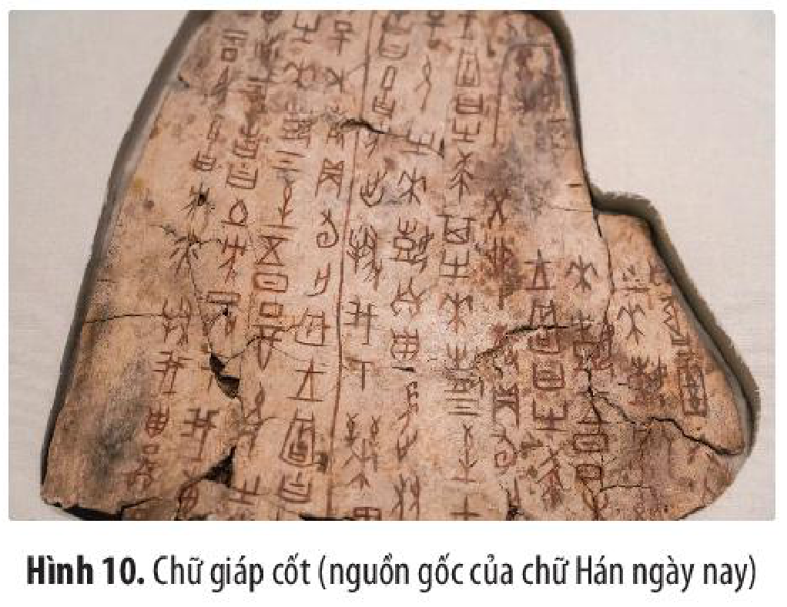

*Hình 10. Chữ giáp cốt (nguồn gốc của chữ Hán ngày nay)*

<!-- pdf:46 -->

• *Văn học*

Kho tàng văn học Trung Hoa đồ sộ, đa dạng về thể loại, nội dung và phong cách nghệ thuật.

<!-- term: Đường thi -->
<!-- term: Tiểu thuyết thời Minh – Thanh -->
Thơ ca, kịch và tiểu thuyết là các loại hình văn học có nhiều thành tựu nhất, trong đó tiêu biểu là thơ ca thời Đường (hay còn gọi là *Đường thi*, với ba nhà thơ nổi tiếng Đỗ Phủ, Bạch Cư Dị, Lý Bạch) và tiểu thuyết thời Minh – Thanh (với một số tác phẩm tiêu biểu như: *Tam quốc diễn nghĩa*, *Thuỷ hử*, *Tây du kí*, *Hồng lâu mộng*,...).

Chữ viết và văn học của văn minh Trung Hoa đã được truyền bá đến một số nước trong khu vực và cũng để lại dấu ấn sâu sắc trong văn hoá Triều Tiên, Nhật Bản và Việt Nam.

• *Kiến trúc, điêu khắc và hội hoạ*

<!-- term: Vạn Lý Trường Thành -->
Kiến trúc và điêu khắc Trung Hoa có sự gắn kết mật thiết với nhau, có công năng sử dụng rất đa dạng như: nhà ở, cung điện; các công trình phòng thủ, quân sự; các công trình tôn giáo, lăng mộ,... Những công trình nổi tiếng nhất của kiến trúc Trung Hoa bao gồm: *Vạn Lý Trường Thành*, *Tử Cấm Thành*, *Di Hoà Viên*, *Thập Tam Lăng*,...

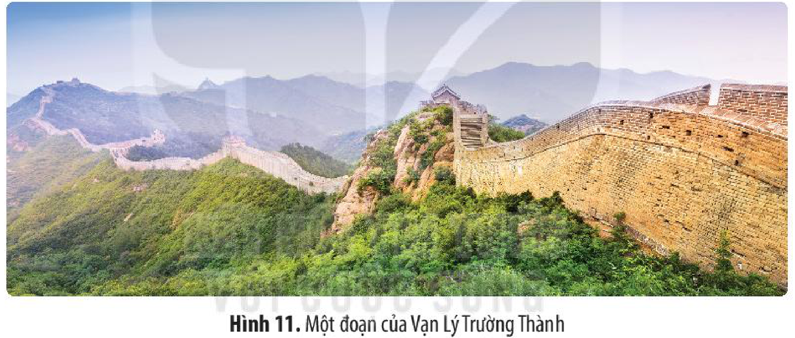

*Hình 11. Một đoạn của Vạn Lý Trường Thành*

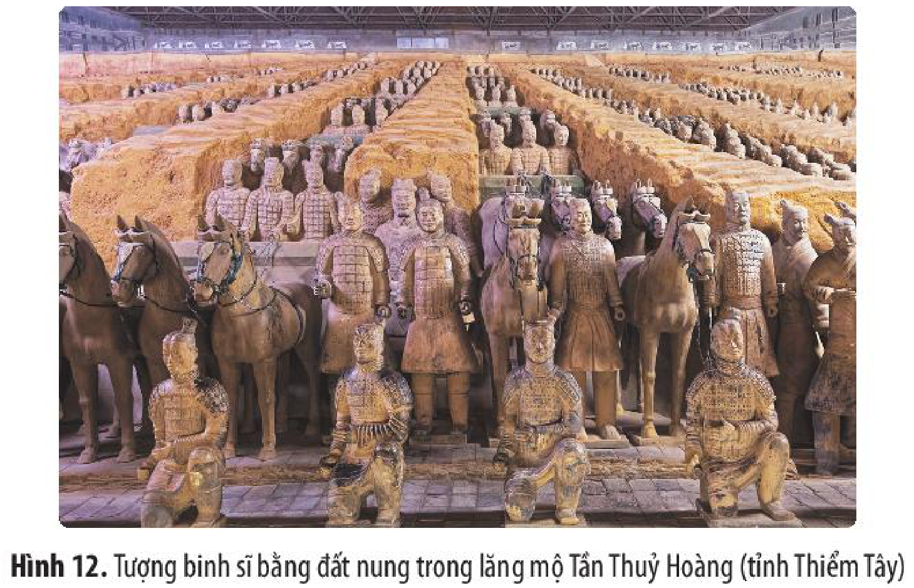

*Hình 12. Tượng binh sĩ bằng đất nung trong lăng mộ Tần Thuỷ Hoàng (tỉnh Thiểm Tây)*

<!-- pdf:47 -->

Hội hoạ Trung Hoa rất đa dạng cả về đề tài, nội dung và phong cách. Người Trung Hoa vẽ tranh trên nhiều chất liệu như gỗ, lụa, giấy,... Các tác phẩm thường có phong cách ước lệ, dùng các đường nét để miêu tả hình ảnh, thần thái, tình cảm,... Những đặc điểm đó đã tạo nên dấu ấn riêng biệt của hội hoạ nước này.

• *Khoa học, kĩ thuật*

Văn minh Trung Hoa đạt được nhiều thành tựu quan trọng trên các lĩnh vực Toán học, Thiên văn học, Y – Dược học, Sử học,... và phát minh kĩ thuật.

Về Toán học, từ thời cổ đại người Trung Hoa đã sử dụng hệ số đếm thập phân, tính được diện tích các hình phẳng và thể tích các hình khối,... lần đầu tiên tính được số pi ($\pi$) chính xác tới 7 chữ số thập phân, phát minh ra bàn tính,...

Trong Thiên văn học, người Trung Hoa là những người đầu tiên ghi chép về nhật thực, nguyệt thực và nhiều hiện tượng thiên văn khác. Họ đã sớm đặt ra lịch để phục vụ đời sống và sản xuất.

Trong Y – Dược học, họ đã chẩn đoán, lí giải và chữa trị các loại bệnh bằng nhiều phương pháp như: dùng thuốc, châm cứu, giải phẫu,... Trong lịch sử Trung Hoa thời kì cổ – trung đại xuất hiện nhiều thầy thuốc nổi tiếng như: Hoa Đà, Trương Trọng Cảnh,...

<!-- term: Sử kí -->
Sử học Trung Hoa đa dạng về hình thức, thể loại, nội dung với một số tác phẩm nổi tiếng như: *Xuân Thu* (bộ biên niên sử đầu tiên của Trung Hoa), *Sử kí* của Tư Mã Thiên. Những tác phẩm này không chỉ có giá trị sử học mà còn là những di sản văn hoá quý báu của nền văn minh Trung Hoa.

<!-- term: Bốn phát minh lớn về kĩ thuật của Trung Hoa -->
Người Trung Hoa có Bốn phát minh lớn về kĩ thuật gồm: kĩ thuật làm giấy, kĩ thuật in, thuốc súng và la bàn.

Những thành tựu của văn minh Trung Hoa có ý nghĩa to lớn, chứng tỏ sự phát triển của nền văn minh này. Hơn nữa, nhiều thành tựu còn sớm được truyền bá đến các nước láng giềng, sang cả Tây Á, sau đó lan truyền và thậm chí được ứng dụng rộng rãi ở châu Âu. Sự truyền bá của những thành tựu này là minh chứng cho sự ảnh hưởng của nền văn minh Trung Hoa, cũng như mối liên hệ về tri thức, khoa học, kĩ thuật giữa phương Đông và phương Tây.

> TƯ LIỆU 4. Giống như ở những nơi khác, Trung Quốc cổ đại phải đối mặt với thách thức do sự xuất hiện của các dân tộc du mục ở biên giới của mình. Tuy nhiên, không giống như Ha-ráp-pa, Xu-me và Ai Cập, Trung Quốc cổ đại đã vượt qua thách thức đó, nhiều thể chế và giá trị văn hoá của nền văn minh này vẫn tồn tại nguyên vẹn đến đầu thế kỉ XX. Vì lí do đó, nền văn minh Trung Hoa đôi khi được mô tả là nền văn minh tồn tại liên tục lâu đời nhất trên thế giới.
>
> *(Theo Uy-li-am G. Đu-khơ, Giắc-xơn G. Spi-en-vô-ghen, Lịch sử thế giới (bản tiếng Anh), Sđd, tr. 68)*

<!-- pdf:48 -->

> ❓ 1. Hãy nêu một số thành tựu cơ bản của văn minh Trung Hoa thời kì cổ – trung đại và ý nghĩa của các thành tựu đó với lịch sử nhân loại.
>
> 2. Tư liệu 4 (tr. 46) giúp em biết điều gì về giá trị và sức sống trường tồn của văn minh Trung Hoa? Hãy lấy một số ví dụ minh hoạ.

## ✏️ Luyện tập và vận dụng

1. Em hãy trình bày về quá trình hình thành, phát triển của các nền văn minh phương Đông thời kì cổ – trung đại.

2. Lập bảng thể hiện các thành tựu văn minh cơ bản của Ai Cập cổ đại, Trung Hoa và Ấn Độ thời kì cổ – trung đại theo gợi ý sau:

| Nền văn minh | Thành tựu tiêu biểu | Thời điểm xuất hiện | Thuộc lĩnh vực | Đặc điểm, ý nghĩa/giá trị |
| --- | --- | --- | --- | --- |
| ? | ? | ? | ? | ? |
<!-- ocr-ok: Bảng gợi ý Luyện tập trang 47 (PDF 48), OCR bị gãy cột tiêu đề bảng -->

1. Liên hệ và cho biết ảnh hưởng của những thành tựu văn minh phương Đông (Ai Cập cổ đại, Ấn Độ và Trung Hoa thời kì cổ – trung đại) đối với Việt Nam.

2. Em hãy giải thích vì sao “Cuộc diễu hành vàng của các pha-ra-ông” ở Ai Cập được tổ chức trang trọng? Hãy đề xuất một số giải pháp để góp phần bảo tồn và tôn vinh các giá trị, thành tựu văn minh thế giới.

## 📷 Danh sách hình trong bài

| Mã hình | Trang PDF | Vị trí trong bài | Chú thích gốc |
| --- | --- | --- | --- |
| H10-lich_su-b05-01 | 37 | Mục II.1.a (Chính trị) | Hình 1. Tấm bia đá Nam-mơ mô tả về chiến thắng của vua Nam-mơ trong cuộc chiến tranh thống nhất Ai Cập |
| H10-lich_su-b05-02 | 38 | Mục II.1.b (Tín ngưỡng, tôn giáo) | Hình 2. Một hình ảnh trong Sách của người chết của Ai Cập cổ đại |
| H10-lich_su-b05-03 | 39 | Mục II.1.b (Chữ viết) | Hình 3. Bia đá Rô-sét-ta (niên đại 196 TCN) được phát hiện ở Mem-phít, hiện lưu giữ tại Bảo tàng quốc gia Anh |
| H10-lich_su-b05-04 | 39 | Mục II.1.b (Kiến trúc và điêu khắc) | Hình 4. Tượng Nhân sư và quần thể kim tự tháp ở Ghi-da |
| H10-lich_su-b05-05 | 40 | Mục II.1.b (Kiến trúc và điêu khắc) | Hình 5. Nắp quan tài bằng vàng của pha-ra-ông Tu-tan-kha-mun |
| H10-lich_su-b05-06 | 42 | Mục II.2.b (Tôn giáo) | Hình 6. Đền Ma-ha-bô-đi ở Bi-ha |
| H10-lich_su-b05-07 | 42 | Mục II.2.b (Chữ viết) | Hình 7. Kí tự trên con dấu bằng đất nung được phát hiện trong di chỉ thuộc văn minh sông Ấn |
| H10-lich_su-b05-08 | 43 | Mục II.2.b (Kiến trúc, điêu khắc) | Hình 8. Chùa hang trong quần thể A-gian-ta |
| H10-lich_su-b05-09 | 43 | Mục II.2.b (Kiến trúc, điêu khắc) | Hình 9. Lăng Ta-giơ Ma-han ở A-gra |
| H10-lich_su-b05-10 | 45 | Mục II.3.b (Chữ viết) | Hình 10. Chữ giáp cốt (nguồn gốc của chữ Hán ngày nay) |
| H10-lich_su-b05-11 | 46 | Mục II.3.b (Kiến trúc, điêu khắc và hội hoạ) | Hình 11. Một đoạn của Vạn Lý Trường Thành |
| H10-lich_su-b05-12 | 46 | Mục II.3.b (Kiến trúc, điêu khắc và hội hoạ) | Hình 12. Tượng binh sĩ bằng đất nung trong lăng mộ Tần Thuỷ Hoàng (tỉnh Thiểm Tây) |
