<!-- pdf:49 -->

# BÀI 6: MỘT SỐ NỀN VĂN MINH PHƯƠNG TÂY THỜI KÌ CỔ – TRUNG ĐẠI

## 🎯 Học xong bài này, em sẽ:

- Nêu được ý nghĩa của những thành tựu cơ bản của văn minh Hy Lạp – La Mã cổ đại và văn minh Tây Âu thời kì Phục hưng.
- Phân tích được cơ sở hình thành của các nền văn minh phương Tây.
- Biết cách sưu tầm và sử dụng tài liệu lịch sử để tìm hiểu về các nền văn minh phương Tây.
- Biết trân trọng giá trị, có nhận thức và hành động góp phần bảo tồn và phát huy giá trị các di sản, giá trị văn minh nhân loại.

## 🔴 Mở đầu

Từ năm 1896 đến nay, cứ bốn năm một lần, Thế vận hội (Ô-lim-píc) được tổ chức tại các quốc gia khác nhau. Đây không chỉ là một sự kiện thể thao mà còn mang ý nghĩa biểu trưng cho sự bình đẳng, tinh thần hoà bình và đoàn kết giữa các quốc gia trên toàn thế giới. Em có biết ngay từ thời cổ đại, Ô-lim-píc đã được tổ chức bốn năm một lần tại đền thờ thần Dớt (ở Ô-lim-pi-a, Hy Lạp)? Ngoài sự kiện này, em có thể kể thêm một số ví dụ khác cho thấy những cống hiến, giá trị trường tồn của các nền văn minh phương Tây thời kì cổ – trung đại?

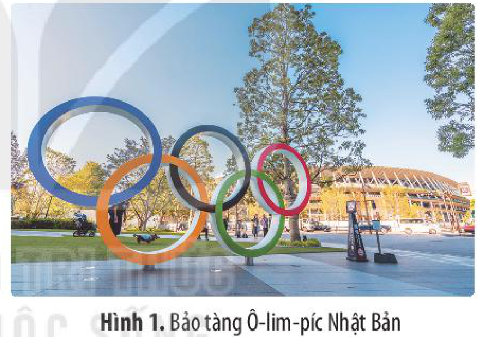

*Hình 1. Bảo tàng Ô-lim-píc Nhật Bản*

## 1. Văn minh Hy Lạp – La Mã cổ đại

### a) Cơ sở hình thành

• *Điều kiện tự nhiên*

<!-- term: Văn minh Hy Lạp – La Mã cổ đại -->
Văn minh Hy Lạp – La Mã cổ đại hình thành trên các bán đảo Nam Âu. Điều kiện tự nhiên ở đây tạo ra nhiều thuận lợi song cũng đặt ra không ít khó khăn đối với các cư dân thời cổ đại.

Địa hình nhiều núi và cao nguyên, đất đai khô rắn và không màu mỡ, chỉ thích hợp trồng các loại cây lâu năm như nho, ô-liu,... Tuy nhiên, ở đây cũng có một số vùng đồng bằng tương đối thuận lợi cho phát triển nông nghiệp. Nguồn tài nguyên thiên nhiên phong phú như: đồng, sắt, vàng, bạc, đá cẩm thạch,... tạo điều kiện cho thủ công nghiệp sớm phát triển.

<!-- pdf:50 -->

Địa Trung Hải có bờ biển dài, nhiều vũng, vịnh với các hải cảng là điều kiện thuận lợi cho sự giao lưu, buôn bán bằng đường biển, đồng thời giúp cho người Hy Lạp – La Mã cổ đại sớm tiếp thu những thành tựu văn minh phương Đông, cũng như mở rộng không gian và ảnh hưởng đến nhiều vùng đất quanh Địa Trung Hải.

• *Dân cư và xã hội*

Người Mi-nô-an là cư dân đầu tiên xây dựng nền văn minh trên đảo Crét ở phía nam Hy Lạp từ khoảng cuối thiên niên kỉ III TCN. Từ khoảng đầu đến cuối thiên niên kỉ II TCN, nhiều tộc người khác như: A-kê-an, Đô-ri-an,... từ phía bắc đã di cư xuống vùng miền Trung và Nam Hy Lạp, xây dựng và mở rộng quốc gia của họ ra nhiều vùng quanh Địa Trung Hải.

Trên bán đảo I-ta-li-a, người I-ta-li-ốt (người La-tinh) là những cư dân chủ yếu xây dựng nên thành bang đầu tiên – La Mã. Ngoài ra, người Ê-tơ-ru-xcơ từ Tiểu Á, người Hy Lạp,... cũng lần lượt đến sinh sống ở đây.

Trong xã hội Hy Lạp – La Mã cổ đại có hai giai cấp cơ bản là chủ nô và nô lệ, ngoài ra, còn có các tầng lớp khác là nông dân, thợ thủ công, thương nhân,...

• *Kinh tế*

Ngành kinh tế chủ đạo của người Hy Lạp – La Mã cổ đại là thủ công nghiệp và thương nghiệp. Ngoài ra, nông nghiệp cũng có vai trò nhất định ở La Mã với nền kinh tế điền trang trong nông nghiệp cũng khá phát triển.

Nhiều xưởng thủ công chuyên luyện kim, làm gốm, chế tạo vũ khí, đóng thuyền,... đã sử dụng nhân công với số lượng lớn. Sự phát triển của thủ công nghiệp đã thúc đẩy quan hệ thương mại, đặc biệt là quan hệ buôn bán đường biển với nhiều vùng xung quanh Địa Trung Hải.

• *Chính trị*

Từ khoảng cuối thiên niên kỉ III TCN, cư dân ở Hy Lạp đã xây dựng các nhà nước đầu tiên. Trong các thế kỉ VIII – IV TCN, những thành bang theo thể chế cộng hoà đã hình thành và phát triển ở miền Trung và Nam Hy Lạp cho tới khi bị Ma-xê-đô-ni-a chinh phục.

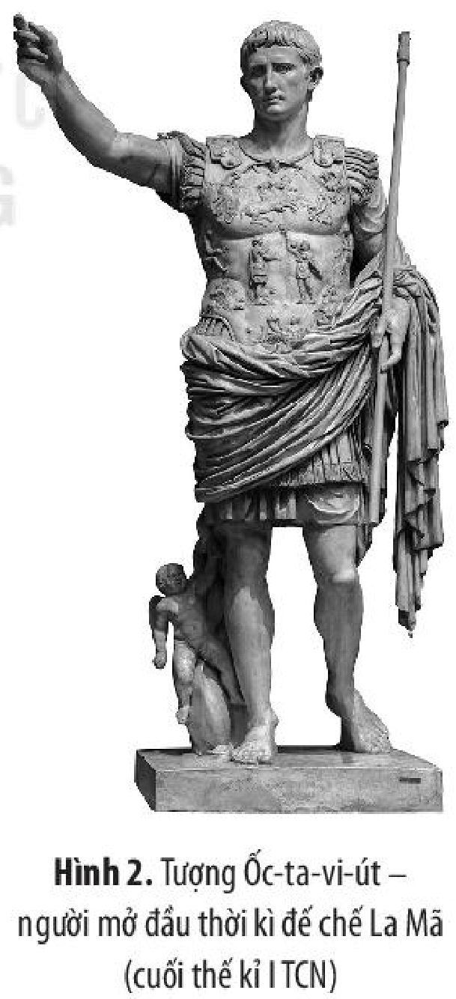

*Hình 2. Tượng Ốc-ta-vi-út – người mở đầu thời kì đế chế La Mã (cuối thế kỉ I TCN)*

Khoảng giữa thế kỉ VIII TCN, thành bang La Mã được thành lập. Thời kì đầu (khoảng từ năm 753 đến năm 510 TCN), bộ máy quản lí của nhà nước này bao gồm: Vua, Viện Nguyên lão, Đại hội công dân. Sau nhiều cuộc cải cách và đấu tranh chính trị, chế độ cộng hoà được thiết lập và duy trì ở La Mã cho đến cuối thế kỉ I TCN. Từ năm 27 TCN, thời kì đế chế bắt đầu, đứng đầu là hoàng đế, kéo dài cho đến cuối thế kỉ V, khi đế quốc Tây La Mã sụp đổ.

<!-- pdf:51 -->

• *Sự tiếp thu các thành tựu của văn minh phương Đông*

Văn minh Hy Lạp – La Mã cổ đại đã tiếp thu nhiều thành tựu của văn minh phương Đông trên các lĩnh vực như: kĩ thuật chế tác và sản xuất thủ công nghiệp, chữ viết, văn học, nghệ thuật kiến trúc, điêu khắc, hội hoạ, tín ngưỡng, tôn giáo,...

> ❓ Em hãy nêu và phân tích cơ sở hình thành của văn minh Hy Lạp – La Mã cổ đại.

### b) Thành tựu cơ bản

• *Chữ viết*

<!-- term: Bảng chữ cái Hy Lạp -->
Người Hy Lạp cổ đại đã xây dựng bảng chữ cái ghi âm của mình từ khoảng thế kỉ IX – VIII TCN. Đến khoảng cuối thế kỉ IV TCN, bảng chữ cái Hy Lạp được hoàn thiện với 24 chữ cái.

<!-- term: Chữ La-tinh -->
Người La Mã đã dựa trên cơ sở chữ viết Hy Lạp để xây dựng một loại chữ mà ngày nay được gọi là chữ La-tinh. Chữ La-tinh ban đầu được sử dụng để ghi tiếng La-tinh, về sau còn được dùng để ghi nhiều ngôn ngữ khác. Đến nay, chữ La-tinh là loại văn tự chữ cái được sử dụng phổ biến nhất trên thế giới.

<!-- term: Hệ thống chữ số La Mã -->
Hệ thống chữ số La Mã mà ngày nay chúng ta vẫn đang sử dụng cũng là một cống hiến lớn của người La Mã cổ đại.

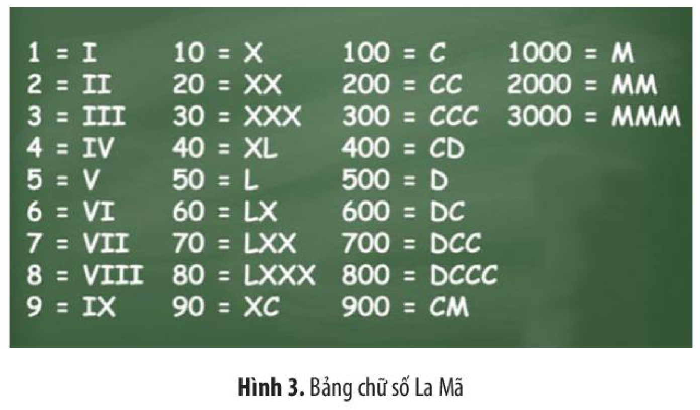

*Hình 3. Bảng chữ số La Mã*

<!-- pdf:52 -->

• *Văn học*

Nền văn học đồ sộ của Hy Lạp và La Mã cổ đại đã đặt nền móng cho văn học phương Tây. Các tác phẩm văn học không chỉ là sáng tác nghệ thuật quý giá, mà còn là nguồn tư liệu quan trọng để tìm hiểu về lịch sử của hai nền văn minh này.

<!-- term: I-li-át và Ô-đi-xê -->
Nguồn cảm hứng và đề tài phong phú của văn học Hy Lạp – La Mã cổ đại bắt nguồn từ thần thoại. Đặt nền móng cho văn học Hy Lạp – La Mã cổ đại là hai bộ sử thi *I-li-át* và *Ô-đi-xê* của Hô-me. Bên cạnh đó, thơ, văn xuôi và kịch cũng đạt được nhiều thành tựu rực rỡ.

Một số tác giả và tác phẩm kịch nổi tiếng của Hy Lạp như: A-chi-lút với vở *Ô-rét-tê*, *Prô-mê-tê bị xiềng*; Xô-phô-clơ với vở *Vua Ơ-đíp*; Ơ-ri-pít với vở *Những phụ nữ thành Tơ-roa*;... Tác giả và tác phẩm văn học nổi tiếng của La Mã là Ô-vi-đi-ớt với các tập thơ: *Nữ anh hùng*, *Tình yêu*,...

• *Kiến trúc, điêu khắc và hội hoạ*

Người Hy Lạp – La Mã cổ đại đã đạt được những thành tựu rực rỡ trên cả ba lĩnh vực: điêu khắc, kiến trúc và hội hoạ. Nghệ thuật của Hy Lạp – La Mã cổ đại đã ảnh hưởng sâu sắc tới nghệ thuật phương Tây sau này.

<!-- term: Đền Pác-tê-nông -->
<!-- term: Đấu trường Cô-li-dê -->
Một số công trình kiến trúc tiêu biểu là: đền Pác-tê-nông, đền thờ thần Dớt, lăng mộ vua Mô-sô-lớt,... (Hy Lạp); đấu trường Cô-li-dê, khải hoàn môn Công-xtan-ti-nút,... (La Mã).

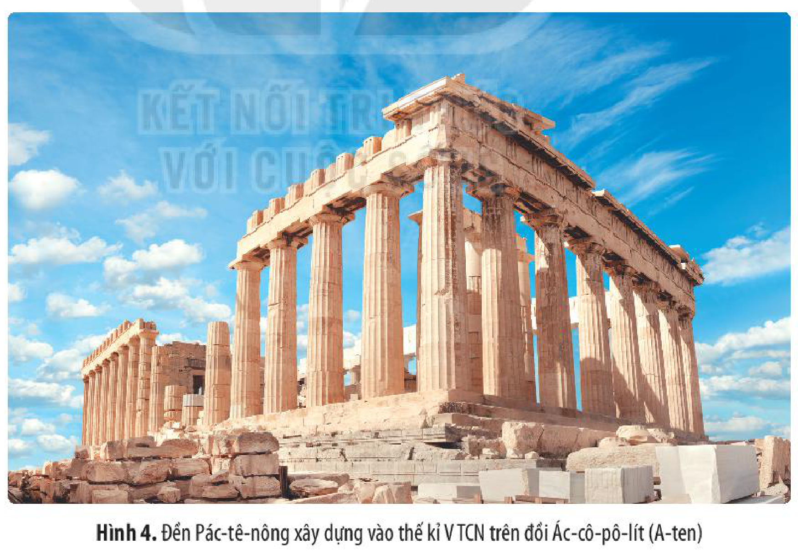

*Hình 4. Đền Pác-tê-nông xây dựng vào thế kỉ V TCN trên đồi Ác-cô-pô-lít (A-ten)*

<!-- pdf:53 -->

Các tác phẩm điêu khắc, hội hoạ xuất sắc nhất của Hy Lạp – La Mã như: tượng Lực sĩ ném đĩa, tượng A-tê-na, tượng thần Vệ nữ thành Mi-lô,...; bức vẽ Chiến dịch Ma-ra-tông, Bắt cóc nàng Péc-xê-phôn; các bức hoạ trên lăng mộ, đền thờ và đồ gốm;...

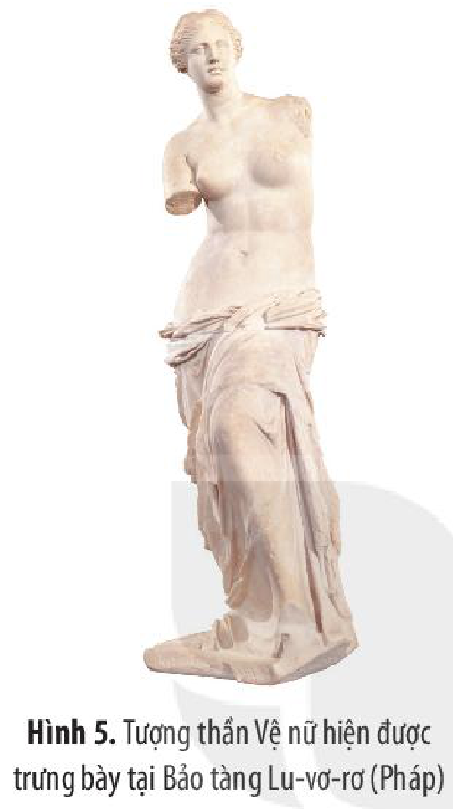

*Hình 5. Tượng thần Vệ nữ hiện được trưng bày tại Bảo tàng Lu-vơ-rơ (Pháp)*

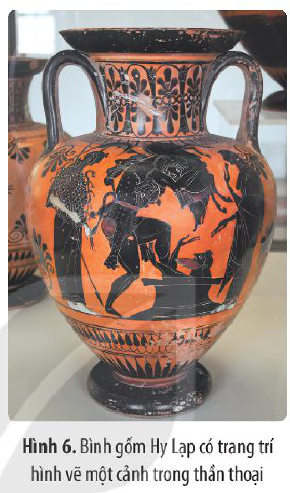

*Hình 6. Bình gốm Hy Lạp có trang trí hình vẽ một cảnh trong thần thoại*

• *Khoa học, kĩ thuật*

Người Hy Lạp – La Mã cổ đại đã có những cống hiến vĩ đại về khoa học, kĩ thuật.

<!-- term: Dương lịch -->
Người Hy Lạp – La Mã có nhiều hiểu biết về thiên văn, họ nhận ra Trái Đất hình cầu, cho rằng Mặt Trời và các thiên thể chuyển động quanh Trái Đất. Người Hy Lạp đã biết tính lịch theo chu kì chuyển động của Mặt Trời. Về sau, người La Mã tính được 1 năm có 365 ngày và 1/4 ngày. Lịch của họ đã rất gần với hệ thống dương lịch được sử dụng phổ biến ngày nay.

Các nhà khoa học Hy Lạp như Ta-lét, Pi-ta-go, Ơ-cơ-lít, Ác-si-mét,... đã có đóng góp trong nhiều ngành khoa học khác nhau, đặc biệt là Toán học, Vật lí học và Thiên văn học. Một số nhà khoa học nổi tiếng của La Mã là Pli-ni-út (tác giả bộ *Lịch sử tự nhiên*), Clô-đi-út Ptô-lê-mê (đề xuất thuyết *Địa tâm*),...

Về Y học, khởi đầu từ Hi-pô-crát (người được coi là cha đẻ của nền Y học phương Tây), các thầy thuốc Hy Lạp cổ đại đạt được nhiều tri thức về chẩn đoán và chữa bệnh bằng thuốc, giải phẫu, gây mê.

Về Sử học, nền Sử học của Hy Lạp cổ đại được hình thành từ thế kỉ V TCN với sử gia đầu tiên là Hê-rô-đốt và tác phẩm *Lịch sử cuộc chiến tranh Hy Lạp – Ba Tư*. Ngoài ra, còn phải kể đến một số nhà sử học nổi tiếng khác như: Tuy-xi-dít với tác phẩm *Lịch sử cuộc chiến tranh Pê-lô-pô-nê-dơ*; Xê-nô-phôn với bộ *Lịch sử Hy Lạp*. Sử học La Mã kế thừa và phát triển truyền thống từ Sử học Hy Lạp với những nhà sử học xuất sắc như: Pô-li-bi-út, Ti-tút Li-vi-út,...

<!-- pdf:54 -->

Người Hy Lạp – La Mã cổ đại cũng biết ứng dụng những hiểu biết khoa học vào thực tiễn cuộc sống như: chế tạo bê tông, sử dụng hệ thống đòn bẩy, chế tạo máy bắn đá, máy bắn tên, máy bơm nước,...

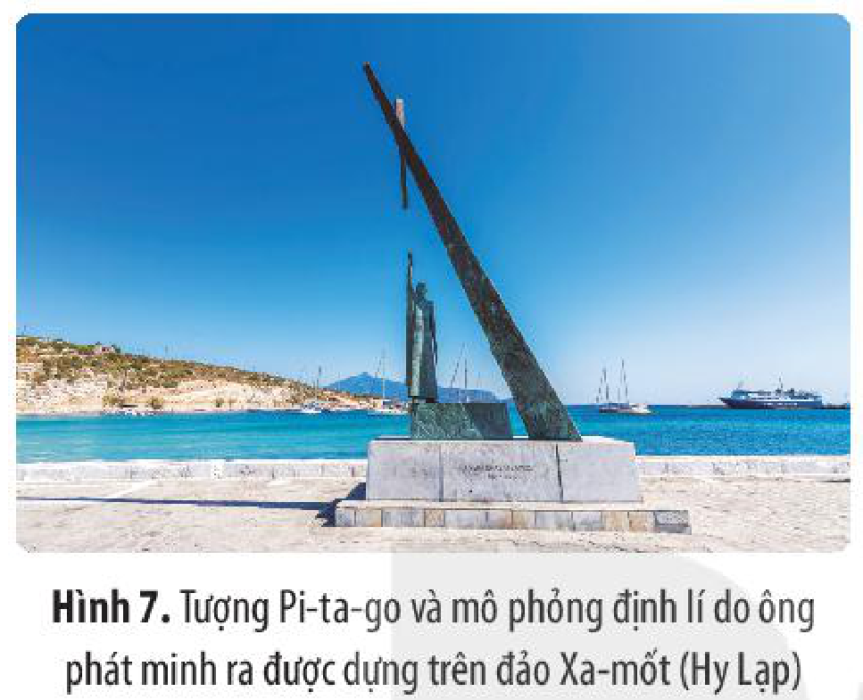

*Hình 7. Tượng Pi-ta-go và mô phỏng định lí do ông phát minh ra được dựng trên đảo Xa-mốt (Hy Lạp)*

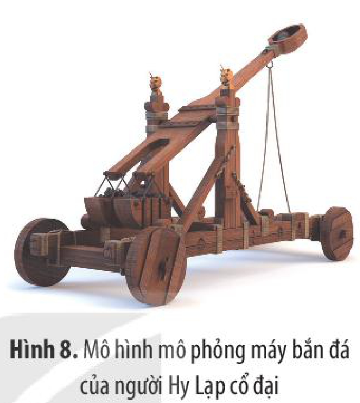

*Hình 8. Mô hình mô phỏng máy bắn đá của người Hy Lạp cổ đại*

Những cống hiến về khoa học, kĩ thuật của người Hy Lạp – Lã Mã cổ đại có ý nghĩa rất to lớn, đặt nền tảng cho sự phát triển mạnh mẽ của các ngành khoa học, kĩ thuật của thế giới trong những giai đoạn tiếp theo.

• *Tư tưởng*

Hy Lạp – La Mã cổ đại là quê hương của triết học phương Tây. Quá trình hình thành và phát triển của triết học Hy Lạp – La Mã cổ đại gắn liền với cuộc đấu tranh giữa chủ nghĩa duy vật và chủ nghĩa duy tâm; đặt nền tảng cho nhiều thành tựu về tư tưởng, tri thức của phương Tây thời cận và hiện đại.

Các nhà triết học tiêu biểu của Hy Lạp cổ đại là: Ta-lét, Hê-ra-clít, Đê-mô-crít,... (trường phái duy vật); Xô-crát, Pla-tôn, Pi-ta-go,... (trường phái duy tâm). Đại diện tiêu biểu của triết học La Mã là: Lu-crê-ti-út, Xi-xê-rông,...

• *Tôn giáo*

Người Hy Lạp – La Mã cổ đại thờ đa thần. Họ thường xuyên hiến tế, cầu nguyện và tổ chức lễ hội để tôn vinh các vị thần. Các vị thần của Hy Lạp – La Mã cổ đại được mô tả với hình dáng, tính cách giống với con người.

<!-- term: Cơ Đốc giáo -->
Cơ Đốc giáo được hình thành vào thế kỉ I ở phần lãnh thổ phía Đông của đế quốc La Mã. Cơ Đốc giáo ra đời trong bối cảnh các cuộc đấu tranh của nô lệ, dân nghèo bị chính quyền La Mã đàn áp.

<!-- pdf:55 -->

<!-- term: Cơ Đốc giáo -->
Theo truyền thuyết, người sáng lập Cơ Đốc giáo là Giê-su, được sinh ra ở Na-da-rét (nay thuộc I-xra-en). Ban đầu, Cơ Đốc giáo bị giới thống trị La Mã tìm cách tiêu diệt, nhưng tôn giáo này vẫn ngày càng có nhiều tín đồ và được truyền bá rộng rãi. Đến đầu thế kỉ IV, chính quyền La Mã đã ngừng đàn áp và công nhận Cơ Đốc giáo là tôn giáo chính thức của đế quốc La Mã.

Tôn giáo Hy Lạp – La Mã cổ đại đã để lại nhiều dấu ấn và ảnh hưởng đối với đời sống xã hội và văn hoá phương Tây sau này.

• *Thể thao*

Thể thao có ý nghĩa và vai trò quan trọng trong đời sống, lễ hội và văn hoá Hy Lạp – La Mã cổ đại. Nhiều sự kiện và môn thể thao của Hy Lạp – La Mã cổ đại là cơ sở, nền tảng thể thao của nhân loại ngày nay.

<!-- term: Đại hội Ô-lim-píc -->
Từ năm 776 TCN, người Hy Lạp đã tổ chức Đại hội Ô-lim-píc theo định kì bốn năm một lần tại đền thờ thần Dớt ở Ô-lim-pi-a. Ngoài ra, còn có Đại hội thể thao Pa-na-thê-nai-a được tổ chức bốn năm một lần tại A-ten từ năm 566 TCN,...

> 💡 EM CÓ BIẾT ?
>
> Có năm môn thể thao được tổ chức tại đại hội Ô-lim-píc: chạy, nhảy xa, phóng lao, ném đĩa và đấu vật. Tất cả những người đàn ông có đủ sức khoẻ, tài năng từ tất cả các thành bang đều có thể đến tham dự. Người đạt giải cao nhất trong mỗi nội dung thi đấu sẽ nhận được phần thưởng là “vòng nguyệt quế” linh thiêng được tết từ cành, lá của cây ô-liu. Trở về quê hương họ sẽ được đón tiếp như những người anh hùng.

Người La Mã rất yêu thích thể thao và dành nhiều thời gian để tham dự hoặc theo dõi các hoạt động thể thao. Đặc biệt, ở các đấu trường, chủ nô thường tổ chức các cuộc đấu của các đấu sĩ, hoặc giữa các đấu sĩ với dã thú.

> ❓ Nêu một số thành tựu cơ bản của nền văn minh Hy Lạp – La Mã cổ đại và ý nghĩa của những thành tựu đó.

## 2. Văn minh Tây Âu thời kì Phục hưng

### a) Bối cảnh lịch sử

<!-- term: Phong trào Văn hoá Phục hưng -->
Thời kì Phục hưng (thế kỉ XV – XVII) được gọi theo tên của phong trào *Văn hoá Phục hưng* – một trào lưu văn hoá của Tây Âu trên cơ sở phục hưng những thành tựu và giá trị của nền văn minh Hy Lạp – La Mã cổ đại.

Phong trào Văn hoá Phục hưng ra đời trong bối cảnh quan hệ sản xuất tư bản chủ nghĩa hình thành ở các nước Tây Âu.

<!-- pdf:56 -->

Thế giới quan, ý thức hệ phong kiến và việc Giáo hội Cơ Đốc lũng đoạn nền văn hoá, tư tưởng là những trở ngại cho sự phát triển phương thức sản xuất mới.

Tầng lớp tư sản mới ra đời cần có một nền văn hoá mới phù hợp với họ. Trong bối cảnh ấy, họ đã tìm kiếm, tiếp thu và phục hưng lại những giá trị và thành tựu rực rỡ của văn minh Hy Lạp – La Mã cổ đại.

Bên cạnh đó, phong trào Văn hoá Phục hưng ra đời trong bối cảnh mâu thuẫn xã hội sâu sắc giữa quần chúng nhân dân với giai cấp phong kiến và giáo hội,...

Phong trào Văn hoá Phục hưng diễn ra đầu tiên ở I-ta-li-a, nơi vốn là quê hương của nền văn minh La Mã, nơi lưu giữ nhiều giá trị văn hoá từ thời cổ đại. Từ I-ta-li-a, phong trào Văn hoá Phục hưng lan sang các nước Anh, Pháp, Tây Ban Nha, Đức,...

> ❓ Hãy phân tích bối cảnh lịch sử, những tiền đề kinh tế, xã hội, văn hoá dẫn đến sự hình thành phong trào Văn hoá Phục hưng.

### b) Thành tựu cơ bản

• *Văn học*

Thời kì này chứng kiến sự phát triển đến đỉnh cao của văn học, nghệ thuật với sự nở rộ của các tài năng. Văn học của thời kì Phục hưng đạt nhiều thành tựu trên cả ba lĩnh vực là thơ, tiểu thuyết và kịch.

Các nhà thơ tiêu biểu người I-ta-li-a như: Đan-tê A-li-ghê-ri với *Thần khúc*, *Cuộc đời mới*; Phran-xi-cô Pê-trác-ca với nhiều tập thơ trữ tình,... Về tiểu thuyết, phải kể đến các đại diện tiêu biểu như: Giô-van-ni Bô-ca-xi-ô (I-ta-li-a) với tác phẩm *Mười ngày*, Phơ-răng-xoa Ra-bơ-le (Pháp) với *Gác-gan-tua và Pan-ta-gru-en*, Mi-quen-đơ Xéc-van-téc (Tây Ban Nha) với *Đôn Ki-hô-tê*,... Trong thể loại kịch, tác giả kiệt xuất nhất là Uy-li-am Sếch-xpia với nhiều tác phẩm nổi tiếng như *Ham-lét*, *Ô-ten-lô*, *Rô-mê-ô và Giu-li-ét*,...

• *Hội hoạ, kiến trúc, điêu khắc*

<!-- term: Nghệ thuật Phục hưng -->
Những thành tựu về hội hoạ, kiến trúc, điêu khắc thời kì Phục hưng bắt đầu từ I-ta-li-a và lan rộng ra khắp châu Âu. Đến thế kỉ XV – XVI, nghệ thuật Phục hưng đạt đến đỉnh cao với tên tuổi của nhiều danh hoạ và nhà điêu khắc, trong đó tiêu biểu nhất là: Lê-ô-na đờ Vanh-xi với các bức tranh *Bữa tiệc cuối cùng*, *Nàng Mô-na Li-sa*,...; Mi-ken-lăng-giơ với các tác phẩm *Tượng Đa-vít*, *Tượng Đức Mẹ sầu bi*,...; Ra-pha-en với bức *Đức Mẹ Sít-tin*, *Trường học A-ten*;...

<!-- pdf:57 -->

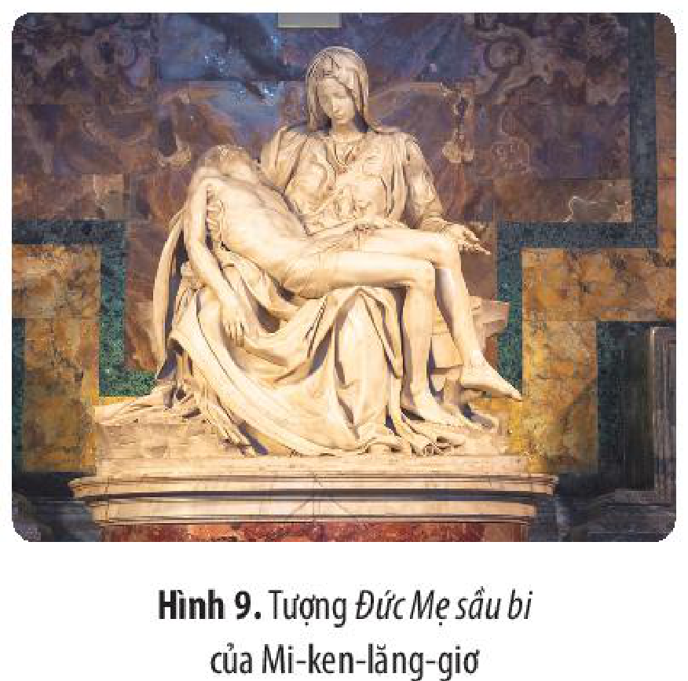

*Hình 9. Tượng Đức Mẹ sầu bi của Mi-ken-lăng-giơ*
<!-- ocr-ok: Chú thích Hình 9 trang 56 (PDF 57), OCR nhận diện nhầm "sầu bi" thành "cầu bị" -->

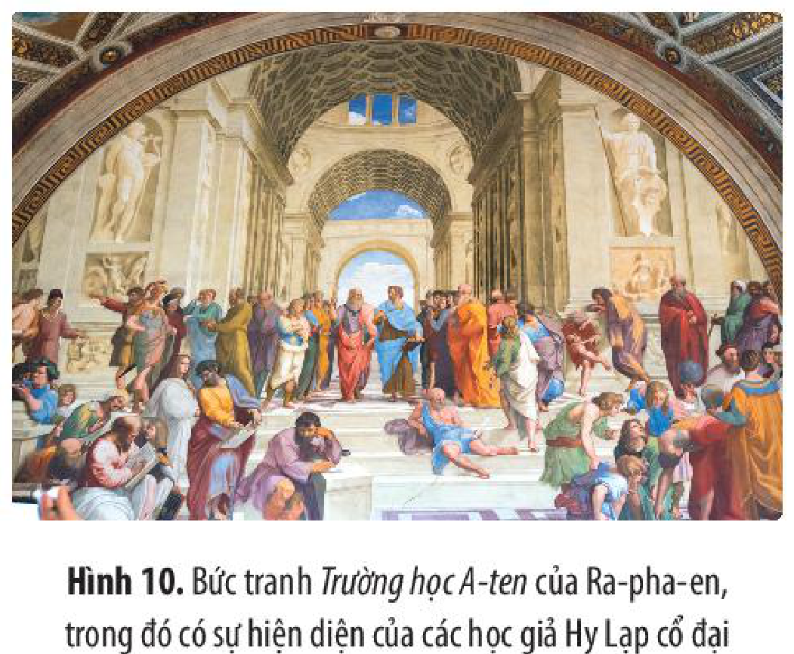

*Hình 10. Bức tranh Trường học A-ten của Ra-pha-en, trong đó có sự hiện diện của các học giả Hy Lạp cổ đại*

Trong kiến trúc, phong cách Phục hưng chú trọng yếu tố hình học, tính đối xứng, tỉ lệ. Các công trình kiến trúc tiêu biểu là Vương cung Thánh đường Thánh Phê-rô, Nhà thờ Thánh Pi-tơ (ở Va-ti-căng),...

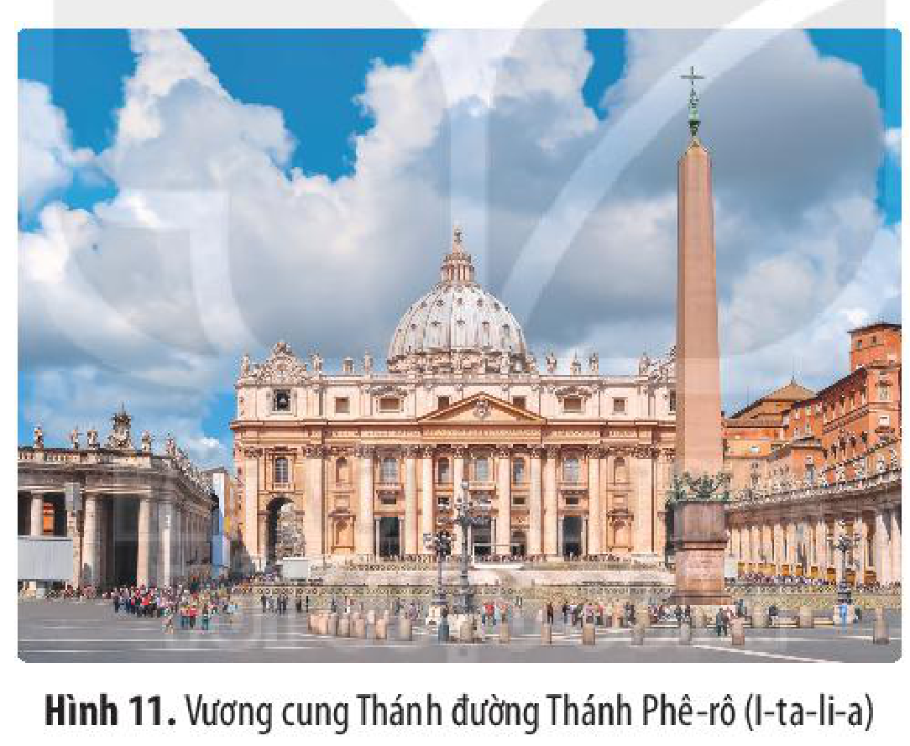

*Hình 11. Vương cung Thánh đường Thánh Phê-rô (I-ta-li-a)*

• *Khoa học, kĩ thuật*

Khoa học, kĩ thuật Tây Âu thời kì này đạt được nhiều thành tựu, có ý nghĩa quan trọng trong việc đẩy lùi những ảnh hưởng và chi phối của thần học.

<!-- term: Thuyết Nhật tâm -->
Lĩnh vực khoa học nổi bật nhất thời Phục hưng là Thiên văn học với sự xuất hiện của các nhà khoa học vĩ đại như: Ni-cô-lai Cô-péc-ních với thuyết *Nhật tâm*; Gioóc-đa-nô Bru-nô với việc chứng minh Mặt Trời chỉ là trung tâm của Thái dương hệ và tồn tại trong vũ trụ vô tận; Ga-li-lê-ô Ga-li-lê với việc chế tạo ra kính thiên văn để quan sát bầu trời,...

Thời kì Phục hưng, văn minh Tây Âu có nhiều tiến bộ về kĩ thuật, đặc biệt là trong các ngành dệt, khai mỏ, luyện kim, đóng tàu, chế tạo vũ khí,... và chế tạo được một số máy móc, sử dụng sức nước trong nhiều ngành sản xuất.

<!-- pdf:58 -->

• *Tư tưởng*

Khoa học, kĩ thuật thời Phục hưng đã tạo tiền đề cho sự phát triển của tư tưởng, đặc biệt triết học duy vật với các học giả tiêu biểu như Phran-xít Bê-cơn, Đê-các-tơ,...

Những chuyển biến trên phương diện tư tưởng đã có tác động to lớn tới tình hình chính trị, xã hội, tạo tiền đề cho các cuộc cách mạng xã hội ở châu Âu và đặt nền tảng cho những bước tiến lớn về tư tưởng, triết học trong các thời đại tiếp theo.

Thành tựu của Văn hoá Phục hưng có ý nghĩa vô cùng to lớn đối với văn minh Tây Âu và nhân loại. Các nhà Văn hoá Phục hưng đã lên án gay gắt Giáo hội Cơ Đốc giáo lũng đoạn, chĩa mũi nhọn đấu tranh chống lại chế độ phong kiến thối nát đương thời, đề cao giá trị con người và quyền tự do cá nhân, đề cao tinh thần dân tộc,...

Văn hoá Phục hưng được coi là cuộc đấu tranh công khai đầu tiên trên lĩnh vực văn hoá, tư tưởng của giai cấp tư sản chống lại chế độ phong kiến lỗi thời, mở đường cho văn minh Tây Âu phát triển trong những thế kỉ tiếp theo.

> ❓ Hãy nêu một số thành tựu cơ bản của văn minh Tây Âu thời kì Phục hưng và ý nghĩa của những thành tựu đó.

## ✏️ Luyện tập và vận dụng

1. Hãy nêu và so sánh cơ sở hình thành nền văn minh Hy Lạp – La Mã cổ đại với các nền văn minh phương Đông.

2. Lập bảng thống kê các thành tựu văn minh cơ bản của Hy Lạp – La Mã cổ đại, của Tây Âu thời kì Phục hưng theo gợi ý sau:

| Lĩnh vực | Tác giả, tác phẩm/thành tựu tiêu biểu | Thuộc nền văn minh | Ý nghĩa/giá trị nổi bật |
| --- | --- | --- | --- |
| ? | ? | ? | ? |

3. Ph. Ăng-ghen đã viết: “... *Không có cơ sở của nền văn minh Hy Lạp và đế chế La Mã thì không có châu Âu hiện đại*”. Em có đồng ý với nhận định này không? Vì sao?

Hãy sưu tầm tư liệu (qua sách, báo, internet,...) và giới thiệu về một thành tựu tiêu biểu của nền văn minh Hy Lạp – La Mã cổ đại hoặc nền văn minh Tây Âu thời kì Phục hưng.

## 📷 Danh sách hình trong bài

| Mã hình | Trang PDF | Vị trí trong bài | Chú thích gốc |
| --- | --- | --- | --- |
| H10-lich_su-b06-01 | 49 | Mở đầu | Hình 1. Bảo tàng Ô-lim-píc Nhật Bản |
| H10-lich_su-b06-02 | 50 | Mục 1.a (Chính trị) | Hình 2. Tượng Ốc-ta-vi-út – người mở đầu thời kì đế chế La Mã (cuối thế kỉ I TCN) |
| H10-lich_su-b06-03 | 51 | Mục 1.b (Chữ viết) | Hình 3. Bảng chữ số La Mã |
| H10-lich_su-b06-04 | 52 | Mục 1.b (Kiến trúc, điêu khắc và hội hoạ) | Hình 4. Đền Pác-tê-nông xây dựng vào thế kỉ V TCN trên đồi Ác-cô-pô-lít (A-ten) |
| H10-lich_su-b06-05 | 53 | Mục 1.b (Kiến trúc, điêu khắc và hội hoạ) | Hình 5. Tượng thần Vệ nữ hiện được trưng bày tại Bảo tàng Lu-vơ-rơ (Pháp) |
| H10-lich_su-b06-06 | 53 | Mục 1.b (Kiến trúc, điêu khắc và hội hoạ) | Hình 6. Bình gốm Hy Lạp có trang trí hình vẽ một cảnh trong thần thoại |
| H10-lich_su-b06-07 | 54 | Mục 1.b (Khoa học, kĩ thuật) | Hình 7. Tượng Pi-ta-go và mô phỏng định lí do ông phát minh ra được dựng trên đảo Xa-mốt (Hy Lạp) |
| H10-lich_su-b06-08 | 54 | Mục 1.b (Khoa học, kĩ thuật) | Hình 8. Mô hình mô phỏng máy bắn đá của người Hy Lạp cổ đại |
| H10-lich_su-b06-09 | 57 | Mục 2.b (Hội hoạ, kiến trúc, điêu khắc) | Hình 9. Tượng Đức Mẹ sầu bi của Mi-ken-lăng-giơ |
| H10-lich_su-b06-10 | 57 | Mục 2.b (Hội hoạ, kiến trúc, điêu khắc) | Hình 10. Bức tranh Trường học A-ten của Ra-pha-en, trong đó có sự hiện diện của các học giả Hy Lạp cổ đại |
| H10-lich_su-b06-11 | 57 | Mục 2.b (Hội hoạ, kiến trúc, điêu khắc) | Hình 11. Vương cung Thánh đường Thánh Phê-rô (I-ta-li-a) |
