<!-- pdf:59 -->

# BÀI 7: CÁC CUỘC CÁCH MẠNG CÔNG NGHIỆP THỜI KÌ CẬN ĐẠI

## 🎯 Học xong bài này, em sẽ:

- Trình bày được những nét chính về bối cảnh lịch sử diễn ra các cuộc cách mạng công nghiệp thời kì cận đại. Nêu được những thành tựu cơ bản và ý nghĩa của các cuộc cách mạng công nghiệp lần thứ nhất và thứ hai.
- Phân tích được những tác động của các cuộc cách mạng công nghiệp đó đối với sự phát triển kinh tế, văn hoá, xã hội.
- Biết sưu tầm, sử dụng tư liệu lịch sử để tìm hiểu về các cuộc cách mạng công nghiệp thời kì cận đại.
- Có thái độ trân trọng những thành quả của các cuộc cách mạng công nghiệp đối với sự phát triển của lịch sử.

## 🔴 Mở đầu

Em có biết, vào thời điểm năm 2021, để đi từ Hà Nội vào Thành phố Hồ Chí Minh bằng máy bay sẽ mất khoảng gần 2 giờ, bằng tàu hoả (loại có tốc độ cao nhất) mất khoảng 30 giờ, còn đi xe đạp có thể mất tới gần 1 000 giờ,... Như vậy, nếu không có những phương tiện giao thông hiện đại thì con người sẽ tốn rất nhiều thời gian và công sức để di chuyển giữa các vùng. Tàu hoả, ô tô, tàu thuỷ, máy bay là một số thành tựu tiêu biểu của các cuộc cách mạng công nghiệp thời kì cận đại. Vậy các cuộc cách mạng công nghiệp đó diễn ra trong bối cảnh nào và có những thành tựu gì nổi bật? Những thành tựu ấy có ý nghĩa và tác động gì đối với thế giới?

*Hình 1. Máy bay đang cất cánh*

<!-- pdf:60 -->

## 1. Cách mạng công nghiệp lần thứ nhất

### a) Bối cảnh lịch sử

<!-- term: Cách mạng công nghiệp lần thứ nhất -->
Cách mạng công nghiệp lần thứ nhất diễn ra vào giữa thế kỉ XVIII, bắt đầu ở Anh, sau đó lan ra nhiều quốc gia ở châu Âu và Bắc Mỹ.

<!-- term: Rào đất cướp ruộng -->
Nước Anh tiến hành cách mạng công nghiệp trong bối cảnh có nhiều thuận lợi: cách mạng tư sản nổ ra sớm và thành công; nguồn tích luỹ tư bản (từ buôn bán nô lệ da đen và bóc lột thuộc địa); giàu tài nguyên thiên nhiên; những tiến bộ kĩ thuật trong sản xuất nông nghiệp, thủ công nghiệp đã tạo ra nguồn lương thực dồi dào và cùng với hiện tượng “rào đất cướp ruộng” đã bổ sung lực lượng lao động cho các nhà máy, xí nghiệp. Sự phát triển của ngành dệt ở Anh đã đặt ra nhu cầu cải tiến kĩ thuật và cơ khí hoá ngành này.

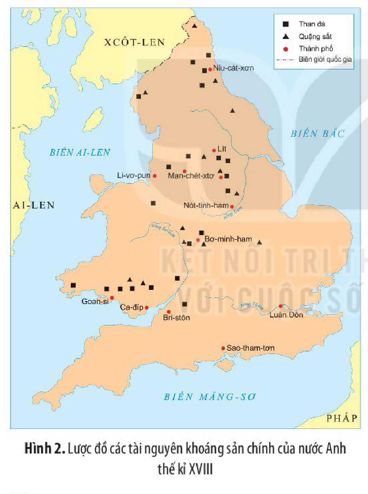

*Hình 2. Lược đồ các tài nguyên khoáng sản chính của nước Anh thế kỉ XVIII*

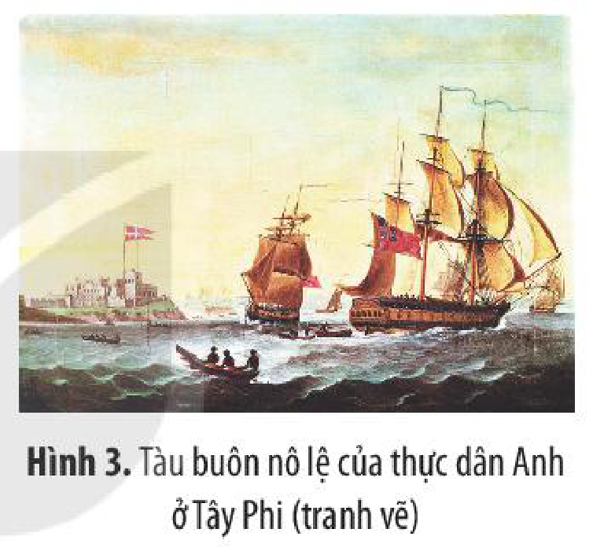

*Hình 3. Tàu buôn nô lệ của thực dân Anh ở Tây Phi (tranh vẽ)*

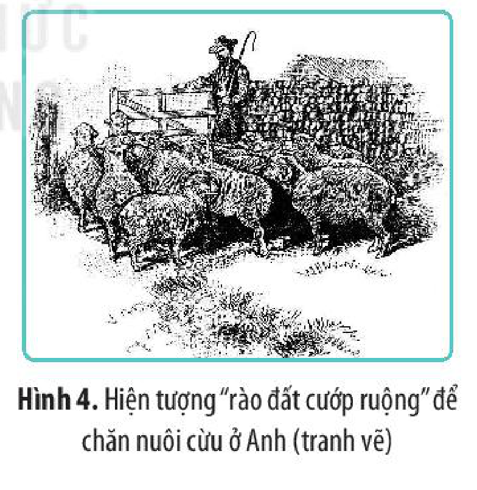

*Hình 4. Hiện tượng “rào đất cướp ruộng” để chăn nuôi cừu ở Anh (tranh vẽ)*

> ❓ 1. Thông qua các hình 2, 3, 4 và thông tin trong mục a, em hãy trình bày bối cảnh của Cách mạng công nghiệp lần thứ nhất ở Anh.
>
> 2. Theo em, tại sao Cách mạng công nghiệp lần thứ nhất lại diễn ra đầu tiên ở nước Anh?

<!-- pdf:61 -->

### b) Những thành tựu cơ bản

> TƯ LIỆU 1. “Khởi điểm của cuộc cách mạng công nghiệp là sự xuất hiện máy móc và thực chất của nó là cuộc cách mạng về kĩ thuật, là sự nhảy vọt từ lao động thủ công sang lao động bằng máy móc”.
>
> *(Vũ Dương Ninh, Nguyễn Văn Hồng, Lịch sử thế giới cận đại, NXB Giáo dục Việt Nam, Hà Nội, 2015, tr. 35)*

Những tiến bộ về kĩ thuật chủ yếu diễn ra trong các ngành dệt, luyện kim và giao thông vận tải; đầu tiên là những tiến bộ về kĩ thuật và máy móc trong ngành dệt.

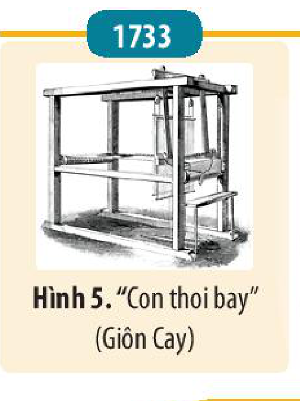

*Hình 5. “Con thoi bay” (Giôn Cay)*

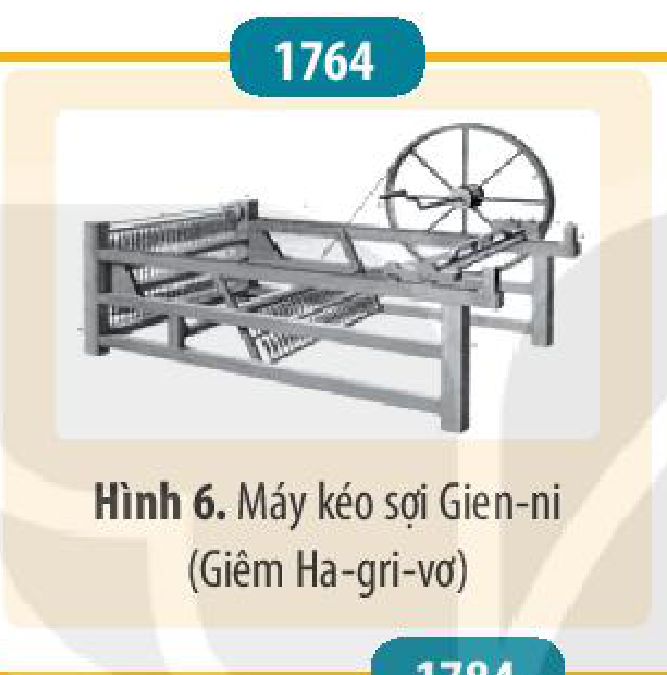

<!-- term: Máy kéo sợi Gien-ni -->
*Hình 6. Máy kéo sợi Gien-ni (Giêm Ha-gri-vơ)*

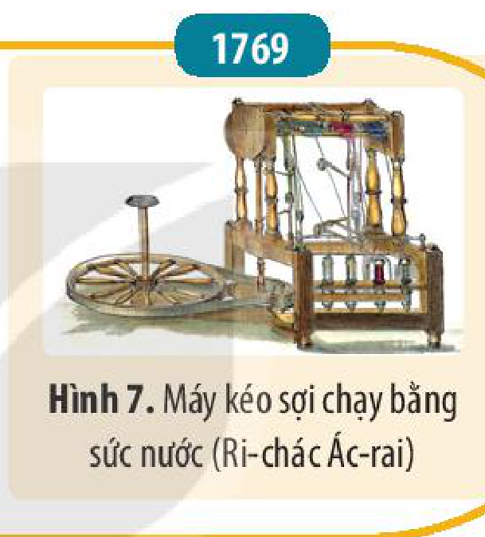

*Hình 7. Máy kéo sợi chạy bằng sức nước (Ri-chác Ác-rai)*

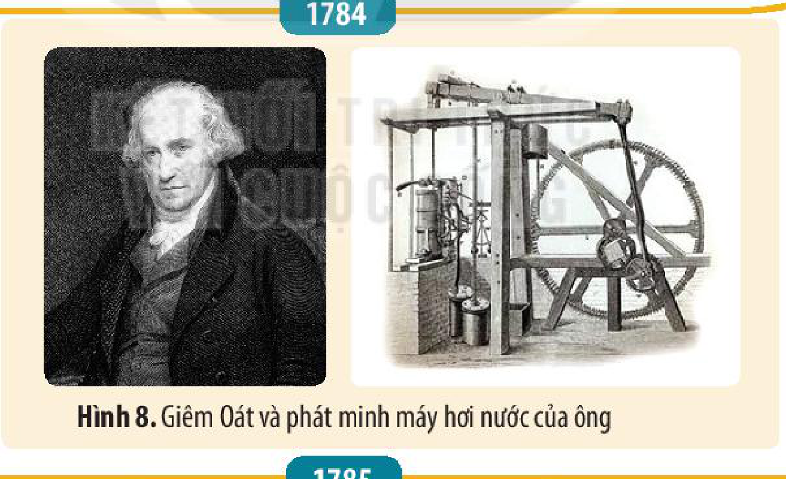

*Hình 8. Giêm Oát và phát minh máy hơi nước của ông*
<!-- ocr-ok: Chú thích Hình 8 trang 60 (PDF 61), OCR bỏ sót toàn bộ dòng chú thích do nằm dưới watermark -->

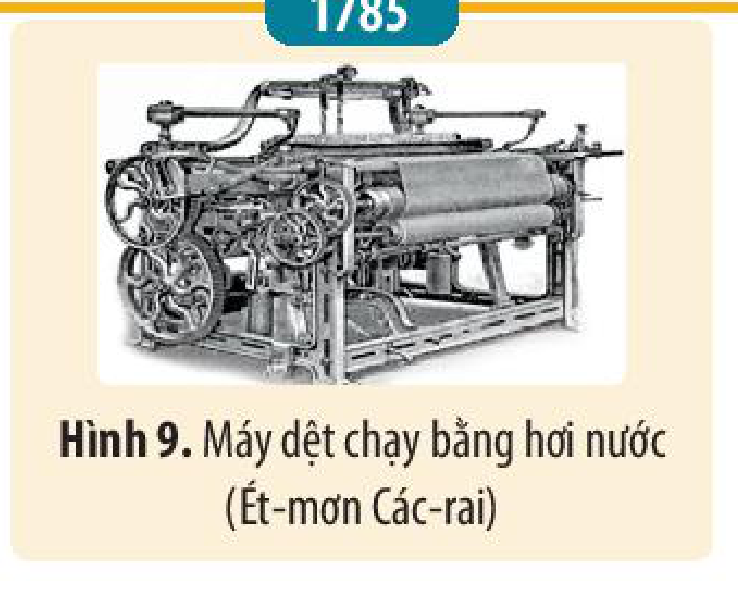

*Hình 9. Máy dệt chạy bằng hơi nước (Ét-mơn Các-rai)*

<!-- pdf:62 -->

Sự xuất hiện của “con thoi bay” do Giôn Cay phát minh năm 1733 đã giúp người thợ dệt không phải lao thoi bằng tay và năng suất lao động tăng gấp đôi. Phát minh ra máy dệt chạy bằng hơi nước vào năm 1785 bởi Ét-mơn Các-rai đã giúp năng suất của thợ dệt tăng lên đến 40 lần. Cùng với thành công của máy kéo sợi của Ác-rai (từ năm 1769), sợi kéo đã nhỏ lại và chắc, vải dệt ra đẹp và bền hơn.

<!-- term: Máy hơi nước -->
Đặc biệt, với việc phát minh ra máy hơi nước đã tạo ra nguồn động lực mới, làm giảm sức lao động cơ bắp của con người, thúc đẩy sản xuất phát triển vượt bậc, khởi đầu quá trình công nghiệp hoá ở nước Anh.

Bên cạnh đó, ngành luyện kim và giao thông vận tải cũng đạt được những thành tựu rất quan trọng.

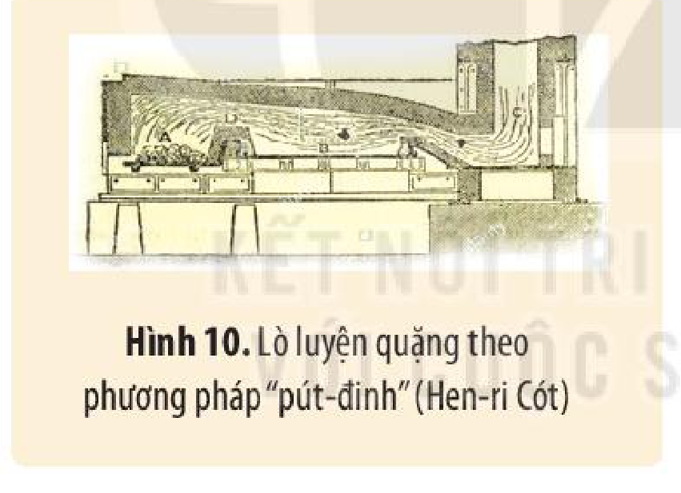

*Hình 10. Lò luyện quặng theo phương pháp “pút-đinh” (Hen-ri Cót)*

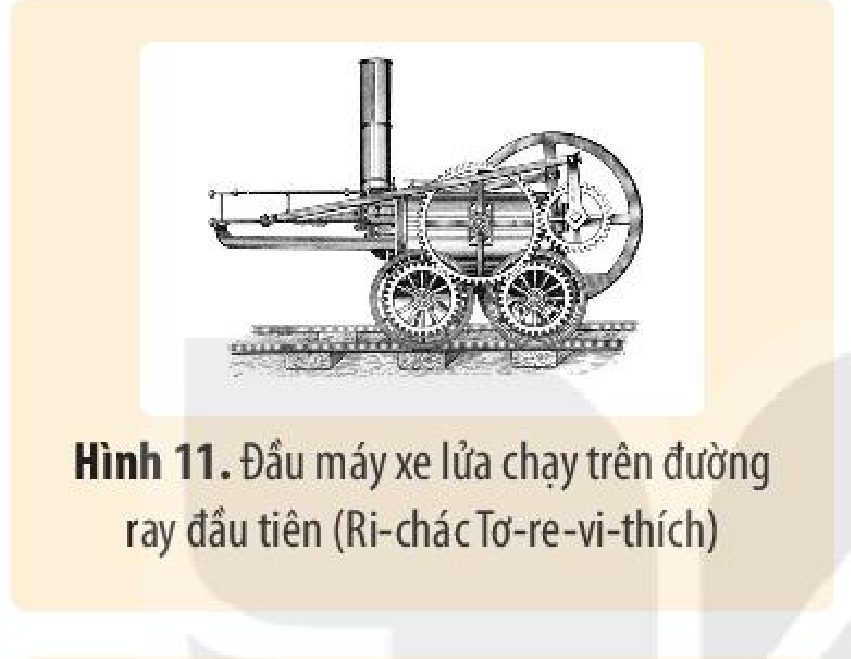

*Hình 11. Đầu máy xe lửa chạy trên đường ray đầu tiên (Ri-chác Tơ-re-vi-thích)*

> 💡 EM CÓ BIẾT ?

<!-- term: Phương pháp luyện kim pút-đinh -->
> Phương pháp luyện kim “pút-đinh” (nhào trộn) dùng luồng khí làm nóng chảy quặng để luyện thành sắt. Nhờ phương pháp này mà việc luyện quặng được đơn giản hoá, sắt được sản xuất ra nhiều, được dùng để sản xuất máy móc và đồ dùng sinh hoạt.

Những thành tựu của cách mạng công nghiệp ở Anh từng bước lan sang các quốc gia khác ở châu Âu và Mỹ.

<!-- term: Tàu thuỷ chạy bằng hơi nước -->
Ở Mỹ, năm 1807, Rô-bớt Phơn-tơn chế tạo thành công tàu thuỷ chở khách chạy bằng hơi nước đầu tiên. Ở Bỉ, quá trình công nghiệp hoá cũng diễn ra vào đầu thế kỉ XIX với trọng tâm là ngành luyện kim (thép), khai mỏ (than đá) và dệt.

Ở Pháp, do tác động của cách mạng tư sản và những bất ổn chính trị, cách mạng công nghiệp diễn ra khá muộn. Phải đến giữa thế kỉ XIX, nước Pháp mới cơ bản trở thành một nước công nghiệp.

> ❓ 1. Em hãy nêu những phát minh và sáng chế cơ bản ở nước Anh và một số nước khác ở châu Âu và Bắc Mỹ trong Cách mạng công nghiệp lần thứ nhất.
>
> 2. Theo em, phát minh nào là quan trọng nhất? Vì sao?

<!-- pdf:63 -->

## 2. Cách mạng công nghiệp lần thứ hai

### a) Bối cảnh lịch sử

<!-- term: Cách mạng công nghiệp lần thứ hai -->
Cách mạng công nghiệp lần thứ hai diễn ra từ giữa thế kỉ XIX đến khi Chiến tranh thế giới thứ nhất bùng nổ (1914).

Cuộc cách mạng này diễn ra trong bối cảnh nước Anh đã đạt được những thành tựu quan trọng trong Cách mạng công nghiệp lần thứ nhất và tiếp tục đẩy mạnh quá trình công nghiệp hoá đất nước.

Đầu thế kỉ XIX, nhiều nước tư bản ở châu Âu và Bắc Mỹ tuy vẫn còn là nước nông nghiệp nhưng có nhiều điều kiện thuận lợi cho phát triển công nghiệp: đầu tư tư bản tài chính lớn, tài nguyên khá phong phú, thị trường tiêu thụ lớn, nguồn lao động dồi dào và hệ thống giao thông phát triển mạnh,...

Từ đầu thế kỉ XVIII đến giữa thế kỉ XIX, các ngành khoa học Vật lí, Hoá học, Sinh học,... đã đạt được nhiều thành tựu như: Thuyết vạn vật hấp dẫn (Niu-tơn), Định luật bảo toàn vật chất và năng lượng (Lô-mô-nô-xốp), Thuyết tiến hoá (Đác-uyn),...

> ❓ Em hãy cho biết: Cách mạng công nghiệp lần thứ hai diễn ra trong bối cảnh nào?

### b) Những thành tựu cơ bản

Cách mạng công nghiệp lần thứ hai gắn liền với những tiến bộ về khoa học, kĩ thuật trong rất nhiều lĩnh vực.

Với việc phát minh ra phương pháp sử dụng lò cao trong luyện kim đã dẫn đến sự ra đời của các nguyên liệu mới.

> 💡 EM CÓ BIẾT ?

<!-- term: Phương pháp sử dụng lò cao -->
> Phương pháp sử dụng lò cao có khả năng luyện gang lỏng thành thép có chất lượng tốt, dễ cán, giá thành rẻ, đã giúp cho việc chế tạo máy móc và động cơ nhanh hơn, cũng như tạo thuận lợi trong xây dựng đường xe lửa, đóng tàu thuyền, chế tạo vũ khí,...

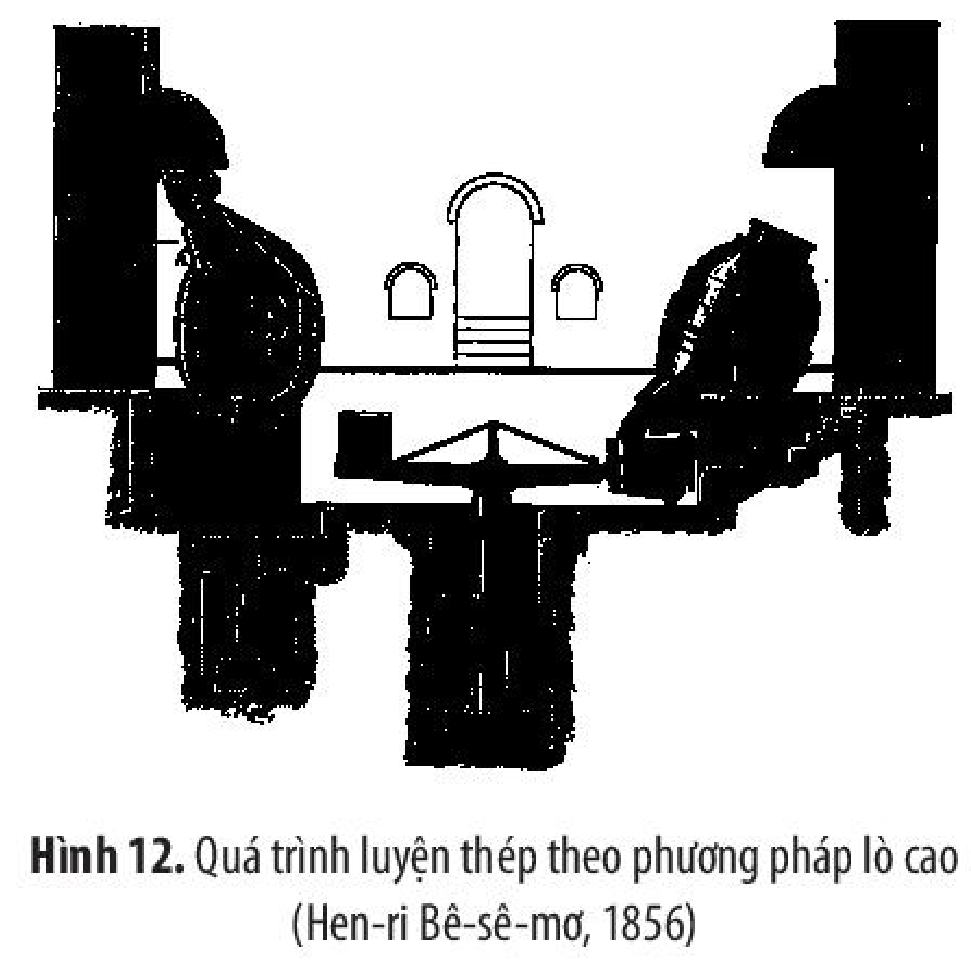

*Hình 12. Quá trình luyện thép theo phương pháp lò cao (Hen-ri Bê-sê-mơ, 1856)*

<!-- pdf:64 -->

Những khám phá về điện của Mai-cơn Pha-ra-đây, Tô-mát Ê-đi-xơn, Ni-cô-la Tét-la là cơ sở cho sự ra đời và phát triển của động cơ điện, điện thoại, vô tuyến điện và thúc đẩy việc ứng dụng nguồn năng lượng điện vào cuộc sống.

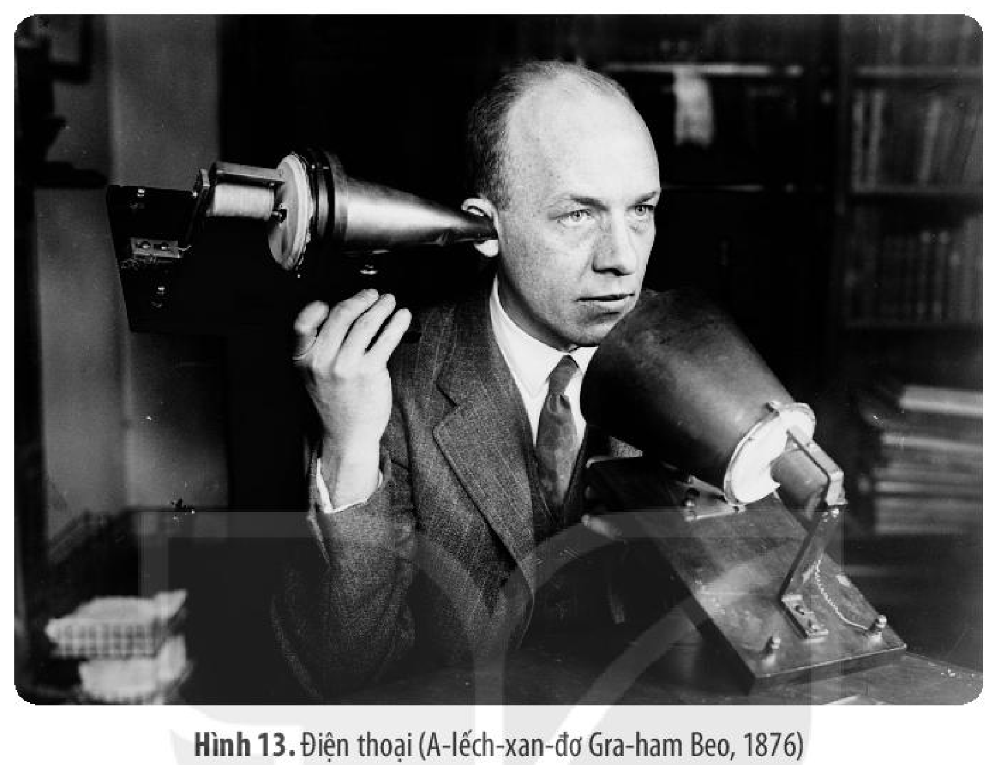

*Hình 13. Điện thoại (A-lếch-xan-đơ Gra-ham Beo, 1876)*

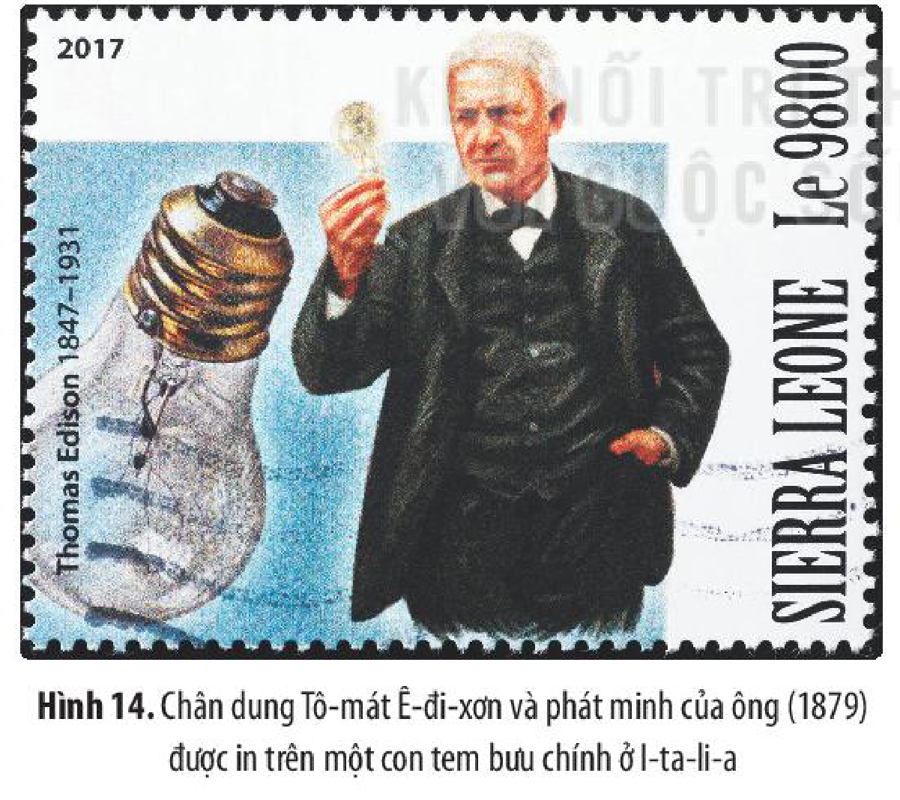

*Hình 14. Chân dung Tô-mát Ê-đi-xơn và phát minh của ông (1879) được in trên một con tem bưu chính ở I-ta-li-a*

> 💡 EM CÓ BIẾT ?

<!-- term: Động cơ điện và bóng đèn sợi đốt -->
> Các nghiên cứu về điện có từ thời cổ đại, tuy nhiên động cơ điện đầu tiên được phát minh bởi Mai-cơn Pha-ra-đây (năm 1821). Năm 1879, Ê-đi-xơn đã hoàn thiện phát minh ra bóng đèn sợi đốt trong và cùng với Giô-dép Goan thương mại hoá đèn điện giúp thắp sáng các nhà, thành phố, nhà xưởng. Ni-cô-la Tét-la đã thúc đẩy sự phát triển của mạng lưới điện xoay chiều được dùng phổ biến ngày nay.

<!-- pdf:65 -->

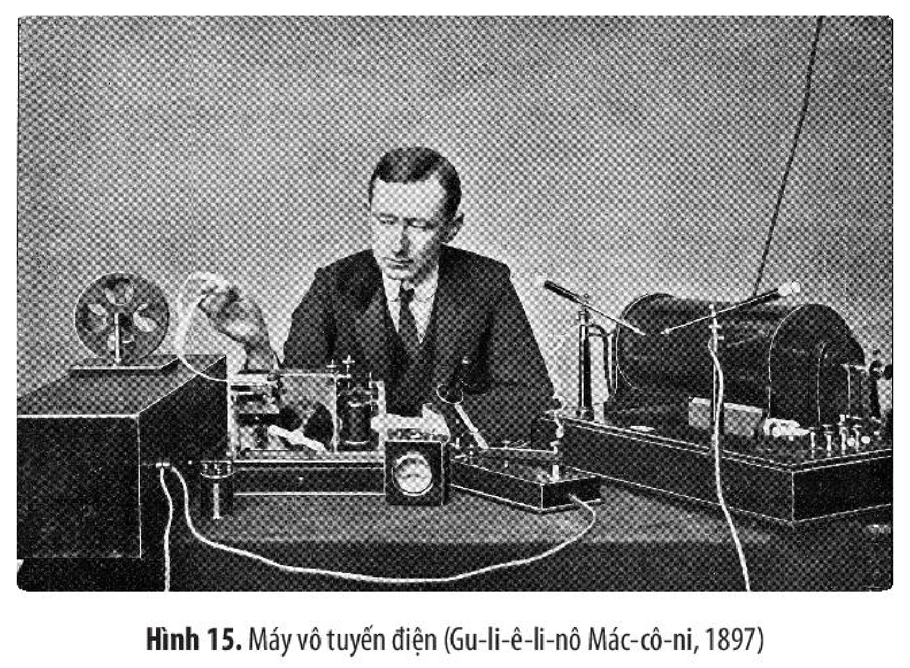

*Hình 15. Máy vô tuyến điện (Gu-li-ê-li-nô Mác-cô-ni, 1897)*

<!-- term: Động cơ đốt trong -->
Việc phát minh ra động cơ đốt trong tạo tiền đề cho sự ra đời và phát triển của ô tô, máy bay, đồng thời thúc đẩy ngành khai thác dầu mỏ.

Chiếc xe hơi đầu tiên được sử dụng trên thực tế do nhà phát minh người Đức Can Ben tạo ra vào năm 1886. Tuy nhiên, người có công lớn trong việc đưa xe hơi trở nên phổ biến là “ông vua xe hơi” nước Mỹ – Hen-ri Pho.

> 💡 EM CÓ BIẾT ?

<!-- term: Dây chuyền lắp ráp hàng loạt của Hen-ri Pho -->
> Năm 1896, Hen-ri Pho chế tạo thành công chiếc xe hơi bốn bánh đầu tiên. Sau đó, năm 1903, Công ti Pho Mô-tô được thành lập và năm 1908 cho ra đời dòng xe Mô-đen T nổi tiếng khắp thế giới thời bấy giờ. Hen-ri Pho đã tạo ra cuộc cách mạng trong ngành công nghiệp ô tô, áp dụng máy móc để xây dựng dây chuyền lắp ráp hàng loạt.

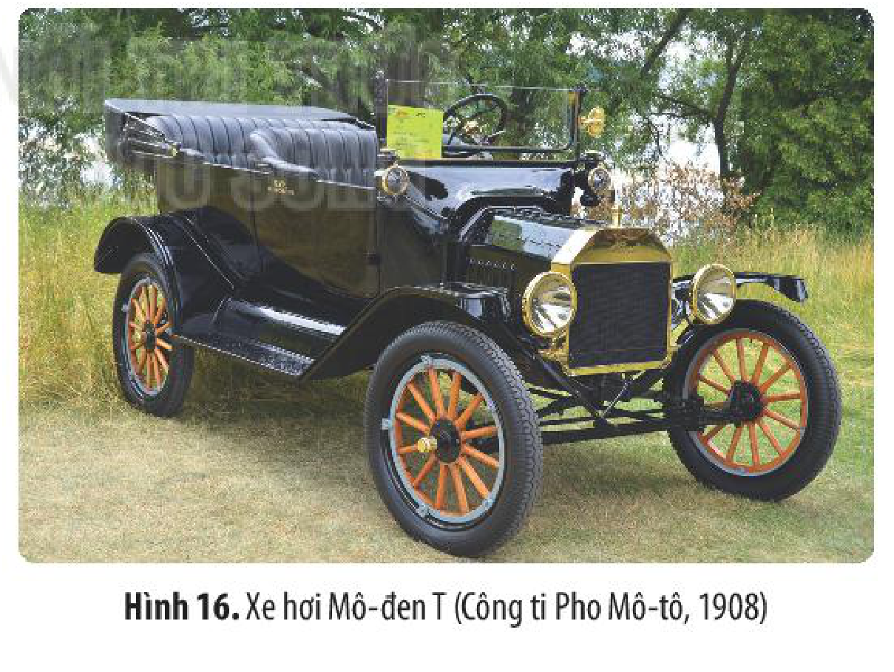

*Hình 16. Xe hơi Mô-đen T (Công ti Pho Mô-tô, 1908)*

Sau nhiều năm nghiên cứu và thử nghiệm với nhiều mô hình, từ diều đến máy bay cánh lượn không động cơ, đến năm 1903, hai anh em nhà Rai đã thử nghiệm thành công máy bay chạy bằng động cơ xăng.

<!-- pdf:66 -->

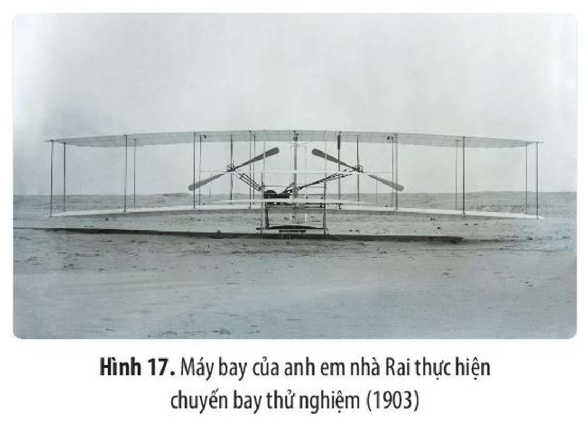

*Hình 17. Máy bay của anh em nhà Rai thực hiện chuyến bay thử nghiệm (1903)*

> 💡 EM CÓ BIẾT ?
>
> Trong buổi thử nghiệm, máy bay của anh em nhà Rai chỉ có thể bay trong khoảng cách vài trăm mét, không thể tự cất cánh mà phải có thiết bị phóng và khi cất cánh, hạ cánh phải lựa theo chiều gió. Tuy nhiên, phát minh này đã gây tiếng vang lớn, tạo động lực cho việc nghiên cứu phát triển loại hình giao thông hiện đại và phổ biến ngày nay: đường hàng không.

> ❓ 1. Trình bày bối cảnh của Cách mạng công nghiệp lần thứ hai.
>
> 2. Nêu một số thành tựu cơ bản của Cách mạng công nghiệp lần thứ hai.

## 3. Ý nghĩa và tác động của Cách mạng công nghiệp lần thứ nhất và lần thứ hai

### a) Ý nghĩa đối với sự phát triển kinh tế

Những phát minh về kĩ thuật đã làm thay đổi cách thức tổ chức sản xuất, tạo ra nhiều nguyên liệu mới, thúc đẩy công nghiệp phát triển, nâng cao năng suất lao động,...

Cách mạng công nghiệp cũng góp phần thúc đẩy sự chuyển biến mạnh mẽ trong nhiều ngành kinh tế khác, đặc biệt là nông nghiệp và giao thông vận tải, thông tin liên lạc,... Nhiều phương tiện giao thông, thông tin liên lạc mới xuất hiện, góp phần thúc đẩy sản xuất phát triển và cải thiện cuộc sống con người.

> TƯ LIỆU 2. Sản lượng thép của các nước
>
> | Nước | Năm 1880 (triệu tấn) | Năm 1900 (triệu tấn) | Tỉ lệ tăng (%) |
> | --- | --- | --- | --- |
> | Anh | 1,3 | 4,9 | 377 |
> | Mỹ | 1,2 | 10,2 | 850 |
> | Đức | 0,7 | 6,4 | 910 |
>
> Năm 1860, Anh và Pháp đứng đầu và thứ hai trong nền sản xuất công nghiệp thế giới, nhưng đến năm 1913, Mỹ và Đức lại chiếm hai vị trí đó.
>
> *(Theo Vũ Dương Ninh, Nguyễn Văn Hồng, Lịch sử thế giới cận đại, Sđd, tr. 230, 286)*

<!-- pdf:67 -->

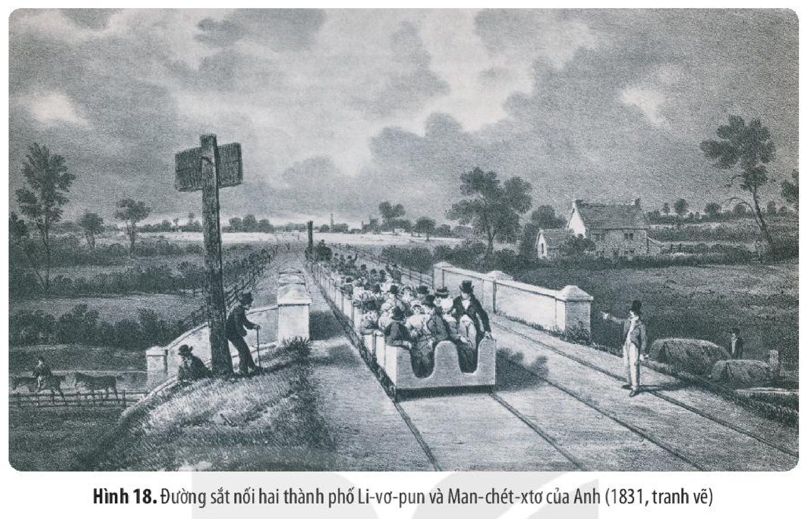

*Hình 18. Đường sắt nối hai thành phố Li-vơ-pun và Man-chét-xtơ của Anh (1831, tranh vẽ)*

### b) Tác động về mặt xã hội, văn hoá

<!-- term: Giai cấp tư sản công nghiệp và giai cấp vô sản -->
*Về mặt xã hội*, các cuộc cách mạng công nghiệp thời cận đại đã đưa đến sự hình thành và phát triển của nhiều trung tâm công nghiệp mới cũng là những thành thị đông dân, tiêu biểu như: Luân Đôn, Man-chét-xtơ, Pa-ri, Béc-lin,... Trong xã hội, đã hình thành hai giai cấp đối kháng là tư sản công nghiệp nắm tư liệu sản xuất và vô sản làm thuê. Mâu thuẫn giữa hai giai cấp này ngày càng gay gắt, dẫn đến các cuộc đấu tranh của vô sản chống lại tư sản.

*Về mặt văn hoá*, các cuộc cách mạng công nghiệp thời cận đại cũng có tác động mạnh, đưa đến những biến chuyển lớn lao trong đời sống văn hoá. Lối sống và văn hoá công nghiệp ngày càng trở nên phổ biến. Đời sống văn hoá tinh thần của người dân phong phú và đa dạng hơn với sự xuất hiện của các phương tiện như: điện thoại, ra-đi-ô, sự xuất hiện của điện ảnh,... Sự giao lưu, kết nối văn hoá giữa các quốc gia, châu lục càng được đẩy mạnh,...

Cách mạng công nghiệp cũng tạo ra một số tác động tiêu cực như: ô nhiễm môi trường, bóc lột lao động phụ nữ và trẻ em, sự xâm chiếm và tranh giành thuộc địa,...

<!-- pdf:68 -->

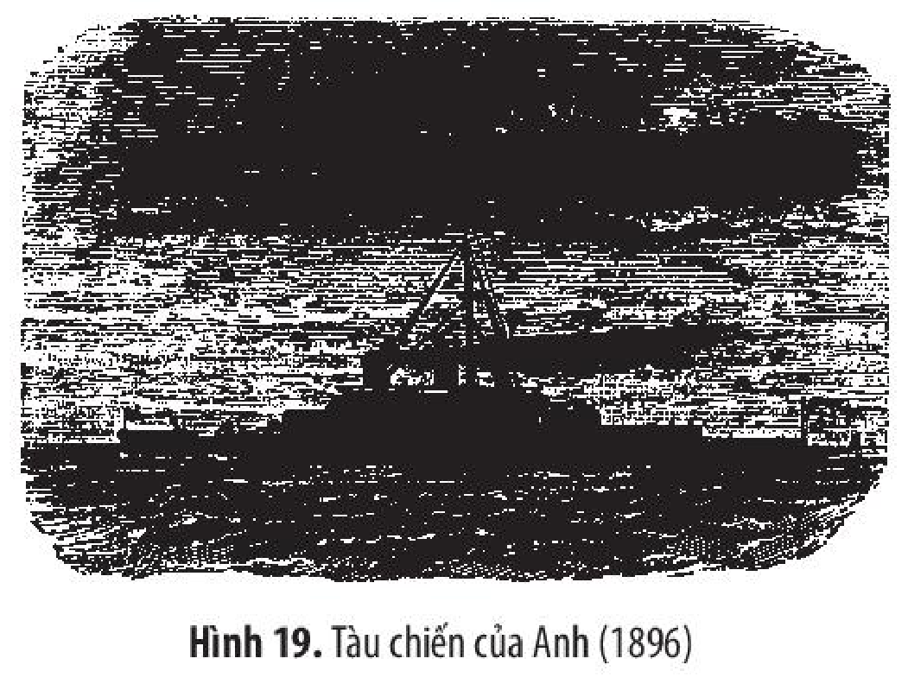

*Hình 19. Tàu chiến của Anh (1896)*

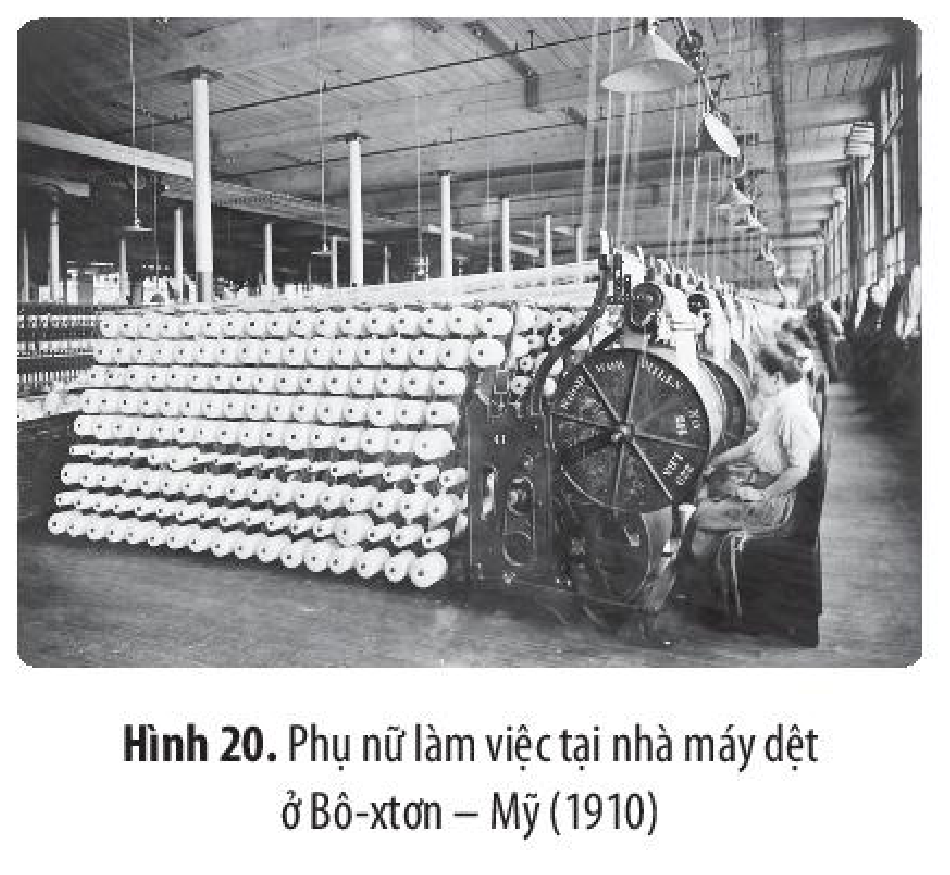

*Hình 20. Phụ nữ làm việc tại nhà máy dệt ở Bô-xtơn – Mỹ (1910)*

> ❓ Hãy nêu ý nghĩa và phân tích tác động của các cuộc cách mạng công nghiệp lần thứ nhất và lần thứ hai.

## ✏️ Luyện tập và vận dụng

1. Hãy trình bày một số thành tựu cơ bản của các cuộc cách mạng công nghiệp thời kì cận đại trên trục thời gian.

2. Lựa chọn và giới thiệu về một thành tựu mà em cho là tiêu biểu nhất.

3. Có ý kiến cho rằng: Một số thành tựu của các cuộc cách mạng công nghiệp thời kì cận đại cũng đưa đến tác động tiêu cực, thậm chí là gây ra các thảm hoạ cho nhân loại. Em có đồng ý với ý kiến này không? Vì sao?

Thường ngày, em sử dụng những thiết bị nào dùng đến nguồn điện? Hãy viết một đoạn văn ngắn chia sẻ suy nghĩ của em về giả thiết: Nếu các nhà khoa học, kĩ thuật chưa phát minh ra điện và các thiết bị tiêu thụ điện năng thì cuộc sống chúng ta sẽ ra sao?

## 📷 Danh sách hình trong bài

| Mã hình | Trang PDF | Vị trí trong bài | Chú thích gốc |
| --- | --- | --- | --- |
| H10-lich_su-b07-01 | 59 | Mở đầu | Hình 1. Máy bay đang cất cánh |
| H10-lich_su-b07-02 | 60 | Mục 1.a | Hình 2. Lược đồ các tài nguyên khoáng sản chính của nước Anh thế kỉ XVIII |
| H10-lich_su-b07-03 | 60 | Mục 1.a | Hình 3. Tàu buôn nô lệ của thực dân Anh ở Tây Phi (tranh vẽ) |
| H10-lich_su-b07-04 | 60 | Mục 1.a | Hình 4. Hiện tượng “rào đất cướp ruộng” để chăn nuôi cừu ở Anh (tranh vẽ) |
| H10-lich_su-b07-05 | 61 | Mục 1.b | Hình 5. “Con thoi bay” (Giôn Cay) |
| H10-lich_su-b07-06 | 61 | Mục 1.b | Hình 6. Máy kéo sợi Gien-ni (Giêm Ha-gri-vơ) |
| H10-lich_su-b07-07 | 61 | Mục 1.b | Hình 7. Máy kéo sợi chạy bằng sức nước (Ri-chác Ác-rai) |
| H10-lich_su-b07-08 | 61 | Mục 1.b | Hình 8. Giêm Oát và phát minh máy hơi nước của ông |
| H10-lich_su-b07-09 | 61 | Mục 1.b | Hình 9. Máy dệt chạy bằng hơi nước (Ét-mơn Các-rai) |
| H10-lich_su-b07-10 | 62 | Mục 1.b | Hình 10. Lò luyện quặng theo phương pháp “pút-đinh” (Hen-ri Cót) |
| H10-lich_su-b07-11 | 62 | Mục 1.b | Hình 11. Đầu máy xe lửa chạy trên đường ray đầu tiên (Ri-chác Tơ-re-vi-thích) |
| H10-lich_su-b07-12 | 63 | Mục 2.b | Hình 12. Quá trình luyện thép theo phương pháp lò cao (Hen-ri Bê-sê-mơ, 1856) |
| H10-lich_su-b07-13 | 64 | Mục 2.b | Hình 13. Điện thoại (A-lếch-xan-đơ Gra-ham Beo, 1876) |
| H10-lich_su-b07-14 | 64 | Mục 2.b | Hình 14. Chân dung Tô-mát Ê-đi-xơn và phát minh của ông (1879) được in trên một con tem bưu chính ở I-ta-li-a |
| H10-lich_su-b07-15 | 65 | Mục 2.b | Hình 15. Máy vô tuyến điện (Gu-li-ê-li-nô Mác-cô-ni, 1897) |
| H10-lich_su-b07-16 | 65 | Mục 2.b | Hình 16. Xe hơi Mô-đen T (Công ti Pho Mô-tô, 1908) |
| H10-lich_su-b07-17 | 66 | Mục 2.b | Hình 17. Máy bay của anh em nhà Rai thực hiện chuyến bay thử nghiệm (1903) |
| H10-lich_su-b07-18 | 67 | Mục 3.a | Hình 18. Đường sắt nối hai thành phố Li-vơ-pun và Man-chét-xtơ của Anh (1831, tranh vẽ) |
| H10-lich_su-b07-19 | 68 | Mục 3.b | Hình 19. Tàu chiến của Anh (1896) |
| H10-lich_su-b07-20 | 68 | Mục 3.b | Hình 20. Phụ nữ làm việc tại nhà máy dệt ở Bô-xtơn – Mỹ (1910) |
