<!-- pdf:69 -->

# BÀI 8: CÁC CUỘC CÁCH MẠNG CÔNG NGHIỆP THỜI KÌ HIỆN ĐẠI

## 🎯 Học xong bài này, em sẽ:

- Trình bày được nét chính về bối cảnh lịch sử diễn ra các cuộc cách mạng công nghiệp thời kì hiện đại. Nêu được những thành tựu cơ bản của các cuộc cách mạng công nghiệp đó, cũng như ý nghĩa đối với sự phát triển kinh tế thế giới.
- Phân tích được tác động của các cuộc cách mạng công nghiệp thời kì hiện đại đối với xã hội và văn hoá.
- Biết cách sưu tầm, sử dụng tư liệu lịch sử để tìm hiểu về các cuộc cách mạng công nghiệp thời kì hiện đại.
- Có thái độ trân trọng những thành quả của các cuộc cách mạng công nghiệp đối với lịch sử, vận dụng những hiểu biết về tác động hai mặt của các cuộc cách mạng công nghiệp thời kì hiện đại khi tuân thủ những quy định của pháp luật trong giao tiếp trên internet, mạng xã hội,...

## 🔴 Mở đầu

Em có biết lần đầu tiên trên thế giới một rô-bốt được cấp quyền công dân?

Đó là “cô gái” rô-bốt Xô-phi-a đã được Chính phủ A-rập Xê-út cấp quyền Công dân vào ngày 25 – 10 – 2017. Ngoài hình dạng giống con người, rô-bốt Xô-phi-a được tích hợp trí tuệ nhân tạo nên có thể giao tiếp, thể hiện cảm xúc, diễn thuyết và thực hiện nhiều hoạt động khác giống như con người với độ chính xác rất cao. Rô-bốt Xô-phi-a là một trong những thành tựu tiêu biểu của cuộc Cách mạng công nghiệp lần thứ tư đang diễn ra hiện nay. Vậy trong thời kì hiện đại, nhân loại đã trải qua những cuộc cách mạng công nghiệp nào? Những thành tựu của các cuộc cách mạng công nghiệp ấy có ý nghĩa gì đối với cuộc sống trong từng giai đoạn lịch sử?

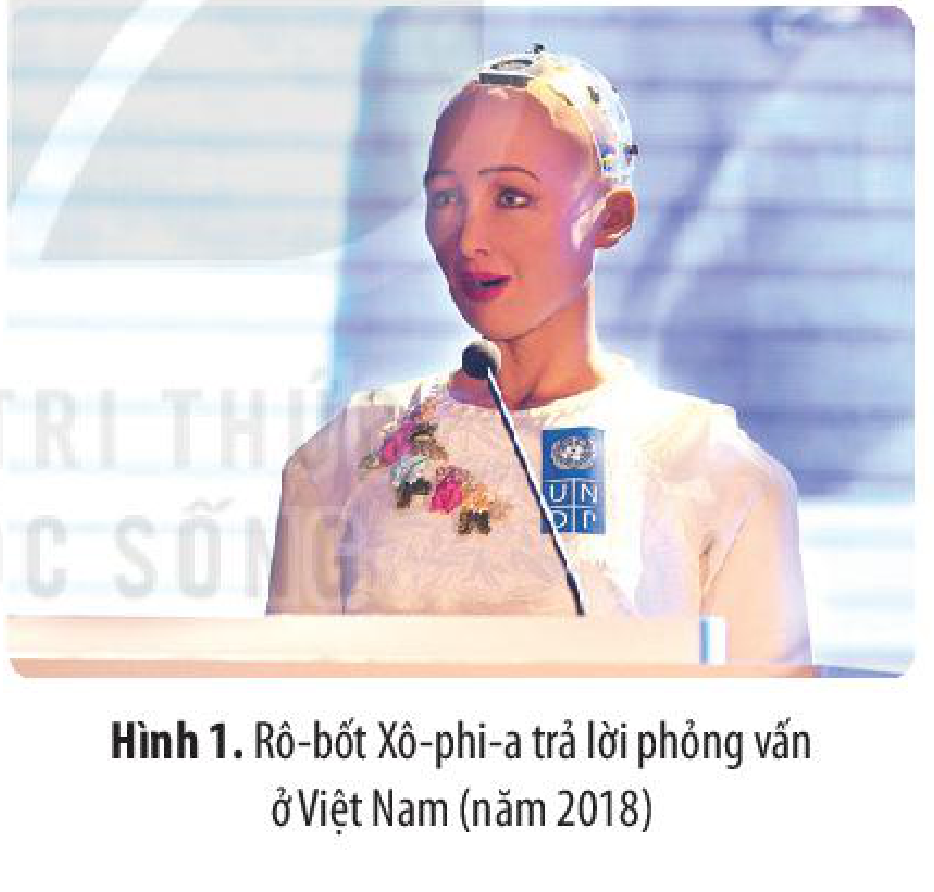

*Hình 1. Rô-bốt Xô-phi-a trả lời phỏng vấn ở Việt Nam (năm 2018)*

## 1. Cách mạng công nghiệp lần thứ ba

### a) Bối cảnh lịch sử

<!-- term: Cách mạng công nghiệp lần thứ ba -->
Cách mạng công nghiệp lần thứ ba (còn được gọi là Cách mạng kĩ thuật số), diễn ra trong khoảng nửa sau thế kỉ XX.

<!-- pdf:70 -->

Cách mạng công nghiệp lần thứ ba ra đời trên cơ sở kế thừa những bước tiến của khoa học, kĩ thuật vào đầu thế kỉ XX. Sự ra đời của lí thuyết nguyên tử hiện đại, đặc biệt là *Thuyết tương đối* của An-be Anh-xtanh (Đức) đã đặt nền tảng cho các phát minh của cuộc Cách mạng công nghiệp lần thứ ba.

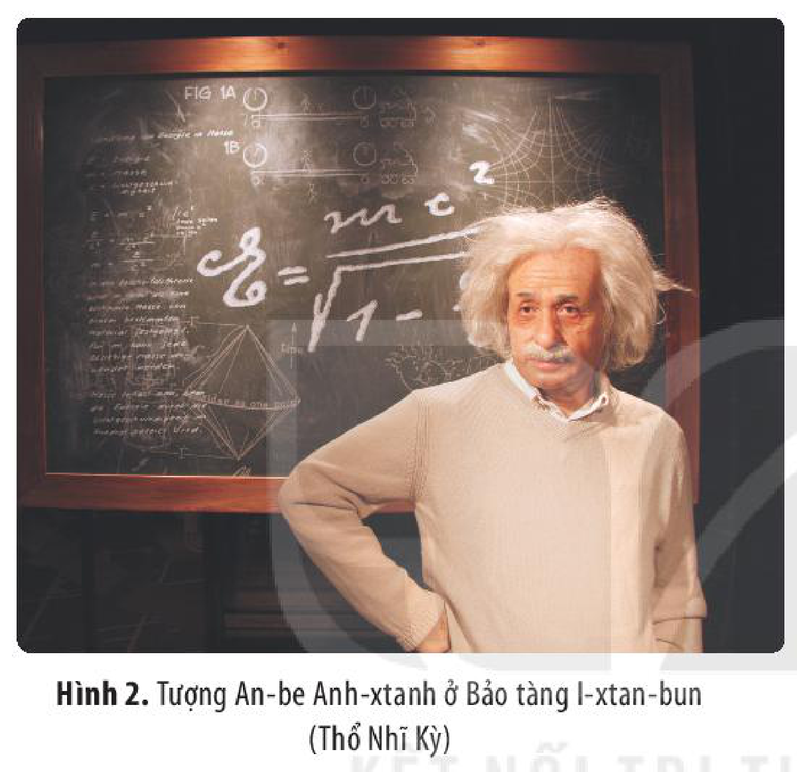

*Hình 2. Tượng An-be Anh-xtanh ở Bảo tàng I-xtan-bun (Thổ Nhĩ Kỳ)*

> 💡 EM CÓ BIẾT ?
>
> *Thuyết tương đối* đã làm nên cuộc cách mạng trong sự hiểu biết về không gian và thời gian, cũng như những hiện tượng liên quan mà vượt xa khỏi những ý tưởng và quan sát trực giác. Những hiện tượng này đã được mô tả bằng những phương trình toán học chính xác và xác nhận tính đúng đắn bằng thực nghiệm. Với *Thuyết tương đối*, ngành Vũ trụ học và Vật lí thiên văn đã tiên đoán và quan sát thấy những hiện tượng thiên văn học kì lạ: lỗ đen, sóng hấp dẫn, thấu kính hấp dẫn,...

Nhu cầu phục vụ chiến tranh và chạy đua vũ trang đã thúc đẩy chính phủ các nước đầu tư vào nghiên cứu khoa học, hoạt động sáng chế để chế tạo ra nhiều loại vũ khí và phương tiện chiến tranh tối tân, hiện đại.

Sự vơi cạn các nguồn tài nguyên hoá thạch (dầu mỏ, than đá,...), thách thức về bùng nổ và già hoá dân số, nhu cầu lớn về nguyên vật liệu cho sản xuất đã đặt ra yêu cầu phải tìm ra những nguồn năng lượng mới, vật liệu mới thay thế, cũng như phát triển các ngành sử dụng ít năng lượng.

### b) Thành tựu cơ bản

<!-- term: Cách mạng công nghiệp lần thứ ba -->
Cách mạng công nghiệp lần thứ ba tạo ra nhiều phát minh lớn về công cụ sản xuất như: máy tính, máy tự động và hệ thống máy tự động; người máy; internet, công nghệ thông tin; những vật liệu mới, nguồn năng lượng mới,...

Thành tựu quan trọng đầu tiên của cuộc Cách mạng công nghiệp lần thứ ba là sự xuất hiện của máy tính.

<!-- pdf:71 -->

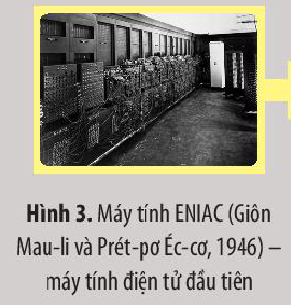

<!-- term: Máy tính điện tử ENIAC -->
*Hình 3. Máy tính ENIAC (Giôn Mau-li và Prét-pơ Éc-cơ, 1946) – máy tính điện tử đầu tiên*

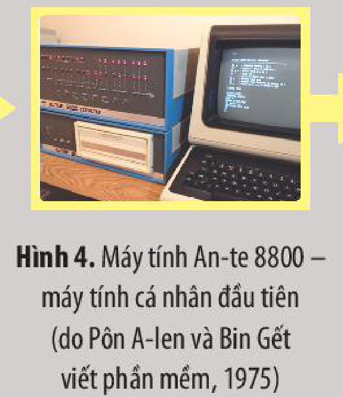

*Hình 4. Máy tính An-te 8800 – máy tính cá nhân đầu tiên (do Pôn A-len và Bin Gết viết phần mềm, 1975)*

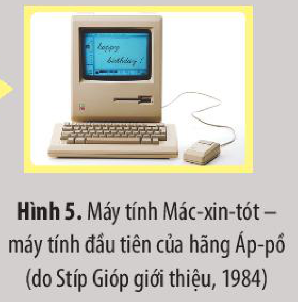

*Hình 5. Máy tính Mác-xin-tót – máy tính đầu tiên của hãng Áp-pồ (do Stíp Gióp giới thiệu, 1984)*

<!-- term: Internet -->
Sau đó, với sự xuất hiện của internet, việc kết nối giữa các khu vực trên thế giới, chia sẻ thông tin giữa các thiết bị được thực hiện một cách dễ dàng, hiệu quả hơn.

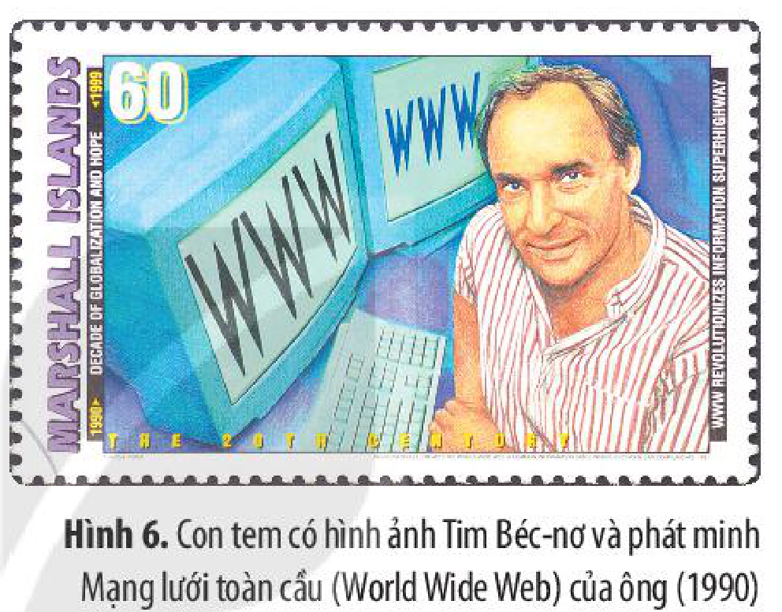

<!-- term: Mạng lưới toàn cầu -->
*Hình 6. Con tem có hình ảnh Tim Béc-nơ và phát minh Mạng lưới toàn cầu (World Wide Web) của ông (1990)*

Sự ra đời của mạng kết nối internet không dây là một bước tiến quan trọng của ngành công nghệ thông tin.

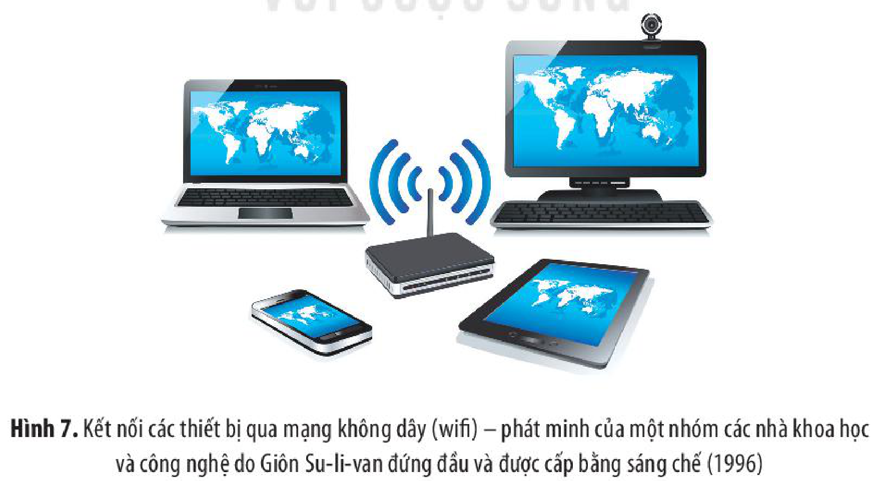

*Hình 7. Kết nối các thiết bị qua mạng không dây (wifi) – phát minh của một nhóm các nhà khoa học và công nghệ do Giôn Su-li-van đứng đầu và được cấp bằng sáng chế (1996)*

<!-- pdf:72 -->

Tự động hoá và công nghệ rô-bốt ra đời đã giúp giải phóng sức lao động của con người, nâng cao năng suất và chất lượng sản phẩm công nghiệp.

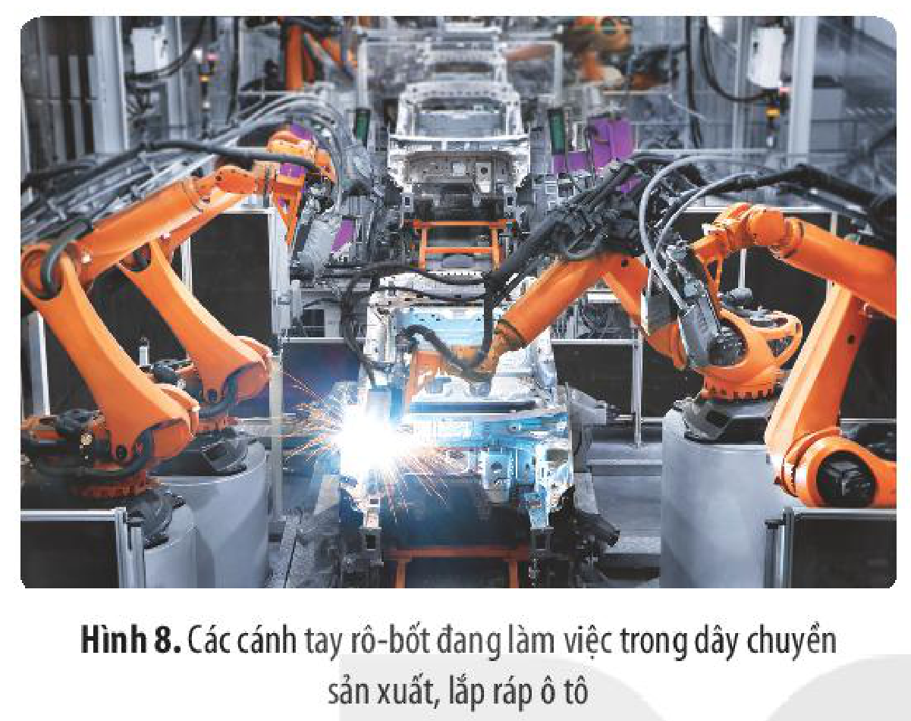

*Hình 8. Các cánh tay rô-bốt đang làm việc trong dây chuyền sản xuất, lắp ráp ô tô*

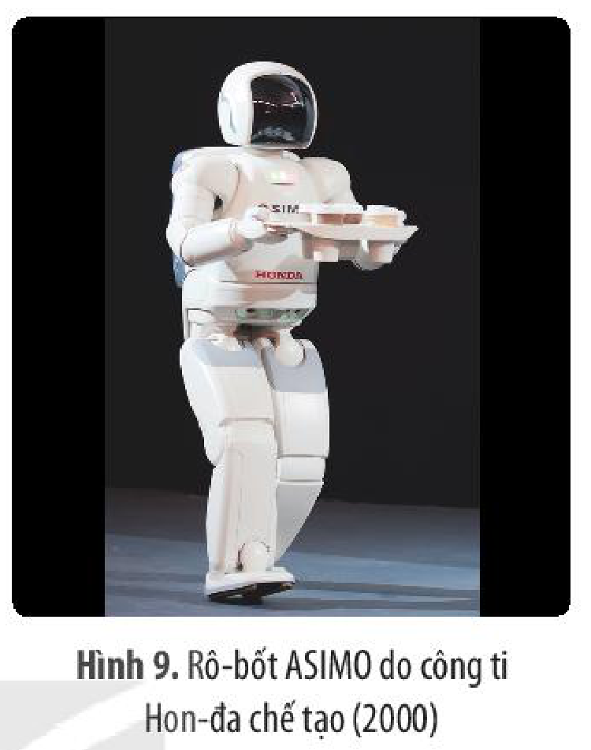

*Hình 9. Rô-bốt ASIMO do công ti Hon-đa chế tạo (2000)*

<!-- term: Công cuộc chinh phục vũ trụ -->
Cách mạng công nghiệp lần thứ ba còn gắn với thành tựu trong công cuộc chinh phục vũ trụ của hai cường quốc là Mỹ và Liên Xô.

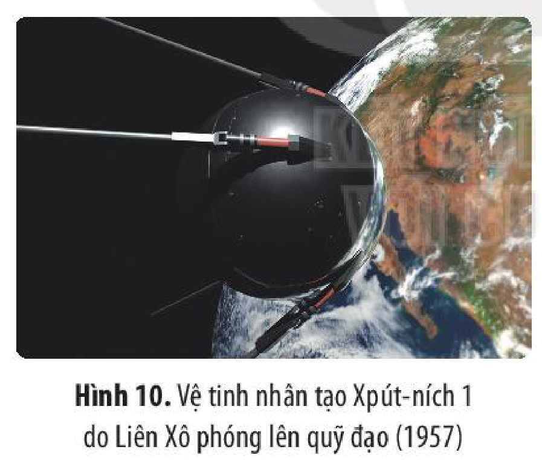

<!-- term: Công cuộc chinh phục vũ trụ -->
*Hình 10. Vệ tinh nhân tạo Xpút-ních 1 do Liên Xô phóng lên quỹ đạo (1957)*

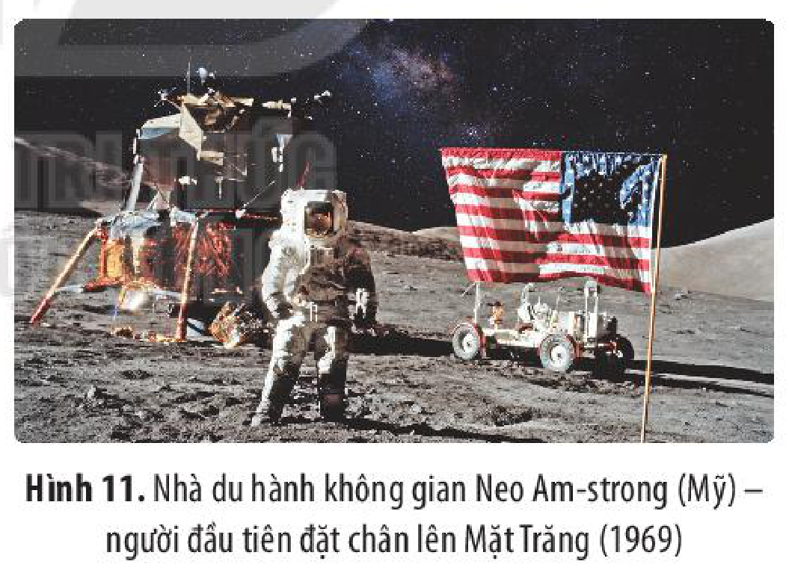

<!-- term: Công cuộc chinh phục vũ trụ -->
*Hình 11. Nhà du hành không gian Neo Am-strong (Mỹ) – người đầu tiên đặt chân lên Mặt Trăng (1969)*

> ❓ 1. Hãy trình bày nét chính về bối cảnh lịch sử diễn ra cuộc Cách mạng công nghiệp lần thứ ba.
>
> 2. Quan sát các hình 3 – 11 (tr. 70 – 71), hãy kể tên một số thành tựu cơ bản của Cách mạng công nghiệp lần thứ ba. Em ấn tượng với thành tựu nào? Vì sao?

<!-- pdf:73 -->

## 2. Cách mạng công nghiệp lần thứ tư

### a) Bối cảnh lịch sử

<!-- term: Cách mạng công nghiệp lần thứ tư -->
Cách mạng công nghiệp lần thứ tư (còn gọi là Cách mạng 4.0) bắt đầu từ những năm đầu tiên của thế kỉ XXI và vẫn đang tiếp diễn. Cuộc Cách mạng 4.0 diễn ra trong bối cảnh nhân loại đã trải qua nhiều cuộc cách mạng công nghiệp với những tiến bộ lớn về khoa học, kĩ thuật và công nghệ.

Cách mạng công nghiệp lần thứ tư trực tiếp thừa hưởng thành tựu của Cách mạng công nghiệp lần thứ ba, trong đó quan trọng nhất là thành tựu trong lĩnh vực công nghệ kĩ thuật số, khi internet ngày càng phổ biến, trí tuệ nhân tạo được ứng dụng rộng rãi hơn trong nhiều lĩnh vực. Các công nghệ số với phần cứng của máy tính, phần mềm và hệ thống mạng ngày càng phức tạp, được tích hợp nhiều chức năng hơn.

Cuộc Cách mạng công nghiệp lần thứ tư đang diễn ra mạnh mẽ tại nhiều quốc gia trên thế giới, đặc biệt là những nước phát triển, nơi có trình độ khoa học, kĩ thuật và công nghệ tiên tiến, cơ sở hạ tầng kĩ thuật số phát triển.

### b) Thành tựu cơ bản

<!-- term: Cách mạng công nghiệp lần thứ tư -->
Cách mạng công nghiệp lần thứ tư gắn liền với những đột phá công nghệ trong các lĩnh vực trí tuệ nhân tạo (AI), internet vạn vật (IoT), điện toán đám mây, dữ liệu lớn (Big Data), công nghệ in 3D, tự động hoá, vật liệu mới, công nghệ gen, công nghệ na-nô,... Cách mạng công nghiệp lần thứ tư vừa mới bắt đầu, nhưng hứa hẹn sẽ tạo ra những thay đổi lớn lao trên tất cả các lĩnh vực kinh tế, chính trị, xã hội của thế kỉ XXI.

Internet vạn vật ngày càng được áp dụng rộng rãi trong các lĩnh vực quản lí đô thị, giao thông, xây dựng, thời trang, chăm sóc sức khoẻ,... không những mang lại sự hiệu quả, kinh tế, tiện nghi cho con người, mà thông qua các thiết bị được kết nối, nhiều dữ liệu được thu thập, giúp hoàn thiện dữ liệu lớn. Kho dữ liệu khổng lồ này rất quan trọng cho sự phát triển của các ngành công nghệ trong thời đại 4.0.

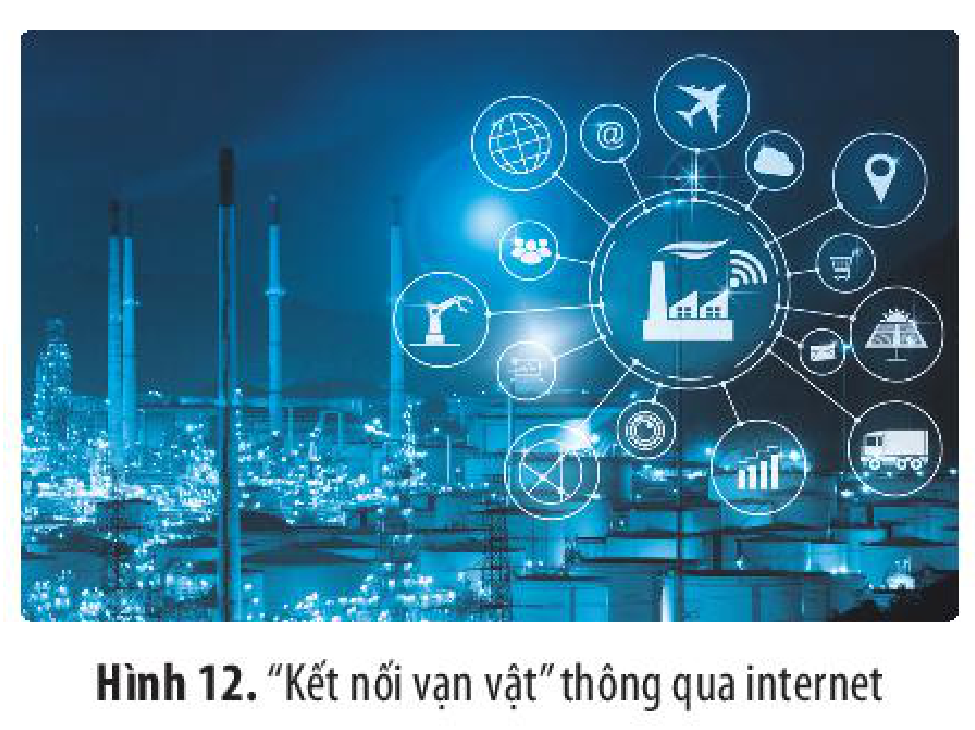

*Hình 12. “Kết nối vạn vật” thông qua internet*

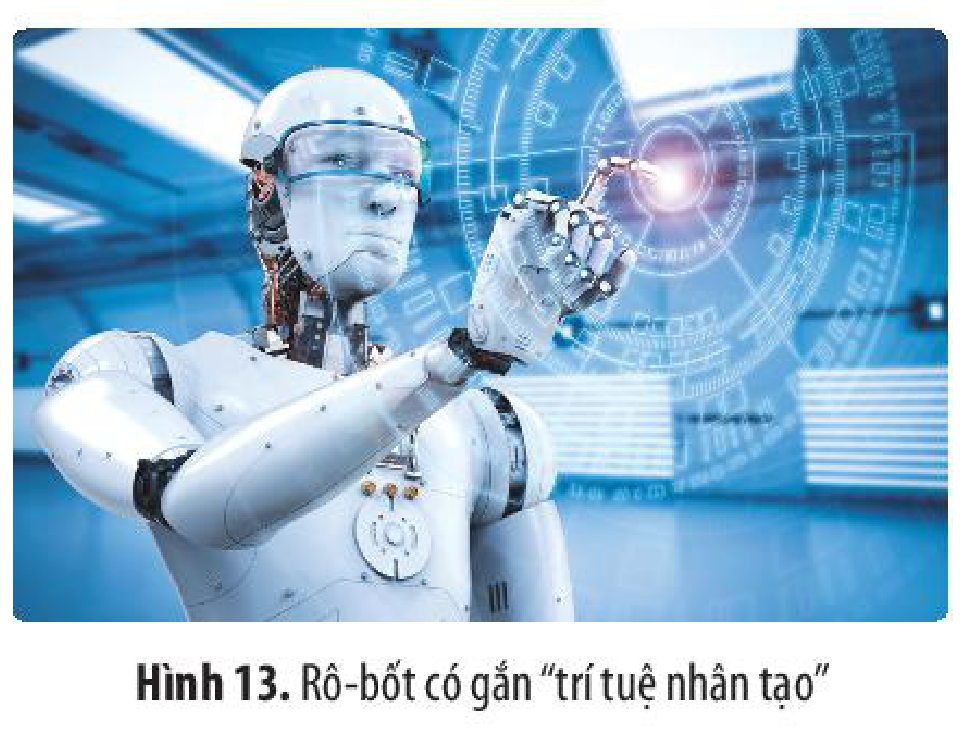

*Hình 13. Rô-bốt có gắn “trí tuệ nhân tạo”*

<!-- pdf:74 -->

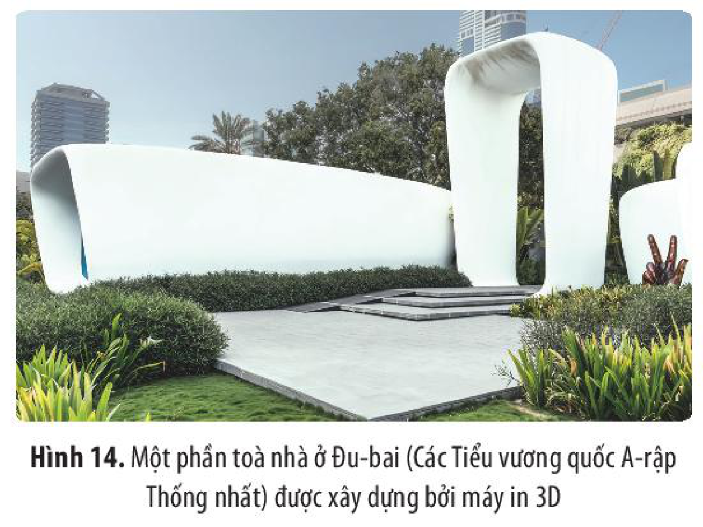

*Hình 14. Một phần toà nhà ở Đu-bai (Các Tiểu vương quốc A-rập Thống nhất) được xây dựng bởi máy in 3D*

> 💡 EM CÓ BIẾT ?
>
> Quá trình xây toà nhà bằng công nghệ in 3D đòi hỏi ít hơn 50% nhân lực và tạo ra ít hơn 60% rác thải so với cách xây dựng nhà truyền thống. Chi phí xây dựng do đó cũng giảm xuống khoảng 60%.

Công nghệ na-nô là ngành công nghiệp liên quan đến việc thiết kế, phân tích, chế tạo và ứng dụng các cấu trúc, thiết bị và hệ thống bằng việc điều khiển hình dáng, kích thước trên quy mô na-nô mét (1m = 1 000 000 000 nm). Đầu thế kỉ XXI, công nghệ na-nô phát triển và được ứng dụng rộng rãi trong các lĩnh vực: Y học, Sinh học, năng lượng, điện tử, cơ khí, may mặc, thực phẩm, bảo vệ môi trường,...

> ❓ 1. Hãy trình bày khái quát bối cảnh lịch sử diễn ra cuộc Cách mạng công nghiệp lần thứ tư.
>
> 2. Quan sát các hình 12 – 14 (tr. 72 – 73) và khai thác thông tin trong mục 2, em hãy nêu một số thành tựu cơ bản của Cách mạng công nghiệp lần thứ tư. Hãy giới thiệu về một thành tựu tiêu biểu mà em thích nhất.

## 3. Ý nghĩa và tác động của cuộc Cách mạng công nghiệp lần thứ ba và thứ tư

### a) Ý nghĩa đối với sự phát triển kinh tế

Sự phát triển của các cuộc cách mạng công nghiệp thời kì hiện đại có ý nghĩa vô cùng to lớn đối với sự phát triển kinh tế của các quốc gia, cũng như toàn thế giới.

Những ứng dụng của các cuộc cách mạng công nghiệp thời kì hiện đại đã giúp cho việc mở rộng và đa dạng hoá các hình thức sản xuất và quản lí. Con người có thể tiếp cận thông tin một cách nhanh chóng và đầy đủ nhờ sự hỗ trợ của internet, dữ liệu lớn, sự phát triển của hệ thống thông tin trực tuyến, mạng xã hội,... do đó có thể hỗ trợ việc ra quyết định nhanh hơn và chính xác hơn.

Sự ra đời của các nhà máy thông minh ứng dụng công nghệ tự động hoá và trí tuệ nhân tạo đã giúp tăng năng suất lao động gấp nhiều lần, rút ngắn thời gian và tiết kiệm nguyên, nhiên liệu, nâng cao chất lượng sản phẩm,...

<!-- pdf:75 -->

<!-- term: Thương mại điện tử -->
Nhờ sự phát triển của internet, thương mại điện tử ra đời đã giúp người tiêu dùng có thể lựa chọn, mua sắm hàng hoá, dịch vụ bằng hình thức trực tuyến. Thông qua thương mại điện tử, người tiêu dùng tiếp cận gần hơn với thương mại toàn cầu.

Sự phát triển của cuộc cách mạng công nghiệp hiện đại đã thúc đẩy quá trình khu vực hoá, toàn cầu hoá nền kinh tế thế giới,...

### b) Tác động về xã hội, văn hoá

*Bảng hệ thống một số tác động về xã hội và văn hoá của các cuộc cách mạng công nghiệp thời kì hiện đại*

| Lĩnh vực | Tác động: Tích cực | Tác động: Tiêu cực |
| --- | --- | --- |
| Xã hội | – Tự động hoá giúp giải phóng sức lao động của con người, đặc biệt trong những công việc nguy hiểm, trong môi trường độc hại. – Tri thức đưa đến sự phân hoá trong lực lượng lao động, số lượng người lao động có kĩ năng và trình độ chuyên môn cao ngày càng tăng. – Ngày nay, con người có thể làm nhiều loại công việc bằng hình thức từ xa, giúp tiết kiệm thời gian,... | – Khiến nhiều người lao động đối diện với nguy cơ mất việc làm. – Gây ra sự phân hoá trong xã hội, nới rộng khoảng cách giàu – nghèo. – Con người bị lệ thuộc nhiều hơn vào các thiết bị thông minh; ít quan tâm đến các mối quan hệ gia đình, xã hội. |
| Văn hoá | – Việc tìm kiếm, chia sẻ thông tin trở nên vô cùng nhanh chóng và thuận tiện. – Con người có thể trao đổi, giao tiếp thông qua các ứng dụng trên internet rất thuận tiện, nhanh chóng. – Quá trình giao lưu văn hoá giữa các quốc gia, khu vực diễn ra dễ dàng và thuận tiện. | – Phát sinh các vấn đề liên quan đến bảo mật thông tin cá nhân, tính chính xác của các thông tin được chia sẻ,... – Làm gia tăng sự xung đột giữa nhiều yếu tố, giá trị văn hoá truyền thống và hiện đại; xuất hiện nguy cơ đánh mất bản sắc văn hoá dân tộc. |

> ❓ 1. Hằng ngày, gia đình, bạn bè và bản thân em thường sử dụng thiết bị điện tử nào? Theo em, sự ra đời của các thiết bị điện tử, hệ thống internet,... có ý nghĩa như thế nào đối với cuộc sống hiện nay?
>
> 2. Hãy phân tích ý nghĩa và tác động của các cuộc cách mạng công nghiệp thời kì hiện đại. Lấy ví dụ minh hoạ.

<!-- pdf:76 -->

## ✏️ Luyện tập và vận dụng

1. Theo em, bối cảnh lịch sử của các cuộc cách mạng công nghiệp thời kì hiện đại có điểm gì khác biệt so với bối cảnh diễn ra các cuộc cách mạng công nghiệp thời kì cận đại?

2. Lập bảng thống kê về những thành tựu cơ bản của các cuộc cách mạng công nghiệp thời kì hiện đại theo gợi ý sau:

| STT | Tên thành tựu | Tên tác giả | Thời điểm ra đời | Quốc gia xuất hiện đầu tiên | Lĩnh vực | Ý nghĩa (tại thời điểm xuất hiện và hiện nay) |
| --- | --- | --- | --- | --- | --- | --- |
| 1 | ? | ? | ? | ? | ? | ? |
| 2 | ? | ? | ? | ? | ? | ? |
<!-- ocr-ok: Bảng gợi ý Luyện tập trang 75 (PDF 76), OCR bị đứt cột tiêu đề bảng -->

3. Clau-xơ Sơ-goát, người sáng lập và là Chủ tịch điều hành Diễn đàn Kinh tế thế giới có nhận định: “Cách mạng công nghiệp đầu tiên sử dụng năng lượng nước và hơi nước để cơ giới hoá sản xuất. Cách mạng công nghiệp lần thứ hai diễn ra nhờ ứng dụng điện năng để sản xuất hàng loạt. Cách mạng công nghiệp lần thứ ba sử dụng điện tử và công nghệ thông tin để tự động hoá sản xuất. Bây giờ, Cách mạng công nghiệp thứ tư đang nảy nở từ Cách mạng lần thứ ba, nó kết hợp các công nghệ lại với nhau, làm mờ ranh giới giữa Vật lí, kĩ thuật số và Sinh học”.

Em có đồng ý với ý kiến trên không? Vì sao?

Trong kỉ nguyên số hiện nay, rất nhiều thông tin được chia sẻ tràn lan trên internet nhưng chưa được kiểm chứng. Nếu là một trong những người nhận được thông tin ấy, em sẽ làm gì?

## 📷 Danh sách hình trong bài

| Mã hình | Trang PDF | Vị trí trong bài | Chú thích gốc |
| --- | --- | --- | --- |
| H10-lich_su-b08-01 | 69 | Mở đầu | Hình 1. Rô-bốt Xô-phi-a trả lời phỏng vấn ở Việt Nam (năm 2018) |
| H10-lich_su-b08-02 | 70 | Mục 1.a | Hình 2. Tượng An-be Anh-xtanh ở Bảo tàng I-xtan-bun (Thổ Nhĩ Kỳ) |
| H10-lich_su-b08-03 | 71 | Mục 1.b | Hình 3. Máy tính ENIAC (Giôn Mau-li và Prét-pơ Éc-cơ, 1946) – máy tính điện tử đầu tiên |
| H10-lich_su-b08-04 | 71 | Mục 1.b | Hình 4. Máy tính An-te 8800 – máy tính cá nhân đầu tiên (do Pôn A-len và Bin Gết viết phần mềm, 1975) |
| H10-lich_su-b08-05 | 71 | Mục 1.b | Hình 5. Máy tính Mác-xin-tót – máy tính đầu tiên của hãng Áp-pồ (do Stíp Gióp giới thiệu, 1984) |
| H10-lich_su-b08-06 | 71 | Mục 1.b | Hình 6. Con tem có hình ảnh Tim Béc-nơ và phát minh Mạng lưới toàn cầu (World Wide Web) của ông (1990) |
| H10-lich_su-b08-07 | 71 | Mục 1.b | Hình 7. Kết nối các thiết bị qua mạng không dây (wifi) – phát minh của một nhóm các nhà khoa học và công nghệ do Giôn Su-li-van đứng đầu và được cấp bằng sáng chế (1996) |
| H10-lich_su-b08-08 | 72 | Mục 1.b | Hình 8. Các cánh tay rô-bốt đang làm việc trong dây chuyền sản xuất, lắp ráp ô tô |
| H10-lich_su-b08-09 | 72 | Mục 1.b | Hình 9. Rô-bốt ASIMO do công ti Hon-đa chế tạo (2000) |
| H10-lich_su-b08-10 | 72 | Mục 1.b | Hình 10. Vệ tinh nhân tạo Xpút-ních 1 do Liên Xô phóng lên quỹ đạo (1957) |
| H10-lich_su-b08-11 | 72 | Mục 1.b | Hình 11. Nhà du hành không gian Neo Am-strong (Mỹ) – người đầu tiên đặt chân lên Mặt Trăng (1969) |
| H10-lich_su-b08-12 | 73 | Mục 2.b | Hình 12. “Kết nối vạn vật” thông qua internet |
| H10-lich_su-b08-13 | 73 | Mục 2.b | Hình 13. Rô-bốt có gắn “trí tuệ nhân tạo” |
| H10-lich_su-b08-14 | 74 | Mục 2.b | Hình 14. Một phần toà nhà ở Đu-bai (Các Tiểu vương quốc A-rập Thống nhất) được xây dựng bởi máy in 3D |
