<!-- pdf:77 -->

# BÀI 9: CƠ SỞ HÌNH THÀNH VĂN MINH ĐÔNG NAM Á THỜI KÌ CỔ – TRUNG ĐẠI

## 🎯 Học xong bài này, em sẽ:

- Phân tích được cơ sở hình thành văn minh Đông Nam Á thời kì cổ – trung đại.
- Phân tích được những ảnh hưởng của văn minh Trung Hoa, Ấn Độ đối với văn minh Đông Nam Á.

## 🔴 Mở đầu

“Tàu Thanh niên Đông Nam Á – Nhật Bản”, hoạt động thường niên của đại diện thanh niên các nước Đông Nam Á và Nhật Bản, bắt đầu từ năm 1974 đến nay, là chuyến hải trình mà các bạn trẻ đều mong muốn được tham dự. Một trong những hoạt động thu hút các bạn trẻ là tìm hiểu, khám phá và trải nghiệm về lịch sử, văn hoá Đông Nam Á. Tất cả đều tự hào về nền văn minh lâu đời trong khu vực và mong muốn được chia sẻ với bạn bè quốc tế về các giá trị trường tồn của nó. Vì sao văn minh Đông Nam Á lại là chủ đề thu hút sự quan tâm của các bạn trẻ? Nền văn minh này đã được hình thành trên những cơ sở nào?

## 1. Cơ sở tự nhiên

### a) Vị trí địa lí

<!-- term: Đông Nam Á -->
<!-- term: Đông Nam Á lục địa -->
<!-- term: Đông Nam Á hải đảo -->
Đông Nam Á là một khu vực bao gồm các bán đảo và quần đảo chạy dài từ Thái Bình Dương sang Ấn Độ Dương. Ngày nay, khu vực này gồm 11 quốc gia, được phân thành hai nhóm: Đông Nam Á lục địa (Việt Nam, Lào, Cam-pu-chia, Thái Lan, Mi-an-ma) và Đông Nam Á hải đảo (Bru-nây, In-đô-nê-xi-a, Ma-lai-xi-a, Phi-líp-pin, Xin-ga-po, Đông Ti-mo).

Với vị trí địa lí nằm trên con đường hàng hải nối liền Ấn Độ Dương và Thái Bình Dương, Đông Nam Á được xem như một “ngã tư đường”, cầu nối của những nền văn minh lớn trên thế giới.

> ❓ Xác định trên lược đồ (Hình 1, tr. 77) các nước Đông Nam Á lục địa và Đông Nam Á hải đảo. Xác định và nêu nhận xét của em về vị trí địa lí khu vực Đông Nam Á.

<!-- pdf:78 -->

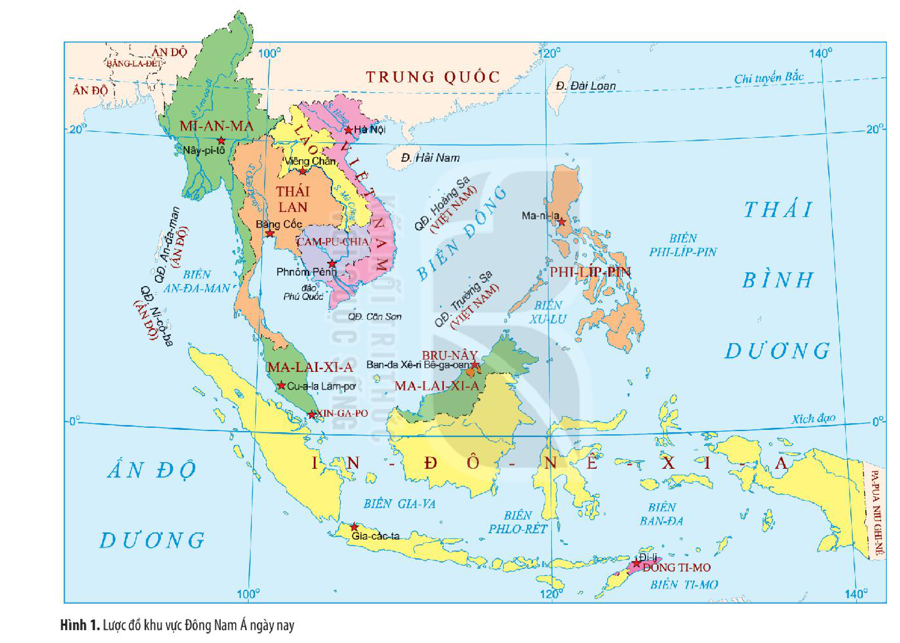

*Hình 1. Lược đồ khu vực Đông Nam Á ngày nay*
<!-- ocr-ok: chú thích Hình 1 in dọc theo lược đồ xoay ngang trang 77 (PDF 78), đã đối chiếu đúng ảnh gốc -->

<!-- pdf:79 -->

### b) Điều kiện tự nhiên

Đông Nam Á có hệ thống sông ngòi dày đặc, đất đai màu mỡ, đa số các quốc gia chịu ảnh hưởng của khí hậu nhiệt đới gió mùa. Hầu hết các quốc gia trong khu vực này đều giáp biển.

> 🔍 KẾT NỐI VỚI ĐỊA LÍ

<!-- term: Sông Mê Công -->
> Sông Mê Công (dòng sông lớn nhất ở Đông Nam Á), bắt nguồn từ cao nguyên Tây Tạng (Trung Quốc), chảy qua Mi-an-ma, Lào, Thái Lan, Cam-pu-chia và Việt Nam. Dòng sông này có ý nghĩa to lớn đối với cuộc sống của cư dân các nước Đông Nam Á lục địa trong lịch sử và hiện tại.

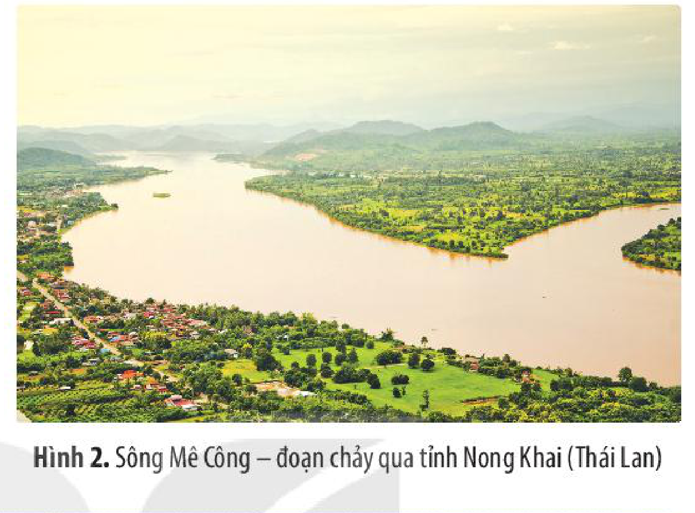

*Hình 2. Sông Mê Công – đoạn chảy qua tỉnh Nong Khai (Thái Lan)*

> TƯ LIỆU 1. “Chính gió mùa và khí hậu biển làm cho khí hậu Đông Nam Á đáng lẽ có thể trở nên khô cằn như một số khu vực lục địa khác có cùng vĩ độ, nhưng nó đã trở nên xanh tốt và trù phú với những đô thị đông đúc như Cu-a-la Lăm-pơ, Xin-ga-po, Gia-các-ta,...”.
>
> *(Vũ Dương Ninh (Chủ biên), Lịch sử văn minh thế giới, NXB Giáo dục Việt Nam, 2010, tr. 152 – 153)*

<!-- term: Văn minh nông nghiệp lúa nước -->
Trên cơ sở điều kiện tự nhiên thuận lợi, ở khu vực Đông Nam Á đã hình thành một nền văn minh bản địa – văn minh nông nghiệp lúa nước trước khi tiếp xúc với văn minh Trung Hoa, Ấn Độ.

Cư dân Đông Nam Á là một trong số những nhóm cư dân đầu tiên trên thế giới biết trồng lúa nước. Nông nghiệp trồng lúa nước đã trở thành phương thức hoạt động kinh tế chính; cây lúa trở thành cây lương thực chủ đạo. Cùng với đó, từ xa xưa người dân đã biết thuần dưỡng trâu bò làm sức kéo, chế tác nông cụ, xây dựng hệ thống thuỷ lợi để phục vụ sản xuất.

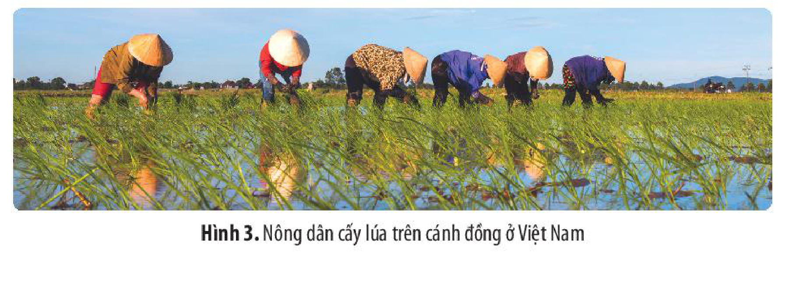

*Hình 3. Nông dân cấy lúa trên cánh đồng ở Việt Nam*

<!-- pdf:80 -->

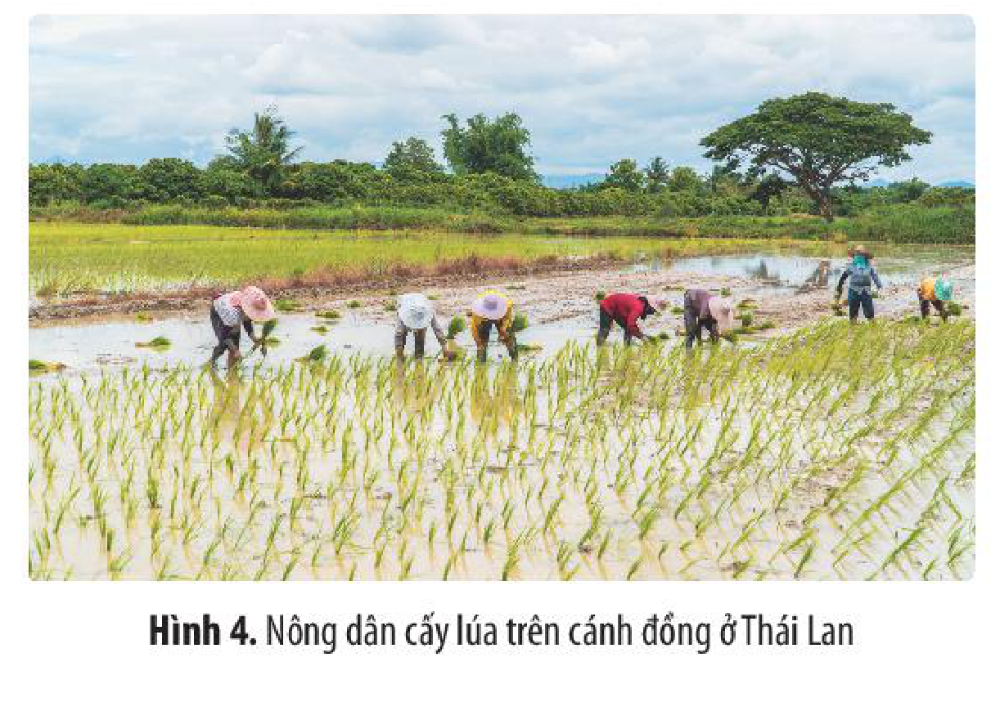

*Hình 4. Nông dân cấy lúa trên cánh đồng ở Thái Lan*

> 🔍 KẾT NỐI VỚI NGÀY NAY

> Ngày nay, Đông Nam Á là khu vực xuất khẩu gạo lớn nhất thế giới, trong đó Thái Lan, Việt Nam là những nước xuất khẩu gạo hàng đầu. Đông Nam Á cũng là quê hương của những giống lúa gạo được cho là ngon nhất thế giới như: ST25 (Việt Nam), Giát-xmin (Cam-pu-chia), Hôm Ma-li (Thái Lan),...

Biển tạo ra nguồn tài nguyên và là đường giao thương cho các nước trong khu vực, cũng như nối Đông Nam Á với các tuyến đường biển quốc tế. Vì vậy, cư dân Đông Nam Á sớm phát triển các hoạt động khai thác biển và buôn bán bằng đường biển.

> 💡 EM CÓ BIẾT ?

> Các thư tịch cổ Trung Quốc từ thế kỉ III cũng xác nhận rằng các sư tăng Trung Quốc sang Ấn Độ đều đi trên những con thuyền có trọng tải lớn, có thể chở hàng trăm người của các nước Đông Nam Á...

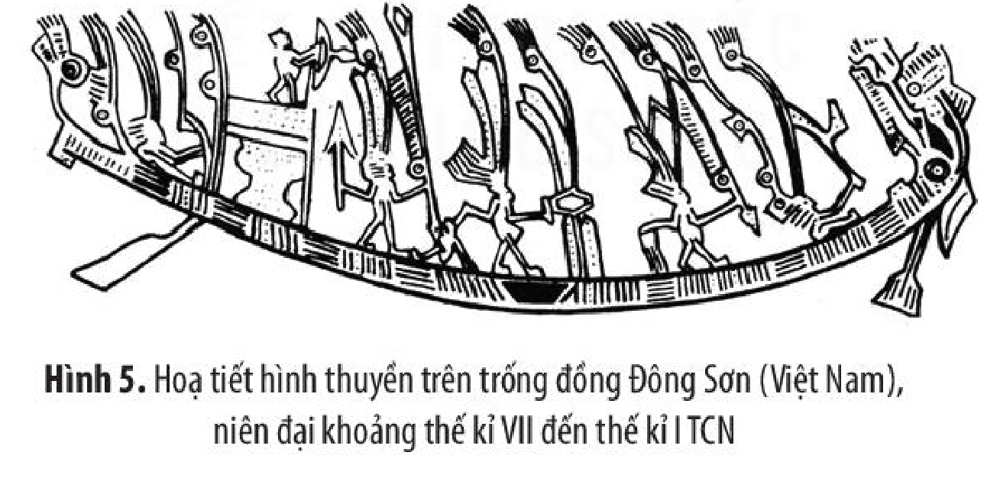

*Hình 5. Hoạ tiết hình thuyền trên trống đồng Đông Sơn (Việt Nam), niên đại khoảng thế kỉ VII đến thế kỉ I TCN*

<!-- term: Sri Vi-giay-a -->
Một số vương quốc hàng hải đã xuất hiện ở Đông Nam Á, tiêu biểu là Sri Vi-giay-a (thế kỉ VII – XIII).

<!-- term: Sri Vi-giay-a -->
> TƯ LIỆU 2. Nằm trên một địa bàn trù phú và làm chủ được eo biển Sun-đa, Sri Vi-giay-a có điều kiện phát triển nhanh chóng và trở thành một quốc gia hùng mạnh, một trung tâm kinh tế và văn hoá quan trọng ở khu vực Đông Nam Á...
>
> *(Theo Lương Ninh (Chủ biên), Lịch sử Đông Nam Á, NXB Giáo dục, Hà Nội, 2008, tr. 71)*

<!-- pdf:81 -->

> ❓ 1. Xác định trên lược đồ Hình 1 (tr. 77) một số sông lớn ở Đông Nam Á.
>
> 2. Nêu một số đặc điểm về điều kiện tự nhiên của khu vực Đông Nam Á.
>
> 3. Phân tích những tác động của cơ sở tự nhiên đến sự hình thành văn minh Đông Nam Á.

## 2. Cơ sở xã hội

### a) Cư dân, tộc người

Đông Nam Á là khu vực đa tộc người với hàng trăm nhóm cư dân. Các nhóm cư dân được phân chia theo ngữ hệ và các nhóm ngôn ngữ khác nhau.

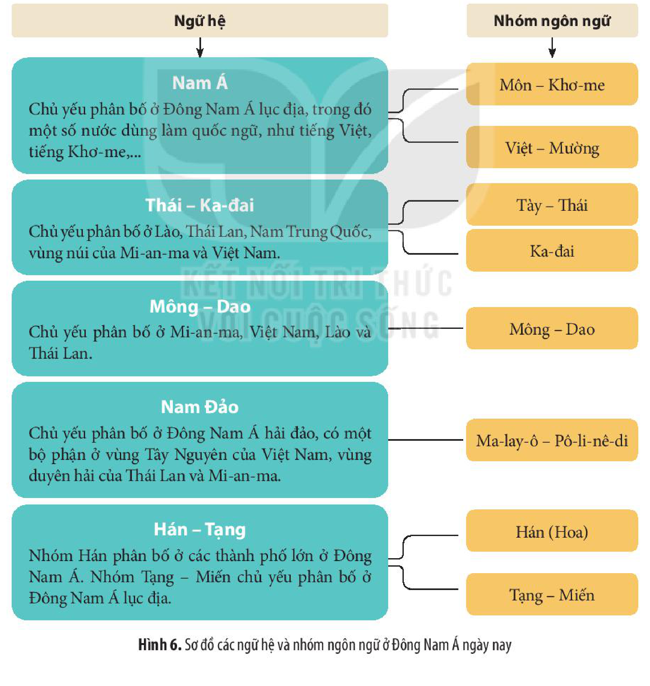

<!-- term: Ngữ hệ Nam Á -->
<!-- term: Ngữ hệ Thái – Ka-đai -->
<!-- term: Ngữ hệ Mông – Dao -->
<!-- term: Ngữ hệ Nam Đảo -->
<!-- term: Ngữ hệ Hán – Tạng -->
| Ngữ hệ | Phân bố | Nhóm ngôn ngữ |
| --- | --- | --- |
| Nam Á | Chủ yếu phân bố ở Đông Nam Á lục địa, trong đó một số nước dùng làm quốc ngữ, như tiếng Việt, tiếng Khơ-me,... | Môn – Khơ-me; Việt – Mường |
| Thái – Ka-đai | Chủ yếu phân bố ở Lào, Thái Lan, Nam Trung Quốc, vùng núi của Mi-an-ma và Việt Nam. | Tày – Thái; Ka-đai |
| Mông – Dao | Chủ yếu phân bố ở Mi-an-ma, Việt Nam, Lào và Thái Lan. | Mông – Dao |
| Nam Đảo | Chủ yếu phân bố ở Đông Nam Á hải đảo, có một bộ phận ở vùng Tây Nguyên của Việt Nam, vùng duyên hải của Thái Lan và Mi-an-ma. | Ma-lay-ô – Pô-li-nê-di |
| Hán – Tạng | Nhóm Hán phân bố ở các thành phố lớn ở Đông Nam Á. Nhóm Tạng – Miến chủ yếu phân bố ở Đông Nam Á lục địa. | Hán (Hoa); Tạng – Miến |
<!-- ocr-ok: bảng chuyển thể nguyên văn sơ đồ Hình 6 trang 80 (PDF 81) do OCR bỏ sót chữ trong các hộp màu -->

*Hình 6. Sơ đồ các ngữ hệ và nhóm ngôn ngữ ở Đông Nam Á ngày nay*

<!-- pdf:82 -->

Với sự đa dạng về tộc người, cư dân Đông Nam Á đã sáng tạo nên nền văn minh bản địa với những sắc thái địa phương phong phú.

> ❓ Theo em, sự đa dạng về cư dân, tộc người có tác động như thế nào đến văn minh Đông Nam Á thời kì cổ – trung đại?

### b) Tổ chức xã hội

<!-- term: Làng ở Đông Nam Á -->
> TƯ LIỆU 3. Sự hình thành và phát triển của văn minh Đông Nam Á trước hết có nguồn gốc tại chỗ, do cư dân ở đây sáng tạo ra. Tổ chức xã hội cơ bản của Đông Nam Á cổ đại là làng. Khi mới xuất hiện, làng là đơn vị cư trú của những người đồng tộc, khép kín, tách biệt, tự cung tự cấp và mang tính phòng thủ. Từ làng đã hình thành nên các vương quốc.
>
> *(Theo Nguyễn Tấn Đắc, Văn hoá Đông Nam Á, NXB Khoa học xã hội, Hà Nội, 2003, tr. 333)*

> TƯ LIỆU 4. Khi người Ấn Độ đến khu vực này, “... đã thấy trước mắt họ không phải là những người man di, không hề có một thứ văn hoá nào, mà trái lại đó là những người đã ở trình độ văn minh nhất định và không phải là không có những nét chung với họ”.
>
> *(Theo G. Xô-đét, Cổ sử các quốc gia Ấn Độ hoá ở Viễn Đông, NXB Thế giới, Hà Nội, 2008, tr. 48)*

<!-- term: Làng ở Đông Nam Á -->
Trong quá trình sinh sống, cư dân Đông Nam Á quần tụ với nhau trên một địa bàn nhất định, hình thành những tổ chức xã hội đầu tiên. Trong đó, làng là tổ chức xã hội phổ biến ở Đông Nam Á (với tên gọi khác nhau ở các vùng). Trải qua thời gian, chính sự phát triển nội tại của các tổ chức xã hội đó đã tạo cơ sở cho sự ra đời các quốc gia đầu tiên, tạo nền tảng cho sự hình thành văn minh Đông Nam Á.

> ❓ 1. Các tư liệu 3, 4 cho em biết những thông tin gì về cơ sở xã hội hình thành văn minh Đông Nam Á?
>
> 2. Hãy phân tích cơ sở xã hội hình thành văn minh Đông Nam Á.

## 3. Ảnh hưởng của văn minh Ấn Độ, Trung Hoa

Trên cơ sở nền văn minh bản địa, cư dân Đông Nam Á tiếp thu ảnh hưởng của các nền văn minh khác như: Ấn Độ, Trung Hoa, phương Tây,... trong đó, văn minh Ấn Độ và Trung Hoa có ảnh hưởng sớm và sâu sắc.

<!-- pdf:83 -->

### a) Ảnh hưởng của văn minh Ấn Độ

> 💡 EM CÓ BIẾT ?

> Từ những thế kỉ đầu Công nguyên, các tôn giáo lớn từ Ấn Độ như Phật giáo, Hin-đu giáo đã du nhập vào Đông Nam Á, trong đó Phật giáo ảnh hưởng lớn tới đời sống văn hoá, tinh thần của các dân tộc. Phật giáo đã trở thành tôn giáo chính ở Lào, Cam-pu-chia, Thái Lan, Mi-an-ma. Lễ hội truyền thống ở các quốc gia này và ở Việt Nam chịu ảnh hưởng sâu sắc của Phật giáo.

> TƯ LIỆU 5. Thông qua quá trình tiếp xúc, đặc biệt là thông qua thương mại đường biển, cư dân Đông Nam Á đã tiếp nhận ảnh hưởng của Ấn Độ từ các thương nhân, nhà truyền giáo Ấn Độ. Trong số đó có những người đã ở lại Đông Nam Á sinh cơ lập nghiệp và thậm chí giữ những chức vụ quan trọng trong chính quyền. Thương nhân Đông Nam Á cũng sang Ấn Độ để buôn bán và nhờ đó tiếp thu văn hoá Ấn Độ.
>
> *(Theo Vũ Dương Ninh (Chủ biên), Lịch sử văn minh thế giới, Sđd, tr. 159)*

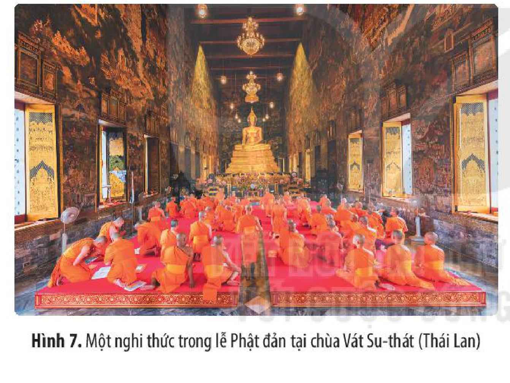

*Hình 7. Một nghi thức trong lễ Phật đản tại chùa Vát Su-thát (Thái Lan)*
<!-- ocr-ok: chú thích Hình 7 trang 82 (PDF 83) bị OCR bỏ sót, đã đối chiếu đúng ảnh gốc -->

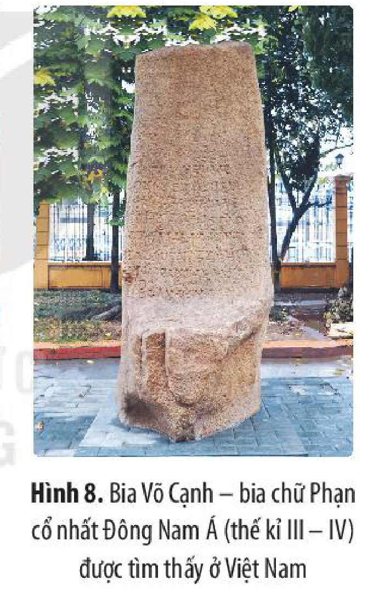

<!-- term: Bia Võ Cạnh -->
*Hình 8. Bia Võ Cạnh – bia chữ Phạn cổ nhất Đông Nam Á (thế kỉ III – IV) được tìm thấy ở Việt Nam*

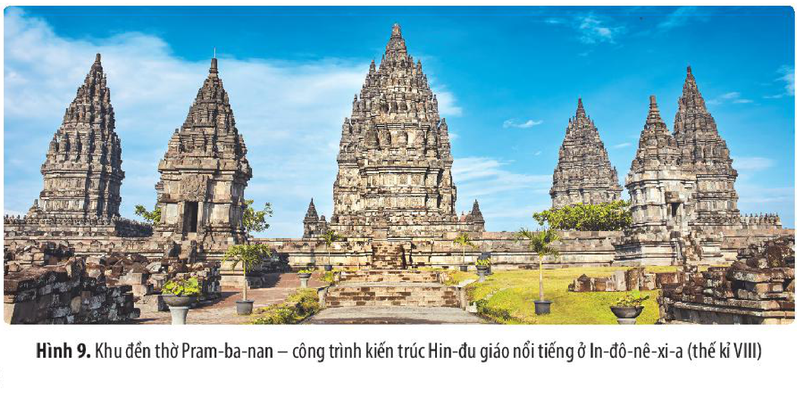

<!-- term: Khu đền thờ Pram-ba-nan -->
*Hình 9. Khu đền thờ Pram-ba-nan – công trình kiến trúc Hin-đu giáo nổi tiếng ở In-đô-nê-xi-a (thế kỉ VIII)*

<!-- pdf:84 -->

<!-- term: Ảnh hưởng của văn minh Ấn Độ -->
<!-- term: Bia Võ Cạnh -->
<!-- term: Khu đền thờ Pram-ba-nan -->
Đông Nam Á tiếp thu có chọn lọc những ảnh hưởng của văn minh Ấn Độ thông qua quá trình tiếp xúc, giao thương, chủ yếu là qua con đường buôn bán bằng đường biển. Ảnh hưởng của văn minh Ấn Độ được thể hiện trên các lĩnh vực tiêu biểu như chính trị, tư tưởng, tôn giáo, văn hoá, nghệ thuật,...

> ❓ Tư liệu 5 và các hình 7, 8, 9 (tr. 82) cho em biết những thông tin gì về ảnh hưởng của văn minh Ấn Độ đối với Đông Nam Á?

### b) Ảnh hưởng của văn minh Trung Hoa

<!-- term: Ảnh hưởng của văn minh Trung Hoa -->
Do vị trí địa lí liền kề, việc tiếp xúc, giao thương giữa Trung Quốc với Đông Nam Á diễn ra từ rất sớm, đặc biệt là thông qua quá trình các triều đại phong kiến Trung Quốc xâm lược, thống trị các nước láng giềng. Văn minh Trung Hoa ảnh hưởng đến một số quốc gia Đông Nam Á trên nhiều lĩnh vực (tư tưởng chính trị, văn hoá, giáo dục, văn học – nghệ thuật,...), ở những mức độ khác nhau, trong đó Việt Nam chịu ảnh hưởng nhiều hơn.

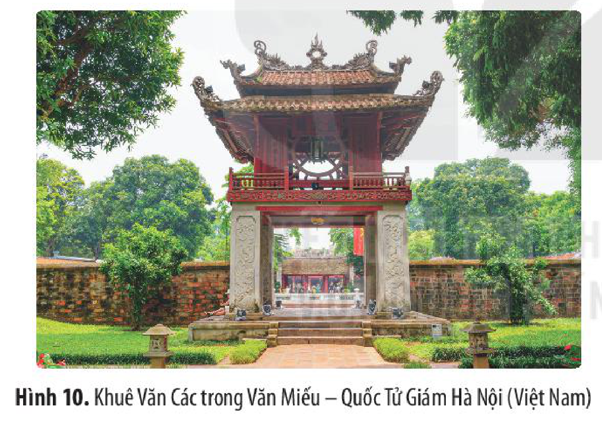

*Hình 10. Khuê Văn Các trong Văn Miếu – Quốc Tử Giám Hà Nội (Việt Nam)*
<!-- ocr-ok: chú thích Hình 10 trang 83 (PDF 84) bị OCR bỏ sót, đã đối chiếu đúng ảnh gốc -->

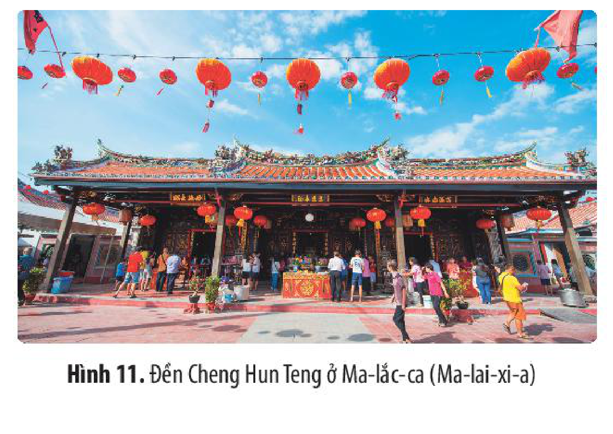

*Hình 11. Đền Cheng Hun Teng ở Ma-lắc-ca (Ma-lai-xi-a)*
<!-- ocr-ok: chú thích Hình 11 trang 83 (PDF 84) bị OCR bỏ sót, đã đối chiếu đúng ảnh gốc -->

> 💡 EM CÓ BIẾT ?

<!-- term: Nho giáo -->
> • Nho giáo (Trung Quốc) du nhập vào Việt Nam từ thời Bắc thuộc. Nhà Lý cho xây dựng Văn Miếu để thờ Khổng Tử (người sáng lập Nho giáo) và tổ chức khoa thi Nho học đầu tiên để tuyển dụng quan lại.
>
<!-- term: Đền Cheng Hun Teng -->
> • Đền Cheng Hun Teng là ngôi đền cổ nhất của người Hoa, được xây dựng từ thế kỉ XVII, chịu ảnh hưởng của kiến trúc đền ở phía nam Trung Quốc.

<!-- pdf:85 -->

> ❓ 1. Em hãy cho biết ảnh hưởng của văn minh Trung Hoa đối với Đông Nam Á thể hiện trên những lĩnh vực nào?
>
> 2. Nêu một số ví dụ cho thấy ảnh hưởng của văn minh Trung Hoa ở Việt Nam mà em biết.

## ✏️ Luyện tập và vận dụng

Lập bảng tóm tắt về cơ sở hình thành văn minh Đông Nam Á (theo gợi ý sau):

| Cơ sở hình thành | Nội dung |
| --- | --- |
| Về tự nhiên | ? |
| Về xã hội | ? |
| Ảnh hưởng của văn minh Ấn Độ, Trung Hoa | ? |

1. Quan sát hình lá cờ của Hiệp hội các quốc gia Đông Nam Á (ASEAN), em hãy giải thích vì sao hình ảnh bó lúa vàng được đặt ở vị trí trung tâm của lá cờ?

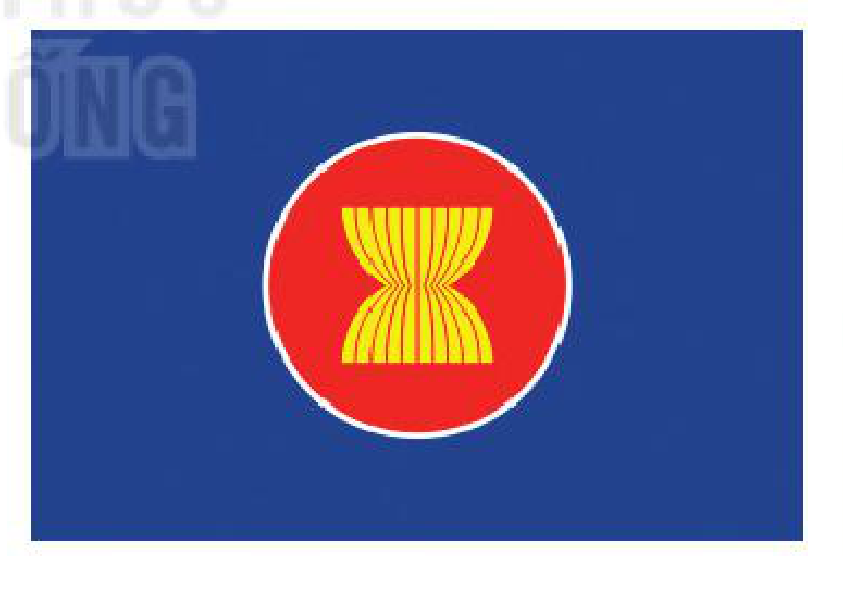

2. Sưu tầm tư liệu và viết bài giới thiệu (khoảng 500 từ) về ảnh hưởng của văn minh Ấn Độ đến một nước Đông Nam Á (tự chọn).

## 📷 Danh sách hình trong bài

| Mã hình | Trang PDF | Vị trí trong bài | Chú thích gốc |
| --- | --- | --- | --- |
| H10-lich_su-b09-01 | 78 | Mục 1.a | Hình 1. Lược đồ khu vực Đông Nam Á ngày nay |
| H10-lich_su-b09-02 | 79 | Mục 1.b | Hình 2. Sông Mê Công – đoạn chảy qua tỉnh Nong Khai (Thái Lan) |
| H10-lich_su-b09-03 | 79 | Mục 1.b | Hình 3. Nông dân cấy lúa trên cánh đồng ở Việt Nam |
| H10-lich_su-b09-04 | 80 | Mục 1.b | Hình 4. Nông dân cấy lúa trên cánh đồng ở Thái Lan |
| H10-lich_su-b09-05 | 80 | Mục 1.b | Hình 5. Hoạ tiết hình thuyền trên trống đồng Đông Sơn (Việt Nam), niên đại khoảng thế kỉ VII đến thế kỉ I TCN |
| H10-lich_su-b09-06 | 81 | Mục 2.a | Hình 6. Sơ đồ các ngữ hệ và nhóm ngôn ngữ ở Đông Nam Á ngày nay |
| H10-lich_su-b09-07 | 83 | Mục 3.a | Hình 7. Một nghi thức trong lễ Phật đản tại chùa Vát Su-thát (Thái Lan) |
| H10-lich_su-b09-08 | 83 | Mục 3.a | Hình 8. Bia Võ Cạnh – bia chữ Phạn cổ nhất Đông Nam Á (thế kỉ III – IV) được tìm thấy ở Việt Nam |
| H10-lich_su-b09-09 | 83 | Mục 3.a | Hình 9. Khu đền thờ Pram-ba-nan – công trình kiến trúc Hin-đu giáo nổi tiếng ở In-đô-nê-xi-a (thế kỉ VIII) |
| H10-lich_su-b09-10 | 84 | Mục 3.b | Hình 10. Khuê Văn Các trong Văn Miếu – Quốc Tử Giám Hà Nội (Việt Nam) |
| H10-lich_su-b09-11 | 84 | Mục 3.b | Hình 11. Đền Cheng Hun Teng ở Ma-lắc-ca (Ma-lai-xi-a) |
| H10-lich_su-b09-12 | 85 | Luyện tập và vận dụng (Vận dụng 1) | (Hình lá cờ của Hiệp hội các quốc gia Đông Nam Á – ASEAN) |
