<!-- pdf:86 -->

# BÀI 10: HÀNH TRÌNH PHÁT TRIỂN VÀ THÀNH TỰU CỦA VĂN MINH ĐÔNG NAM Á THỜI KÌ CỔ – TRUNG ĐẠI

## 🎯 Học xong bài này, em sẽ:

- Trình bày được các thời kì phát triển của văn minh Đông Nam Á trên trục thời gian.
- Nêu được một số thành tựu tiêu biểu của văn minh Đông Nam Á.
- Biết cách sưu tầm, sử dụng tài liệu để tìm hiểu về văn minh Đông Nam Á.
- Biết trân trọng giá trị, có hành động cụ thể góp phần bảo tồn các di sản văn minh Đông Nam Á nói chung và ở Việt Nam nói riêng.

## 🔴 Mở đầu

<!-- term: Đền Bô-rô-bu-đua -->
Vào năm 1814, một nhóm người châu Âu phát hiện ra khu đền tháp Bô-rô-bu-đua (In-đô-nê-xi-a). Ngôi đền đã bị bao phủ bởi đất đá và cây cỏ nhưng vẫn khiến mọi người đều kinh ngạc vì sự kì vĩ của nó. Trong nhiều thập kỉ sau đó, Bô-rô-bu-đua được UNESCO cùng nhiều nhà khoa học trên thế giới tham gia trùng tu, phục chế và ngày 14 – 2 – 1983, công trình đã hoàn thành. Bô-rô-bu-đua là một trong những công trình kiến trúc tiêu biểu của văn minh Đông Nam Á thời kì cổ – trung đại còn lại đến ngày nay.

Hãy kể tên một số thành tựu văn minh Đông Nam Á thời kì cổ – trung đại mà em biết.

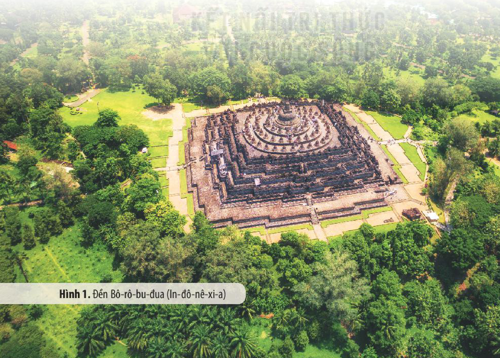

*Hình 1. Đền Bô-rô-bu-đua (In-đô-nê-xi-a)*

<!-- pdf:87 -->

## 1. Hành trình phát triển của văn minh Đông Nam Á

Hành trình phát triển của văn minh Đông Nam Á gắn liền với các thời kì lịch sử của khu vực.

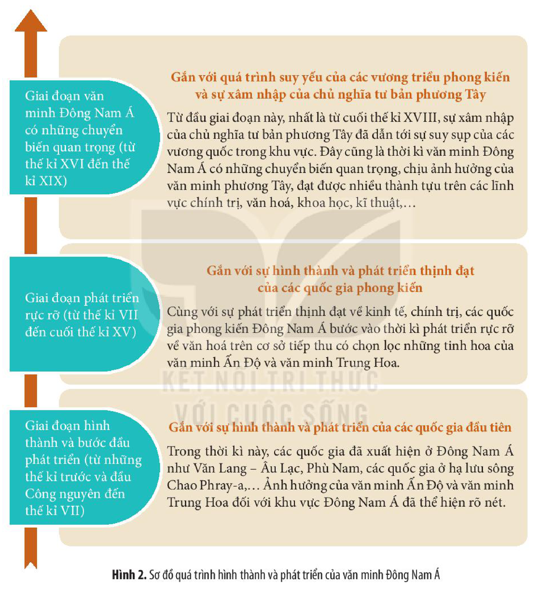

<!-- term: Giai đoạn đầu văn minh Đông Nam Á -->
**Giai đoạn hình thành và bước đầu phát triển (từ những thế kỉ trước và đầu Công nguyên đến thế kỉ VII) – Gắn với sự hình thành và phát triển của các quốc gia đầu tiên:** Trong thời kì này, các quốc gia đã xuất hiện ở Đông Nam Á như Văn Lang – Âu Lạc, Phù Nam, các quốc gia ở hạ lưu sông Chao Phray-a,... Ảnh hưởng của văn minh Ấn Độ và văn minh Trung Hoa đối với khu vực Đông Nam Á đã thể hiện rõ nét.

<!-- term: Giai đoạn phát triển rực rỡ -->
**Giai đoạn phát triển rực rỡ (từ thế kỉ VII đến cuối thế kỉ XV) – Gắn với sự hình thành và phát triển thịnh đạt của các quốc gia phong kiến:** Cùng với sự phát triển thịnh đạt về kinh tế, chính trị, các quốc gia phong kiến Đông Nam Á bước vào thời kì phát triển rực rỡ về văn hoá trên cơ sở tiếp thu có chọn lọc những tinh hoa của văn minh Ấn Độ và văn minh Trung Hoa.

<!-- term: Giai đoạn chuyển biến quan trọng -->
**Giai đoạn văn minh Đông Nam Á có những chuyển biến quan trọng (từ thế kỉ XVI đến thế kỉ XIX) – Gắn với quá trình suy yếu của các vương triều phong kiến và sự xâm nhập của chủ nghĩa tư bản phương Tây:** Từ đầu giai đoạn này, nhất là từ cuối thế kỉ XVIII, sự xâm nhập của chủ nghĩa tư bản phương Tây đã dẫn tới sự suy sụp của các vương quốc trong khu vực. Đây cũng là thời kì văn minh Đông Nam Á có những chuyển biến quan trọng, chịu ảnh hưởng của văn minh phương Tây, đạt được nhiều thành tựu trên các lĩnh vực chính trị, văn hoá, khoa học, kĩ thuật,...

*Hình 2. Sơ đồ quá trình hình thành và phát triển của văn minh Đông Nam Á*

> ❓ Nêu những nét chính trong các giai đoạn phát triển của văn minh Đông Nam Á.

<!-- pdf:88 -->

## 2. Một số thành tựu tiêu biểu

### a) Tín ngưỡng, tôn giáo

• *Tín ngưỡng*

<!-- term: Tín ngưỡng bản địa Đông Nam Á -->
Trước khi chịu ảnh hưởng của các nền văn hoá lớn từ bên ngoài, ở Đông Nam Á đã tồn tại các hình thức tín ngưỡng bản địa phong phú, đa dạng.

<!-- term: Tín ngưỡng bản địa Đông Nam Á -->
<!-- term: Tín ngưỡng sùng bái tự nhiên -->
<!-- term: Tín ngưỡng phồn thực -->
<!-- term: Tín ngưỡng thờ cúng người đã mất -->
Về cơ bản, tín ngưỡng Đông Nam Á bao gồm ba nhóm chính: tín ngưỡng sùng bái tự nhiên (thờ các vị thần tự nhiên gắn với cuộc sống, sản xuất nông nghiệp lúa nước,...), tín ngưỡng phồn thực (thờ các vật tượng trưng cho sự sinh sôi nảy nở) và tín ngưỡng thờ cúng người đã mất (thờ cúng, tạ ơn tổ tiên và những người có công với cộng đồng).

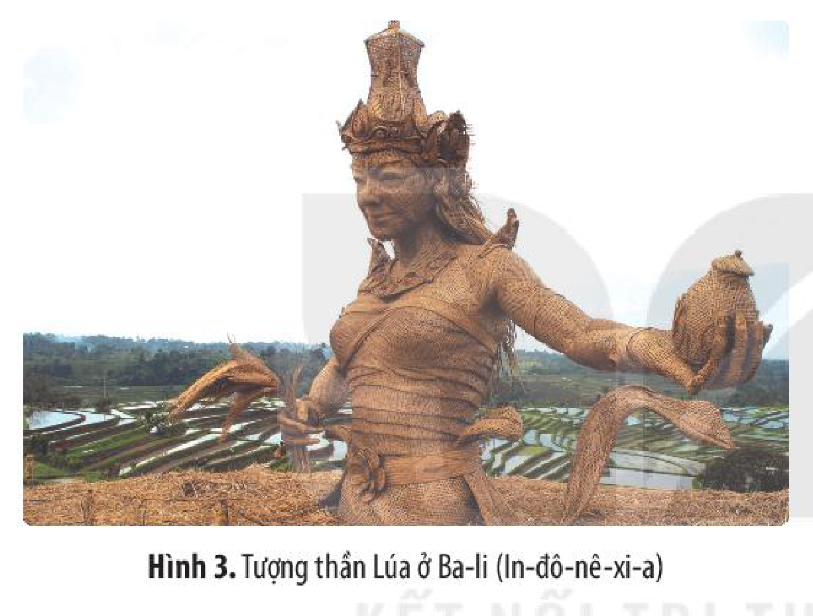

*Hình 3. Tượng thần Lúa ở Ba-li (In-đô-nê-xi-a)*

> 💡 EM CÓ BIẾT ?

<!-- term: Tín ngưỡng thờ thần Lúa -->
> Cư dân Đông Nam Á thờ thần Lúa để bảo trợ cho sản xuất nông nghiệp. Ở mỗi quốc gia, thần Lúa lại có tên gọi khác nhau (ở Lào là Nang Kho-sốp, ở In-đô-nê-xi-a gọi là Đê-uy Sri, Thái Lan là Mae Pho-sốp,...). Ở Việt Nam, tục thờ thần Lúa được các tộc người Kinh, Ê Đê, Chăm,... rất coi trọng.

Các hình thức tín ngưỡng bản địa được bảo tồn trong quá trình phát triển của lịch sử Đông Nam Á và tiếp tục tồn tại đến ngày nay như một nét văn hoá truyền thống độc đáo của các quốc gia trong khu vực.

• *Tôn giáo*

Trải qua quá trình lịch sử, bằng nhiều con đường khác nhau, các tôn giáo lớn của thế giới như Phật giáo, Hin-đu giáo, Hồi giáo, Công giáo lần lượt được du nhập vào Đông Nam Á và có ảnh hưởng lớn trong đời sống tinh thần của cư dân từng quốc gia trong khu vực này.

<!-- term: Phật giáo ở Đông Nam Á -->
Phật giáo du nhập từ khoảng những thế kỉ đầu Công nguyên và có vai trò quan trọng trong đời sống chính trị, xã hội và văn hoá của cư dân nhiều nước (Thái Lan, Lào, Cam-pu-chia,...).

<!-- term: Hồi giáo ở Đông Nam Á -->
Hồi giáo được truyền bá thông qua hoạt động thương mại của các thương nhân Ấn Độ vào khoảng thế kỉ XIII. Hồi giáo phát triển hưng thịnh ở Đông Nam Á với sự ra đời của các quốc gia Hồi giáo: Ma-lắc-ca, A-chê, Giô-hô vào các thế kỉ XV – XVII.

<!-- pdf:89 -->

Đầu thế kỉ XVI, Công giáo được truyền bá vào Phi-líp-pin thông qua các linh mục người Tây Ban Nha. Cùng với quá trình các nước phương Tây mở rộng xâm lược Đông Nam Á, Công giáo tiếp tục được truyền bá đến nhiều nước khác trong khu vực.

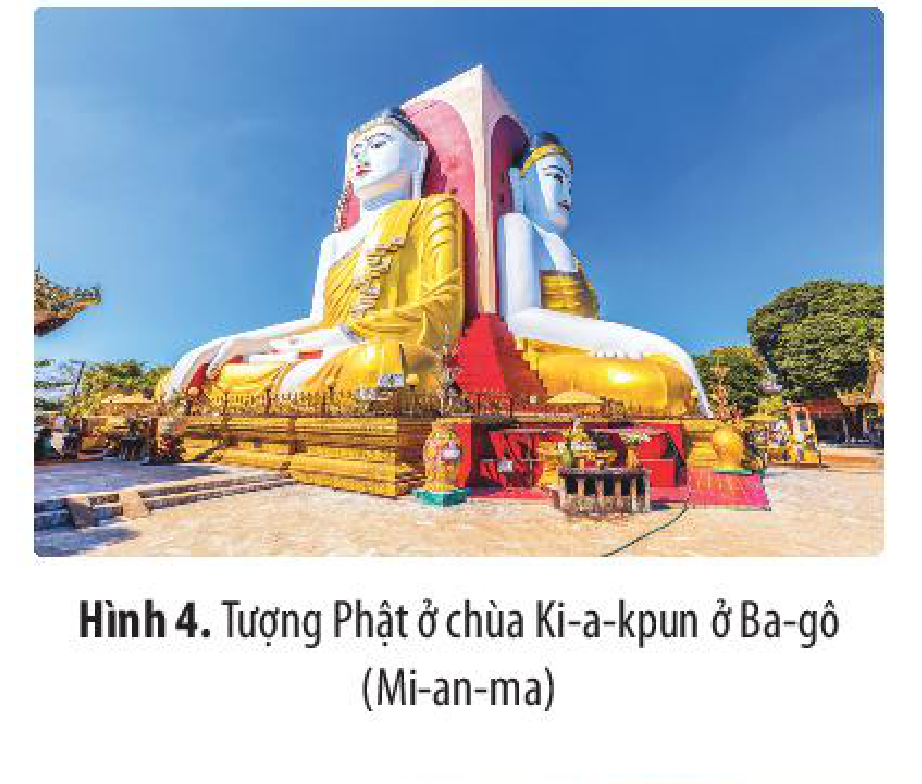

*Hình 4. Tượng Phật ở chùa Ki-a-kpun ở Ba-gô (Mi-an-ma)*

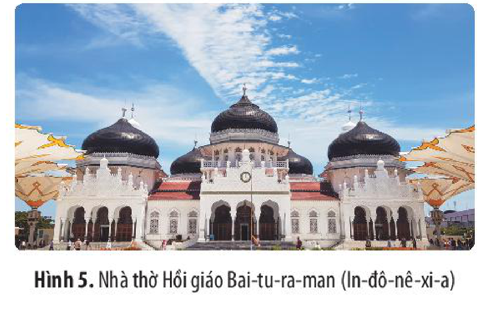

*Hình 5. Nhà thờ Hồi giáo Bai-tu-ra-man (In-đô-nê-xi-a)*

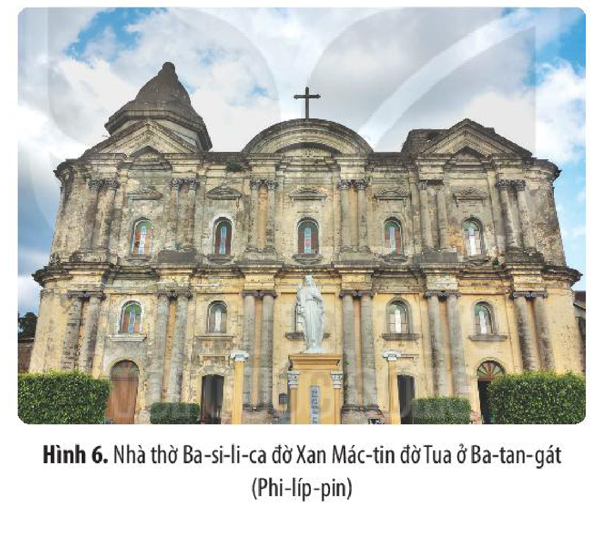

*Hình 6. Nhà thờ Ba-si-li-ca đờ Xan Mác-tin đờ Tua ở Ba-tan-gát (Phi-líp-pin)*

Là một khu vực đa tôn giáo nhưng nhìn chung ở Đông Nam Á thời kì cổ – trung đại các tôn giáo cùng tồn tại và phát triển một cách hoà hợp.

> ❓ 1. Em hãy trình bày một số nét tiêu biểu về tín ngưỡng, tôn giáo ở Đông Nam Á trong thời kì cổ – trung đại.
>
> 2. Hãy giải thích vì sao nhiều tôn giáo lớn trên thế giới được truyền bá và phát triển ở các quốc gia Đông Nam Á.

<!-- pdf:90 -->

### b) Chữ viết và văn học

• *Chữ viết*

<!-- term: Chữ viết ở Đông Nam Á -->
Trước khi sáng tạo chữ viết riêng, các nước Đông Nam Á sử dụng các chữ viết cổ của Ấn Độ (chữ Phạn, chữ Pa-li) và Trung Quốc (chữ Hán). Dần dần, cư dân các nước Đông Nam Á đã sáng tạo ra một hệ thống chữ viết riêng để ghi ngôn ngữ bản địa của mình như: chữ Chăm cổ, Khơ-me cổ, Mã Lai cổ, Miến cổ, chữ Nôm của người Việt,...

• *Văn học*

<!-- term: Văn học dân gian Đông Nam Á -->
Trên nền tảng văn minh nông nghiệp lúa nước, cư dân Đông Nam Á đã sáng tạo ra kho tàng văn học dân gian phong phú, đa dạng.

<!-- term: Văn học dân gian Đông Nam Á -->
Trong dòng văn học dân gian, nổi bật nhất là các truyền thuyết, thần thoại, cổ tích, truyện cười, truyện ngụ ngôn, truyện thơ khuyết danh,... giải thích về nguồn gốc thế giới, loài người,...; phản ánh hoạt động sản xuất, đời sống vật chất, tinh thần của cư dân Đông Nam Á và những quan niệm của họ về thế giới xung quanh.

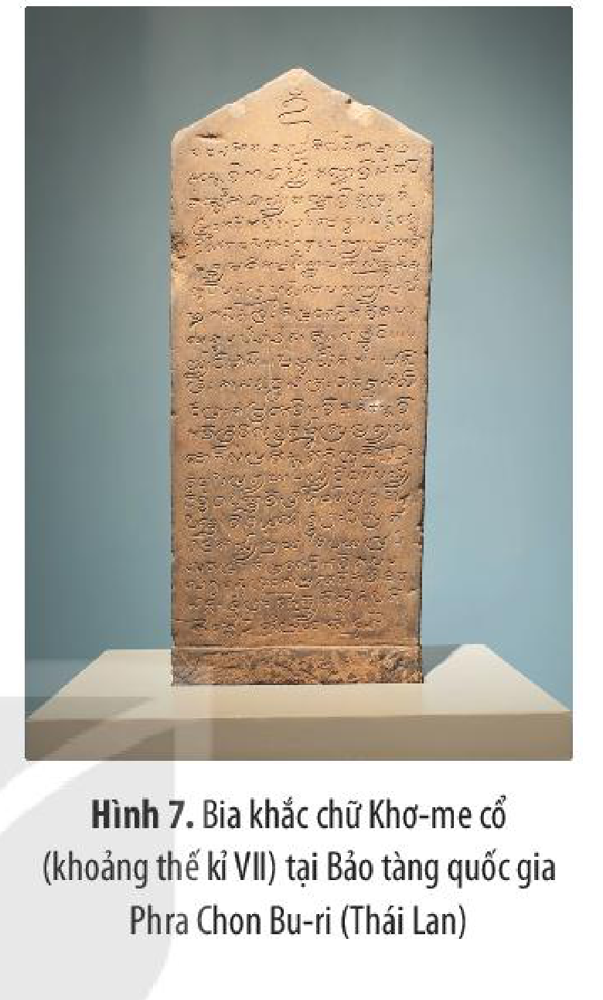

*Hình 7. Bia khắc chữ Khơ-me cổ (khoảng thế kỉ VII) tại Bảo tàng quốc gia Phra Chon Bu-ri (Thái Lan)*

<!-- term: Văn học viết Đông Nam Á -->
Trên cơ sở chữ viết riêng, cư dân các nước Đông Nam Á đã tạo dựng một nền văn học viết đa dạng với nhiều tác phẩm xuất sắc còn được lưu giữ đến ngày nay, như *Truyện Kiều* (Việt Nam), *Riêm Kê* (Cam-pu-chia), *Ra-ma-kiên* (Thái Lan),...

> ❓ 1. Việc cư dân các nước Đông Nam Á sáng tạo ra chữ viết của mình có ý nghĩa như thế nào?
>
> 2. Kể tên một số tác phẩm văn học chữ Nôm tiêu biểu của Việt Nam thời kì trung đại mà em biết.

### c) Kiến trúc và điêu khắc

• *Kiến trúc*

<!-- term: Kiến trúc Đông Nam Á -->
<!-- term: Tháp Thạt Luổng -->
Cư dân Đông Nam Á đã tạo dựng hàng loạt công trình kiến trúc (đền, chùa, tháp) mang phong cách Phật giáo và Hin-đu giáo ảnh hưởng của văn hoá Ấn Độ nhưng vẫn có nét độc đáo riêng, thể hiện bản sắc văn hoá của từng dân tộc.

<!-- pdf:91 -->

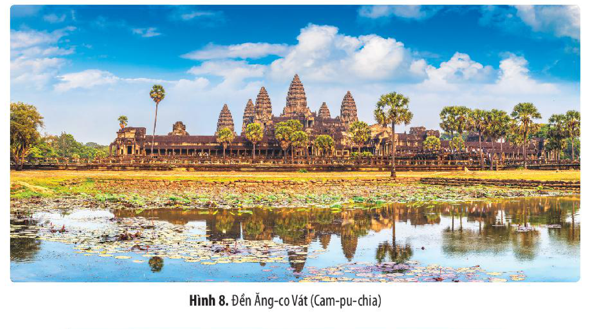

*Hình 8. Đền Ăng-co Vát (Cam-pu-chia)*

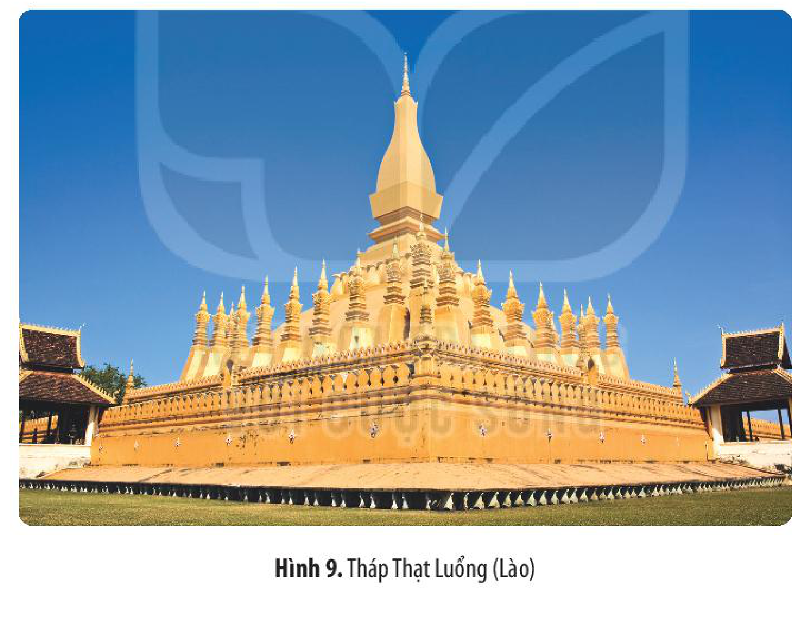

<!-- term: Tháp Thạt Luổng -->
*Hình 9. Tháp Thạt Luổng (Lào)*

• *Điêu khắc*

Trước khi tiếp thu ảnh hưởng của các nền văn hoá lớn từ bên ngoài, cư dân ở Đông Nam Á đã sáng tạo ra nghệ thuật tạo hình độc đáo và đa dạng, thể hiện qua nghệ thuật chạm khắc hoa văn trang trí trên các hiện vật bằng gốm, đồng,...

<!-- term: Trống đồng, thạp đồng Đông Sơn -->
Trống đồng, thạp đồng Đông Sơn (Việt Nam) là minh chứng cho sự phát triển đến đỉnh cao của nghệ thuật tạo hình bản địa ở Đông Nam Á thời kì này.

<!-- pdf:92 -->

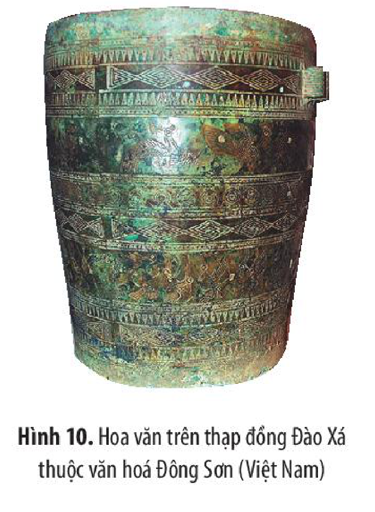

*Hình 10. Hoa văn trên thạp đồng Đào Xá thuộc văn hoá Đông Sơn (Việt Nam)*

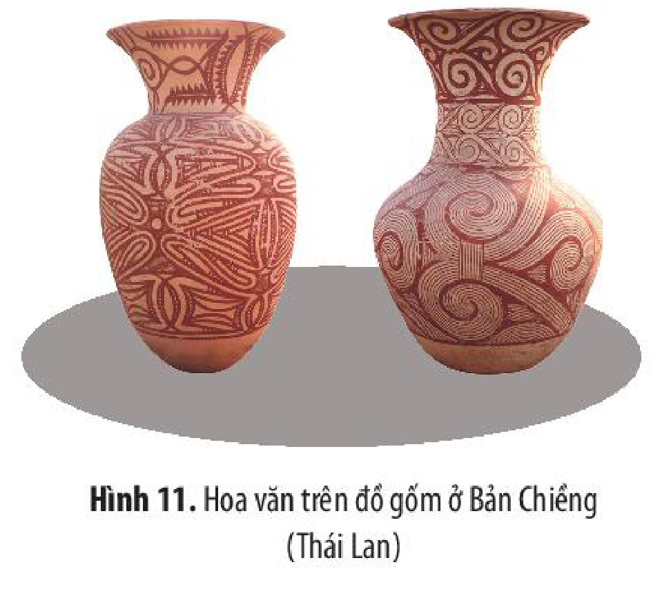

*Hình 11. Hoa văn trên đồ gốm ở Bản Chiềng (Thái Lan)*
<!-- ocr-ok: chú thích Hình 11 trang 91 (PDF 92) bị OCR đọc nhầm dấu thanh ("đổ gốm ở Bản Chiểng"), đã đối chiếu đúng ảnh gốc -->

<!-- term: Điêu khắc Đông Nam Á -->
Cùng với các công trình kiến trúc đồ sộ là hàng loạt tác phẩm điêu khắc nổi tiếng, với hai loại hình chủ yếu là phù điêu và tượng.

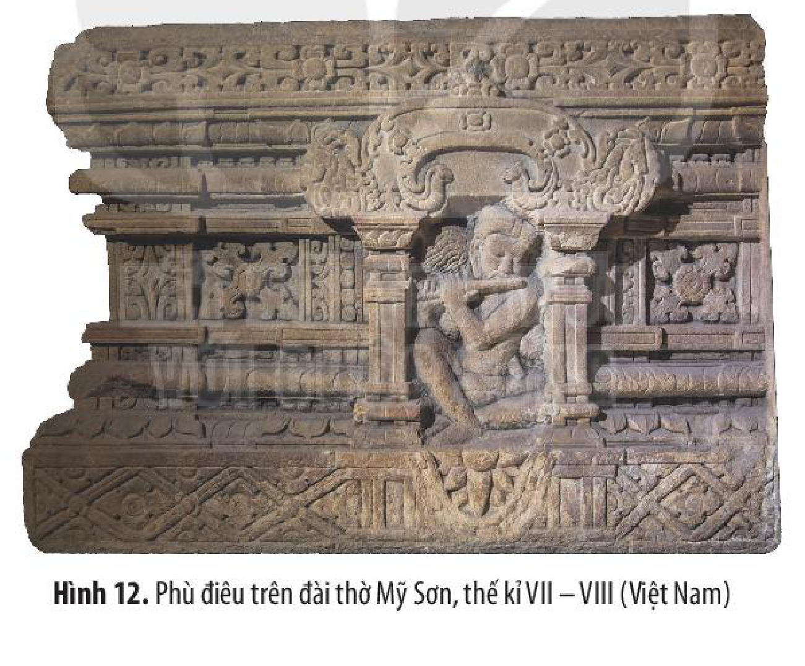

*Hình 12. Phù điêu trên đài thờ Mỹ Sơn, thế kỉ VII – VIII (Việt Nam)*

<!-- term: Kiến trúc Đông Nam Á -->
<!-- term: Điêu khắc Đông Nam Á -->
<!-- term: Đền Ăng-co Vát -->
<!-- term: Khu đền tháp Mỹ Sơn -->
Trên nền tảng văn hoá bản địa, cư dân các quốc gia Đông Nam Á tiếp thu có chọn lọc những thành tựu từ bên ngoài, để sáng tạo nên một nền nghệ thuật kiến trúc và điêu khắc đặc sắc mang đậm bản sắc của riêng mình. Kiến trúc và điêu khắc Đông Nam Á đạt đến đỉnh cao rực rỡ với nhiều công trình đặc sắc, tiêu biểu là: quần thể kiến trúc đền Bô-rô-bu-đua (In-đô-nê-xi-a), Ăng-co Vát và Ăng-co Thom (Cam-pu-chia), chùa Phật Ngọc (Thái Lan), chùa Vàng (Mi-an-ma), khu đền tháp Mỹ Sơn (Việt Nam),...

<!-- pdf:93 -->

> ❓ 1. Hãy nêu một số thành tựu tiêu biểu của văn minh Đông Nam Á. Em ấn tượng nhất với thành tựu nào? Vì sao?
>
> 2. Em có nhận xét gì về giá trị trường tồn của những thành tựu văn minh Đông Nam Á thời kì cổ – trung đại?

## ✏️ Luyện tập và vận dụng

1. Xây dựng trục thời gian về hành trình phát triển của văn minh Đông Nam Á thời kì cổ – trung đại.

2. Lập bảng thống kê theo gợi ý dưới đây (hoặc vẽ sơ đồ tư duy) về những thành tựu tiêu biểu của văn minh Đông Nam Á thời kì cổ – trung đại.

| Tên thành tựu | Lĩnh vực | Niên đại | Quốc gia | Ý nghĩa/Giá trị |
| --- | --- | --- | --- | --- |
| ? | ? | ? | ? | ? |
<!-- ocr-ok: tiêu đề bảng trang 92 (PDF 93) bị OCR dính chữ không dấu cách ("Tênthànhtựu Linhvực..."), đã đối chiếu đúng ảnh gốc -->

Nếu được tham gia “Tàu Thanh niên Đông Nam Á – Nhật Bản”, em sẽ lựa chọn thành tựu nào về văn minh Đông Nam Á để chia sẻ với bạn bè quốc tế? Vì sao?

## 📷 Danh sách hình trong bài

| Mã hình | Trang PDF | Vị trí trong bài | Chú thích gốc |
| --- | --- | --- | --- |
| H10-lich_su-b10-01 | 86 | Mở đầu (ảnh nền tràn lề nửa dưới trang mở đầu Bài 10) | Hình 1. Đền Bô-rô-bu-đua (In-đô-nê-xi-a) |
| H10-lich_su-b10-02 | 87 | Mục 1 | Hình 2. Sơ đồ quá trình hình thành và phát triển của văn minh Đông Nam Á |
| H10-lich_su-b10-03 | 88 | Mục 2.a | Hình 3. Tượng thần Lúa ở Ba-li (In-đô-nê-xi-a) |
| H10-lich_su-b10-04 | 89 | Mục 2.a | Hình 4. Tượng Phật ở chùa Ki-a-kpun ở Ba-gô (Mi-an-ma) |
| H10-lich_su-b10-05 | 89 | Mục 2.a | Hình 5. Nhà thờ Hồi giáo Bai-tu-ra-man (In-đô-nê-xi-a) |
| H10-lich_su-b10-06 | 89 | Mục 2.a | Hình 6. Nhà thờ Ba-si-li-ca đờ Xan Mác-tin đờ Tua ở Ba-tan-gát (Phi-líp-pin) |
| H10-lich_su-b10-07 | 90 | Mục 2.b | Hình 7. Bia khắc chữ Khơ-me cổ (khoảng thế kỉ VII) tại Bảo tàng quốc gia Phra Chon Bu-ri (Thái Lan) |
| H10-lich_su-b10-08 | 91 | Mục 2.c | Hình 8. Đền Ăng-co Vát (Cam-pu-chia) |
| H10-lich_su-b10-09 | 91 | Mục 2.c | Hình 9. Tháp Thạt Luổng (Lào) |
| H10-lich_su-b10-10 | 92 | Mục 2.c | Hình 10. Hoa văn trên thạp đồng Đào Xá thuộc văn hoá Đông Sơn (Việt Nam) |
| H10-lich_su-b10-11 | 92 | Mục 2.c | Hình 11. Hoa văn trên đồ gốm ở Bản Chiềng (Thái Lan) |
| H10-lich_su-b10-12 | 92 | Mục 2.c | Hình 12. Phù điêu trên đài thờ Mỹ Sơn, thế kỉ VII – VIII (Việt Nam) |
