<!-- pdf:94 -->

# BÀI 11: MỘT SỐ NỀN VĂN MINH CỔ TRÊN ĐẤT NƯỚC VIỆT NAM

## 🎯 Học xong bài này, em sẽ:

- Nêu được cơ sở hình thành của các nền văn minh cổ trên đất nước Việt Nam: văn minh Văn Lang – Âu Lạc (văn minh sông Hồng), văn minh Chăm-pa, văn minh Phù Nam. Trình bày được một số thành tựu tiêu biểu của các nền văn minh cổ.
- Biết cách sưu tầm và sử dụng tư liệu lịch sử để tìm hiểu về văn minh Văn Lang – Âu Lạc.
- Nhận biết được và trân trọng giá trị trường tồn của các nền văn minh cổ trên đất nước Việt Nam.
- Biết vận dụng những hiểu biết về các nền văn minh cổ để giới thiệu về đất nước, con người Việt Nam.

## 🔴 Mở đầu

Từ hơn 2 000 năm trước, trên lãnh thổ Việt Nam đã từng bước hình thành ba trung tâm văn minh gắn với ba quốc gia cổ. Các hiện vật trong Hình 1 là những tư liệu quý giúp các em tìm hiểu về các nền văn minh cổ trên đất nước Việt Nam một cách chân thực và sinh động. Những hiện vật đó gợi cho em liên tưởng đến những nền văn minh nào? Những nền văn minh đó có những thành tựu gì nổi bật?

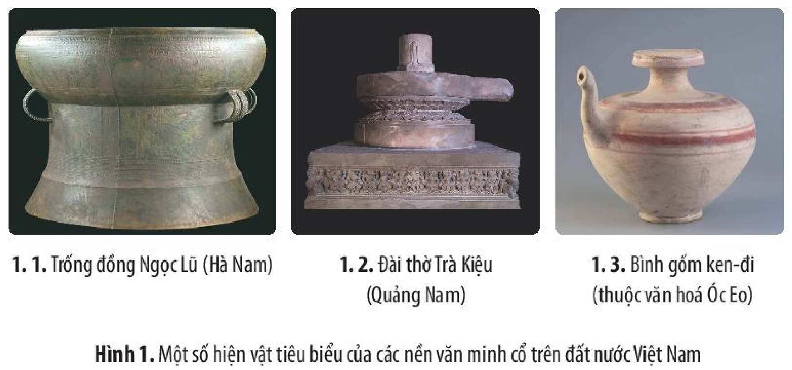

*Hình 1. Một số hiện vật tiêu biểu của các nền văn minh cổ trên đất nước Việt Nam (1.1. Trống đồng Ngọc Lũ (Hà Nam); 1.2. Đài thờ Trà Kiệu (Quảng Nam); 1.3. Bình gốm ken-đi (thuộc văn hoá Óc Eo))*

<!-- pdf:95 -->

## 1. Văn minh Văn Lang – Âu Lạc

<!-- term: Văn minh Văn Lang – Âu Lạc -->
Văn minh Văn Lang – Âu Lạc (còn gọi là văn minh sông Hồng, văn minh Việt cổ, văn minh Đông Sơn) có nguồn gốc bản địa, chủ nhân là các cộng đồng người Việt cổ, được hình thành và phát triển từ đầu thiên niên kỉ I TCN đến vài thế kỉ đầu Công nguyên ở khu vực Bắc Bộ và Bắc Trung Bộ Việt Nam ngày nay.

### a) Cơ sở hình thành

• *Điều kiện tự nhiên*

Văn minh Văn Lang – Âu Lạc được hình thành trên lưu vực các dòng sông như sông Hồng, sông Mã, sông Cả,... Khu vực này đất đai màu mỡ, hệ thống sông ngòi dày đặc, khí hậu nhiệt đới ẩm gió mùa,... thuận lợi cho động vật, thực vật sinh sôi, nảy nở, phát triển nông nghiệp, đặc biệt là nghề trồng lúa nước. Khoáng sản có các mỏ đồng, sắt, thiếc, chì,... thuận lợi cho nghề luyện kim phát triển sớm.

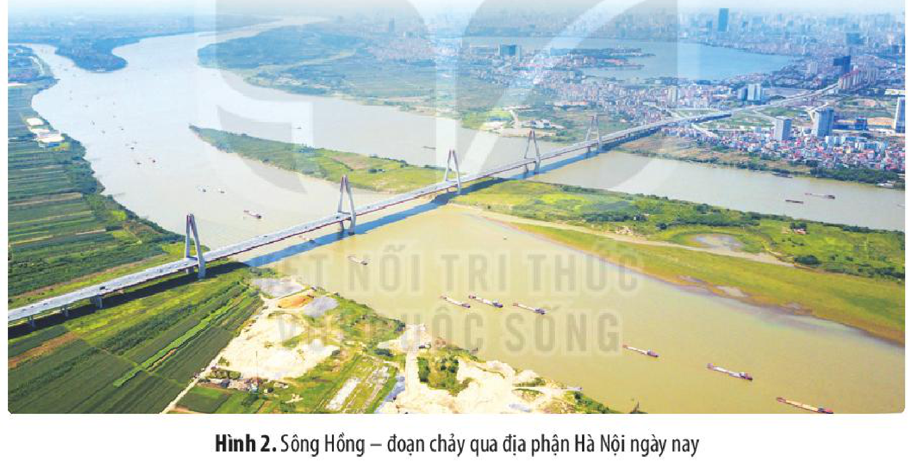

*Hình 2. Sông Hồng – đoạn chảy qua địa phận Hà Nội ngày nay*
<!-- ocr-ok: chú thích Hình 2 đối chiếu đúng ảnh trang 95 -->

> 💡 EM CÓ BIẾT ?

> Khảo cổ học liên tiếp phát hiện ra dấu tích các nền văn hoá đồng thau tiền Đông Sơn ở Việt Nam. Điều này đã bác bỏ quan điểm của một số nhà nghiên cứu cho rằng văn hoá Đông Sơn được du nhập từ bên ngoài.

• *Cơ sở xã hội*

<!-- term: Văn hoá Phùng Nguyên -->
Văn minh Văn Lang – Âu Lạc có cội nguồn từ văn hoá Phùng Nguyên (khoảng 4 000 năm trước), phát triển rực rỡ trong thời kì văn hoá Đông Sơn. Trong hơn hai thiên niên kỉ, sự phát triển của công cụ lao động, các hoạt động sản xuất đã dẫn tới những thay đổi lớn: sự tan rã của xã hội nguyên thuỷ, phân hoá xã hội và sự ra đời của nhà nước.

<!-- pdf:96 -->

Cư dân Việt cổ sống thành từng làng, xuất phát từ yêu cầu phát triển kinh tế nông nghiệp (trị thuỷ, làm thuỷ lợi, khai hoang,...), yêu cầu bảo vệ cuộc sống chung của cộng đồng, các làng đã liên kết với nhau, suy tôn thủ lĩnh chung. Đây chính là cơ sở hình thành nên nhà nước đầu tiên ở Việt Nam – tiền đề cho sự hình thành và phát triển rực rỡ của văn minh.

> ❓ Em hãy cho biết: Nền văn minh Văn Lang – Âu Lạc được hình thành và phát triển dựa trên những cơ sở nào?

### b) Một số thành tựu tiêu biểu

• *Sự ra đời của nhà nước*

<!-- term: Nhà nước Văn Lang -->
*Nhà nước Văn Lang* xuất hiện cách ngày nay khoảng 2 700 năm và tồn tại đến năm 208 TCN; kinh đô là Phong Châu (Việt Trì, Phú Thọ ngày nay). Tổ chức nhà nước Văn Lang còn khá sơ khai.

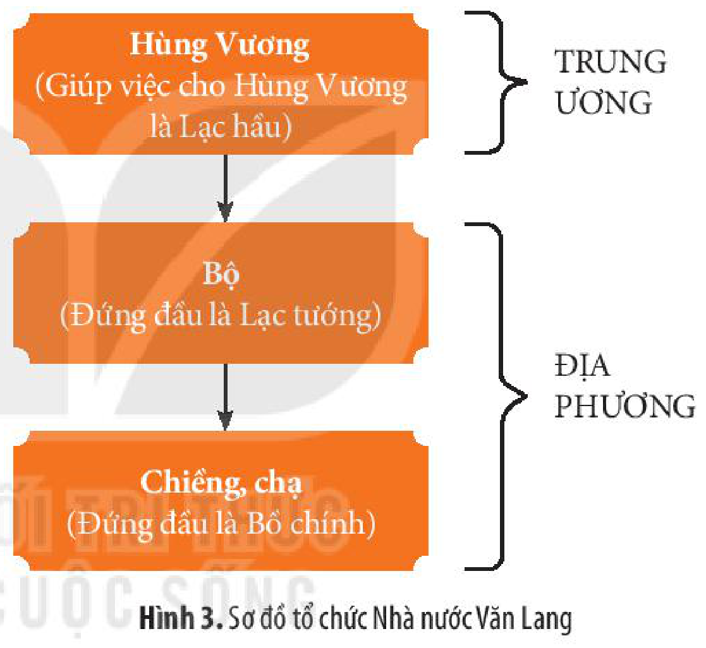

*Hình 3. Sơ đồ tổ chức Nhà nước Văn Lang (TRUNG ƯƠNG: Hùng Vương, giúp việc cho Hùng Vương là Lạc hầu; ĐỊA PHƯƠNG: Bộ – đứng đầu là Lạc tướng, Chiềng, chạ – đứng đầu là Bồ chính)*

<!-- term: Nhà nước Âu Lạc -->
Tiếp nối Nhà nước Văn Lang là Nhà nước Âu Lạc (208 – 179 TCN); kinh đô ở Cổ Loa (Đông Anh, Hà Nội ngày nay); đứng đầu nhà nước là Thục Phán – An Dương Vương; giúp việc cho vua cũng là Lạc hầu; dưới địa phương vẫn do các Lạc tướng cai quản.

• *Hoạt động kinh tế*

Trên những điểm tụ cư ở các gò đồi, chân núi, các dải đất cao ven sông, cư dân Văn Lang – Âu Lạc đã khai phá đất đai, mở rộng diện tích trồng lúa nước bằng nhiều hình thức canh tác phù hợp: làm rẫy (vùng đồi núi, địa hình dốc)

<!-- pdf:97 -->

và làm ruộng (vùng đồng bằng, đất phù sa màu mỡ, thuận lợi tưới tiêu). Cư dân Văn Lang – Âu Lạc đã có bước tiến lớn về công cụ và kĩ thuật canh tác nông nghiệp. Ngoài ra, các nghề chăn nuôi, đánh cá và làm thủ công cũng phát triển.

> 💡 EM CÓ BIẾT ?

> Các nhà khảo cổ đã tìm được nhiều khuôn đúc, nồi nấu đồng, rót đồng trong các di tích Làng Cả (Phú Thọ); Làng Vạc, Đồng Mõm (Nghệ An) và mảnh khuôn đúc trống đồng ở Luy Lâu (Bắc Ninh) thuộc thời kì Đông Sơn.

Thời kì Đông Sơn, một số nghề thủ công (chế tác đá, làm gốm, mộc, dệt, luyện kim,...) phát triển mạnh mẽ. Trong đó, nghề đúc đồng phát triển vượt bậc, với nhiều sản phẩm được chế tác tinh xảo (công cụ lao động, đồ trang sức, vũ khí, trống đồng, thạp đồng,...). Cho đến nay, kĩ thuật đúc trống đồng, thạp đồng,... của người Việt cổ vẫn còn nhiều điều bí ẩn.

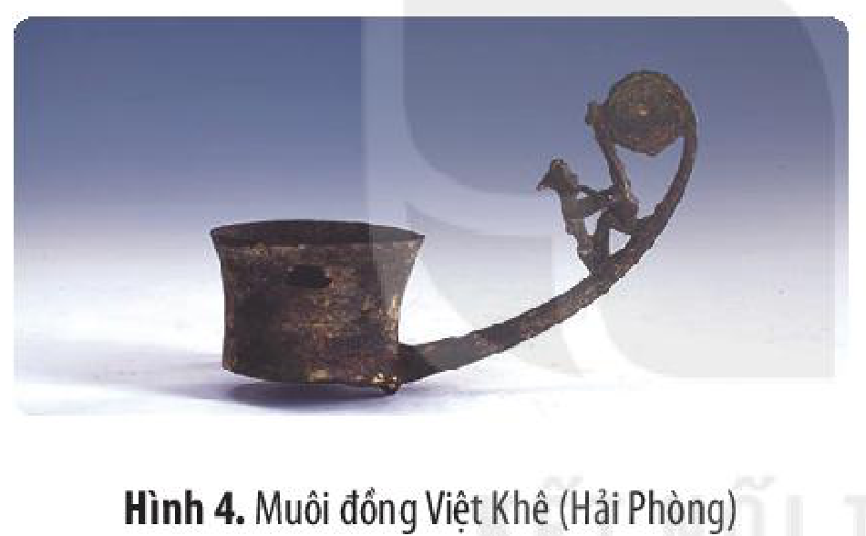

*Hình 4. Muôi đồng Việt Khê (Hải Phòng)*

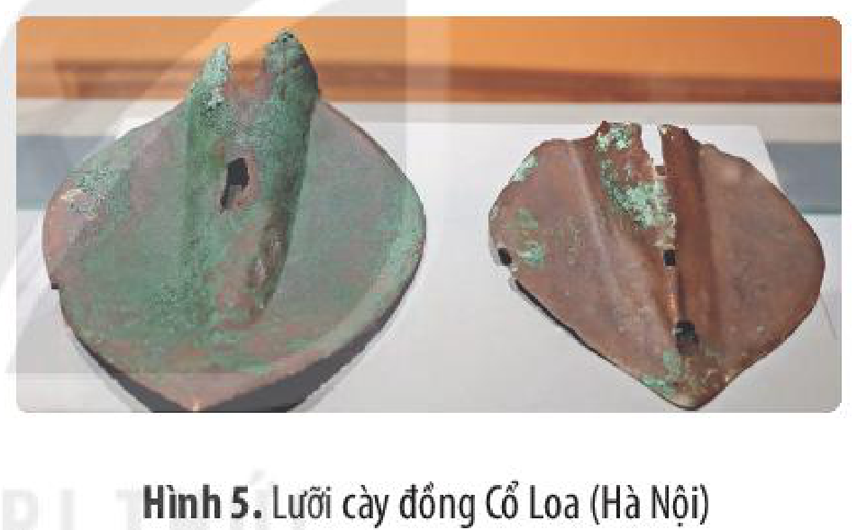

*Hình 5. Lưỡi cày đồng Cổ Loa (Hà Nội)*

> 💡 EM CÓ BIẾT ?

<!-- term: Trống đồng Đông Sơn -->
> Cho đến nay, đã có gần 300 trống đồng Đông Sơn được phát hiện trên lãnh thổ Việt Nam. Trống đồng Đông Sơn còn được tìm thấy ở nhiều nơi khác như miền Nam Trung Quốc, các nước Đông Nam Á,... Trong đó, Việt Nam là trung tâm xuất hiện, truyền bá sớm và quan trọng.

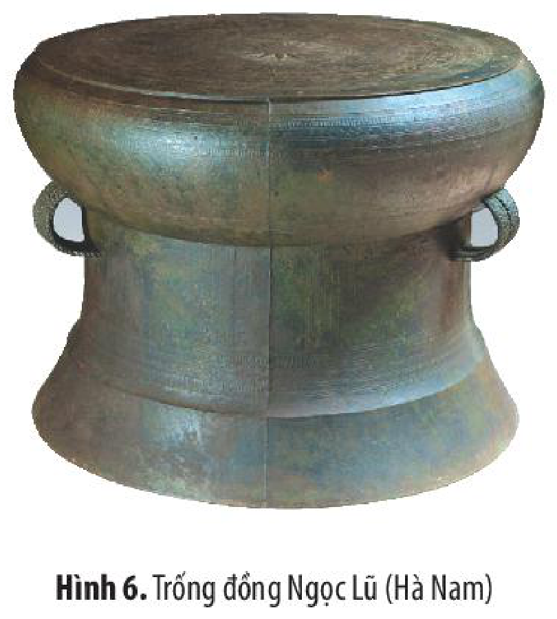

*Hình 6. Trống đồng Ngọc Lũ (Hà Nam)*

<!-- pdf:98 -->

• *Đời sống vật chất*

Thành phần chính trong *bữa ăn* hằng ngày của người Việt cổ là cơm, rau, cá,... Lương thực chính là lúa gạo; thức ăn gồm các loại rau, củ, quả và các sản phẩm của nghề đánh cá, săn bắt và chăn nuôi.

*Về trang phục:* Thường ngày, phụ nữ mặc váy và áo yếm, đàn ông đóng khố, ở trần, đi chân đất, tóc để xoã ngang vai hoặc để dài búi tó. Họ thích sử dụng đồ trang sức được làm từ sừng, ngà động vật, đá, kim loại (sắt, đồng),...

*Về nhà ở:* Cư dân chủ yếu cư trú trong các nhà sàn làm bằng gỗ, tre, nứa, lá (cả miền núi và đồng bằng). Những ngôi nhà quây quần trong một khu vực tạo thành những xóm làng định cư.

Người Việt cổ *đi lại* chủ yếu bằng đường thuỷ (đường sông, đường biển), phương tiện chính là thuyền, bè,...

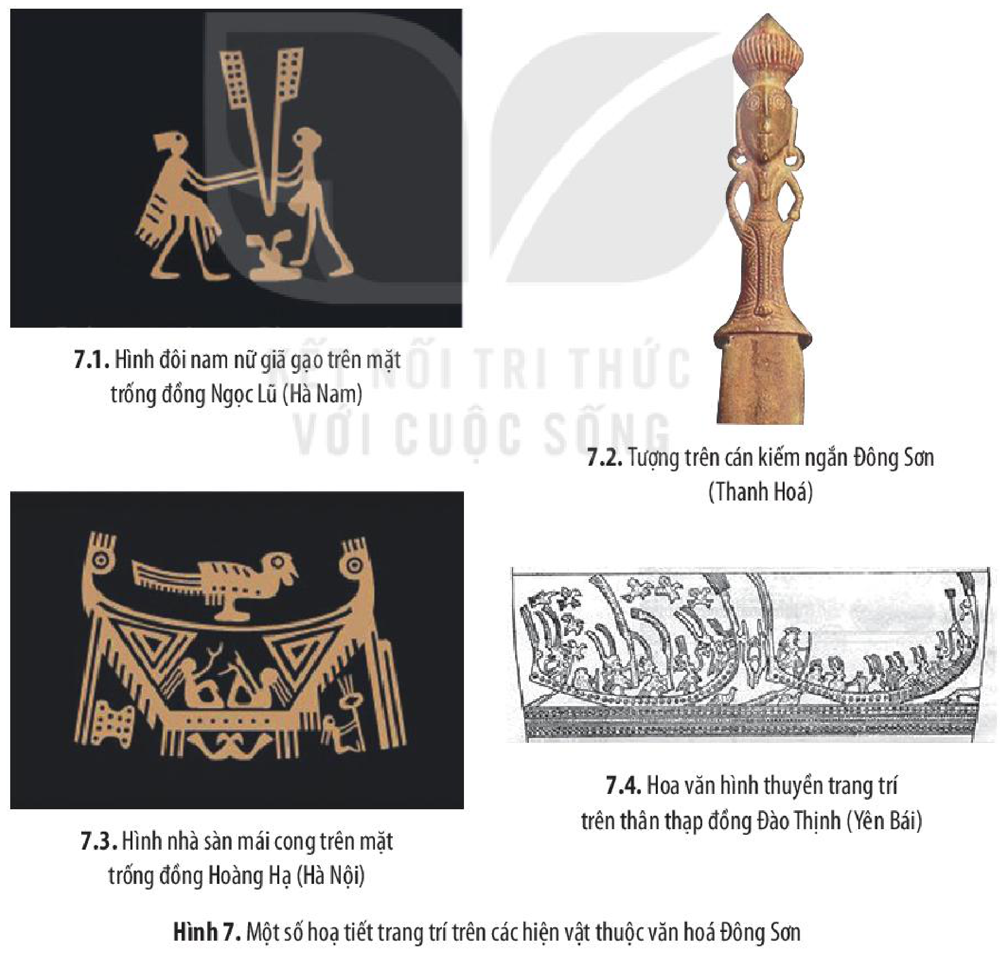

*Hình 7. Một số hoạ tiết trang trí trên các hiện vật thuộc văn hoá Đông Sơn (7.1. Hình đôi nam nữ giã gạo trên mặt trống đồng Ngọc Lũ (Hà Nam); 7.2. Tượng trên cán kiếm ngắn Đông Sơn (Thanh Hoá); 7.3. Hình nhà sàn mái cong trên mặt trống đồng Hoàng Hạ (Hà Nội); 7.4. Hoa văn hình thuyền trang trí trên thân thạp đồng Đào Thịnh (Yên Bái))*

<!-- pdf:99 -->

• *Đời sống tinh thần*

*Tín ngưỡng:* Cư dân Văn Lang – Âu Lạc có tục thờ cúng tổ tiên và những người có công với cộng đồng, thờ các vị thần tự nhiên và tín ngưỡng phồn thực.

*Nghệ thuật:* Cư dân Văn Lang – Âu Lạc đã đạt đến một trình độ thẩm mĩ khá cao. Những tác phẩm như: trống đồng, thạp đồng, đồ trang sức hay tượng người, chim, thú hoặc trang trí trên các công cụ, vũ khí,... vừa thể hiện trình độ chế tác tinh xảo, kĩ thuật cao, giàu tính nghệ thuật, vừa phản ánh đời sống tinh thần phong phú của cư dân thời kì này.

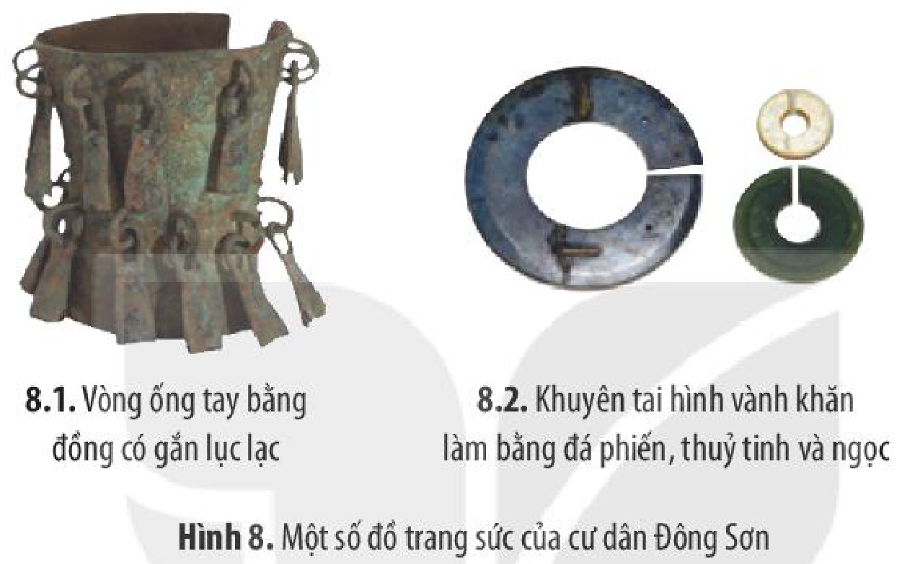

*Hình 8. Một số đồ trang sức của cư dân Đông Sơn (8.1. Vòng ống tay bằng đồng có gắn lục lạc; 8.2. Khuyên tai hình vành khăn làm bằng đá phiến, thuỷ tinh và ngọc)*

*Âm nhạc* khá phát triển với sự xuất hiện của nhiều loại nhạc cụ và hình thức biểu diễn.

Trống đồng Đông Sơn trước hết là một loại nhạc khí dùng trong các dịp lễ, tết lớn của cộng đồng. Bằng kĩ thuật điêu luyện, cư dân Văn Lang – Âu Lạc đã tạo nên những chiếc trống với âm thanh trầm hùng.

Trên trống đồng, thạp đồng có trang trí hoạ tiết là các giàn trống (từ 2 đến 4 chiếc), giàn cồng (từ 6 đến 8 chiếc), cảnh tốp nam nữ mặc trang phục đẹp, đầu đội mũ lông chim, vừa múa, hát, vừa sử dụng những nhạc khí khác nhau (khèn, sênh, chuông, phách,...).

> TƯ LIỆU 1. Nền văn minh của người Việt cổ với biểu tượng trống đồng Đông Sơn thực chất là một nền văn minh nông nghiệp trồng lúa nước dựa trên nền tảng cộng đồng xóm làng và một cơ cấu chính trị nhà nước phôi thai; không những đã vươn tới một trình độ phát triển khá cao, mà còn xác lập lối sống Việt Nam, truyền thống Việt Nam, đặt cơ sở vững chắc cho toàn bộ sự tồn tại và phát triển của quốc gia – dân tộc sau đó.
>
> *(Theo Phan Huy Lê (Chủ biên), Lịch sử Việt Nam, Tập I, Sđd, tr. 173)*

<!-- pdf:100 -->

> ❓ 1. Trình bày những thành tựu tiêu biểu của nền văn minh Văn Lang – Âu Lạc.
>
> 2. Khai thác Tư liệu 1 (tr. 98), hãy cho biết ý nghĩa, giá trị của nền văn minh Văn Lang – Âu Lạc trong lịch sử Việt Nam.

## 2. Văn minh Chăm-pa

### a) Cơ sở hình thành

• *Điều kiện tự nhiên*

<!-- term: Văn minh Chăm-pa -->
Nền văn minh Chăm-pa hình thành, tồn tại và phát triển (từ thế kỉ II đến thế kỉ XV) trên địa bàn các tỉnh miền Trung và một phần cao nguyên Trường Sơn Việt Nam ngày nay.

> TƯ LIỆU 2. “Vùng đất này được coi là vùng có khí hậu khô hạn nhất miền Trung, đồng bằng hẹp, khô hạn, cồn cát chiếm tỉ lệ cao. Trong những vùng ngăn cách bởi dải Hoành Sơn, có không gian khép kín, ba mặt là núi, hướng đông mở ra biển,... Mối liên hệ giữa các vùng với nhau chủ yếu là giao thông đường biển, bởi đường bộ phải vượt qua những đèo khá hiểm trở gian nan”.
>
> *(Lê Đình Phụng, Đối thoại với nền văn minh cổ Chăm-pa, NXB Khoa học xã hội, Hà Nội, 2015, tr. 104)*

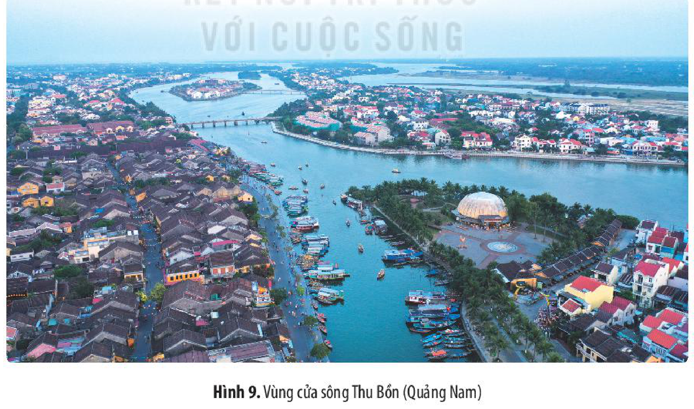

*Hình 9. Vùng cửa sông Thu Bồn (Quảng Nam)*

<!-- pdf:101 -->

> 💡 EM CÓ BIẾT ?

<!-- term: Văn hoá Sa Huỳnh -->
> Văn hoá Sa Huỳnh thuộc thời đại kim khí, có quá trình phát triển liên tục, phân bố từ Quảng Bình cho đến Bình Thuận.

• *Cơ sở xã hội*

Khoảng thế kỉ V TCN, cư dân văn hoá Sa Huỳnh cư trú ở vùng duyên hải, lưu vực các con sông và sâu trong nội địa. Cơ cấu xã hội Sa Huỳnh là xã hội dạng lãnh địa hay liên minh cụm làng, đứng đầu là thủ lĩnh tối cao. Sự phát triển nội tại của những tổ chức xã hội này là cơ sở quan trọng cho sự hình thành của Nhà nước Chăm-pa sau này.

Ngoài ra, có thể có một số nhóm người khác cùng kết hợp với người Sa Huỳnh tạo nên nền văn minh Chăm-pa.

• *Ảnh hưởng của văn minh Ấn Độ*

Từ thời văn hoá Sa Huỳnh, cư dân nơi đây đã tiếp xúc với văn minh Ấn Độ. Thông qua tầng lớp thương nhân, chữ viết, tôn giáo, tư tưởng, mô hình tổ chức nhà nước và pháp luật đã được du nhập. Việc tiếp thu những thành tựu của văn minh Ấn Độ đã góp phần đưa nền văn minh Chăm-pa phát triển rực rỡ.

> ❓ Em hãy cho biết: Nền văn minh Chăm-pa được hình thành trên những cơ sở nào?

### b) Một số thành tựu tiêu biểu

• *Sự ra đời nhà nước*

<!-- term: Nước Lâm Ấp -->
Trong hai thế kỉ đầu Công nguyên, người Chăm ở quận Nhật Nam liên tục đấu tranh chống lại ách cai trị của nhà Hán. Đến năm 192, dưới sự lãnh đạo của Khu Liên, nhân dân huyện Tượng Lâm (thuộc quận Nhật Nam) đã nổi dậy lật đổ ách thống trị của ngoại bang, lập ra nước Lâm Ấp (sau này gọi là Chăm-pa), kinh đô là Sin-ha-pu-ra (Trà Kiệu, Quảng Nam).

Ở cấp trung ương, đứng đầu Nhà nước Chăm-pa là vua (thường được đồng nhất với một vị thần), có quyền lực tối cao, theo chế độ cha truyền con nối. Dưới vua là hai vị quan đại thần (một quan văn, một quan võ). Cấp địa phương, chia thành các châu – huyện – làng và giao cho các vị quan quản lí.

• *Kinh tế*

Cư dân Chăm-pa có hoạt động kinh tế đa dạng: trồng lúa trên các vùng đồng bằng lưu vực của các con sông, chăn nuôi gia súc, làm nghề thủ công (làm gốm, dệt, luyện kim,...).

<!-- pdf:102 -->

> TƯ LIỆU 3. “Hiện nay tại những cánh đồng ở Phan Rang, Phan Rí, tại những vùng đất bỏ hoang, vẫn còn dấu vết một hệ thống tưới tiêu rất hoàn chỉnh chứng tỏ người Chăm xưa hiểu biết rất nhiều về canh tác nông nghiệp”.
>
> *(Gioóc-giơ Mát-xpê-rô, Vương quốc Chăm-pa, NXB Khoa học xã hội, Hà Nội, 2020, tr. 41)*

Bên cạnh đó, người Chăm-pa rất giỏi nghề buôn bán bằng đường biển.

Do nằm trên tuyến đường buôn bán quốc tế qua Biển Đông, vì vậy Chăm-pa được biết đến là cầu nối buôn bán quốc tế quan trọng, với nhiều cảng thị nổi tiếng như: Đại Chiêm (Quảng Nam), Thị Nại (Bình Định), Pan-đu-ran-ga (Phan Rang),...

Qua các cảng thị, cư dân Chăm-pa bán những sản phẩm nổi tiếng của miền nhiệt đới như trầm hương, kì nam, ngọc trai,... và mua các mặt hàng như thuỷ tinh (Ấn Độ), mã não (Thái Lan), gương đồng (Trung Quốc), đồ gốm màu xanh lam cô-ban (A-rập),...

> 💡 EM CÓ BIẾT ?

> Quá trình khai quật di tích Cù Lao Chàm (Quảng Nam) đã tìm thấy nhiều mảnh gốm có nguồn gốc A-rập với xương gốm dày, trắng xốp, tráng men màu xanh cô-ban đặc trưng cùng những mảnh thuỷ tinh màu (từ Ấn Độ).

• *Chữ viết*

<!-- term: Chữ Chăm cổ -->
Trên cơ sở chữ Phạn của Ấn Độ, cư dân Chăm-pa đã sáng tạo chữ viết riêng của dân tộc mình. Chữ Chăm cổ được coi là loại chữ viết cổ nhất ở Đông Nam Á. Trải qua thời gian, hệ thống chữ viết của người Chăm đã dần được cải tiến và duy trì đến ngày nay.

• *Đời sống vật chất*

<!-- term: Ka-ma -->
*Trang phục* chính của người Chăm xưa là một mảnh vải (gọi là “ka-ma”) quấn quanh người từ phải sang trái và che từ ngang lưng đến chân, mùa đông họ khoác thêm một cái áo dày. Dân chúng đều đi chân đất, chỉ có vua, quan đi dép hoặc giày. Phụ nữ Chăm thường đeo một số đồ trang sức: hoa tai, vòng cổ,...

Người dân *ở* trong các ngôi nhà trệt, xây bằng gạch nung, tường có quét vôi ở ngoài.

Thành phần chính trong *bữa ăn* hằng ngày của người Chăm-pa là cơm, rau, cá,...

• *Đời sống tinh thần*

*Tín ngưỡng, tôn giáo, lễ hội*

Trước khi tiếp xúc với các nền văn hoá bên ngoài, cư dân Sa Huỳnh đã duy trì nhiều tín ngưỡng truyền thống: vạn vật hữu linh, thờ sinh thực khí, thờ cúng tổ tiên,...

<!-- pdf:103 -->

<!-- term: Lễ hội Ka-tê -->
Ngoài tín ngưỡng bản địa, người Chăm-pa cũng tiếp thu nhiều tôn giáo khác nhau như: Phật giáo, Hin-đu giáo, Hồi giáo,... Gắn liền với các tôn giáo là hệ thống lễ hội đặc sắc được đồng bào Chăm tổ chức hằng năm tại các cụm di tích tháp Chăm.

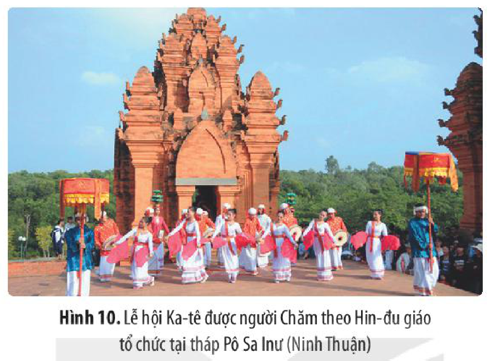

*Hình 10. Lễ hội Ka-tê được người Chăm theo Hin-đu giáo tổ chức tại tháp Pô Sa Inư (Ninh Thuận)*

*Kiến trúc, điêu khắc*

<!-- term: Thánh địa Mỹ Sơn -->
Ngày nay, trên dải đất miền Trung Việt Nam còn nhiều di tích, công trình kiến trúc tôn giáo quan trọng của Vương quốc Chăm-pa, tiêu biểu như Thánh địa Mỹ Sơn, Phật viện Đồng Dương (Quảng Nam), tháp Mỹ Khánh (Thừa Thiên Huế), tháp Cánh Tiên, Dương Long (Bình Định), tháp Bà Pô Na-ga (Khánh Hoà),...

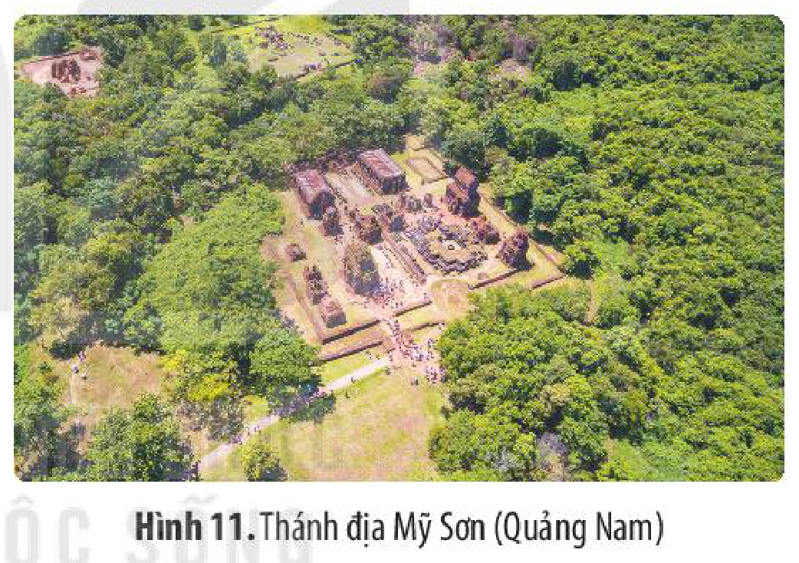

*Hình 11. Thánh địa Mỹ Sơn (Quảng Nam)*
<!-- ocr-ok: chú thích Hình 11 đối chiếu đúng ảnh trang 103 -->

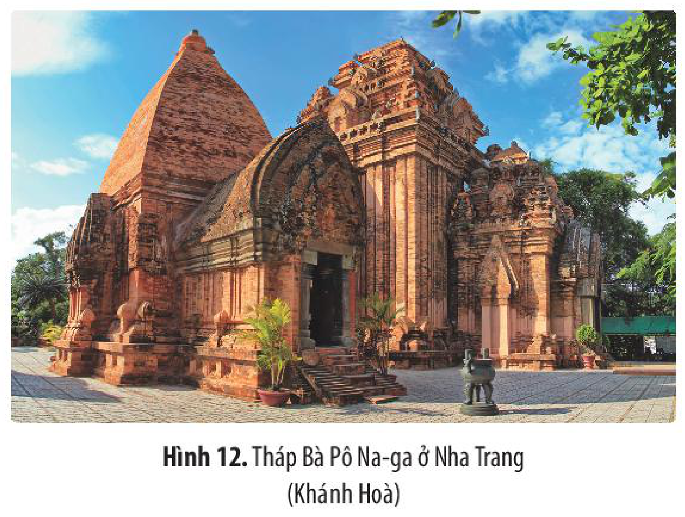

*Hình 12. Tháp Bà Pô Na-ga ở Nha Trang (Khánh Hoà)*

<!-- pdf:104 -->

Nghệ thuật điêu khắc Chăm-pa đặc sắc thể hiện thông qua các bức tượng và phù điêu trang trí trên các đài thờ, đền tháp,...

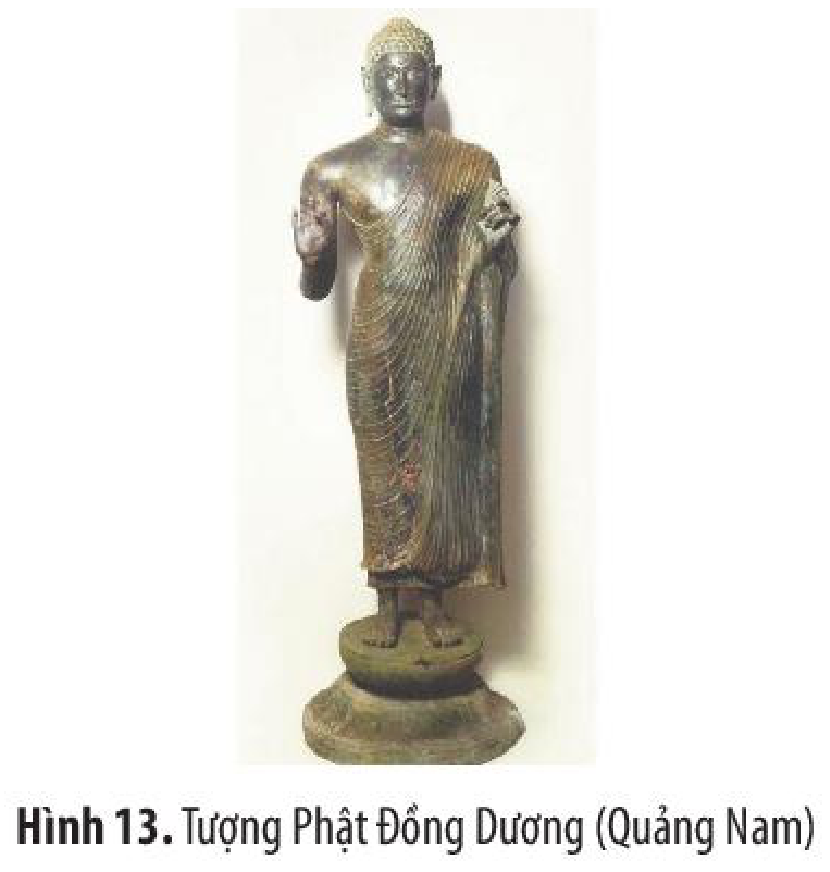

*Hình 13. Tượng Phật Đồng Dương (Quảng Nam)*
<!-- ocr-ok: chú thích Hình 13 đối chiếu đúng ảnh trang 104 -->

> 💡 EM CÓ BIẾT ?

<!-- term: Tượng Phật Đồng Dương -->
> Pho tượng Phật nặng 120 kg, cao 119 cm, được phát hiện tại Đồng Dương (huyện Thăng Bình, tỉnh Quảng Nam). Đây là tượng Phật bằng đồng lớn nhất được tìm thấy, một trong những tác phẩm nghệ thuật độc đáo, tiêu biểu nhất của nghệ thuật điêu khắc Chăm-pa giai đoạn này.

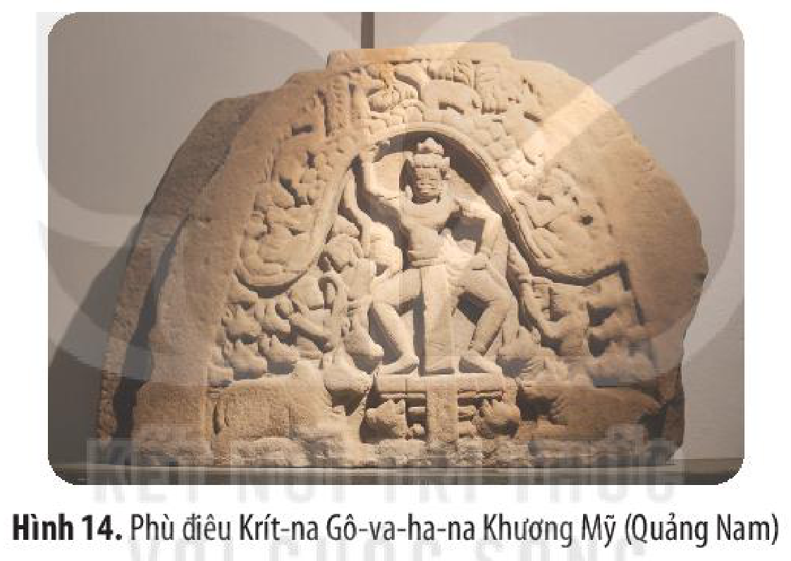

*Hình 14. Phù điêu Krít-na Gô-va-ha-na Khương Mỹ (Quảng Nam)*

> ❓ Hãy nêu một số thành tựu tiêu biểu của văn minh Chăm-pa.

## 3. Văn minh Phù Nam

### a) Cơ sở hình thành

• *Điều kiện tự nhiên*

<!-- term: Văn minh Phù Nam -->
Địa bàn chủ yếu của Vương quốc Phù Nam là khu vực Nam Bộ Việt Nam ngày nay, thuộc vùng hạ lưu sông Mê Công. Hằng năm, nơi đây được phù sa bồi đắp tạo thành đồng bằng màu mỡ, thuận lợi cho phát triển nông nghiệp. Khu vực này có hệ thống kênh rạch chằng chịt, thuận tiện cho thuyền bè lưu thông.

• *Cơ sở xã hội*

Văn minh Phù Nam có cội nguồn từ nền văn hoá lâu đời ở khu vực Nam Bộ – văn hoá tiền Óc Eo.

<!-- pdf:105 -->

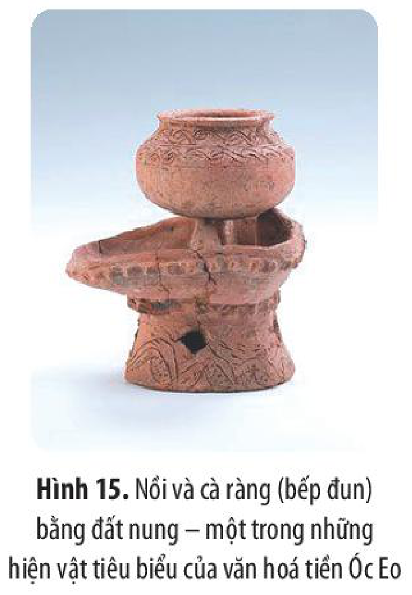

*Hình 15. Nồi và cà ràng (bếp đun) bằng đất nung – một trong những hiện vật tiêu biểu của văn hoá tiền Óc Eo*

Khoảng cuối thiên niên kỉ I TCN, sản xuất nông nghiệp, thủ công nghiệp và trao đổi hàng hoá ngày càng phát triển; cấu trúc làng nông – chài – thương nghiệp hình thành, chuẩn bị cho sự ra đời của các đô thị sơ khai ở một số vùng đất thuộc Nam Bộ. Đây là tiền đề quan trọng dẫn đến sự thay đổi lớn trong xã hội và sự ra đời của nhà nước.

Do vị trí địa lí thuận lợi, từ thời văn hoá tiền Óc Eo, vùng đất này đã là nơi giao thoa, gặp gỡ của nhiều tộc người. Cư dân bản địa cư trú lâu đời kết hợp với những cư dân Nam Đảo di cư đến, họ cùng nhau xây dựng, phát triển và tạo nên tiền đề cho sự thành lập Vương quốc Phù Nam sau này.

> TƯ LIỆU 4. Các kết quả khai quật khảo cổ học cho thấy cư dân Phù Nam chủ yếu là các bộ lạc thuộc nhóm ngôn ngữ Ma-lay-ô – Pô-li-nê-di của ngữ hệ Nam Đảo. Vào thời cổ đại, người Nam Đảo sống trên vùng ven biển và hải đảo Đông Nam Á vốn quen sông nước và thành thạo nghề đi biển.
>
> *(Theo Đặng Văn Thắng, Khảo cổ học Óc Eo và Phù Nam, NXB Đại học Quốc gia Thành phố Hồ Chí Minh, 2019, tr. 176)*

• *Ảnh hưởng từ văn minh Ấn Độ*

Văn minh Phù Nam chịu ảnh hưởng mạnh mẽ của văn minh Ấn Độ, được truyền bá chủ yếu thông qua hoạt động thương mại biển. Điều này được thể hiện ngay trong truyền thuyết về sự ra đời của Vương quốc Phù Nam và trên các lĩnh vực chính trị, tư tưởng, kiến trúc, tôn giáo,...

> ❓ Hãy cho biết những cơ sở hình thành văn minh Phù Nam.

### b) Một số thành tựu tiêu biểu

• *Sự ra đời của nhà nước*

<!-- term: Vương quốc Phù Nam -->
Vào khoảng đầu Công nguyên, Vương quốc Phù Nam đã được thành lập trên cơ sở tập hợp nhiều tộc người, nhiều tiểu quốc. Đứng đầu nhà nước là vua, có quyền lực cao nhất, cai trị bằng cả vương quyền và thần quyền; giúp việc cho vua là các quan lại trong hệ thống chính quyền với nhiều cấp bậc.

<!-- pdf:106 -->

Trong khoảng hơn hai thế kỉ đầu sau khi thành lập, tổ chức nhà nước Phù Nam còn đơn giản. Từ thế kỉ III đến thế kỉ V, tổ chức nhà nước ngày càng được hoàn thiện. Phù Nam vươn lên trở thành vương quốc hùng mạnh, có ảnh hưởng rộng ra nhiều vùng đất ở khu vực Đông Nam Á.

> TƯ LIỆU 5. Các quốc gia cổ Đốn Tốn, Xích Thổ, Chân Lạp đã phải thần phục Phù Nam, cống nạp và không được có quan hệ ngoại giao độc lập mà phải qua Phù Nam.
>
> *(Theo Lương Ninh, Vương quốc Phù Nam, NXB Đại học Quốc gia Hà Nội, 2009, tr. 71)*

• *Hoạt động kinh tế*

<!-- term: Cảng Óc Eo -->
Phù Nam trở thành một trong những trung tâm buôn bán thương mại quan trọng bậc nhất lúc bấy giờ. Thương nhân từ các nước như: Trung Quốc, Ấn Độ, Ba Tư,... đều ghé qua khu vực cảng Óc Eo để trao đổi, buôn bán.

> TƯ LIỆU 6. Những sản phẩm sản xuất ở Óc Eo gồm có loại thô và loại đã gia công chế biến. Loại thô hầu hết là lâm sản như: trầm hương, các loại dầu thơm, ngà voi, chim công, chim két năm sắc,... Loại gia công chế biến như: đồ vàng, đồ bạc, đồ thuỷ tinh, đồ ngọc, đồi mồi, tượng gỗ bạch đàn, lụa, vải.
>
> *(Theo Văn hoá Óc Eo và các văn hoá đồng bằng sông Cửu Long, Sở Văn hoá và Thông tin An Giang xuất bản, 1985, tr. 234)*

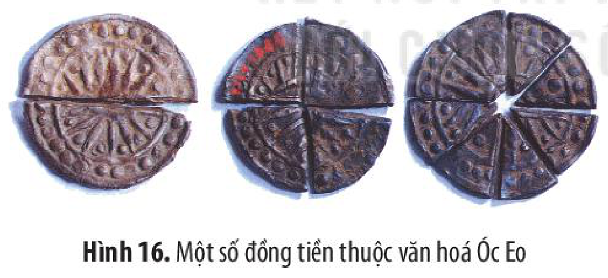

*Hình 16. Một số đồng tiền thuộc văn hoá Óc Eo*

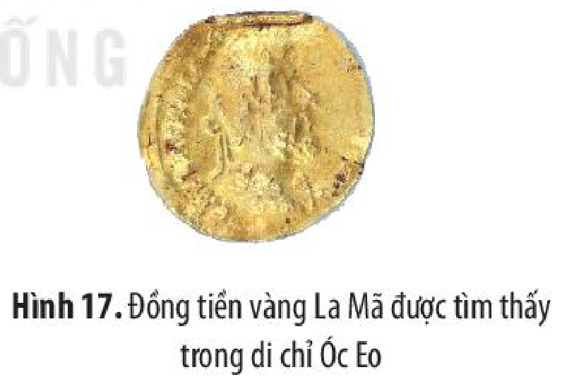

*Hình 17. Đồng tiền vàng La Mã được tìm thấy trong di chỉ Óc Eo*

Một số nghề thủ công (luyện kim, nấu thuỷ tinh, đóng tàu, làm gốm,...) và nông nghiệp (trồng lúa và chăn nuôi) ở Phù Nam cũng khá phát triển. Sản phẩm của các ngành này không chỉ đáp ứng nhu cầu của người dân mà còn được trao đổi, buôn bán với thương nhân các nước.

<!-- pdf:107 -->

• *Đời sống vật chất*

Cư dân Phù Nam chủ yếu *ở* trong những ngôi nhà sàn rộng làm bằng gỗ, lợp mái lá, phù hợp với môi trường sông nước và khí hậu nóng ẩm của vùng Nam Bộ.

> 💡 EM CÓ BIẾT ?

> Khi khai quật ở cánh đồng Óc Eo (An Giang), các nhà khoa học đã tìm thấy dấu tích các cọc gỗ được cho là để làm nhà sàn, đóng san sát nhau trên một phạm vi rộng.

Cư dân Phù Nam *đi lại* chủ yếu bằng thuyền trên kênh, rạch, sông ngòi.

*Lương thực, thực phẩm* chính của người Phù Nam là lúa gạo, các loại thịt và thuỷ, hải sản.

*Trang phục* của người Phù Nam tương đối đơn giản: đàn ông đóng khố, ở trần; phụ nữ mặc váy và đeo một số đồ trang sức như vòng tay, khuyên tai,...

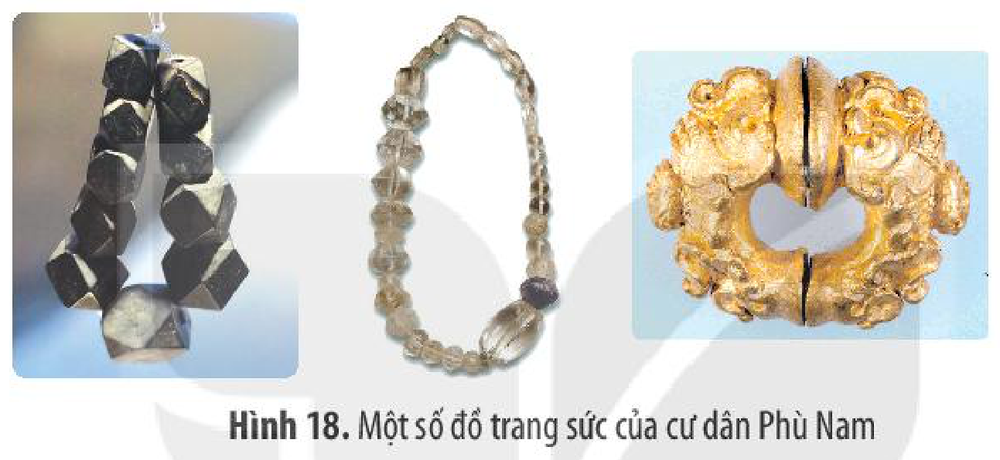

*Hình 18. Một số đồ trang sức của cư dân Phù Nam*

• *Đời sống tinh thần*

*Tín ngưỡng, tôn giáo:* Cư dân Phù Nam có tín ngưỡng thờ đa thần, tiêu biểu là thần Mặt Trời. Họ cũng duy trì tín ngưỡng phồn thực (thờ sinh thực khí).

Trong quá trình giao lưu buôn bán với Ấn Độ, người Phù Nam đã tiếp nhận các tôn giáo như: Phật giáo, Hin-đu giáo,...

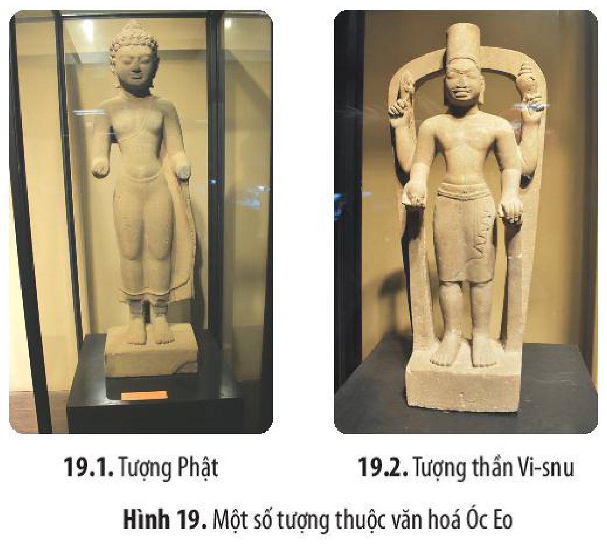

*Hình 19. Một số tượng thuộc văn hoá Óc Eo (19.1. Tượng Phật; 19.2. Tượng thần Vi-snu)*

<!-- pdf:108 -->

*Phong tục, tập quán:* Cư dân Phù Nam có phong tục chôn cất người chết bằng nhiều hình thức như thuỷ táng (thả xác xuống sông), hoả táng (đốt xác), thổ táng (chôn dưới đất) và điểu táng (để xác ngoài đồng cho chim ăn). Khi gia đình có tang, người thân phải cạo đầu, cạo râu và mặc đồ trắng.

> ❓ 1. Trình bày một số thành tựu tiêu biểu của văn minh Phù Nam.
>
> 2. Hãy giới thiệu về một thành tựu mà em ấn tượng nhất.

## ✏️ Luyện tập và vận dụng

1. Lập bảng hệ thống (hoặc vẽ sơ đồ tư duy) về cơ sở hình thành của các nền văn minh cổ trên đất nước Việt Nam. Em hãy cho biết những điểm giống nhau và khác nhau về cơ sở hình thành của các nền văn minh ấy.

2. Hãy thống kê một số thành tựu tiêu biểu của các nền văn minh cổ trên đất nước Việt Nam theo gợi ý sau:

| Thành tựu trên các lĩnh vực | Văn minh Văn Lang – Âu Lạc | Văn minh Chăm-pa | Văn minh Phù Nam |
| --- | --- | --- | --- |
| Sự ra đời nhà nước | ? | ? | ? |
| Hoạt động kinh tế | ? | ? | ? |
| Đời sống vật chất | ? | ? | ? |
| Đời sống tinh thần | ? | ? | ? |

1. Em hãy giải thích tại sao phiên bản của trống đồng Ngọc Lũ được Việt Nam lựa chọn làm quà tặng Liên hợp quốc nhân dịp kỉ niệm 50 năm ngày thành lập tổ chức này?

2. Hãy sưu tầm một số hình ảnh cho thấy sức sống trường tồn của những giá trị các nền văn minh cổ trên đất nước Việt Nam.

## 📷 Danh sách hình trong bài

| Mã hình | Trang PDF | Vị trí trong bài | Chú thích gốc |
| --- | --- | --- | --- |
| H10-lich_su-b11-01 | 94 | Mở đầu | Hình 1. Một số hiện vật tiêu biểu của các nền văn minh cổ trên đất nước Việt Nam |
| H10-lich_su-b11-02 | 95 | Mục 1.a | Hình 2. Sông Hồng – đoạn chảy qua địa phận Hà Nội ngày nay |
| H10-lich_su-b11-03 | 96 | Mục 1.b | Hình 3. Sơ đồ tổ chức Nhà nước Văn Lang |
| H10-lich_su-b11-04 | 97 | Mục 1.b | Hình 4. Muôi đồng Việt Khê (Hải Phòng) |
| H10-lich_su-b11-05 | 97 | Mục 1.b | Hình 5. Lưỡi cày đồng Cổ Loa (Hà Nội) |
| H10-lich_su-b11-06 | 97 | Mục 1.b | Hình 6. Trống đồng Ngọc Lũ (Hà Nam) |
| H10-lich_su-b11-07 | 98 | Mục 1.b | Hình 7. Một số hoạ tiết trang trí trên các hiện vật thuộc văn hoá Đông Sơn |
| H10-lich_su-b11-08 | 99 | Mục 1.b | Hình 8. Một số đồ trang sức của cư dân Đông Sơn |
| H10-lich_su-b11-09 | 100 | Mục 2.a | Hình 9. Vùng cửa sông Thu Bồn (Quảng Nam) |
| H10-lich_su-b11-10 | 103 | Mục 2.b | Hình 10. Lễ hội Ka-tê được người Chăm theo Hin-đu giáo tổ chức tại tháp Pô Sa Inư (Ninh Thuận) |
| H10-lich_su-b11-11 | 103 | Mục 2.b | Hình 11. Thánh địa Mỹ Sơn (Quảng Nam) |
| H10-lich_su-b11-12 | 103 | Mục 2.b | Hình 12. Tháp Bà Pô Na-ga ở Nha Trang (Khánh Hoà) |
| H10-lich_su-b11-13 | 104 | Mục 2.b | Hình 13. Tượng Phật Đồng Dương (Quảng Nam) |
| H10-lich_su-b11-14 | 104 | Mục 2.b | Hình 14. Phù điêu Krít-na Gô-va-ha-na Khương Mỹ (Quảng Nam) |
| H10-lich_su-b11-15 | 105 | Mục 3.a | Hình 15. Nồi và cà ràng (bếp đun) bằng đất nung – một trong những hiện vật tiêu biểu của văn hoá tiền Óc Eo |
| H10-lich_su-b11-16 | 106 | Mục 3.b | Hình 16. Một số đồng tiền thuộc văn hoá Óc Eo |
| H10-lich_su-b11-17 | 106 | Mục 3.b | Hình 17. Đồng tiền vàng La Mã được tìm thấy trong di chỉ Óc Eo |
| H10-lich_su-b11-18 | 107 | Mục 3.b | Hình 18. Một số đồ trang sức của cư dân Phù Nam |
| H10-lich_su-b11-19 | 107 | Mục 3.b | Hình 19. Một số tượng thuộc văn hoá Óc Eo |
