<!-- pdf:109 -->

# BÀI 12: VĂN MINH ĐẠI VIỆT

## 🎯 Học xong bài này, em sẽ:

- Nêu được quá trình phát triển của văn minh Đại Việt trên trục thời gian và một số thành tựu tiêu biểu của nền văn minh Đại Việt.
- Giải thích được khái niệm, phân tích được cơ sở hình thành, ý nghĩa của nền văn minh Đại Việt.
- Biết cách sưu tầm và sử dụng tư liệu lịch sử để tìm hiểu về những thành tựu của văn minh Đại Việt.
- Trân trọng giá trị của nền văn minh Đại Việt, vận dụng hiểu biết về văn minh Đại Việt để giới thiệu, quảng bá về đất nước, con người, di sản văn hoá Việt Nam.

## 🔴 Mở đầu

Em đã tìm hiểu về các nền văn minh cổ trên đất nước Việt Nam. Từ thế kỉ X đến thế kỉ XIX, trong kỉ nguyên đất nước độc lập và phát triển theo mô hình quân chủ trung ương tập quyền, nền văn minh Đại Việt được hình thành và phát triển. Hãy chia sẻ một số thành tựu tiêu biểu của nền văn minh Đại Việt mà em biết. Nền văn minh này có ý nghĩa như thế nào đối với lịch sử dân tộc?

## 1. Khái niệm và cơ sở hình thành

### a) Khái niệm văn minh Đại Việt

<!-- term: Văn minh Đại Việt -->
Văn minh Đại Việt là những sáng tạo vật chất và tinh thần tiêu biểu trong kỉ nguyên độc lập của Việt Nam từ thế kỉ X đến giữa thế kỉ XIX.

### b) Cơ sở hình thành

Văn minh Đại Việt có cội nguồn từ những nền văn minh cổ trên đất nước Việt Nam; phản ánh quá trình sinh sống, lao động và thích ứng với điều kiện tự nhiên và cuộc đấu tranh trong hơn 1 000 năm Bắc thuộc để giành độc lập và bảo tồn văn hoá dân tộc.

Trải qua các triều đại (Ngô, Đinh, Tiền Lê, Lý, Trần,...), triều đình và nhân dân luôn kiên cường chiến đấu chống ngoại xâm, bảo vệ và củng cố nền độc lập, tạo điều kiện cho nền văn minh Đại Việt phát triển rực rỡ.

Văn minh Đại Việt cũng tiếp thu có chọn lọc những thành tựu của các nền văn minh bên ngoài (Ấn Độ, Trung Hoa,...) về tư tưởng, chính trị, giáo dục, văn hoá, kĩ thuật,...

<!-- pdf:110 -->

> ❓ 1. Em hiểu thế nào về khái niệm văn minh Đại Việt?
>
> 2. Hãy phân tích cơ sở hình thành văn minh Đại Việt. Theo em, cơ sở nào là quan trọng nhất? Vì sao?

## 2. Tiến trình phát triển

• *Ngô – Đinh – Tiền Lê*

- Sau chiến thắng Bạch Đằng (năm 938), Ngô Quyền xưng vương, đóng đô ở Cổ Loa (Hà Nội), nền độc lập dân tộc được khôi phục hoàn toàn.
- Triều Đinh và Tiền Lê đóng đô ở Hoa Lư (Ninh Bình); kinh tế và văn hoá dân tộc bước đầu phát triển.

• *Lý – Trần – Hồ*

<!-- term: Tam giáo đồng nguyên -->
- Năm 1010, Lý Thái Tổ dời đô ra Thăng Long (Hà Nội), mở ra thời kì phát triển rực rỡ của văn minh Đại Việt. Nhà Trần kế thừa và phát huy các thành tựu của nhà Lý. Một trong những đặc trưng nổi bật của văn minh Đại Việt thời Lý – Trần là *tam giáo đồng nguyên* (kết hợp hài hoà Nho – Phật – Đạo).
- Từ năm 1407 đến năm 1427, nhà Minh thống trị và thực hiện chính sách huỷ diệt văn minh Đại Việt.

• *Lê sơ*

- Năm 1428, nhà Lê sơ được thành lập, Đại Việt trở thành một cường quốc trong khu vực Đông Nam Á.
- Văn minh Đại Việt thời Lê sơ đạt được những thành tích rực rỡ trên cơ sở *độc tôn Nho học* (coi trọng giáo dục Nho học, tuyển dụng quan lại thông qua thi cử,...).

• *Mạc – Lê trung hưng*

- Năm 1527, nhà Mạc thành lập, khuyến khích phát triển kinh tế công thương nghiệp và văn hoá. Một trong những đặc trưng nổi bật của văn minh Đại Việt thời Mạc là *kinh tế hướng ngoại*.
- Thời Lê trung hưng, văn minh Đại Việt phát triển theo xu hướng dân gian hoá và bước đầu tiếp xúc với văn minh phương Tây.

• *Tây Sơn – Nguyễn (Trước năm 1858)*
<!-- ocr-ok: tiêu đề trong sơ đồ Hình 1 đối chiếu đúng ảnh trang 110 -->

- Cuối thế kỉ XVIII, phong trào Tây Sơn bùng nổ và lan rộng, lật đổ các chính quyền phong kiến trong nước, đánh tan quân xâm lược Xiêm và Mãn Thanh, xoá bỏ tình trạng chia cắt đất nước, thành lập vương triều, tạo nền tảng cho sự thống nhất quốc gia.
- Năm 1802, nhà Nguyễn thành lập, xây dựng quốc gia thống nhất.
- Văn minh Đại Việt thời Nguyễn nổi bật là *tính thống nhất*: những khác biệt giữa các vùng miền được giảm bớt.

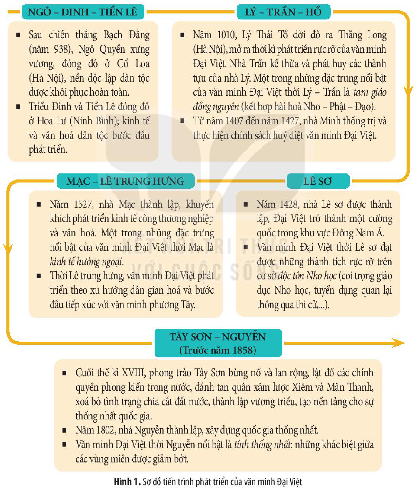

*Hình 1. Sơ đồ tiến trình phát triển của văn minh Đại Việt*

<!-- pdf:111 -->

> ❓ Hãy nêu khái quát tiến trình phát triển văn minh Đại Việt qua các triều đại thông qua trục thời gian.

## 3. Những thành tựu tiêu biểu của văn minh Đại Việt

### a) Chính trị

• *Thiết chế chính trị*

<!-- term: Quân chủ trung ương tập quyền -->
Các vương triều Đinh – Tiền Lê đã tiếp thu mô hình thiết chế chính trị quân chủ trung ương tập quyền của phong kiến Trung Quốc. Thiết chế đó ngày càng được hoàn thiện qua các triều đại Lý – Trần và đạt đến đỉnh cao dưới triều Lê sơ.

Hoàng đế đứng đầu bộ máy chính quyền trung ương, có quyền quyết định mọi công việc. Giúp việc cho hoàng đế có các cơ quan và hệ thống quan lại. Chính quyền địa phương được chia thành các cấp quản lí, mỗi cấp đều sắp đặt các chức quan cai quản.

Tuy nhiên, mỗi triều đại cũng có đặc trưng riêng. Thời Lý – Trần, thiết chế tập quyền vẫn mang tính thân dân, từ thời Lê sơ về sau, mang tính quan liêu và chuyên chế.

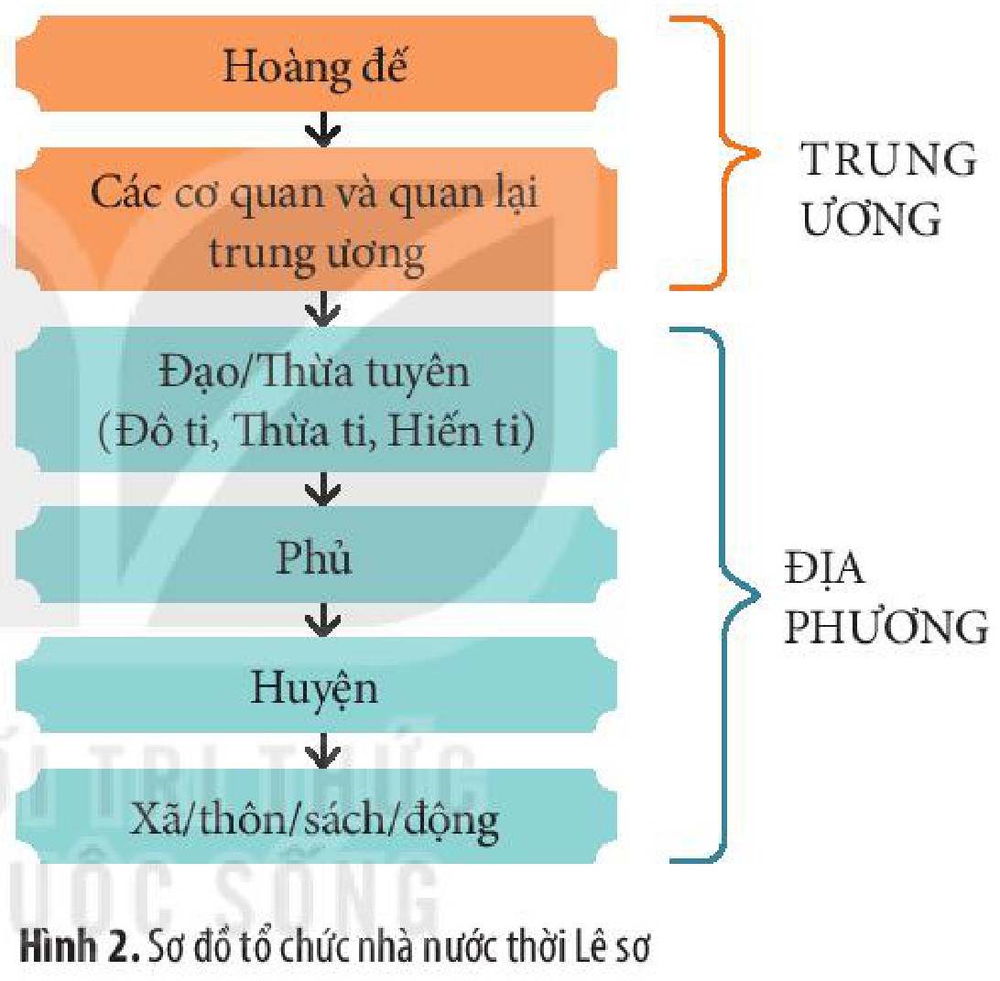

*Hình 2. Sơ đồ tổ chức nhà nước thời Lê sơ (TRUNG ƯƠNG: Hoàng đế -> Các cơ quan và quan lại trung ương; ĐỊA PHƯƠNG: Đạo/Thừa tuyên (Đô ti, Thừa ti, Hiến ti) -> Phủ -> Huyện -> Xã/thôn/sách/động)*
<!-- ocr-ok: sơ đồ Hình 2 đối chiếu đúng ảnh trang 111 -->

Trong tiến trình phát triển, các triều đại quân chủ có đặt ra yêu cầu cải cách. Tiêu biểu là cải cách Hồ Quý Ly (cuối thế kỉ XIV – đầu thế kỉ XV), cải cách Lê Thánh Tông (cuối thế kỉ XV), cải cách Minh Mạng (đầu thế kỉ XIX).

• *Pháp luật*

<!-- term: Quốc triều hình luật -->
Các vương triều Đại Việt chú trọng xây dựng luật pháp. Các bộ luật như: *Hình thư* thời Lý, *Hình luật* thời Trần, *Quốc triều hình luật* thời Lê và *Hoàng Việt luật lệ* thời Nguyễn là những thành tựu lập pháp tiêu biểu.

<!-- pdf:112 -->

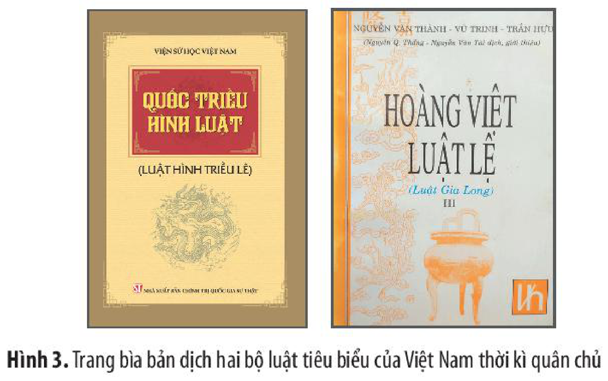

*Hình 3. Trang bìa bản dịch hai bộ luật tiêu biểu của Việt Nam thời kì quân chủ*

> ❓ Hãy nêu thành tựu tiêu biểu về chính trị của văn minh Đại Việt.

### b) Kinh tế

• *Nông nghiệp*

Nông nghiệp lúa nước và văn hoá làng xã tiếp tục là một trong những đặc trưng của văn minh Đại Việt. Các triều đại đều đặc biệt chú trọng phát triển nông nghiệp.

<!-- term: Lễ Tịch điền -->
Các hoàng đế thường thực hiện nghi lễ Tịch điền vào mùa xuân để khuyến khích nghề nông phát triển. Nghi lễ Tịch điền sớm nhất theo sử sách ghi chép do vua Lê Hoàn thực hiện tại Núi Đọi (Duy Tiên, Hà Nam) vào năm 987.

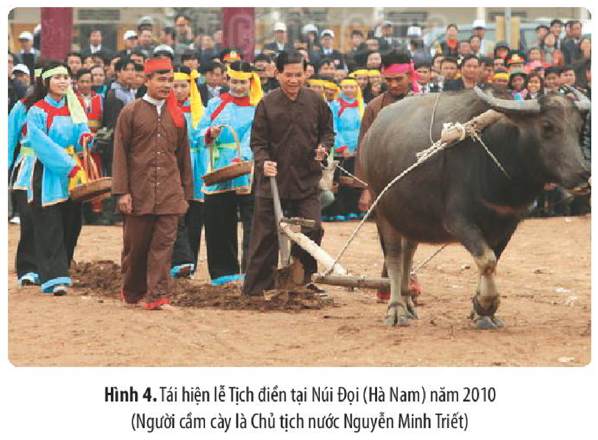

*Hình 4. Tái hiện lễ Tịch điền tại Núi Đọi (Hà Nam) năm 2010 (Người cầm cày là Chủ tịch nước Nguyễn Minh Triết)*

<!-- pdf:113 -->

> 💡 EM CÓ BIẾT ?

<!-- term: Đàn Xã Tắc -->
> Năm 1048, nhà Lý bắt đầu dựng đàn Xã Tắc ở Thăng Long, đến nay còn di tích tại khu vực nút giao thông Ô Chợ Dừa (Đống Đa, Hà Nội). Việc tôn thờ thần Đất (Xã) và thần Lúa (Tắc) cho thấy triều đình rất coi trọng sản xuất nông nghiệp.
>
> Trong các năm gặp nhiều thiên tai, dịch bệnh, triều đình miễn thuế cho dân,... nhà vua đích thân làm lễ để cầu mưa thuận gió hoà, mùa màng bội thu.

Nhà nước thành lập các cơ quan chuyên trách đê điều, cử quan lại thường xuyên trông coi việc đắp đê, khơi vét kênh mương, đào nắn các dòng chảy,... phục vụ sản xuất. Để bảo vệ sức kéo cho nông nghiệp, triều đình có quy định cấm giết trâu, bò, nếu vi phạm sẽ bị phạt nặng.

Công cuộc khai hoang mở rộng diện tích canh tác được tiến hành thường xuyên. Kĩ thuật thâm canh cây lúa nước có nhiều tiến bộ. Cư dân đã du nhập và cải tạo những giống lúa từ bên ngoài để thích ứng với tình trạng ngập nước vào mùa hạ ở khu vực phía Bắc.

• *Thủ công nghiệp*

Thời kì này nhiều nghề thủ công phát triển, nổi tiếng nhất là các nghề: dệt, gốm sứ, luyện kim. Bên cạnh đó còn có các nghề: chạm đục gỗ, chạm khắc đá, thuộc da, làm giấy, khảm trai, sơn mài, kim hoàn,...

<!-- term: Cục Bách tác -->
Các xưởng thủ công của Nhà nước (Cục Bách tác) chuyên sản xuất các mặt hàng độc quyền của triều đình như: tiền, vũ khí, trang phục và đồ dùng của hoàng cung,...

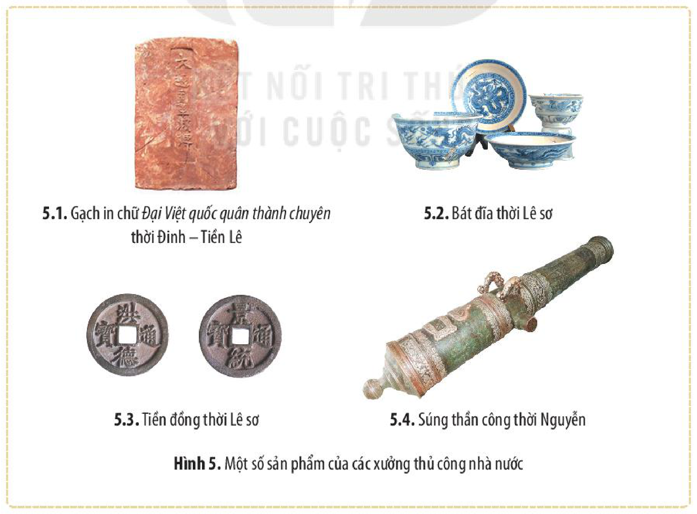

*Hình 5. Một số sản phẩm của các xưởng thủ công nhà nước (5.1. Gạch in chữ Đại Việt quốc quân thành chuyên thời Đinh – Tiền Lê; 5.2. Bát đĩa thời Lê sơ; 5.3. Tiền đồng thời Lê sơ; 5.4. Súng thần công thời Nguyễn)*

<!-- pdf:114 -->

Trong các làng xã, bên cạnh nghề chính là nông nghiệp, người dân còn làm các nghề thủ công. Có một số làng chuyên sản xuất các mặt hàng thủ công trình độ cao. Thợ thủ công từ nhiều làng nghề cùng tập trung ở các khu đô thị để sản xuất và buôn bán.

Tại kinh thành Thăng Long đã hình thành nhiều phố nghề. Ở các địa phương cũng xuất hiện các trung tâm sản xuất gốm nổi tiếng như: Kim Lan và Bát Tràng (Hà Nội), Thiên Trường (Nam Định), Chu Đậu (Hải Dương), Phù Lãng (Bắc Ninh), Thổ Hà (Bắc Giang),...

Nhiều sản phẩm chạm khắc gỗ, đá còn được bảo tồn đến ngày nay như: tượng thờ và đồ thờ trong một số di tích tôn giáo, tín ngưỡng, bia đá ghi danh những người đỗ đạt,... ở khắp mọi miền đất nước. Tiêu biểu là 82 bia Tiến sĩ ở Văn Miếu – Quốc Tử Giám (Hà Nội), bộ cửa gỗ chùa Phổ Minh (Nam Định),...

> 💡 EM CÓ BIẾT ?

<!-- term: Gốm Chu Đậu -->
> Các sản phẩm gốm sứ Đại Việt được xuất khẩu ra thị trường thế giới từ sớm. Tại Nhật Bản đã phát hiện gốm thời Trần. Tại các nước ở khu vực Đông Nam Á, Nam Á và châu Âu đã phát hiện nhiều gốm Chu Đậu thời Trần – Lê – Mạc.
>
> Theo tư liệu của Công ti Đông Ấn Hà Lan (VOC), thời kì 1663 – 1681, khu vực phía Bắc Đại Việt đã xuất khẩu sang thị trường Đông Nam Á gần hai triệu đồ gốm, chiếm khoảng 30% thị phần của cả khu vực.

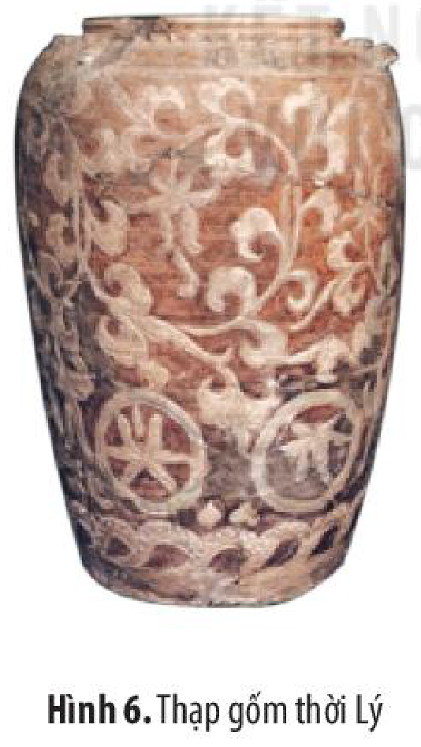

*Hình 6. Thạp gốm thời Lý*

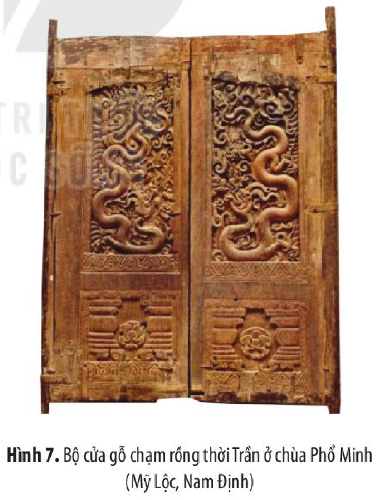

*Hình 7. Bộ cửa gỗ chạm rồng thời Trần ở chùa Phổ Minh (Mỹ Lộc, Nam Định)*

<!-- pdf:115 -->

• *Thương nghiệp*

Bắt đầu từ thời Tiền Lê (thế kỉ X), các triều đại đều cho đúc các loại tiền kim loại riêng.

<!-- term: Trang Vân Đồn -->
Năm 1149, nhà Lý thành lập trang Vân Đồn (Quảng Ninh), tạo điều kiện cho thuyền buôn từ các nước như Trung Quốc, Ấn Độ, Đông Nam Á,... đến trao đổi hàng hoá. Đầu thế kỉ XV, Đại Việt có nhiều thương cảng có buôn bán với nước ngoài do nhà nước quản lí.

Từ thế kỉ XVI, đặc biệt trong thế kỉ XVII, khi thương mại Á – Âu phát triển, các công ti như Công ti Đông Ấn Hà Lan, Công ti Đông Ấn Anh và thương nhân Trung Quốc, Nhật Bản, Đông Nam Á,... đã đến Đại Việt buôn bán nhộn nhịp ở khắp cả nước.

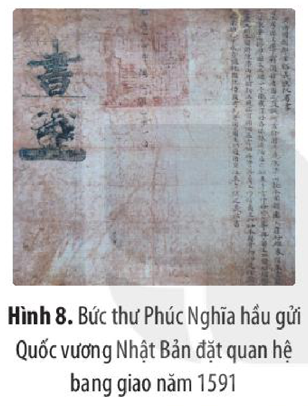

*Hình 8. Bức thư Phúc Nghĩa hầu gửi Quốc vương Nhật Bản đặt quan hệ bang giao năm 1591*
<!-- ocr-ok: chú thích Hình 8 đối chiếu đúng ảnh trang 115 -->

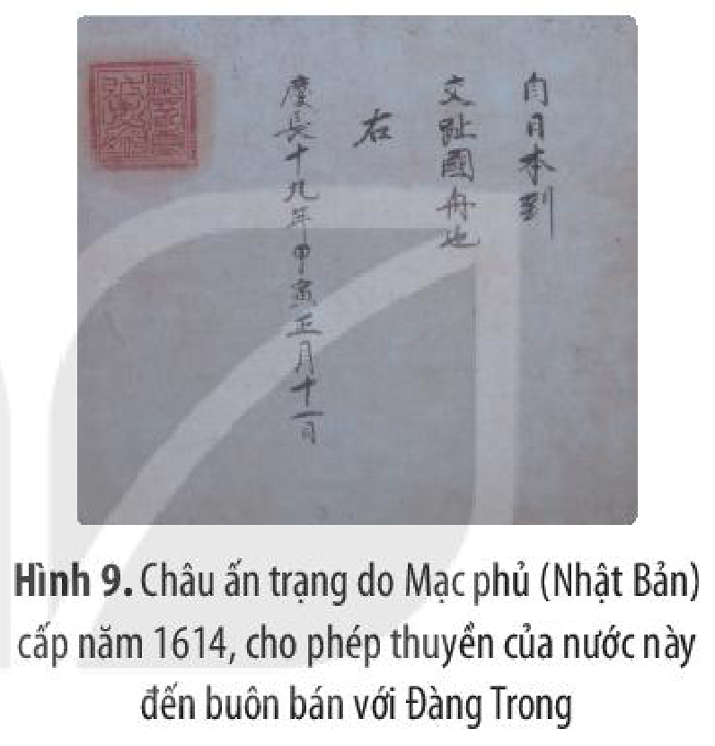

*Hình 9. Châu ấn trạng do Mạc phủ (Nhật Bản) cấp năm 1614, cho phép thuyền của nước này đến buôn bán với Đàng Trong*

> ❓ 1. Hãy nêu một số thành tựu tiêu biểu về kinh tế của văn minh Đại Việt.
>
> 2. Kể tên một số làng nghề thủ công có từ thời kì này mà còn tồn tại đến ngày nay.

### c) Tín ngưỡng, tư tưởng, tôn giáo

• *Tín ngưỡng dân gian*

Tín ngưỡng thờ cúng tổ tiên, thờ cúng các vị anh hùng, người có công với đất nước tiếp tục được duy trì.

Tín ngưỡng thờ thần Đồng Cổ (thần Trống đồng) được đưa vào cung đình từ thời Lý, được triều đình bảo trợ và phát triển dưới hình thức một nghi lễ nhằm giữ đạo trung với vua, với quốc gia.

<!-- term: Đạo Mẫu -->
Từ thế kỉ XVI, đạo Mẫu trở thành tín ngưỡng được đông đảo người Việt tin theo; thờ mẫu Thượng Thiên (mẹ Trời), mẫu Địa (mẹ Đất), mẫu Thoải (mẹ Nước), mẫu Thượng Ngàn (mẹ Rừng) và mẫu Liễu Hạnh (thường được đồng nhất với mẫu Thượng Thiên).

Việc thờ Thành hoàng làng tại đình, đền, miếu ở các làng xã ngày càng phổ biến.

<!-- pdf:116 -->

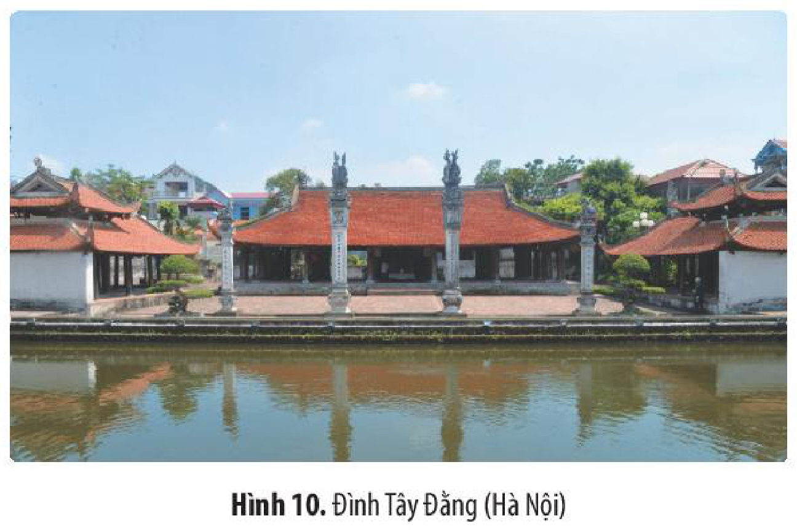

*Hình 10. Đình Tây Đằng (Hà Nội)*

• *Tư tưởng, tôn giáo*

<!-- term: Quốc Tử Giám -->
*Nho giáo:* được du nhập vào Việt Nam từ thời Bắc thuộc. Nhà Lý là triều đại đầu tiên chính thức sử dụng chế độ thi cử Nho học để tuyển chọn quan lại. Năm 1070, vua Lý Thánh Tông cho dựng Văn Miếu thờ Khổng Tử; năm 1076, vua Lý Nhân Tông cho lập Quốc Tử Giám (Hà Nội) làm trường học Nho giáo cao cấp của triều đình.

Nhà Lê sơ thực hiện chính sách độc tôn Nho học, Nho giáo trở thành hệ tư tưởng chính thống của nhà nước quân chủ.

*Phật giáo:* được du nhập vào Việt Nam khoảng đầu Công nguyên, trung tâm nổi tiếng là chùa Dâu (Bắc Ninh). Phật giáo hoà quyện với tín ngưỡng bản địa, phát triển mạnh mẽ trong cung đình và đời sống dân gian.

Thời Lý – Trần, Phật giáo rất được tôn sùng. Thời Lê sơ, Phật giáo không còn vị trí như thời Lý – Trần, nhưng vẫn có ảnh hưởng sâu rộng trong đời sống dân gian. Từ thời Mạc, Phật giáo hưng thịnh trở lại.

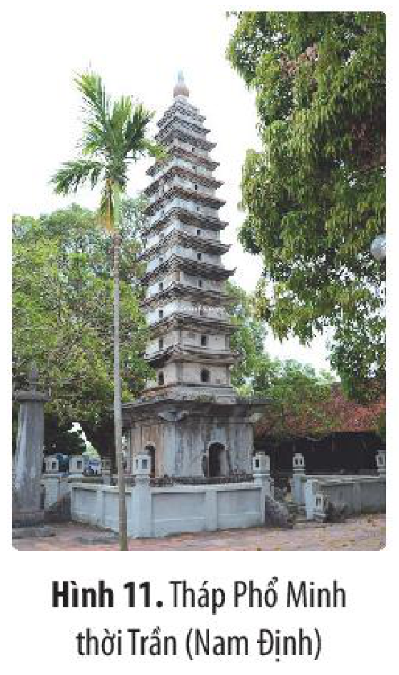

*Hình 11. Tháp Phổ Minh thời Trần (Nam Định)*

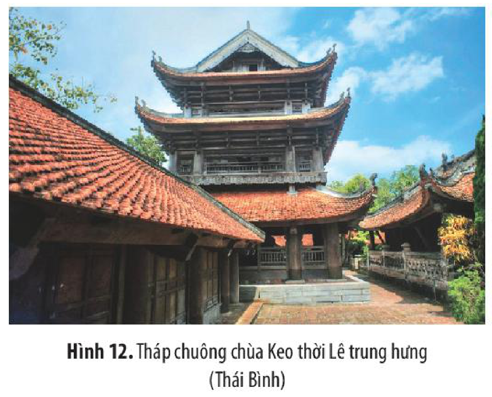

*Hình 12. Tháp chuông chùa Keo thời Lê trung hưng (Thái Bình)*

<!-- pdf:117 -->

*Đạo giáo:* có vị trí nhất định trong xã hội. Các triều đại cho xây dựng một số đạo quán: Khai Nguyên (thời Lý); Trấn Vũ, Bích Câu, Huyền Thiên (thời Lê trung hưng);...

“Tam giáo đồng nguyên” là đặc điểm nổi bật trong đời sống tôn giáo thời Lý – Trần.

<!-- term: Thiền phái Trúc Lâm -->
Nhà Lý mở khoa thi Tam giáo. Thời Trần, Phật hoàng Trần Nhân Tông là vị tổ sáng lập dòng thiền Trúc Lâm cũng từng tu theo Đạo giáo ở động Thiên Tôn (Ninh Bình) trước khi tu Phật trên núi Yên Tử (Quảng Ninh). Sự xuất hiện các ngôi chùa thờ cả Phật và Thánh cũng là một đặc trưng của thời kì này.

*Sự du nhập của Công giáo:* Từ năm 1533, một giáo sĩ người phương Tây đã đến vùng ven biển Nam Định truyền đạo. Đến giữa thế kỉ XVII, có khoảng 340 nhà thờ và 350 000 tín đồ, tập trung ở các đô thị và vùng ven biển.

> ❓ Hãy cho biết một số nét nổi bật trong đời sống tín ngưỡng, tôn giáo của văn minh Đại Việt.

### d) Giáo dục và khoa cử

Nền giáo dục, khoa cử bắt đầu được triển khai từ thời nhà Lý. Đến thời Trần, khoa cử được tổ chức đều đặn và quy củ hơn. Từ thời Lê sơ, khoa cử Nho học phát triển thịnh đạt.

Vương triều Lê sơ đã tổ chức được 26 khoa thi, lấy đỗ gần 1 000 tiến sĩ và 20 trạng nguyên. Triều Mạc trong thời gian ở Thăng Long (1529 – 1592) đều đặn ba năm tổ chức một khoa thi, lấy đỗ 484 tiến sĩ.

Nhiều người đỗ đạt, làm quan và trở thành các nhà văn hoá lớn của dân tộc như: Lê Văn Hưu, Mạc Đĩnh Chi, Chu Văn An, Nguyễn Trãi, Lê Quý Đôn,...

Các triều đại đều có chính sách nhằm khuyến khích giáo dục và khoa cử.

<!-- term: Bia Tiến sĩ Văn Miếu -->
Từ năm 1442, nhà Lê sơ tổ chức lễ xướng danh và vinh quy bái tổ. Năm 1484, vua Lê Thánh Tông bắt đầu cho dựng bia đá ở Văn Miếu, khắc tên những người đỗ tiến sĩ,... Nhà Nguyễn đặt ở mỗi tỉnh một quan Đốc học để chuyên trách việc giáo dục, khoa cử,...

<!-- pdf:118 -->

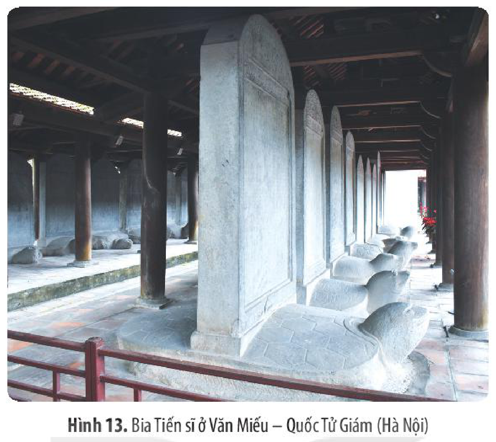

*Hình 13. Bia Tiến sĩ ở Văn Miếu – Quốc Tử Giám (Hà Nội)*

> ❓ 1. Từ thế kỉ X đến thế kỉ XIX, nền giáo dục, khoa cử của Đại Việt có điểm gì nổi bật?
>
> 2. Theo em, vì sao các vương triều Đại Việt quan tâm đến giáo dục, khoa cử?

### e) Chữ viết và văn học

• *Chữ viết*

Chữ Hán là văn tự chính thức, được sử dụng trong các văn bản hành chính nhà nước, trong giáo dục và khoa cử của Đại Việt.

<!-- term: Chữ Nôm -->
Trên cơ sở chữ Hán, chữ Nôm được người Việt sáng tạo và được sử dụng rộng rãi từ thế kỉ XIII.

<!-- term: Chữ Quốc ngữ -->
Từ đầu thế kỉ XVII, cùng với sự du nhập của Công giáo, chữ Quốc ngữ đã xuất hiện và dần được hoàn thiện.

> 💡 EM CÓ BIẾT ?

> Theo sử cũ, năm 1282, Hàn Thuyên đã viết bài văn tế bằng chữ Nôm để đuổi cá sấu ở sông Hồng. Hồ Quý Ly đã cho người dùng chữ Nôm giải nghĩa kinh sách Nho giáo. Các nhà thơ lớn như Nguyễn Trãi, Lê Thánh Tông,... đều làm thơ Nôm. Nổi tiếng nhất là Đại thi hào Nguyễn Du với tác phẩm *Truyện Kiều*.

• *Văn học*

Văn học Đại Việt phong phú, đa dạng, gồm hai bộ phận: văn học dân gian và văn học viết.

Văn học dân gian Đại Việt thời kì này được lưu truyền và bổ sung qua thời gian, gồm các thể loại như: truyền thuyết, sử thi, truyện cổ tích, truyện ngụ ngôn, truyện cười, thành ngữ, tục ngữ, ca dao, dân ca,... Nội dung phản ánh đời sống xã hội, đúc kết kinh nghiệm và răn dạy,...

<!-- pdf:119 -->

Văn học viết sáng tác chủ yếu bằng chữ Hán, Nôm, gồm các thể loại như: thơ, phú, hịch, cáo, truyện,... Nội dung thể hiện tinh thần yêu nước, niềm tin tôn giáo, tín ngưỡng,...

<!-- term: Bình Ngô đại cáo -->
Một số tác phẩm viết bằng chữ Hán tiêu biểu: *Nam quốc sơn hà* (thời Lý); *Hịch tướng sĩ*, *Bạch Đằng giang phú* (thời Trần); *Bình Ngô đại cáo* (thời Lê sơ); *Truyền kì mạn lục* (thời Mạc); *Thượng kinh kí sự* (thời Lê trung hưng);...

<!-- term: Truyện Kiều -->
Một số tác phẩm viết bằng chữ Nôm tiêu biểu: *Truyện Kiều* (Nguyễn Du); *Qua Đèo Ngang* (Bà Huyện Thanh Quan);...

> ❓ Hãy trình bày những thành tựu tiêu biểu về chữ viết và văn học của văn minh Đại Việt.

### g) Nghệ thuật

• *Kiến trúc*

Thành tựu tiêu biểu về kiến trúc Đại Việt là các kinh đô: Hoa Lư (thời Đinh – Tiền Lê), Thăng Long (thời Lý – Trần – Lê), Tây Đô (thời Hồ) và Huế (thời Nguyễn). Bên cạnh đó là rất nhiều công trình kiến trúc như: chùa, tháp, đền, đình, miếu, nhà thờ,... được xây dựng ở khắp cả nước.

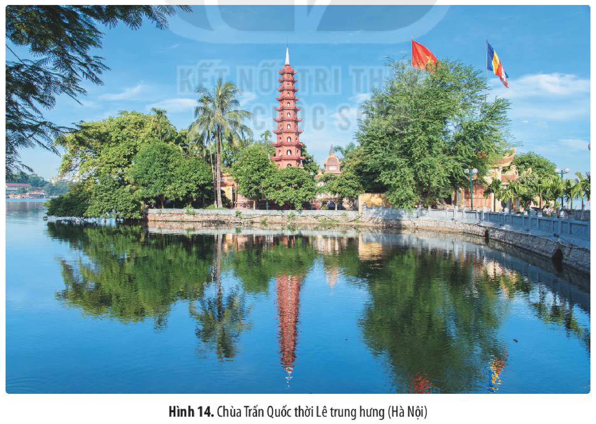

*Hình 14. Chùa Trấn Quốc thời Lê trung hưng (Hà Nội)*

<!-- pdf:120 -->

• *Điêu khắc*

Điêu khắc Đại Việt thời kì này phát triển, đạt đến trình độ cao, thể hiện qua những tác phẩm chạm khắc trên các công trình kiến trúc, điêu khắc tượng,...

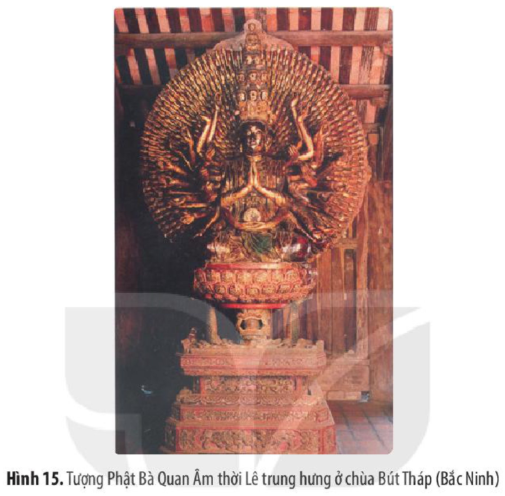

*Hình 15. Tượng Phật Bà Quan Âm thời Lê trung hưng ở chùa Bút Tháp (Bắc Ninh)*

• *Tranh dân gian*

Tranh dân gian bao gồm hai loại chính là tranh thờ và tranh chơi Tết. Kĩ thuật chủ yếu là in trên giấy dó bằng nhiều ván khắc, sau đó có sửa lại bằng tay.

<!-- term: Tranh Đông Hồ -->
Thời kì Lê trung hưng xuất hiện các dòng tranh nổi tiếng: Đông Hồ (Bắc Ninh), Hàng Trống (Hà Nội), Làng Sình (Thừa Thiên Huế),...

• *Nghệ thuật biểu diễn*

Nghệ thuật biểu diễn rất đa dạng về thể loại, bao gồm biểu diễn cung đình và biểu diễn dân gian.

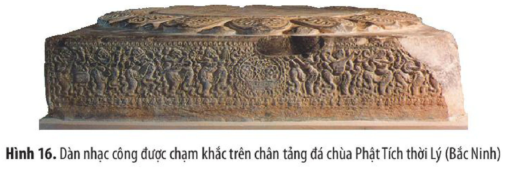

*Hình 16. Dàn nhạc công được chạm khắc trên chân tảng đá chùa Phật Tích thời Lý (Bắc Ninh)*

<!-- pdf:121 -->

Năm 1437, vua Lê Thái Tông giao Nguyễn Trãi và Lương Đăng làm nhã nhạc cung đình và cấm các loại hình ca múa nhạc cổ truyền như tuồng, chèo,...

Trong dân gian, các loại hình diễn xướng như tuồng, chèo, múa rối phát triển rộng rãi. Nhiều giáo phường được thành lập. Nhạc cụ truyền thống gồm nhiều loại thuộc bộ gõ, bộ hơi và bộ dây.

<!-- term: Hát ca trù -->
Hát ca trù (còn gọi là hát ả đào, hát cô đầu, hát cửa đình) xuất hiện từ khoảng thế kỉ XV trong cung đình, rồi dần lan toả và phổ biến trong đời sống dân gian.

<!-- term: Hát văn -->
Hát văn (còn gọi là chầu văn) là loại hình ca múa nhạc dân gian, gắn liền với thực hành nghi lễ trong tín ngưỡng thờ Mẫu của người Việt.

> ❓ 1. Nêu nhận xét về nghệ thuật của Đại Việt thời kì trung đại.
>
> 2. Nêu những thành tựu tiêu biểu về nghệ thuật của văn minh Đại Việt. Thành tựu nào khiến em ấn tượng nhất? Vì sao?

### h) Khoa học, kĩ thuật

• *Sử học*

Sử học được nhà nước và nhân dân quan tâm, nhiều công trình được biên soạn qua các thời kì khác nhau.

<!-- term: Đại Việt sử ký -->
Thời Lý có *Sử ký* (của Đỗ Thiện) nhưng đã thất truyền. Thời Trần thành lập Quốc sử viện là cơ quan chuyên viết sử, tác phẩm nổi tiếng là *Đại Việt sử ký* (Lê Văn Hưu).

<!-- term: Đại Việt sử ký toàn thư -->
Thời Lê sơ, việc chép sử được triều đình đặc biệt coi trọng, với nhiều sử gia nổi tiếng như Phan Phu Tiên, Ngô Sỹ Liên, Vũ Quỳnh,... Bộ quốc sử tiêu biểu thời kì này là *Đại Việt sử ký toàn thư*.

Triều Nguyễn thành lập Quốc sử quán, biên soạn nhiều công trình sử học, tiêu biểu như: *Đại Nam thực lục*, *Khâm định Việt sử thông giám cương mục*,... ngoài ra, còn có các công trình sử học của cá nhân biên soạn.

• *Địa lí*

Thời kì này xuất hiện nhiều công trình địa chí ghi chép về ranh giới, núi sông, địa danh, phong tục,... của đất nước và các địa phương.

<!-- term: Dư địa chí -->
Tiêu biểu phải kể đến: *Dư địa chí* (Nguyễn Trãi), *Gia Định thành thông chí* (Trịnh Hoài Đức), *Nghệ An ký* (Bùi Dương Lịch), *Hoàng Việt nhất thống dư địa chí* (Lê Quang Định), *Đại Nam nhất thống chí* (Quốc sử quán triều Nguyễn),... Bản đồ xác định lãnh thổ, biên giới quốc gia trên đất liền, trên biển cũng được quan tâm xây dựng, trong đó tiêu biểu là *Hồng Đức bản đồ* (triều Lê sơ) và *Đại Nam nhất thống toàn đồ* (triều Nguyễn).

• *Toán học:* phải kể đến *Đại thành toán pháp* của Lương Thế Vinh, *Lập thành toán pháp* của Vũ Hữu,...

<!-- pdf:122 -->

• *Quân sự:* cũng đạt được những thành tựu quan trọng cả về lí luận và kĩ thuật quân sự.

<!-- term: Binh thư yếu lược -->
Các tác phẩm tiêu biểu như: *Binh thư yếu lược*, *Vạn Kiếp tông bí truyền thư* (Trần Quốc Tuấn), *Hổ trướng khu cơ* (Đào Duy Từ),... Từ cuối thế kỉ XIV, người Việt đã chế tạo được súng thần cơ, đóng loại thuyền chiến cỡ lớn; thế kỉ XVI – XVII, đúc được các loại đại bác, đóng thuyền chiến trang bị đại bác có vận dụng kĩ thuật của phương Tây.

• *Y học:* tiêu biểu có các danh y như: Tuệ Tĩnh, Hải Thượng Lãn Ông,...

> ❓ Hãy nêu một số thành tựu cơ bản của văn minh Đại Việt về khoa học, kĩ thuật. Hãy lựa chọn và giới thiệu về thành tựu tiêu biểu nhất.

## 4. Ý nghĩa của văn minh Đại Việt trong lịch sử Việt Nam

### a) Ưu điểm và hạn chế của văn minh Đại Việt

Xuất phát từ nền tảng nghề trồng lúa nước, các vương triều Đại Việt luôn chú trọng phát triển nông nghiệp. Thủ công nghiệp và thương nghiệp cũng được khuyến khích. Tuy nhiên, trong một số thời kì, thương nghiệp không được đề cao. Trong thời kì trung đại, người Việt ít có phát minh khoa học, kĩ thuật.

Việc sinh sống thành làng xã một mặt gia tăng tinh thần cố kết cộng đồng, nhưng mặt khác tạo nên tâm lí bình quân, cào bằng giữa các thành viên, do đó, hạn chế động lực phát triển, sáng tạo của xã hội và từng cá nhân.

Trong kỉ nguyên Đại Việt, Nho giáo ngày càng được đề cao, góp phần làm cho xã hội kỉ cương, ổn định nhưng đồng thời cũng tạo ra sự bảo thủ, chậm cải cách trước những biến đổi về xã hội, kinh tế, đặc biệt là sự xâm nhập của chủ nghĩa tư bản phương Tây.

### b) Ý nghĩa của văn minh Đại Việt

Văn minh Đại Việt khẳng định tinh thần quật khởi và sức lao động sáng tạo bền bỉ của nhân dân. Trước những thách thức của tự nhiên và xã hội, người Việt Nam đã nỗ lực không ngừng, xây dựng một nền văn minh mang đậm bản sắc dân tộc trên cơ sở tiếp thu có chọn lọc những thành tựu văn minh từ bên ngoài.

Những thành tựu đạt được không chỉ chứng minh sự phát triển vượt bậc trên các lĩnh vực chính trị, kinh tế, văn hoá trong các thời kì lịch sử mà còn góp phần quan trọng tạo nên sức mạnh dân tộc, giúp Đại Việt giành thắng lợi trong những cuộc kháng chiến chống ngoại xâm, bảo vệ nền độc lập dân tộc.

<!-- pdf:123 -->

Thành tựu của văn minh Đại Việt trong gần mười thế kỉ là một nền tảng để Việt Nam đạt được nhiều thành tựu rực rỡ trong công cuộc xây dựng và bảo vệ Tổ quốc; tạo dựng bản lĩnh, bản sắc riêng để người Việt Nam vững vàng vượt qua thử thách, vững bước tiến vào kỉ nguyên hội nhập và phát triển mới.

> ❓ 1. Em hãy nêu nhận xét về một số ưu điểm và hạn chế của văn minh Đại Việt.
>
> 2. Em hãy phân tích ý nghĩa của văn minh Đại Việt trong lịch sử Việt Nam.

## ✏️ Luyện tập và vận dụng

1. Lập bảng thống kê những thành tựu tiêu biểu của nền văn minh Đại Việt theo gợi ý dưới đây.

| Lĩnh vực | Thành tựu tiêu biểu | Ý nghĩa/giá trị |
| --- | --- | --- |
| ? | ? | ? |
| ? | ? | ? |

2. Chứng minh những thành tựu văn minh Đại Việt là sự kế thừa, phát triển các thành tựu của nền văn minh cổ trên đất nước Việt Nam và tiếp thu có chọn lọc những ảnh hưởng từ bên ngoài.

3. Có ý kiến cho rằng: Văn minh Đại Việt phát triển rất phong phú, đa dạng và mang tính dân tộc sâu sắc. Em có đồng ý với ý kiến đó không? Vì sao?

1. Theo em, mỗi cá nhân cần làm gì để bảo tồn và phát huy giá trị của những thành tựu văn minh Đại Việt trong thời đại ngày nay?

2. Lựa chọn thành tựu thuộc một lĩnh vực của văn minh Đại Việt, thực hiện theo nhóm (tổ) cùng sưu tầm tư liệu và xây dựng một bài thuyết trình (bài viết, sơ đồ hoặc đoạn phim ngắn) rồi trình bày trước lớp.

## 📷 Danh sách hình trong bài

| Mã hình | Trang PDF | Vị trí trong bài | Chú thích gốc |
| --- | --- | --- | --- |
| H10-lich_su-b12-01 | 110 | Mục 2 | Hình 1. Sơ đồ tiến trình phát triển của văn minh Đại Việt |
| H10-lich_su-b12-02 | 111 | Mục 3.a | Hình 2. Sơ đồ tổ chức nhà nước thời Lê sơ |
| H10-lich_su-b12-03 | 112 | Mục 3.a | Hình 3. Trang bìa bản dịch hai bộ luật tiêu biểu của Việt Nam thời kì quân chủ |
| H10-lich_su-b12-04 | 112 | Mục 3.b | Hình 4. Tái hiện lễ Tịch điền tại Núi Đọi (Hà Nam) năm 2010 (Người cầm cày là Chủ tịch nước Nguyễn Minh Triết) |
| H10-lich_su-b12-05 | 113 | Mục 3.b | Hình 5. Một số sản phẩm của các xưởng thủ công nhà nước |
| H10-lich_su-b12-06 | 114 | Mục 3.b | Hình 6. Thạp gốm thời Lý |
| H10-lich_su-b12-07 | 114 | Mục 3.b | Hình 7. Bộ cửa gỗ chạm rồng thời Trần ở chùa Phổ Minh (Mỹ Lộc, Nam Định) |
| H10-lich_su-b12-08 | 115 | Mục 3.b | Hình 8. Bức thư Phúc Nghĩa hầu gửi Quốc vương Nhật Bản đặt quan hệ bang giao năm 1591 |
| H10-lich_su-b12-09 | 115 | Mục 3.b | Hình 9. Châu ấn trạng do Mạc phủ (Nhật Bản) cấp năm 1614, cho phép thuyền của nước này đến buôn bán với Đàng Trong |
| H10-lich_su-b12-10 | 116 | Mục 3.c | Hình 10. Đình Tây Đằng (Hà Nội) |
| H10-lich_su-b12-11 | 116 | Mục 3.c | Hình 11. Tháp Phổ Minh thời Trần (Nam Định) |
| H10-lich_su-b12-12 | 116 | Mục 3.c | Hình 12. Tháp chuông chùa Keo thời Lê trung hưng (Thái Bình) |
| H10-lich_su-b12-13 | 118 | Mục 3.d | Hình 13. Bia Tiến sĩ ở Văn Miếu – Quốc Tử Giám (Hà Nội) |
| H10-lich_su-b12-14 | 119 | Mục 3.g | Hình 14. Chùa Trấn Quốc thời Lê trung hưng (Hà Nội) |
| H10-lich_su-b12-15 | 120 | Mục 3.g | Hình 15. Tượng Phật Bà Quan Âm thời Lê trung hưng ở chùa Bút Tháp (Bắc Ninh) |
| H10-lich_su-b12-16 | 120 | Mục 3.g | Hình 16. Dàn nhạc công được chạm khắc trên chân tảng đá chùa Phật Tích thời Lý (Bắc Ninh) |
