<!-- pdf:124 -->

# BÀI 13: ĐỜI SỐNG VẬT CHẤT VÀ TINH THẦN CỦA CỘNG ĐỒNG CÁC DÂN TỘC VIỆT NAM

## 🎯 Học xong bài này, em sẽ:

- Nêu được thành phần tộc người theo dân số; trình bày được khái niệm ngữ hệ và phân chia tộc người theo ngữ hệ.
- Trình bày được nét chính về đời sống vật chất và đời sống tinh thần của cộng đồng các dân tộc Việt Nam.
- Có ý thức trân trọng, giữ gìn, phát huy bản sắc văn hoá của cộng đồng các dân tộc Việt Nam.

## 🔴 Mở đầu

Trên đất nước Việt Nam hiện nay có nhiều dân tộc cùng sinh sống, đời sống vật chất và tinh thần rất đa dạng, phong phú. Quan sát hình bên, em có thể kể được tên của những dân tộc nào? Hãy chia sẻ hiểu biết của bản thân về một số nét văn hoá tiêu biểu của các dân tộc đó như: trang phục, ẩm thực, lễ hội,...

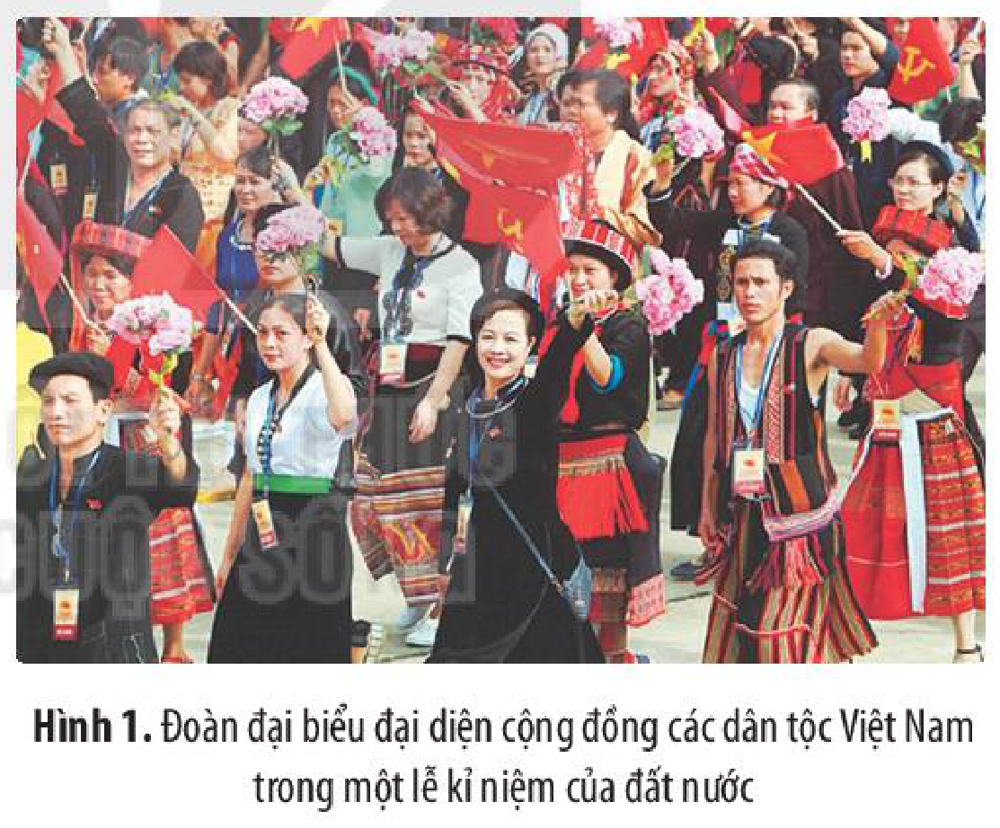

*Hình 1. Đoàn đại biểu đại diện cộng đồng các dân tộc Việt Nam trong một lễ kỉ niệm của đất nước*

## 1. Các dân tộc trên đất nước Việt Nam

### a) Thành phần dân tộc theo dân số

<!-- term: Dân tộc -->
Khái niệm “dân tộc” trong tiếng Việt hiện nay được sử dụng theo hai nghĩa: dân tộc – quốc gia bao gồm toàn thể cư dân của quốc gia, đất nước (dân tộc Việt Nam); dân tộc – tộc người là những cộng đồng người có chung ngôn ngữ, văn hoá và ý thức tự giác dân tộc (dân tộc Kinh, dân tộc Mường, dân tộc Thái,...).

Thành phần dân tộc theo dân số ở Việt Nam hiện nay được chia thành hai nhóm: *dân tộc đa số* và *dân tộc thiểu số* (dựa vào số dân của từng dân tộc theo tổng điều tra dân số toàn quốc).

<!-- pdf:125 -->

<!-- term: Dân tộc đa số -->
<!-- term: Dân tộc thiểu số -->
> TƯ LIỆU 1. Theo Nghị định số 05/2011/NĐ-CP ngày 14 – 1 – 2011 về Công tác dân tộc: “Dân tộc đa số” là dân tộc có số dân chiếm trên 50% tổng dân số của cả nước, theo điều tra dân số quốc gia.
>
> “Dân tộc thiểu số” là những dân tộc có số dân ít hơn so với dân tộc đa số trên phạm vi lãnh thổ nước Cộng hoà xã hội chủ nghĩa Việt Nam.
>
> *(Nguồn: Cổng thông tin điện tử vanban.chinhphu.vn — Biểu đồ cơ cấu dân số: Dân tộc Kinh chiếm 85,32%; Các dân tộc thiểu số chiếm 14,68%)*

> TƯ LIỆU 2. *Thống kê dân số các dân tộc ở Việt Nam (theo kết quả Tổng điều tra dân số và nhà ở năm 2019)*

| STT | Dân tộc | Số dân (người) | STT | Dân tộc | Số dân (người) | STT | Dân tộc | Số dân (người) |
| --- | --- | --- | --- | --- | --- | --- | --- | --- |
| 1 | Kinh | 82 085 826 | 19 | Raglai | 146 613 | 37 | La Chí | 15 126 |
| 2 | Tày | 1 845 492 | 20 | Mnông | 127 334 | 38 | Phù Lá | 12 471 |
| 3 | Thái | 1 820 950 | 21 | Xtiêng | 100 752 | 39 | La Hủ | 12 113 |
| 4 | Mường | 1 452 095 | 22 | Bru – Vân Kiều | 94 598 | 40 | La Ha | 10 157 |
| 5 | Mông (H’Mông) | 1 393 547 | 23 | Thổ | 91 430 | 41 | Pà Thẻn | 8 248 |
| 6 | Khơ-me | 1 319 652 | 24 | Khơ Mú | 90 612 | 42 | Chứt | 7 513 |
| 7 | Nùng | 1 083 298 | 25 | Cơ Tu | 74 173 | 43 | Lự | 6 757 |
| 8 | Dao | 891 151 | 26 | Giáy | 67 858 | 44 | Lô Lô | 4 827 |
| 9 | Hoa | 749 466 | 27 | Giẻ – Triêng | 63 322 | 45 | Mảng | 4 650 |
| 10 | Gia Rai | 513 930 | 28 | Tà Ôi | 52 356 | 46 | Cơ Lao | 4 003 |
| 11 | Ê Đê | 398 671 | 29 | Mạ | 50 322 | 47 | Bố Y | 3 232 |
| 12 | Ba Na | 286 910 | 30 | Co | 40 442 | 48 | Cống | 2 729 |
| 13 | Xơ Đăng | 212 277 | 31 | Chơ Ro | 29 520 | 49 | Ngái | 1 649 |
| 14 | Sán Chay | 201 398 | 32 | Xinh Mun | 29 503 | 50 | Si La | 909 |
| 15 | Cơ Ho | 200 800 | 33 | Hà Nhì | 25 539 | 51 | Pu Péo | 903 |
| 16 | Sán Dìu | 183 004 | 34 | Chu Ru | 23 242 | 52 | Rơ Măm | 639 |
| 17 | Chăm | 178 948 | 35 | Lào | 17 532 | 53 | Brâu | 525 |
| 18 | Hrê | 149 460 | 36 | Kháng | 16 180 | 54 | Ơ Đu | 428 |
<!-- ocr-ok: bảng Tư liệu 2 đối chiếu đúng ảnh trang 125 -->

> *(Theo Tổng cục thống kê, Kết quả toàn bộ Tổng điều tra dân số và nhà ở năm 2019, NXB Thống kê, Hà Nội, 2020, tr. 43 – 45)*

<!-- pdf:126 -->

> ❓ 1. Dựa vào Tư liệu 1 (tr. 124), em hãy cho biết các dân tộc ở Việt Nam được chia thành mấy nhóm. Căn cứ vào tiêu chí nào để phân chia như vậy?
>
> 2. Khai thác thông tin trong Tư liệu 2 (tr. 124), hãy kể tên một số dân tộc thuộc mỗi nhóm đó.

### b) Thành phần dân tộc theo ngữ hệ

<!-- term: Ngữ hệ -->
Ngữ hệ là một nhóm các ngôn ngữ cùng nguồn gốc, có những đặc điểm giống nhau về ngữ pháp, hệ thống từ vựng cơ bản, thanh điệu và ngữ âm,... Mỗi ngữ hệ có thể bao gồm một hoặc nhiều nhóm ngôn ngữ.

Hiện nay, 54 dân tộc ở Việt Nam được chia thành *năm ngữ hệ, tám nhóm ngôn ngữ*.

| Ngữ hệ | Nhóm ngôn ngữ | Dân tộc |
| --- | --- | --- |
| Nam Á | Việt – Mường | Kinh (Việt), Mường, Thổ, Chứt. |
| Nam Á | Môn – Khơ-me | Khơ Mú, Xinh Mun, Mảng, Kháng, Ơ Đu, Bru – Vân Kiều, Tà Ôi, Cơ Tu, Giẻ – Triêng, Co, Hrê, Brâu, Rơ Măm, Ba Na, Xơ Đăng, Mnông, Cơ Ho, Mạ, Xtiêng, Chơ Ro, Khơ-me. |
| Thái – Ka-đai | Tày – Thái | Tày, Thái, Nùng, Giáy, Lào, Lự, Sán Chay, Bố Y. |
| Thái – Ka-đai | Ka-đai | La Chí, La Ha, Cơ Lao, Pu Péo. |
| Mông – Dao | Mông – Dao | Mông, Dao, Pà Thẻn. |
| Nam Đảo | Ma-lay-ô – Pô-li-nê-di | Chăm, Gia Rai, Ê Đê, Chu Ru, Raglai. |
| Hán – Tạng | Hán (hay Hoa) | Hoa/Hán, Sán Dìu, Ngái. |
| Hán – Tạng | Tạng – Miến | Hà Nhì, Phù Lá, La Hủ, Lô Lô, Cống, Si La. |

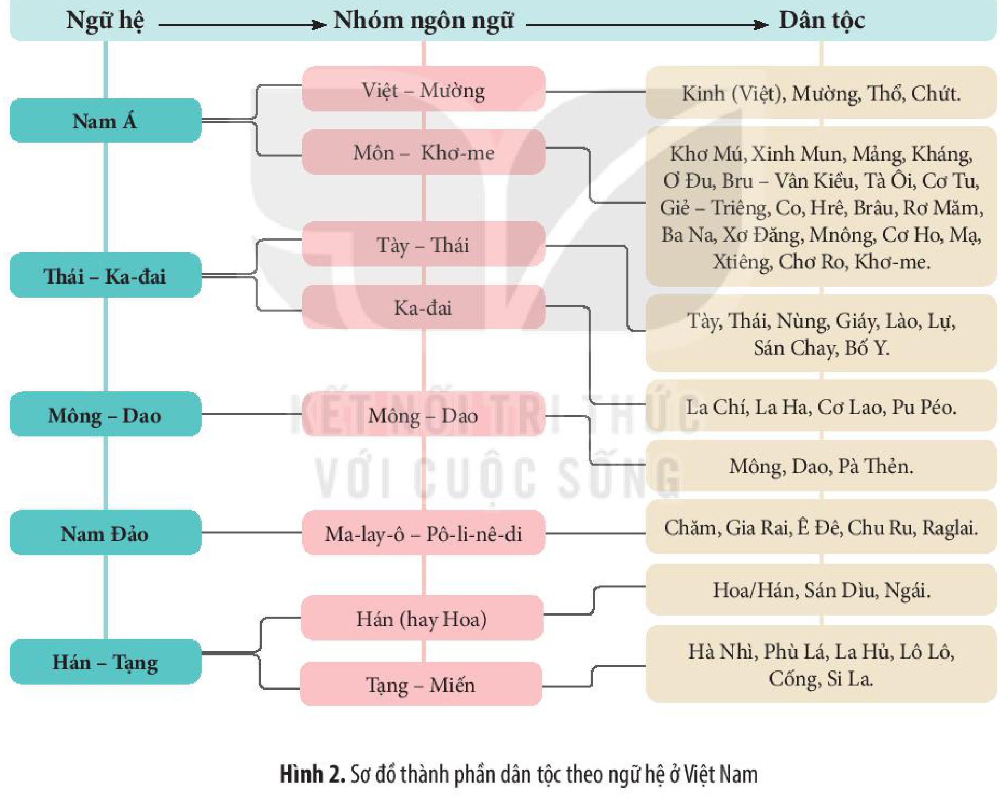

*Hình 2. Sơ đồ thành phần dân tộc theo ngữ hệ ở Việt Nam*

> ❓ 1. Ngữ hệ là gì? Dựa vào những đặc điểm nào để xếp các dân tộc vào cùng một ngữ hệ?
>
> 2. Ở Việt Nam có mấy ngữ hệ/mấy nhóm ngôn ngữ? Kể tên các ngữ hệ, nhóm ngôn ngữ đó. Dân tộc em thuộc ngữ hệ, nhóm ngôn ngữ nào?

<!-- pdf:127 -->

## 2. Đời sống vật chất

### a) Một số hoạt động kinh tế chính

• *Sản xuất nông nghiệp*

Do cư trú chủ yếu ở đồng bằng nên sản xuất nông nghiệp, đặc biệt là canh tác lúa nước, là hoạt động kinh tế chính của người Kinh. Hoạt động kinh tế này tồn tại, phát triển gắn liền với việc trị thuỷ, xây dựng hệ thống thuỷ lợi như: đắp đê, tạo kênh, mương dẫn nước vào ruộng ở đồng bằng Bắc Bộ, Bắc Trung Bộ và đắp đê ngăn nước biển, thau chua, rửa mặn,... ở đồng bằng Nam Bộ.

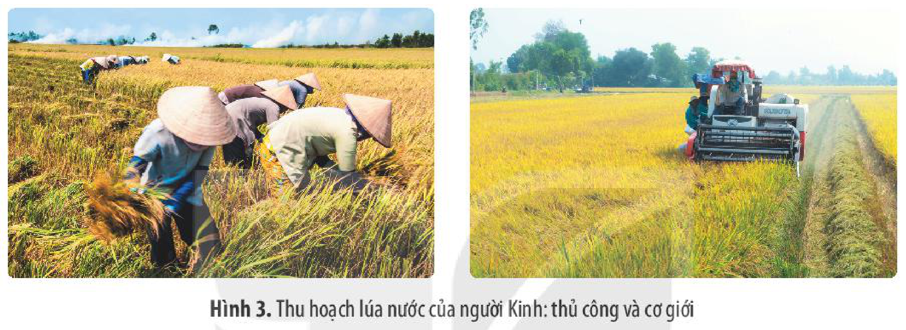

*Hình 3. Thu hoạch lúa nước của người Kinh: thủ công và cơ giới*

Ngày nay, canh tác lúa nước vẫn giữ vị trí, vai trò quan trọng trong cơ cấu kinh tế của người Kinh, lúa gạo vẫn là nguồn lương thực chính, không chỉ đáp ứng nhu cầu trong nước mà còn là một trong những mặt hàng xuất khẩu quan trọng.

Bên cạnh cây lúa nước, người Kinh còn trồng một số cây lương thực khác như: ngô, khoai, sắn,... cùng các loại cây rau, củ, gia vị, cây ăn quả,... và chăn nuôi gia súc, gia cầm, đánh bắt và nuôi trồng thuỷ – hải sản,...

> 💡 EM CÓ BIẾT ?

<!-- term: Ruộng bậc thang -->
> Để có nước canh tác trên ruộng bậc thang, cư dân các dân tộc đã tìm cách dẫn nước từ các dòng suối ở trên cao xuống hoặc tạo hồ hứng và chứa nước mưa trên đỉnh núi.
>
> Để canh tác lúa nước ở các thung lũng chân núi, người dân đã sáng tạo ra hệ thống mương, máng và guồng nước (cọn nước), dẫn nước từ sông, suối lên ruộng.

<!-- term: Canh tác nương rẫy -->
Do địa bàn cư trú chủ yếu là các khu vực có địa hình cao, dốc ở trung du, miền núi phía Bắc và Trường Sơn – Tây Nguyên nên các dân tộc thiểu số phát triển hoạt động canh tác nương rẫy với một số cây trồng chủ yếu: lúa, ngô, khoai, sắn, cây ăn quả, cây rau xanh và cây gia vị,... Việc canh tác lúa nước được tiến hành ở các thung lũng chân núi hoặc những thửa ruộng bậc thang trên các sườn đồi, sườn núi đất. Người Khơ-me và người Chăm ở đồng bằng sông Cửu Long cũng canh tác lúa nước; công cụ và kĩ thuật canh tác không khác nhiều so với người Kinh.

<!-- pdf:128 -->

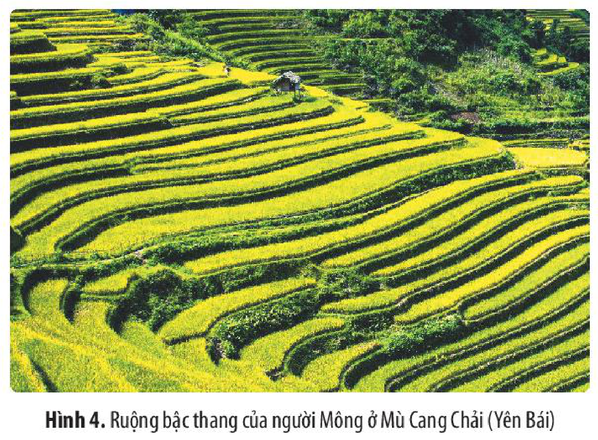

*Hình 4. Ruộng bậc thang của người Mông ở Mù Cang Chải (Yên Bái)*

> ❓ 1. Em hãy nêu một số nét chính về hoạt động sản xuất nông nghiệp của các dân tộc ở Việt Nam.
>
> 2. Sản xuất nông nghiệp của người Kinh và các dân tộc thiểu số có điểm gì giống và khác nhau?

• *Thủ công nghiệp*

Bên cạnh sản xuất nông nghiệp, người Kinh còn làm nhiều nghề thủ công truyền thống như: nghề gốm, nghề dệt, nghề đan, rèn, mộc, chạm khắc, đúc đồng, kim hoàn, khảm trai,... Sản phẩm của nhiều ngành nghề rất đa dạng và tinh xảo, không chỉ đáp ứng nhu cầu của người dân trong nước mà còn được xuất khẩu.

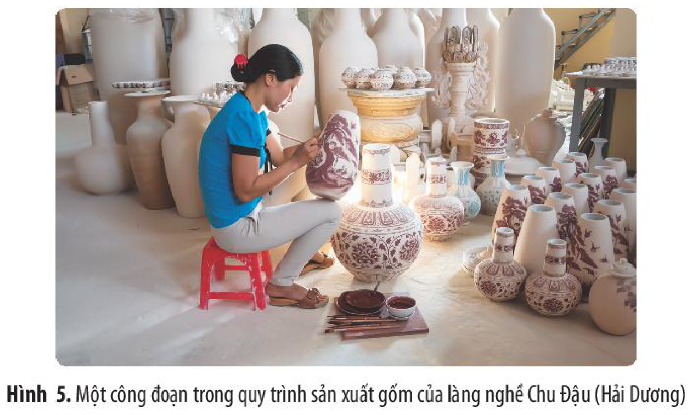

*Hình 5. Một công đoạn trong quy trình sản xuất gốm của làng nghề Chu Đậu (Hải Dương)*

<!-- pdf:129 -->

Các dân tộc thiểu số ở Việt Nam phát triển đa dạng nhiều nghề thủ công, mang dấu ấn và bản sắc riêng của từng tộc người. Nghề dệt và nghề đan ra đời sớm, phát triển mạnh ở hầu hết các dân tộc; nghề gốm và nghề rèn, đúc cũng ra đời sớm nhưng ít phổ biến hơn. Ngoài ra, một số ngành nghề thủ công khác cũng được duy trì trong cộng đồng các dân tộc thiểu số như: nghề mộc, nghề làm đồ trang sức bằng bạc,... Sản phẩm của các nghề thủ công này chủ yếu đáp ứng nhu cầu của người dân địa phương.

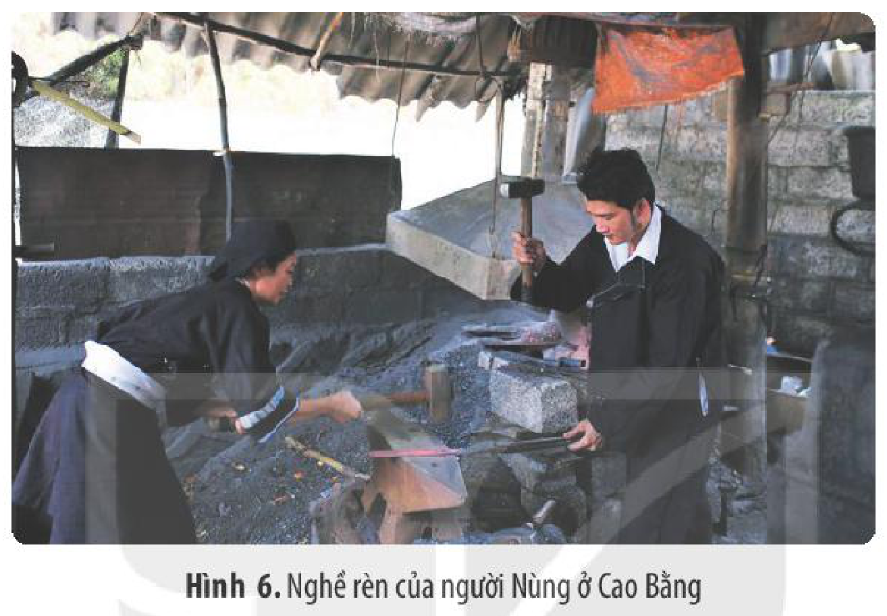

*Hình 6. Nghề rèn của người Nùng ở Cao Bằng*

> ❓ 1. Em hãy kể tên một số ngành nghề thủ công của người Kinh và của các dân tộc thiểu số ở Việt Nam.
>
> 2. Hãy cho biết một số nghề thủ công nổi tiếng ở địa phương em, hoặc em được biết qua sách, báo, truyền hình. Theo em, các nghề thủ công có vai trò gì trong đời sống kinh tế – xã hội?

### b) Ăn, mặc, ở

Bữa ăn truyền thống của người Kinh thường bao gồm cơm, rau, cá; nước uống thường là nước đun với một số loại lá, hạt cây (chè, vối,...). Ngoài ra, bữa ăn có thể được bổ sung các món ăn chế biến từ thịt gia súc, gia cầm. Người Kinh đã sáng tạo ra nhiều món ăn ngon nổi tiếng, đa dạng về cách chế biến và thưởng thức, mang đậm bản sắc văn hoá của mỗi vùng miền. Ngày nay, thực đơn bữa ăn chính của các gia đình người Kinh đã đa dạng hơn.

Trang phục thường ngày của người Kinh gồm áo, quần (hoặc váy), kết hợp thêm một vài chi tiết phụ khác như: mũ, khăn, giày, dép,... Người Kinh ưa thích dùng đồ trang sức như các loại vòng, nhẫn, dây chuyền, hoa tai,... bằng bạc hoặc vàng.

<!-- pdf:130 -->

Trang phục của người Kinh cũng có sự khác biệt giữa các vùng, miền; chất liệu, kiểu dáng, màu sắc và ngày càng đa dạng trên cơ sở giữ gìn bản sắc văn hoá truyền thống và tiếp thu những ảnh hưởng từ cư dân các dân tộc, quốc gia khác trên thế giới.

Hiện nay, người Kinh ở các vùng miền thường mặc áo sơ mi, áo phông, quần âu, quần bò,... chịu ảnh hưởng từ văn hoá phương Tây.

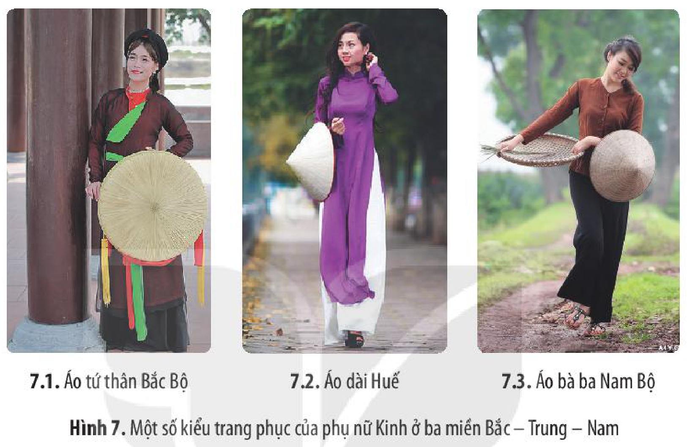

*Hình 7. Một số kiểu trang phục của phụ nữ Kinh ở ba miền Bắc – Trung – Nam (7.1. Áo tứ thân Bắc Bộ; 7.2. Áo dài Huế; 7.3. Áo bà ba Nam Bộ)*

Người Kinh có tập quán ở trong các ngôi nhà trệt, được xây bằng gạch hoặc đắp đất. Mỗi gia đình có một khuôn viên với một vài ngôi nhà, trong đó ngôi nhà chính để thờ cúng, tiếp khách, sinh hoạt gia đình, cất giữ đồ đạc quý; các ngôi nhà khác để nấu ăn, cất giữ dụng cụ lao động, lương thực, thực phẩm,...

Ngày nay, cùng với quá trình đô thị hoá, kiến trúc nhà ở của người Kinh thay đổi theo hướng hiện đại, tiện dụng hơn với sự xuất hiện ngày càng phổ biến các ngôi nhà nhiều tầng ở nông thôn và các chung cư cao tầng tại đô thị.

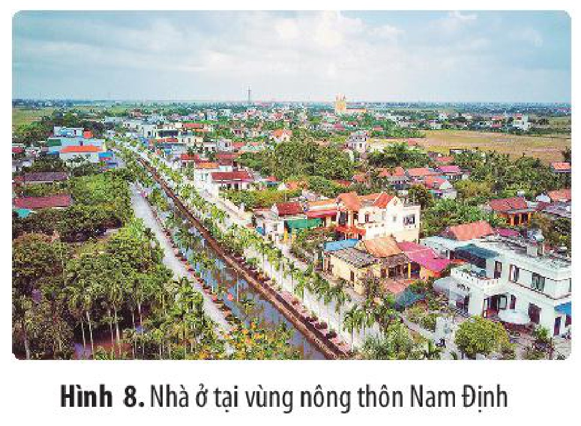

*Hình 8. Nhà ở tại vùng nông thôn Nam Định*

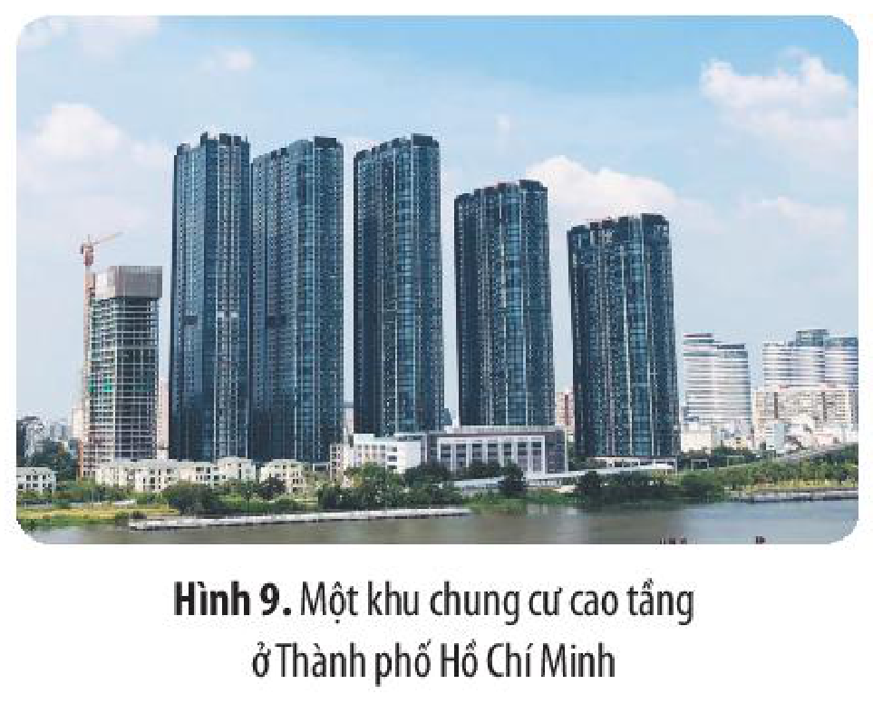

*Hình 9. Một khu chung cư cao tầng ở Thành phố Hồ Chí Minh*

<!-- pdf:131 -->

Trước đây, thường ngày cư dân các dân tộc thiểu số cũng chủ yếu ăn cơm với rau, cá. Hoạt động săn bắt và chăn nuôi có vai trò quan trọng trong đời sống, nhưng sản phẩm đem lại không đều và chủ yếu dành cho các bữa ăn cộng đồng, dịp lễ hội, cúng tế. Cách ăn và chế biến đồ ăn cũng có ít nhiều sự khác biệt giữa các dân tộc, vùng miền.

Trang phục của cư dân các dân tộc thiểu số được may từ vải bông, vải tơ tằm, vải lanh,...

Trang phục của các dân tộc phía bắc là quần (hoặc váy) và áo có nhiều hoa văn trang trí. Các dân tộc phía nam, khi trời nóng, nam đóng khố, cởi trần (hoặc mặc áo); nữ mặc váy, áo; khi trời lạnh, nam, nữ đều khoác thêm tấm vải giữ ấm cơ thể. Ngoài trang sức bằng kim loại, họ sử dụng nhiều loại trang sức có nguồn gốc từ động vật, thực vật.

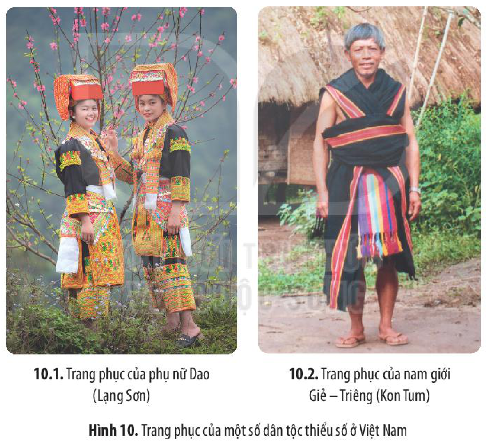

*Hình 10. Trang phục của một số dân tộc thiểu số ở Việt Nam (10.1. Trang phục của phụ nữ Dao (Lạng Sơn); 10.2. Trang phục của nam giới Giẻ – Triêng (Kon Tum))*

<!-- term: Nhà sàn -->
Cư dân các dân tộc thiểu số Việt Nam chủ yếu làm và ở trong những ngôi nhà sàn bằng nguyên liệu thực vật (gỗ, tre, nứa, lá,...); cư dân một số dân tộc ở nhà trệt (đất) hoặc nhà nửa sàn nửa trệt.

Mỗi dân tộc, tuỳ theo địa bàn sinh sống, điều kiện tự nhiên cũng như hoạt động kinh tế, văn hoá (phong tục, tập quán, lối sống,...) khác nhau mà có những mô hình nhà ở phù hợp, tạo nên sự đa dạng, phong phú trong kiến trúc nhà ở truyền thống của Việt Nam.

<!-- pdf:132 -->

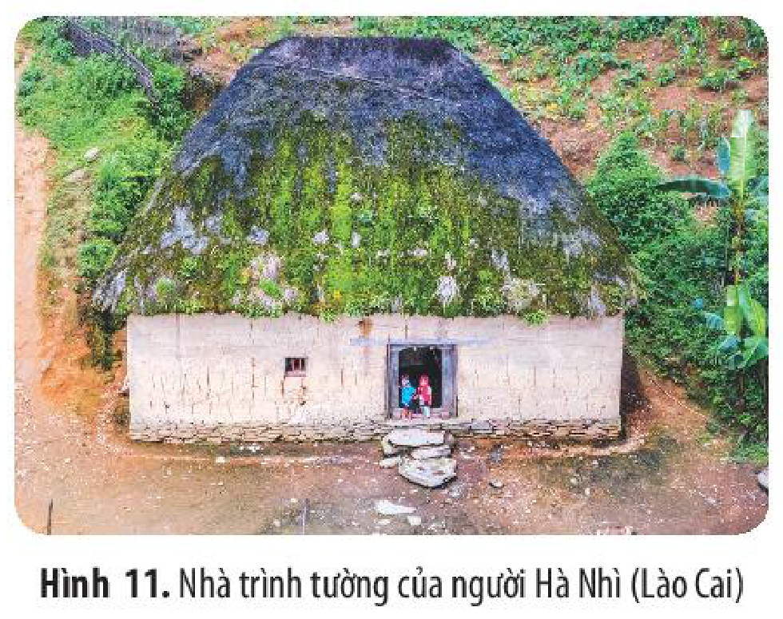

*Hình 11. Nhà trình tường của người Hà Nhì (Lào Cai)*

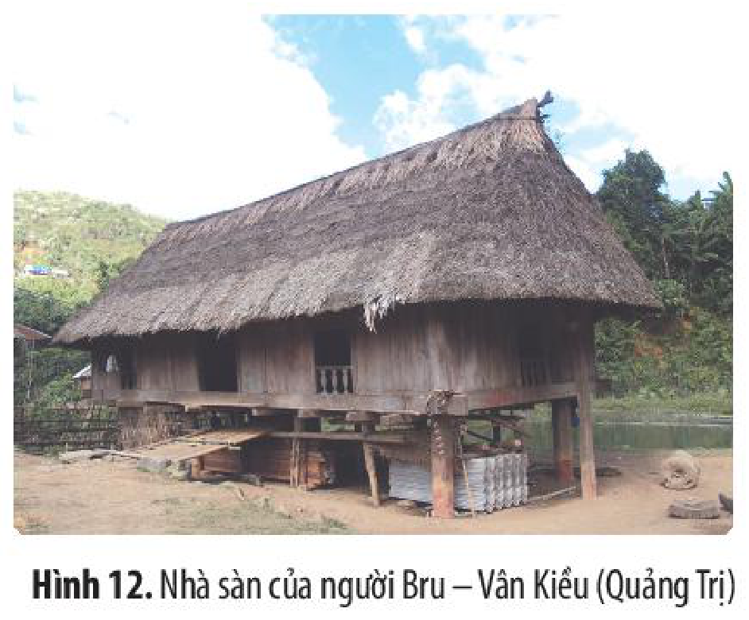

*Hình 12. Nhà sàn của người Bru – Vân Kiều (Quảng Trị)*

> ❓ 1. Trình bày một số nét chính về văn hoá ăn, mặc, ở của người Kinh và các dân tộc thiểu số Việt Nam.
>
> 2. Theo em, văn hoá ăn, mặc, ở của cộng đồng các dân tộc ở Việt Nam có sự thay đổi như thế nào trong những năm gần đây? Nêu một số ví dụ ở địa phương em.

### c) Đi lại, vận chuyển

Trước đây, ngoài đi bộ, vận chuyển bằng vai, tuỳ vào điều kiện cụ thể, người Kinh còn phát triển hình thức đi lại, vận chuyển bằng xe trâu, bò (kéo), ngựa (cưỡi/thồ) hoặc các loại thuyền, bè,...

Hiện nay, việc đi lại, vận chuyển hàng hoá giữa các địa phương trong nước cũng như với nước ngoài ngày càng dễ dàng, thuận tiện, tiết kiệm thời gian nhờ việc phát triển đa dạng các loại hình và phương tiện giao thông: xe đạp, xe máy, ô tô, tàu hoả, tàu thuỷ, máy bay,...

<!-- term: Gùi -->
Ở miền núi, do địa hình phức tạp, độ dốc lớn, hẹp, cư dân các dân tộc thiểu số Việt Nam chủ yếu đi bộ và vận chuyển đồ bằng gùi. Một số dân tộc biết thuần dưỡng súc vật (trâu, ngựa, voi,...) và sử dụng các loại xe, thuyền để đi lại và vận chuyển hàng hoá, đồ đạc.

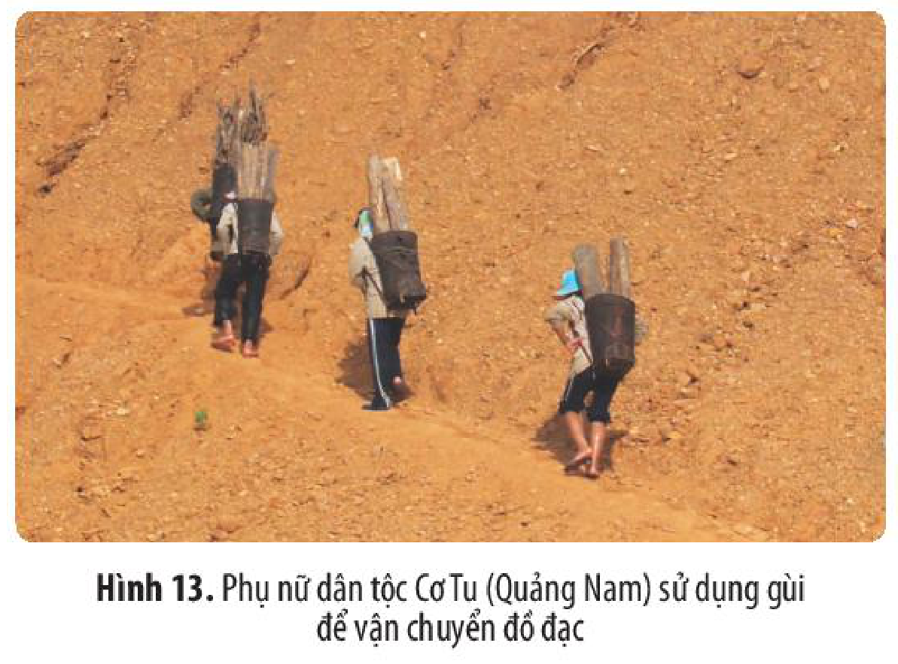

*Hình 13. Phụ nữ dân tộc Cơ Tu (Quảng Nam) sử dụng gùi để vận chuyển đồ đạc*

<!-- pdf:133 -->

> ❓ Em hãy giới thiệu một số nét chính về phương tiện đi lại và vận chuyển của người Kinh và đồng bào các dân tộc thiểu số ở Việt Nam.

## 3. Đời sống tinh thần

### a) Tín ngưỡng, tôn giáo

<!-- term: Tín ngưỡng thờ cúng tổ tiên -->
Người Kinh cho rằng từ sông, suối đến rừng, núi, mưa, gió,... đều có linh hồn, có thần. Vì vậy, họ tổ chức nhiều nghi lễ cúng tế cầu mong cho con người khoẻ mạnh, cây trồng, vật nuôi tốt tươi, sinh sôi nảy nở,... Đồng thời, người Kinh còn duy trì tín ngưỡng thờ cúng tổ tiên, thờ những người có công với cộng đồng, thờ Mẫu, Thành hoàng làng,...

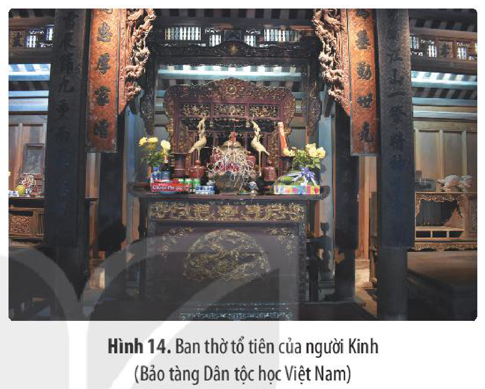

*Hình 14. Ban thờ tổ tiên của người Kinh (Bảo tàng Dân tộc học Việt Nam)*

Người Kinh đã và đang tiếp thu nhiều tôn giáo lớn trên thế giới như: Phật giáo, Công giáo, Tin Lành,... Cùng với đó là việc xây dựng nhiều công trình kiến trúc như: đình, đền, chùa, tháp, nhà thờ,... và tổ chức nhiều nghi lễ liên quan đến các tôn giáo như lễ Phật đản (Phật giáo), lễ Giáng sinh (Công giáo, Tin Lành),...

<!-- term: Vạn vật hữu linh -->
Cư dân các dân tộc thiểu số Việt Nam đều đang duy trì tín ngưỡng đa thần, vạn vật hữu linh, tô tem giáo,... ở các mức độ đậm, nhạt khác nhau. Họ cũng đã và đang tiếp thu, chịu ảnh hưởng của nhiều tôn giáo lớn trên thế giới như: Phật giáo, Công giáo, Hồi giáo,...

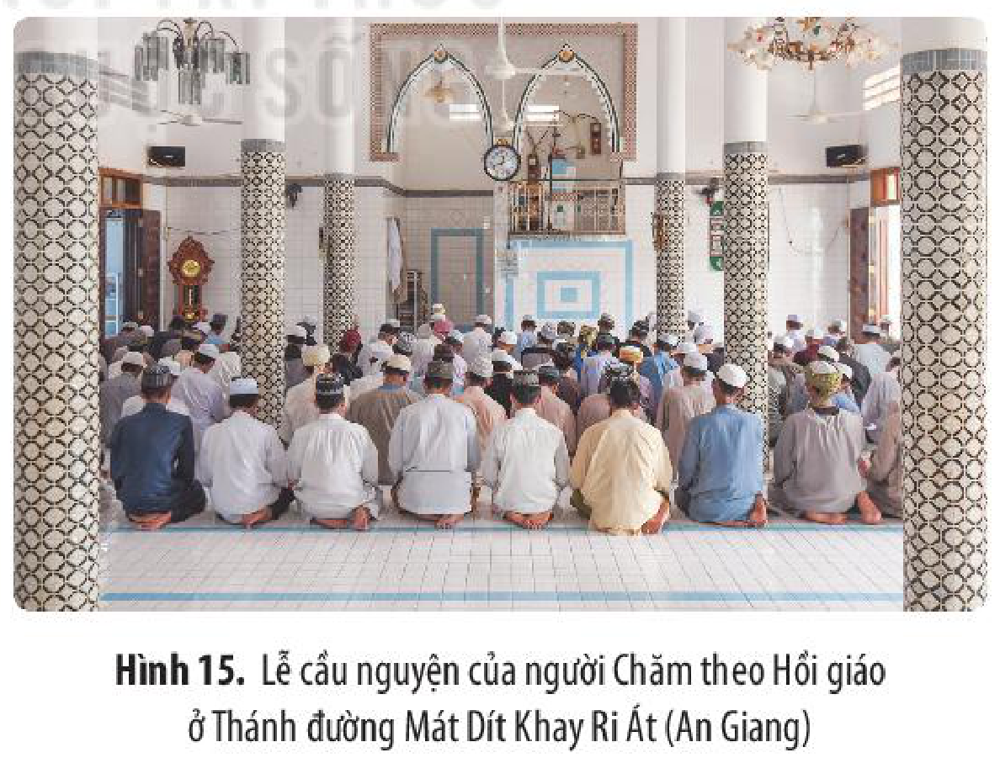

*Hình 15. Lễ cầu nguyện của người Chăm theo Hồi giáo ở Thánh đường Mát Dít Khay Ri Át (An Giang)*

<!-- pdf:134 -->

> ❓ Em hãy kể tên một số tín ngưỡng, tôn giáo đang được duy trì trong đời sống tinh thần của cộng đồng các dân tộc ở Việt Nam.

### b) Phong tục, tập quán, lễ hội

Trong cuộc sống, người Kinh thực hành nhiều phong tục, tập quán liên quan đến chu kì vòng đời (sinh đẻ, cưới xin, ma chay,...), chu kì canh tác (xuống đồng, cơm mới,...) và chu kì thời gian/thời tiết (tết Nguyên đán, tết Nguyên tiêu, tết Trung thu,...).

<!-- term: Lễ hội Đền Hùng -->
Người Kinh sáng tạo, duy trì và phát triển hệ thống lễ hội đa dạng và phong phú, gồm lễ hội liên quan đến các tín ngưỡng dân gian, lễ hội tôn giáo, lễ hội tưởng nhớ các anh hùng dân tộc,... Về quy mô, lễ hội của người Kinh cũng khá đa dạng, từ các lễ hội của cộng đồng làng đến lễ hội của vùng, quốc gia, quốc tế.

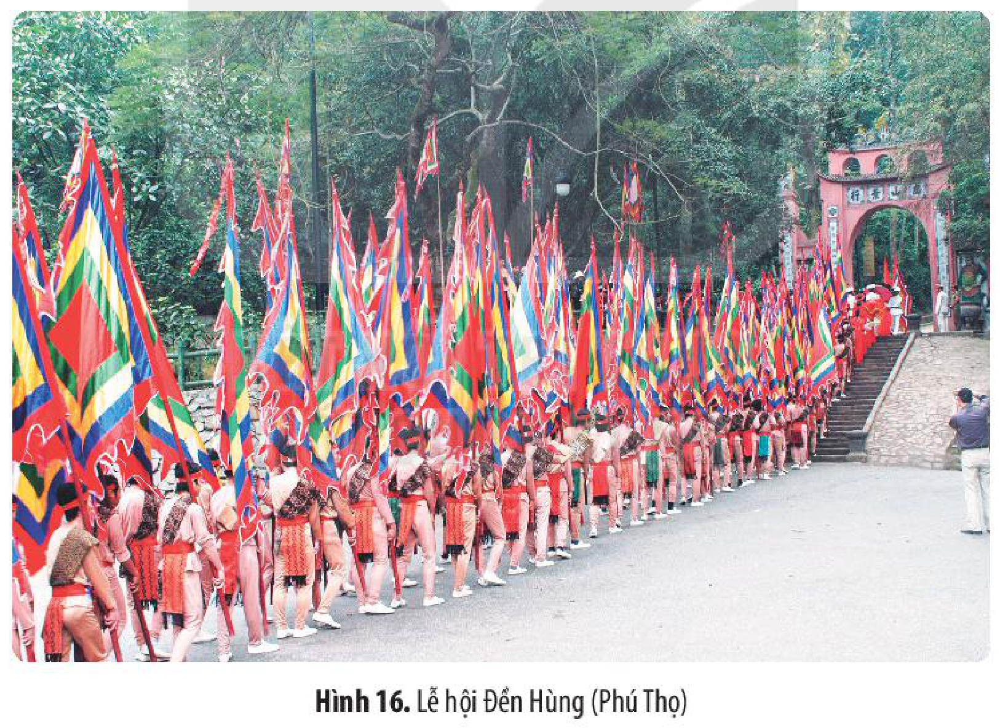

*Hình 16. Lễ hội Đền Hùng (Phú Thọ)*

Các dân tộc thiểu số Việt Nam cũng duy trì nhiều phong tục, tập quán liên quan đến chu kì vòng đời (sinh đẻ, cưới xin, tang ma,...) và chu kì canh tác (làm đất, gieo tỉa, thu hoạch,...). Một số dân tộc cũng có các phong tục, tập quán liên quan đến chu kì thời gian/thời tiết.

<!-- pdf:135 -->

> 💡 EM CÓ BIẾT ?

<!-- term: Lễ thổi tai -->
> Lễ thổi tai (đặt tên) là nghi lễ đầu tiên trong vòng đời mỗi con người, một nghi lễ phổ biến của hầu hết cư dân các dân tộc thiểu số ở Việt Nam.
>
> Sau khi đứa trẻ được sinh ra, gia đình làm lễ đặt tên, tạ ơn thần linh và cầu chúc cho đứa trẻ luôn khoẻ mạnh, khôn lớn,...

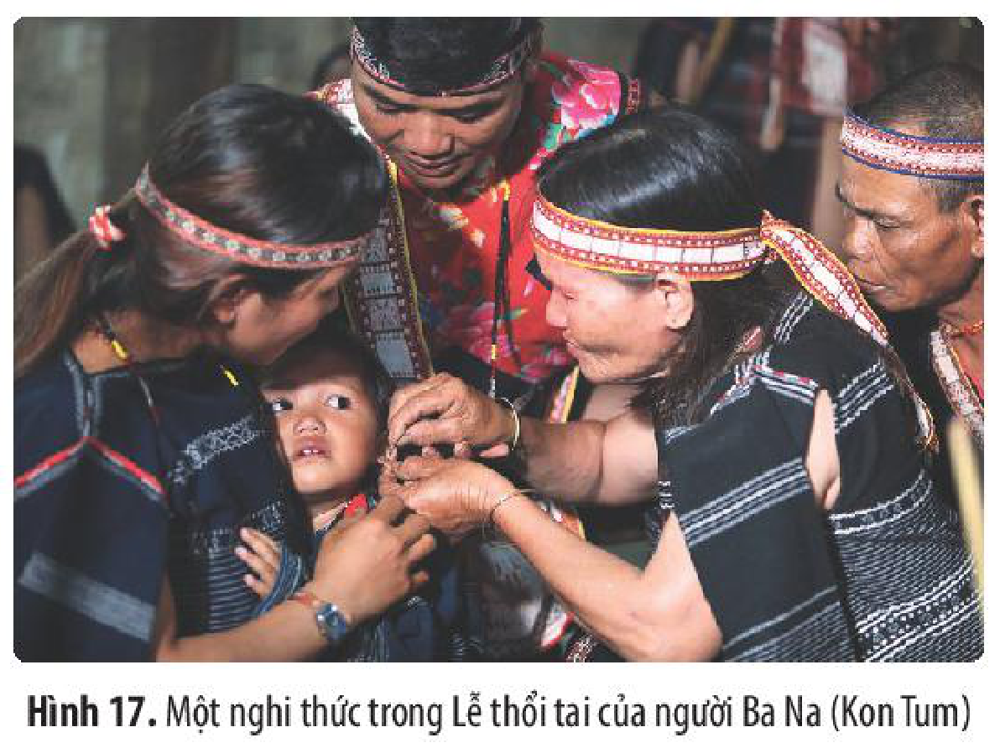

*Hình 17. Một nghi thức trong Lễ thổi tai của người Ba Na (Kon Tum)*

Lễ hội của các dân tộc thiểu số Việt Nam chủ yếu được tổ chức với quy mô làng/bản và tộc người. Một số lễ hội liên quan đến cộng đồng cư dân – dân tộc cư trú tại một vài làng/bản trong một khu vực. Các lễ hội phổ biến như: lễ tế thần, lễ hội cơm mới, đưa thóc vào kho, lễ hội xuống đồng, lễ cúng bản, cúng mường, lễ hội liên quan đến trâu và voi, lễ hội liên quan đến chùa (người Khơ-me), đền, tháp (người Chăm, người Hoa),...

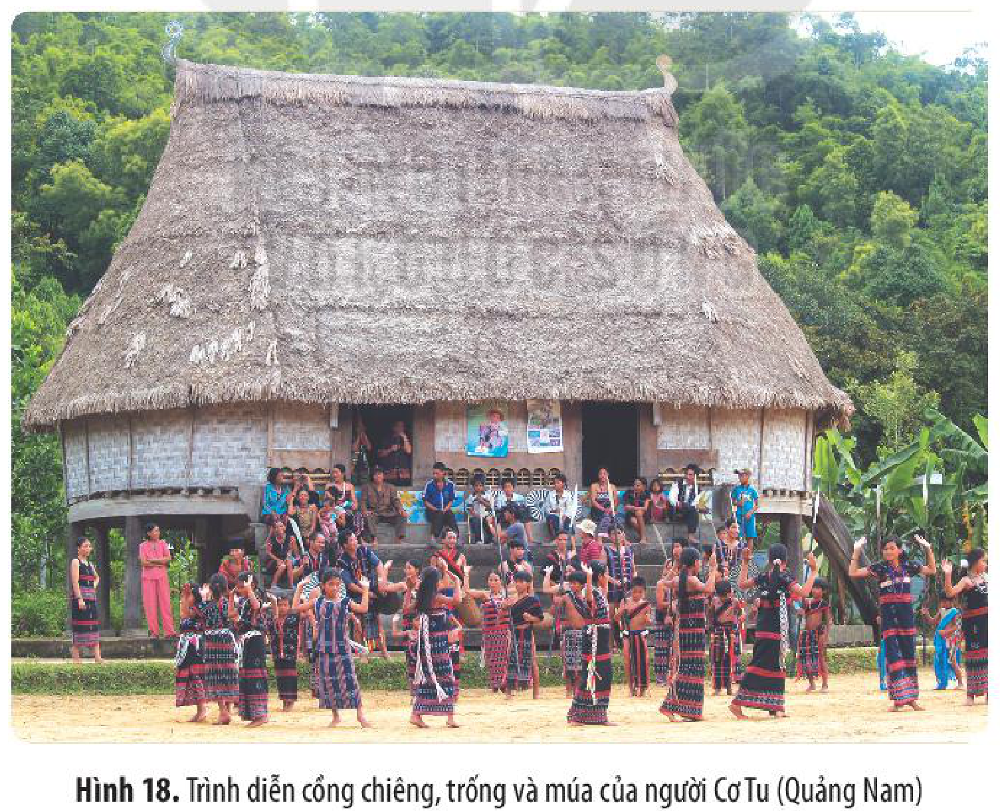

*Hình 18. Trình diễn cồng chiêng, trống và múa của người Cơ Tu (Quảng Nam)*

<!-- pdf:136 -->

Đời sống tinh thần của người Kinh và các dân tộc thiểu số Việt Nam đang ngày càng đa dạng và phong phú. Bên cạnh việc giữ gìn, phát huy những nét đẹp văn hoá truyền thống mang bản sắc dân tộc, người Kinh và cư dân các dân tộc thiểu số Việt Nam cũng không ngừng giao lưu, tiếp thu và phát triển những giá trị, những thành tố văn hoá tiên tiến, phù hợp từ bên ngoài.

> ❓ Hãy kể tên một số phong tục, tập quán, lễ hội của người Kinh và các dân tộc thiểu số Việt Nam.

## ✏️ Luyện tập và vận dụng

1. Lập sơ đồ về các ngữ hệ và nhóm ngôn ngữ ở Việt Nam. Kể tên một số dân tộc thuộc từng nhóm ngôn ngữ đó.

2. Lập bảng thể hiện một số nét chính về đời sống vật chất, tinh thần của cộng đồng các dân tộc ở Việt Nam.

1. Sưu tầm tư liệu và giới thiệu khái quát về các dân tộc ở địa phương em (huyện/thị, xã). Em nhận thấy đời sống vật chất, tinh thần của cộng đồng các dân tộc ở địa phương em trong những năm gần đây có thay đổi gì nổi bật?

## 📷 Danh sách hình trong bài

| Mã hình | Trang PDF | Vị trí trong bài | Chú thích gốc |
| --- | --- | --- | --- |
| H10-lich_su-b13-01 | 124 | Mở đầu | Hình 1. Đoàn đại biểu đại diện cộng đồng các dân tộc Việt Nam trong một lễ kỉ niệm của đất nước |
| H10-lich_su-b13-02 | 126 | Mục 1.b | Hình 2. Sơ đồ thành phần dân tộc theo ngữ hệ ở Việt Nam |
| H10-lich_su-b13-03 | 127 | Mục 2.a | Hình 3. Thu hoạch lúa nước của người Kinh: thủ công và cơ giới |
| H10-lich_su-b13-04 | 128 | Mục 2.a | Hình 4. Ruộng bậc thang của người Mông ở Mù Cang Chải (Yên Bái) |
| H10-lich_su-b13-05 | 128 | Mục 2.a | Hình 5. Một công đoạn trong quy trình sản xuất gốm của làng nghề Chu Đậu (Hải Dương) |
| H10-lich_su-b13-06 | 129 | Mục 2.a | Hình 6. Nghề rèn của người Nùng ở Cao Bằng |
| H10-lich_su-b13-07 | 130 | Mục 2.b | Hình 7. Một số kiểu trang phục của phụ nữ Kinh ở ba miền Bắc – Trung – Nam |
| H10-lich_su-b13-08 | 130 | Mục 2.b | Hình 8. Nhà ở tại vùng nông thôn Nam Định |
| H10-lich_su-b13-09 | 130 | Mục 2.b | Hình 9. Một khu chung cư cao tầng ở Thành phố Hồ Chí Minh |
| H10-lich_su-b13-10 | 131 | Mục 2.b | Hình 10. Trang phục của một số dân tộc thiểu số ở Việt Nam |
| H10-lich_su-b13-11 | 132 | Mục 2.b | Hình 11. Nhà trình tường của người Hà Nhì (Lào Cai) |
| H10-lich_su-b13-12 | 132 | Mục 2.b | Hình 12. Nhà sàn của người Bru – Vân Kiều (Quảng Trị) |
| H10-lich_su-b13-13 | 132 | Mục 2.c | Hình 13. Phụ nữ dân tộc Cơ Tu (Quảng Nam) sử dụng gùi để vận chuyển đồ đạc |
| H10-lich_su-b13-14 | 133 | Mục 3.a | Hình 14. Ban thờ tổ tiên của người Kinh (Bảo tàng Dân tộc học Việt Nam) |
| H10-lich_su-b13-15 | 133 | Mục 3.a | Hình 15. Lễ cầu nguyện của người Chăm theo Hồi giáo ở Thánh đường Mát Dít Khay Ri Át (An Giang) |
| H10-lich_su-b13-16 | 134 | Mục 3.b | Hình 16. Lễ hội Đền Hùng (Phú Thọ) |
| H10-lich_su-b13-17 | 135 | Mục 3.b | Hình 17. Một nghi thức trong Lễ thổi tai của người Ba Na (Kon Tum) |
| H10-lich_su-b13-18 | 135 | Mục 3.b | Hình 18. Trình diễn cồng chiêng, trống và múa của người Cơ Tu (Quảng Nam) |
