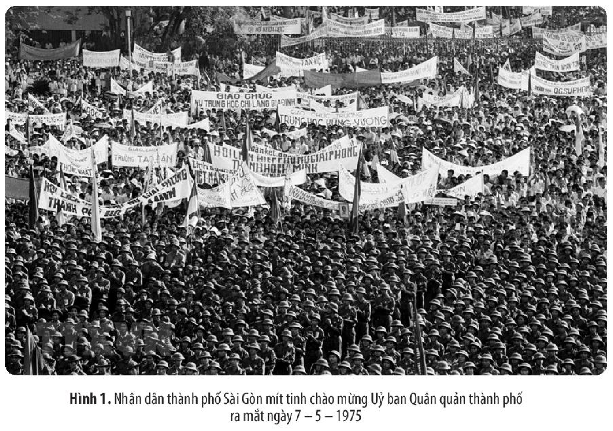
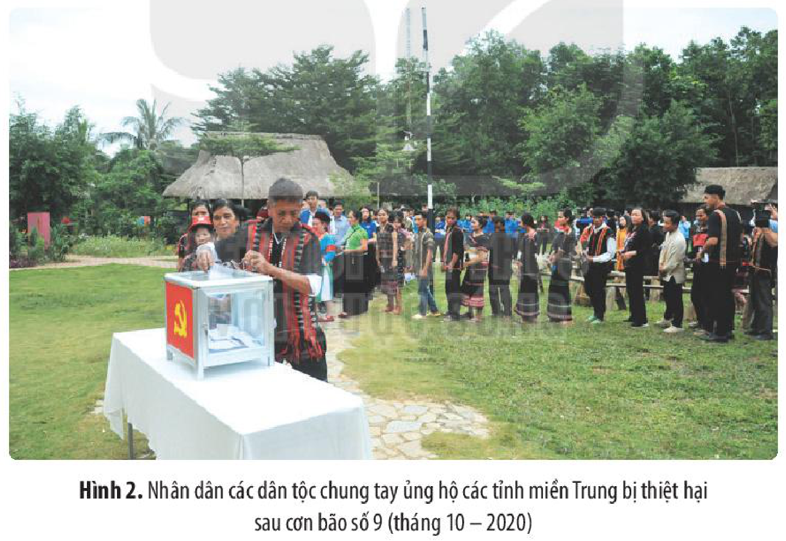
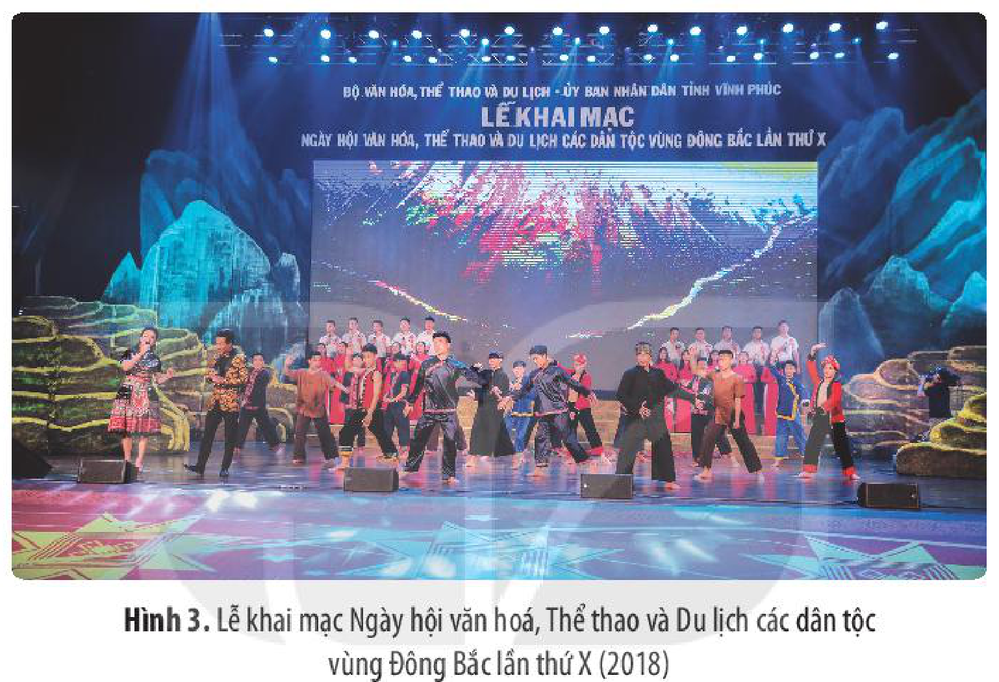
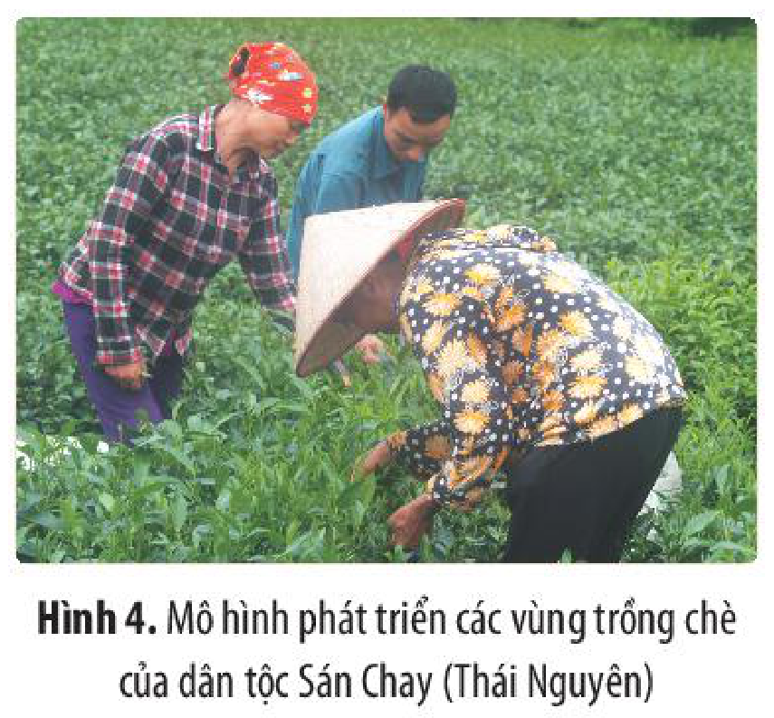
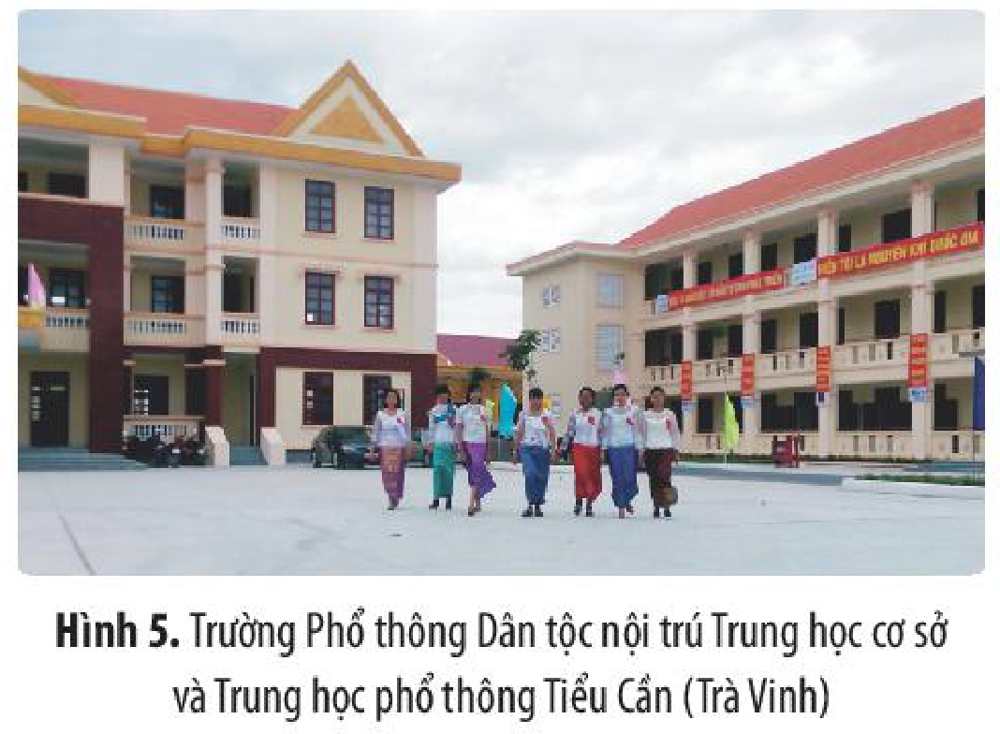

<!-- pdf:137 -->

# BÀI 14: KHỐI ĐẠI ĐOÀN KẾT DÂN TỘC TRONG LỊCH SỬ VIỆT NAM

## 🎯 Học xong bài này, em sẽ:

- Nêu được nét chính về sự hình thành khối đại đoàn kết dân tộc trong lịch sử Việt Nam. Phân tích được vai trò và tầm quan trọng của khối đại đoàn kết dân tộc trong lịch sử dựng nước, giữ nước và trong sự nghiệp xây dựng, bảo vệ Tổ quốc hiện nay.
- Nêu được quan điểm nhất quán của Đảng, Nhà nước trong chính sách dân tộc. Phân tích được nội dung cơ bản trong chính sách dân tộc của Đảng và Nhà nước hiện nay.
- Có ý thức gìn giữ sự bình đẳng giữa các dân tộc; có hành động cụ thể góp phần giữ gìn khối đại đoàn kết dân tộc.

## 🔴 Mở đầu

Trong tiến trình lịch sử dựng nước và giữ nước, dân tộc Việt Nam đã kiên cường chiến đấu và chiến thắng nhiều kẻ thù hung bạo. Theo em, sức mạnh nào góp phần quyết định giúp dân tộc Việt Nam giành được những thắng lợi to lớn trong công cuộc chống ngoại xâm, giữ vững nền độc lập cũng như giữ gìn và phát triển nền văn hoá truyền thống? Sức mạnh ấy đã được phát huy ra sao trong công cuộc xây dựng và bảo vệ Tổ quốc hiện nay?

## 1. Khối đại đoàn kết dân tộc trong lịch sử Việt Nam

### a) Sự hình thành khối đại đoàn kết dân tộc

<!-- term: Khối đại đoàn kết dân tộc -->
Từ yêu cầu liên kết để trị thuỷ, làm thuỷ lợi phục vụ sản xuất nông nghiệp và tập hợp lực lượng đấu tranh chống giặc ngoại xâm, khối đoàn kết dân tộc ở Việt Nam đã hình thành từ rất sớm – từ thời dựng nước Văn Lang – Âu Lạc.

> 🔍 KẾT NỐI VỚI VĂN HỌC
<!-- ocr-ok: tiêu đề hộp Kết nối với văn học đối chiếu đúng ảnh trang 137 -->

<!-- term: Truyền thuyết Con Rồng cháu Tiên -->
> Truyền thuyết *Con Rồng cháu Tiên* có nội dung giải thích về nguồn gốc, tổ tiên của các dân tộc trên lãnh thổ Việt Nam (cùng chung một cha mẹ, chung một giống nòi), là minh chứng về khối đại đoàn kết dân tộc ngay từ thuở bình minh lịch sử.

Khối đại đoàn kết dân tộc ở Việt Nam ngày càng được củng cố qua cuộc đấu tranh bền bỉ trong hơn 1 000 năm chống lại sự thống trị, đồng hoá của các triều đại phong kiến phương Bắc, giành lại độc lập dân tộc.

Thời kì phong kiến tự chủ, khối đại đoàn kết dân tộc giữa người Kinh với các dân tộc thiểu số luôn được các vương triều quan tâm, xây dựng thông qua nhiều chính sách, biện pháp cụ thể, trong đó đáng chú ý là việc phong chức tước, gả công chúa cho thủ lĩnh người dân tộc ở những vùng biên giới,...

<!-- pdf:138 -->

<!-- term: Dương Tự Minh -->
> TƯ LIỆU 1. “Giáp Tý [1144], gả Công chúa Thiều Dung cho Dương Tự Minh [một thủ lĩnh người dân tộc Tày ở Thái Nguyên], phong Tự Minh làm Phò mã lang,... Tháng 5, cho Mậu Du Đô làm Thái sư, xa lĩnh việc các khê động dọc biên giới về đường bộ”.
>
> *(Ngô Sỹ Liên và các sử thần nhà Lê, Đại Việt sử ký toàn thư, Tập I, Sđd, tr. 315)*

Tuy nhiên, khi cần thiết chính quyền trung ương cũng sử dụng những biện pháp cứng rắn để ngăn chặn xu hướng li khai, cát cứ, giữ gìn sự thống nhất quốc gia, toàn vẹn lãnh thổ và khối đại đoàn kết dân tộc.

Từ khi Đảng Cộng sản Việt Nam được thành lập (năm 1930), khối đại đoàn kết dân tộc ngày càng được củng cố, mở rộng, phát triển và trở thành một trong những nhân tố quan trọng quyết định thắng lợi của sự nghiệp giải phóng dân tộc và xây dựng, phát triển, bảo vệ Tổ quốc hiện nay.

<!-- term: Mặt trận dân tộc thống nhất Việt Nam -->
<!-- term: Hội Phản đế Đồng minh -->
<!-- term: Mặt trận Tổ quốc Việt Nam -->
Khối đại đoàn kết các dân tộc Việt Nam được thể hiện tập trung trong Mặt trận dân tộc thống nhất Việt Nam, được thành lập ngày 18 – 11 – 1930 với tên gọi Hội Phản đế Đồng minh, nay là Mặt trận Tổ quốc Việt Nam.

> 💡 EM CÓ BIẾT ?

<!-- term: Ngày hội Đại đoàn kết toàn dân tộc -->
> Ngày 26 – 3 – 1986, Ban Bí thư Ban Chấp hành Trung ương Đảng Cộng sản Việt Nam đã quyết định lấy ngày 18 – 11 hằng năm là ngày kỉ niệm thành lập Mặt trận dân tộc thống nhất Việt Nam, cũng là Ngày hội Đại đoàn kết toàn dân tộc.

> ❓ 1. Hãy cho biết: Khối đại đoàn kết dân tộc ở Việt Nam được hình thành trên những cơ sở nào và thể hiện ra sao trong các thời kì lịch sử?
>
> 2. Nêu nhận xét về sự hình thành và phát triển khối đại đoàn kết dân tộc trong lịch sử Việt Nam.

### b) Vai trò, tầm quan trọng của khối đại đoàn kết dân tộc trong lịch sử dựng nước và giữ nước

Trong lịch sử dựng nước và giữ nước của Việt Nam, khối đại đoàn kết dân tộc có vai trò đặc biệt quan trọng.

Khi có giặc ngoại xâm, khối đại đoàn kết dân tộc là nhân tố quan trọng, quyết định sự thành công của các cuộc đấu tranh chống ngoại xâm, bảo vệ hoặc giành lại độc lập dân tộc.

<!-- pdf:139 -->

> TƯ LIỆU 2. ... Noi theo lá cờ đại nghĩa của Hai Bà Trưng, nhân dân các quận, huyện nhất tề nổi dậy hưởng ứng “đánh phá các châu, quận” *(Giao châu ngoại vực kí)*... Khi Hai Bà Trưng “đánh hạ quận Giao Chỉ” thì người Man Lý ở Cửu Chân, Nhật Nam, Hợp Phố đều hưởng ứng, cướp được 65 thành *(Hậu Hán thư)*...
>
> *(Theo Phan Huy Lê, Tìm về cội nguồn, NXB Thế giới, Hà Nội, 2010, tr. 772)*

> TƯ LIỆU 3. “Đoàn kết là một lực lượng vô địch. Lực lượng đoàn kết đã giúp Cách mạng tháng Tám thành công. Lực lượng đoàn kết đã giúp kháng chiến thắng lợi. Lực lượng đoàn kết sẽ động viên nhân dân ta từ Bắc đến Nam đấu tranh để thực hiện hoà bình, thống nhất, độc lập, dân chủ trong cả nước”.
>
> *(Hồ Chí Minh toàn tập, Tập VIII, NXB Chính trị quốc gia, Hà Nội, 2000, tr. 49)*

*Hình 1. Nhân dân thành phố Sài Gòn mít tinh chào mừng Uỷ ban Quân quản thành phố ra mắt ngày 7 – 5 – 1975*

> ❓ Em hãy cho biết nguyên nhân thắng lợi của các cuộc đấu tranh giành độc lập trong lịch sử dân tộc. Qua đó, phân tích vai trò và tầm quan trọng của khối đại đoàn kết toàn dân tộc trong lịch sử dựng nước và giữ nước của Việt Nam.

<!-- pdf:140 -->

### c) Vai trò, tầm quan trọng của khối đại đoàn kết dân tộc trong sự nghiệp xây dựng và bảo vệ Tổ quốc hiện nay

Trong thời đại ngày nay, đại đoàn kết dân tộc có vai trò to lớn, là cơ sở để huy động sức mạnh của toàn dân tộc trong sự nghiệp phát triển kinh tế, văn hoá, giữ gìn ổn định xã hội, sự bền vững của môi trường, đảm bảo an ninh quốc phòng, bảo vệ toàn vẹn lãnh thổ và chủ quyền quốc gia.

> TƯ LIỆU 4. “Đại đoàn kết toàn dân tộc là đường lối chiến lược của cách mạng Việt Nam, là động lực và nguồn lực to lớn trong xây dựng và bảo vệ Tổ quốc...”.
>
> *(Đảng Cộng sản Việt Nam, Văn kiện Đại hội đại biểu toàn quốc lần thứ XII, NXB Chính trị quốc gia Sự thật, Hà Nội, 2016, tr. 158)*

Đoàn kết giữa các dân tộc, một truyền thống tốt đẹp của dân tộc Việt Nam đã và đang được phát huy cao độ khi có thiên tai, dịch bệnh.

*Hình 2. Nhân dân các dân tộc chung tay ủng hộ các tỉnh miền Trung bị thiệt hại sau cơn bão số 9 (tháng 10 – 2020)*

> ❓ Quan sát Hình 2, kết hợp liên hệ thực tế, em hãy nêu vai trò, tầm quan trọng của khối đại đoàn kết dân tộc trong cuộc sống hiện nay. Kể thêm một số ví dụ khác mà em biết.

<!-- pdf:141 -->

## 2. Chính sách dân tộc của Đảng và Nhà nước hiện nay

### a) Quan điểm của Đảng và Nhà nước về chính sách dân tộc

<!-- term: Chính sách dân tộc của Đảng và Nhà nước -->
Từ khi ra đời cho đến nay, Đảng Cộng sản Việt Nam đã luôn quan tâm xây dựng, phát triển khối đại đoàn kết dân tộc, với ba nguyên tắc: *Đoàn kết, Bình đẳng và Tương trợ nhau cùng phát triển*.

Ba nguyên tắc này đã từng bước được phát triển, khẳng định trên tất cả các văn kiện quan trọng của Đảng và Nhà nước; được quán triệt trong toàn Đảng, toàn quân, toàn dân và được cụ thể hoá trong các chương trình hành động, chính sách của Nhà nước Việt Nam qua các thời kì.

<!-- term: Hiến pháp năm 1946 -->
> TƯ LIỆU 5. Hiến pháp nước Việt Nam Dân chủ Cộng hoà năm 1946 khẳng định: *“Đoàn kết toàn dân không phân biệt giống nòi, gái, trai, giai cấp, tôn giáo”*.
>
> *(Theo Hiến pháp nước Cộng hoà xã hội chủ nghĩa Việt Nam năm 1946, 1959, 1980, 1992, NXB Thống kê, Hà Nội, tr. 6)*

<!-- term: Điều 5 Hiến pháp năm 2013 -->
> TƯ LIỆU 6. Điều 5, Hiến pháp nước Cộng hoà xã hội chủ nghĩa Việt Nam, năm 2013, có đoạn: “Nước Cộng hoà xã hội chủ nghĩa Việt Nam là quốc gia thống nhất của các dân tộc cùng sinh sống trên đất nước Việt Nam. Các dân tộc bình đẳng, đoàn kết, tôn trọng và giúp nhau cùng phát triển; nghiêm cấm mọi hành vi kì thị, chia rẽ dân tộc”.
>
> *(Theo Hiến pháp nước Cộng hoà xã hội chủ nghĩa Việt Nam năm 2013, NXB Chính trị quốc gia Sự thật, Hà Nội, 2020, tr. 10 – 11)*

> ❓ Em hãy xác định những từ ngữ thể hiện quan điểm của Đảng và Nhà nước về vấn đề dân tộc trong các tư liệu 5, 6. Các tư liệu đó thể hiện điều gì trong chính sách dân tộc của Đảng và Nhà nước?

### b) Nội dung cơ bản trong chính sách dân tộc của Đảng và Nhà nước

Với quan điểm nhất quán, xuyên suốt trong lãnh đạo thực hiện công tác dân tộc và chính sách dân tộc, Đảng và Nhà nước đã đề ra nhiều chủ trương, chính sách phù hợp với từng thời kì, từng vùng miền, từng địa phương, từng dân tộc nhằm gìn giữ, phát huy, phát triển khối đại đoàn kết dân tộc.

Điểm nổi bật nhất trong chính sách dân tộc của Nhà nước Việt Nam hiện nay là tính toàn diện, trên tất cả các lĩnh vực kinh tế, văn hoá, xã hội, an ninh quốc phòng,...

*Về kinh tế,* Nhà nước chủ trương phát triển kinh tế miền núi, vùng dân tộc thiểu số, nhằm phát huy tiềm năng, thế mạnh của các dân tộc, từng bước khắc phục chênh lệch giữa các vùng, các dân tộc,...

<!-- pdf:142 -->

*Về văn hoá,* nội dung bao trùm là xây dựng nền văn hoá Việt Nam tiên tiến, đậm đà bản sắc dân tộc; bao gồm các giá trị và bản sắc văn hoá của 54 dân tộc,...

*Về xã hội,* thực hiện chính sách xã hội trong vùng đồng bào các dân tộc thiểu số xuất phát từ đường lối chung và đặc điểm riêng về trình độ phát triển kinh tế – xã hội, tổ chức và kết cấu xã hội, tập quán và truyền thống trong các dân tộc,...

*Về an ninh quốc phòng,* củng cố các địa bàn chiến lược, giải quyết tốt vấn đề đoàn kết dân tộc và quan hệ dân tộc trong mối liên hệ tộc người, giữa các tộc người và liên quốc gia trong xu thế toàn cầu hoá.

*Hình 3. Lễ khai mạc Ngày hội văn hoá, Thể thao và Du lịch các dân tộc vùng Đông Bắc lần thứ X (2018)*

Những chương trình kinh tế, chính trị, xã hội của Đảng và Nhà nước Việt Nam đã phát huy hiệu quả, thực sự đi vào cuộc sống, làm thay đổi diện mạo kinh tế, văn hoá, xã hội các địa phương miền núi, hải đảo; củng cố, giữ vững biên giới, toàn vẹn lãnh thổ quốc gia.

*Hình 4. Mô hình phát triển các vùng trồng chè của dân tộc Sán Chay (Thái Nguyên)*

*Hình 5. Trường Phổ thông Dân tộc nội trú Trung học cơ sở và Trung học phổ thông Tiểu Cần (Trà Vinh)*

<!-- pdf:143 -->

> ❓ 1. Lập bảng tóm tắt một số nội dung cơ bản trong chính sách dân tộc của Đảng và Nhà nước (về kinh tế, văn hoá, xã hội và an ninh quốc phòng).
>
> 2. Thông qua sách, báo, truyền hình, internet hoặc quan sát thực tế ở địa phương, em hãy kể tên một số chương trình thể hiện những nội dung cơ bản trong chính sách dân tộc của Đảng và Nhà nước.

## ✏️ Luyện tập và vận dụng

1. Em hãy trình bày quá trình hình thành và phát triển khối đại đoàn kết dân tộc trên trục thời gian.

2. “Đoàn kết, đoàn kết, đại đoàn kết
   Thành công, thành công, đại thành công”
   *(Hồ Chí Minh)*

   Em hiểu như thế nào về quan điểm trên của Chủ tịch Hồ Chí Minh? Lấy những dẫn chứng lịch sử để chứng minh cho luận giải của em.

1. Hiện nay, trong danh sách Di sản văn hoá vật thể và phi vật thể của Việt Nam được UNESCO ghi danh có nhiều di sản thuộc về cộng đồng các dân tộc thiểu số. Điều đó gợi cho em suy nghĩ gì? Hãy viết một đoạn văn (khoảng 15 dòng) giới thiệu về một di sản của cư dân dân tộc thiểu số mà em thích nhất.

2. Nếu trường em hoặc tổ dân phố/làng/bản nơi em đang sinh sống phát động cuộc thi vẽ tranh hoặc sưu tầm hình ảnh và viết bài tham gia Ngày hội Đại đoàn kết toàn dân tộc, em sẽ lựa chọn hình ảnh nào? Tại sao?

## 📷 Danh sách hình trong bài

| Mã hình | Trang PDF | Vị trí trong bài | Chú thích gốc |
| --- | --- | --- | --- |
| H10-lich_su-b14-01 | 139 | Mục 1.b | Hình 1. Nhân dân thành phố Sài Gòn mít tinh chào mừng Uỷ ban Quân quản thành phố ra mắt ngày 7 – 5 – 1975 |
| H10-lich_su-b14-02 | 140 | Mục 1.c | Hình 2. Nhân dân các dân tộc chung tay ủng hộ các tỉnh miền Trung bị thiệt hại sau cơn bão số 9 (tháng 10 – 2020) |
| H10-lich_su-b14-03 | 142 | Mục 2.b | Hình 3. Lễ khai mạc Ngày hội văn hoá, Thể thao và Du lịch các dân tộc vùng Đông Bắc lần thứ X (2018) |
| H10-lich_su-b14-04 | 142 | Mục 2.b | Hình 4. Mô hình phát triển các vùng trồng chè của dân tộc Sán Chay (Thái Nguyên) |
| H10-lich_su-b14-05 | 142 | Mục 2.b | Hình 5. Trường Phổ thông Dân tộc nội trú Trung học cơ sở và Trung học phổ thông Tiểu Cần (Trà Vinh) |
