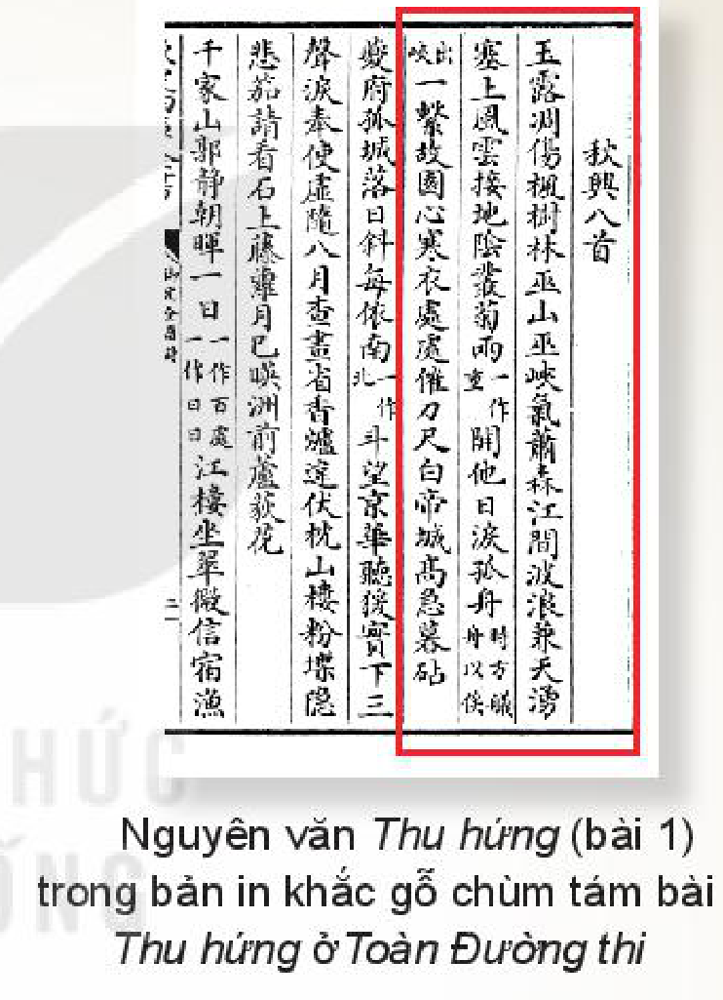
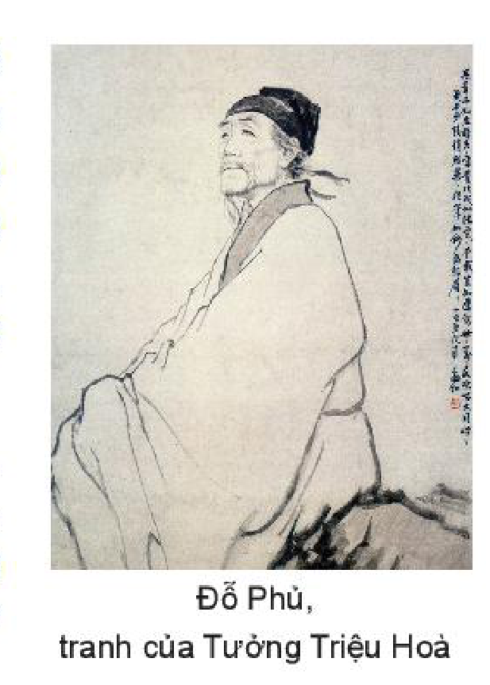

<!-- pdf:44 -->

# BÀI 2: VẺ ĐẸP CỦA THƠ CA

## 🎯 Yêu cầu cần đạt

- Phân tích và đánh giá được giá trị thẩm mĩ của một số yếu tố trong thơ như từ ngữ, hình ảnh, vần, nhịp, đối, nhân vật trữ tình (chủ thể trữ tình).
- Liên hệ để thấy được một số điểm gần gũi về nội dung giữa các tác phẩm thơ thuộc hai nền văn hoá khác nhau.
- Nhận biết được lỗi dùng từ và lỗi về trật tự từ, biết cách sửa những lỗi đó.
- Viết được một văn bản nghị luận phân tích, đánh giá chủ đề và những nét đặc sắc về nghệ thuật của một tác phẩm thơ.
- Biết thuyết trình (giới thiệu, đánh giá) về nội dung và nghệ thuật của một tác phẩm thơ.
- Biết nuôi dưỡng đời sống tâm hồn phong phú, có khả năng rung động trước những vẻ đẹp đa dạng của cuộc sống.

## ĐỌC

### TRI THỨC NGỮ VĂN

**Thơ và thơ trữ tình**

**Thơ** là hình thức tổ chức ngôn từ đặc biệt, tuân theo một mô hình thi luật hoặc nhịp điệu nhất định. Mô hình này làm nổi bật mối quan hệ giữa âm điệu và ý nghĩa của ngôn từ thơ ca. Với hình thức ngôn từ như thế, thơ có khả năng diễn tả được những tình cảm mãnh liệt hoặc những ấn tượng, xúc động tinh tế của con người trước thế giới.

**Thơ trữ tình** là loại tác phẩm thơ thường có dung lượng nhỏ, thể hiện trực tiếp cảm xúc, tâm trạng của nhân vật trữ tình.

<!-- pdf:45 -->

**Nhân vật trữ tình**

**Nhân vật trữ tình** (còn gọi là **chủ thể trữ tình**) là người trực tiếp bộc lộ rung động và tình cảm trong bài thơ trước một khung cảnh hoặc sự tình nào đó. Nhân vật trữ tình có mối liên hệ mật thiết với tác giả song không hoàn toàn đồng nhất với tác giả.

**Hình ảnh thơ**

**Hình ảnh thơ** là các sự vật, hiện tượng, trạng thái đời sống được tái tạo một cách cụ thể, sống động bằng ngôn từ, khơi dậy cảm giác (đặc biệt là những ấn tượng thị giác) cũng như gợi ra những ý nghĩa tinh thần nhất định đối với người đọc.

**Vần thơ, nhịp điệu, nhạc điệu, đối, thi luật, thể thơ**

**Vần thơ**: sự cộng hưởng, hoà âm theo quy luật giữa một số âm tiết trong hay cuối dòng thơ. Vần có chức năng liên kết các dòng thơ và góp phần tạo nên nhịp điệu, nhạc điệu cũng như giọng điệu của bài thơ.

**Nhịp điệu**: những điểm ngắt hay ngừng theo chu kì nhất định trên văn bản do tác giả chủ động bố trí. Nhịp điệu chứa đựng sự lặp lại có biến đổi của các yếu tố ngôn ngữ và hình ảnh nhằm gợi ra cảm giác về sự vận động của sự sống và thể hiện cảm nhận thẩm mĩ về thế giới.

**Nhạc điệu**: cách tổ chức các yếu tố âm thanh của ngôn từ để lời văn gợi ra cảm giác về âm nhạc (âm hưởng, nhịp điệu). Trong thơ, những phương thức cơ bản để tạo nhạc điệu là gieo vần, ngắt nhịp, điệp, phối hợp thanh điệu bằng – trắc,...

**Đối**: cách tổ chức lời văn thành hai vế cân xứng và sóng đôi với nhau cả về ý và lời. Căn cứ vào sự thuận chiều hay tương phản về ý và lời, có thể chia đối thành hai loại: **đối cân** (thuận chiều), **đối chọi** (tương phản).

**Thi luật**: toàn bộ những quy tắc tổ chức ngôn từ trong thơ như gieo vần, ngắt nhịp, hoà thanh, đối, phân bố số tiếng trong một dòng thơ, số dòng trong cả bài thơ,...

**Thể thơ**: sự thống nhất giữa mô hình thi luật và loại hình nội dung của tác phẩm thơ. Các thể thơ được hình thành và duy trì sự ổn định của chúng trong quá trình phát triển của lịch sử văn học.

**Lỗi dùng từ và lỗi về trật tự từ trong câu**

<!-- term: lỗi dùng từ -->
Khi sử dụng tiếng Việt, cần tránh những lỗi cơ bản trong cách dùng từ như lỗi lặp từ, lỗi dùng từ không đúng nghĩa, lỗi dùng từ không đúng phong cách của kiểu, loại văn bản.

<!-- term: lỗi về trật tự từ -->
Trong cụm từ hay trong câu tiếng Việt, các từ được sắp xếp theo một trật tự có quy tắc riêng. Việc vi phạm trật tự này sẽ khiến thông tin muốn truyền đạt bị hiểu nhầm, hiểu sai và theo đó, hiệu quả giao tiếp bị hạn chế.

<!-- pdf:46 -->

### VĂN BẢN 1, 2, 3: Chùm thơ hai-cư (haiku) Nhật Bản
<!-- ocr-ok: nhãn VĂN BẢN 1, 2, 3 và tiêu đề bài màu cam bị OCR bỏ sót, đã đối chiếu ảnh trang PDF 46 -->

Bài thơ ngắn nhất mà bạn đã từng đọc là bài nào? Điều gì khiến nó được bạn nhớ tới?

**1.** *Trên cành khô*
*cánh quạ đậu*
*chiều thu.*
<!-- ocr-ok: chữ in nghiêng bị OCR đọc nhầm "cánh quạ" thành "cánh: qua", đã đối chiếu ảnh trang PDF 46 -->

(Ba-sô – Basho, Nhật Chiêu dịch, *Ba-sô và thơ hai-cư*, NXB Văn học, Thành phố Hồ Chí Minh, 1994, tr. 23)

> Hãy hình dung về màu sắc, không khí của khung cảnh được gợi tả trong bài thơ.

**2.** *Ôi hoa triêu nhan(1)!*
*Dây gàu vương hoa bên giếng*
*Đành xin nước nhà bên.*
<!-- ocr-ok: chữ in nghiêng bị OCR đọc nhầm "hoa triêu nhan" thành "loa triều nhan" và "Dây gàu" thành "Dâu sầu", đã đối chiếu ảnh trang PDF 46 -->

(Chi-y-ô – Chiyo, Nhật Chiêu dịch, *Ba nghìn thế giới thơm*, NXB Văn học, Thành phố Hồ Chí Minh, 2015, tr. 314)

> Ấn tượng mà hình ảnh “hoa triêu nhan” và “dây gàu” gợi ra cho bạn là gì?

**3.** *Chậm rì, chậm rì*
*Kìa con ốc nhỏ*
*Trèo núi Phu-gi (Fuji).(2)*

(Ít-sa – Issa, Nhật Chiêu dịch, *Ba nghìn thế giới thơm*, Sđd, tr. 385)

> Khi nhắc đến “con ốc” và “núi Phu-gi”, người ta thường nghĩ đến những đặc điểm nào của chúng?

> (1) *Triêu nhan*: loài hoa rất phổ biến ở Nhật Bản, được người Nhật gọi bằng nhiều cái tên gợi cảm như “kim tuyến của ban mai”, “trăng lúc chiều tà”, “cô gái đậu tía”,... Hoa triêu nhan cũng là hình ảnh xuất hiện nhiều trong thơ Chi-y-ô.
> (2) *Phu-gi*: ngọn núi cao nhất Nhật Bản (3 776m), ở Việt Nam thường được gọi theo âm Hán Việt là Phú Sĩ. Từ lâu, ngọn núi này đã khơi gợi cảm hứng sáng tác cho nhiều nghệ sĩ và là điểm đến quen thuộc của nhiều người Nhật và du khách nước ngoài.

<!-- pdf:47 -->

**Hai-cư** là thể thơ truyền thống có vị trí quan trọng trong văn học Nhật Bản, đồng thời được xem là một trong những hình thức cô đọng nhất của thơ ca thế giới. Bài thơ hai-cư trong tiếng Nhật chỉ gồm 3 dòng (dòng 1 và dòng 3 có năm âm tiết; dòng 2 có bảy âm tiết). Bản dịch tiếng Việt trong sách giáo khoa tuy không đáp ứng được đầy đủ yêu cầu của luật thơ nêu trên nhưng vẫn đảm bảo sự ngắn gọn, hàm súc đặc trưng của thể thơ này. Thơ hai-cư thường biểu hiện những rung cảm của con người trước thiên nhiên bằng những hình ảnh trong sáng, nhẹ nhàng nhưng cũng đậm tính tượng trưng.

Khởi nguồn từ Nhật Bản, ngày nay, hai-cư đã trở thành thể thơ được sáng tác bằng nhiều ngôn ngữ khác nhau trên thế giới. Thơ hai-cư hiện đại tuy có những đặc điểm riêng về bút pháp nhưng vẫn bảo lưu một số nguyên tắc quan trọng của tư duy và mĩ cảm thơ hai-cư truyền thống như bài thơ được cấu tứ quanh một phát hiện mang tính chất “bừng ngộ” về mối quan hệ giữa các sự vật, hiện tượng, về sự tương thông đầy bí ẩn giữa thế giới và con người; thơ thiên về khơi gợi hơn là miêu tả và diễn giải. Sức sống và sự hấp dẫn của thơ hai-cư nằm ở khả năng kiệm lời mà vẫn gợi nhiều cảm xúc và suy tưởng.

**Mát-chư-ô Ba-sô** (Matsuo Basho, 1644 – 1694) là nhà thơ nổi tiếng của văn học Nhật. Ông có công lớn trong việc hoàn thiện thơ hai-cư, đưa nó trở thành thể thơ độc đáo nhất của Nhật Bản.

**Phư-cư-ma-xư-y-a Chi-y-ô** (Fukumasuya Chiyo, 1703 – 1775) là người đánh dấu sự hiện diện của các tác giả nữ trong truyền thống thơ hai-cư. Trước bà, thơ hai-cư của tác giả nữ thường bị coi thường và quên lãng. Bà đã trở thành một tiếng nói thơ ca độc đáo, được nhiều người yêu thích.

**Cô-ba-y-a-si Ít-sa** (Kobayashi Issa, 1763 – 1828) là nhà thơ kiêm tu sĩ Phật giáo. Ông còn là hoạ sĩ tài ba, nổi tiếng với những bức tranh có đề các bài thơ hai-cư do chính ông sáng tác.

**Trả lời câu hỏi**

1. Hãy nhận diện hình ảnh trung tâm ở từng bài thơ hai-cư và cho biết đặc điểm chung của các hình ảnh ấy.
2. Xác định mối quan hệ giữa hình ảnh trung tâm trong bài thơ của Ba-sô với các yếu tố thời gian và không gian.
3. Bài thơ của Chi-y-ô được triển khai xoay quanh phát hiện nào? Theo bạn, vì sao phát hiện này lại dẫn dắt nhân vật trữ tình sang “xin nước nhà bên”?
4. Từ những đặc điểm thường được liên hệ khi hình dung về “con ốc” và “núi Phu-gi”, hãy nhận xét về tương quan giữa hai hình ảnh này.
5. Khoảnh khắc được thể hiện trong bài thơ của Ba-sô có thể khơi gợi những cảm xúc gì ở người đọc?
6. Từ bài thơ của Chi-y-ô, hãy bình luận về ý nghĩa triết lí trong cách ứng xử của con người đối với thiên nhiên mà bài thơ gợi ra.
7. Bạn cảm nhận như thế nào về hành trình “chậm rì” của con ốc trong bài thơ của Ít-sa?

#### Kết nối đọc – viết

Từ việc đọc ba bài thơ trong chùm thơ hai-cư, hãy viết đoạn văn (khoảng 150 chữ) trình bày về điều bạn cảm thấy thú vị nhất ở thể thơ hai-cư.

<!-- pdf:48 -->

### VĂN BẢN 4: Thu hứng
<!-- ocr-ok: nhãn VĂN BẢN 4 trên nền màu xanh bị OCR bỏ sót, đã đối chiếu ảnh trang PDF 48 -->

*(Cảm xúc mùa thu)*

**Đỗ Phủ**

- Bạn đã được làm quen với một số bài thơ Đường luật trong sách giáo khoa Ngữ văn cấp Trung học cơ sở. Hãy chia sẻ ấn tượng của bạn về đặc điểm hình thức cũng như nội dung của những bài thơ thuộc thể loại này.
- Bạn đã bao giờ xa gia đình và thấy nhớ nhà? Nếu có thể, hãy chia sẻ về trải nghiệm ấy của bạn.

**Phiên âm**

*Ngọc lộ điêu thương phong thụ lâm,*
*Vu sơn, Vu giáp khí tiêu sâm.*
*Giang gian ba lãng kiêm thiên dũng,*
*Tái thượng phong vân tiếp địa âm.*
*Tùng cúc lưỡng khai tha nhật lệ,*
*Cô chu nhất hệ cố viên tâm.*
*Hàn y xứ xứ thôi đao xích,*
*Bạch Đế thành cao cấp mộ châm.*
<!-- ocr-ok: chữ in nghiêng đặt cạnh ảnh bản in khắc gỗ chữ Hán bị OCR trộn lẫn và đọc nhầm nhiều từ, đã đối chiếu ảnh trang PDF 48 -->

Nguyên văn *Thu hứng* (bài 1) trong bản in khắc gỗ chùm tám bài *Thu hứng* ở *Toàn Đường thi*

**Dịch nghĩa**

Sương móc trắng xoá làm tiêu điều cả rừng cây phong,
Núi Vu(1), kẽm Vu(2) hơi thu hiu hắt.
Giữa lòng sông, sóng tung vọt trùm bầu trời,
Từ trên cửa ải, gió mây sà xuống khiến mặt đất âm u.
Khóm cúc nở hoa đã hai lần làm tuôn rơi nước mắt ngày trước,
Con thuyền lẻ loi thắt chặt mãi tấm lòng nhớ về vườn cũ.
Chỗ nào cũng rộn ràng dao thước để may áo rét,
Về chiều, từ trên thành Bạch Đế(3) cao, tiếng chày nện vải nghe càng dồn dập.

> (1) *Núi Vu*: nay thuộc thành phố Trùng Khánh, tỉnh Tứ Xuyên, Trung Quốc.
> (2) *Kẽm Vu*: hẻm núi kéo dài từ huyện Vu Sơn (thành phố Trùng Khánh) đến huyện Ba Đông (tỉnh Hồ Bắc, Trung Quốc).
> (3) *Bạch Đế*: toà thành được xây trên núi cao, ở bờ bắc sông Trường Giang, thuộc thành phố Trùng Khánh.

<!-- pdf:49 -->

**Dịch thơ**

**Bản dịch 1**

*Lác đác rừng phong hạt móc sa,*
*Ngàn non hiu hắt, khí thu loà.*
*Lưng trời sóng rợn lòng sông thẳm,*
*Mặt đất mây đùn cửa ải xa.*
*Khóm cúc tuôn thêm dòng lệ cũ,*
*Con thuyền buộc chặt mối tình nhà.*
*Lạnh lùng giục kẻ tay dao thước,*
*Thành Bạch, chày vang bóng ác tà.*
<!-- ocr-ok: chữ in nghiêng của bản dịch thơ 1 đặt cạnh hộp chỉ dẫn đọc bị OCR đọc nhầm nhiều từ, đã đối chiếu ảnh trang PDF 49 -->

(Nguyễn Công Trứ dịch, *Ngữ văn 10*, tập một, NXB Giáo dục Việt Nam, Hà Nội, 2014, tr. 146)

> Khung cảnh mùa thu được tái hiện trong bài thơ (màu sắc, không khí, trạng thái vận động của sự vật).

> Hãy nhận diện phép đối trong cả nguyên tác và bản dịch nghĩa trong các cặp câu thơ 3 – 4 và 5 – 6.

**Bản dịch 2**

*Móc trắng rừng phong vẻ úa gầy,*
*Vu sơn, Vu giáp khí thu dày.*
*Lòng sông sóng tận lưng trời nhảy,*
*Đầu ải mây sà mặt đất bay.*
*Lệ cũ nở hai mùa cúc đó,*
*Lòng quê buộc một chiếc thuyền đây.*
*Nơi nơi áo lạnh đòi dao thước,*
*Bạch Đế thành hôm rộn tiếng chày.*
<!-- ocr-ok: chữ in nghiêng của bản dịch thơ 2 bị OCR đọc nhầm nhiều từ cuối câu, đã đối chiếu ảnh trang PDF 49 -->

(Khương Hữu Dụng dịch, *Thơ Đỗ Phủ*, NXB Văn học, Hà Nội, 1962, tr. 229)

> Âm thanh của tiếng dao thước may áo, tiếng chày đập vải gợi ra không khí gì?

**Thơ Đường luật** còn gọi là thơ cận thể. Đó là thể thơ ngũ ngôn hay thất ngôn làm theo những nguyên tắc thi luật được đặt ra từ thời Đường.

Thơ Đường luật có ba dạng chính: thơ bát cú (8 câu), thơ tuyệt cú (4 câu) và thơ bài luật (dạng kéo dài của thơ Đường luật), trong đó thơ bát cú (đặc biệt là thất ngôn bát cú) được xem là dạng cơ bản nhất.

Về bố cục, một bài thơ thất ngôn bát cú Đường luật gồm bốn cặp câu thơ (liên thơ), tương ứng với bốn phần: đề – thực – luận – kết. Bài thơ chỉ gieo một vần (thường là vần bằng) ở các câu 1 – 2 – 4 – 6 – 8 (chữ cuối của câu thứ nhất có thể gieo vần hoặc không). Về luật bằng trắc, thơ Đường luật có quy định về sự hoà thanh trong từng câu và trong cả bài để đảm bảo sự cân bằng, hài hoà cho âm hưởng của toàn bộ bài thơ. Về đối, thơ Đường luật bát cú yêu cầu đối ở câu thực và luận.

Thơ Đường luật có một mô hình thi luật chặt chẽ, hướng tới sự cân đối, hài hoà về cấu trúc của toàn bộ bài thơ. Mô hình thi luật này phản ánh cảm quan về vũ trụ của người Trung Quốc thời trung đại, theo đó, vũ trụ là một thể thống nhất và giữa các bộ phận của vũ trụ có sự liên thông, tương ứng với nhau.

<!-- pdf:50 -->

Về mặt ngôn từ, nét đặc sắc của thơ Đường luật thể hiện ở chỗ: có thể chỉ bằng một vốn từ ngữ hữu hạn, thậm chí quen thuộc, các nhà thơ vẫn tạo nên được những cách biểu đạt hết sức tinh tế, gợi ra nhiều liên tưởng và ý nghĩa. Về cấu tứ, thơ Đường luật có đặc trưng nổi bật là xây dựng tứ thơ theo các mối quan hệ tương đồng hoặc đối lập, tả ít gợi nhiều, tả gián tiếp hơn là trực tiếp, nhờ đó, mở ra không gian cho người đọc cảm nhận bài thơ.

Đỗ Phủ, tranh của Tưởng Triệu Hoà

**Đỗ Phủ** (712 – 770) tên chữ là Tử Mỹ, người tỉnh Hà Nam, Trung Quốc. Những biến cố chính trị dữ dội của thời đại, cảnh li tán, khốn khó của gia đình, tình trạng bệnh tật liên miên đã tác động mạnh đến nhận thức và cảm hứng của Đỗ Phủ, khiến âm điệu thơ ông có phần bi thương.

Thơ Đỗ Phủ nổi lên ba chủ đề lớn: nhiệt huyết yêu nước, phản kháng cường quyền, cảm thông với số phận dân đen. Ông sáng tác ở nhiều thể thơ, cả cổ thể và cận thể. Đỗ Phủ được người đời sau tôn làm Thi thánh (Thánh thơ). Thơ ông hiện còn trên 1 000 bài.

Năm 763, loạn An – Sử tới hồi kết thúc nhưng tình hình xã hội vẫn chưa yên. Mùa thu năm 766, Đỗ Phủ vẫn đang sống những tháng ngày phiêu bạt, ốm đau, khốn khó tại Quỳ Châu (nay thuộc tỉnh Tứ Xuyên, Trung Quốc) nên cảm thời thế và viết một chùm tám bài thơ thất ngôn bát cú nổi tiếng có nhan đề chung là *Thu hứng*. Văn bản được học là bài đầu tiên của chùm thơ này.

**Trả lời câu hỏi**

1. Mô tả một số đặc điểm cơ bản của thơ Đường luật (bố cục, cách gieo vần, luật bằng – trắc, phép đối) được thể hiện trong bài thơ *Thu hứng*.
2. Đối chiếu hai bản dịch thơ với nguyên văn (thông qua bản dịch nghĩa), từ đó, chỉ ra những chỗ hai bản dịch thơ có thể chưa diễn đạt hết sắc thái và ý nghĩa của nguyên văn.
3. Những hình ảnh và từ ngữ nào được dùng để gợi không khí cảnh thu trong bốn câu đầu của bài thơ? Khung cảnh mùa thu này có thể gợi cho bạn những ấn tượng gì?
4. Qua các từ ngữ và hình ảnh ở hai câu thơ 5 – 6, người đọc có thể nhận biết được điều gì về nhân vật trữ tình?
5. Việc mô tả khung cảnh sinh hoạt của con người ở hai câu thơ kết có ý nghĩa như thế nào trong việc thể hiện cảm xúc của nhân vật trữ tình?
6. *Thu hứng* được viết trong một hoàn cảnh đặc biệt của cuộc đời Đỗ Phủ. Phải chăng tác phẩm chỉ thể hiện nỗi niềm thân phận cá nhân của nhà thơ?
7. Có ý kiến cho rằng câu thơ nào trong bài thơ cũng thể hiện cảm xúc về mùa thu, nỗi niềm tâm sự của tác giả trong mùa thu. Bạn suy nghĩ gì về ý kiến này?

#### Kết nối đọc – viết

Những yếu tố làm nên đặc trưng và sức hấp dẫn của thơ Đường luật và thơ hai-cư có nhiều điểm gần gũi nhau. Hãy viết đoạn văn (khoảng 150 chữ) về những điểm tương đồng ấy.

<!-- pdf:51 -->

### VĂN BẢN 5: Mùa xuân chín
<!-- ocr-ok: nhãn VĂN BẢN 5 trên nền màu xanh bị OCR bỏ sót, đã đối chiếu ảnh trang PDF 51 -->

**Hàn Mặc Tử**

- Bạn có nhớ những bài thơ, những câu thơ nào về mùa xuân mà mình đã từng đọc?
- Điều gì khiến bạn có ấn tượng hay thích thú ở những bài thơ, câu thơ ấy?

Trong làn nắng ửng khói mơ tan
Đôi mái nhà tranh lấm tấm vàng
Sột soạt gió trêu tà áo biếc
Trên giàn thiên lí. Bóng xuân sang.

Sóng cỏ xanh tươi gợn tới trời.
Bao cô thôn nữ hát trên đồi
– Ngày mai trong đám xuân xanh ấy,
Có kẻ theo chồng, bỏ cuộc chơi.

Tiếng ca vắt vẻo lưng chừng núi
Hổn hển như lời của nước mây
Thầm thĩ(1) với ai ngồi dưới trúc,
Nghe ra ý vị và thơ ngây.

Khách xa, gặp lúc mùa xuân chín
Lòng trí bâng khuâng sực nhớ làng
– Chị ấy, năm nay còn gánh thóc
Dọc bờ sông trắng nắng chang chang?

> Chú ý:
> - Các vần được gieo trong bài thơ;
> - Những từ ngữ có thể gợi ra nhiều nét nghĩa hoặc nhiều khả năng liên tưởng về âm thanh, hình ảnh;
> - Những kết hợp từ ngữ ít gặp trong lời nói thông thường.
<!-- ocr-ok: hộp chỉ dẫn đọc cột phải bị OCR trộn vào các dòng thơ cột trái và mất chữ, đã đối chiếu ảnh trang PDF 51 -->

(*Thơ Hàn Mặc Tử*, Sở Văn hoá và Thông tin Nghĩa Bình, 1988, tr. 78)

> (1) *Thầm thĩ*: thầm thì, tha thiết.

<!-- pdf:52 -->

**Hàn Mặc Tử** (1912 – 1940) tên khai sinh là Nguyễn Trọng Trí, sinh ra ở huyện Đồng Hới, tỉnh Quảng Bình. Năm mười tám tuổi, ông theo gia đình vào sống tại thành phố Quy Nhơn, tỉnh Bình Định. Hàn Mặc Tử qua đời trong thời gian trị bệnh phong tại nhà thương Quy Hoà.

Hàn Mặc Tử sáng tác với nhiều bút danh như Lệ Thanh, Phong Trần, Minh Duệ Thị,... Ông là một đại diện độc đáo của phong trào Thơ mới, là nhân vật trụ cột của Trường thơ Loạn Bình Định – một nhóm thi sĩ cùng chia sẻ nhiều quan điểm thẩm mĩ táo bạo, bao gồm Chế Lan Viên, Quách Tấn, Yến Lan, Bích Khê, Hoàng Diệp,...

Thơ Hàn Mặc Tử bộc lộ một thế giới nội tâm mãnh liệt với những cung bậc cảm xúc được đẩy đến tột cùng. Ngôn ngữ thơ của ông giàu cảm giác mạnh với nhiều hình ảnh độc đáo, thể hiện trí tưởng tượng phóng khoáng, thậm chí dị kì.

Một số tập thơ tiêu biểu của Hàn Mặc Tử: *Gái quê* (1936), *Thơ Hàn Mặc Tử* (1942), *Chơi giữa mùa trăng* (thơ không vần, 1944),...

**Phong trào Thơ mới** (1932 – 1945) được xem là sự kiện mở ra “một thời đại mới trong thi ca” Việt Nam. Thơ mới đánh dấu sự chấm dứt của mười thế kỉ thơ ca trung đại, đưa thơ Việt Nam vào quỹ đạo hiện đại. Thơ mới chịu ảnh hưởng của thơ ca Pháp, đặc biệt là chủ nghĩa lãng mạn và chủ nghĩa tượng trưng, nhưng về cơ bản, Thơ mới là hiện tượng được nảy sinh và phát triển từ khát vọng giải phóng cái tôi cá nhân và nhu cầu đổi mới nghệ thuật của các nhà thơ Việt Nam.

Về mặt nội dung, Thơ mới bộc lộ những tình cảm, cảm xúc cá nhân cũng như ý thức cá tính của con người với nhiều biểu hiện đa dạng, độc đáo.

Về mặt hình thức, Thơ mới đã thực hiện một cuộc đột phá mạnh mẽ vào những nguyên tắc thi pháp chi phối mười thế kỉ thơ trung đại Việt Nam. Bài thơ được tổ chức theo dòng chảy tự nhiên của cảm xúc thay vì theo mô hình luật thơ đã định sẵn từ trước. Câu thơ và các phương thức gieo vần, ngắt nhịp, tạo nhạc điệu trở nên linh hoạt, tự do hơn. Hình ảnh thơ thể hiện rõ nét dấu ấn chủ quan trong cách nhà thơ quan sát, cảm nhận và tưởng tượng về thế giới.

Với những cách tân quan trọng cả về nội dung và hình thức, Thơ mới đã mở ra nhiều khả năng phát triển đa dạng của thơ Việt Nam hiện đại.

<!-- pdf:53 -->

**Trả lời câu hỏi**

1. Nhan đề bài thơ *Mùa xuân chín* được cấu tạo bởi những từ thuộc từ loại nào và có thể gợi ra cho bạn những liên tưởng gì?
2. Trạng thái “chín” của mùa xuân trong bài thơ được thể hiện bằng những từ ngữ nào?
3. Hãy nhận xét về ngôn từ của bài thơ trên hai khía cạnh sau:
   - Bài thơ có những sự lựa chọn và kết hợp ngôn từ nào khiến bạn đặc biệt chú ý? Hãy nói cụ thể hơn cảm nhận của bạn về điều này.
   - Ngôn từ của bài thơ đã gợi lên một khung cảnh mùa xuân như thế nào?
4. Mô tả cách ngắt nhịp và gieo vần trong bài thơ. Chỉ ra những điểm mà cách ngắt nhịp, gieo vần này có thể gây được ấn tượng đặc biệt với người đọc (chú ý đến vai trò của các dấu câu, sự biến hoá của cách ngắt nhịp, vị trí gieo vần). Từ đó, hãy so sánh mức độ chặt chẽ trong cách ngắt nhịp và gieo vần trong bài thơ này với một bài thơ trung đại làm theo thể Đường luật.
5. Con người trong bài thơ hiện diện qua những hình ảnh nào? Hình ảnh nào gắn với nhân vật trữ tình? Hình ảnh nào là đối tượng quan sát hay nằm trong tâm tưởng của nhân vật trữ tình?
6. Hình ảnh, nhịp và vần trong bài thơ có mối liên hệ như thế nào với mạch cảm xúc của nhân vật trữ tình?
7. Hãy nêu cảm nhận của bạn về nhân vật trữ tình trong bài thơ.

#### Kết nối đọc – viết

Viết đoạn văn (khoảng 150 chữ) trình bày cảm nhận về một câu thơ hoặc một hình ảnh trong bài thơ *Mùa xuân chín* của Hàn Mặc Tử đã gợi cho bạn nhiều ấn tượng và cảm xúc.

<!-- pdf:54 -->

### VĂN BẢN 6: Bản hoà âm ngôn từ trong Tiếng thu của Lưu Trọng Lư(*)

**Chu Văn Sơn**(1)

Qua những bài đã học về thơ, hãy chia sẻ những điều bạn thấy thú vị và khó khăn khi tiếp cận một bài thơ trữ tình.

**1.** Từng có câu: “Thu là thơ của đất trời, thơ là thu của lòng người”. Có thể còn ai đó hoài nghi cái chân lí này của người xưa. Nhưng nếu một lần đọc những bài như *Tiếng thu* của Lưu Trọng Lư thì nỗi hoài nghi vẩn vơ kia dễ dàng tan biến. “Hồn thơ” và “hồn thu” ở đây đã đồng vọng mà thành *Tiếng thu*:

**Tiếng thu**

*Em không nghe mùa thu*
*dưới trăng mờ thổn thức?*
*Em không nghe rạo rực*
*hình ảnh kẻ chinh phu*
*trong lòng người cô phụ?*

*Em không nghe rừng thu*
*lá thu kêu xào xạc,*
*con nai vàng ngơ ngác*
*đạp trên lá vàng khô?*
<!-- ocr-ok: chữ in nghiêng bị OCR đọc nhầm "con nai vàng ngơ ngác" thành "cơn nại nàng II9Ơ ngắc", đã đối chiếu ảnh trang PDF 54 -->

> Trước khi đọc tiếp văn bản của Chu Văn Sơn, hãy dừng lại đọc bài thơ của Lưu Trọng Lư và liệt kê những yếu tố hình thức ở bài thơ có thể gây ấn tượng và liên tưởng mạnh ở người đọc.

> (\*) Nhan đề do người biên soạn sách giáo khoa đặt.
> Lưu Trọng Lư (1911 – 1991) sinh tại huyện Bố Trạch, tỉnh Quảng Bình, được xem là một trong những thi sĩ đầu tiên khởi xướng và tích cực cổ vũ cho phong trào Thơ mới. Trong phong trào Thơ mới, Lưu Trọng Lư được ghi nhận là một hồn thơ sầu mộng, ngôn ngữ thơ giản dị, tự nhiên, dễ gợi sự cảm động. Các tác phẩm chính của ông: *Tiếng thu* (thơ, 1939), *Người sơn nhân* (tập truyện ngắn, 1933), *Chiếc cáng xanh* (truyện dài, 1941), *Khói lam chiều* (truyện dài, 1941), *Toả sáng đôi bờ* (thơ, 1959), *Hồng Gấm, tuổi hai mươi tới rồi* (kịch thơ, 1973), *Bao la sầu* (thơ, 1989).
> (1) Chu Văn Sơn (1962 – 2019) là nhà nghiên cứu văn học Việt Nam hiện đại. Các tác phẩm chính đã xuất bản: *Ba đỉnh cao Thơ mới: Xuân Diệu, Nguyễn Bính, Hàn Mặc Tử* (2005), *Thơ – điệu hồn và cấu trúc* (2007), *Tự tình cùng cái Đẹp* (2019).

<!-- pdf:55 -->

**2.** Con người cổ điển vốn xem tĩnh là gốc của động, là gốc của sự vận động trong tạo vật. Cho nên người ta đã có cả một quan niệm triết học và mĩ học về cái tĩnh. Tĩnh được xem là trạng thái vĩnh viễn, là nét đẹp vĩnh hằng của tạo vật thiên nhiên trường cửu không di dịch này. Vì thế, bước vào thơ thiên nhiên xưa là bước vào một thiên nhiên tĩnh lặng, miên viễn. Yên bình, thanh vắng trở thành một đặc tính của vẻ đẹp thiên nhiên trong nghệ thuật cổ điển. Ấy là cái tĩnh đầy an nhiên minh triết của thi nhân xưa.

> Trong đoạn 2 và 3, thao tác lập luận chính mà tác giả sử dụng là gì?
<!-- ocr-ok: hộp chỉ dẫn đọc cột phải bị OCR trộn vào đoạn văn và đọc nhầm dấu, đã đối chiếu ảnh trang PDF 55 -->

**3.** Thơ mới không thế! Nếu như gom toàn bộ Thơ mới lại để mà lắng nghe, thì cái âm hưởng đặc trưng nhất vang lên từ đáy hồn Thơ mới chính là tiếng XÔN XAO. Các thi sĩ Thơ mới ít nhìn thiên nhiên bằng cái nhìn chiêm nghiệm. Họ muốn vào dò la cái sự sống tiềm tàng chất chứa bên trong lòng tạo vật. Bằng mối liên hệ tương ứng vi diệu giữa tâm hồn cá nhân và tâm hồn tạo vật, họ đã khám phá ra sự sống bí mật đầy xôn xao trong lòng thiên nhiên. Bên trong mỗi tạo vật kia chất chứa bao biến thái tinh vi và bí mật. Bên trong mỗi tạo vật là cả một thế giới riêng vừa mơ hồ vừa hiển hiện mà người ta chỉ nắm bắt được bằng thi cảm: thế giới huyền diệu! Nó là cái cựa mình của nụ hoa, là tiếng thở dài của lá, là nỗi rạo rực của nhuỵ phấn, tiếng đập cánh của những giấc mơ, tiếng rung của những đường trăng, là tiếng ngân của những làn ánh sáng, là sự hổn hển nước mây, là sự run rẩy bâng khuâng của thứ nắng lỡ thì,... Thế giới Thơ mới là vạn vật lên men say, là tạo vật ở trạng thái thăng hoa. Vì thế mà XÔN XAO đã thành điệu hồn riêng của Thơ mới. [...]

**4.** *Tiếng thu* không phải là một âm thanh riêng rẽ nào, cũng không phải là một tập hợp giản đơn nôm na của nỗi thổn thức trong đất trời, nỗi rạo rực trong lòng người và tiếng xạc xào của lá rừng. *Tiếng thu* là một điệu huyền. *Tiếng thu* là cả một bản hoà âm vừa mơ hồ vừa hiển hiện của bao nỗi xôn xao ngấm ngầm trong lòng tạo vật đang hoà điệu với nỗi xôn xao huyền diệu của hồn thi nhân. [...]

> Xác định câu chủ đề của đoạn 4.
<!-- ocr-ok: hộp chỉ dẫn đọc bị OCR đọc nhầm "câu chủ đề" thành "cầu chủ đẽ", đã đối chiếu ảnh trang PDF 55 -->

**5.** Có lẽ bởi sự cộng hưởng ấy mà “bản hoà âm mùa thu” đã tìm thấy cho mình một “bản hoà âm ngôn từ” để cất lên thành *Tiếng thu*. Vâng, ta đang nói đến một trong những nét đặc sắc nhất của thi phẩm này: âm điệu. *Tiếng thu* đã được kí thác vào một cấu trúc ngôn từ chứa chan tính nhạc. Nghe trong tổng thể, thậm chí còn thấy bài thơ từa tựa một ca khúc. Sao lại né tránh, lại xem nhẹ việc cảm thụ phương diện âm nhạc của *Tiếng thu*?

> Từ đoạn 5 đến đoạn 7, tác giả tập trung phân tích những yếu tố hình thức nào của bài thơ?

<!-- pdf:56 -->

Bên cạnh câu “Thi trung hữu hoạ”, người xưa chẳng đã từng nói “Thi trung hữu nhạc” đó thôi! Vả chăng áng thơ ca chân chính nào cũng xâm chiếm tâm hồn người đọc trước hết bằng âm điệu của nó. Âm điệu thơ bao giờ cũng là sự cất cánh, sự hiển hiện của cái ta gọi là hồn thơ. Nghe được âm điệu riêng thì xem như đã cảm nhập được cái hồn, cái thần của thơ rồi vậy. Mà ở đây, dường như nhạc lại là cái hình thức của *Tiếng thu*, là cái chân dung của thi phẩm. Xem nhẹ điều này chẳng phải là bỏ qua phần hồn mà chỉ chú trọng đến phần thân xác của thơ hay sao? Điều cốt yếu là cảm nhận nhạc tính trong sự hoà điệu giữa TIẾNG THU và TIẾNG THƠ thế nào thôi!

**6.** Có thể khi in, bài thơ được sắp xếp thành khổ, cũng có thể in liền không chia khổ. Nhưng điều này không có ý nghĩa quyết định, nó chỉ thuần tuý là sự trình bày bề ngoài. Cấu trúc ngôn từ tự nó đã chia bài thơ thành ba phần nội dung, tương ứng với ba câu hỏi. Và như thế, dù muốn hay không, tự nó cũng hình thành ba khổ, bất chấp sự tán đồng hay phản bác của người phân tích. Ba phần nội dung hợp thành một chỉnh thể theo kết cấu rất âm nhạc.

**7.** Chúng ta đều biết “lặp lại” và “phát triển” là một quy luật rất thông thường của âm nhạc. Âm nhạc của ngôn từ cũng không nằm ngoài quy luật ấy. *Tiếng thu* quả là một chỉnh thể chặt chẽ và nhuần nhuyễn, đẹp như một giai điệu thu. Có thể ví với một giai điệu, bởi sự hoà nhập tự nhiên hài hoà giữa “vần” và “nhịp”. *Tiếng thu* hiệp vần bằng cả hai hệ thống: vần bằng (*mùa thu – trăng mờ – chinh phu – rừng thu – vàng khô*) và vần trắc (*thổn thức – rạo rực – xào xạc – ngơ ngác*),... Vần điệu nhờ vậy vừa giàu có vừa nhất quán. Bởi “bằng” cũng chỉ một vần (vần *u*), “trắc” cũng chỉ một vần (vần *ưc – ac*). Sức quyến rũ của bài thơ, trước hết, nằm ở sự quyện hoà của hai chuỗi vần bằng và vần trắc này. Còn nhịp điệu có lẽ được tạo ra trước hết bởi thể loại. Bài thơ thuộc thể ngũ ngôn, gồm chín câu, mỗi câu năm chữ, tạo ra bước nhịp lớn đều đặn, êm đềm suốt toàn bài. Ba khổ thơ, khổ nào cũng mở đầu bằng cụm từ *Em không nghe*, tạo nên điệp khúc rõ rệt. Đúng hơn là như một khúc thức gồm ba lời. Khúc thức không chỉ lặp lại mà còn phát triển. Ba khổ thì khổ một: 2 dòng, khổ hai: 3 dòng, và khổ ba: 4 dòng. Sự gia tăng tương ứng với từng mảng nội dung, từng bước đẩy cảm xúc lên cao trào.

**8.** Người viết vừa phân tách, mô tả cấu trúc ngôn từ mang tính nhạc của thi phẩm này. Nhưng điều đó phỏng có ích gì nếu như không làm vang lên được cái “tiếng thu”?

> Từ đoạn 8 đến đoạn 12, tác giả tập trung phân tích khía cạnh gì của bài thơ?

**9.** Có phải mùa thu là mùa nhạy cảm nhất trong năm? Có phải vào mùa thu ngay cả những người vô tâm nhất cũng có thể nghe thấy những rung động tinh vi của trời đất?

<!-- pdf:57 -->

Lưu Trọng Lư đang muốn chia sẻ, muốn tìm kiếm sự đồng điệu, hay đang muốn phô bày những cảm nhận huyền diệu mình mới nghe được trong hư hoảng qua một thoáng nghiêng tai thi sĩ? Ba khổ thơ nói đến ba thứ tiếng của mùa thu. Chẳng biết là ngẫu nhiên hay được sắp đặt một cách tinh vi, nhuần nhị mà ba “tiếng” ấy lần lượt cất lên theo một trật tự phát triển: từ tiếng thổn thức của mùa thu dưới ánh trăng mờ, đến tiếng rạo rực của lòng người cô phụ, đến tiếng lá thu kêu *xào xạc* – nghĩa là từ xa đến gần, từ mơ hồ đến cụ thể, từ toàn thể đến cá thể, từ cảnh vật đến nhân vật, từ hình sắc đến thanh âm, từ bề sâu đến bề ngoài, từ kín khuất đến phát lộ. Nhưng lắng kĩ mà xem, thực ra thổn thức và rạo rực chưa thực là âm thanh. Những tiếng ấy hiện hữu mà mơ hồ. Toàn bài chỉ có duy nhất một từ tượng thanh: *xào xạc*. Vậy *Tiếng thu* là bao gồm cả những tiếng có thể nghe được một cách trực quan cả những tiếng chỉ nhận được bằng linh cảm, thi cảm. Nhưng trong ba tiếng trên dường như chứa đựng một tương quan khác. *Thổn thức* và *rạo rực* là những âm nền còn *xào xạc* là âm nổi: Phải chăng nỗi thổn thức của tạo vật, nỗi rạo rực của lòng người đã cộng hưởng thành nỗi xôn xao mênh mang đang rung lên bên trong lòng trời đất này. Còn tiếng *xào xạc* kia chỉ là sự phát lộ thành tiếng ra bên ngoài của nỗi xôn xao ngấm ngầm đó thôi? Hồn thu bàng bạc trong toàn bài nhưng nó hiện hình sống động nhất là ở cái tiếng *xào xạc* ấy. Nghe cái tiếng thu này, ta dễ nhớ đến một tiếng thu khác của Nguyễn Đình Thi về sau này:

*Sáng chớm lạnh trong lòng Hà Nội*
*Những phố dài xao xác hơi may.*

(*Đất nước*)

**10.** *Xao xác* và *xào xạc* thực chỉ là một âm thôi, khác nào như một nốt nhạc chơi ở hai cung khác nhau. Ấy thế mà không thể thay thế được. *Xao xác* đanh và cao, gợi được tiếng lá quét mình trên đường phố, nó là cái hơi thu phố phường. Còn *xào xạc* lại trầm và đục, trong không khí này, đã gợi được vẻ âm u và huyền bí của rừng già:

*Em không nghe rừng thu*
*lá thu kêu xào xạc,*

**11.** Tiếng *thổn thức* của đất trời còn mơ hồ, tiếng *rạo rực* của lòng người cô phụ có phần rõ rệt hơn! Có thể em không nghe! Nhưng còn tiếng *xào xạc* gần gũi thế, lẽ nào em không nghe? Cấu trúc lời thơ vừa lặp lại vừa phát triển như thế khiến cho tiếng thu ngày một xốn xang hơn và lòng thi nhân (người cất lên tiếng hỏi tìm sự đồng điệu) cũng ngày một khắc khoải hơn!

<!-- pdf:58 -->

**12.** Sự hoà điệu giữa TIẾNG THU và TIẾNG THƠ còn tỏ ra tinh tế hơn trong âm hưởng của nó. Toàn bài có thể ngắt thành 18 tiết tấu, thì số tiết tấu bằng là 11, còn tiết tấu trắc là 7. Bằng chiếm ưu thế. Toàn bài có 45 âm thì có tới 33 âm bằng, âm trắc chỉ có 12. Bằng cũng chiếm ưu thế! Lại nữa, toàn bài có những câu hoàn toàn viết bởi âm bằng: “Em không nghe mùa thu”, “Em không nghe rừng thu”. Vậy là âm điệu chung đã nghiêng hẳn về bằng. Bởi thế chúng ta thấy *Tiếng thu* có một điệu êm đềm, thanh thoát mà tiêu tao. Cái nền bằng của âm hưởng dường như mang trong nó cái không khí âm u bàng bạc, mơ màng cái nhịp rung trầm trong lòng cõi thu mênh mông. Nhưng điều độc đáo chưa phải ở phần bằng, mà ở phần trắc. Đáng kể nhất là những vần chân thuộc về âm trắc. Chúng đều là những từ láy. Bản thân từ láy đã gợi được sự điệp âm, sự nhấn nhá, luyến láy. Chúng lại đi liền thành chuỗi càng làm cho sắc thái ngân luyến vang vọng hơn, lên cao hơn. Khác nào trên cái nền bằng thanh tĩnh mơ màng của đất trời chợt ngân lên những *Tiếng thu*. Khác nào trên cái nền mơ hồ những thổn thức rạo rực xốn xang vô hình thấy động lên một tiếng xạc xào của lá! Sự tương phản bằng trắc ấy lại chính là sự hài hoà, sự hài thanh để cho *Tiếng thu* thành một bản hoà âm đó vậy?

**13.** Tôi cứ nghĩ, Lưu Trọng Lư chính là chú nai kia, bởi cái nghiêng tai ngơ ngác thi sĩ của nó. Nó ngơ ngác vì không nghe ra hay vì tiếng thu quá đỗi lạ lùng. Nó chỉ nghe có một tiếng lá thu kêu xào xạc thôi, mà đằng sau tiếng xào xạc kia là biết bao rạo rực, thổn thức của đất trời. Chỉ có một tín hiệu duy nhất là tiếng *xào xạc* nhưng cái âm thanh của lá rừng thực đã là vị sứ giả của cái vương – quốc – thu huyền bí, là phát ngôn chính thức và hàm súc của *Tiếng thu*. Ẩn sau tiếng *xào xạc* là cả một giao hưởng vô hình của những nỗi xôn xao huyền diệu. Đó vừa là trạng thái của thiên nhiên tạo vật, vừa là điệu hồn của thi sĩ và của thời đại cộng hưởng trong một cấu trúc ngôn từ thi ca tinh vi và đẹp đẽ.

> Xác định câu chủ đề của đoạn 13.

(Theo Chu Văn Sơn, *Thơ – điệu hồn và cấu trúc*, NXB Giáo dục, Hà Nội, 2007, tr. 45 – 53)

<!-- pdf:59 -->

**Trả lời câu hỏi**

1. Theo phân tích của tác giả, “tiếng thu” và “tiếng thơ” tương ứng với những bình diện nào trong bài thơ của Lưu Trọng Lư?
2. Trình tự của bài viết đi từ “tiếng thu” hay “tiếng thơ”? Theo tác giả, “tiếng thu” trong bài thơ của Lưu Trọng Lư là gì?
3. Đánh giá về tính hợp lí của cách tổ chức và triển khai ý tưởng trong bài viết.
4. Theo tác giả, sự khác biệt lớn nhất trong cách miêu tả thiên nhiên của Thơ mới so với thơ cổ điển là gì? Nguyên nhân nào dẫn đến sự khác biệt ấy?
5. Khi phân tích ngôn từ trong bài thơ *Tiếng thu*, những thao tác nào được nhà nghiên cứu Chu Văn Sơn thường xuyên sử dụng? Theo bạn, tại sao những thao tác ấy lại rất cần thiết trong việc cảm thụ giá trị thẩm mĩ của ngôn từ thơ?
6. Từ gợi ý trong bài viết của Chu Văn Sơn, theo bạn, sức hấp dẫn của một bài thơ nằm ở những yếu tố nào?

#### Kết nối đọc – viết

Qua các tác phẩm được giới thiệu trong Bài 2: *Vẻ đẹp của thơ ca*, hãy viết đoạn văn (khoảng 150 chữ) chia sẻ về điều làm bạn thấy thú vị, hấp dẫn khi đọc thơ.

### Thực hành tiếng Việt: Lỗi dùng từ, lỗi về trật tự từ và cách sửa

**1.** Hãy tìm lỗi dùng từ trong các câu sau và nêu cách sửa lỗi thích hợp:

a. *Nhà thơ Cô-ba-y-a-si Ít-sa là một trong những nhà thơ tiêu biểu nhất của thơ hai-cư Nhật Bản.*
<!-- ocr-ok: cột hẹp bên trái bị OCR dính liền các từ không có dấu cách, đã đối chiếu ảnh trang PDF 59 -->

b. *Đề tài, chủ đề, cảm hứng cũng như nội dung của các bài thơ hai-cư rất đa dạng, khác nhau.*

> **Lỗi dùng từ và cách sửa**
>
> - ***Lặp từ***
> - Trường hợp một từ ngữ được dùng nhiều lần trong một câu, một đoạn khiến câu, đoạn đó trở nên nặng nề, rườm rà được coi là lỗi lặp từ. Cách sửa: bỏ từ ngữ bị lặp hoặc thay bằng đại từ hay từ ngữ đồng nghĩa.
> - Chẳng hạn, câu *Có lẽ thơ hai-cư dường như là thể thơ kiệm lời bậc nhất* mắc lỗi

<!-- pdf:60 -->

c. *Bài thơ Thu hứng là một trong những thi phẩm nổi tiếng của Đỗ Phủ.*

d. *Nhà thơ đã mượn trí tưởng tượng của mình để tái hiện bằng ngôn từ một khung cảnh thiên nhiên tràn đầy sức sống.*

e. *Được sinh ra trong một gia đình tri thức, từ nhỏ, nhà văn X đã là một cậu bé say mê đọc sách.*

g. *Bài thơ Mùa xuân chín của Hàn Mặc Tử kết lại bằng hình ảnh của nhân vật trữ tình – người phụ nữ nhọc nhằn gánh thóc trên bãi cát trắng.*

h. *Hình ảnh hoa triêu nhan vướng dây gàu khiến nhân vật trữ tình trong bài thơ của Chi-y-ô rất ư bất ngờ.*

**2.** Trường hợp nào dưới đây được xem là mắc lỗi về trật tự từ? Hãy đưa ra cách sửa lỗi cho trường hợp ấy.

a. *Một bộ phận độc giả đông đảo đã không cảm nhận được cái mới ngay trong thơ Hàn Mặc Tử.*

b. *Là thể thơ ngắn nhất thế giới, hai-cư được xem như một “đặc sản” của văn chương Nhật Bản.*

c. *Nói chung, người đọc thơ trữ tình cần quan tâm đến mạch sự kiện hơn là mạch cảm xúc của bài thơ.*

> lặp từ, có thể viết lại như sau: *Có lẽ hai-cư là thể thơ kiệm lời bậc nhất*.
> - Cần phân biệt lỗi lặp từ với phép lặp trong liên kết câu và lặp tu từ (điệp ngữ). Lỗi lặp từ thể hiện sự vụng về, thiếu cẩn thận trong việc sử dụng ngôn ngữ.
> - ***Dùng từ không đúng nghĩa***
> - Nguyên nhân đưa đến lỗi này là người viết không hiểu đúng nghĩa của từ ngữ mình dùng, nhất là các thành ngữ, từ Hán Việt, thuật ngữ khoa học.
> - Để khắc phục lỗi này, cần biết sử dụng thường xuyên từ điển tiếng Việt, từ điển Hán Việt, từ điển thuật ngữ chuyên ngành có uy tín.
> - ***Dùng từ không đúng phong cách ngôn ngữ của kiểu, loại văn bản***
> - Lỗi này thường do người viết chưa ý thức được những ràng buộc của ngữ cảnh hay tính đặc thù của kiểu, loại văn bản, từ đó lựa chọn từ ngữ không thích hợp, làm giảm hiệu quả giao tiếp. Chẳng hạn, trong câu *Bài thơ có nhiều lối diễn đạt hơi bị lạ so với ngôn ngữ thông thường*, cụm từ “hơi bị lạ” có tính khẩu ngữ, không nên dùng ở một bài viết có tính trường quy. Có thể viết lại câu này như sau: *Bài thơ có nhiều lối diễn đạt khác lạ so với ngôn ngữ thông thường*.
> - Để khắc phục, người viết cần phải quan tâm thực sự đến hoàn cảnh giao tiếp, nắm vững đặc điểm phong cách ngôn ngữ của kiểu, loại văn bản được sử dụng.
>
> **Lỗi trật tự từ và cách sửa**
>
> - Nhiều cụm từ, câu trong tiếng Việt chỉ khác nhau do trật tự sắp xếp giữa các từ, ví dụ: *hộp sữa/ sữa hộp; viên thuốc/ thuốc viên;*

<!-- pdf:61 -->

d. *Rất nhiều hình ảnh đời thường xuất hiện trong thơ hai-cư Nhật Bản.*

e. *Thơ Đường luật mặc dù chặt chẽ bố cục nhưng vẫn có những khoảng trống liên tưởng khơi gợi.*

g. *Điều làm thích thú người đọc ở bài thơ này là cách độc đáo gieo vần.*

h. *Trong bài thơ Tiếng thu, đóng vai trò quan trọng là các từ láy tượng thanh.*

i. *Nhà thơ cho phép thơ lãng mạn giải phóng cảm xúc của mình một cách rất phóng khoáng.*

**3.** Phát hiện các lỗi dùng từ và trật tự từ (nếu có) trong đoạn văn đã viết theo yêu cầu của phần Kết nối đọc – viết.

**4.** Sưu tầm các trường hợp vi phạm lỗi dùng từ và trật tự từ trong một số văn bản báo chí. Phân tích lỗi và đưa ra phương án sửa lỗi.

> *Sao không bảo nó đến? Sao bảo nó không đến?/ Nó đến sao không bảo?;...* Cần phân biệt lỗi trật tự từ với biện pháp tu từ đảo ngữ trong sáng tác văn học. Trong văn học, phép đảo ngữ là biện pháp thay đổi trật tự từ so với trật tự từ do ngữ pháp quy định, làm tăng hiệu quả biểu đạt cho lời văn nghệ thuật, chẳng hạn:
>
> *Cỏ non xanh tận chân trời*
> *Cành lê trắng điểm một vài bông hoa*
>
> (Nguyễn Du, *Truyện Kiều*)
>
> *Con đường nhỏ nhỏ, gió xiêu xiêu*
> *Lả lả cành hoang, nắng trở chiều*
>
> (Xuân Diệu, *Thơ duyên*)
>
> - Trong giao tiếp thông thường, các từ trong câu cần được sắp xếp theo trình tự đúng với quy tắc ngữ pháp. Nếu không tuân thủ thì câu bị coi là mắc lỗi về trật tự từ. Chẳng hạn, câu *Bài thơ đã thi vị miêu tả khung cảnh mùa xuân làng quê* có thể được sửa lại như sau: *Bài thơ đã miêu tả khung cảnh mùa xuân làng quê một cách thi vị*; hoặc: *Bài thơ đã thi vị hoá khung cảnh mùa xuân làng quê*.
> - Để khắc phục lỗi trật tự từ, cần phải nắm vững quy tắc ngữ pháp, hiểu được mục đích giao tiếp. Đặc biệt, cần thường xuyên luyện tập cách sử dụng tiếng Việt.

<!-- pdf:62 -->

## VIẾT

**Viết văn bản nghị luận phân tích, đánh giá một tác phẩm thơ**

Bài văn nghị luận phân tích, đánh giá một tác phẩm thơ không phải là một bài phát biểu cảm nhận đơn thuần. Kiểu bài viết này đòi hỏi sự chặt chẽ trong lập luận, sự sáng rõ, sắc nét của luận điểm và sự mạch lạc trong tổ chức bài viết. Bởi vậy, người viết cần nắm chắc các tri thức về đặc trưng thi ca đã được giới thiệu trong bài học và được làm rõ qua các tiết đọc văn bản để có những phân tích, đánh giá thuyết phục. Mặt khác, kiểu bài này cũng vẫn khuyến khích người viết thể hiện những rung cảm và tưởng tượng của mình khi chiếm lĩnh bài thơ.

**Yêu cầu**

- Giới thiệu ngắn gọn về bài thơ được chọn (tác giả, hoàn cảnh ra đời của tác phẩm, khuynh hướng, trào lưu văn học gắn với bài thơ; lí do lựa chọn bài thơ để phân tích, đánh giá).
- Chỉ ra và phân tích được những nét đặc sắc, độc đáo của bài thơ (từ ngữ, hình ảnh, cách tổ chức nhịp điệu, nhạc điệu, cách liên kết mạch cảm xúc và hình ảnh,...).
- Đánh giá giá trị của bài thơ về phương diện nghệ thuật cũng như ý nghĩa nhân sinh.

### Bài viết tham khảo

**Những điệu xanh của mùa xuân**

*(Đọc Mùa xuân xanh của Nguyễn Bính)*

Không phải vô cớ mà trong phong trào Thơ mới (1932 – 1945), Nguyễn Bính lại được mệnh danh là “thi sĩ của mùa xuân”. Theo thống kê của Đỗ Anh Vũ, trong số 271 bài thơ sáng tác trước năm 1945 của Nguyễn Bính, có đến 35 bài trực tiếp nhắc đến mùa xuân, 41 bài nhắc đến chữ Tết(1). Bức tranh xuân trong thơ Nguyễn Bính có khi hiện lên với nét tươi tắn, hồn hậu, lại cũng có khi nặng trĩu nỗi niềm, tâm sự. *Mùa xuân xanh* thuộc mảng thứ nhất. Bài thơ nhỏ gọn, giản dị mà vẫn làm toát lên được sức sống phơi phới của vạn vật lúc xuân về và cả nét tình tứ đậm chất “chân quê”.

> (1) Đỗ Anh Vũ, *Nguyễn Bính: Tết và xuân*, báo *Đại đoàn kết*, số ra ngày 18/1/2016.

<!-- pdf:63 -->

**Mùa xuân xanh**

*Mùa xuân là cả một mùa xanh*
*Giời ở trên cao, lá ở cành*
*Lúa ở đồng tôi và lúa ở*
*Đồng nàng và lúa ở đồng anh.*

*Cỏ nằm trên mộ đợi thanh minh*
*Tôi đợi người yêu đến tự tình*
*Khỏi luỹ tre làng tôi nhận thấy*
*Bắt đầu là cái thắt lưng xanh.*

1937

(Nguyễn Bính, in trong *Tuyển tập Nguyễn Bính*, NXB Văn học, Hà Nội, 1986, tr. 64)

Hãy bắt đầu bằng những ấn tượng được gợi ra từ nhan đề và câu mở đầu bài thơ. Có lẽ mỗi nhà thơ đều có những cảm nhận của riêng mình về sắc màu đặc trưng của mùa xuân. Xuân Diệu gọi tên mùa xuân bằng sắc hồng mơn mởn: “Hỡi xuân hồng, ta muốn cắn vào ngươi!” (*Vội vàng*). Hàn Mặc Tử vẽ bức tranh xuân bằng những từ ngữ gợi gam màu ấm nóng, thể hiện trạng thái viên mãn của mùa xuân vào độ chín (*Mùa xuân chín*). Còn Nguyễn Bính thì định nghĩa: “Mùa xuân là cả một mùa xanh”. Định nghĩa này tự nhiên như thể chẳng cần phải giải thích bởi “mùa xuân” và “mùa xanh” không chỉ gần âm mà còn gần nghĩa. Cả hai đều khơi dậy những liên tưởng tương đồng về ý nghĩa như sự khởi đầu, niềm hi vọng, sức sống, tuổi trẻ,...

> Nêu ấn tượng trước sự gợi mở của nhan đề và câu mở đầu bài thơ.

Mạch thơ được tổ chức theo lối diễn dịch. Ý niệm “mùa xuân” được cụ thể hoá trong các hình ảnh trải dọc bài thơ: bầu trời, cây lá, ruộng đồng, luỹ tre và cuối cùng là “cái thắt lưng xanh” của người thôn nữ. Mỗi hình ảnh lại gợi ra những sắc thái khác nhau của mùa xanh: trời xanh trong, lá xanh biếc, lúa xanh mát, cỏ xanh non, tre xanh ngắt và chiếc thắt lưng xanh thắm. Điểm nhìn của nhân vật trữ tình vận động từ cao xuống thấp, theo đó, cả bầu trời lẫn mặt đất, cả thiên nhiên lẫn con người đều hiện lên trong trạng thái tươi tắn, dào dạt sức sống.

> Phân tích mạch triển khai hệ thống hình ảnh trong bài thơ.

Nhìn vào từng câu thơ và quan hệ giữa các cặp câu thơ trong cả bài, có thể dễ nhận thấy nhà thơ chủ ý khai thác hiệu quả phép đối: “Giời ở trên cao,/ lá ở cành”;

<!-- pdf:64 -->

“Cỏ nằm trên mộ đợi thanh minh/ Tôi đợi người yêu đến tự tình”, cũng như các phép điệp từ, điệp cấu trúc được triển khai xuyên suốt bài thơ. Các biện pháp tu từ này có thể gợi ra hình dung về trạng thái sóng đôi, hô ứng giữa các tạo vật trong vũ trụ, giữa con người với các tạo vật và cuối cùng, giữa con người với con người. Tất cả đều đang tồn tại trong sự cận kề, giao hoà, tình tự. Như vậy, trong chỉnh thể bài thơ, “mùa xuân xanh” vừa là mùa tươi mà cũng vừa là mùa tình.

> Phân tích phép đối, phép điệp và hiệu quả thẩm mĩ mà các phép tu từ này gợi ra.

Cả hai khổ thơ mở ra một không gian đồng nội thân thuộc. Nhưng hình thức và tình ý trong bài thơ đã mang những yếu tố hiện đại khác biệt với những bài thơ về làng cảnh trong văn học dân gian hay văn học trung đại. Thứ nhất, nếu trong thơ ca truyền thống, thiên nhiên thường được mô tả với những thuộc tính vốn có của nó thì ở đây, tạo vật lại được tạo hình theo những ấn tượng và xúc cảm chủ quan của con người. Điều này được thể hiện rõ nét ở câu thơ: “Cỏ nằm trên mộ đợi thanh minh”. Biện pháp nhân hoá khiến cỏ cũng trở thành một sinh thể khát khao tình tự. Nhân vật trữ tình không chỉ nhìn ngắm cảnh vật mà còn phổ vào nó những xốn xang trong nội tâm của chính mình. Đến ngay cả “trên mộ” – nơi đánh dấu sự kết thúc của đời người, cỏ cũng ngời lên sắc xanh khi xuân về, cũng đang rạo rực ngóng đợi thanh minh. Thiên nhiên trong *Mùa xuân xanh* không mang vẻ bình lặng của một trạng thái vĩnh cửu muôn đời. Thay vào đó, thiên nhiên như cũng đang rung động theo những cảm xúc đang dâng lên rộn ràng ở nhân vật trữ tình.

> Liên hệ, so sánh với thơ truyền thống để làm rõ những nét mới mẻ của bài thơ.
<!-- ocr-ok: hộp chỉ dẫn cột phải bị OCR trộn vào đoạn văn và đọc nhầm dấu, đã đối chiếu ảnh trang PDF 64 -->

Thứ hai, trong bài thơ có sự xuất hiện của kiểu câu thơ vắt dòng – một hiện tượng hầu như không bắt gặp khi đọc thơ trung đại:

*Lúa ở đồng tôi và lúa ở*
*Đồng nàng và lúa ở đồng anh.*

hay

*Khỏi luỹ tre làng tôi nhận thấy*
*Bắt đầu là cái thắt lưng xanh.*

Ở những câu thơ vắt dòng này, nhịp điệu nương theo cảm xúc của con người hơn là tuân thủ quy tắc của ngữ pháp. Nhịp điệu ấy là nhịp điệu của nỗi hân hoan và cả niềm hồi hộp khi “đợi người yêu đến tự tình”. Lời thơ vừa nao nức nhưng vẫn có gì ngập ngừng, vừa e ấp mà cũng vừa lơi lả qua cách sử dụng các đại từ một cách lấp lửng “đồng tôi” – “đồng nàng” – “đồng anh”. Nhịp điệu và lời thơ gợi nhớ đến cách nói đưa đẩy, duyên dáng thường bắt gặp trong ca dao xưa, nhưng cảm xúc chứa đựng trong đó lại là một tình điệu mới. Điệu cảm xúc trong bài thơ chính là một biểu hiện của

<!-- pdf:65 -->

ái tình “trăm hình muôn trạng” (chữ của Lưu Trọng Lư, dẫn lại theo Hoài Thanh trong *Thi nhân Việt Nam*)(1). Chỉ đến thời đại của Thơ mới, khi ý thức cá nhân của con người được giải phóng, trạng thái tinh thần đặc biệt này mới thực sự trở thành đối tượng mà thơ ca muốn khám phá và tìm cách biểu đạt.

Bài thơ khép lại bằng hình ảnh người thôn nữ trong chiếc thắt lưng xanh, không khỏi làm người ta liên hệ đến câu ca dao tình tứ: “Hỡi cô thắt dải lưng xanh/ Có về Nam Định với anh thì về”. Cô gái chỉ được khắc hoạ bằng một nét chấm phá, tập trung vào chiếc thắt lưng nhưng cũng đủ gợi hình dung về vẻ đẹp nữ tính. Thay vì nép mình lại sau thiên nhiên như trong thơ ca trung đại, con người giờ đã hiện diện ở tiền cảnh. Bài thơ kết lại khi mọi sự của con người mới bắt đầu, kết mà như thể bỏ lửng. Nhưng đó là sự bỏ lửng thi vị mà ta cũng hay bắt gặp trong nhiều bài thơ tình lãng mạn khác. Nó thể hiện mĩ cảm đặc trưng của chủ nghĩa lãng mạn vốn nâng niu tất cả những gì ở trạng thái khởi nguyên, trong sáng và hồn nhiên.

> Khẳng định giá trị thẩm mĩ và giá trị nhân bản của bài thơ.

Tóm lại, *Mùa xuân xanh* là bài thơ của niềm vui sống, của sự chan hoà giữa con người với tạo vật, là khúc dạo đầu của tình yêu lứa đôi. Những giá trị nhân bản ấy lại được thể hiện bằng một thứ ngôn từ thơ ca tự nhiên, giản dị nhưng vẫn có tính hiện đại. Có lẽ bởi những yếu tố ấy, trải qua nhiều năm tháng, bài thơ của Nguyễn Bính vẫn còn xanh mãi trong tâm trí của người đọc.

(Nhóm biên soạn)

1. Tác giả bài viết cảm nhận và phân tích bài thơ *Mùa xuân xanh* của Nguyễn Bính vừa theo tuyến hình ảnh trải dọc bài thơ, vừa theo trình tự câu thơ, khổ thơ. Cách cảm nhận và phân tích đó có những ưu thế gì nổi bật?
2. Trong bài nghị luận phân tích, đánh giá về một tác phẩm thơ, thực chất của việc phân tích chủ đề là gì?
3. Người viết đã đánh giá bài thơ như thế nào? Nêu nhận xét khái quát về tính thuyết phục của đánh giá đó.

> (1) Hoài Thanh – Hoài Chân, *Thi nhân Việt Nam* (bản in lần thứ 11), NXB Văn học, Hà Nội, 1995, tr. 17.

<!-- pdf:66 -->

### Thực hành viết

**Chuẩn bị viết**

- Lựa chọn bài thơ sẽ được phân tích, đánh giá. Cân nhắc để chọn đúng bài thơ đã thật sự làm bạn rung cảm và tin vào giá trị nghệ thuật của nó. (Bài thơ gây cho bạn những ấn tượng đặc biệt gì về hình ảnh, nhịp điệu, giọng điệu? Tình cảm và tư tưởng trong bài thơ đã khiến bạn xúc động như thế nào?)
- Tìm đọc tham khảo những bài viết, ý kiến liên quan đến bài thơ bạn sẽ phân tích, đánh giá.

**Tìm ý, lập dàn ý**

*Tìm ý*

- Đọc lại bài thơ đã lựa chọn. Có thể đọc thầm hoặc đọc thành tiếng để cảm nhận đầy đủ hơn về âm điệu, nhịp điệu của nó. Chú ý những cách diễn đạt lạ, có thể lần đầu mình bắt gặp và những hình ảnh gây ấn tượng. Sau khi đọc, hãy suy nghĩ vì sao bài thơ lại có những cách tổ chức và kết hợp ngôn từ đặc biệt như vậy.

Chẳng hạn, khi đọc bài thơ *Mùa xuân xanh* của Nguyễn Bính, cần quan tâm đến nhan đề bài thơ, cách sử dụng các đại từ một cách lấp lửng (đồng *tôi*, đồng *nàng*, đồng *anh*),... Cũng cần chú ý đến nhịp điệu của bài thơ và giọng điệu của nhân vật trữ tình (Bài thơ có nhịp nhanh hay chậm? Giọng điệu của nhân vật trữ tình sôi nổi hay rụt rè, náo nức hay ngập ngừng?). Không nên bỏ qua sự cụ thể hoá những điệu xanh của mùa xuân thành các hình ảnh trải dọc bài thơ.

- Thử liên kết âm điệu, nhịp điệu, ngôn ngữ, hình ảnh của bài thơ và chú ý xem mạch liên kết này có thể đem đến cho bạn sự bất ngờ nào trong cảm xúc, liên tưởng và nhận thức.

Ví dụ, ở bài viết tham khảo, người viết đã phát hiện về cấu trúc hô ứng và sóng đôi của hệ thống hình ảnh và văn bản ngôn từ của bài thơ, từ đó khẳng định rằng hình thức nghệ thuật này thể hiện cảm quan độc đáo của nhà thơ về mối quan hệ giữa con người và thiên nhiên.

- Tìm hiểu thêm thông tin về tác giả và hoàn cảnh sáng tác, chú ý bối cảnh lịch sử, xã hội, văn hoá, văn học giúp hiểu sâu hơn về ngôn ngữ, hình ảnh, cảm xúc và tư tưởng của bài thơ.

Có thể thấy trong bài viết tham khảo, tác giả đã có ý thức đặt bài thơ *Mùa xuân xanh* trong mối liên hệ với phong trào Thơ mới, so sánh nội dung và hình thức của bài thơ với thơ ca dân gian và trung đại, từ đó chứng minh sự hài hoà giữa tính hiện đại và tính truyền thống của bài thơ.

- Khi phân tích nghệ thuật của bài thơ, chú ý vận dụng các thao tác so sánh và liên tưởng một cách thích hợp. (Ví dụ: so sánh từ ngữ mà nhà thơ lựa chọn với những từ ngữ đồng nghĩa, gần nghĩa, từ đó lí giải vì sao lựa chọn của nhà thơ có thể được xem là tối ưu.)

<!-- pdf:67 -->

- Cần tập trung vào những phương diện hình thức nghệ thuật và nội dung của bài thơ mà người đọc xem là độc đáo, mới mẻ, thú vị. Ví dụ, bài phân tích *Mùa xuân xanh* đã chú ý nhấn mạnh vào cái mới, cái mang tính hiện đại trong cảm nhận về thiên nhiên và sự biểu hiện tình cảm của con người.
- Khi đánh giá bài thơ, cần chú ý đầy đủ các giá trị thẩm mĩ và giá trị nhân văn của nó. (Bài thơ gợi cho bạn những trải nghiệm đặc biệt gì về cảm giác, cảm xúc, nhận thức? Những trải nghiệm đó có ý nghĩa như thế nào đối với bạn?)

Chẳng hạn, trong bài phân tích *Mùa xuân xanh*, tác giả cho rằng niềm vui sống toát lên từ bài thơ của Nguyễn Bính là một giá trị nhân bản; bài viết *Bản hoà âm ngôn từ trong* Tiếng thu *của Lưu Trọng Lư* cho rằng *Tiếng thu* mang trong nó những tâm tình thời đại được thể hiện trong một cấu trúc ngôn từ thơ ca đẹp đẽ.

*Lập dàn ý*

*Mở bài*: Giới thiệu ngắn gọn về bài thơ (tác giả, thời điểm ra đời, nơi xuất bản, đánh giá chung của dư luận,...) và nêu vấn đề chính sẽ được tập trung phân tích trong bài viết.

*Thân bài*:

- Phân tích, đánh giá mạch ý tưởng, cảm xúc của nhân vật trữ tình (nhân vật trữ tình muốn biểu đạt điều gì, thông qua hình tượng nào, với cái nhìn và thái độ ra sao,...).
- Phân tích, đánh giá sự phát triển của hình tượng chính (qua các khổ, đoạn trong bài) và tính độc đáo của những phương tiện ngôn từ đã được sử dụng (từ ngữ, cách gieo vần, ngắt nhịp, các biện pháp tu từ,...).
- Phân tích, đánh giá nét hấp dẫn riêng của bài thơ so với những sáng tác khác cùng đề tài, chủ đề, thể loại (của chính nhà thơ hoặc của những tác giả khác).

*Kết bài*: Khẳng định giá trị tư tưởng và giá trị thẩm mĩ của bài thơ, ý nghĩa của bài thơ đối với người viết bài nghị luận.

**Viết**

- Mỗi ý trong dàn ý cần được triển khai thành một đoạn văn; từng đoạn văn đều có câu chủ đề, được đặt ở vị trí thích hợp.
- Cần chú ý dẫn các dòng thơ, khổ thơ có thể minh hoạ tốt cho ý đã được nêu, kèm theo những lời bình, phân tích phù hợp, tránh tình trạng nói chung chung thiếu căn cứ.
- Cần thể hiện được sự rung động thật sự của mình trước bài thơ nhưng tránh lối nói đại ngôn hay lạm dụng những câu cảm thán.

**Chỉnh sửa, hoàn thiện**

- Đọc lại và kiểm tra bài viết, đồng thời đối chiếu với các yêu cầu của đề bài, mục đích mà người viết đã đặt ra.
- Thử tóm tắt lại bài viết (khoảng 120 chữ) để tự đánh giá về mức độ chặt chẽ và sự sáng rõ của các luận điểm.
- Chỉnh sửa các lỗi về chính tả, từ ngữ, ngữ pháp.

<!-- pdf:68 -->

## NÓI VÀ NGHE

**Giới thiệu, đánh giá về nội dung và nghệ thuật của một tác phẩm thơ**

**Yêu cầu**

- Cung cấp được các thông tin chung về bài thơ một cách ngắn gọn: nhan đề bài thơ, tác giả, đề tài, thể thơ,...
- Thể hiện được niềm hứng thú của bản thân đối với tác phẩm thơ.
- Nêu lên quan điểm cá nhân về vấn đề thuyết trình, thuyết phục được người nghe và đặt câu hỏi để mời gọi thảo luận.
- Thể hiện được sự tôn trọng những cách cảm nhận, đánh giá đa dạng đối với một tác phẩm thơ.

**Chuẩn bị nói và nghe**

**Chuẩn bị nói**

*Lựa chọn đề tài*

Đề tài của bài nói có thể được khai thác từ đề tài của bài viết ở trên.

*Tìm ý và sắp xếp ý*

Xem lại hệ thống luận điểm ở bài viết, lựa chọn những ý quan trọng nhất, thể hiện rõ nét quan điểm và phát hiện của bản thân cần được trình bày trong bài nói. Ví dụ, từ bài viết phân tích bài thơ *Mùa xuân xanh* của Nguyễn Bính, có thể triển khai bài thuyết trình theo bố cục: Tại sao *Mùa xuân xanh* là một bài thơ xuân đáng thưởng thức? Nhan đề bài thơ có gì đặc biệt? Sự triển khai hình ảnh trong bài thơ theo trục ngang (trục văn bản ngôn từ) và theo trục dọc (trục văn bản hình tượng) được thể hiện như thế nào? Tìm những nét mới của bài thơ này so với thơ ca dân gian và thơ ca trung đại.

*Xác định từ ngữ then chốt*

Cần ghi nhớ những từ ngữ quan trọng đã được dùng trong bài viết nhằm phân tích một điểm sáng nào đó ở bài thơ. Ví dụ, khi chuyển bài viết phân tích *Mùa xuân xanh* thành bài thuyết trình, cần nhấn mạnh những phát hiện của người viết về bài thơ của Nguyễn Bính như câu thơ vắt dòng, phép nhân hoá, bút pháp chấm phá,...

<!-- pdf:69 -->

*Phương tiện hỗ trợ*

- Chuẩn bị bài trình chiếu PowerPoint(1) với các thông tin chắt lọc (có thể triển khai các luận điểm thành gạch đầu dòng, dùng các kí hiệu để nhấn mạnh những từ ngữ trọng tâm đã được xác định ở trên), cần cân nhắc về số lượng slide sử dụng. Có thể sử dụng các kênh âm thanh, kênh hình ảnh. (Lưu ý: hình ảnh cần phải tương thích với bài thơ đã chọn. Chẳng hạn, với bài *Mùa xuân xanh*, nên minh hoạ bằng những hình ảnh mùa xuân gắn liền với nông thôn, đồng quê.)
- Người nói cũng có thể chuẩn bị văn bản tác phẩm thơ sẽ thuyết trình để cung cấp cho người nghe trước khi trình bày bài nói.

**Chuẩn bị nghe**

- Tìm hiểu về tác phẩm hoặc các tác phẩm thơ sẽ được thuyết trình, xem lại những tri thức ngữ văn có liên quan, đọc các tài liệu mà người nói có thể đã chuẩn bị và cung cấp.
- Chuẩn bị tâm thế lắng nghe và xác định các vấn đề chủ yếu cần đối thoại với người nói: những từ ngữ, hình ảnh nên được chú ý phân tích, cách sử dụng thao tác phân tích,...

**Thực hành nói và nghe**

**Người nói**

- *Mở đầu*: Giới thiệu ngắn gọn về bài thơ, có thể sử dụng nhiều cách dẫn dắt khác nhau để tạo không khí cho giờ học. Ví dụ, với bài thơ *Mùa xuân xanh*, có thể đặt câu hỏi cho người nghe như: “Mùa xuân là nguồn cảm hứng muôn thuở của thi ca. Có lẽ nhà thơ nào cũng ít nhất một lần từng viết về mùa xuân. Trong thơ ca Việt Nam, các bạn có biết nhà thơ nào viết nhiều nhất về mùa xuân không?”. Đây không phải là yêu cầu bắt buộc nhưng để tránh việc nói mà như đọc, người nói cần khơi gợi được sự tương tác từ người nghe.

Lưu ý: Có thể chỉ cần chọn một phương diện nào đó về tư tưởng, tình cảm hoặc hình thức nghệ thuật của bài thơ mà bạn thấy tâm đắc để thuyết trình.

- *Triển khai*: Trình bày lần lượt các thông tin có trong bài viết theo hình thức tóm lược, kết hợp nhịp nhàng với việc trình chiếu PowerPoint (nếu có). Dành nhiều thời gian hơn để nói về những giá trị nổi bật của bài thơ mà bạn đã cảm nhận được. Nên nhấn mạnh các thao tác bạn đã sử dụng để phát hiện giá trị thẩm mĩ hay tư tưởng trong bài thơ (liên tưởng, đối lập). Với bài thuyết trình về bài thơ *Mùa xuân xanh*, cần nhấn mạnh đến

> (1) Ở những nơi có điều kiện dạy học phù hợp.

<!-- pdf:70 -->

các phương diện: (1) *Nhan đề*; (2) *Mạch thơ*; (3) *Nhịp điệu*; (4) *“Mùa xuân xanh”: truyền thống và hiện đại*. Có thể coi đây là các mục lớn để thiết kế slide trong trường hợp người thuyết trình sử dụng phương tiện trình chiếu.

- *Kết luận*: Khái quát lại những điều mình cảm nhận cũng như đánh giá về giá trị của bài thơ trên các phương diện hình thức và nội dung. Có thể kết bài bằng những câu khuyến khích người nghe chia sẻ những góc nhìn khác, phát hiện khác về bài thơ.

**Người nghe**

Trong khi nghe bạn thuyết trình, cần:

- Có thái độ tôn trọng, đặc biệt quan tâm đến cảm xúc của người thuyết trình.
- Ghi chép những ý tưởng trong bài thuyết trình đã khiến bạn thực sự thấy hứng thú hoặc những điểm bạn còn băn khoăn muốn trao đổi.
- Chú ý đến phong thái của người thuyết trình (ví dụ: sự tự tin, khả năng điều tiết giọng nói, ngôn ngữ, cử chỉ,...).

**Trao đổi**

**Người nghe**

- Chia sẻ những điểm bạn thấy hợp lí và hấp dẫn trong bài thuyết trình.
- Nêu những điểm còn gây băn khoăn ở bài thuyết trình; góp ý, bổ sung một số nội dung giúp bài nói hoàn thiện hơn. Có thể dựa vào những tri thức ngữ văn trong bài để trao đổi về nội dung và các thao tác phân tích của người nói.
- Đưa ra góc nhìn khác hay cách cảm thụ khác của mình đối với bài thơ.
- Có thể đặt một số câu hỏi để người nói chia sẻ thêm những cảm xúc về bài thơ.

**Người nói**

- Trả lời những thắc mắc từ phía người nghe.
- Thể hiện thái độ tiếp thu chân thành đối với những góp ý xác đáng, nghiêm túc.
- Tự đánh giá phần trình bày của mình và chia sẻ thêm về cách trình bày đã lựa chọn.
- Phản hồi và trao đổi với các ý kiến khác với tinh thần tôn trọng và cầu thị.

Lưu ý: Cả người nói và người nghe cùng bổ sung những yêu cầu phải đảm bảo khi giới thiệu, đánh giá về một tác phẩm thơ.

<!-- pdf:71 -->

- Tham khảo các nội dung trong bảng sau để tự đánh giá hay đánh giá về bài trình bày:

| STT | Nội dung đánh giá | Kết quả: Đạt | Kết quả: Chưa đạt |
| --- | --- | --- | --- |
| 1 | Lựa chọn được tác phẩm thơ phù hợp để giới thiệu, đánh giá. | | |
| 2 | Nêu được phương diện cần tập trung giới thiệu, đánh giá. | | |
| 3 | Xây dựng được bố cục hợp lí cho bài thuyết trình căn cứ vào đặc điểm của tác phẩm thơ và mục đích thuyết trình. | | |
| 4 | Chú ý đặc trưng của thể loại thơ khi tạo điểm nhấn cho bài thuyết trình. | | |
| 5 | Phát huy được ưu thế tác động của tác phẩm thơ khi tương tác với người nghe. | | |
| 6 | Sử dụng có hiệu quả các phương tiện phi ngôn ngữ. | | |

## CỦNG CỐ, MỞ RỘNG

1. Qua bài học này, theo bạn, những điều gì làm nên vẻ đẹp của thơ ca?
2. Thảo luận nhóm về một trong các chủ đề: (1) *Tại sao nên đọc thơ?*; (2) *Thế nào là một bài thơ hay?*
3. Đọc lại tất cả tác phẩm thơ đã học trong bài. Sưu tầm, tập hợp một số bài thơ khác cùng thể thơ hoặc cùng đề tài và ghi chép ngắn gọn những điều bạn tâm đắc khi đọc những bài thơ đó.
4. Tìm đọc thêm một số bài phân tích thơ, từ đó rút ra những kinh nghiệm về cảm nhận và phân tích thơ ca.
5. Hãy phân tích một bài thơ được bạn đánh giá là hay (ngoài bài đã được phân tích trong phần Viết của bài học).

<!-- pdf:72 -->

## THỰC HÀNH ĐỌC

**Một số điều cần lưu ý khi đọc văn bản:**

- Cảm nhận sự biến hoá của nhịp điệu, sự phóng khoáng trong cách xây dựng hình ảnh thơ, sự dụng công trong cách tổ chức mạch thơ.
- Lắng nghe dòng chảy cảm xúc và suy tưởng của nhân vật trữ tình được biểu hiện sống động, sắc nét trong sự tự do của hình thức thơ ca.

**Cánh đồng**

**Ngân Hoa**(1)

Những đoá cúc vừa hái về từ cánh đồng mùa xuân rộng lớn.
Toả sáng trên chiếc bình gốm sẫm màu
Chạm vào em một chiếc lá già nua, một nụ hoa bé bỏng, một hơi thở run run, một làn sương ẩm ướt
Chạm vào em một lảnh lót trong veo, một vang rền trầm đục, một nức nở âm u, một lặng câm rực rỡ...

\*

Em chạy về với cánh đồng rộng lớn mùa xuân
Chân ngập trong đất mềm tơi xốp
Em gọi tên những loài hoa chưa kịp mọc
Em gọi tên những trái cây chưa kịp ra đời
Những trái cây đang ngủ trong hạt mầm vừa nứt
Đang ngủ trong đoá hoa nấp dưới đất cày.

\*

Dưới lớp đất cày có những chiếc bình gốm
Chưa kịp thành hình chờ đợi các loài hoa.

Tháng 2/1995
(Ngân Hoa, *Cánh đồng*, NXB Văn học, Hà Nội, 1998, tr. 49 – 50)

> (1) *Ngân Hoa*: tên khai sinh là Nguyễn Thị Ngân Hoa (sinh năm 1970), là nhà văn, nhà nghiên cứu ngôn ngữ. Các tác phẩm văn học đã xuất bản: *Cánh đồng* (thơ, 1998), *Quà của mùa thu* (tập truyện ngắn, 1998), *Những bông huệ* (thơ, 1999). Bài thơ *Cánh đồng* thuộc chùm thơ được giải B (không có giải A) trong cuộc thi Thơ trên tuần báo *Văn nghệ* năm 1995.

## 📷 Danh sách hình trong bài

| Mã hình | Trang PDF | Vị trí trong bài | Chú thích gốc |
| --- | --- | --- | --- |
| H10-ngu_van-b02-01 | 48 | Văn bản 4 – Phiên âm bài thơ *Thu hứng* (trang 47) | Nguyên văn Thu hứng (bài 1) trong bản in khắc gỗ chùm tám bài Thu hứng ở Toàn Đường thi |
| H10-ngu_van-b02-02 | 50 | Văn bản 4 – Tiểu sử tác giả Đỗ Phủ (trang 49) | Đỗ Phủ, tranh của Tưởng Triệu Hoà |
